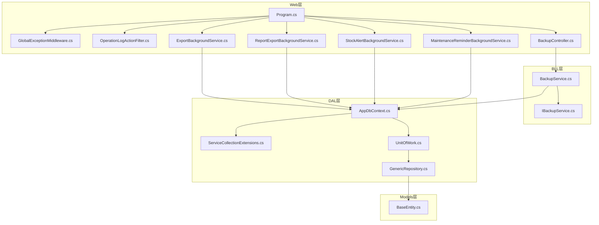
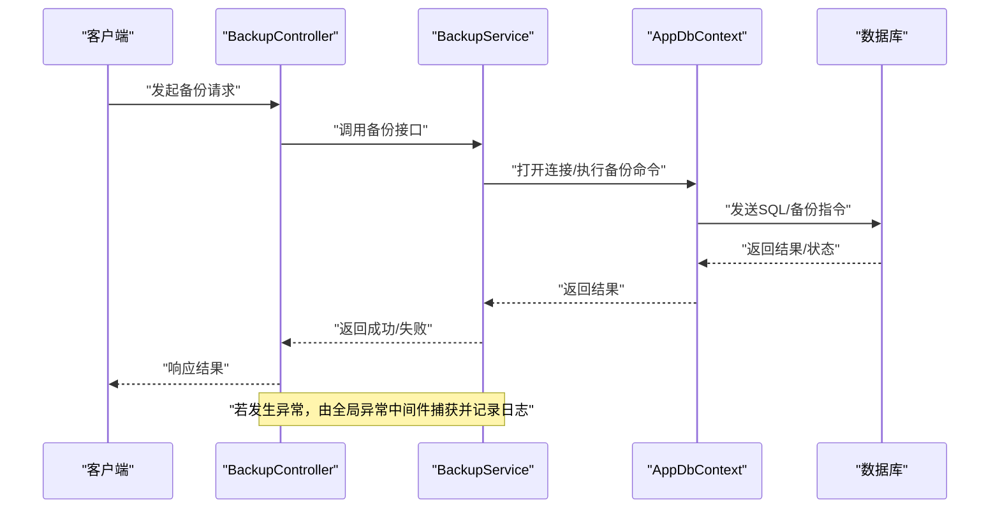
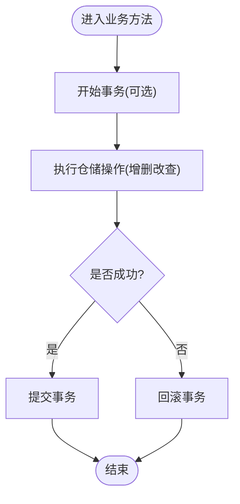
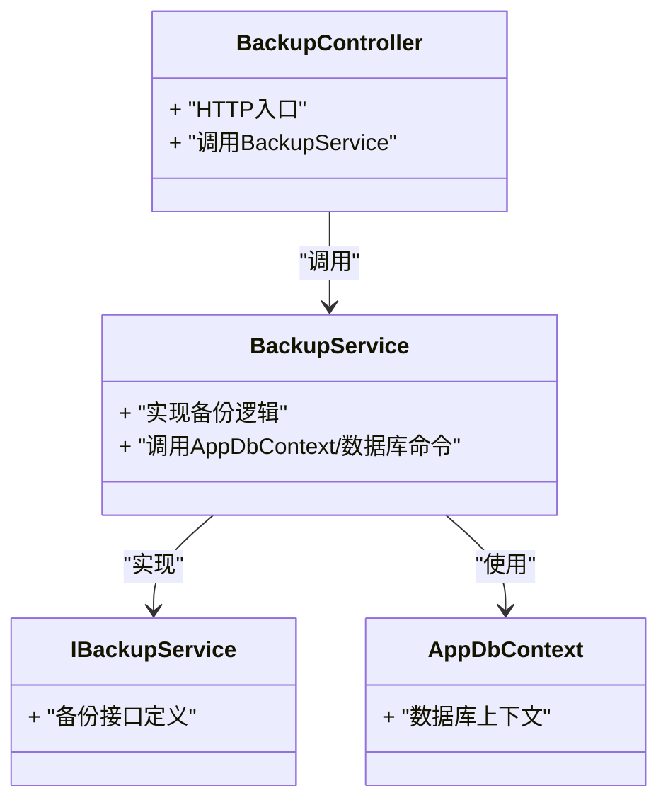
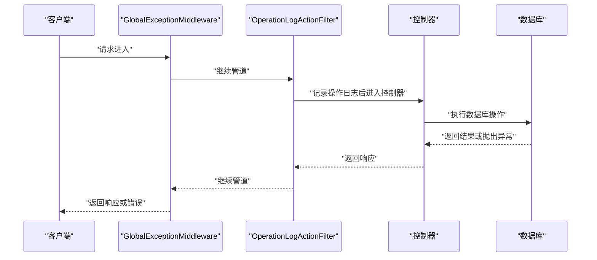
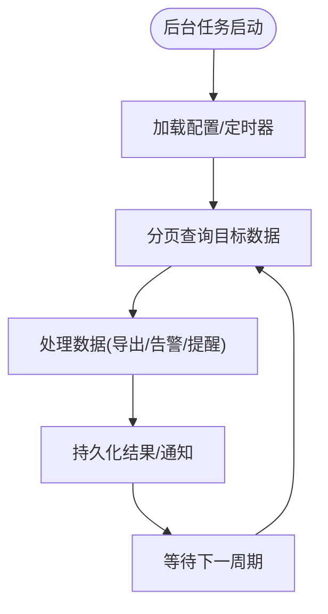
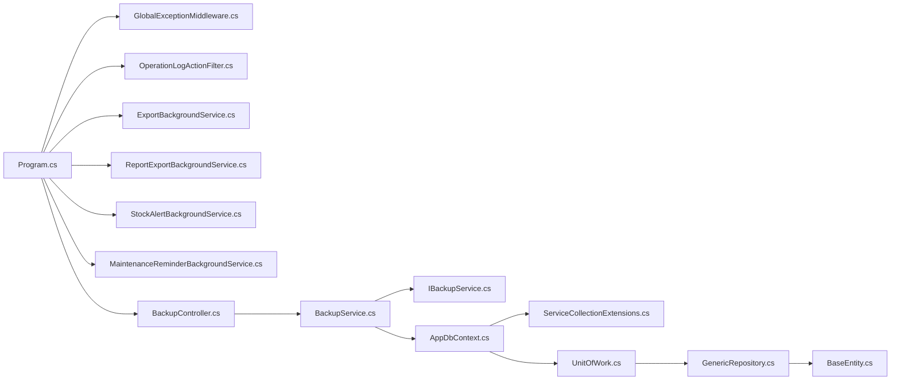
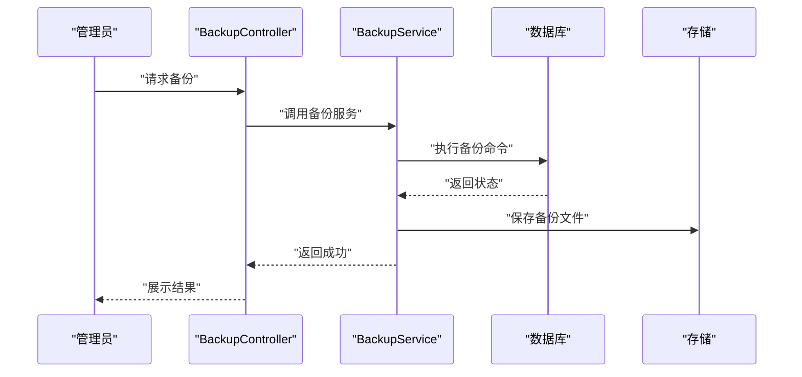

# 数据库故障排查

<cite>
**本文引用的文件**   
- [AppDbContext.cs](file://EquipmentIMS.DAL/AppDbContext.cs)
- [ServiceCollectionExtensions.cs](file://EquipmentIMS.DAL/Extensions/ServiceCollectionExtensions.cs)
- [UnitOfWork.cs](file://EquipmentIMS.DAL/Repositories/UnitOfWork.cs)
- [GenericRepository.cs](file://EquipmentIMS.DAL/Repositories/GenericRepository.cs)
- [BackupService.cs](file://EquipmentIMS.BLL/Services/BackupService.cs)
- [IBackupService.cs](file://EquipmentIMS.BLL/Interfaces/IBackupService.cs)
- [BackupController.cs](file://EquipmentIMS.Web/Controllers/BackupController.cs)
- [Program.cs](file://EquipmentIMS.Web/Program.cs)
- [appsettings.json](file://EquipmentIMS.Web/appsettings.json)
- [GlobalExceptionMiddleware.cs](file://EquipmentIMS.Web/Filters/GlobalExceptionMiddleware.cs)
- [OperationLogActionFilter.cs](file://EquipmentIMS.Web/Filters/OperationLogActionFilter.cs)
- [ExportBackgroundService.cs](file://EquipmentIMS.Web/BackgroundServices/ExportBackgroundService.cs)
- [ReportExportBackgroundService.cs](file://EquipmentIMS.Web/BackgroundServices/ReportExportBackgroundService.cs)
- [StockAlertBackgroundService.cs](file://EquipmentIMS.Web/BackgroundServices/StockAlertBackgroundService.cs)
- [MaintenanceReminderBackgroundService.cs](file://EquipmentIMS.Web/BackgroundServices/MaintenanceReminderBackgroundService.cs)
- [BaseEntity.cs](file://EquipmentIMS.Models/Entities/BaseEntity.cs)
</cite>

## 目录
1. [简介](#简介)
2. [项目结构](#项目结构)
3. [核心组件](#核心组件)
4. [架构总览](#架构总览)
5. [详细组件分析](#详细组件分析)
6. [依赖关系分析](#依赖关系分析)
7. [性能考虑](#性能考虑)
8. [故障排查指南](#故障排查指南)
9. [结论](#结论)
10. [附录](#附录)

## 简介
本指南面向THMS系统的运维与开发人员，聚焦数据库层面的常见问题与排障方法。内容覆盖连接池耗尽、死锁检测、事务超时、EF迁移失败、数据不一致、索引失效等问题的诊断与修复；并提供SQL查询性能分析、执行计划解读、备份恢复操作指导，以及监控指标、容量规划与扩容升级的最佳实践。文档中的流程与配置均以仓库中现有实现为依据，确保可操作性与可追溯性。

## 项目结构
系统采用分层架构：Web层（控制器、中间件、后台服务）调用BLL业务服务，BLL通过DAL的数据访问层（DbContext、仓储、工作单元）访问数据库。关键数据库相关位置如下：
- DAL层：DbContext定义、EF配置、仓储与工作单元
- BLL层：备份服务等业务逻辑
- Web层：启动配置、全局异常处理、操作日志、后台任务
- Models层：实体基类与领域模型

图表来源
- [Program.cs](file://EquipmentIMS.Web/Program.cs)
- [GlobalExceptionMiddleware.cs](file://EquipmentIMS.Web/Filters/GlobalExceptionMiddleware.cs)
- [OperationLogActionFilter.cs](file://EquipmentIMS.Web/Filters/OperationLogActionFilter.cs)
- [ExportBackgroundService.cs](file://EquipmentIMS.Web/BackgroundServices/ExportBackgroundService.cs)
- [ReportExportBackgroundService.cs](file://EquipmentIMS.Web/BackgroundServices/ReportExportBackgroundService.cs)
- [StockAlertBackgroundService.cs](file://EquipmentIMS.Web/BackgroundServices/StockAlertBackgroundService.cs)
- [MaintenanceReminderBackgroundService.cs](file://EquipmentIMS.Web/BackgroundServices/MaintenanceReminderBackgroundService.cs)
- [BackupController.cs](file://EquipmentIMS.Web/Controllers/BackupController.cs)
- [BackupService.cs](file://EquipmentIMS.BLL/Services/BackupService.cs)
- [IBackupService.cs](file://EquipmentIMS.BLL/Interfaces/IBackupService.cs)
- [AppDbContext.cs](file://EquipmentIMS.DAL/AppDbContext.cs)
- [ServiceCollectionExtensions.cs](file://EquipmentIMS.DAL/Extensions/ServiceCollectionExtensions.cs)
- [UnitOfWork.cs](file://EquipmentIMS.DAL/Repositories/UnitOfWork.cs)
- [GenericRepository.cs](file://EquipmentIMS.DAL/Repositories/GenericRepository.cs)
- [BaseEntity.cs](file://EquipmentIMS.Models/Entities/BaseEntity.cs)

章节来源
- [Program.cs](file://EquipmentIMS.Web/Program.cs)
- [AppDbContext.cs](file://EquipmentIMS.DAL/AppDbContext.cs)
- [ServiceCollectionExtensions.cs](file://EquipmentIMS.DAL/Extensions/ServiceCollectionExtensions.cs)
- [UnitOfWork.cs](file://EquipmentIMS.DAL/Repositories/UnitOfWork.cs)
- [GenericRepository.cs](file://EquipmentIMS.DAL/Repositories/GenericRepository.cs)
- [BackupService.cs](file://EquipmentIMS.BLL/Services/BackupService.cs)
- [IBackupService.cs](file://EquipmentIMS.BLL/Interfaces/IBackupService.cs)
- [BackupController.cs](file://EquipmentIMS.Web/Controllers/BackupController.cs)
- [GlobalExceptionMiddleware.cs](file://EquipmentIMS.Web/Filters/GlobalExceptionMiddleware.cs)
- [OperationLogActionFilter.cs](file://EquipmentIMS.Web/Filters/OperationLogActionFilter.cs)
- [ExportBackgroundService.cs](file://EquipmentIMS.Web/BackgroundServices/ExportBackgroundService.cs)
- [ReportExportBackgroundService.cs](file://EquipmentIMS.Web/BackgroundServices/ReportExportBackgroundService.cs)
- [StockAlertBackgroundService.cs](file://EquipmentIMS.Web/BackgroundServices/StockAlertBackgroundService.cs)
- [MaintenanceReminderBackgroundService.cs](file://EquipmentIMS.Web/BackgroundServices/MaintenanceReminderBackgroundService.cs)
- [BaseEntity.cs](file://EquipmentIMS.Models/Entities/BaseEntity.cs)

## 核心组件
- 应用上下文与EF配置
  - AppDbContext：集中管理实体映射、变更追踪、事务边界与连接行为。
  - ServiceCollectionExtensions：在DI容器中注册DbContext及相关服务，便于统一配置连接字符串、命令超时、重试策略等。
- 工作单元与仓储
  - UnitOfWork：封装多个仓储的提交与事务控制，保证跨仓储的一致性。
  - GenericRepository：提供通用CRUD与分页查询能力，减少重复代码。
- 备份服务
  - IBackupService/BackupService：对外暴露备份接口，供控制器或后台任务调用。
- 控制器与中间件
  - BackupController：提供备份操作的HTTP入口。
  - GlobalExceptionMiddleware：捕获未处理异常并记录日志，辅助定位数据库错误。
  - OperationLogActionFilter：记录操作审计日志，便于回溯问题。
- 后台服务
  - ExportBackgroundService、ReportExportBackgroundService、StockAlertBackgroundService、MaintenanceReminderBackgroundService：长期运行的任务，需关注连接占用与事务时长。

章节来源
- [AppDbContext.cs](file://EquipmentIMS.DAL/AppDbContext.cs)
- [ServiceCollectionExtensions.cs](file://EquipmentIMS.DAL/Extensions/ServiceCollectionExtensions.cs)
- [UnitOfWork.cs](file://EquipmentIMS.DAL/Repositories/UnitOfWork.cs)
- [GenericRepository.cs](file://EquipmentIMS.DAL/Repositories/GenericRepository.cs)
- [BackupService.cs](file://EquipmentIMS.BLL/Services/BackupService.cs)
- [IBackupService.cs](file://EquipmentIMS.BLL/Interfaces/IBackupService.cs)
- [BackupController.cs](file://EquipmentIMS.Web/Controllers/BackupController.cs)
- [GlobalExceptionMiddleware.cs](file://EquipmentIMS.Web/Filters/GlobalExceptionMiddleware.cs)
- [OperationLogActionFilter.cs](file://EquipmentIMS.Web/Filters/OperationLogActionFilter.cs)
- [ExportBackgroundService.cs](file://EquipmentIMS.Web/BackgroundServices/ExportBackgroundService.cs)
- [ReportExportBackgroundService.cs](file://EquipmentIMS.Web/BackgroundServices/ReportExportBackgroundService.cs)
- [StockAlertBackgroundService.cs](file://EquipmentIMS.Web/BackgroundServices/StockAlertBackgroundService.cs)
- [MaintenanceReminderBackgroundService.cs](file://EquipmentIMS.Web/BackgroundServices/MaintenanceReminderBackgroundService.cs)

## 架构总览
下图展示了从请求到数据库的关键路径，包括异常处理、操作日志、后台任务与备份流程。

图表来源
- [BackupController.cs](file://EquipmentIMS.Web/Controllers/BackupController.cs)
- [BackupService.cs](file://EquipmentIMS.BLL/Services/BackupService.cs)
- [AppDbContext.cs](file://EquipmentIMS.DAL/AppDbContext.cs)
- [GlobalExceptionMiddleware.cs](file://EquipmentIMS.Web/Filters/GlobalExceptionMiddleware.cs)

## 详细组件分析

### 连接池与事务管理
- 连接池配置
  - 通过ServiceCollectionExtensions在DI中注册DbContext，通常在此处设置连接字符串、最大连接数、命令超时、连接池大小等参数。
  - 建议为不同场景（如导出、报表、常规业务）使用独立连接字符串或命名上下文，避免长事务阻塞短请求。
- 事务边界
  - UnitOfWork统一管理多仓储的提交，应在业务服务层显式开启事务，并在异常时回滚。
  - 后台任务应谨慎使用长事务，必要时拆分为分片批量提交，降低锁竞争与连接占用。

图表来源
- [UnitOfWork.cs](file://EquipmentIMS.DAL/Repositories/UnitOfWork.cs)
- [GenericRepository.cs](file://EquipmentIMS.DAL/Repositories/GenericRepository.cs)
- [ServiceCollectionExtensions.cs](file://EquipmentIMS.DAL/Extensions/ServiceCollectionExtensions.cs)

章节来源
- [ServiceCollectionExtensions.cs](file://EquipmentIMS.DAL/Extensions/ServiceCollectionExtensions.cs)
- [UnitOfWork.cs](file://EquipmentIMS.DAL/Repositories/UnitOfWork.cs)
- [GenericRepository.cs](file://EquipmentIMS.DAL/Repositories/GenericRepository.cs)

### 备份服务与控制器
- 备份接口
  - IBackupService定义备份契约，BackupService实现具体备份逻辑（如调用数据库原生备份命令或导出脚本）。
- 控制器入口
  - BackupController暴露HTTP接口，接收备份请求并委托给服务层。
- 注意事项
  - 备份期间应避免对同一对象进行并发写入；必要时加锁或限制并发。
  - 备份产物需落盘并保留历史版本，定期清理旧备份以释放空间。

图表来源
- [IBackupService.cs](file://EquipmentIMS.BLL/Interfaces/IBackupService.cs)
- [BackupService.cs](file://EquipmentIMS.BLL/Services/BackupService.cs)
- [BackupController.cs](file://EquipmentIMS.Web/Controllers/BackupController.cs)
- [AppDbContext.cs](file://EquipmentIMS.DAL/AppDbContext.cs)

章节来源
- [IBackupService.cs](file://EquipmentIMS.BLL/Interfaces/IBackupService.cs)
- [BackupService.cs](file://EquipmentIMS.BLL/Services/BackupService.cs)
- [BackupController.cs](file://EquipmentIMS.Web/Controllers/BackupController.cs)
- [AppDbContext.cs](file://EquipmentIMS.DAL/AppDbContext.cs)

### 全局异常与操作日志
- 全局异常中间件
  - 捕获未处理异常，记录堆栈与上下文信息，便于快速定位数据库错误。
- 操作日志过滤器
  - 记录用户操作与关键参数，结合异常日志形成完整审计链。

图表来源
- [GlobalExceptionMiddleware.cs](file://EquipmentIMS.Web/Filters/GlobalExceptionMiddleware.cs)
- [OperationLogActionFilter.cs](file://EquipmentIMS.Web/Filters/OperationLogActionFilter.cs)

章节来源
- [GlobalExceptionMiddleware.cs](file://EquipmentIMS.Web/Filters/GlobalExceptionMiddleware.cs)
- [OperationLogActionFilter.cs](file://EquipmentIMS.Web/Filters/OperationLogActionFilter.cs)

### 后台任务与数据库交互
- 导出与报表任务
  - ExportBackgroundService、ReportExportBackgroundService负责大批量数据导出，需注意分页读取与分批写入，避免长时间持有连接。
- 库存预警与维护提醒
  - StockAlertBackgroundService、MaintenanceReminderBackgroundService定时扫描数据并触发告警或提醒，应优化查询条件与索引使用。

图表来源
- [ExportBackgroundService.cs](file://EquipmentIMS.Web/BackgroundServices/ExportBackgroundService.cs)
- [ReportExportBackgroundService.cs](file://EquipmentIMS.Web/BackgroundServices/ReportExportBackgroundService.cs)
- [StockAlertBackgroundService.cs](file://EquipmentIMS.Web/BackgroundServices/StockAlertBackgroundService.cs)
- [MaintenanceReminderBackgroundService.cs](file://EquipmentIMS.Web/BackgroundServices/MaintenanceReminderBackgroundService.cs)

章节来源
- [ExportBackgroundService.cs](file://EquipmentIMS.Web/BackgroundServices/ExportBackgroundService.cs)
- [ReportExportBackgroundService.cs](file://EquipmentIMS.Web/BackgroundServices/ReportExportBackgroundService.cs)
- [StockAlertBackgroundService.cs](file://EquipmentIMS.Web/BackgroundServices/StockAlertBackgroundService.cs)
- [MaintenanceReminderBackgroundService.cs](file://EquipmentIMS.Web/BackgroundServices/MaintenanceReminderBackgroundService.cs)

## 依赖关系分析
- 组件耦合
  - Web层依赖BLL服务与DAL上下文；BLL服务依赖DAL仓储与工作单元；DAL上下文依赖DI扩展配置。
- 外部依赖
  - 数据库驱动、EF Core、日志框架、缓存（如有）、消息队列（如有）。
- 潜在循环依赖
  - 当前分层清晰，未见明显循环引用；需确保仓储不反向依赖控制器或服务。

图表来源
- [Program.cs](file://EquipmentIMS.Web/Program.cs)
- [GlobalExceptionMiddleware.cs](file://EquipmentIMS.Web/Filters/GlobalExceptionMiddleware.cs)
- [OperationLogActionFilter.cs](file://EquipmentIMS.Web/Filters/OperationLogActionFilter.cs)
- [ExportBackgroundService.cs](file://EquipmentIMS.Web/BackgroundServices/ExportBackgroundService.cs)
- [ReportExportBackgroundService.cs](file://EquipmentIMS.Web/BackgroundServices/ReportExportBackgroundService.cs)
- [StockAlertBackgroundService.cs](file://EquipmentIMS.Web/BackgroundServices/StockAlertBackgroundService.cs)
- [MaintenanceReminderBackgroundService.cs](file://EquipmentIMS.Web/BackgroundServices/MaintenanceReminderBackgroundService.cs)
- [BackupController.cs](file://EquipmentIMS.Web/Controllers/BackupController.cs)
- [BackupService.cs](file://EquipmentIMS.BLL/Services/BackupService.cs)
- [IBackupService.cs](file://EquipmentIMS.BLL/Interfaces/IBackupService.cs)
- [AppDbContext.cs](file://EquipmentIMS.DAL/AppDbContext.cs)
- [ServiceCollectionExtensions.cs](file://EquipmentIMS.DAL/Extensions/ServiceCollectionExtensions.cs)
- [UnitOfWork.cs](file://EquipmentIMS.DAL/Repositories/UnitOfWork.cs)
- [GenericRepository.cs](file://EquipmentIMS.DAL/Repositories/GenericRepository.cs)
- [BaseEntity.cs](file://EquipmentIMS.Models/Entities/BaseEntity.cs)

章节来源
- [Program.cs](file://EquipmentIMS.Web/Program.cs)
- [AppDbContext.cs](file://EquipmentIMS.DAL/AppDbContext.cs)
- [ServiceCollectionExtensions.cs](file://EquipmentIMS.DAL/Extensions/ServiceCollectionExtensions.cs)
- [UnitOfWork.cs](file://EquipmentIMS.DAL/Repositories/UnitOfWork.cs)
- [GenericRepository.cs](file://EquipmentIMS.DAL/Repositories/GenericRepository.cs)
- [BackupService.cs](file://EquipmentIMS.BLL/Services/BackupService.cs)
- [IBackupService.cs](file://EquipmentIMS.BLL/Interfaces/IBackupService.cs)
- [BackupController.cs](file://EquipmentIMS.Web/Controllers/BackupController.cs)
- [GlobalExceptionMiddleware.cs](file://EquipmentIMS.Web/Filters/GlobalExceptionMiddleware.cs)
- [OperationLogActionFilter.cs](file://EquipmentIMS.Web/Filters/OperationLogActionFilter.cs)
- [ExportBackgroundService.cs](file://EquipmentIMS.Web/BackgroundServices/ExportBackgroundService.cs)
- [ReportExportBackgroundService.cs](file://EquipmentIMS.Web/BackgroundServices/ReportExportBackgroundService.cs)
- [StockAlertBackgroundService.cs](file://EquipmentIMS.Web/BackgroundServices/StockAlertBackgroundService.cs)
- [MaintenanceReminderBackgroundService.cs](file://EquipmentIMS.Web/BackgroundServices/MaintenanceReminderBackgroundService.cs)
- [BaseEntity.cs](file://EquipmentIMS.Models/Entities/BaseEntity.cs)

## 性能考虑
- 连接池调优
  - 根据并发峰值与平均请求时长估算最小/最大连接数，避免过小导致排队、过大导致资源争用。
  - 区分读写负载，必要时启用只读副本或分离连接字符串。
- 事务与锁
  - 缩短事务范围，避免在事务内执行I/O或外部调用；批量更新分片提交。
  - 合理设计索引以减少锁粒度与锁等待时间。
- 查询优化
  - 使用分页与投影，避免SELECT *；为高频过滤字段建立合适索引。
  - 避免N+1查询，使用Include或JOIN优化。
- 后台任务
  - 控制并发度，使用令牌桶或信号量限流；失败重试与退避策略。
- 监控与告警
  - 采集连接池使用率、慢查询、锁等待、事务超时等指标，设定阈值告警。

[本节为通用指导，无需特定文件来源]

## 故障排查指南

### 连接池耗尽
- 现象
  - 大量请求超时或抛出“无法获取连接”的错误；后台任务堆积。
- 诊断步骤
  - 检查连接池配置与当前使用率（最大连接数、活动连接、等待队列）。
  - 审查长事务与未释放的连接（尤其是后台任务与导出流程）。
  - 查看全局异常日志与操作日志，定位耗时高的接口与SQL。
- 解决措施
  - 调整连接池大小与命令超时；拆分长事务为批处理。
  - 为热点查询添加索引，减少锁竞争。
  - 对导出与报表任务增加并发限制与重试退避。

章节来源
- [ServiceCollectionExtensions.cs](file://EquipmentIMS.DAL/Extensions/ServiceCollectionExtensions.cs)
- [GlobalExceptionMiddleware.cs](file://EquipmentIMS.Web/Filters/GlobalExceptionMiddleware.cs)
- [OperationLogActionFilter.cs](file://EquipmentIMS.Web/Filters/OperationLogActionFilter.cs)
- [ExportBackgroundService.cs](file://EquipmentIMS.Web/BackgroundServices/ExportBackgroundService.cs)
- [ReportExportBackgroundService.cs](file://EquipmentIMS.Web/BackgroundServices/ReportExportBackgroundService.cs)

### 死锁检测
- 现象
  - 偶发超时或死锁错误；数据库日志中出现死锁图。
- 诊断步骤
  - 启用死锁跟踪与扩展事件，捕获死锁XML。
  - 分析死锁涉及的表与索引，识别冲突的更新顺序。
  - 结合操作日志与异常日志，还原调用链与事务边界。
- 解决措施
  - 统一更新顺序，避免交叉锁定；缩小事务范围。
  - 优化索引，减少锁范围；必要时引入乐观锁或版本号字段。
  - 将高冲突操作移至低峰时段或异步队列。

章节来源
- [UnitOfWork.cs](file://EquipmentIMS.DAL/Repositories/UnitOfWork.cs)
- [GenericRepository.cs](file://EquipmentIMS.DAL/Repositories/GenericRepository.cs)
- [GlobalExceptionMiddleware.cs](file://EquipmentIMS.Web/Filters/GlobalExceptionMiddleware.cs)
- [OperationLogActionFilter.cs](file://EquipmentIMS.Web/Filters/OperationLogActionFilter.cs)

### 事务超时
- 现象
  - 事务执行超过配置的超时时间被终止；部分更新未生效。
- 诊断步骤
  - 检查命令超时与事务超时配置；定位耗时SQL。
  - 分析事务内的I/O与外部调用，评估是否必要。
- 解决措施
  - 提升超时阈值（谨慎），优先优化SQL与索引。
  - 拆分大事务为小批次提交；避免在事务中执行网络请求。

章节来源
- [ServiceCollectionExtensions.cs](file://EquipmentIMS.DAL/Extensions/ServiceCollectionExtensions.cs)
- [UnitOfWork.cs](file://EquipmentIMS.DAL/Repositories/UnitOfWork.cs)
- [GenericRepository.cs](file://EquipmentIMS.DAL/Repositories/GenericRepository.cs)

### EF迁移失败
- 现象
  - 运行迁移时报错（如列已存在、约束冲突、数据类型不匹配）。
- 诊断步骤
  - 查看迁移脚本与实际数据库差异；确认目标环境版本一致。
  - 检查迁移依赖与种子数据脚本的执行顺序。
- 解决措施
  - 先在小环境验证迁移；生产环境采用灰度发布与回滚预案。
  - 对破坏性变更（如删除列）采用分阶段迁移与数据清洗脚本。

章节来源
- [AppDbContext.cs](file://EquipmentIMS.DAL/AppDbContext.cs)
- [ServiceCollectionExtensions.cs](file://EquipmentIMS.DAL/Extensions/ServiceCollectionExtensions.cs)

### 数据不一致
- 现象
  - 主从或缓存与数据库不一致；统计报表与明细不符。
- 诊断步骤
  - 核对事务边界与提交时机；检查是否有绕过仓储的直接SQL。
  - 对比审计日志与数据库快照，定位不一致点。
- 解决措施
  - 统一数据写入路径，强制通过仓储与工作单元提交。
  - 引入一致性校验任务，定期比对关键指标。

章节来源
- [UnitOfWork.cs](file://EquipmentIMS.DAL/Repositories/UnitOfWork.cs)
- [GenericRepository.cs](file://EquipmentIMS.DAL/Repositories/GenericRepository.cs)
- [OperationLogActionFilter.cs](file://EquipmentIMS.Web/Filters/OperationLogActionFilter.cs)

### 索引失效
- 现象
  - 查询变慢，全表扫描增多；CPU与IO升高。
- 诊断步骤
  - 收集慢查询与执行计划，识别缺失或失效索引。
  - 检查统计信息是否过期，重建或更新统计信息。
- 解决措施
  - 为高频过滤与排序字段创建合适索引；避免函数包裹列导致索引失效。
  - 定期维护索引碎片，重建或重组。

章节来源
- [GenericRepository.cs](file://EquipmentIMS.DAL/Repositories/GenericRepository.cs)
- [AppDbContext.cs](file://EquipmentIMS.DAL/AppDbContext.cs)

### SQL查询性能分析与执行计划解读
- 步骤
  - 启用慢查询日志与执行计划收集。
  - 分析执行计划中的扫描类型、索引使用、预估行数与实际行数偏差。
  - 针对高成本节点优化SQL或索引。
- 工具
  - 数据库自带执行计划工具；结合应用日志与异常中间件输出定位问题。

章节来源
- [GlobalExceptionMiddleware.cs](file://EquipmentIMS.Web/Filters/GlobalExceptionMiddleware.cs)
- [OperationLogActionFilter.cs](file://EquipmentIMS.Web/Filters/OperationLogActionFilter.cs)

### 数据库备份与恢复
- 备份流程
  - 通过BackupController触发备份，BackupService执行备份逻辑，产物落盘并记录历史。
- 恢复流程
  - 选择最近可用备份；在隔离环境验证恢复；再切换至生产。
- 注意事项
  - 备份期间限制并发写入；保留多版本备份并定期清理。

图表来源
- [BackupController.cs](file://EquipmentIMS.Web/Controllers/BackupController.cs)
- [BackupService.cs](file://EquipmentIMS.BLL/Services/BackupService.cs)
- [IBackupService.cs](file://EquipmentIMS.BLL/Interfaces/IBackupService.cs)

章节来源
- [BackupController.cs](file://EquipmentIMS.Web/Controllers/BackupController.cs)
- [BackupService.cs](file://EquipmentIMS.BLL/Services/BackupService.cs)
- [IBackupService.cs](file://EquipmentIMS.BLL/Interfaces/IBackupService.cs)

### 监控指标与容量规划
- 监控指标
  - 连接池使用率、活跃连接、等待队列长度
  - 慢查询数量与平均耗时
  - 锁等待与死锁次数
  - 事务超时次数
  - 磁盘使用率与增长趋势
- 容量规划
  - 基于业务峰值与增长率估算存储与计算资源
  - 预留冗余空间用于索引重建与备份保留
- 扩容升级
  - 水平扩展：读写分离、分库分表
  - 垂直扩展：提升CPU/内存/IO
  - 滚动升级与灰度发布，确保零停机

[本节为通用指导，无需特定文件来源]

## 结论
通过对连接池、事务、死锁、迁移、数据一致性、索引与备份恢复的系统化排查与优化，可有效提升THMS系统的数据库稳定性与性能。建议结合监控指标与容量规划，持续迭代优化，确保在高并发与大数据量场景下的可靠运行。

[本节为总结，无需特定文件来源]

## 附录
- 常用配置项参考
  - 连接字符串、最大连接数、命令超时、连接池大小
  - 事务超时、重试策略、日志级别
- 最佳实践清单
  - 明确事务边界，避免长事务
  - 合理使用索引与分页
  - 后台任务限流与重试
  - 备份与恢复演练常态化

[本节为补充说明，无需特定文件来源]