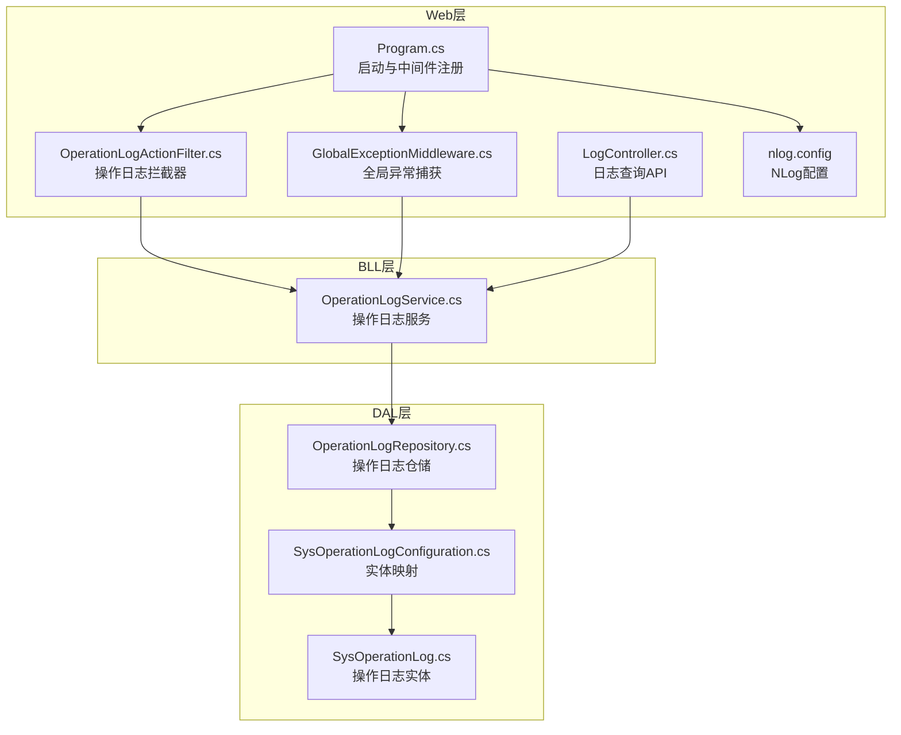
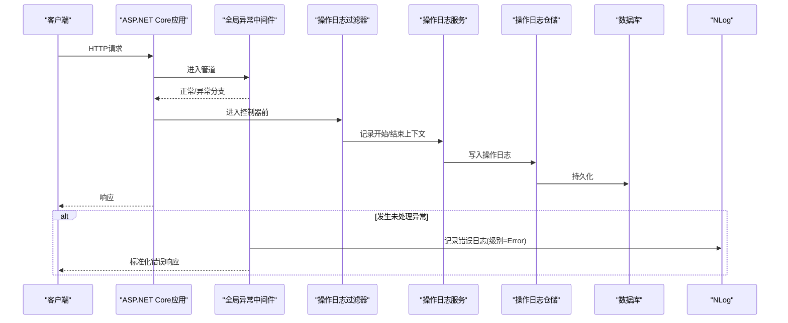
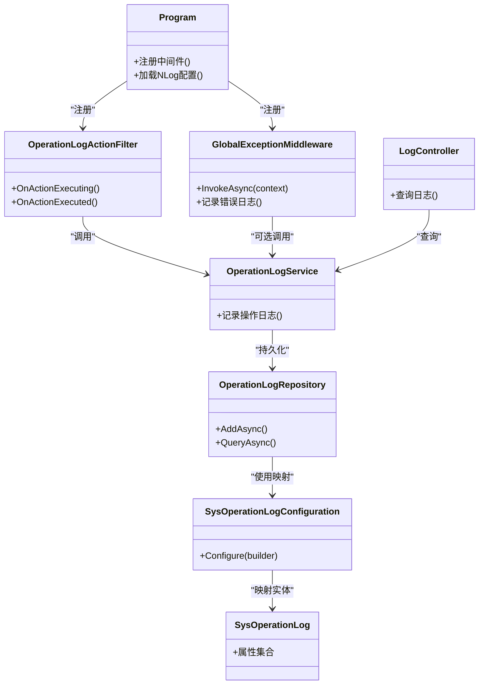

# 日志分析方法

<cite>
**本文引用的文件**   
- [nlog.config](file://EquipmentIMS.Web/nlog.config)
- [Program.cs](file://EquipmentIMS.Web/Program.cs)
- [appsettings.json](file://EquipmentIMS.Web/appsettings.json)
- [OperationLogService.cs](file://EquipmentIMS.BLL/Services/OperationLogService.cs)
- [OperationLogRepository.cs](file://EquipmentIMS.DAL/Repositories/OperationLogRepository.cs)
- [SysOperationLogConfiguration.cs](file://EquipmentIMS.DAL/Configurations/SysOperationLogConfiguration.cs)
- [SysOperationLog.cs](file://EquipmentIMS.Models/Entities/SysOperationLog.cs)
- [GlobalExceptionMiddleware.cs](file://EquipmentIMS.Web/Filters/GlobalExceptionMiddleware.cs)
- [OperationLogActionFilter.cs](file://EquipmentIMS.Web/Filters/OperationLogActionFilter.cs)
- [LogController.cs](file://EquipmentIMS.Web/Controllers/LogController.cs)
</cite>

## 目录
1. [简介](#简介)
2. [项目结构](#项目结构)
3. [核心组件](#核心组件)
4. [架构总览](#架构总览)
5. [详细组件分析](#详细组件分析)
6. [依赖关系分析](#依赖关系分析)
7. [性能与存储优化](#性能与存储优化)
8. [故障排查指南](#故障排查指南)
9. [结论](#结论)
10. [附录](#附录)

## 简介
本指南面向THMS系统的运维与开发人员，系统化说明NLog配置结构、日志级别设置、日志轮转策略；定义操作日志、错误日志、性能日志的记录规范与查询方法；提供日志文件位置、格式解析、关键字搜索技巧；并给出日志聚合分析、异常模式识别、安全审计监控的方法，以及性能优化、存储管理与远程收集的配置方案。

## 项目结构
THMS采用分层架构：Web层负责HTTP请求处理、全局异常捕获与操作日志拦截；BLL层封装业务逻辑与操作日志服务；DAL层通过EF Core将操作日志持久化到数据库；NLog作为统一日志框架，负责结构化输出、轮转与可选的远程收集。

图表来源
- [Program.cs](file://EquipmentIMS.Web/Program.cs)
- [GlobalExceptionMiddleware.cs](file://EquipmentIMS.Web/Filters/GlobalExceptionMiddleware.cs)
- [OperationLogActionFilter.cs](file://EquipmentIMS.Web/Filters/OperationLogActionFilter.cs)
- [nlog.config](file://EquipmentIMS.Web/nlog.config)
- [OperationLogService.cs](file://EquipmentIMS.BLL/Services/OperationLogService.cs)
- [OperationLogRepository.cs](file://EquipmentIMS.DAL/Repositories/OperationLogRepository.cs)
- [SysOperationLogConfiguration.cs](file://EquipmentIMS.DAL/Configurations/SysOperationLogConfiguration.cs)
- [SysOperationLog.cs](file://EquipmentIMS.Models/Entities/SysOperationLog.cs)

章节来源
- [Program.cs](file://EquipmentIMS.Web/Program.cs)
- [nlog.config](file://EquipmentIMS.Web/nlog.config)

## 核心组件
- NLog配置中心：集中管理目标（文件、控制台、远程）、规则（按级别路由）、布局（字段与格式）。
- 全局异常中间件：捕获未处理异常，记录错误日志并返回标准化响应。
- 操作日志过滤器：在控制器动作前后采集上下文信息，调用服务写入操作日志。
- 操作日志服务与仓储：封装写入逻辑，持久化至数据库表。
- 日志查询接口：对外暴露查询能力，便于前端或外部系统检索。

章节来源
- [nlog.config](file://EquipmentIMS.Web/nlog.config)
- [GlobalExceptionMiddleware.cs](file://EquipmentIMS.Web/Filters/GlobalExceptionMiddleware.cs)
- [OperationLogActionFilter.cs](file://EquipmentIMS.Web/Filters/OperationLogActionFilter.cs)
- [OperationLogService.cs](file://EquipmentIMS.BLL/Services/OperationLogService.cs)
- [OperationLogRepository.cs](file://EquipmentIMS.DAL/Repositories/OperationLogRepository.cs)
- [SysOperationLogConfiguration.cs](file://EquipmentIMS.DAL/Configurations/SysOperationLogConfiguration.cs)
- [SysOperationLog.cs](file://EquipmentIMS.Models/Entities/SysOperationLog.cs)
- [LogController.cs](file://EquipmentIMS.Web/Controllers/LogController.cs)

## 架构总览
下图展示从请求进入、异常捕获、操作日志记录到持久化的完整链路，以及NLog在其中的角色。

图表来源
- [Program.cs](file://EquipmentIMS.Web/Program.cs)
- [GlobalExceptionMiddleware.cs](file://EquipmentIMS.Web/Filters/GlobalExceptionMiddleware.cs)
- [OperationLogActionFilter.cs](file://EquipmentIMS.Web/Filters/OperationLogActionFilter.cs)
- [OperationLogService.cs](file://EquipmentIMS.BLL/Services/OperationLogService.cs)
- [OperationLogRepository.cs](file://EquipmentIMS.DAL/Repositories/OperationLogRepository.cs)
- [SysOperationLogConfiguration.cs](file://EquipmentIMS.DAL/Configurations/SysOperationLogConfiguration.cs)
- [SysOperationLog.cs](file://EquipmentIMS.Models/Entities/SysOperationLog.cs)
- [nlog.config](file://EquipmentIMS.Web/nlog.config)

## 详细组件分析

### NLog配置结构与日志级别
- 目标(Targets)
  - 文件目标：用于本地磁盘落盘，支持按日期/大小轮转、保留天数、压缩等。
  - 控制台目标：开发调试时快速查看。
  - 远程目标（可选）：通过HTTP/UDP等协议发送到远端收集器。
- 规则(Rules)
  - 按日志级别路由：Trace/Debug/Info/Warn/Error/Fatal分别指向不同目标或合并输出。
  - 按命名空间过滤：仅对特定模块启用高详细度日志。
- 布局(Layout)
  - 结构化字段：时间戳、级别、消息、线程ID、用户标识、IP、请求路径、耗时、堆栈等。
  - 可配置JSON或文本格式，便于后续解析与聚合。

建议实践
- 生产环境默认Info及以上级别，按需开启Debug/Trace。
- 错误与致命级别必须同时落盘与上报。
- 使用环境变量或配置文件动态调整级别与目标。

章节来源
- [nlog.config](file://EquipmentIMS.Web/nlog.config)
- [appsettings.json](file://EquipmentIMS.Web/appsettings.json)

### 日志轮转策略
- 基于时间的轮转：按天/小时生成文件，便于按时间段检索。
- 基于大小的轮转：单文件超过阈值自动切换新文件。
- 保留策略：按数量或天数清理历史文件，避免磁盘占满。
- 压缩归档：对过期文件进行压缩以节省空间。

章节来源
- [nlog.config](file://EquipmentIMS.Web/nlog.config)

### 操作日志记录规范与查询
- 记录时机
  - 请求进入：记录用户、IP、方法、URL、参数摘要、开始时间。
  - 请求完成：记录结果状态码、耗时、结束时间。
  - 关键业务点：记录关键步骤与变更摘要。
- 数据模型
  - 实体包含：用户标识、操作类型、资源标识、请求详情、结果、耗时、异常信息等。
- 持久化
  - 通过仓储写入数据库，便于分页、筛选与关联查询。
- 查询方式
  - 通过日志查询接口按时间范围、用户、操作类型、状态码、关键词检索。
  - 结合NLog文件日志进行关键字搜索与正则匹配。

章节来源
- [OperationLogActionFilter.cs](file://EquipmentIMS.Web/Filters/OperationLogActionFilter.cs)
- [OperationLogService.cs](file://EquipmentIMS.BLL/Services/OperationLogService.cs)
- [OperationLogRepository.cs](file://EquipmentIMS.DAL/Repositories/OperationLogRepository.cs)
- [SysOperationLogConfiguration.cs](file://EquipmentIMS.DAL/Configurations/SysOperationLogConfiguration.cs)
- [SysOperationLog.cs](file://EquipmentIMS.Models/Entities/SysOperationLog.cs)
- [LogController.cs](file://EquipmentIMS.Web/Controllers/LogController.cs)

### 错误日志记录规范与查询
- 触发点
  - 全局异常中间件捕获未处理异常，记录错误级别日志。
- 内容要求
  - 异常类型、消息、堆栈、请求上下文（用户、IP、URL、参数摘要）。
- 查询方式
  - 通过NLog文件日志按级别筛选Error/Fatal。
  - 通过数据库操作日志关联异常信息字段进行检索。

章节来源
- [GlobalExceptionMiddleware.cs](file://EquipmentIMS.Web/Filters/GlobalExceptionMiddleware.cs)
- [nlog.config](file://EquipmentIMS.Web/nlog.config)

### 性能日志记录规范与查询
- 指标
  - 请求耗时、慢请求阈值告警、数据库访问耗时、缓存命中率等。
- 实现建议
  - 在过滤器或中间件中计算耗时并记录Info/Debug级别日志。
  - 对慢请求单独标记Warn级别以便快速定位。
- 查询方式
  - 按耗时阈值筛选，结合用户与接口维度分析瓶颈。

章节来源
- [OperationLogActionFilter.cs](file://EquipmentIMS.Web/Filters/OperationLogActionFilter.cs)
- [nlog.config](file://EquipmentIMS.Web/nlog.config)

### 安全审计日志监控
- 关注事件
  - 登录成功/失败、权限拒绝、密码修改、敏感数据访问。
- 记录要点
  - 用户标识、源IP、操作类型、结果、风险等级。
- 监控方法
  - 实时告警：当连续失败登录次数超过阈值时触发告警。
  - 定期报表：统计高风险操作与异常行为趋势。

章节来源
- [OperationLogActionFilter.cs](file://EquipmentIMS.Web/Filters/OperationLogActionFilter.cs)
- [GlobalExceptionMiddleware.cs](file://EquipmentIMS.Web/Filters/GlobalExceptionMiddleware.cs)
- [LogController.cs](file://EquipmentIMS.Web/Controllers/LogController.cs)

## 依赖关系分析
- 低耦合设计
  - Web层通过过滤器与服务解耦，服务再依赖仓储，仓储依赖EF Core配置与实体。
- 外部依赖
  - NLog作为日志基础设施，独立于业务逻辑，可通过配置灵活扩展目标与规则。
- 潜在循环依赖
  - 当前分层清晰，未见循环引用；确保过滤器不直接依赖仓储，避免跨层调用。

图表来源
- [Program.cs](file://EquipmentIMS.Web/Program.cs)
- [GlobalExceptionMiddleware.cs](file://EquipmentIMS.Web/Filters/GlobalExceptionMiddleware.cs)
- [OperationLogActionFilter.cs](file://EquipmentIMS.Web/Filters/OperationLogActionFilter.cs)
- [OperationLogService.cs](file://EquipmentIMS.BLL/Services/OperationLogService.cs)
- [OperationLogRepository.cs](file://EquipmentIMS.DAL/Repositories/OperationLogRepository.cs)
- [SysOperationLogConfiguration.cs](file://EquipmentIMS.DAL/Configurations/SysOperationLogConfiguration.cs)
- [SysOperationLog.cs](file://EquipmentIMS.Models/Entities/SysOperationLog.cs)
- [LogController.cs](file://EquipmentIMS.Web/Controllers/LogController.cs)

章节来源
- [Program.cs](file://EquipmentIMS.Web/Program.cs)
- [OperationLogService.cs](file://EquipmentIMS.BLL/Services/OperationLogService.cs)
- [OperationLogRepository.cs](file://EquipmentIMS.DAL/Repositories/OperationLogRepository.cs)
- [SysOperationLogConfiguration.cs](file://EquipmentIMS.DAL/Configurations/SysOperationLogConfiguration.cs)
- [SysOperationLog.cs](file://EquipmentIMS.Models/Entities/SysOperationLog.cs)
- [LogController.cs](file://EquipmentIMS.Web/Controllers/LogController.cs)

## 性能与存储优化
- 异步写入
  - 使用NLog异步目标减少IO阻塞，提升吞吐。
- 批量持久化
  - 操作日志仓储可采用批量插入降低数据库压力。
- 分级输出
  - 生产默认Info，仅在问题复现时临时开启Debug/Trace。
- 轮转与保留
  - 合理设置文件大小与保留天数，避免磁盘爆满。
- 远程收集
  - 通过HTTP/UDP目标将日志发送至集中式收集器（如Elasticsearch、Splunk），配合索引与告警。
- 结构化日志
  - 使用JSON布局，便于解析与聚合分析。

章节来源
- [nlog.config](file://EquipmentIMS.Web/nlog.config)
- [OperationLogRepository.cs](file://EquipmentIMS.DAL/Repositories/OperationLogRepository.cs)

## 故障排查指南
- 常见问题
  - 日志未落盘：检查NLog目标与规则配置、权限与路径。
  - 轮转失效：确认文件大小与保留策略是否生效。
  - 操作日志缺失：验证过滤器是否注册、服务是否正确注入。
  - 错误日志无堆栈：检查异常捕获中间件是否覆盖所有管道。
- 定位步骤
  - 先查NLog文件日志定位错误级别条目。
  - 再通过数据库操作日志关联用户与请求上下文。
  - 必要时临时提高级别并复现问题。
- 关键字搜索技巧
  - 使用“错误”、“异常”、“超时”、“拒绝”等关键词快速筛选。
  - 结合用户ID、IP、接口路径进行多维过滤。

章节来源
- [GlobalExceptionMiddleware.cs](file://EquipmentIMS.Web/Filters/GlobalExceptionMiddleware.cs)
- [OperationLogActionFilter.cs](file://EquipmentIMS.Web/Filters/OperationLogActionFilter.cs)
- [nlog.config](file://EquipmentIMS.Web/nlog.config)

## 结论
通过统一的NLog配置、严格的操作与错误日志规范、完善的轮转与远程收集策略，THMS实现了可观测、可追溯、可扩展的日志体系。结合结构化输出与集中式聚合，能够快速定位问题、识别异常模式并满足安全审计需求。

## 附录
- 日志文件位置
  - 本地文件：由NLog文件目标配置决定，通常位于应用运行目录下的logs子目录。
  - 数据库：操作日志持久化至SysOperationLog表。
- 格式解析
  - JSON布局：使用标准JSON解析库读取字段。
  - 文本布局：使用正则表达式提取关键字段。
- 查询示例思路
  - 按时间范围+用户+操作类型筛选。
  - 按错误级别+关键字组合检索。
  - 按耗时阈值筛选慢请求。

章节来源
- [nlog.config](file://EquipmentIMS.Web/nlog.config)
- [SysOperationLog.cs](file://EquipmentIMS.Models/Entities/SysOperationLog.cs)
- [LogController.cs](file://EquipmentIMS.Web/Controllers/LogController.cs)