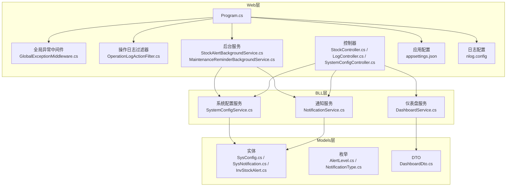
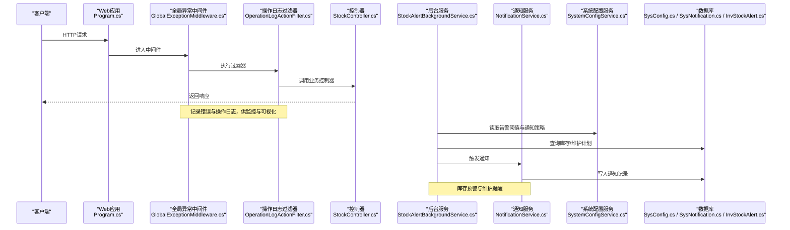
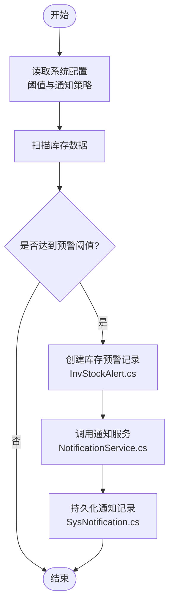
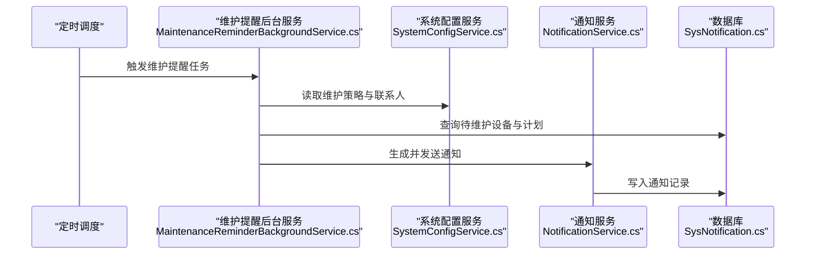
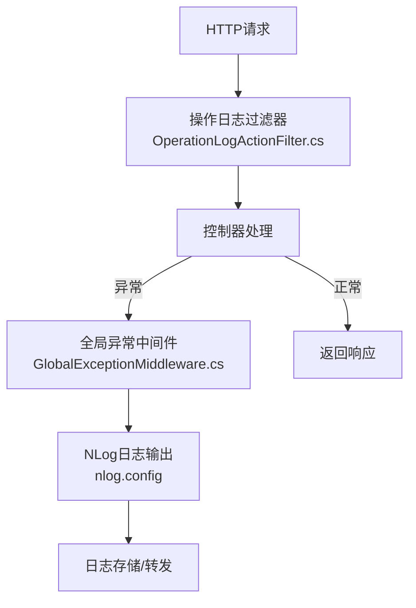
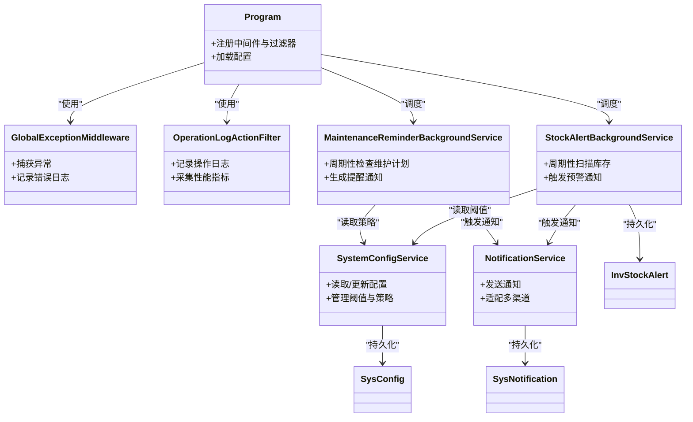

# 系统监控告警

<cite>
**本文引用的文件**   
- [Program.cs](file://EquipmentIMS.Web/Program.cs)
- [appsettings.json](file://EquipmentIMS.Web/appsettings.json)
- [nlog.config](file://EquipmentIMS.Web/nlog.config)
- [GlobalExceptionMiddleware.cs](file://EquipmentIMS.Web/Filters/GlobalExceptionMiddleware.cs)
- [OperationLogActionFilter.cs](file://EquipmentIMS.Web/Filters/OperationLogActionFilter.cs)
- [StockAlertBackgroundService.cs](file://EquipmentIMS.Web/BackgroundServices/StockAlertBackgroundService.cs)
- [MaintenanceReminderBackgroundService.cs](file://EquipmentIMS.Web/BackgroundServices/MaintenanceReminderBackgroundService.cs)
- [NotificationService.cs](file://EquipmentIMS.BLL/Services/NotificationService.cs)
- [INotificationService.cs](file://EquipmentIMS.BLL/Interfaces/INotificationService.cs)
- [SystemConfigService.cs](file://EquipmentIMS.BLL/Services/SystemConfigService.cs)
- [ISystemConfigService.cs](file://EquipmentIMS.BLL/Interfaces/ISystemConfigService.cs)
- [SysConfig.cs](file://EquipmentIMS.Models/Entities/SysConfig.cs)
- [SysNotification.cs](file://EquipmentIMS.Models/Entities/SysNotification.cs)
- [InvStockAlert.cs](file://EquipmentIMS.Models/Entities/InvStockAlert.cs)
- [AlertLevel.cs](file://EquipmentIMS.Models/Enums/AlertLevel.cs)
- [NotificationType.cs](file://EquipmentIMS.Models/Enums/NotificationType.cs)
- [StockController.cs](file://EquipmentIMS.Web/Controllers/StockController.cs)
- [LogController.cs](file://EquipmentIMS.Web/Controllers/LogController.cs)
- [SystemConfigController.cs](file://EquipmentIMS.Web/Controllers/SystemConfigController.cs)
- [DashboardService.cs](file://EquipmentIMS.BLL/Services/DashboardService.cs)
- [IDashboardService.cs](file://EquipmentIMS.BLL/Interfaces/IDashboardService.cs)
- [DashboardDto.cs](file://EquipmentIMS.Models/DTOs/DashboardDto.cs)
</cite>

## 目录
1. [简介](#简介)
2. [项目结构](#项目结构)
3. [核心组件](#核心组件)
4. [架构总览](#架构总览)
5. [详细组件分析](#详细组件分析)
6. [依赖关系分析](#依赖关系分析)
7. [性能考虑](#性能考虑)
8. [故障排查指南](#故障排查指南)
9. [结论](#结论)
10. [附录](#附录)

## 简介
本指南面向THMS（设备库存管理系统）的监控与告警配置，覆盖以下目标：
- 系统健康检查与服务可用性监控
- 资源使用率监控
- 库存预警、维护提醒、系统告警的通知机制与阈值设置
- 日志监控、错误率统计、性能指标的可视化展示方案
- 告警规则配置、通知渠道集成、监控数据存储实现指导
- 监控系统的高可用部署与扩展方案

本指南基于仓库现有代码与配置进行说明，并提供可操作的步骤与图示。

## 项目结构
THMS采用分层架构：Web层提供HTTP接口与后台任务；BLL层封装业务逻辑；DAL层负责数据访问；Models层定义实体、枚举与DTO。监控与告警相关能力主要分布在Web层的中间件、过滤器、后台服务与控制器中，并通过BLL的服务与Models中的实体完成持久化与通知。

图表来源
- [Program.cs](file://EquipmentIMS.Web/Program.cs)
- [GlobalExceptionMiddleware.cs](file://EquipmentIMS.Web/Filters/GlobalExceptionMiddleware.cs)
- [OperationLogActionFilter.cs](file://EquipmentIMS.Web/Filters/OperationLogActionFilter.cs)
- [StockAlertBackgroundService.cs](file://EquipmentIMS.Web/BackgroundServices/StockAlertBackgroundService.cs)
- [MaintenanceReminderBackgroundService.cs](file://EquipmentIMS.Web/BackgroundServices/MaintenanceReminderBackgroundService.cs)
- [NotificationService.cs](file://EquipmentIMS.BLL/Services/NotificationService.cs)
- [SystemConfigService.cs](file://EquipmentIMS.BLL/Services/SystemConfigService.cs)
- [DashboardService.cs](file://EquipmentIMS.BLL/Services/DashboardService.cs)
- [SysConfig.cs](file://EquipmentIMS.Models/Entities/SysConfig.cs)
- [SysNotification.cs](file://EquipmentIMS.Models/Entities/SysNotification.cs)
- [InvStockAlert.cs](file://EquipmentIMS.Models/Entities/InvStockAlert.cs)
- [AlertLevel.cs](file://EquipmentIMS.Models/Enums/AlertLevel.cs)
- [NotificationType.cs](file://EquipmentIMS.Models/Enums/NotificationType.cs)
- [DashboardDto.cs](file://EquipmentIMS.Models/DTOs/DashboardDto.cs)

章节来源
- [Program.cs](file://EquipmentIMS.Web/Program.cs)
- [appsettings.json](file://EquipmentIMS.Web/appsettings.json)
- [nlog.config](file://EquipmentIMS.Web/nlog.config)

## 核心组件
- 全局异常中间件：捕获未处理异常，统一记录错误日志并返回标准化响应，便于错误率统计与可视化。
- 操作日志过滤器：在请求进入与退出时记录关键信息，支撑审计与性能指标采集。
- 库存预警后台服务：周期性扫描库存状态，触发库存预警通知与持久化。
- 维护提醒后台服务：根据维护计划生成提醒通知。
- 通知服务：抽象通知发送能力，支持多种渠道（如站内消息、邮件等），通过配置驱动。
- 系统配置服务：读写系统配置项，用于动态调整告警阈值、通知策略等。
- 仪表盘服务：聚合关键指标，为前端可视化提供数据。

章节来源
- [GlobalExceptionMiddleware.cs](file://EquipmentIMS.Web/Filters/GlobalExceptionMiddleware.cs)
- [OperationLogActionFilter.cs](file://EquipmentIMS.Web/Filters/OperationLogActionFilter.cs)
- [StockAlertBackgroundService.cs](file://EquipmentIMS.Web/BackgroundServices/StockAlertBackgroundService.cs)
- [MaintenanceReminderBackgroundService.cs](file://EquipmentIMS.Web/BackgroundServices/MaintenanceReminderBackgroundService.cs)
- [NotificationService.cs](file://EquipmentIMS.BLL/Services/NotificationService.cs)
- [INotificationService.cs](file://EquipmentIMS.BLL/Interfaces/INotificationService.cs)
- [SystemConfigService.cs](file://EquipmentIMS.BLL/Services/SystemConfigService.cs)
- [ISystemConfigService.cs](file://EquipmentIMS.BLL/Interfaces/ISystemConfigService.cs)
- [DashboardService.cs](file://EquipmentIMS.BLL/Services/DashboardService.cs)
- [IDashboardService.cs](file://EquipmentIMS.BLL/Interfaces/IDashboardService.cs)

## 架构总览
下图展示了从请求到监控、告警、通知与可视化的整体流程。

图表来源
- [Program.cs](file://EquipmentIMS.Web/Program.cs)
- [GlobalExceptionMiddleware.cs](file://EquipmentIMS.Web/Filters/GlobalExceptionMiddleware.cs)
- [OperationLogActionFilter.cs](file://EquipmentIMS.Web/Filters/OperationLogActionFilter.cs)
- [StockController.cs](file://EquipmentIMS.Web/Controllers/StockController.cs)
- [StockAlertBackgroundService.cs](file://EquipmentIMS.Web/BackgroundServices/StockAlertBackgroundService.cs)
- [NotificationService.cs](file://EquipmentIMS.BLL/Services/NotificationService.cs)
- [SystemConfigService.cs](file://EquipmentIMS.BLL/Services/SystemConfigService.cs)
- [SysConfig.cs](file://EquipmentIMS.Models/Entities/SysConfig.cs)
- [SysNotification.cs](file://EquipmentIMS.Models/Entities/SysNotification.cs)
- [InvStockAlert.cs](file://EquipmentIMS.Models/Entities/InvStockAlert.cs)

## 详细组件分析

### 健康检查与服务可用性监控
- 健康检查入口：在程序启动阶段注册中间件与端点，暴露健康检查API，供外部探针或负载均衡器探测。
- 服务可用性：通过健康检查端点的成功/失败状态判断服务是否可用；结合错误率与响应时间指标评估服务质量。
- 配置要点：在应用配置文件中启用健康检查模块，并根据环境差异调整超时与重试策略。

章节来源
- [Program.cs](file://EquipmentIMS.Web/Program.cs)
- [appsettings.json](file://EquipmentIMS.Web/appsettings.json)

### 资源使用率监控
- 指标采集：建议采集CPU、内存、磁盘I/O、网络I/O等系统级指标，以及进程级指标（线程数、GC次数）。
- 存储与可视化：将指标写入时序数据库（如InfluxDB/Prometheus），并使用Grafana进行可视化展示。
- 集成方式：在Web应用中引入指标收集库，定期上报；或通过Sidecar模式采集宿主主机指标。

[本节为通用指导，不直接分析具体文件]

### 库存预警与阈值设置
- 触发条件：当库存低于安全阈值或超过上限时触发预警。
- 阈值管理：通过系统配置服务动态读取阈值，支持按产品/仓库维度配置。
- 通知策略：根据预警级别选择不同通知渠道与接收人。

图表来源
- [StockAlertBackgroundService.cs](file://EquipmentIMS.Web/BackgroundServices/StockAlertBackgroundService.cs)
- [SystemConfigService.cs](file://EquipmentIMS.BLL/Services/SystemConfigService.cs)
- [InvStockAlert.cs](file://EquipmentIMS.Models/Entities/InvStockAlert.cs)
- [NotificationService.cs](file://EquipmentIMS.BLL/Services/NotificationService.cs)
- [SysNotification.cs](file://EquipmentIMS.Models/Entities/SysNotification.cs)

章节来源
- [StockAlertBackgroundService.cs](file://EquipmentIMS.Web/BackgroundServices/StockAlertBackgroundService.cs)
- [SystemConfigService.cs](file://EquipmentIMS.BLL/Services/SystemConfigService.cs)
- [InvStockAlert.cs](file://EquipmentIMS.Models/Entities/InvStockAlert.cs)
- [NotificationService.cs](file://EquipmentIMS.BLL/Services/NotificationService.cs)
- [SysNotification.cs](file://EquipmentIMS.Models/Entities/SysNotification.cs)
- [AlertLevel.cs](file://EquipmentIMS.Models/Enums/AlertLevel.cs)

### 维护提醒与通知机制
- 触发条件：根据维护计划的时间周期与设备状态生成提醒。
- 通知渠道：支持站内消息、邮件、短信等，通过通知服务抽象与配置驱动。
- 优先级与去重：依据通知类型与级别控制优先级，避免重复通知。

图表来源
- [MaintenanceReminderBackgroundService.cs](file://EquipmentIMS.Web/BackgroundServices/MaintenanceReminderBackgroundService.cs)
- [SystemConfigService.cs](file://EquipmentIMS.BLL/Services/SystemConfigService.cs)
- [NotificationService.cs](file://EquipmentIMS.BLL/Services/NotificationService.cs)
- [SysNotification.cs](file://EquipmentIMS.Models/Entities/SysNotification.cs)

章节来源
- [MaintenanceReminderBackgroundService.cs](file://EquipmentIMS.Web/BackgroundServices/MaintenanceReminderBackgroundService.cs)
- [NotificationService.cs](file://EquipmentIMS.BLL/Services/NotificationService.cs)
- [INotificationService.cs](file://EquipmentIMS.BLL/Interfaces/INotificationService.cs)
- [SysNotification.cs](file://EquipmentIMS.Models/Entities/SysNotification.cs)
- [NotificationType.cs](file://EquipmentIMS.Models/Enums/NotificationType.cs)

### 日志监控与错误率统计
- 日志框架：使用NLog进行结构化日志输出，支持多目标（文件、控制台、远程服务等）。
- 错误捕获：全局异常中间件统一捕获异常并记录，便于错误率统计与根因分析。
- 可视化：将日志与错误事件导入ELK或Loki+Grafana，构建错误率趋势与热点分析看板。

图表来源
- [OperationLogActionFilter.cs](file://EquipmentIMS.Web/Filters/OperationLogActionFilter.cs)
- [GlobalExceptionMiddleware.cs](file://EquipmentIMS.Web/Filters/GlobalExceptionMiddleware.cs)
- [nlog.config](file://EquipmentIMS.Web/nlog.config)

章节来源
- [GlobalExceptionMiddleware.cs](file://EquipmentIMS.Web/Filters/GlobalExceptionMiddleware.cs)
- [OperationLogActionFilter.cs](file://EquipmentIMS.Web/Filters/OperationLogActionFilter.cs)
- [nlog.config](file://EquipmentIMS.Web/nlog.config)

### 性能指标与可视化展示
- 指标范围：请求耗时、吞吐量、错误率、数据库慢查询、缓存命中率等。
- 数据采集：在过滤器与中间件中埋点，记录关键路径耗时与状态码分布。
- 可视化方案：使用Grafana对接Prometheus或时序数据库，构建仪表盘展示关键指标。

章节来源
- [OperationLogActionFilter.cs](file://EquipmentIMS.Web/Filters/OperationLogActionFilter.cs)
- [DashboardService.cs](file://EquipmentIMS.BLL/Services/DashboardService.cs)
- [IDashboardService.cs](file://EquipmentIMS.BLL/Interfaces/IDashboardService.cs)
- [DashboardDto.cs](file://EquipmentIMS.Models/DTOs/DashboardDto.cs)

### 告警规则配置与通知渠道集成
- 规则配置：通过系统配置服务管理告警规则（阈值、冷却时间、升级策略）。
- 通知渠道：在通知服务中实现多渠道适配器（站内消息、邮件、短信、企业微信/钉钉等），通过配置选择与路由。
- 动态调整：支持运行时更新规则与渠道参数，无需重启服务。

章节来源
- [SystemConfigService.cs](file://EquipmentIMS.BLL/Services/SystemConfigService.cs)
- [ISystemConfigService.cs](file://EquipmentIMS.BLL/Interfaces/ISystemConfigService.cs)
- [NotificationService.cs](file://EquipmentIMS.BLL/Services/NotificationService.cs)
- [INotificationService.cs](file://EquipmentIMS.BLL/Interfaces/INotificationService.cs)
- [SysConfig.cs](file://EquipmentIMS.Models/Entities/SysConfig.cs)

### 监控数据存储
- 日志与事件：使用NLog输出至文件或远程日志服务，结合集中式日志平台进行分析。
- 指标数据：推荐使用时序数据库（Prometheus/InfluxDB）存储指标，便于高效查询与可视化。
- 告警与通知：将告警记录与通知记录持久化到数据库，便于审计与回溯。

章节来源
- [nlog.config](file://EquipmentIMS.Web/nlog.config)
- [SysNotification.cs](file://EquipmentIMS.Models/Entities/SysNotification.cs)
- [InvStockAlert.cs](file://EquipmentIMS.Models/Entities/InvStockAlert.cs)

### 高可用部署与扩展方案
- 无状态设计：Web应用保持无状态，便于水平扩展与滚动升级。
- 会话与缓存：使用分布式缓存与会话存储，确保多实例一致性。
- 数据库高可用：主从复制、自动故障转移与备份恢复策略。
- 监控组件高可用：Prometheus/Grafana/ELK集群部署，避免单点故障。
- 扩缩容策略：基于CPU/内存/队列长度等指标进行自动扩缩容。

[本节为通用指导，不直接分析具体文件]

## 依赖关系分析
监控与告警相关的组件依赖关系如下：

图表来源
- [Program.cs](file://EquipmentIMS.Web/Program.cs)
- [GlobalExceptionMiddleware.cs](file://EquipmentIMS.Web/Filters/GlobalExceptionMiddleware.cs)
- [OperationLogActionFilter.cs](file://EquipmentIMS.Web/Filters/OperationLogActionFilter.cs)
- [StockAlertBackgroundService.cs](file://EquipmentIMS.Web/BackgroundServices/StockAlertBackgroundService.cs)
- [MaintenanceReminderBackgroundService.cs](file://EquipmentIMS.Web/BackgroundServices/MaintenanceReminderBackgroundService.cs)
- [NotificationService.cs](file://EquipmentIMS.BLL/Services/NotificationService.cs)
- [SystemConfigService.cs](file://EquipmentIMS.BLL/Services/SystemConfigService.cs)
- [SysConfig.cs](file://EquipmentIMS.Models/Entities/SysConfig.cs)
- [SysNotification.cs](file://EquipmentIMS.Models/Entities/SysNotification.cs)
- [InvStockAlert.cs](file://EquipmentIMS.Models/Entities/InvStockAlert.cs)

章节来源
- [Program.cs](file://EquipmentIMS.Web/Program.cs)
- [NotificationService.cs](file://EquipmentIMS.BLL/Services/NotificationService.cs)
- [SystemConfigService.cs](file://EquipmentIMS.BLL/Services/SystemConfigService.cs)

## 性能考虑
- 减少同步阻塞：后台服务与通知发送应异步执行，避免影响主业务流程。
- 批量处理：对大量库存或维护计划的扫描与通知，采用分批与节流策略。
- 指标采样：在高并发场景下对性能指标进行采样，降低开销。
- 缓存热点：对频繁读取的配置与字典数据进行缓存，提升响应速度。
- 日志轮转与压缩：合理配置日志文件大小与保留策略，避免磁盘占用过高。

[本节为通用指导，不直接分析具体文件]

## 故障排查指南
- 错误定位：通过全局异常中间件记录的错误日志快速定位问题；结合操作日志过滤器提供的上下文信息缩小范围。
- 告警验证：手动触发库存预警与维护提醒，验证通知渠道与阈值配置是否正确。
- 性能瓶颈：查看仪表盘服务的指标数据，识别慢查询与高延迟路径。
- 配置回滚：若调整后出现异常，及时回滚系统配置至稳定版本。

章节来源
- [GlobalExceptionMiddleware.cs](file://EquipmentIMS.Web/Filters/GlobalExceptionMiddleware.cs)
- [OperationLogActionFilter.cs](file://EquipmentIMS.Web/Filters/OperationLogActionFilter.cs)
- [DashboardService.cs](file://EquipmentIMS.BLL/Services/DashboardService.cs)
- [SystemConfigService.cs](file://EquipmentIMS.BLL/Services/SystemConfigService.cs)

## 结论
THMS的监控与告警体系以中间件与过滤器为基础，结合后台服务与通知服务形成闭环。通过系统配置服务实现动态阈值与策略管理，配合日志与指标可视化，能够有效保障系统的稳定性与可观测性。建议在生产环境中完善高可用部署与自动化运维流程，持续提升系统韧性。

## 附录
- 健康检查端点：参考程序启动配置与健康检查模块注册位置。
- 日志配置：参考NLog配置文件的目标与规则。
- 控制器接口：参考库存、日志与系统配置相关控制器，了解监控数据的获取与配置入口。

章节来源
- [Program.cs](file://EquipmentIMS.Web/Program.cs)
- [nlog.config](file://EquipmentIMS.Web/nlog.config)
- [StockController.cs](file://EquipmentIMS.Web/Controllers/StockController.cs)
- [LogController.cs](file://EquipmentIMS.Web/Controllers/LogController.cs)
- [SystemConfigController.cs](file://EquipmentIMS.Web/Controllers/SystemConfigController.cs)