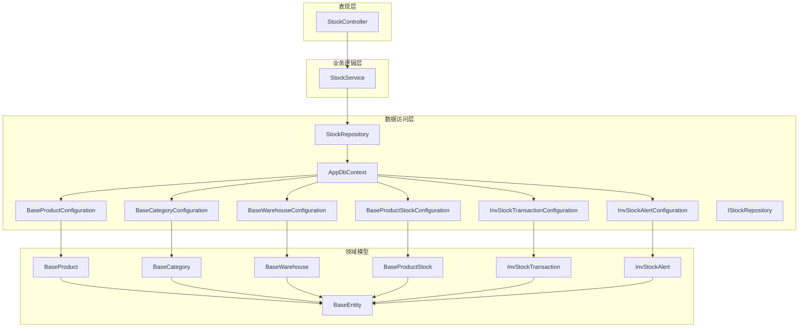
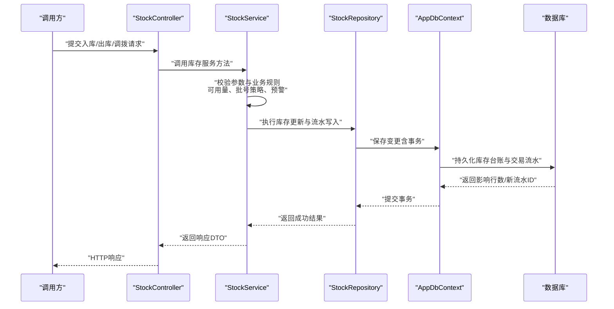
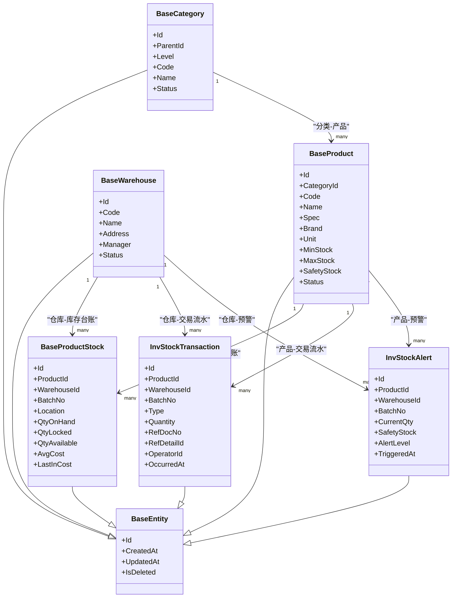
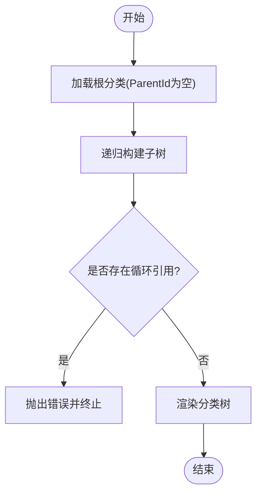
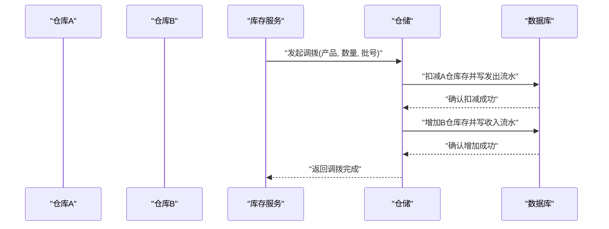
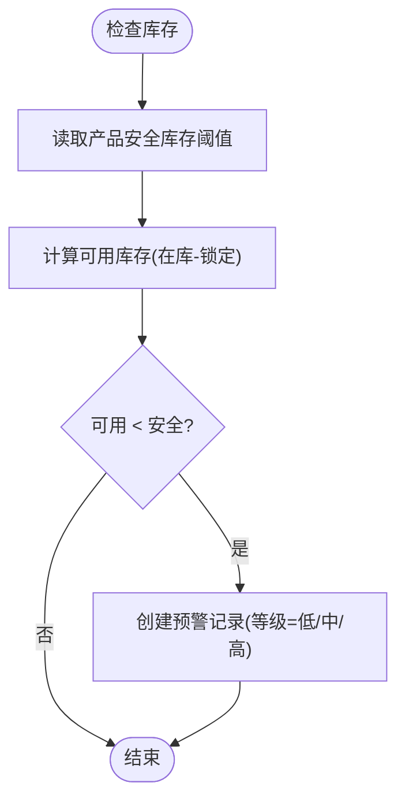
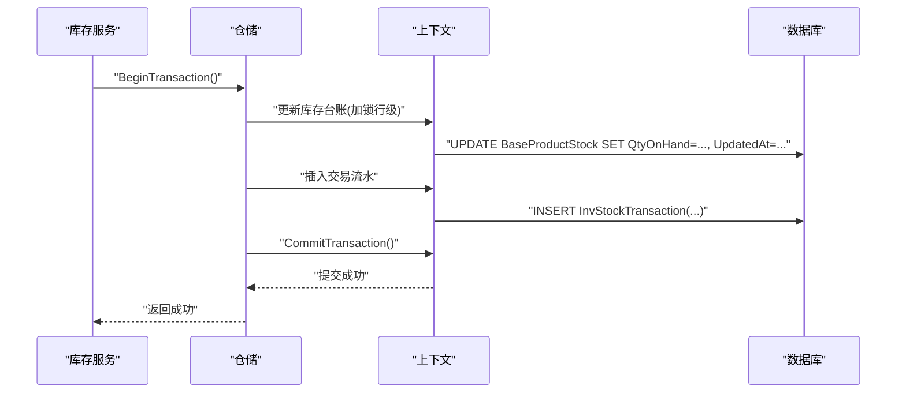
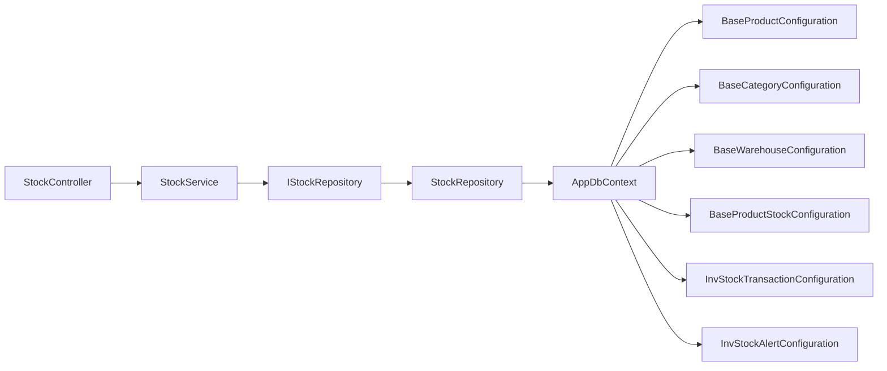

# 产品库存模型

<cite>
**本文引用的文件**   
- [BaseProduct.cs](file://EquipmentIMS.Models/Entities/BaseProduct.cs)
- [BaseCategory.cs](file://EquipmentIMS.Models/Entities/BaseCategory.cs)
- [BaseWarehouse.cs](file://EquipmentIMS.Models/Entities/BaseWarehouse.cs)
- [BaseProductStock.cs](file://EquipmentIMS.Models/Entities/BaseProductStock.cs)
- [InvStockTransaction.cs](file://EquipmentIMS.Models/Entities/InvStockTransaction.cs)
- [InvStockAlert.cs](file://EquipmentIMS.Models/Entities/InvStockAlert.cs)
- [BaseEntity.cs](file://EquipmentIMS.Models/Entities/BaseEntity.cs)
- [BaseProductConfiguration.cs](file://EquipmentIMS.DAL/Configurations/BaseProductConfiguration.cs)
- [BaseCategoryConfiguration.cs](file://EquipmentIMS.DAL/Configurations/BaseCategoryConfiguration.cs)
- [BaseWarehouseConfiguration.cs](file://EquipmentIMS.DAL/Configurations/BaseWarehouseConfiguration.cs)
- [BaseProductStockConfiguration.cs](file://EquipmentIMS.DAL/Configurations/BaseProductStockConfiguration.cs)
- [InvStockTransactionConfiguration.cs](file://EquipmentIMS.DAL/Configurations/InvStockTransactionConfiguration.cs)
- [InvStockAlertConfiguration.cs](file://EquipmentIMS.DAL/Configurations/InvStockAlertConfiguration.cs)
- [AppDbContext.cs](file://EquipmentIMS.DAL/AppDbContext.cs)
- [StockService.cs](file://EquipmentIMS.BLL/Services/StockService.cs)
- [StockRepository.cs](file://EquipmentIMS.DAL/Repositories/StockRepository.cs)
- [IStockRepository.cs](file://EquipmentIMS.DAL/Interfaces/IStockRepository.cs)
- [StockController.cs](file://EquipmentIMS.Web/Controllers/StockController.cs)
</cite>

## 目录
1. [简介](#简介)
2. [项目结构](#项目结构)
3. [核心组件](#核心组件)
4. [架构总览](#架构总览)
5. [详细组件分析](#详细组件分析)
6. [依赖关系分析](#依赖关系分析)
7. [性能考虑](#性能考虑)
8. [故障排查指南](#故障排查指南)
9. [结论](#结论)
10. [附录：典型SQL查询示例](#附录典型sql查询示例)

## 简介
本文件聚焦THMS系统“产品库存”数据模型，围绕以下目标展开：
- 定义并解释产品管理核心实体：BaseProduct、BaseCategory、BaseWarehouse、BaseProductStock的字段与业务含义
- 说明产品分类的树形结构设计、仓库管理的多仓库支持方案
- 阐述产品库存的批次管理与库存预警机制的数据模型设计
- 明确产品与分类、仓库之间的关联关系与数据完整性约束
- 给出库存变动的历史追踪设计与查询优化策略
- 提供典型业务场景的SQL查询示例（概念性）

## 项目结构
与产品库存数据模型相关的代码主要分布在三层：
- 领域模型层（Models.Entities）：定义实体类与枚举
- 数据访问层（DAL.Configurations + DAL.Repositories + AppDbContext）：EF Core配置、仓储实现与上下文
- 业务逻辑层（BLL.Services）：库存服务编排与事务边界
- 表现层（Web.Controllers）：对外API入口

图表来源
- [BaseProduct.cs](file://EquipmentIMS.Models/Entities/BaseProduct.cs)
- [BaseCategory.cs](file://EquipmentIMS.Models/Entities/BaseCategory.cs)
- [BaseWarehouse.cs](file://EquipmentIMS.Models/Entities/BaseWarehouse.cs)
- [BaseProductStock.cs](file://EquipmentIMS.Models/Entities/BaseProductStock.cs)
- [InvStockTransaction.cs](file://EquipmentIMS.Models/Entities/InvStockTransaction.cs)
- [InvStockAlert.cs](file://EquipmentIMS.Models/Entities/InvStockAlert.cs)
- [BaseEntity.cs](file://EquipmentIMS.Models/Entities/BaseEntity.cs)
- [BaseProductConfiguration.cs](file://EquipmentIMS.DAL/Configurations/BaseProductConfiguration.cs)
- [BaseCategoryConfiguration.cs](file://EquipmentIMS.DAL/Configurations/BaseCategoryConfiguration.cs)
- [BaseWarehouseConfiguration.cs](file://EquipmentIMS.DAL/Configurations/BaseWarehouseConfiguration.cs)
- [BaseProductStockConfiguration.cs](file://EquipmentIMS.DAL/Configurations/BaseProductStockConfiguration.cs)
- [InvStockTransactionConfiguration.cs](file://EquipmentIMS.DAL/Configurations/InvStockTransactionConfiguration.cs)
- [InvStockAlertConfiguration.cs](file://EquipmentIMS.DAL/Configurations/InvStockAlertConfiguration.cs)
- [AppDbContext.cs](file://EquipmentIMS.DAL/AppDbContext.cs)
- [StockRepository.cs](file://EquipmentIMS.DAL/Repositories/StockRepository.cs)
- [IStockRepository.cs](file://EquipmentIMS.DAL/Interfaces/IStockRepository.cs)
- [StockService.cs](file://EquipmentIMS.BLL/Services/StockService.cs)
- [StockController.cs](file://EquipmentIMS.Web/Controllers/StockController.cs)

章节来源
- [BaseProduct.cs](file://EquipmentIMS.Models/Entities/BaseProduct.cs)
- [BaseCategory.cs](file://EquipmentIMS.Models/Entities/BaseCategory.cs)
- [BaseWarehouse.cs](file://EquipmentIMS.Models/Entities/BaseWarehouse.cs)
- [BaseProductStock.cs](file://EquipmentIMS.Models/Entities/BaseProductStock.cs)
- [InvStockTransaction.cs](file://EquipmentIMS.Models/Entities/InvStockTransaction.cs)
- [InvStockAlert.cs](file://EquipmentIMS.Models/Entities/InvStockAlert.cs)
- [BaseEntity.cs](file://EquipmentIMS.Models/Entities/BaseEntity.cs)
- [BaseProductConfiguration.cs](file://EquipmentIMS.DAL/Configurations/BaseProductConfiguration.cs)
- [BaseCategoryConfiguration.cs](file://EquipmentIMS.DAL/Configurations/BaseCategoryConfiguration.cs)
- [BaseWarehouseConfiguration.cs](file://EquipmentIMS.DAL/Configurations/BaseWarehouseConfiguration.cs)
- [BaseProductStockConfiguration.cs](file://EquipmentIMS.DAL/Configurations/BaseProductStockConfiguration.cs)
- [InvStockTransactionConfiguration.cs](file://EquipmentIMS.DAL/Configurations/InvStockTransactionConfiguration.cs)
- [InvStockAlertConfiguration.cs](file://EquipmentIMS.DAL/Configurations/InvStockAlertConfiguration.cs)
- [AppDbContext.cs](file://EquipmentIMS.DAL/AppDbContext.cs)
- [StockRepository.cs](file://EquipmentIMS.DAL/Repositories/StockRepository.cs)
- [IStockRepository.cs](file://EquipmentIMS.DAL/Interfaces/IStockRepository.cs)
- [StockService.cs](file://EquipmentIMS.BLL/Services/StockService.cs)
- [StockController.cs](file://EquipmentIMS.Web/Controllers/StockController.cs)

## 核心组件
本节对四个核心实体进行字段与业务含义说明，并补充基础实体与关键枚举。

- BaseProduct（产品主数据）
  - 标识与元信息：唯一标识、编码、名称、规格型号、品牌、单位等
  - 分类归属：通过外键关联分类，支撑树形分类体系
  - 安全参数：最低库存、最高库存、安全库存阈值等，用于预警
  - 状态控制：启用/停用、是否可销售、是否参与盘点等
  - 审计字段：创建/更新时间、操作人等（继承自基础实体）
  - 业务含义：作为库存核算的最小对象维度之一，是库存台账与交易流水的锚点

- BaseCategory（产品分类）
  - 树形结构：父分类ID、层级、排序等，形成多级分类树
  - 属性：分类编码、名称、描述、状态等
  - 业务含义：为产品组织提供结构化归类，便于报表统计与权限控制

- BaseWarehouse（仓库）
  - 基本信息：编码、名称、地址、负责人、状态等
  - 多仓支持：每个仓库独立维护库存，支持跨仓调拨
  - 业务含义：库存按“产品+仓库”粒度进行管控

- BaseProductStock（产品库存台账）
  - 维度：产品ID、仓库ID、批次号（可选）、库位（可选）
  - 数量：在库数量、锁定数量、可用数量（计算字段或冗余字段）
  - 成本：加权平均成本、最近入库成本等（视业务需要）
  - 预警：当前库存与安全库存对比结果（可由服务计算）
  - 业务含义：记录某产品在某一仓库（及批次）的实时库存快照

- BaseEntity（基础实体）
  - 通用字段：主键、创建时间、更新时间、删除标记等
  - 作用：统一审计与软删除能力

- 相关枚举（节选）
  - 交易类型：入库、出库、盘盈、盘亏、调拨等
  - 预警等级：低、中、高
  - 单据状态：草稿、已审核、已关闭等

章节来源
- [BaseProduct.cs](file://EquipmentIMS.Models/Entities/BaseProduct.cs)
- [BaseCategory.cs](file://EquipmentIMS.Models/Entities/BaseCategory.cs)
- [BaseWarehouse.cs](file://EquipmentIMS.Models/Entities/BaseWarehouse.cs)
- [BaseProductStock.cs](file://EquipmentIMS.Models/Entities/BaseProductStock.cs)
- [BaseEntity.cs](file://EquipmentIMS.Models/Entities/BaseEntity.cs)

## 架构总览
从数据建模到应用调用，整体链路如下：
- Web控制器接收请求，调用库存服务
- 库存服务编排业务规则（如可用性校验、批号策略、预警判断），并通过仓储接口访问数据库
- EF Core根据配置生成表结构与关系映射
- 库存变动通过交易流水持久化，保证可追溯

图表来源
- [StockController.cs](file://EquipmentIMS.Web/Controllers/StockController.cs)
- [StockService.cs](file://EquipmentIMS.BLL/Services/StockService.cs)
- [StockRepository.cs](file://EquipmentIMS.DAL/Repositories/StockRepository.cs)
- [IStockRepository.cs](file://EquipmentIMS.DAL/Interfaces/IStockRepository.cs)
- [AppDbContext.cs](file://EquipmentIMS.DAL/AppDbContext.cs)

## 详细组件分析

### 实体关系与约束
- 产品与分类：一对多（一个分类下多个产品）
- 产品与库存台账：一对多（一个产品对应多条仓库维度的库存记录）
- 仓库与库存台账：一对多（一个仓库下有多条产品库存记录）
- 库存台账与交易流水：一对多（一次库存变动产生一条或多条流水）
- 预警：由服务基于安全库存阈值与当前库存计算，可落库为预警记录

图表来源
- [BaseProduct.cs](file://EquipmentIMS.Models/Entities/BaseProduct.cs)
- [BaseCategory.cs](file://EquipmentIMS.Models/Entities/BaseCategory.cs)
- [BaseWarehouse.cs](file://EquipmentIMS.Models/Entities/BaseWarehouse.cs)
- [BaseProductStock.cs](file://EquipmentIMS.Models/Entities/BaseProductStock.cs)
- [InvStockTransaction.cs](file://EquipmentIMS.Models/Entities/InvStockTransaction.cs)
- [InvStockAlert.cs](file://EquipmentIMS.Models/Entities/InvStockAlert.cs)
- [BaseEntity.cs](file://EquipmentIMS.Models/Entities/BaseEntity.cs)

章节来源
- [BaseProductConfiguration.cs](file://EquipmentIMS.DAL/Configurations/BaseProductConfiguration.cs)
- [BaseCategoryConfiguration.cs](file://EquipmentIMS.DAL/Configurations/BaseCategoryConfiguration.cs)
- [BaseWarehouseConfiguration.cs](file://EquipmentIMS.DAL/Configurations/BaseWarehouseConfiguration.cs)
- [BaseProductStockConfiguration.cs](file://EquipmentIMS.DAL/Configurations/BaseProductStockConfiguration.cs)
- [InvStockTransactionConfiguration.cs](file://EquipmentIMS.DAL/Configurations/InvStockTransactionConfiguration.cs)
- [InvStockAlertConfiguration.cs](file://EquipmentIMS.DAL/Configurations/InvStockAlertConfiguration.cs)

### 产品分类树形结构设计
- 采用自引用父节点（ParentId）+ Level层级字段，支持任意深度分类树
- 通过排序字段保证同级顺序稳定
- 建议索引：(ParentId, Level)、(Code) 以加速树遍历与查找
- 业务规则：根节点ParentId为空；禁止循环引用；删除前需校验子分类

章节来源
- [BaseCategory.cs](file://EquipmentIMS.Models/Entities/BaseCategory.cs)
- [BaseCategoryConfiguration.cs](file://EquipmentIMS.DAL/Configurations/BaseCategoryConfiguration.cs)

### 仓库管理与多仓库支持
- 仓库为独立主数据，支持多仓库并行运营
- 库存台账按“产品+仓库+批次”维度拆分，确保各仓独立核算
- 调拨流程通过两条交易流水（出仓、入仓）完成，保持账实一致

图表来源
- [StockService.cs](file://EquipmentIMS.BLL/Services/StockService.cs)
- [StockRepository.cs](file://EquipmentIMS.DAL/Repositories/StockRepository.cs)
- [InvStockTransaction.cs](file://EquipmentIMS.Models/Entities/InvStockTransaction.cs)

章节来源
- [BaseWarehouse.cs](file://EquipmentIMS.Models/Entities/BaseWarehouse.cs)
- [BaseWarehouseConfiguration.cs](file://EquipmentIMS.DAL/Configurations/BaseWarehouseConfiguration.cs)
- [BaseProductStock.cs](file://EquipmentIMS.Models/Entities/BaseProductStock.cs)
- [BaseProductStockConfiguration.cs](file://EquipmentIMS.DAL/Configurations/BaseProductStockConfiguration.cs)

### 批次管理与库存预警
- 批次管理
  - 通过批次号字段区分同产品同仓库的不同批次库存
  - 支持先进先出（FIFO）或指定批号出库策略（由服务层决定）
  - 交易流水携带批号，便于溯源
- 库存预警
  - 当当前可用库存低于安全库存时触发预警
  - 预警等级可按差值比例或固定阈值划分
  - 预警记录包含触发时间与等级，便于后续处理

图表来源
- [BaseProduct.cs](file://EquipmentIMS.Models/Entities/BaseProduct.cs)
- [BaseProductStock.cs](file://EquipmentIMS.Models/Entities/BaseProductStock.cs)
- [InvStockAlert.cs](file://EquipmentIMS.Models/Entities/InvStockAlert.cs)

章节来源
- [BaseProductConfiguration.cs](file://EquipmentIMS.DAL/Configurations/BaseProductConfiguration.cs)
- [BaseProductStockConfiguration.cs](file://EquipmentIMS.DAL/Configurations/BaseProductStockConfiguration.cs)
- [InvStockAlertConfiguration.cs](file://EquipmentIMS.DAL/Configurations/InvStockAlertConfiguration.cs)

### 库存变动历史追踪与一致性
- 所有库存变动必须写入交易流水，遵循“有账必有单”的原则
- 使用事务包裹“库存台账更新 + 流水写入”，保证原子性
- 流水关键字段：产品、仓库、批次、方向（增/减）、数量、来源单据号、操作人、发生时间

图表来源
- [StockService.cs](file://EquipmentIMS.BLL/Services/StockService.cs)
- [StockRepository.cs](file://EquipmentIMS.DAL/Repositories/StockRepository.cs)
- [AppDbContext.cs](file://EquipmentIMS.DAL/AppDbContext.cs)
- [InvStockTransaction.cs](file://EquipmentIMS.Models/Entities/InvStockTransaction.cs)

章节来源
- [InvStockTransactionConfiguration.cs](file://EquipmentIMS.DAL/Configurations/InvStockTransactionConfiguration.cs)
- [BaseProductStockConfiguration.cs](file://EquipmentIMS.DAL/Configurations/BaseProductStockConfiguration.cs)

## 依赖关系分析
- 控制器依赖服务：StockController -> StockService
- 服务依赖仓储接口：StockService -> IStockRepository
- 仓储实现依赖上下文：StockRepository -> AppDbContext
- 上下文依赖实体配置：AppDbContext -> *Configuration
- 实体继承基础实体：所有核心实体 -> BaseEntity

图表来源
- [StockController.cs](file://EquipmentIMS.Web/Controllers/StockController.cs)
- [StockService.cs](file://EquipmentIMS.BLL/Services/StockService.cs)
- [IStockRepository.cs](file://EquipmentIMS.DAL/Interfaces/IStockRepository.cs)
- [StockRepository.cs](file://EquipmentIMS.DAL/Repositories/StockRepository.cs)
- [AppDbContext.cs](file://EquipmentIMS.DAL/AppDbContext.cs)
- [BaseProductConfiguration.cs](file://EquipmentIMS.DAL/Configurations/BaseProductConfiguration.cs)
- [BaseCategoryConfiguration.cs](file://EquipmentIMS.DAL/Configurations/BaseCategoryConfiguration.cs)
- [BaseWarehouseConfiguration.cs](file://EquipmentIMS.DAL/Configurations/BaseWarehouseConfiguration.cs)
- [BaseProductStockConfiguration.cs](file://EquipmentIMS.DAL/Configurations/BaseProductStockConfiguration.cs)
- [InvStockTransactionConfiguration.cs](file://EquipmentIMS.DAL/Configurations/InvStockTransactionConfiguration.cs)
- [InvStockAlertConfiguration.cs](file://EquipmentIMS.DAL/Configurations/InvStockAlertConfiguration.cs)

章节来源
- [StockController.cs](file://EquipmentIMS.Web/Controllers/StockController.cs)
- [StockService.cs](file://EquipmentIMS.BLL/Services/StockService.cs)
- [IStockRepository.cs](file://EquipmentIMS.DAL/Interfaces/IStockRepository.cs)
- [StockRepository.cs](file://EquipmentIMS.DAL/Repositories/StockRepository.cs)
- [AppDbContext.cs](file://EquipmentIMS.DAL/AppDbContext.cs)

## 性能考虑
- 索引建议
  - 产品：(Code), (CategoryId)
  - 仓库：(Code)
  - 库存台账：(ProductId, WarehouseId), (WarehouseId), (ProductId), (BatchNo)
  - 交易流水：(ProductId, WarehouseId, OccurredAt), (RefDocNo), (Type)
  - 预警：(ProductId, WarehouseId, TriggeredAt)
- 查询优化
  - 常用视图：按产品+仓库汇总可用库存、近N日出入库趋势
  - 分页与投影：仅返回必要字段，避免大对象传输
  - 批量操作：入库/出库批量合并以减少事务次数
- 并发控制
  - 行级锁或乐观锁防止超卖
  - 热点产品分片或缓存只读聚合（如安全库存阈值）

[本节为通用指导，不直接分析具体文件]

## 故障排查指南
- 常见问题
  - 库存不足：检查可用库存与锁定数量，核对最近交易流水
  - 批次不一致：核对批次号与FIFO策略，确认流水批号正确
  - 预警未触发：检查安全库存阈值与计算口径
- 定位步骤
  - 通过产品+仓库+时间范围检索交易流水
  - 核对库存台账当前数量与流水累计是否一致
  - 查看预警记录与触发时间，评估阈值设置

章节来源
- [InvStockTransaction.cs](file://EquipmentIMS.Models/Entities/InvStockTransaction.cs)
- [InvStockAlert.cs](file://EquipmentIMS.Models/Entities/InvStockAlert.cs)
- [BaseProductStock.cs](file://EquipmentIMS.Models/Entities/BaseProductStock.cs)

## 结论
本数据模型以“产品-分类-仓库-批次”为核心维度，结合交易流水与预警机制，构建了可扩展、可追溯的产品库存体系。通过分层架构与清晰的实体关系，既满足日常进销存需求，也为后续扩展（如序列号、效期、多计量单位）预留空间。

[本节为总结性内容，不直接分析具体文件]

## 附录：典型SQL查询示例
以下为概念性示例，实际字段名以数据库生成为准：
- 查询某产品在某仓库的可用库存
  - 思路：按产品+仓库+批次汇总，可用=在库-锁定
- 查询某产品的库存变动明细（含批号）
  - 思路：按产品+仓库过滤，按发生时间排序，展示方向与数量
- 查询库存预警清单
  - 思路：筛选当前可用<安全库存的记录，按等级排序
- 查询某仓库的月度出入库汇总
  - 思路：按月分组，按交易类型聚合数量
- 查询某分类下的产品及其在各仓库的库存分布
  - 思路：连接分类-产品-库存台账，按仓库维度透视

[本节为概念性示例，不直接分析具体文件]