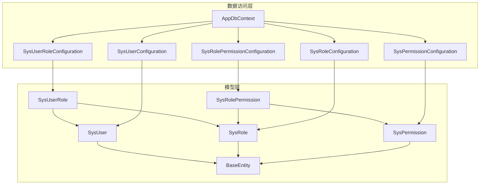
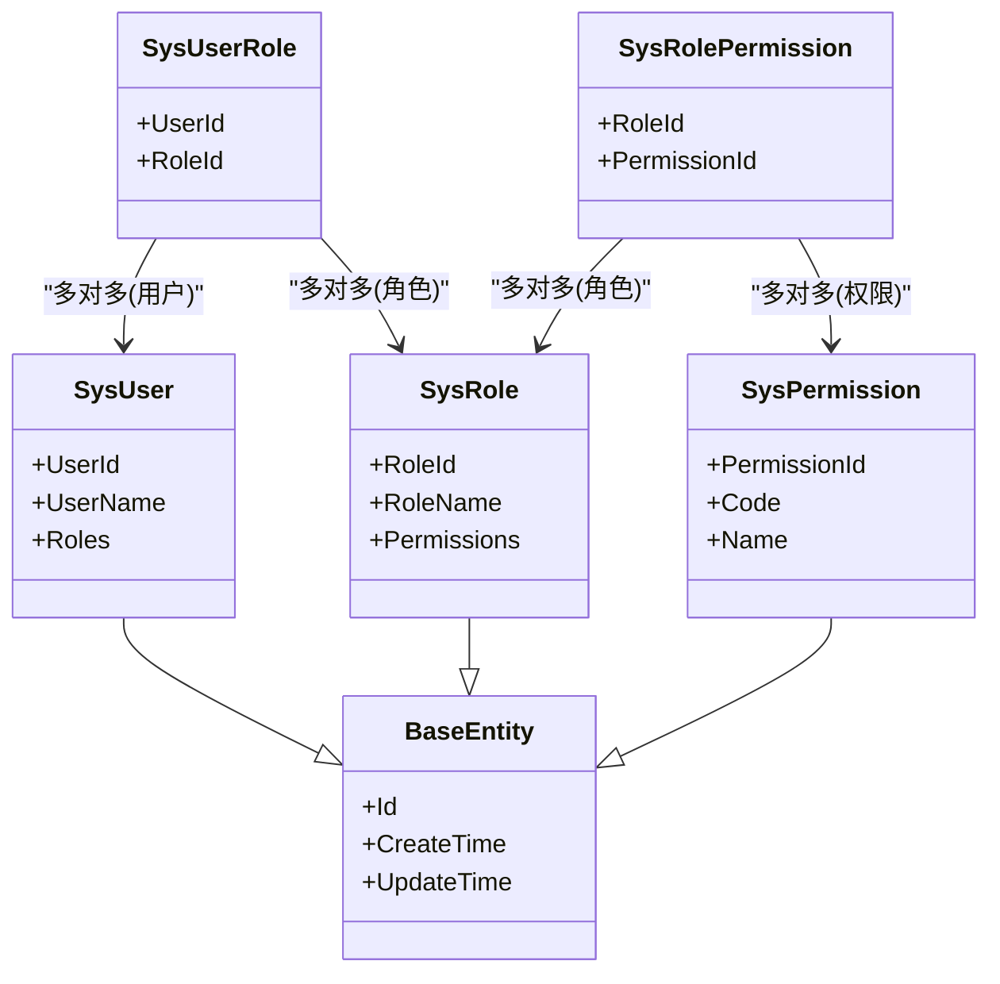
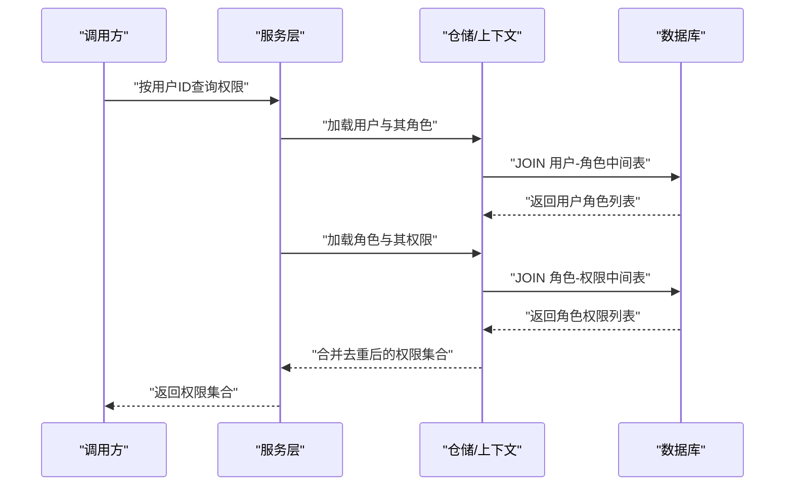
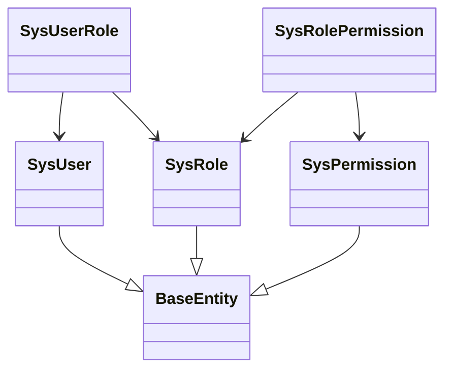
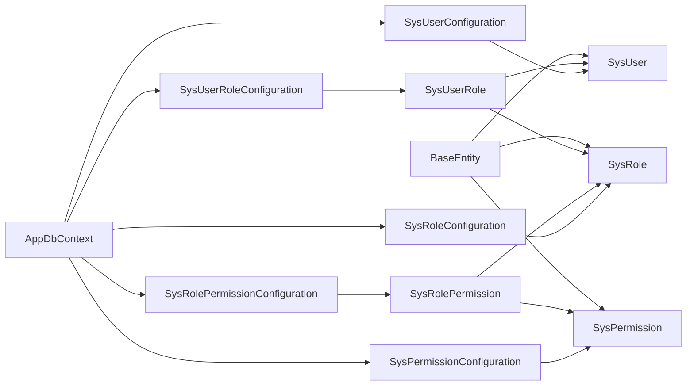

# 基础实体设计

<cite>
**本文引用的文件**   
- [BaseEntity.cs](file://EquipmentIMS.Models/Entities/BaseEntity.cs)
- [SysUser.cs](file://EquipmentIMS.Models/Entities/SysUser.cs)
- [SysRole.cs](file://EquipmentIMS.Models/Entities/SysRole.cs)
- [SysPermission.cs](file://EquipmentIMS.Models/Entities/SysPermission.cs)
- [SysUserRole.cs](file://EquipmentIMS.Models/Entities/SysUserRole.cs)
- [SysRolePermission.cs](file://EquipmentIMS.Models/Entities/SysRolePermission.cs)
- [SysUserConfiguration.cs](file://EquipmentIMS.DAL/Configurations/SysUserConfiguration.cs)
- [SysRoleConfiguration.cs](file://EquipmentIMS.DAL/Configurations/SysRoleConfiguration.cs)
- [SysPermissionConfiguration.cs](file://EquipmentIMS.DAL/Configurations/SysPermissionConfiguration.cs)
- [SysUserRoleConfiguration.cs](file://EquipmentIMS.DAL/Configurations/SysUserRoleConfiguration.cs)
- [SysRolePermissionConfiguration.cs](file://EquipmentIMS.DAL/Configurations/SysRolePermissionConfiguration.cs)
- [AppDbContext.cs](file://EquipmentIMS.DAL/AppDbContext.cs)
</cite>

## 目录
1. [简介](#简介)
2. [项目结构](#项目结构)
3. [核心组件](#核心组件)
4. [架构总览](#架构总览)
5. [详细组件分析](#详细组件分析)
6. [依赖关系分析](#依赖关系分析)
7. [性能考虑](#性能考虑)
8. [故障排查指南](#故障排查指南)
9. [结论](#结论)
10. [附录](#附录)

## 简介
本文件聚焦于THMS系统的基础实体设计，围绕以下目标展开：
- 解释BaseEntity基类的设计理念与通用字段（如Id、CreateTime、UpdateTime等）的作用。
- 详细说明用户权限体系的核心实体：SysUser、SysRole、SysPermission及其关联关系。
- 阐述RBAC权限模型的数据结构设计，包括用户角色分配、角色权限映射的多对多关系实现。
- 提供实体继承层次图和外键约束说明。
- 给出典型查询示例与性能优化建议。

## 项目结构
与基础实体相关的代码主要分布在两个层：
- 模型层（Models/Entities）：定义领域实体与继承关系。
- 数据访问层（DAL/Configurations）：通过EF Core配置实体映射、主外键关系与索引策略。

图表来源
- [BaseEntity.cs](file://EquipmentIMS.Models/Entities/BaseEntity.cs)
- [SysUser.cs](file://EquipmentIMS.Models/Entities/SysUser.cs)
- [SysRole.cs](file://EquipmentIMS.Models/Entities/SysRole.cs)
- [SysPermission.cs](file://EquipmentIMS.Models/Entities/SysPermission.cs)
- [SysUserRole.cs](file://EquipmentIMS.Models/Entities/SysUserRole.cs)
- [SysRolePermission.cs](file://EquipmentIMS.Models/Entities/SysRolePermission.cs)
- [SysUserConfiguration.cs](file://EquipmentIMS.DAL/Configurations/SysUserConfiguration.cs)
- [SysRoleConfiguration.cs](file://EquipmentIMS.DAL/Configurations/SysRoleConfiguration.cs)
- [SysPermissionConfiguration.cs](file://EquipmentIMS.DAL/Configurations/SysPermissionConfiguration.cs)
- [SysUserRoleConfiguration.cs](file://EquipmentIMS.DAL/Configurations/SysUserRoleConfiguration.cs)
- [SysRolePermissionConfiguration.cs](file://EquipmentIMS.DAL/Configurations/SysRolePermissionConfiguration.cs)
- [AppDbContext.cs](file://EquipmentIMS.DAL/AppDbContext.cs)

章节来源
- [BaseEntity.cs](file://EquipmentIMS.Models/Entities/BaseEntity.cs)
- [SysUser.cs](file://EquipmentIMS.Models/Entities/SysUser.cs)
- [SysRole.cs](file://EquipmentIMS.Models/Entities/SysRole.cs)
- [SysPermission.cs](file://EquipmentIMS.Models/Entities/SysPermission.cs)
- [SysUserRole.cs](file://EquipmentIMS.Models/Entities/SysUserRole.cs)
- [SysRolePermission.cs](file://EquipmentIMS.Models/Entities/SysRolePermission.cs)
- [SysUserConfiguration.cs](file://EquipmentIMS.DAL/Configurations/SysUserConfiguration.cs)
- [SysRoleConfiguration.cs](file://EquipmentIMS.DAL/Configurations/SysRoleConfiguration.cs)
- [SysPermissionConfiguration.cs](file://EquipmentIMS.DAL/Configurations/SysPermissionConfiguration.cs)
- [SysUserRoleConfiguration.cs](file://EquipmentIMS.DAL/Configurations/SysUserRoleConfiguration.cs)
- [SysRolePermissionConfiguration.cs](file://EquipmentIMS.DAL/Configurations/SysRolePermissionConfiguration.cs)
- [AppDbContext.cs](file://EquipmentIMS.DAL/AppDbContext.cs)

## 核心组件
- BaseEntity：所有实体的公共基类，统一标识与审计字段，便于跨域一致性与通用操作。
- SysUser：系统用户实体，承载登录身份与基本属性。
- SysRole：系统角色实体，用于聚合一组权限。
- SysPermission：系统权限实体，描述可被授权的最小操作单元。
- SysUserRole：用户-角色中间表，实现用户到角色的多对多关系。
- SysRolePermission：角色-权限中间表，实现角色到权限的多对多关系。

章节来源
- [BaseEntity.cs](file://EquipmentIMS.Models/Entities/BaseEntity.cs)
- [SysUser.cs](file://EquipmentIMS.Models/Entities/SysUser.cs)
- [SysRole.cs](file://EquipmentIMS.Models/Entities/SysRole.cs)
- [SysPermission.cs](file://EquipmentIMS.Models/Entities/SysPermission.cs)
- [SysUserRole.cs](file://EquipmentIMS.Models/Entities/SysUserRole.cs)
- [SysRolePermission.cs](file://EquipmentIMS.Models/Entities/SysRolePermission.cs)

## 架构总览
下图展示了RBAC权限模型在数据层的整体结构，以及实体间的继承与关联关系。

图表来源
- [BaseEntity.cs](file://EquipmentIMS.Models/Entities/BaseEntity.cs)
- [SysUser.cs](file://EquipmentIMS.Models/Entities/SysUser.cs)
- [SysRole.cs](file://EquipmentIMS.Models/Entities/SysRole.cs)
- [SysPermission.cs](file://EquipmentIMS.Models/Entities/SysPermission.cs)
- [SysUserRole.cs](file://EquipmentIMS.Models/Entities/SysUserRole.cs)
- [SysRolePermission.cs](file://EquipmentIMS.Models/Entities/SysRolePermission.cs)

## 详细组件分析

### BaseEntity基类设计与通用字段
- 设计理念
  - 统一标识：为所有实体提供稳定的主键字段，简化仓储与服务的通用CRUD逻辑。
  - 审计追踪：记录创建时间与更新时间，便于问题定位与合规审计。
  - 扩展性：作为基类，派生实体无需重复声明通用字段，降低维护成本。
- 通用字段作用
  - Id：主键，唯一标识一条记录，通常作为外键引用目标。
  - CreateTime：记录首次创建时间，常用于排序、统计与审计。
  - UpdateTime：记录最近一次修改时间，支持软删除或变更检测。
- 复杂度与影响
  - 空间：每个实体增加固定字段开销，但换来一致的审计能力。
  - 时间：读写路径中需维护时间戳，通常在保存前由上下文或服务层填充。

章节来源
- [BaseEntity.cs](file://EquipmentIMS.Models/Entities/BaseEntity.cs)

### RBAC核心实体与多对多关系
- 用户-角色（多对多）
  - 通过SysUserRole中间表将用户与角色解耦，支持一个用户拥有多个角色，一个角色包含多个用户。
- 角色-权限（多对多）
  - 通过SysRolePermission中间表将角色与权限解耦，支持细粒度权限控制。
- 典型查询场景
  - 根据用户获取其所有角色与权限集合。
  - 根据角色获取其所有权限集合。
  - 校验某用户对某权限是否具备访问资格。

图表来源
- [SysUser.cs](file://EquipmentIMS.Models/Entities/SysUser.cs)
- [SysRole.cs](file://EquipmentIMS.Models/Entities/SysRole.cs)
- [SysPermission.cs](file://EquipmentIMS.Models/Entities/SysPermission.cs)
- [SysUserRole.cs](file://EquipmentIMS.Models/Entities/SysUserRole.cs)
- [SysRolePermission.cs](file://EquipmentIMS.Models/Entities/SysRolePermission.cs)

章节来源
- [SysUser.cs](file://EquipmentIMS.Models/Entities/SysUser.cs)
- [SysRole.cs](file://EquipmentIMS.Models/Entities/SysRole.cs)
- [SysPermission.cs](file://EquipmentIMS.Models/Entities/SysPermission.cs)
- [SysUserRole.cs](file://EquipmentIMS.Models/Entities/SysUserRole.cs)
- [SysRolePermission.cs](file://EquipmentIMS.Models/Entities/SysRolePermission.cs)

### 实体继承层次图
- 所有权限相关实体均继承自BaseEntity，获得统一的标识与审计字段。
- 中间表实体（SysUserRole、SysRolePermission）通常仅包含外键组合，以实现多对多关系。

图表来源
- [BaseEntity.cs](file://EquipmentIMS.Models/Entities/BaseEntity.cs)
- [SysUser.cs](file://EquipmentIMS.Models/Entities/SysUser.cs)
- [SysRole.cs](file://EquipmentIMS.Models/Entities/SysRole.cs)
- [SysPermission.cs](file://EquipmentIMS.Models/Entities/SysPermission.cs)
- [SysUserRole.cs](file://EquipmentIMS.Models/Entities/SysUserRole.cs)
- [SysRolePermission.cs](file://EquipmentIMS.Models/Entities/SysRolePermission.cs)

### 外键约束与索引策略
- 外键约束
  - SysUserRole.UserId -> SysUser.Id
  - SysUserRole.RoleId -> SysRole.Id
  - SysRolePermission.RoleId -> SysRole.Id
  - SysRolePermission.PermissionId -> SysPermission.Id
- 索引建议
  - 在中间表的外键列上建立索引，加速多对多查询。
  - 在常用查询条件列（如用户名、角色名、权限码）上建立唯一或普通索引，提升检索效率。
- 一致性保障
  - 通过数据库外键约束保证引用完整性，避免孤儿记录。
  - 在应用层进行幂等写入与冲突处理，防止重复分配。

章节来源
- [SysUserConfiguration.cs](file://EquipmentIMS.DAL/Configurations/SysUserConfiguration.cs)
- [SysRoleConfiguration.cs](file://EquipmentIMS.DAL/Configurations/SysRoleConfiguration.cs)
- [SysPermissionConfiguration.cs](file://EquipmentIMS.DAL/Configurations/SysPermissionConfiguration.cs)
- [SysUserRoleConfiguration.cs](file://EquipmentIMS.DAL/Configurations/SysUserRoleConfiguration.cs)
- [SysRolePermissionConfiguration.cs](file://EquipmentIMS.DAL/Configurations/SysRolePermissionConfiguration.cs)

### 典型查询示例（概念性）
- 查询用户的所有权限
  - 步骤：加载用户 -> 连接用户-角色中间表 -> 连接角色-权限中间表 -> 去重返回权限集合。
- 查询角色的所有权限
  - 步骤：加载角色 -> 连接角色-权限中间表 -> 返回权限集合。
- 校验用户是否具备某权限
  - 步骤：加载用户与其角色 -> 检查是否存在对应权限记录。

[本节为概念性说明，不直接分析具体文件]

## 依赖关系分析
- 实体间依赖
  - SysUser、SysRole、SysPermission均依赖BaseEntity以获得通用字段。
  - 中间表实体依赖两端的主实体以建立多对多关系。
- 配置与上下文
  - AppDbContext注册各实体与配置，确保EF Core正确生成关系与约束。
  - 各*Configuration类集中定义外键、索引与关系映射，提高可读性与可维护性。

图表来源
- [BaseEntity.cs](file://EquipmentIMS.Models/Entities/BaseEntity.cs)
- [SysUser.cs](file://EquipmentIMS.Models/Entities/SysUser.cs)
- [SysRole.cs](file://EquipmentIMS.Models/Entities/SysRole.cs)
- [SysPermission.cs](file://EquipmentIMS.Models/Entities/SysPermission.cs)
- [SysUserRole.cs](file://EquipmentIMS.Models/Entities/SysUserRole.cs)
- [SysRolePermission.cs](file://EquipmentIMS.Models/Entities/SysRolePermission.cs)
- [SysUserConfiguration.cs](file://EquipmentIMS.DAL/Configurations/SysUserConfiguration.cs)
- [SysRoleConfiguration.cs](file://EquipmentIMS.DAL/Configurations/SysRoleConfiguration.cs)
- [SysPermissionConfiguration.cs](file://EquipmentIMS.DAL/Configurations/SysPermissionConfiguration.cs)
- [SysUserRoleConfiguration.cs](file://EquipmentIMS.DAL/Configurations/SysUserRoleConfiguration.cs)
- [SysRolePermissionConfiguration.cs](file://EquipmentIMS.DAL/Configurations/SysRolePermissionConfiguration.cs)
- [AppDbContext.cs](file://EquipmentIMS.DAL/AppDbContext.cs)

章节来源
- [AppDbContext.cs](file://EquipmentIMS.DAL/AppDbContext.cs)
- [SysUserConfiguration.cs](file://EquipmentIMS.DAL/Configurations/SysUserConfiguration.cs)
- [SysRoleConfiguration.cs](file://EquipmentIMS.DAL/Configurations/SysRoleConfiguration.cs)
- [SysPermissionConfiguration.cs](file://EquipmentIMS.DAL/Configurations/SysPermissionConfiguration.cs)
- [SysUserRoleConfiguration.cs](file://EquipmentIMS.DAL/Configurations/SysUserRoleConfiguration.cs)
- [SysRolePermissionConfiguration.cs](file://EquipmentIMS.DAL/Configurations/SysRolePermissionConfiguration.cs)

## 性能考虑
- 索引优化
  - 为中间表外键列建立索引，显著减少多表JOIN的扫描成本。
  - 为高频查询字段（如用户名、角色名、权限码）建立合适索引，必要时使用覆盖索引。
- 查询优化
  - 按需选择字段，避免SELECT *；在需要时投影到DTO以减少数据传输。
  - 使用分页与过滤条件，限制结果集规模。
- 缓存策略
  - 对静态或低频变化的权限数据进行缓存，减少数据库压力。
  - 注意缓存失效策略，确保权限变更后及时更新。
- 事务与一致性
  - 批量分配角色/权限时使用事务，保证原子性。
  - 避免长事务，减少锁竞争。

[本节提供一般性指导，不直接分析具体文件]

## 故障排查指南
- 常见错误
  - 外键约束违反：插入或更新中间表时，若引用不存在的主记录会失败。
  - 循环依赖：确保只通过中间表建立多对多关系，避免实体间直接双向导航导致复杂加载。
  - 索引缺失：多对多查询慢时，检查中间表外键是否有索引。
- 诊断方法
  - 查看数据库执行计划，确认是否命中索引。
  - 启用EF Core日志，观察生成的SQL语句与参数。
  - 核对配置文件中关系映射是否正确。

[本节提供一般性指导，不直接分析具体文件]

## 结论
通过BaseEntity的统一抽象与RBAC多对多模型的设计，THMS系统在用户权限方面具备良好的可扩展性与可维护性。配合合理的索引与查询优化策略，可在大规模数据下保持良好性能。建议在后续迭代中持续完善权限缓存与审计机制，进一步提升系统稳定性与安全性。

[本节为总结性内容，不直接分析具体文件]

## 附录
- 术语
  - RBAC：基于角色的访问控制（Role-Based Access Control）。
  - 中间表：用于实现多对多关系的桥接表。
- 参考
  - EF Core实体配置与关系映射最佳实践。
  - 数据库索引设计与查询优化原则。

[本节为补充信息，不直接分析具体文件]