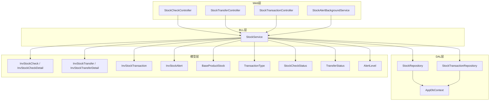
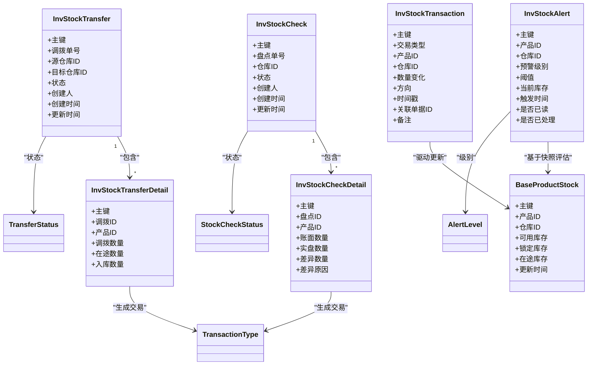
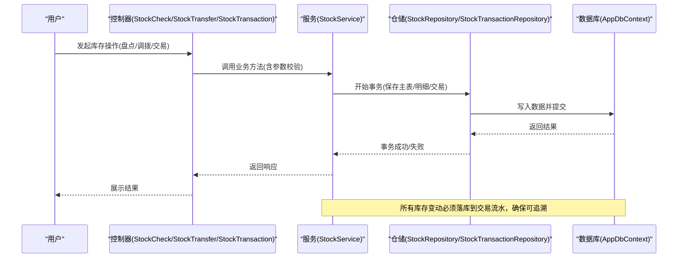
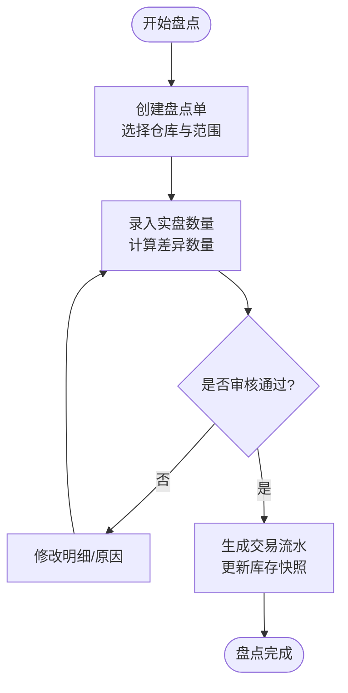
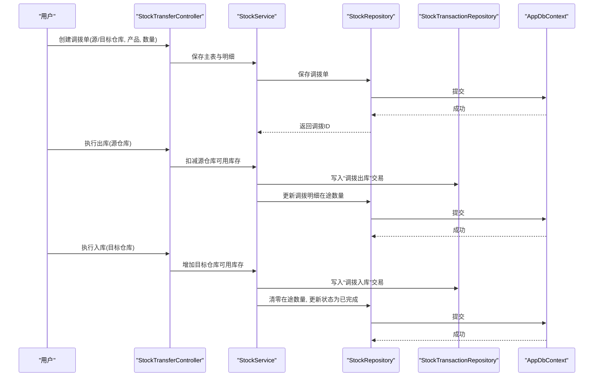
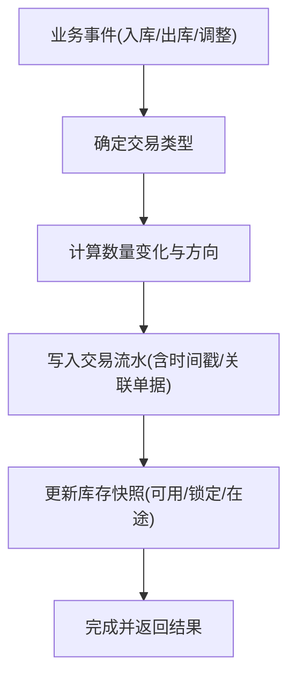
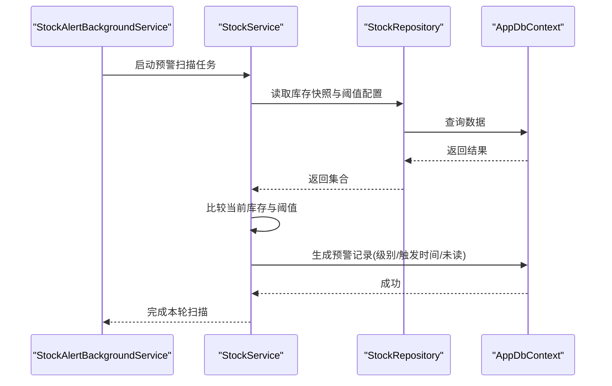
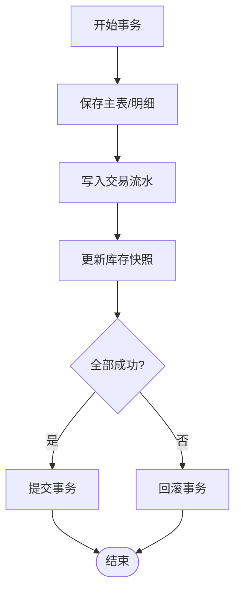
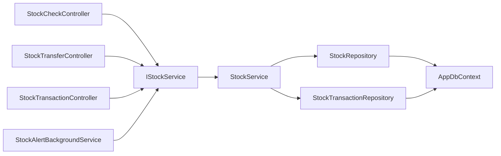

# 库存管理模型

<cite>
**本文引用的文件**   
- [InvStockCheck.cs](file://EquipmentIMS.Models/Entities/InvStockCheck.cs)
- [InvStockCheckDetail.cs](file://EquipmentIMS.Models/Entities/InvStockCheckDetail.cs)
- [InvStockTransfer.cs](file://EquipmentIMS.Models/Entities/InvStockTransfer.cs)
- [InvStockTransferDetail.cs](file://EquipmentIMS.Models/Entities/InvStockTransferDetail.cs)
- [InvStockTransaction.cs](file://EquipmentIMS.Models/Entities/InvStockTransaction.cs)
- [InvStockAlert.cs](file://EquipmentIMS.Models/Entities/InvStockAlert.cs)
- [BaseProductStock.cs](file://EquipmentIMS.Models/Entities/BaseProductStock.cs)
- [TransactionType.cs](file://EquipmentIMS.Models/Enums/TransactionType.cs)
- [StockCheckStatus.cs](file://EquipmentIMS.Models/Enums/StockCheckStatus.cs)
- [TransferStatus.cs](file://EquipmentIMS.Models/Enums/TransferStatus.cs)
- [AlertLevel.cs](file://EquipmentIMS.Models/Enums/AlertLevel.cs)
- [StockRepository.cs](file://EquipmentIMS.DAL/Repositories/StockRepository.cs)
- [StockTransactionRepository.cs](file://EquipmentIMS.DAL/Repositories/StockTransactionRepository.cs)
- [IStockRepository.cs](file://EquipmentIMS.DAL/Interfaces/IStockRepository.cs)
- [IStockTransactionRepository.cs](file://EquipmentIMS.DAL/Interfaces/IStockTransactionRepository.cs)
- [StockService.cs](file://EquipmentIMS.BLL/Services/StockService.cs)
- [IStockService.cs](file://EquipmentIMS.BLL/Interfaces/IStockService.cs)
- [StockCheckController.cs](file://EquipmentIMS.Web/Controllers/StockCheckController.cs)
- [StockTransferController.cs](file://EquipmentIMS.Web/Controllers/StockTransferController.cs)
- [StockTransactionController.cs](file://EquipmentIMS.Web/Controllers/StockTransactionController.cs)
- [StockAlertBackgroundService.cs](file://EquipmentIMS.Web/BackgroundServices/StockAlertBackgroundService.cs)
- [StockCheckDto.cs](file://EquipmentIMS.Models/DTOs/StockCheckDto.cs)
- [StockTransferDto.cs](file://EquipmentIMS.Models/DTOs/StockTransferDto.cs)
- [StockTransactionDto.cs](file://EquipmentIMS.Models/DTOs/StockTransactionDto.cs)
- [StockAlertDto.cs](file://EquipmentIMS.Models/DTOs/StockAlertDto.cs)
- [StockQueryDto.cs](file://EquipmentIMS.Models/DTOs/StockQueryDto.cs)
- [StockListDto.cs](file://EquipmentIMS.Models/DTOs/StockListDto.cs)
- [ReportInventoryDtos.cs](file://EquipmentIMS.Models/DTOs/Reports/ReportInventoryDtos.cs)
- [AppDbContext.cs](file://EquipmentIMS.DAL/AppDbContext.cs)
</cite>

## 目录
1. [简介](#简介)
2. [项目结构](#项目结构)
3. [核心组件](#核心组件)
4. [架构总览](#架构总览)
5. [详细组件分析](#详细组件分析)
6. [依赖关系分析](#依赖关系分析)
7. [性能考虑](#性能考虑)
8. [故障排查指南](#故障排查指南)
9. [结论](#结论)
10. [附录](#附录)

## 简介
本文件聚焦THMS系统的库存管理数据模型，围绕以下实体与流程展开：
- 库存盘点实体 InvStockCheck 及其明细 InvStockCheckDetail，覆盖盘点流程、差异处理的数据结构设计。
- 库存调拨实体 InvStockTransfer 及其明细 InvStockTransferDetail，说明多仓库调拨逻辑与在途库存管理的数据模型。
- 库存交易流水实体 InvStockTransaction，阐述交易类型、数量变动与时间戳记录的设计。
- 库存预警实体 InvStockAlert，解释预警级别、触发条件与通知机制的数据结构。
- 库存事务的原子性保证与历史追溯设计。
- 库存变动的审计日志设计与性能优化策略。
- 库存统计与分析的典型查询示例。

## 项目结构
库存相关代码遵循分层架构：Web层控制器负责请求路由与参数校验；BLL层服务编排业务规则与事务边界；DAL层仓储封装EF Core访问；Models层定义实体、枚举与DTO；BackgroundServices提供定时任务（如库存预警扫描）。

图表来源
- [StockCheckController.cs](file://EquipmentIMS.Web/Controllers/StockCheckController.cs)
- [StockTransferController.cs](file://EquipmentIMS.Web/Controllers/StockTransferController.cs)
- [StockTransactionController.cs](file://EquipmentIMS.Web/Controllers/StockTransactionController.cs)
- [StockAlertBackgroundService.cs](file://EquipmentIMS.Web/BackgroundServices/StockAlertBackgroundService.cs)
- [StockService.cs](file://EquipmentIMS.BLL/Services/StockService.cs)
- [StockRepository.cs](file://EquipmentIMS.DAL/Repositories/StockRepository.cs)
- [StockTransactionRepository.cs](file://EquipmentIMS.DAL/Repositories/StockTransactionRepository.cs)
- [AppDbContext.cs](file://EquipmentIMS.DAL/AppDbContext.cs)
- [InvStockCheck.cs](file://EquipmentIMS.Models/Entities/InvStockCheck.cs)
- [InvStockCheckDetail.cs](file://EquipmentIMS.Models/Entities/InvStockCheckDetail.cs)
- [InvStockTransfer.cs](file://EquipmentIMS.Models/Entities/InvStockTransfer.cs)
- [InvStockTransferDetail.cs](file://EquipmentIMS.Models/Entities/InvStockTransferDetail.cs)
- [InvStockTransaction.cs](file://EquipmentIMS.Models/Entities/InvStockTransaction.cs)
- [InvStockAlert.cs](file://EquipmentIMS.Models/Entities/InvStockAlert.cs)
- [BaseProductStock.cs](file://EquipmentIMS.Models/Entities/BaseProductStock.cs)
- [TransactionType.cs](file://EquipmentIMS.Models/Enums/TransactionType.cs)
- [StockCheckStatus.cs](file://EquipmentIMS.Models/Enums/StockCheckStatus.cs)
- [TransferStatus.cs](file://EquipmentIMS.Models/Enums/TransferStatus.cs)
- [AlertLevel.cs](file://EquipmentIMS.Models/Enums/AlertLevel.cs)

章节来源
- [StockCheckController.cs](file://EquipmentIMS.Web/Controllers/StockCheckController.cs)
- [StockTransferController.cs](file://EquipmentIMS.Web/Controllers/StockTransferController.cs)
- [StockTransactionController.cs](file://EquipmentIMS.Web/Controllers/StockTransactionController.cs)
- [StockAlertBackgroundService.cs](file://EquipmentIMS.Web/BackgroundServices/StockAlertBackgroundService.cs)
- [StockService.cs](file://EquipmentIMS.BLL/Services/StockService.cs)
- [StockRepository.cs](file://EquipmentIMS.DAL/Repositories/StockRepository.cs)
- [StockTransactionRepository.cs](file://EquipmentIMS.DAL/Repositories/StockTransactionRepository.cs)
- [AppDbContext.cs](file://EquipmentIMS.DAL/AppDbContext.cs)
- [InvStockCheck.cs](file://EquipmentIMS.Models/Entities/InvStockCheck.cs)
- [InvStockCheckDetail.cs](file://EquipmentIMS.Models/Entities/InvStockCheckDetail.cs)
- [InvStockTransfer.cs](file://EquipmentIMS.Models/Entities/InvStockTransfer.cs)
- [InvStockTransferDetail.cs](file://EquipmentIMS.Models/Entities/InvStockTransferDetail.cs)
- [InvStockTransaction.cs](file://EquipmentIMS.Models/Entities/InvStockTransaction.cs)
- [InvStockAlert.cs](file://EquipmentIMS.Models/Entities/InvStockAlert.cs)
- [BaseProductStock.cs](file://EquipmentIMS.Models/Entities/BaseProductStock.cs)
- [TransactionType.cs](file://EquipmentIMS.Models/Enums/TransactionType.cs)
- [StockCheckStatus.cs](file://EquipmentIMS.Models/Enums/StockCheckStatus.cs)
- [TransferStatus.cs](file://EquipmentIMS.Models/Enums/TransferStatus.cs)
- [AlertLevel.cs](file://EquipmentIMS.Models/Enums/AlertLevel.cs)

## 核心组件
本节从数据模型与业务流程两个维度，概述库存管理的核心实体与关系。

- 库存盘点
  - 主表 InvStockCheck：记录盘点单号、仓库、状态、创建人、时间等。
  - 明细 InvStockCheckDetail：逐行记录产品、账面数量、实盘数量、差异数量及原因。
  - 状态枚举 StockCheckStatus：用于控制盘点生命周期（如草稿、进行中、已完成、已关闭）。
- 库存调拨
  - 主表 InvStockTransfer：记录调拨单号、源仓库、目标仓库、状态、创建人、时间等。
  - 明细 InvStockTransferDetail：逐行记录产品、调拨数量、在途数量、入库数量等。
  - 状态枚举 TransferStatus：用于控制调拨生命周期（如待出库、在途、部分入库、已完成、已取消）。
- 库存交易流水
  - 实体 InvStockTransaction：记录每次库存变动的交易类型、产品、仓库、数量变化、方向、时间戳、关联单据等。
  - 交易类型 TransactionType：涵盖采购入库、销售出库、调拨出库/入库、盘点调整、退货入库/出库等。
- 库存预警
  - 实体 InvStockAlert：记录预警级别、产品、仓库、阈值、当前库存、触发时间、是否已读/处理等。
  - 预警级别 AlertLevel：如低库存、超储、过期风险等。
- 库存快照
  - 实体 BaseProductStock：按产品+仓库维度的实时库存快照，供报表与查询使用。

图表来源
- [InvStockCheck.cs](file://EquipmentIMS.Models/Entities/InvStockCheck.cs)
- [InvStockCheckDetail.cs](file://EquipmentIMS.Models/Entities/InvStockCheckDetail.cs)
- [InvStockTransfer.cs](file://EquipmentIMS.Models/Entities/InvStockTransfer.cs)
- [InvStockTransferDetail.cs](file://EquipmentIMS.Models/Entities/InvStockTransferDetail.cs)
- [InvStockTransaction.cs](file://EquipmentIMS.Models/Entities/InvStockTransaction.cs)
- [InvStockAlert.cs](file://EquipmentIMS.Models/Entities/InvStockAlert.cs)
- [BaseProductStock.cs](file://EquipmentIMS.Models/Entities/BaseProductStock.cs)
- [TransactionType.cs](file://EquipmentIMS.Models/Enums/TransactionType.cs)
- [StockCheckStatus.cs](file://EquipmentIMS.Models/Enums/StockCheckStatus.cs)
- [TransferStatus.cs](file://EquipmentIMS.Models/Enums/TransferStatus.cs)
- [AlertLevel.cs](file://EquipmentIMS.Models/Enums/AlertLevel.cs)

章节来源
- [InvStockCheck.cs](file://EquipmentIMS.Models/Entities/InvStockCheck.cs)
- [InvStockCheckDetail.cs](file://EquipmentIMS.Models/Entities/InvStockCheckDetail.cs)
- [InvStockTransfer.cs](file://EquipmentIMS.Models/Entities/InvStockTransfer.cs)
- [InvStockTransferDetail.cs](file://EquipmentIMS.Models/Entities/InvStockTransferDetail.cs)
- [InvStockTransaction.cs](file://EquipmentIMS.Models/Entities/InvStockTransaction.cs)
- [InvStockAlert.cs](file://EquipmentIMS.Models/Entities/InvStockAlert.cs)
- [BaseProductStock.cs](file://EquipmentIMS.Models/Entities/BaseProductStock.cs)
- [TransactionType.cs](file://EquipmentIMS.Models/Enums/TransactionType.cs)
- [StockCheckStatus.cs](file://EquipmentIMS.Models/Enums/StockCheckStatus.cs)
- [TransferStatus.cs](file://EquipmentIMS.Models/Enums/TransferStatus.cs)
- [AlertLevel.cs](file://EquipmentIMS.Models/Enums/AlertLevel.cs)

## 架构总览
库存操作通过控制器进入服务层，服务层调用仓储层完成持久化与事务控制，最终由数据库上下文提交。后台服务周期性扫描库存并生成预警。

图表来源
- [StockCheckController.cs](file://EquipmentIMS.Web/Controllers/StockCheckController.cs)
- [StockTransferController.cs](file://EquipmentIMS.Web/Controllers/StockTransferController.cs)
- [StockTransactionController.cs](file://EquipmentIMS.Web/Controllers/StockTransactionController.cs)
- [StockService.cs](file://EquipmentIMS.BLL/Services/StockService.cs)
- [StockRepository.cs](file://EquipmentIMS.DAL/Repositories/StockRepository.cs)
- [StockTransactionRepository.cs](file://EquipmentIMS.DAL/Repositories/StockTransactionRepository.cs)
- [AppDbContext.cs](file://EquipmentIMS.DAL/AppDbContext.cs)

## 详细组件分析

### 库存盘点（InvStockCheck 与 InvStockCheckDetail）
- 盘点流程
  - 创建盘点单：选择仓库与范围，生成主表记录与初始明细（按产品清单或筛选条件）。
  - 录入实盘数量：逐行填写实盘数，系统自动计算差异数量（实盘-账面），支持差异原因记录。
  - 审核与过账：审核通过后，根据差异生成库存交易流水，更新库存快照与盘点状态为“已完成”。
- 差异处理数据结构
  - 明细字段包含账面数量、实盘数量、差异数量与差异原因，便于后续分析与审批。
  - 过账时按差异方向（正/负）生成对应交易类型（如盘点调整），并附带关联单据ID与时间戳。

图表来源
- [InvStockCheck.cs](file://EquipmentIMS.Models/Entities/InvStockCheck.cs)
- [InvStockCheckDetail.cs](file://EquipmentIMS.Models/Entities/InvStockCheckDetail.cs)
- [StockCheckStatus.cs](file://EquipmentIMS.Models/Enums/StockCheckStatus.cs)
- [StockCheckController.cs](file://EquipmentIMS.Web/Controllers/StockCheckController.cs)
- [StockService.cs](file://EquipmentIMS.BLL/Services/StockService.cs)
- [StockRepository.cs](file://EquipmentIMS.DAL/Repositories/StockRepository.cs)
- [StockTransactionRepository.cs](file://EquipmentIMS.DAL/Repositories/StockTransactionRepository.cs)
- [AppDbContext.cs](file://EquipmentIMS.DAL/AppDbContext.cs)

章节来源
- [InvStockCheck.cs](file://EquipmentIMS.Models/Entities/InvStockCheck.cs)
- [InvStockCheckDetail.cs](file://EquipmentIMS.Models/Entities/InvStockCheckDetail.cs)
- [StockCheckStatus.cs](file://EquipmentIMS.Models/Enums/StockCheckStatus.cs)
- [StockCheckController.cs](file://EquipmentIMS.Web/Controllers/StockCheckController.cs)
- [StockService.cs](file://EquipmentIMS.BLL/Services/StockService.cs)
- [StockRepository.cs](file://EquipmentIMS.DAL/Repositories/StockRepository.cs)
- [StockTransactionRepository.cs](file://EquipmentIMS.DAL/Repositories/StockTransactionRepository.cs)
- [AppDbContext.cs](file://EquipmentIMS.DAL/AppDbContext.cs)

### 库存调拨（InvStockTransfer 与 InvStockTransferDetail）
- 多仓库调拨逻辑
  - 创建调拨单：指定源仓库与目标仓库，添加产品与调拨数量。
  - 出库阶段：源仓库扣减可用库存，生成“调拨出库”交易，并在调拨明细中记录在途数量。
  - 在途库存管理：在途数量作为中间态，不直接计入可用库存，避免重复占用。
  - 入库阶段：目标仓库增加可用库存，生成“调拨入库”交易，在途数量减少至零，调拨单状态更新为“已完成”。
- 在途库存数据模型
  - 调拨明细包含在途数量与入库数量字段，配合状态枚举实现分阶段流转。
  - 库存快照中的在途库存字段可用于报表与看板展示。

图表来源
- [InvStockTransfer.cs](file://EquipmentIMS.Models/Entities/InvStockTransfer.cs)
- [InvStockTransferDetail.cs](file://EquipmentIMS.Models/Entities/InvStockTransferDetail.cs)
- [TransferStatus.cs](file://EquipmentIMS.Models/Enums/TransferStatus.cs)
- [StockTransferController.cs](file://EquipmentIMS.Web/Controllers/StockTransferController.cs)
- [StockService.cs](file://EquipmentIMS.BLL/Services/StockService.cs)
- [StockRepository.cs](file://EquipmentIMS.DAL/Repositories/StockRepository.cs)
- [StockTransactionRepository.cs](file://EquipmentIMS.DAL/Repositories/StockTransactionRepository.cs)
- [AppDbContext.cs](file://EquipmentIMS.DAL/AppDbContext.cs)

章节来源
- [InvStockTransfer.cs](file://EquipmentIMS.Models/Entities/InvStockTransfer.cs)
- [InvStockTransferDetail.cs](file://EquipmentIMS.Models/Entities/InvStockTransferDetail.cs)
- [TransferStatus.cs](file://EquipmentIMS.Models/Enums/TransferStatus.cs)
- [StockTransferController.cs](file://EquipmentIMS.Web/Controllers/StockTransferController.cs)
- [StockService.cs](file://EquipmentIMS.BLL/Services/StockService.cs)
- [StockRepository.cs](file://EquipmentIMS.DAL/Repositories/StockRepository.cs)
- [StockTransactionRepository.cs](file://EquipmentIMS.DAL/Repositories/StockTransactionRepository.cs)
- [AppDbContext.cs](file://EquipmentIMS.DAL/AppDbContext.cs)

### 库存交易流水（InvStockTransaction）
- 交易类型
  - 通过 TransactionType 枚举表达不同业务场景（如采购入库、销售出库、调拨出库/入库、盘点调整、退货入库/出库等）。
- 数量变动与方向
  - 数量变化字段表示绝对值，方向字段标识增加或减少，便于统一计算与审计。
- 时间戳与关联
  - 时间戳记录交易发生时刻，关联单据ID用于回溯到具体业务单据（盘点单、调拨单、出入库单等）。
- 历史追溯
  - 所有库存变动均落库到交易流水，形成不可篡改的历史链，支持按产品、仓库、时间范围、交易类型进行查询与对账。

图表来源
- [InvStockTransaction.cs](file://EquipmentIMS.Models/Entities/InvStockTransaction.cs)
- [TransactionType.cs](file://EquipmentIMS.Models/Enums/TransactionType.cs)
- [StockTransactionRepository.cs](file://EquipmentIMS.DAL/Repositories/StockTransactionRepository.cs)
- [StockRepository.cs](file://EquipmentIMS.DAL/Repositories/StockRepository.cs)
- [StockService.cs](file://EquipmentIMS.BLL/Services/StockService.cs)
- [AppDbContext.cs](file://EquipmentIMS.DAL/AppDbContext.cs)

章节来源
- [InvStockTransaction.cs](file://EquipmentIMS.Models/Entities/InvStockTransaction.cs)
- [TransactionType.cs](file://EquipmentIMS.Models/Enums/TransactionType.cs)
- [StockTransactionRepository.cs](file://EquipmentIMS.DAL/Repositories/StockTransactionRepository.cs)
- [StockRepository.cs](file://EquipmentIMS.DAL/Repositories/StockRepository.cs)
- [StockService.cs](file://EquipmentIMS.BLL/Services/StockService.cs)
- [AppDbContext.cs](file://EquipmentIMS.DAL/AppDbContext.cs)

### 库存预警（InvStockAlert）
- 预警级别
  - 通过 AlertLevel 枚举定义不同级别（如低库存、超储、过期风险等），便于分级处理与通知。
- 触发条件
  - 后台服务定期扫描库存快照，当可用库存低于阈值或高于上限时，生成预警记录。
- 通知机制
  - 预警记录包含是否已读、是否已处理字段，结合通知服务或消息队列推送给相关人员。
- 数据结构要点
  - 产品、仓库维度定位问题；阈值与当前库存对比；触发时间与处理状态用于闭环跟踪。

图表来源
- [InvStockAlert.cs](file://EquipmentIMS.Models/Entities/InvStockAlert.cs)
- [AlertLevel.cs](file://EquipmentIMS.Models/Enums/AlertLevel.cs)
- [StockAlertBackgroundService.cs](file://EquipmentIMS.Web/BackgroundServices/StockAlertBackgroundService.cs)
- [StockService.cs](file://EquipmentIMS.BLL/Services/StockService.cs)
- [StockRepository.cs](file://EquipmentIMS.DAL/Repositories/StockRepository.cs)
- [AppDbContext.cs](file://EquipmentIMS.DAL/AppDbContext.cs)

章节来源
- [InvStockAlert.cs](file://EquipmentIMS.Models/Entities/InvStockAlert.cs)
- [AlertLevel.cs](file://EquipmentIMS.Models/Enums/AlertLevel.cs)
- [StockAlertBackgroundService.cs](file://EquipmentIMS.Web/BackgroundServices/StockAlertBackgroundService.cs)
- [StockService.cs](file://EquipmentIMS.BLL/Services/StockService.cs)
- [StockRepository.cs](file://EquipmentIMS.DAL/Repositories/StockRepository.cs)
- [AppDbContext.cs](file://EquipmentIMS.DAL/AppDbContext.cs)

### 库存事务的原子性与历史追溯
- 原子性保证
  - 服务层在单一事务内完成主表、明细、交易流水与库存快照的更新，任一失败则整体回滚，避免数据不一致。
- 历史追溯
  - 交易流水作为唯一事实源，所有库存变动均可通过关联单据ID与时间戳进行回溯与对账。
- 并发控制
  - 建议采用乐观锁或行级锁保护库存快照更新，防止高并发下的竞态条件。

图表来源
- [StockService.cs](file://EquipmentIMS.BLL/Services/StockService.cs)
- [StockRepository.cs](file://EquipmentIMS.DAL/Repositories/StockRepository.cs)
- [StockTransactionRepository.cs](file://EquipmentIMS.DAL/Repositories/StockTransactionRepository.cs)
- [AppDbContext.cs](file://EquipmentIMS.DAL/AppDbContext.cs)

章节来源
- [StockService.cs](file://EquipmentIMS.BLL/Services/StockService.cs)
- [StockRepository.cs](file://EquipmentIMS.DAL/Repositories/StockRepository.cs)
- [StockTransactionRepository.cs](file://EquipmentIMS.DAL/Repositories/StockTransactionRepository.cs)
- [AppDbContext.cs](file://EquipmentIMS.DAL/AppDbContext.cs)

### 库存变动的审计日志设计与性能优化策略
- 审计日志设计
  - 建议在关键操作（创建/审核/过账/出库/入库）记录操作人、动作、前后快照摘要、时间戳，便于合规与排障。
  - 审计日志可与交易流水联动，通过关联单据ID建立双向追溯。
- 性能优化策略
  - 批量写入：对大批量盘点或调拨明细采用批量插入，减少往返开销。
  - 索引设计：在产品ID、仓库ID、时间戳、交易类型、关联单据ID上建立合适索引，提升查询与对账效率。
  - 读写分离：报表与统计走只读副本，降低主库压力。
  - 缓存热点：常用库存快照与阈值配置可短期缓存，减少频繁IO。
  - 分页与投影：列表与报表使用分页与投影，仅加载必要字段。

[本节为通用指导，不直接分析具体文件]

### 库存统计与分析的典型查询示例
以下为典型查询思路（以概念为主，实际SQL/表达式请参照仓储层实现）：
- 按产品与仓库查看可用库存与在途库存
  - 过滤条件：产品ID、仓库ID
  - 输出字段：可用库存、锁定库存、在途库存、更新时间
- 按时间范围统计交易流水
  - 过滤条件：起始时间、结束时间、交易类型
  - 聚合指标：交易次数、总流入、总流出、净变化
- 盘点差异汇总
  - 过滤条件：盘点单号、仓库、产品
  - 输出字段：账面数量、实盘数量、差异数量、差异原因
- 调拨进度追踪
  - 过滤条件：调拨单号、源/目标仓库
  - 输出字段：调拨数量、在途数量、入库数量、状态

[本节为概念性示例，不直接分析具体文件]

## 依赖关系分析
库存模块内部依赖清晰：控制器依赖服务接口，服务依赖仓储接口，仓储依赖数据库上下文。模型层提供实体与枚举，DTO用于数据传输。

图表来源
- [StockCheckController.cs](file://EquipmentIMS.Web/Controllers/StockCheckController.cs)
- [StockTransferController.cs](file://EquipmentIMS.Web/Controllers/StockTransferController.cs)
- [StockTransactionController.cs](file://EquipmentIMS.Web/Controllers/StockTransactionController.cs)
- [StockAlertBackgroundService.cs](file://EquipmentIMS.Web/BackgroundServices/StockAlertBackgroundService.cs)
- [IStockService.cs](file://EquipmentIMS.BLL/Interfaces/IStockService.cs)
- [StockService.cs](file://EquipmentIMS.BLL/Services/StockService.cs)
- [IStockRepository.cs](file://EquipmentIMS.DAL/Interfaces/IStockRepository.cs)
- [IStockTransactionRepository.cs](file://EquipmentIMS.DAL/Interfaces/IStockTransactionRepository.cs)
- [StockRepository.cs](file://EquipmentIMS.DAL/Repositories/StockRepository.cs)
- [StockTransactionRepository.cs](file://EquipmentIMS.DAL/Repositories/StockTransactionRepository.cs)
- [AppDbContext.cs](file://EquipmentIMS.DAL/AppDbContext.cs)

章节来源
- [StockCheckController.cs](file://EquipmentIMS.Web/Controllers/StockCheckController.cs)
- [StockTransferController.cs](file://EquipmentIMS.Web/Controllers/StockTransferController.cs)
- [StockTransactionController.cs](file://EquipmentIMS.Web/Controllers/StockTransactionController.cs)
- [StockAlertBackgroundService.cs](file://EquipmentIMS.Web/BackgroundServices/StockAlertBackgroundService.cs)
- [IStockService.cs](file://EquipmentIMS.BLL/Interfaces/IStockService.cs)
- [StockService.cs](file://EquipmentIMS.BLL/Services/StockService.cs)
- [IStockRepository.cs](file://EquipmentIMS.DAL/Interfaces/IStockRepository.cs)
- [IStockTransactionRepository.cs](file://EquipmentIMS.DAL/Interfaces/IStockTransactionRepository.cs)
- [StockRepository.cs](file://EquipmentIMS.DAL/Repositories/StockRepository.cs)
- [StockTransactionRepository.cs](file://EquipmentIMS.DAL/Repositories/StockTransactionRepository.cs)
- [AppDbContext.cs](file://EquipmentIMS.DAL/AppDbContext.cs)

## 性能考虑
- 事务粒度：将同一业务域内的写操作合并到最小事务，减少锁持有时间。
- 批量操作：对大量明细（盘点/调拨）采用批量插入与更新，降低网络与序列化开销。
- 索引策略：为高频查询字段（产品、仓库、时间、类型、关联ID）建立复合索引。
- 异步与后台任务：预警扫描、报表导出等耗时任务放入后台服务，避免阻塞主流程。
- 缓存与只读副本：热点数据短期缓存，报表查询走只读副本，减轻主库压力。

[本节为通用指导，不直接分析具体文件]

## 故障排查指南
- 事务异常
  - 检查服务层事务边界是否正确包裹所有写操作，确认仓储层提交与回滚路径。
- 数据不一致
  - 核对交易流水与库存快照的一致性，按关联单据ID与时间戳进行对账。
- 并发冲突
  - 在高并发场景下启用乐观锁或行级锁，避免库存快照被覆盖。
- 预警误报/漏报
  - 检查阈值配置与扫描周期，确认后台服务运行状态与日志。

章节来源
- [StockService.cs](file://EquipmentIMS.BLL/Services/StockService.cs)
- [StockRepository.cs](file://EquipmentIMS.DAL/Repositories/StockRepository.cs)
- [StockTransactionRepository.cs](file://EquipmentIMS.DAL/Repositories/StockTransactionRepository.cs)
- [StockAlertBackgroundService.cs](file://EquipmentIMS.Web/BackgroundServices/StockAlertBackgroundService.cs)
- [AppDbContext.cs](file://EquipmentIMS.DAL/AppDbContext.cs)

## 结论
本模型以交易流水为核心事实源，结合盘点、调拨、预警等实体与状态机，构建了完整的库存管理体系。通过事务原子性、审计日志与性能优化策略，系统在准确性、可追溯性与可扩展性方面具备良好基础。

[本节为总结性内容，不直接分析具体文件]

## 附录
- DTO参考
  - 盘点DTO：StockCheckDto
  - 调拨DTO：StockTransferDto
  - 交易DTO：StockTransactionDto
  - 预警DTO：StockAlertDto
  - 查询DTO：StockQueryDto、StockListDto
  - 报表DTO：ReportInventoryDtos

章节来源
- [StockCheckDto.cs](file://EquipmentIMS.Models/DTOs/StockCheckDto.cs)
- [StockTransferDto.cs](file://EquipmentIMS.Models/DTOs/StockTransferDto.cs)
- [StockTransactionDto.cs](file://EquipmentIMS.Models/DTOs/StockTransactionDto.cs)
- [StockAlertDto.cs](file://EquipmentIMS.Models/DTOs/StockAlertDto.cs)
- [StockQueryDto.cs](file://EquipmentIMS.Models/DTOs/StockQueryDto.cs)
- [StockListDto.cs](file://EquipmentIMS.Models/DTOs/StockListDto.cs)
- [ReportInventoryDtos.cs](file://EquipmentIMS.Models/DTOs/Reports/ReportInventoryDtos.cs)