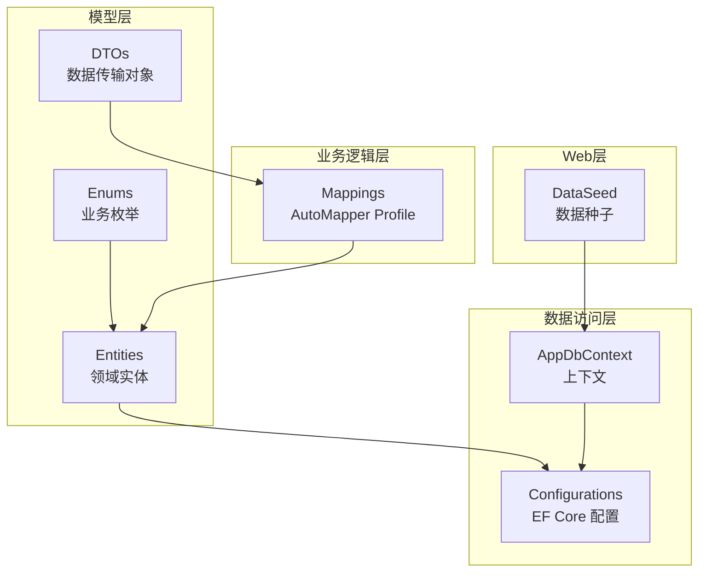

# 数据模型设计

<cite>
**本文引用的文件**   
- [EquipmentIMS.Models/Entities/BaseEntity.cs](file://EquipmentIMS.Models/Entities/BaseEntity.cs)
- [EquipmentIMS.Models/Entities/SysUser.cs](file://EquipmentIMS.Models/Entities/SysUser.cs)
- [EquipmentIMS.Models/Entities/SysRole.cs](file://EquipmentIMS.Models/Entities/SysRole.cs)
- [EquipmentIMS.Models/Entities/SysPermission.cs](file://EquipmentIMS.Models/Entities/SysPermission.cs)
- [EquipmentIMS.Models/Entities/SysUserRole.cs](file://EquipmentIMS.Models/Entities/SysUserRole.cs)
- [EquipmentIMS.Models/Entities/SysRolePermission.cs](file://EquipmentIMS.Models/Entities/SysRolePermission.cs)
- [EquipmentIMS.Models/Entities/BaseProduct.cs](file://EquipmentIMS.Models/Entities/BaseProduct.cs)
- [EquipmentIMS.Models/Entities/BaseCategory.cs](file://EquipmentIMS.Models/Entities/BaseCategory.cs)
- [EquipmentIMS.Models/Entities/BaseCustomer.cs](file://EquipmentIMS.Models/Entities/BaseCustomer.cs)
- [EquipmentIMS.Models/Entities/BaseSupplier.cs](file://EquipmentIMS.Models/Entities/BaseSupplier.cs)
- [EquipmentIMS.Models/Entities/BaseWarehouse.cs](file://EquipmentIMS.Models/Entities/BaseWarehouse.cs)
- [EquipmentIMS.Models/Entities/BaseProductStock.cs](file://EquipmentIMS.Models/Entities/BaseProductStock.cs)
- [EquipmentIMS.Models/Entities/PurPurchaseOrder.cs](file://EquipmentIMS.Models/Entities/PurPurchaseOrder.cs)
- [EquipmentIMS.Models/Entities/PurPurchaseOrderDetail.cs](file://EquipmentIMS.Models/Entities/PurPurchaseOrderDetail.cs)
- [EquipmentIMS.Models/Entities/PurPurchaseIn.cs](file://EquipmentIMS.Models/Entities/PurPurchaseIn.cs)
- [EquipmentIMS.Models/Entities/PurPurchaseInDetail.cs](file://EquipmentIMS.Models/Entities/PurPurchaseInDetail.cs)
- [EquipmentIMS.Models/Entities/PurPurchaseReturn.cs](file://EquipmentIMS.Models/Entities/PurPurchaseReturn.cs)
- [EquipmentIMS.Models/Entities/PurPurchaseReturnDetail.cs](file://EquipmentIMS.Models/Entities/PurPurchaseReturnDetail.cs)
- [EquipmentIMS.Models/Entities/SaleSaleOrder.cs](file://EquipmentIMS.Models/Entities/SaleSaleOrder.cs)
- [EquipmentIMS.Models/Entities/SaleSaleOrderDetail.cs](file://EquipmentIMS.Models/Entities/SaleSaleOrderDetail.cs)
- [EquipmentIMS.Models/Entities/SaleSaleOut.cs](file://EquipmentIMS.Models/Entities/SaleSaleOut.cs)
- [EquipmentIMS.Models/Entities/SaleSaleOutDetail.cs](file://EquipmentIMS.Models/Entities/SaleSaleOutDetail.cs)
- [EquipmentIMS.Models/Entities/SaleReturn.cs](file://EquipmentIMS.Models/Entities/SaleReturn.cs)
- [EquipmentIMS.Models/Entities/SaleReturnDetail.cs](file://EquipmentIMS.Models/Entities/SaleReturnDetail.cs)
- [EquipmentIMS.Models/Entities/InvStockCheck.cs](file://EquipmentIMS.Models/Entities/InvStockCheck.cs)
- [EquipmentIMS.Models/Entities/InvStockCheckDetail.cs](file://EquipmentIMS.Models/Entities/InvStockCheckDetail.cs)
- [EquipmentIMS.Models/Entities/InvStockTransfer.cs](file://EquipmentIMS.Models/Entities/InvStockTransfer.cs)
- [EquipmentIMS.Models/Entities/InvStockTransferDetail.cs](file://EquipmentIMS.Models/Entities/InvStockTransferDetail.cs)
- [EquipmentIMS.Models/Entities/InvStockTransaction.cs](file://EquipmentIMS.Models/Entities/InvStockTransaction.cs)
- [EquipmentIMS.Models/Entities/MaintDeviceArchive.cs](file://EquipmentIMS.Models/Entities/MaintDeviceArchive.cs)
- [EquipmentIMS.Models/Entities/MaintMaintenancePlan.cs](file://EquipmentIMS.Models/Entities/MaintMaintenancePlan.cs)
- [EquipmentIMS.Models/Entities/MaintRepairOrder.cs](file://EquipmentIMS.Models/Entities/MaintRepairOrder.cs)
- [EquipmentIMS.Models/Entities/MaintRepairPart.cs](file://EquipmentIMS.Models/Entities/MaintRepairPart.cs)
- [EquipmentIMS.DAL/Configurations/BaseProductConfiguration.cs](file://EquipmentIMS.DAL/Configurations/BaseProductConfiguration.cs)
- [EquipmentIMS.DAL/Configurations/BaseCategoryConfiguration.cs](file://EquipmentIMS.DAL/Configurations/BaseCategoryConfiguration.cs)
- [EquipmentIMS.DAL/Configurations/BaseCustomerConfiguration.cs](file://EquipmentIMS.DAL/Configurations/BaseCustomerConfiguration.cs)
- [EquipmentIMS.DAL/Configurations/BaseSupplierConfiguration.cs](file://EquipmentIMS.DAL/Configurations/BaseSupplierConfiguration.cs)
- [EquipmentIMS.DAL/Configurations/BaseWarehouseConfiguration.cs](file://EquipmentIMS.DAL/Configurations/BaseWarehouseConfiguration.cs)
- [EquipmentIMS.DAL/Configurations/BaseProductStockConfiguration.cs](file://EquipmentIMS.DAL/Configurations/BaseProductStockConfiguration.cs)
- [EquipmentIMS.DAL/Configurations/PurPurchaseOrderConfiguration.cs](file://EquipmentIMS.DAL/Configurations/PurPurchaseOrderConfiguration.cs)
- [EquipmentIMS.DAL/Configurations/PurPurchaseOrderDetailConfiguration.cs](file://EquipmentIMS.DAL/Configurations/PurPurchaseOrderDetailConfiguration.cs)
- [EquipmentIMS.DAL/Configurations/PurPurchaseInConfiguration.cs](file://EquipmentIMS.DAL/Configurations/PurPurchaseInConfiguration.cs)
- [EquipmentIMS.DAL/Configurations/PurPurchaseInDetailConfiguration.cs](file://EquipmentIMS.DAL/Configurations/PurPurchaseInDetailConfiguration.cs)
- [EquipmentIMS.DAL/Configurations/PurPurchaseReturnConfiguration.cs](file://EquipmentIMS.DAL/Configurations/PurPurchaseReturnConfiguration.cs)
- [EquipmentIMS.DAL/Configurations/PurPurchaseReturnDetailConfiguration.cs](file://EquipmentIMS.DAL/Configurations/PurPurchaseReturnDetailConfiguration.cs)
- [EquipmentIMS.DAL/Configurations/SaleSaleOrderConfiguration.cs](file://EquipmentIMS.DAL/Configurations/SaleSaleOrderConfiguration.cs)
- [EquipmentIMS.DAL/Configurations/SaleSaleOrderDetailConfiguration.cs](file://EquipmentIMS.DAL/Configurations/SaleSaleOrderDetailConfiguration.cs)
- [EquipmentIMS.DAL/Configurations/SaleSaleOutConfiguration.cs](file://EquipmentIMS.DAL/Configurations/SaleSaleOutConfiguration.cs)
- [EquipmentIMS.DAL/Configurations/SaleSaleOutDetailConfiguration.cs](file://EquipmentIMS.DAL/Configurations/SaleSaleOutDetailConfiguration.cs)
- [EquipmentIMS.DAL/Configurations/SaleReturnConfiguration.cs](file://EquipmentIMS.DAL/Configurations/SaleReturnConfiguration.cs)
- [EquipmentIMS.DAL/Configurations/SaleReturnDetailConfiguration.cs](file://EquipmentIMS.DAL/Configurations/SaleReturnDetailConfiguration.cs)
- [EquipmentIMS.DAL/Configurations/InvStockCheckConfiguration.cs](file://EquipmentIMS.DAL/Configurations/InvStockCheckConfiguration.cs)
- [EquipmentIMS.DAL/Configurations/InvStockCheckDetailConfiguration.cs](file://EquipmentIMS.DAL/Configurations/InvStockCheckDetailConfiguration.cs)
- [EquipmentIMS.DAL/Configurations/InvStockTransferConfiguration.cs](file://EquipmentIMS.DAL/Configurations/InvStockTransferConfiguration.cs)
- [EquipmentIMS.DAL/Configurations/InvStockTransferDetailConfiguration.cs](file://EquipmentIMS.DAL/Configurations/InvStockTransferDetailConfiguration.cs)
- [EquipmentIMS.DAL/Configurations/InvStockTransactionConfiguration.cs](file://EquipmentIMS.DAL/Configurations/InvStockTransactionConfiguration.cs)
- [EquipmentIMS.DAL/Configurations/MaintDeviceArchiveConfiguration.cs](file://EquipmentIMS.DAL/Configurations/MaintDeviceArchiveConfiguration.cs)
- [EquipmentIMS.DAL/Configurations/MaintMaintenancePlanConfiguration.cs](file://EquipmentIMS.DAL/Configurations/MaintMaintenancePlanConfiguration.cs)
- [EquipmentIMS.DAL/Configurations/MaintRepairOrderConfiguration.cs](file://EquipmentIMS.DAL/Configurations/MaintRepairOrderConfiguration.cs)
- [EquipmentIMS.DAL/Configurations/MaintRepairPartConfiguration.cs](file://EquipmentIMS.DAL/Configurations/MaintRepairPartConfiguration.cs)
- [EquipmentIMS.BLL/Mappings/MappingProfile.cs](file://EquipmentIMS.BLL/Mappings/MappingProfile.cs)
- [EquipmentIMS.Web/DataSeed.cs](file://EquipmentIMS.Web/DataSeed.cs)
</cite>

## 目录
1. [引言](#引言)
2. [项目结构](#项目结构)
3. [核心组件](#核心组件)
4. [架构总览](#架构总览)
5. [详细组件分析](#详细组件分析)
6. [依赖关系分析](#依赖关系分析)
7. [性能考虑](#性能考虑)
8. [故障排查指南](#故障排查指南)
9. [结论](#结论)
10. [附录](#附录)

## 引言
本文件面向THMS（设备库存管理系统）的数据模型设计，聚焦于实体类层次结构、继承与通用基类设计、核心业务实体的字段定义与约束、实体间外键与关联关系、数据库表结构与索引策略、数据完整性约束、AutoMapper映射配置与自定义规则、数据迁移与版本管理方案，并提供ER图与典型查询示例。文档旨在帮助开发者快速理解系统数据层的设计思想与落地实现。

## 项目结构
数据模型相关代码主要分布在以下模块：
- 领域模型与枚举：EquipmentIMS.Models/Entities、Enums
- EF Core 配置与关系映射：EquipmentIMS.DAL/Configurations
- AutoMapper 映射配置：EquipmentIMS.BLL/Mappings
- 数据种子与初始化：EquipmentIMS.Web/DataSeed.cs

图表来源
- [EquipmentIMS.Models/Entities/BaseEntity.cs](file://EquipmentIMS.Models/Entities/BaseEntity.cs)
- [EquipmentIMS.DAL/Configurations/BaseProductConfiguration.cs](file://EquipmentIMS.DAL/Configurations/BaseProductConfiguration.cs)
- [EquipmentIMS.BLL/Mappings/MappingProfile.cs](file://EquipmentIMS.BLL/Mappings/MappingProfile.cs)
- [EquipmentIMS.Web/DataSeed.cs](file://EquipmentIMS.Web/DataSeed.cs)

章节来源
- [EquipmentIMS.Models/Entities/BaseEntity.cs](file://EquipmentIMS.Models/Entities/BaseEntity.cs)
- [EquipmentIMS.BLL/Mappings/MappingProfile.cs](file://EquipmentIMS.BLL/Mappings/MappingProfile.cs)
- [EquipmentIMS.Web/DataSeed.cs](file://EquipmentIMS.Web/DataSeed.cs)

## 核心组件
- 通用基类 BaseEntity：为所有实体提供统一的标识与审计字段，如主键、创建时间、更新时间等，确保跨域一致性与可追踪性。
- 基础主数据实体：BaseCategory、BaseProduct、BaseCustomer、BaseSupplier、BaseWarehouse、BaseProductStock，构成产品、分类、客户、供应商、仓库与库存的核心主数据。
- 采购域：PurPurchaseOrder、PurPurchaseOrderDetail、PurPurchaseIn、PurPurchaseInDetail、PurPurchaseReturn、PurPurchaseReturnDetail。
- 销售域：SaleSaleOrder、SaleSaleOrderDetail、SaleSaleOut、SaleSaleOutDetail、SaleReturn、SaleReturnDetail。
- 库存域：InvStockCheck、InvStockCheckDetail、InvStockTransfer、InvStockTransferDetail、InvStockTransaction。
- 维保域：MaintDeviceArchive、MaintMaintenancePlan、MaintRepairOrder、MaintRepairPart。
- 系统与安全：SysUser、SysRole、SysPermission、SysUserRole、SysRolePermission。

章节来源
- [EquipmentIMS.Models/Entities/BaseEntity.cs](file://EquipmentIMS.Models/Entities/BaseEntity.cs)
- [EquipmentIMS.Models/Entities/BaseProduct.cs](file://EquipmentIMS.Models/Entities/BaseProduct.cs)
- [EquipmentIMS.Models/Entities/BaseCategory.cs](file://EquipmentIMS.Models/Entities/BaseCategory.cs)
- [EquipmentIMS.Models/Entities/BaseCustomer.cs](file://EquipmentIMS.Models/Entities/BaseCustomer.cs)
- [EquipmentIMS.Models/Entities/BaseSupplier.cs](file://EquipmentIMS.Models/Entities/BaseSupplier.cs)
- [EquipmentIMS.Models/Entities/BaseWarehouse.cs](file://EquipmentIMS.Models/Entities/BaseWarehouse.cs)
- [EquipmentIMS.Models/Entities/BaseProductStock.cs](file://EquipmentIMS.Models/Entities/BaseProductStock.cs)
- [EquipmentIMS.Models/Entities/PurPurchaseOrder.cs](file://EquipmentIMS.Models/Entities/PurPurchaseOrder.cs)
- [EquipmentIMS.Models/Entities/SaleSaleOrder.cs](file://EquipmentIMS.Models/Entities/SaleSaleOrder.cs)
- [EquipmentIMS.Models/Entities/InvStockCheck.cs](file://EquipmentIMS.Models/Entities/InvStockCheck.cs)
- [EquipmentIMS.Models/Entities/MaintDeviceArchive.cs](file://EquipmentIMS.Models/Entities/MaintDeviceArchive.cs)
- [EquipmentIMS.Models/Entities/SysUser.cs](file://EquipmentIMS.Models/Entities/SysUser.cs)

## 架构总览
数据模型采用“领域实体 + EF Core 配置”的解耦方式：
- 领域实体仅承载业务语义与基本约束；
- EF Core 配置集中描述表名、列类型、长度、必填、唯一、索引、关系等；
- AutoMapper 在 DTO 与实体之间进行映射，支持复杂转换与校验前置；
- DataSeed 负责初始数据与演示数据的注入。

```mermaid
classDiagram
class BaseEntity {
+Id
+CreatedAt
+UpdatedAt
}
class BaseCategory
class BaseProduct
class BaseCustomer
class BaseSupplier
class BaseWarehouse
class BaseProductStock
class PurPurchaseOrder
class PurPurchaseOrderDetail
class PurPurchaseIn
class PurPurchaseInDetail
class PurPurchaseReturn
class PurPurchaseReturnDetail
class SaleSaleOrder
class SaleSaleOrderDetail
class SaleSaleOut
class SaleSaleOutDetail
class SaleReturn
class SaleReturnDetail
class InvStockCheck
class InvStockCheckDetail
class InvStockTransfer
class InvStockTransferDetail
class InvStockTransaction
class MaintDeviceArchive
class MaintMaintenancePlan
class MaintRepairOrder
class MaintRepairPart
class SysUser
class SysRole
class SysPermission
class SysUserRole
class SysRolePermission
BaseCategory --|> BaseEntity
BaseProduct --|> BaseEntity
BaseCustomer --|> BaseEntity
BaseSupplier --|> BaseEntity
BaseWarehouse --|> BaseEntity
BaseProductStock --|> BaseEntity
PurPurchaseOrder --|> BaseEntity
PurPurchaseOrderDetail --|> BaseEntity
PurPurchaseIn --|> BaseEntity
PurPurchaseInDetail --|> BaseEntity
PurPurchaseReturn --|> BaseEntity
PurPurchaseReturnDetail --|> BaseEntity
SaleSaleOrder --|> BaseEntity
SaleSaleOrderDetail --|> BaseEntity
SaleSaleOut --|> BaseEntity
SaleSaleOutDetail --|> BaseEntity
SaleReturn --|> BaseEntity
SaleReturnDetail --|> BaseEntity
InvStockCheck --|> BaseEntity
InvStockCheckDetail --|> BaseEntity
InvStockTransfer --|> BaseEntity
InvStockTransferDetail --|> BaseEntity
InvStockTransaction --|> BaseEntity
MaintDeviceArchive --|> BaseEntity
MaintMaintenancePlan --|> BaseEntity
MaintRepairOrder --|> BaseEntity
MaintRepairPart --|> BaseEntity
SysUser --|> BaseEntity
SysRole --|> BaseEntity
SysPermission --|> BaseEntity
SysUserRole --|> BaseEntity
SysRolePermission --|> BaseEntity
```

图表来源
- [EquipmentIMS.Models/Entities/BaseEntity.cs](file://EquipmentIMS.Models/Entities/BaseEntity.cs)
- [EquipmentIMS.Models/Entities/BaseCategory.cs](file://EquipmentIMS.Models/Entities/BaseCategory.cs)
- [EquipmentIMS.Models/Entities/BaseProduct.cs](file://EquipmentIMS.Models/Entities/BaseProduct.cs)
- [EquipmentIMS.Models/Entities/BaseCustomer.cs](file://EquipmentIMS.Models/Entities/BaseCustomer.cs)
- [EquipmentIMS.Models/Entities/BaseSupplier.cs](file://EquipmentIMS.Models/Entities/BaseSupplier.cs)
- [EquipmentIMS.Models/Entities/BaseWarehouse.cs](file://EquipmentIMS.Models/Entities/BaseWarehouse.cs)
- [EquipmentIMS.Models/Entities/BaseProductStock.cs](file://EquipmentIMS.Models/Entities/BaseProductStock.cs)
- [EquipmentIMS.Models/Entities/PurPurchaseOrder.cs](file://EquipmentIMS.Models/Entities/PurPurchaseOrder.cs)
- [EquipmentIMS.Models/Entities/PurPurchaseOrderDetail.cs](file://EquipmentIMS.Models/Entities/PurPurchaseOrderDetail.cs)
- [EquipmentIMS.Models/Entities/PurPurchaseIn.cs](file://EquipmentIMS.Models/Entities/PurPurchaseIn.cs)
- [EquipmentIMS.Models/Entities/PurPurchaseInDetail.cs](file://EquipmentIMS.Models/Entities/PurPurchaseInDetail.cs)
- [EquipmentIMS.Models/Entities/PurPurchaseReturn.cs](file://EquipmentIMS.Models/Entities/PurPurchaseReturn.cs)
- [EquipmentIMS.Models/Entities/PurPurchaseReturnDetail.cs](file://EquipmentIMS.Models/Entities/PurPurchaseReturnDetail.cs)
- [EquipmentIMS.Models/Entities/SaleSaleOrder.cs](file://EquipmentIMS.Models/Entities/SaleSaleOrder.cs)
- [EquipmentIMS.Models/Entities/SaleSaleOrderDetail.cs](file://EquipmentIMS.Models/Entities/SaleSaleOrderDetail.cs)
- [EquipmentIMS.Models/Entities/SaleSaleOut.cs](file://EquipmentIMS.Models/Entities/SaleSaleOut.cs)
- [EquipmentIMS.Models/Entities/SaleSaleOutDetail.cs](file://EquipmentIMS.Models/Entities/SaleSaleOutDetail.cs)
- [EquipmentIMS.Models/Entities/SaleReturn.cs](file://EquipmentIMS.Models/Entities/SaleReturn.cs)
- [EquipmentIMS.Models/Entities/SaleReturnDetail.cs](file://EquipmentIMS.Models/Entities/SaleReturnDetail.cs)
- [EquipmentIMS.Models/Entities/InvStockCheck.cs](file://EquipmentIMS.Models/Entities/InvStockCheck.cs)
- [EquipmentIMS.Models/Entities/InvStockCheckDetail.cs](file://EquipmentIMS.Models/Entities/InvStockCheckDetail.cs)
- [EquipmentIMS.Models/Entities/InvStockTransfer.cs](file://EquipmentIMS.Models/Entities/InvStockTransfer.cs)
- [EquipmentIMS.Models/Entities/InvStockTransferDetail.cs](file://EquipmentIMS.Models/Entities/InvStockTransferDetail.cs)
- [EquipmentIMS.Models/Entities/InvStockTransaction.cs](file://EquipmentIMS.Models/Entities/InvStockTransaction.cs)
- [EquipmentIMS.Models/Entities/MaintDeviceArchive.cs](file://EquipmentIMS.Models/Entities/MaintDeviceArchive.cs)
- [EquipmentIMS.Models/Entities/MaintMaintenancePlan.cs](file://EquipmentIMS.Models/Entities/MaintMaintenancePlan.cs)
- [EquipmentIMS.Models/Entities/MaintRepairOrder.cs](file://EquipmentIMS.Models/Entities/MaintRepairOrder.cs)
- [EquipmentIMS.Models/Entities/MaintRepairPart.cs](file://EquipmentIMS.Models/Entities/MaintRepairPart.cs)
- [EquipmentIMS.Models/Entities/SysUser.cs](file://EquipmentIMS.Models/Entities/SysUser.cs)
- [EquipmentIMS.Models/Entities/SysRole.cs](file://EquipmentIMS.Models/Entities/SysRole.cs)
- [EquipmentIMS.Models/Entities/SysPermission.cs](file://EquipmentIMS.Models/Entities/SysPermission.cs)
- [EquipmentIMS.Models/Entities/SysUserRole.cs](file://EquipmentIMS.Models/Entities/SysUserRole.cs)
- [EquipmentIMS.Models/Entities/SysRolePermission.cs](file://EquipmentIMS.Models/Entities/SysRolePermission.cs)

## 详细组件分析

### 通用基类与审计字段
- 统一主键与审计字段：所有实体继承自 BaseEntity，包含 Id、CreatedAt、UpdatedAt 等字段，保证全系统一致的标识与审计能力。
- 建议：在新增实体时优先继承 BaseEntity，避免重复定义公共字段。

章节来源
- [EquipmentIMS.Models/Entities/BaseEntity.cs](file://EquipmentIMS.Models/Entities/BaseEntity.cs)

### 基础主数据实体
- BaseCategory：分类主数据，用于组织产品树形结构或扁平分类。
- BaseProduct：产品主数据，包含编码、名称、规格、单位、价格等关键属性。
- BaseCustomer / BaseSupplier：客户与供应商主数据，包含基本信息、联系方式、结算信息等。
- BaseWarehouse：仓库主数据，用于多仓库存管理。
- BaseProductStock：产品-仓库维度库存快照，记录可用数量、锁定数量、在途数量等。

章节来源
- [EquipmentIMS.Models/Entities/BaseCategory.cs](file://EquipmentIMS.Models/Entities/BaseCategory.cs)
- [EquipmentIMS.Models/Entities/BaseProduct.cs](file://EquipmentIMS.Models/Entities/BaseProduct.cs)
- [EquipmentIMS.Models/Entities/BaseCustomer.cs](file://EquipmentIMS.Models/Entities/BaseCustomer.cs)
- [EquipmentIMS.Models/Entities/BaseSupplier.cs](file://EquipmentIMS.Models/Entities/BaseSupplier.cs)
- [EquipmentIMS.Models/Entities/BaseWarehouse.cs](file://EquipmentIMS.Models/Entities/BaseWarehouse.cs)
- [EquipmentIMS.Models/Entities/BaseProductStock.cs](file://EquipmentIMS.Models/Entities/BaseProductStock.cs)

### 采购域实体
- 订单头：PurPurchaseOrder，记录供应商、下单人、日期、状态、总金额等。
- 订单行：PurPurchaseOrderDetail，记录产品、数量、单价、金额等。
- 入库单：PurPurchaseIn，记录入库批次、仓库、操作人、状态等。
- 入库明细：PurPurchaseInDetail，记录入库的产品、数量、批次等。
- 退货单：PurPurchaseReturn / PurPurchaseReturnDetail，记录退货原因、数量、金额等。

章节来源
- [EquipmentIMS.Models/Entities/PurPurchaseOrder.cs](file://EquipmentIMS.Models/Entities/PurPurchaseOrder.cs)
- [EquipmentIMS.Models/Entities/PurPurchaseOrderDetail.cs](file://EquipmentIMS.Models/Entities/PurPurchaseOrderDetail.cs)
- [EquipmentIMS.Models/Entities/PurPurchaseIn.cs](file://EquipmentIMS.Models/Entities/PurPurchaseIn.cs)
- [EquipmentIMS.Models/Entities/PurPurchaseInDetail.cs](file://EquipmentIMS.Models/Entities/PurPurchaseInDetail.cs)
- [EquipmentIMS.Models/Entities/PurPurchaseReturn.cs](file://EquipmentIMS.Models/Entities/PurPurchaseReturn.cs)
- [EquipmentIMS.Models/Entities/PurPurchaseReturnDetail.cs](file://EquipmentIMS.Models/Entities/PurPurchaseReturnDetail.cs)

### 销售域实体
- 销售订单：SaleSaleOrder / SaleSaleOrderDetail，记录客户、订单行、金额、状态等。
- 出库单：SaleSaleOut / SaleSaleOutDetail，记录出库仓库、发货信息、实发数量等。
- 销售退货：SaleReturn / SaleReturnDetail，记录退货原因、数量、金额等。

章节来源
- [EquipmentIMS.Models/Entities/SaleSaleOrder.cs](file://EquipmentIMS.Models/Entities/SaleSaleOrder.cs)
- [EquipmentIMS.Models/Entities/SaleSaleOrderDetail.cs](file://EquipmentIMS.Models/Entities/SaleSaleOrderDetail.cs)
- [EquipmentIMS.Models/Entities/SaleSaleOut.cs](file://EquipmentIMS.Models/Entities/SaleSaleOut.cs)
- [EquipmentIMS.Models/Entities/SaleSaleOutDetail.cs](file://EquipmentIMS.Models/Entities/SaleSaleOutDetail.cs)
- [EquipmentIMS.Models/Entities/SaleReturn.cs](file://EquipmentIMS.Models/Entities/SaleReturn.cs)
- [EquipmentIMS.Models/Entities/SaleReturnDetail.cs](file://EquipmentIMS.Models/Entities/SaleReturnDetail.cs)

### 库存域实体
- 盘点单：InvStockCheck / InvStockCheckDetail，记录盘点范围、差异、处理结果。
- 调拨单：InvStockTransfer / InvStockTransferDetail，记录源仓库、目标仓库、调拨明细。
- 流水账：InvStockTransaction，记录每次库存变动的类型、数量、方向、关联单据等。

章节来源
- [EquipmentIMS.Models/Entities/InvStockCheck.cs](file://EquipmentIMS.Models/Entities/InvStockCheck.cs)
- [EquipmentIMS.Models/Entities/InvStockCheckDetail.cs](file://EquipmentIMS.Models/Entities/InvStockCheckDetail.cs)
- [EquipmentIMS.Models/Entities/InvStockTransfer.cs](file://EquipmentIMS.Models/Entities/InvStockTransfer.cs)
- [EquipmentIMS.Models/Entities/InvStockTransferDetail.cs](file://EquipmentIMS.Models/Entities/InvStockTransferDetail.cs)
- [EquipmentIMS.Models/Entities/InvStockTransaction.cs](file://EquipmentIMS.Models/Entities/InvStockTransaction.cs)

### 维保域实体
- 设备档案：MaintDeviceArchive，记录设备编号、型号、序列号、归属仓库/位置等。
- 保养计划：MaintMaintenancePlan，记录计划周期、任务内容、责任人等。
- 维修工单：MaintRepairOrder / MaintRepairPart，记录故障描述、处理过程、更换配件等。

章节来源
- [EquipmentIMS.Models/Entities/MaintDeviceArchive.cs](file://EquipmentIMS.Models/Entities/MaintDeviceArchive.cs)
- [EquipmentIMS.Models/Entities/MaintMaintenancePlan.cs](file://EquipmentIMS.Models/Entities/MaintMaintenancePlan.cs)
- [EquipmentIMS.Models/Entities/MaintRepairOrder.cs](file://EquipmentIMS.Models/Entities/MaintRepairOrder.cs)
- [EquipmentIMS.Models/Entities/MaintRepairPart.cs](file://EquipmentIMS.Models/Entities/MaintRepairPart.cs)

### 系统与权限实体
- 用户：SysUser，登录账号、姓名、角色关联等。
- 角色：SysRole，角色名称、描述等。
- 权限：SysPermission，权限标识、资源路径、类型等。
- 用户-角色：SysUserRole，多对多中间表。
- 角色-权限：SysRolePermission，多对多中间表。

章节来源
- [EquipmentIMS.Models/Entities/SysUser.cs](file://EquipmentIMS.Models/Entities/SysUser.cs)
- [EquipmentIMS.Models/Entities/SysRole.cs](file://EquipmentIMS.Models/Entities/SysRole.cs)
- [EquipmentIMS.Models/Entities/SysPermission.cs](file://EquipmentIMS.Models/Entities/SysPermission.cs)
- [EquipmentIMS.Models/Entities/SysUserRole.cs](file://EquipmentIMS.Models/Entities/SysUserRole.cs)
- [EquipmentIMS.Models/Entities/SysRolePermission.cs](file://EquipmentIMS.Models/Entities/SysRolePermission.cs)

## 依赖关系分析

### 实体间关系与外键
- 一对多
  - 分类 -> 产品：BaseCategory.BaseProducts
  - 产品 -> 库存：BaseProduct.BaseProductStocks
  - 仓库 -> 库存：BaseWarehouse.BaseProductStocks
  - 供应商 -> 采购订单：BaseSupplier.PurPurchaseOrders
  - 客户 -> 销售订单：BaseCustomer.SaleSaleOrders
  - 仓库 -> 入库单：BaseWarehouse.PurPurchaseIns
  - 仓库 -> 出库单：BaseWarehouse.SaleSaleOuts
  - 仓库 -> 调拨单：BaseWarehouse.InvStockTransfers
  - 仓库 -> 盘点单：BaseWarehouse.InvStockChecks
  - 产品 -> 入库明细：BaseProduct.PurPurchaseInDetails
  - 产品 -> 出库明细：BaseProduct.SaleSaleOutDetails
  - 产品 -> 调拨明细：BaseProduct.InvStockTransferDetails
  - 产品 -> 盘点明细：BaseProduct.InvStockCheckDetails
  - 产品 -> 采购订单明细：BaseProduct.PurPurchaseOrderDetails
  - 产品 -> 销售订单明细：BaseProduct.SaleSaleOrderDetails
  - 产品 -> 退货明细（采购/销售）：对应 Detail 实体
  - 产品 -> 维修配件：BaseProduct.MaintRepairParts
  - 设备 -> 维修工单：MaintDeviceArchive.MaintRepairOrders
  - 计划 -> 维修工单：MaintMaintenancePlan.MaintRepairOrders
- 多对多
  - 用户 <-> 角色：通过 SysUserRole
  - 角色 <-> 权限：通过 SysRolePermission

```mermaid
erDiagram
BASECATEGORY ||--o{ BASEPRODUCT : "拥有"
BASESUPPLIER ||--o{ PURPURCHASEORDER : "发起"
BASECUSTOMER ||--o{ SALESALEORDER : "下单"
BASEWAREHOUSE ||--o{ BASEPRODUCTSTOCK : "持有"
BASEWAREHOUSE ||--o{ PURPURCHASEIN : "入库"
BASEWAREHOUSE ||--o{ SALESALEOUT : "出库"
BASEWAREHOUSE ||--o{ INVSTOCKTRANSFER : "调拨"
BASEWAREHOUSE ||--o{ INVSTOCKCHECK : "盘点"
BASEPRODUCT ||--o{ BASEPRODUCTSTOCK : "库存"
BASEPRODUCT ||--o{ PURPURCHASEORDERDETAIL : "采购明细"
BASEPRODUCT ||--o{ SALESALEORDERDETAIL : "销售明细"
BASEPRODUCT ||--o{ PURPURCHASEINDetail : "入库明细"
BASEPRODUCT ||--o{ SALESALEOUTDETAIL : "出库明细"
BASEPRODUCT ||--o{ INVSTOCKTRANSFERDETAIL : "调拨明细"
BASEPRODUCT ||--o{ INVSTOCKCHECKDETAIL : "盘点明细"
BASEPRODUCT ||--o{ PURPURCHASERETURNDETAIL : "采购退货明细"
BASEPRODUCT ||--o{ SALERETURNDETAIL : "销售退货明细"
BASEPRODUCT ||--o{ MAINTREPAIRPART : "维修配件"
MAINTDEVICEARCHIVE ||--o{ MAINTREPAIRORDER : "维修工单"
MAINTMAINTENANCEPLAN ||--o{ MAINTREPAIRORDER : "计划关联"
SYSUSER ||--o{ SYSUSERROLE : "用户角色"
SYSDROLE ||--o{ SYSUSERROLE : "用户角色"
SYSROLE ||--o{ SYSROLEPERMISSION : "角色权限"
SYSPERMISSION ||--o{ SYSROLEPERMISSION : "角色权限"
```

图表来源
- [EquipmentIMS.Models/Entities/BaseCategory.cs](file://EquipmentIMS.Models/Entities/BaseCategory.cs)
- [EquipmentIMS.Models/Entities/BaseProduct.cs](file://EquipmentIMS.Models/Entities/BaseProduct.cs)
- [EquipmentIMS.Models/Entities/BaseCustomer.cs](file://EquipmentIMS.Models/Entities/BaseCustomer.cs)
- [EquipmentIMS.Models/Entities/BaseSupplier.cs](file://EquipmentIMS.Models/Entities/BaseSupplier.cs)
- [EquipmentIMS.Models/Entities/BaseWarehouse.cs](file://EquipmentIMS.Models/Entities/BaseWarehouse.cs)
- [EquipmentIMS.Models/Entities/BaseProductStock.cs](file://EquipmentIMS.Models/Entities/BaseProductStock.cs)
- [EquipmentIMS.Models/Entities/PurPurchaseOrder.cs](file://EquipmentIMS.Models/Entities/PurPurchaseOrder.cs)
- [EquipmentIMS.Models/Entities/PurPurchaseOrderDetail.cs](file://EquipmentIMS.Models/Entities/PurPurchaseOrderDetail.cs)
- [EquipmentIMS.Models/Entities/PurPurchaseIn.cs](file://EquipmentIMS.Models/Entities/PurPurchaseIn.cs)
- [EquipmentIMS.Models/Entities/PurPurchaseInDetail.cs](file://EquipmentIMS.Models/Entities/PurPurchaseInDetail.cs)
- [EquipmentIMS.Models/Entities/PurPurchaseReturn.cs](file://EquipmentIMS.Models/Entities/PurPurchaseReturn.cs)
- [EquipmentIMS.Models/Entities/PurPurchaseReturnDetail.cs](file://EquipmentIMS.Models/Entities/PurPurchaseReturnDetail.cs)
- [EquipmentIMS.Models/Entities/SaleSaleOrder.cs](file://EquipmentIMS.Models/Entities/SaleSaleOrder.cs)
- [EquipmentIMS.Models/Entities/SaleSaleOrderDetail.cs](file://EquipmentIMS.Models/Entities/SaleSaleOrderDetail.cs)
- [EquipmentIMS.Models/Entities/SaleSaleOut.cs](file://EquipmentIMS.Models/Entities/SaleSaleOut.cs)
- [EquipmentIMS.Models/Entities/SaleSaleOutDetail.cs](file://EquipmentIMS.Models/Entities/SaleSaleOutDetail.cs)
- [EquipmentIMS.Models/Entities/SaleReturn.cs](file://EquipmentIMS.Models/Entities/SaleReturn.cs)
- [EquipmentIMS.Models/Entities/SaleReturnDetail.cs](file://EquipmentIMS.Models/Entities/SaleReturnDetail.cs)
- [EquipmentIMS.Models/Entities/InvStockCheck.cs](file://EquipmentIMS.Models/Entities/InvStockCheck.cs)
- [EquipmentIMS.Models/Entities/InvStockCheckDetail.cs](file://EquipmentIMS.Models/Entities/InvStockCheckDetail.cs)
- [EquipmentIMS.Models/Entities/InvStockTransfer.cs](file://EquipmentIMS.Models/Entities/InvStockTransfer.cs)
- [EquipmentIMS.Models/Entities/InvStockTransferDetail.cs](file://EquipmentIMS.Models/Entities/InvStockTransferDetail.cs)
- [EquipmentIMS.Models/Entities/InvStockTransaction.cs](file://EquipmentIMS.Models/Entities/InvStockTransaction.cs)
- [EquipmentIMS.Models/Entities/MaintDeviceArchive.cs](file://EquipmentIMS.Models/Entities/MaintDeviceArchive.cs)
- [EquipmentIMS.Models/Entities/MaintMaintenancePlan.cs](file://EquipmentIMS.Models/Entities/MaintMaintenancePlan.cs)
- [EquipmentIMS.Models/Entities/MaintRepairOrder.cs](file://EquipmentIMS.Models/Entities/MaintRepairOrder.cs)
- [EquipmentIMS.Models/Entities/MaintRepairPart.cs](file://EquipmentIMS.Models/Entities/MaintRepairPart.cs)
- [EquipmentIMS.Models/Entities/SysUser.cs](file://EquipmentIMS.Models/Entities/SysUser.cs)
- [EquipmentIMS.Models/Entities/SysRole.cs](file://EquipmentIMS.Models/Entities/SysRole.cs)
- [EquipmentIMS.Models/Entities/SysPermission.cs](file://EquipmentIMS.Models/Entities/SysPermission.cs)
- [EquipmentIMS.Models/Entities/SysUserRole.cs](file://EquipmentIMS.Models/Entities/SysUserRole.cs)
- [EquipmentIMS.Models/Entities/SysRolePermission.cs](file://EquipmentIMS.Models/Entities/SysRolePermission.cs)

### 索引优化策略
- 主键索引：所有实体的 Id 自动为主键索引。
- 外键索引：建议在频繁查询的外键列上建立索引，例如：
  - 采购/销售订单头的外键（供应商、客户、仓库）
  - 明细表的外键（产品、订单头、入库/出库头）
  - 库存流水的关联外键（产品、仓库、交易类型、时间）
- 复合索引：针对常用过滤条件组合建立复合索引，例如：
  - 产品+仓库（库存查询）
  - 订单号+状态（订单列表）
  - 设备编号+状态（设备检索）
- 唯一约束：对业务唯一字段建立唯一索引，例如：
  - 产品编码、分类编码、仓库编码、用户账号等

章节来源
- [EquipmentIMS.DAL/Configurations/BaseProductConfiguration.cs](file://EquipmentIMS.DAL/Configurations/BaseProductConfiguration.cs)
- [EquipmentIMS.DAL/Configurations/BaseCategoryConfiguration.cs](file://EquipmentIMS.DAL/Configurations/BaseCategoryConfiguration.cs)
- [EquipmentIMS.DAL/Configurations/BaseCustomerConfiguration.cs](file://EquipmentIMS.DAL/Configurations/BaseCustomerConfiguration.cs)
- [EquipmentIMS.DAL/Configurations/BaseSupplierConfiguration.cs](file://EquipmentIMS.DAL/Configurations/BaseSupplierConfiguration.cs)
- [EquipmentIMS.DAL/Configurations/BaseWarehouseConfiguration.cs](file://EquipmentIMS.DAL/Configurations/BaseWarehouseConfiguration.cs)
- [EquipmentIMS.DAL/Configurations/BaseProductStockConfiguration.cs](file://EquipmentIMS.DAL/Configurations/BaseProductStockConfiguration.cs)
- [EquipmentIMS.DAL/Configurations/PurPurchaseOrderConfiguration.cs](file://EquipmentIMS.DAL/Configurations/PurPurchaseOrderConfiguration.cs)
- [EquipmentIMS.DAL/Configurations/PurPurchaseOrderDetailConfiguration.cs](file://EquipmentIMS.DAL/Configurations/PurPurchaseOrderDetailConfiguration.cs)
- [EquipmentIMS.DAL/Configurations/PurPurchaseInConfiguration.cs](file://EquipmentIMS.DAL/Configurations/PurPurchaseInConfiguration.cs)
- [EquipmentIMS.DAL/Configurations/PurPurchaseInDetailConfiguration.cs](file://EquipmentIMS.DAL/Configurations/PurPurchaseInDetailConfiguration.cs)
- [EquipmentIMS.DAL/Configurations/PurPurchaseReturnConfiguration.cs](file://EquipmentIMS.DAL/Configurations/PurPurchaseReturnConfiguration.cs)
- [EquipmentIMS.DAL/Configurations/PurPurchaseReturnDetailConfiguration.cs](file://EquipmentIMS.DAL/Configurations/PurPurchaseReturnDetailConfiguration.cs)
- [EquipmentIMS.DAL/Configurations/SaleSaleOrderConfiguration.cs](file://EquipmentIMS.DAL/Configurations/SaleSaleOrderConfiguration.cs)
- [EquipmentIMS.DAL/Configurations/SaleSaleOrderDetailConfiguration.cs](file://EquipmentIMS.DAL/Configurations/SaleSaleOrderDetailConfiguration.cs)
- [EquipmentIMS.DAL/Configurations/SaleSaleOutConfiguration.cs](file://EquipmentIMS.DAL/Configurations/SaleSaleOutConfiguration.cs)
- [EquipmentIMS.DAL/Configurations/SaleSaleOutDetailConfiguration.cs](file://EquipmentIMS.DAL/Configurations/SaleSaleOutDetailConfiguration.cs)
- [EquipmentIMS.DAL/Configurations/SaleReturnConfiguration.cs](file://EquipmentIMS.DAL/Configurations/SaleReturnConfiguration.cs)
- [EquipmentIMS.DAL/Configurations/SaleReturnDetailConfiguration.cs](file://EquipmentIMS.DAL/Configurations/SaleReturnDetailConfiguration.cs)
- [EquipmentIMS.DAL/Configurations/InvStockCheckConfiguration.cs](file://EquipmentIMS.DAL/Configurations/InvStockCheckConfiguration.cs)
- [EquipmentIMS.DAL/Configurations/InvStockCheckDetailConfiguration.cs](file://EquipmentIMS.DAL/Configurations/InvStockCheckDetailConfiguration.cs)
- [EquipmentIMS.DAL/Configurations/InvStockTransferConfiguration.cs](file://EquipmentIMS.DAL/Configurations/InvStockTransferConfiguration.cs)
- [EquipmentIMS.DAL/Configurations/InvStockTransferDetailConfiguration.cs](file://EquipmentIMS.DAL/Configurations/InvStockTransferDetailConfiguration.cs)
- [EquipmentIMS.DAL/Configurations/InvStockTransactionConfiguration.cs](file://EquipmentIMS.DAL/Configurations/InvStockTransactionConfiguration.cs)
- [EquipmentIMS.DAL/Configurations/MaintDeviceArchiveConfiguration.cs](file://EquipmentIMS.DAL/Configurations/MaintDeviceArchiveConfiguration.cs)
- [EquipmentIMS.DAL/Configurations/MaintMaintenancePlanConfiguration.cs](file://EquipmentIMS.DAL/Configurations/MaintMaintenancePlanConfiguration.cs)
- [EquipmentIMS.DAL/Configurations/MaintRepairOrderConfiguration.cs](file://EquipmentIMS.DAL/Configurations/MaintRepairOrderConfiguration.cs)
- [EquipmentIMS.DAL/Configurations/MaintRepairPartConfiguration.cs](file://EquipmentIMS.DAL/Configurations/MaintRepairPartConfiguration.cs)

### 数据完整性约束
- 非空与长度限制：在 Configuration 中设置 Required、HasMaxLength 等约束，确保输入合法性。
- 唯一性：对编码类字段设置唯一约束，防止重复。
- 级联删除/更新：谨慎使用，避免误删重要历史数据；对于明细表通常禁止级联删除。
- 数值精度：金额、税率、折扣等使用高精度小数类型，避免舍入误差。
- 枚举约束：使用数据库 CHECK 或应用层枚举校验，确保状态值合法。

章节来源
- [EquipmentIMS.DAL/Configurations/BaseProductConfiguration.cs](file://EquipmentIMS.DAL/Configurations/BaseProductConfiguration.cs)
- [EquipmentIMS.DAL/Configurations/BaseCategoryConfiguration.cs](file://EquipmentIMS.DAL/Configurations/BaseCategoryConfiguration.cs)
- [EquipmentIMS.DAL/Configurations/BaseCustomerConfiguration.cs](file://EquipmentIMS.DAL/Configurations/BaseCustomerConfiguration.cs)
- [EquipmentIMS.DAL/Configurations/BaseSupplierConfiguration.cs](file://EquipmentIMS.DAL/Configurations/BaseSupplierConfiguration.cs)
- [EquipmentIMS.DAL/Configurations/BaseWarehouseConfiguration.cs](file://EquipmentIMS.DAL/Configurations/BaseWarehouseConfiguration.cs)
- [EquipmentIMS.DAL/Configurations/BaseProductStockConfiguration.cs](file://EquipmentIMS.DAL/Configurations/BaseProductStockConfiguration.cs)
- [EquipmentIMS.DAL/Configurations/PurPurchaseOrderConfiguration.cs](file://EquipmentIMS.DAL/Configurations/PurPurchaseOrderConfiguration.cs)
- [EquipmentIMS.DAL/Configurations/PurPurchaseOrderDetailConfiguration.cs](file://EquipmentIMS.DAL/Configurations/PurPurchaseOrderDetailConfiguration.cs)
- [EquipmentIMS.DAL/Configurations/PurPurchaseInConfiguration.cs](file://EquipmentIMS.DAL/Configurations/PurPurchaseInConfiguration.cs)
- [EquipmentIMS.DAL/Configurations/PurPurchaseInDetailConfiguration.cs](file://EquipmentIMS.DAL/Configurations/PurPurchaseInDetailConfiguration.cs)
- [EquipmentIMS.DAL/Configurations/PurPurchaseReturnConfiguration.cs](file://EquipmentIMS.DAL/Configurations/PurPurchaseReturnConfiguration.cs)
- [EquipmentIMS.DAL/Configurations/PurPurchaseReturnDetailConfiguration.cs](file://EquipmentIMS.DAL/Configurations/PurPurchaseReturnDetailConfiguration.cs)
- [EquipmentIMS.DAL/Configurations/SaleSaleOrderConfiguration.cs](file://EquipmentIMS.DAL/Configurations/SaleSaleOrderConfiguration.cs)
- [EquipmentIMS.DAL/Configurations/SaleSaleOrderDetailConfiguration.cs](file://EquipmentIMS.DAL/Configurations/SaleSaleOrderConfiguration.cs)
- [EquipmentIMS.DAL/Configurations/SaleSaleOutConfiguration.cs](file://EquipmentIMS.DAL/Configurations/SaleSaleOutConfiguration.cs)
- [EquipmentIMS.DAL/Configurations/SaleSaleOutDetailConfiguration.cs](file://EquipmentIMS.DAL/Configurations/SaleSaleOutDetailConfiguration.cs)
- [EquipmentIMS.DAL/Configurations/SaleReturnConfiguration.cs](file://EquipmentIMS.DAL/Configurations/SaleReturnConfiguration.cs)
- [EquipmentIMS.DAL/Configurations/SaleReturnDetailConfiguration.cs](file://EquipmentIMS.DAL/Configurations/SaleReturnDetailConfiguration.cs)
- [EquipmentIMS.DAL/Configurations/InvStockCheckConfiguration.cs](file://EquipmentIMS.DAL/Configurations/InvStockCheckConfiguration.cs)
- [EquipmentIMS.DAL/Configurations/InvStockCheckDetailConfiguration.cs](file://EquipmentIMS.DAL/Configurations/InvStockCheckDetailConfiguration.cs)
- [EquipmentIMS.DAL/Configurations/InvStockTransferConfiguration.cs](file://EquipmentIMS.DAL/Configurations/InvStockTransferConfiguration.cs)
- [EquipmentIMS.DAL/Configurations/InvStockTransferDetailConfiguration.cs](file://EquipmentIMS.DAL/Configurations/InvStockTransferDetailConfiguration.cs)
- [EquipmentIMS.DAL/Configurations/InvStockTransactionConfiguration.cs](file://EquipmentIMS.DAL/Configurations/InvStockTransactionConfiguration.cs)
- [EquipmentIMS.DAL/Configurations/MaintDeviceArchiveConfiguration.cs](file://EquipmentIMS.DAL/Configurations/MaintDeviceArchiveConfiguration.cs)
- [EquipmentIMS.DAL/Configurations/MaintMaintenancePlanConfiguration.cs](file://EquipmentIMS.DAL/Configurations/MaintMaintenancePlanConfiguration.cs)
- [EquipmentIMS.DAL/Configurations/MaintRepairOrderConfiguration.cs](file://EquipmentIMS.DAL/Configurations/MaintRepairOrderConfiguration.cs)
- [EquipmentIMS.DAL/Configurations/MaintRepairPartConfiguration.cs](file://EquipmentIMS.DAL/Configurations/MaintRepairPartConfiguration.cs)

### AutoMapper 映射配置与自定义规则
- 配置文件位置：BLL/Mappings/MappingProfile.cs
- 常见用法
  - 实体到 DTO：用于 API 返回与前端展示
  - DTO 到实体：用于接收前端提交并持久化
  - 复杂映射：如金额汇总、状态码转换、字典映射、日期格式化等
- 自定义映射规则
  - 使用 MapFrom 指定字段映射表达式
  - 使用 ConvertUsing 实现复杂转换逻辑
  - 使用 AfterMap/BeforeMap 执行额外处理（如计算派生字段）
- 最佳实践
  - 保持 DTO 与实体一一对应，避免过度耦合
  - 将复杂转换封装为独立转换器，便于测试与维护
  - 在批量映射场景下启用投影以减少 N+1 查询

章节来源
- [EquipmentIMS.BLL/Mappings/MappingProfile.cs](file://EquipmentIMS.BLL/Mappings/MappingProfile.cs)

### 数据迁移策略与版本管理
- 迁移生成：基于 EF Core 的 Code First 模式，从实体与配置生成迁移脚本。
- 版本控制：每个迁移对应一次变更，提交至版本库，确保环境一致性。
- 回滚策略：保留反向迁移，必要时可回滚到上一版本。
- 生产发布：先在预生产验证，再在生产执行迁移，配合事务与备份。
- 数据种子：结合 DataSeed 在首次部署或特定版本注入基础数据。

章节来源
- [EquipmentIMS.Web/DataSeed.cs](file://EquipmentIMS.Web/DataSeed.cs)

### 典型查询示例
- 按产品与仓库查询当前库存
  - 思路：连接 BaseProductStock 与 BaseProduct、BaseWarehouse，过滤仓库与产品，聚合可用数量
- 查询某供应商的未结采购订单
  - 思路：筛选 PurPurchaseOrder 的状态与供应商，展开 OrderDetails 获取行项
- 查询某客户的最近销售出库记录
  - 思路：筛选 SaleSaleOut 的客户与时间范围，展开 OutDetails 获取明细
- 查询设备维修历史
  - 思路：根据设备编号查找 MaintRepairOrder，展开 RepairParts 获取配件消耗
- 库存流水分页查询
  - 思路：按产品/仓库/交易类型/时间范围过滤，排序后分页

[本节为概念性说明，不直接分析具体文件]

## 性能考虑
- 查询优化
  - 合理使用 Include/ThenInclude 减少 N+1 查询
  - 使用 Select 投影只取必要字段，降低网络与内存开销
  - 对高频过滤字段建立合适索引
- 写入优化
  - 批量插入/更新，减少往返次数
  - 拆分大事务，避免长事务锁表
- 缓存策略
  - 对主数据（分类、仓库、产品）使用缓存，减轻数据库压力
  - 对报表类聚合结果做短期缓存

[本节为通用指导，不直接分析具体文件]

## 故障排查指南
- 常见错误
  - 外键约束冲突：检查关联实体是否存在，确认级联策略
  - 唯一约束冲突：检查编码是否重复
  - 类型转换失败：检查 DTO 与实体字段类型是否匹配
- 定位方法
  - 查看异常堆栈与 SQL 日志
  - 使用 EF Core 的 ChangeTracker 跟踪实体状态
  - 核对 MappingProfile 中的映射规则是否正确

章节来源
- [EquipmentIMS.BLL/Mappings/MappingProfile.cs](file://EquipmentIMS.BLL/Mappings/MappingProfile.cs)

## 结论
THMS 的数据模型以 BaseEntity 为基础，围绕主数据、采购、销售、库存、维保与系统权限构建清晰的领域边界。通过 EF Core 配置集中管理表结构与关系，借助 AutoMapper 完成 DTO 与实体的映射，结合 DataSeed 实现数据初始化。合理的索引与约束策略保障了查询性能与数据完整性。建议持续完善迁移管理与监控告警，进一步提升系统的稳定性与可维护性。

## 附录

### ER 图（完整视图）

```mermaid
erDiagram
BASECATEGORY ||--o{ BASEPRODUCT : "分类->产品"
BASESUPPLIER ||--o{ PURPURCHASEORDER : "供应商->采购订单"
BASECUSTOMER ||--o{ SALESALEORDER : "客户->销售订单"
BASEWAREHOUSE ||--o{ BASEPRODUCTSTOCK : "仓库->库存"
BASEWAREHOUSE ||--o{ PURPURCHASEIN : "仓库->入库单"
BASEWAREHOUSE ||--o{ SALESALEOUT : "仓库->出库单"
BASEWAREHOUSE ||--o{ INVSTOCKTRANSFER : "仓库->调拨单"
BASEWAREHOUSE ||--o{ INVSTOCKCHECK : "仓库->盘点单"
BASEPRODUCT ||--o{ BASEPRODUCTSTOCK : "产品->库存"
BASEPRODUCT ||--o{ PURPURCHASEORDERDETAIL : "产品->采购订单明细"
BASEPRODUCT ||--o{ SALESALEORDERDETAIL : "产品->销售订单明细"
BASEPRODUCT ||--o{ PURPURCHASEINDetail : "产品->入库明细"
BASEPRODUCT ||--o{ SALESALEOUTDETAIL : "产品->出库明细"
BASEPRODUCT ||--o{ INVSTOCKTRANSFERDETAIL : "产品->调拨明细"
BASEPRODUCT ||--o{ INVSTOCKCHECKDETAIL : "产品->盘点明细"
BASEPRODUCT ||--o{ PURPURCHASERETURNDETAIL : "产品->采购退货明细"
BASEPRODUCT ||--o{ SALERETURNDETAIL : "产品->销售退货明细"
BASEPRODUCT ||--o{ MAINTREPAIRPART : "产品->维修配件"
MAINTDEVICEARCHIVE ||--o{ MAINTREPAIRORDER : "设备->维修工单"
MAINTMAINTENANCEPLAN ||--o{ MAINTREPAIRORDER : "计划->维修工单"
SYSUSER ||--o{ SYSUSERROLE : "用户->用户角色"
SYSROLE ||--o{ SYSUSERROLE : "角色->用户角色"
SYSROLE ||--o{ SYSROLEPERMISSION : "角色->角色权限"
SYSPERMISSION ||--o{ SYSROLEPERMISSION : "权限->角色权限"
```

图表来源
- [EquipmentIMS.Models/Entities/BaseCategory.cs](file://EquipmentIMS.Models/Entities/BaseCategory.cs)
- [EquipmentIMS.Models/Entities/BaseProduct.cs](file://EquipmentIMS.Models/Entities/BaseProduct.cs)
- [EquipmentIMS.Models/Entities/BaseCustomer.cs](file://EquipmentIMS.Models/Entities/BaseCustomer.cs)
- [EquipmentIMS.Models/Entities/BaseSupplier.cs](file://EquipmentIMS.Models/Entities/BaseSupplier.cs)
- [EquipmentIMS.Models/Entities/BaseWarehouse.cs](file://EquipmentIMS.Models/Entities/BaseWarehouse.cs)
- [EquipmentIMS.Models/Entities/BaseProductStock.cs](file://EquipmentIMS.Models/Entities/BaseProductStock.cs)
- [EquipmentIMS.Models/Entities/PurPurchaseOrder.cs](file://EquipmentIMS.Models/Entities/PurPurchaseOrder.cs)
- [EquipmentIMS.Models/Entities/PurPurchaseOrderDetail.cs](file://EquipmentIMS.Models/Entities/PurPurchaseOrderDetail.cs)
- [EquipmentIMS.Models/Entities/PurPurchaseIn.cs](file://EquipmentIMS.Models/Entities/PurPurchaseIn.cs)
- [EquipmentIMS.Models/Entities/PurPurchaseInDetail.cs](file://EquipmentIMS.Models/Entities/PurPurchaseInDetail.cs)
- [EquipmentIMS.Models/Entities/PurPurchaseReturn.cs](file://EquipmentIMS.Models/Entities/PurPurchaseReturn.cs)
- [EquipmentIMS.Models/Entities/PurPurchaseReturnDetail.cs](file://EquipmentIMS.Models/Entities/PurPurchaseReturnDetail.cs)
- [EquipmentIMS.Models/Entities/SaleSaleOrder.cs](file://EquipmentIMS.Models/Entities/SaleSaleOrder.cs)
- [EquipmentIMS.Models/Entities/SaleSaleOrderDetail.cs](file://EquipmentIMS.Models/Entities/SaleSaleOrderDetail.cs)
- [EquipmentIMS.Models/Entities/SaleSaleOut.cs](file://EquipmentIMS.Models/Entities/SaleSaleOut.cs)
- [EquipmentIMS.Models/Entities/SaleSaleOutDetail.cs](file://EquipmentIMS.Models/Entities/SaleSaleOutDetail.cs)
- [EquipmentIMS.Models/Entities/SaleReturn.cs](file://EquipmentIMS.Models/Entities/SaleReturn.cs)
- [EquipmentIMS.Models/Entities/SaleReturnDetail.cs](file://EquipmentIMS.Models/Entities/SaleReturnDetail.cs)
- [EquipmentIMS.Models/Entities/InvStockCheck.cs](file://EquipmentIMS.Models/Entities/InvStockCheck.cs)
- [EquipmentIMS.Models/Entities/InvStockCheckDetail.cs](file://EquipmentIMS.Models/Entities/InvStockCheckDetail.cs)
- [EquipmentIMS.Models/Entities/InvStockTransfer.cs](file://EquipmentIMS.Models/Entities/InvStockTransfer.cs)
- [EquipmentIMS.Models/Entities/InvStockTransferDetail.cs](file://EquipmentIMS.Models/Entities/InvStockTransferDetail.cs)
- [EquipmentIMS.Models/Entities/InvStockTransaction.cs](file://EquipmentIMS.Models/Entities/InvStockTransaction.cs)
- [EquipmentIMS.Models/Entities/MaintDeviceArchive.cs](file://EquipmentIMS.Models/Entities/MaintDeviceArchive.cs)
- [EquipmentIMS.Models/Entities/MaintMaintenancePlan.cs](file://EquipmentIMS.Models/Entities/MaintMaintenancePlan.cs)
- [EquipmentIMS.Models/Entities/MaintRepairOrder.cs](file://EquipmentIMS.Models/Entities/MaintRepairOrder.cs)
- [EquipmentIMS.Models/Entities/MaintRepairPart.cs](file://EquipmentIMS.Models/Entities/MaintRepairPart.cs)
- [EquipmentIMS.Models/Entities/SysUser.cs](file://EquipmentIMS.Models/Entities/SysUser.cs)
- [EquipmentIMS.Models/Entities/SysRole.cs](file://EquipmentIMS.Models/Entities/SysRole.cs)
- [EquipmentIMS.Models/Entities/SysPermission.cs](file://EquipmentIMS.Models/Entities/SysPermission.cs)
- [EquipmentIMS.Models/Entities/SysUserRole.cs](file://EquipmentIMS.Models/Entities/SysUserRole.cs)
- [EquipmentIMS.Models/Entities/SysRolePermission.cs](file://EquipmentIMS.Models/Entities/SysRolePermission.cs)