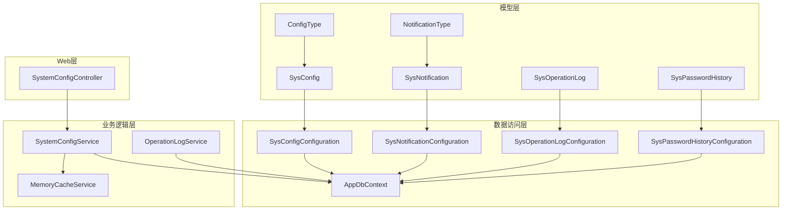
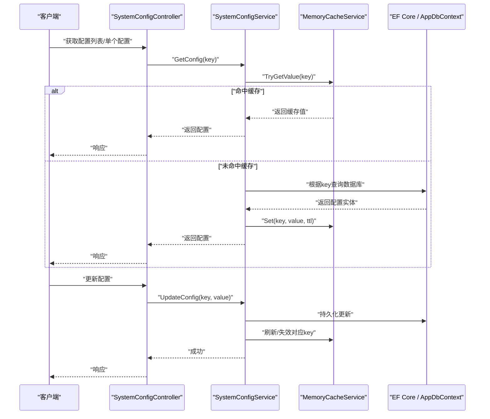
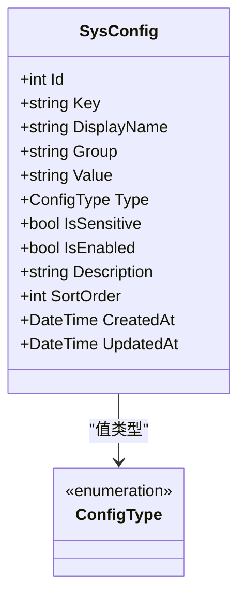
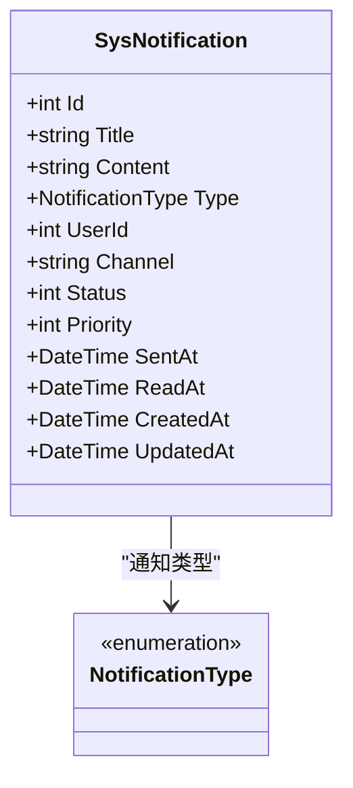
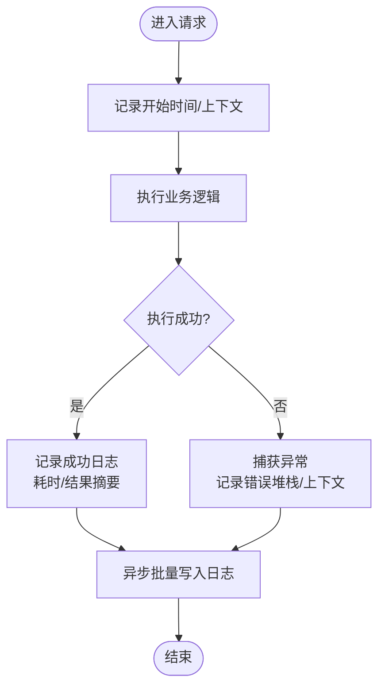
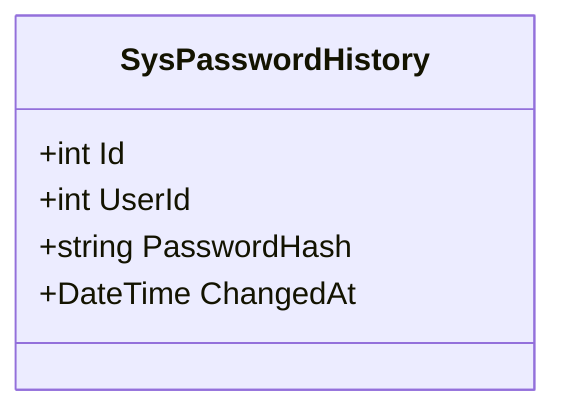
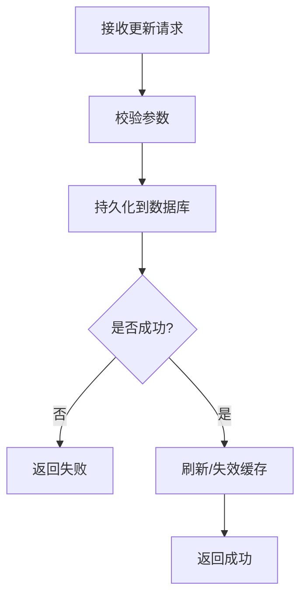
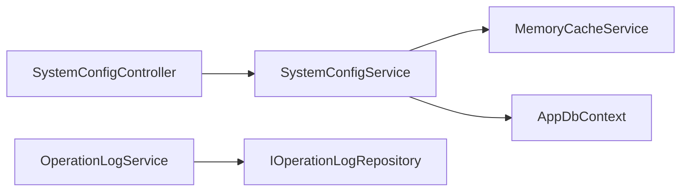

# 系统配置模型

<cite>
**本文引用的文件**   
- [SysConfig.cs](file://EquipmentIMS.Models/Entities/SysConfig.cs)
- [SysNotification.cs](file://EquipmentIMS.Models/Entities/SysNotification.cs)
- [SysOperationLog.cs](file://EquipmentIMS.Models/Entities/SysOperationLog.cs)
- [SysPasswordHistory.cs](file://EquipmentIMS.Models/Entities/SysPasswordHistory.cs)
- [ConfigType.cs](file://EquipmentIMS.Models/Enums/ConfigType.cs)
- [NotificationType.cs](file://EquipmentIMS.Models/Enums/NotificationType.cs)
- [SysConfigConfiguration.cs](file://EquipmentIMS.DAL/Configurations/SysConfigConfiguration.cs)
- [SysNotificationConfiguration.cs](file://EquipmentIMS.DAL/Configurations/SysNotificationConfiguration.cs)
- [SysOperationLogConfiguration.cs](file://EquipmentIMS.DAL/Configurations/SysOperationLogConfiguration.cs)
- [SysPasswordHistoryConfiguration.cs](file://EquipmentIMS.DAL/Configurations/SysPasswordHistoryConfiguration.cs)
- [SystemConfigService.cs](file://EquipmentIMS.BLL/Services/SystemConfigService.cs)
- [ISystemConfigService.cs](file://EquipmentIMS.BLL/Interfaces/ISystemConfigService.cs)
- [MemoryCacheService.cs](file://EquipmentIMS.BLL/Services/MemoryCacheService.cs)
- [ICacheService.cs](file://EquipmentIMS.BLL/Interfaces/ICacheService.cs)
- [SystemConfigController.cs](file://EquipmentIMS.Web/Controllers/SystemConfigController.cs)
- [OperationLogService.cs](file://EquipmentIMS.BLL/Services/OperationLogService.cs)
- [IOperationLogRepository.cs](file://EquipmentIMS.DAL/Interfaces/IOperationLogRepository.cs)
- [OperationLogRepository.cs](file://EquipmentIMS.DAL/Repositories/OperationLogRepository.cs)
- [AppDbContext.cs](file://EquipmentIMS.DAL/AppDbContext.cs)
</cite>

## 目录
1. [简介](#简介)
2. [项目结构](#项目结构)
3. [核心组件](#核心组件)
4. [架构总览](#架构总览)
5. [详细组件分析](#详细组件分析)
6. [依赖关系分析](#依赖关系分析)
7. [性能考虑](#性能考虑)
8. [故障排查指南](#故障排查指南)
9. [结论](#结论)
10. [附录](#附录)

## 简介
本文件聚焦于THMS系统的“配置管理数据模型”，围绕以下实体与机制展开：
- 系统配置实体 SysConfig 的配置项管理与动态加载机制的数据结构设计
- 系统通知实体 SysNotification 的通知类型、发送状态、用户关联的数据模型
- 操作日志实体 SysOperationLog 的审计追踪、操作记录、异常捕获的数据结构
- 密码历史实体 SysPasswordHistory 的密码策略与历史记录的安全设计
- 系统参数的缓存机制与热更新策略
- 日志数据的归档清理策略与性能考虑
- 系统监控与故障排查的查询示例

## 项目结构
围绕配置与运维支撑的关键代码分布在如下层次：
- 模型层（Models）：定义实体与枚举，如 SysConfig、SysNotification、SysOperationLog、SysPasswordHistory 及 ConfigType、NotificationType
- 数据访问层（DAL）：通过 EF Core Configuration 映射实体到数据库表结构，并在 DbContext 中注册
- 业务逻辑层（BLL）：提供 SystemConfigService 等实现配置读取、缓存、热更新；OperationLogService 负责日志写入
- 接口层（Interfaces）：抽象 ISystemConfigService、ICacheService、IOperationLogRepository 等能力边界
- Web 层（Web）：SystemConfigController 暴露配置管理 API，供前端调用

图表来源
- [SysConfig.cs:1-200](file://EquipmentIMS.Models/Entities/SysConfig.cs#L1-L200)
- [SysNotification.cs:1-200](file://EquipmentIMS.Models/Entities/SysNotification.cs#L1-L200)
- [SysOperationLog.cs:1-200](file://EquipmentIMS.Models/Entities/SysOperationLog.cs#L1-L200)
- [SysPasswordHistory.cs:1-200](file://EquipmentIMS.Models/Entities/SysPasswordHistory.cs#L1-L200)
- [ConfigType.cs:1-200](file://EquipmentIMS.Models/Enums/ConfigType.cs#L1-L200)
- [NotificationType.cs:1-200](file://EquipmentIMS.Models/Enums/NotificationType.cs#L1-L200)
- [SysConfigConfiguration.cs:1-200](file://EquipmentIMS.DAL/Configurations/SysConfigConfiguration.cs#L1-L200)
- [SysNotificationConfiguration.cs:1-200](file://EquipmentIMS.DAL/Configurations/SysNotificationConfiguration.cs#L1-L200)
- [SysOperationLogConfiguration.cs:1-200](file://EquipmentIMS.DAL/Configurations/SysOperationLogConfiguration.cs#L1-L200)
- [SysPasswordHistoryConfiguration.cs:1-200](file://EquipmentIMS.DAL/Configurations/SysPasswordHistoryConfiguration.cs#L1-L200)
- [AppDbContext.cs:1-200](file://EquipmentIMS.DAL/AppDbContext.cs#L1-L200)
- [SystemConfigService.cs:1-200](file://EquipmentIMS.BLL/Services/SystemConfigService.cs#L1-L200)
- [MemoryCacheService.cs:1-200](file://EquipmentIMS.BLL/Services/MemoryCacheService.cs#L1-L200)
- [SystemConfigController.cs:1-200](file://EquipmentIMS.Web/Controllers/SystemConfigController.cs#L1-L200)

章节来源
- [SysConfig.cs:1-200](file://EquipmentIMS.Models/Entities/SysConfig.cs#L1-L200)
- [SysNotification.cs:1-200](file://EquipmentIMS.Models/Entities/SysNotification.cs#L1-L200)
- [SysOperationLog.cs:1-200](file://EquipmentIMS.Models/Entities/SysOperationLog.cs#L1-L200)
- [SysPasswordHistory.cs:1-200](file://EquipmentIMS.Models/Entities/SysPasswordHistory.cs#L1-L200)
- [ConfigType.cs:1-200](file://EquipmentIMS.Models/Enums/ConfigType.cs#L1-L200)
- [NotificationType.cs:1-200](file://EquipmentIMS.Models/Enums/NotificationType.cs#L1-L200)
- [SysConfigConfiguration.cs:1-200](file://EquipmentIMS.DAL/Configurations/SysConfigConfiguration.cs#L1-L200)
- [SysNotificationConfiguration.cs:1-200](file://EquipmentIMS.DAL/Configurations/SysNotificationConfiguration.cs#L1-L200)
- [SysOperationLogConfiguration.cs:1-200](file://EquipmentIMS.DAL/Configurations/SysOperationLogConfiguration.cs#L1-L200)
- [SysPasswordHistoryConfiguration.cs:1-200](file://EquipmentIMS.DAL/Configurations/SysPasswordHistoryConfiguration.cs#L1-L200)
- [AppDbContext.cs:1-200](file://EquipmentIMS.DAL/AppDbContext.cs#L1-L200)
- [SystemConfigService.cs:1-200](file://EquipmentIMS.BLL/Services/SystemConfigService.cs#L1-L200)
- [MemoryCacheService.cs:1-200](file://EquipmentIMS.BLL/Services/MemoryCacheService.cs#L1-L200)
- [SystemConfigController.cs:1-200](file://EquipmentIMS.Web/Controllers/SystemConfigController.cs#L1-L200)

## 核心组件
本节概述四大核心实体的职责与关键属性，以及它们如何协同工作。

- SysConfig（系统配置）
  - 用于存储键值型系统参数，支持分类与类型化（通过枚举），并提供缓存与热更新能力
  - 典型字段包括：唯一键、显示名称、分组/类别、值、数据类型、是否敏感、是否启用、描述、排序、创建/更新时间等
  - 与枚举 ConfigType 配合，表达配置值的语义类型（如字符串、整数、布尔、JSON等）

- SysNotification（系统通知）
  - 承载系统内消息，包含通知标题、内容、类型、目标用户、发送状态、优先级、时间戳等
  - 与枚举 NotificationType 配合，区分系统公告、告警、任务提醒等
  - 与用户实体存在一对多或一对一关联（取决于具体实现），便于按用户维度查看已读/未读

- SysOperationLog（操作日志）
  - 记录关键操作的审计信息，包括操作人、模块、动作、请求路径、IP、结果、耗时、异常信息等
  - 适合分页查询与导出，支持按时间范围、模块、操作人筛选

- SysPasswordHistory（密码历史）
  - 记录用户密码变更历史，用于防止重复使用旧密码与满足密码策略校验
  - 通常包含用户标识、哈希后的密码值、更新时间等

章节来源
- [SysConfig.cs:1-200](file://EquipmentIMS.Models/Entities/SysConfig.cs#L1-L200)
- [SysNotification.cs:1-200](file://EquipmentIMS.Models/Entities/SysNotification.cs#L1-L200)
- [SysOperationLog.cs:1-200](file://EquipmentIMS.Models/Entities/SysOperationLog.cs#L1-L200)
- [SysPasswordHistory.cs:1-200](file://EquipmentIMS.Models/Entities/SysPasswordHistory.cs#L1-L200)
- [ConfigType.cs:1-200](file://EquipmentIMS.Models/Enums/ConfigType.cs#L1-L200)
- [NotificationType.cs:1-200](file://EquipmentIMS.Models/Enums/NotificationType.cs#L1-L200)

## 架构总览
下图展示了从控制器到服务、缓存、仓储与数据库的整体交互流程，重点体现配置的热更新与日志落库。

图表来源
- [SystemConfigController.cs:1-200](file://EquipmentIMS.Web/Controllers/SystemConfigController.cs#L1-L200)
- [SystemConfigService.cs:1-200](file://EquipmentIMS.BLL/Services/SystemConfigService.cs#L1-L200)
- [MemoryCacheService.cs:1-200](file://EquipmentIMS.BLL/Services/MemoryCacheService.cs#L1-L200)
- [AppDbContext.cs:1-200](file://EquipmentIMS.DAL/AppDbContext.cs#L1-L200)

## 详细组件分析

### 系统配置实体 SysConfig 与动态加载机制
- 数据模型要点
  - 主键与索引：建议对 key 建立唯一索引以保障快速查找与一致性
  - 类型化：通过 ConfigType 表达值类型，便于在应用层进行解析与校验
  - 敏感标记：对敏感配置（如密钥）增加加密存储与脱敏展示策略
  - 版本与生效：可引入版本号或生效时间，配合灰度发布与回滚
- 动态加载与热更新
  - 首次读取走数据库并写入内存缓存，后续读取优先命中缓存
  - 更新配置后，同步刷新缓存（覆盖或失效），确保下一读即新值
  - 可选：监听外部事件（如配置文件变更、消息队列）触发缓存刷新
- 数据结构复杂度
  - 单条配置读写为 O(1)（缓存命中）或 O(logN)/O(1)（数据库索引查找）
  - 批量初始化时注意分批加载与批处理提交，避免长事务

图表来源
- [SysConfig.cs:1-200](file://EquipmentIMS.Models/Entities/SysConfig.cs#L1-L200)
- [ConfigType.cs:1-200](file://EquipmentIMS.Models/Enums/ConfigType.cs#L1-L200)

章节来源
- [SysConfig.cs:1-200](file://EquipmentIMS.Models/Entities/SysConfig.cs#L1-L200)
- [SysConfigConfiguration.cs:1-200](file://EquipmentIMS.DAL/Configurations/SysConfigConfiguration.cs#L1-L200)
- [SystemConfigService.cs:1-200](file://EquipmentIMS.BLL/Services/SystemConfigService.cs#L1-L200)
- [MemoryCacheService.cs:1-200](file://EquipmentIMS.BLL/Services/MemoryCacheService.cs#L1-L200)

### 系统通知实体 SysNotification 与用户关联
- 数据模型要点
  - 通知类型：通过 NotificationType 区分系统公告、告警、任务提醒等
  - 发送状态：记录已读/未读、发送渠道、重试次数、失败原因等
  - 用户关联：与用户实体建立外键关系，支持按用户维度查询与统计
  - 优先级与过期：高优先级优先推送，过期自动归档或隐藏
- 业务流程
  - 创建通知 -> 选择目标用户/角色 -> 写入数据库 -> 异步发送（站内信/邮件/短信）
  - 用户打开详情后更新为已读，支持批量标记已读

图表来源
- [SysNotification.cs:1-200](file://EquipmentIMS.Models/Entities/SysNotification.cs#L1-L200)
- [NotificationType.cs:1-200](file://EquipmentIMS.Models/Enums/NotificationType.cs#L1-L200)
- [SysNotificationConfiguration.cs:1-200](file://EquipmentIMS.DAL/Configurations/SysNotificationConfiguration.cs#L1-L200)

章节来源
- [SysNotification.cs:1-200](file://EquipmentIMS.Models/Entities/SysNotification.cs#L1-L200)
- [SysNotificationConfiguration.cs:1-200](file://EquipmentIMS.DAL/Configurations/SysNotificationConfiguration.cs#L1-L200)

### 操作日志实体 SysOperationLog 与审计追踪
- 数据模型要点
  - 审计字段：操作人、模块、动作、请求路径、方法、IP、UA、耗时、结果、错误堆栈等
  - 索引优化：按时间、操作人、模块建立复合索引，提升查询效率
  - 异常捕获：统一中间件或过滤器捕获异常并写入日志，保证可追溯
- 写入策略
  - 异步写入：非阻塞写入，降低对主流程的影响
  - 批量落库：聚合多条日志后批量插入，减少IO开销
  - 分级存储：热数据保留短期，冷数据归档至历史表或对象存储

图表来源
- [SysOperationLog.cs:1-200](file://EquipmentIMS.Models/Entities/SysOperationLog.cs#L1-L200)
- [SysOperationLogConfiguration.cs:1-200](file://EquipmentIMS.DAL/Configurations/SysOperationLogConfiguration.cs#L1-L200)
- [OperationLogService.cs:1-200](file://EquipmentIMS.BLL/Services/OperationLogService.cs#L1-L200)
- [IOperationLogRepository.cs:1-200](file://EquipmentIMS.DAL/Interfaces/IOperationLogRepository.cs#L1-L200)
- [OperationLogRepository.cs:1-200](file://EquipmentIMS.DAL/Repositories/OperationLogRepository.cs#L1-L200)

章节来源
- [SysOperationLog.cs:1-200](file://EquipmentIMS.Models/Entities/SysOperationLog.cs#L1-L200)
- [SysOperationLogConfiguration.cs:1-200](file://EquipmentIMS.DAL/Configurations/SysOperationLogConfiguration.cs#L1-L200)
- [OperationLogService.cs:1-200](file://EquipmentIMS.BLL/Services/OperationLogService.cs#L1-L200)
- [IOperationLogRepository.cs:1-200](file://EquipmentIMS.DAL/Interfaces/IOperationLogRepository.cs#L1-L200)
- [OperationLogRepository.cs:1-200](file://EquipmentIMS.DAL/Repositories/OperationLogRepository.cs#L1-L200)

### 密码历史实体 SysPasswordHistory 与安全设计
- 数据模型要点
  - 用户关联：每个用户的最近若干次密码需保留，防止循环复用
  - 安全存储：仅保存密码哈希值，不保存明文
  - 策略校验：结合密码策略（长度、复杂度、历史重复检查）在修改密码时校验
- 生命周期
  - 新增：每次修改密码生成一条历史记录
  - 清理：定期清理超过策略周期的历史，释放空间

图表来源
- [SysPasswordHistory.cs:1-200](file://EquipmentIMS.Models/Entities/SysPasswordHistory.cs#L1-L200)
- [SysPasswordHistoryConfiguration.cs:1-200](file://EquipmentIMS.DAL/Configurations/SysPasswordHistoryConfiguration.cs#L1-L200)

章节来源
- [SysPasswordHistory.cs:1-200](file://EquipmentIMS.Models/Entities/SysPasswordHistory.cs#L1-L200)
- [SysPasswordHistoryConfiguration.cs:1-200](file://EquipmentIMS.DAL/Configurations/SysPasswordHistoryConfiguration.cs#L1-L200)

### 系统参数缓存机制与热更新策略
- 缓存设计
  - 键策略：以配置 key 作为缓存键，必要时加入版本或环境前缀
  - 过期策略：短TTL+主动失效相结合，兼顾一致性与性能
  - 并发控制：写时加锁或采用原子替换，避免脏读
- 热更新流程
  - 更新配置 -> 持久化 -> 刷新缓存 -> 返回成功
  - 可选：广播式刷新（多实例场景）

图表来源
- [SystemConfigService.cs:1-200](file://EquipmentIMS.BLL/Services/SystemConfigService.cs#L1-L200)
- [MemoryCacheService.cs:1-200](file://EquipmentIMS.BLL/Services/MemoryCacheService.cs#L1-L200)
- [ISystemConfigService.cs:1-200](file://EquipmentIMS.BLL/Interfaces/ISystemConfigService.cs#L1-L200)

章节来源
- [SystemConfigService.cs:1-200](file://EquipmentIMS.BLL/Services/SystemConfigService.cs#L1-L200)
- [MemoryCacheService.cs:1-200](file://EquipmentIMS.BLL/Services/MemoryCacheService.cs#L1-L200)
- [ISystemConfigService.cs:1-200](file://EquipmentIMS.BLL/Interfaces/ISystemConfigService.cs#L1-L200)

## 依赖关系分析
- 低耦合高内聚
  - 控制器仅负责入参校验与响应封装，核心逻辑下沉至服务层
  - 服务层依赖接口（ICacheService、IRepository），便于替换实现与单元测试
- 直接依赖
  - SystemConfigController -> SystemConfigService
  - SystemConfigService -> MemoryCacheService、AppDbContext
  - OperationLogService -> IOperationLogRepository
- 潜在风险
  - 缓存与数据库一致性：需确保写路径先DB后缓存，失败回滚
  - 日志写入阻塞：必须异步批量写入，避免影响主流程

图表来源
- [SystemConfigController.cs:1-200](file://EquipmentIMS.Web/Controllers/SystemConfigController.cs#L1-L200)
- [SystemConfigService.cs:1-200](file://EquipmentIMS.BLL/Services/SystemConfigService.cs#L1-L200)
- [MemoryCacheService.cs:1-200](file://EquipmentIMS.BLL/Services/MemoryCacheService.cs#L1-L200)
- [AppDbContext.cs:1-200](file://EquipmentIMS.DAL/AppDbContext.cs#L1-L200)
- [OperationLogService.cs:1-200](file://EquipmentIMS.BLL/Services/OperationLogService.cs#L1-L200)
- [IOperationLogRepository.cs:1-200](file://EquipmentIMS.DAL/Interfaces/IOperationLogRepository.cs#L1-L200)

章节来源
- [SystemConfigController.cs:1-200](file://EquipmentIMS.Web/Controllers/SystemConfigController.cs#L1-L200)
- [SystemConfigService.cs:1-200](file://EquipmentIMS.BLL/Services/SystemConfigService.cs#L1-L200)
- [MemoryCacheService.cs:1-200](file://EquipmentIMS.BLL/Services/MemoryCacheService.cs#L1-L200)
- [AppDbContext.cs:1-200](file://EquipmentIMS.DAL/AppDbContext.cs#L1-L200)
- [OperationLogService.cs:1-200](file://EquipmentIMS.BLL/Services/OperationLogService.cs#L1-L200)
- [IOperationLogRepository.cs:1-200](file://EquipmentIMS.DAL/Interfaces/IOperationLogRepository.cs#L1-L200)

## 性能考虑
- 配置读取
  - 缓存命中率优先，热点配置设置较长TTL；冷配置短TTL或按需加载
  - 批量初始化时采用分片加载与并行读取，避免启动慢
- 日志写入
  - 异步队列+批量落库，限制单次批次大小，避免内存抖动
  - 对高频字段建立合适索引，避免全表扫描
- 通知发送
  - 异步发送，失败重试与退避策略，限流保护下游通道
- 存储与归档
  - 日志与通知按时间分区或按月归档，冷热分离
  - 定期清理过期数据，释放磁盘空间

[本节为通用性能指导，无需特定文件引用]

## 故障排查指南
- 配置不一致
  - 现象：不同实例读到不同配置
  - 排查：确认写路径顺序（先DB后缓存）、是否存在并发覆盖、是否多实例共享缓存
  - 参考实现位置：
    - [SystemConfigService.cs:1-200](file://EquipmentIMS.BLL/Services/SystemConfigService.cs#L1-L200)
    - [MemoryCacheService.cs:1-200](file://EquipmentIMS.BLL/Services/MemoryCacheService.cs#L1-L200)
- 日志丢失或延迟
  - 现象：操作日志未及时出现
  - 排查：检查异步队列堆积、批量写入失败重试、数据库连接池
  - 参考实现位置：
    - [OperationLogService.cs:1-200](file://EquipmentIMS.BLL/Services/OperationLogService.cs#L1-L200)
    - [OperationLogRepository.cs:1-200](file://EquipmentIMS.DAL/Repositories/OperationLogRepository.cs#L1-L200)
- 通知未送达
  - 现象：用户未收到通知
  - 排查：检查发送状态、重试次数、失败原因、用户有效性
  - 参考实现位置：
    - [SysNotification.cs:1-200](file://EquipmentIMS.Models/Entities/SysNotification.cs#L1-L200)
    - [SysNotificationConfiguration.cs:1-200](file://EquipmentIMS.DAL/Configurations/SysNotificationConfiguration.cs#L1-L200)

章节来源
- [SystemConfigService.cs:1-200](file://EquipmentIMS.BLL/Services/SystemConfigService.cs#L1-L200)
- [MemoryCacheService.cs:1-200](file://EquipmentIMS.BLL/Services/MemoryCacheService.cs#L1-L200)
- [OperationLogService.cs:1-200](file://EquipmentIMS.BLL/Services/OperationLogService.cs#L1-L200)
- [OperationLogRepository.cs:1-200](file://EquipmentIMS.DAL/Repositories/OperationLogRepository.cs#L1-L200)
- [SysNotification.cs:1-200](file://EquipmentIMS.Models/Entities/SysNotification.cs#L1-L200)
- [SysNotificationConfiguration.cs:1-200](file://EquipmentIMS.DAL/Configurations/SysNotificationConfiguration.cs#L1-L200)

## 结论
通过对 SysConfig、SysNotification、SysOperationLog、SysPasswordHistory 四个核心实体的建模与配套服务的设计，THMS系统在配置管理、通知分发、审计追踪与密码安全方面形成了完整闭环。配合缓存与异步写入策略，系统在可用性与性能之间取得平衡。建议在多实例部署下完善分布式缓存与幂等更新，进一步提升一致性与可观测性。

[本节为总结性内容，无需特定文件引用]

## 附录

### 监控与故障排查常用查询示例
以下为面向运维与开发的常见查询思路（概念性示例，便于落地到实际SQL/ORM查询）：
- 配置相关
  - 查询某配置项当前值与最后更新时间
  - 统计各分组配置数量与敏感配置占比
- 通知相关
  - 按用户维度统计未读通知数
  - 按类型与状态统计发送成功率
- 日志相关
  - 按时间范围、模块、操作人检索操作日志
  - 统计异常率与平均耗时Top模块
- 密码历史
  - 检查用户是否重复使用近N次密码
  - 统计密码变更频率与异常模式

[本节为概念性查询示例，无需特定文件引用]