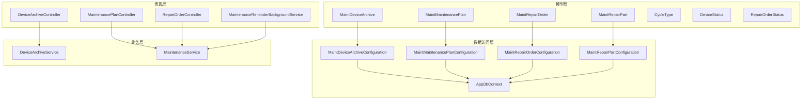
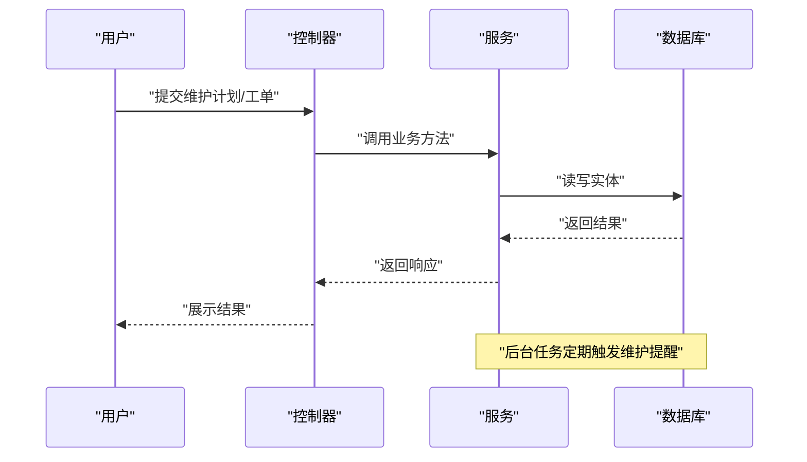
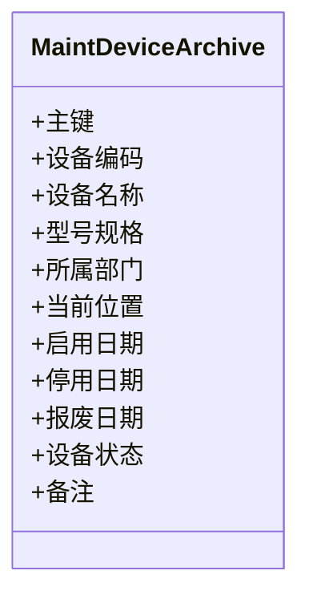
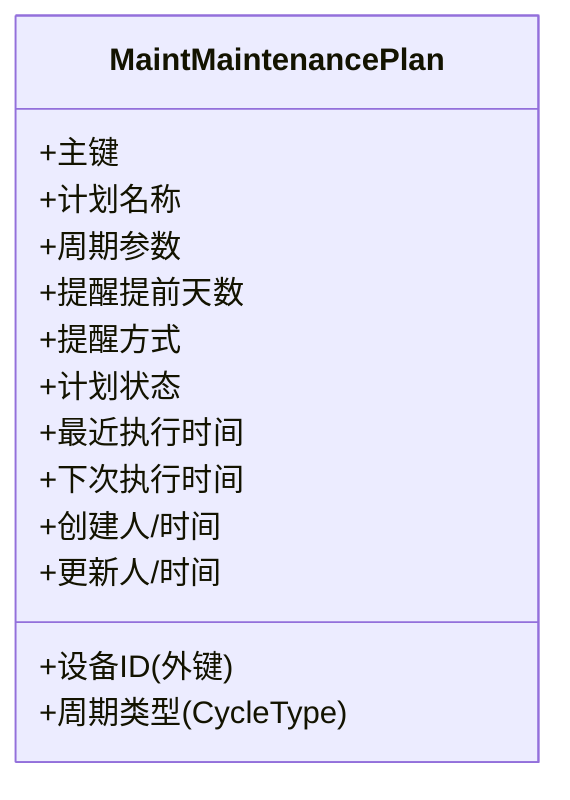
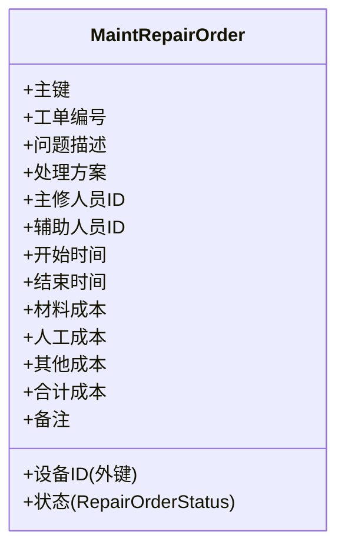
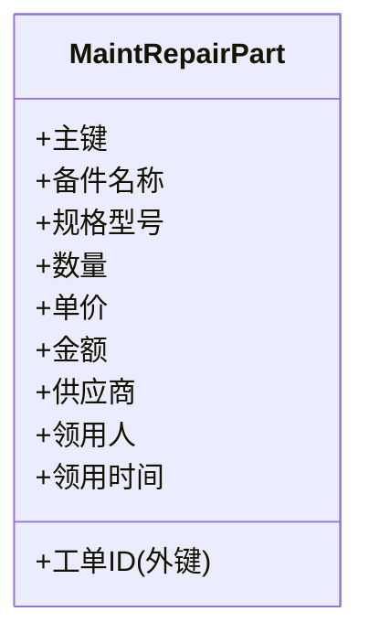
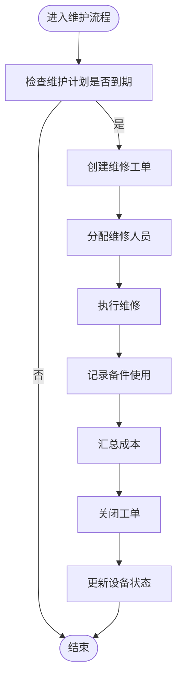
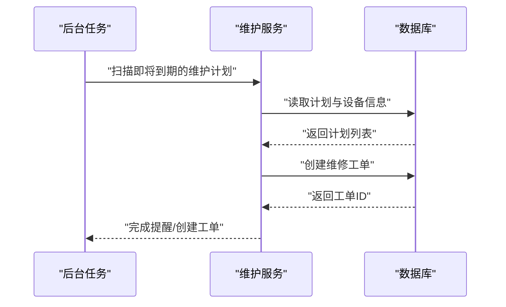
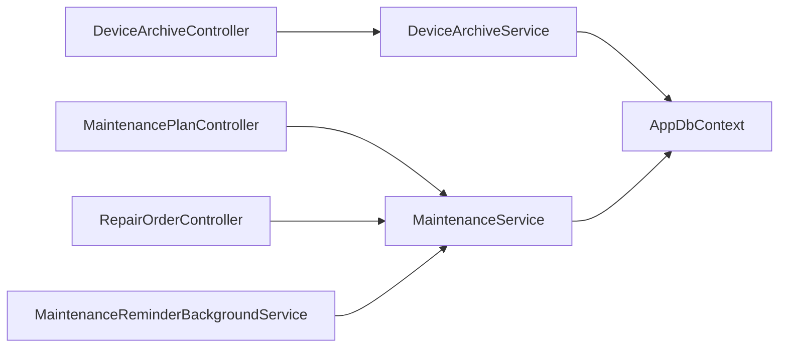
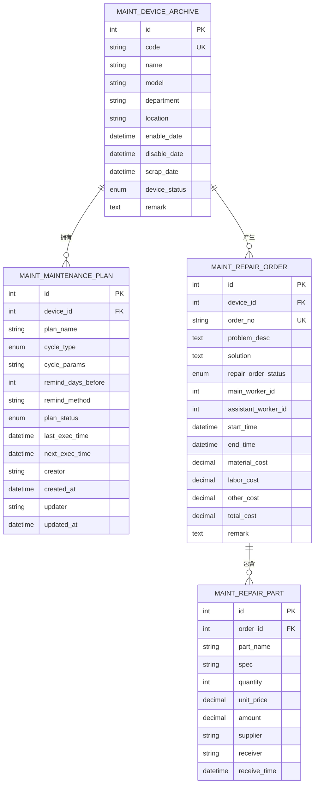

# 设备维护模型

<cite>
**本文引用的文件**   
- [MaintDeviceArchive.cs](file://EquipmentIMS.Models/Entities/MaintDeviceArchive.cs)
- [MaintMaintenancePlan.cs](file://EquipmentIMS.Models/Entities/MaintMaintenancePlan.cs)
- [MaintRepairOrder.cs](file://EquipmentIMS.Models/Entities/MaintRepairOrder.cs)
- [MaintRepairPart.cs](file://EquipmentIMS.Models/Entities/MaintRepairPart.cs)
- [CycleType.cs](file://EquipmentIMS.Models/Enums/CycleType.cs)
- [DeviceStatus.cs](file://EquipmentIMS.Models/Enums/DeviceStatus.cs)
- [RepairOrderStatus.cs](file://EquipmentIMS.Models/Enums/RepairOrderStatus.cs)
- [MaintDeviceArchiveConfiguration.cs](file://EquipmentIMS.DAL/Configurations/MaintDeviceArchiveConfiguration.cs)
- [MaintMaintenancePlanConfiguration.cs](file://EquipmentIMS.DAL/Configurations/MaintMaintenancePlanConfiguration.cs)
- [MaintRepairOrderConfiguration.cs](file://EquipmentIMS.DAL/Configurations/MaintRepairOrderConfiguration.cs)
- [MaintRepairPartConfiguration.cs](file://EquipmentIMS.DAL/Configurations/MaintRepairPartConfiguration.cs)
- [AppDbContext.cs](file://EquipmentIMS.DAL/AppDbContext.cs)
- [DeviceArchiveService.cs](file://EquipmentIMS.BLL/Services/DeviceArchiveService.cs)
- [MaintenanceService.cs](file://EquipmentIMS.BLL/Services/MaintenanceService.cs)
- [DeviceArchiveController.cs](file://EquipmentIMS.Web/Controllers/DeviceArchiveController.cs)
- [MaintenancePlanController.cs](file://EquipmentIMS.Web/Controllers/MaintenancePlanController.cs)
- [RepairOrderController.cs](file://EquipmentIMS.Web/Controllers/RepairOrderController.cs)
- [MaintenanceReminderBackgroundService.cs](file://EquipmentIMS.Web/BackgroundServices/MaintenanceReminderBackgroundService.cs)
</cite>

## 目录
1. [简介](#简介)
2. [项目结构](#项目结构)
3. [核心组件](#核心组件)
4. [架构总览](#架构总览)
5. [详细组件分析](#详细组件分析)
6. [依赖关系分析](#依赖关系分析)
7. [性能考虑](#性能考虑)
8. [故障排查指南](#故障排查指南)
9. [结论](#结论)
10. [附录](#附录)

## 简介
本文件聚焦于THMS系统中的“设备维护”子域，围绕以下数据实体与流程进行建模说明：
- 设备档案管理实体 MaintDeviceArchive 的完整生命周期字段设计
- 维护计划实体 MaintMaintenancePlan 的周期类型、提醒机制数据结构
- 维修工单实体 MaintRepairOrder 的状态流转、人员分配、成本统计的数据模型
- 维修备件实体 MaintRepairPart 与工单的关联关系
- 设备状态跟踪与维护历史记录的数据设计
- 设备维护业务流程的ER图与典型查询示例

## 项目结构
设备维护相关代码分布在三层结构中：
- 领域模型（Models）：定义实体、枚举、DTO等
- 数据访问层（DAL）：通过EF Core配置映射实体到数据库表
- 业务逻辑层（BLL）：封装维护相关的服务方法
- 表现层（Web）：控制器与后台任务驱动业务流程

图表来源
- [MaintDeviceArchive.cs](file://EquipmentIMS.Models/Entities/MaintDeviceArchive.cs)
- [MaintMaintenancePlan.cs](file://EquipmentIMS.Models/Entities/MaintMaintenancePlan.cs)
- [MaintRepairOrder.cs](file://EquipmentIMS.Models/Entities/MaintRepairOrder.cs)
- [MaintRepairPart.cs](file://EquipmentIMS.Models/Entities/MaintRepairPart.cs)
- [CycleType.cs](file://EquipmentIMS.Models/Enums/CycleType.cs)
- [DeviceStatus.cs](file://EquipmentIMS.Models/Enums/DeviceStatus.cs)
- [RepairOrderStatus.cs](file://EquipmentIMS.Models/Enums/RepairOrderStatus.cs)
- [MaintDeviceArchiveConfiguration.cs](file://EquipmentIMS.DAL/Configurations/MaintDeviceArchiveConfiguration.cs)
- [MaintMaintenancePlanConfiguration.cs](file://EquipmentIMS.DAL/Configurations/MaintMaintenancePlanConfiguration.cs)
- [MaintRepairOrderConfiguration.cs](file://EquipmentIMS.DAL/Configurations/MaintRepairOrderConfiguration.cs)
- [MaintRepairPartConfiguration.cs](file://EquipmentIMS.DAL/Configurations/MaintRepairPartConfiguration.cs)
- [AppDbContext.cs](file://EquipmentIMS.DAL/AppDbContext.cs)
- [DeviceArchiveService.cs](file://EquipmentIMS.BLL/Services/DeviceArchiveService.cs)
- [MaintenanceService.cs](file://EquipmentIMS.BLL/Services/MaintenanceService.cs)
- [DeviceArchiveController.cs](file://EquipmentIMS.Web/Controllers/DeviceArchiveController.cs)
- [MaintenancePlanController.cs](file://EquipmentIMS.Web/Controllers/MaintenancePlanController.cs)
- [RepairOrderController.cs](file://EquipmentIMS.Web/Controllers/RepairOrderController.cs)
- [MaintenanceReminderBackgroundService.cs](file://EquipmentIMS.Web/BackgroundServices/MaintenanceReminderBackgroundService.cs)

章节来源
- [MaintDeviceArchive.cs](file://EquipmentIMS.Models/Entities/MaintDeviceArchive.cs)
- [MaintMaintenancePlan.cs](file://EquipmentIMS.Models/Entities/MaintMaintenancePlan.cs)
- [MaintRepairOrder.cs](file://EquipmentIMS.Models/Entities/MaintRepairOrder.cs)
- [MaintRepairPart.cs](file://EquipmentIMS.Models/Entities/MaintRepairPart.cs)
- [CycleType.cs](file://EquipmentIMS.Models/Enums/CycleType.cs)
- [DeviceStatus.cs](file://EquipmentIMS.Models/Enums/DeviceStatus.cs)
- [RepairOrderStatus.cs](file://EquipmentIMS.Models/Enums/RepairOrderStatus.cs)
- [MaintDeviceArchiveConfiguration.cs](file://EquipmentIMS.DAL/Configurations/MaintDeviceArchiveConfiguration.cs)
- [MaintMaintenancePlanConfiguration.cs](file://EquipmentIMS.DAL/Configurations/MaintMaintenancePlanConfiguration.cs)
- [MaintRepairOrderConfiguration.cs](file://EquipmentIMS.DAL/Configurations/MaintRepairOrderConfiguration.cs)
- [MaintRepairPartConfiguration.cs](file://EquipmentIMS.DAL/Configurations/MaintRepairPartConfiguration.cs)
- [AppDbContext.cs](file://EquipmentIMS.DAL/AppDbContext.cs)
- [DeviceArchiveService.cs](file://EquipmentIMS.BLL/Services/DeviceArchiveService.cs)
- [MaintenanceService.cs](file://EquipmentIMS.BLL/Services/MaintenanceService.cs)
- [DeviceArchiveController.cs](file://EquipmentIMS.Web/Controllers/DeviceArchiveController.cs)
- [MaintenancePlanController.cs](file://EquipmentIMS.Web/Controllers/MaintenancePlanController.cs)
- [RepairOrderController.cs](file://EquipmentIMS.Web/Controllers/RepairOrderController.cs)
- [MaintenanceReminderBackgroundService.cs](file://EquipmentIMS.Web/BackgroundServices/MaintenanceReminderBackgroundService.cs)

## 核心组件
本节对设备维护的核心实体与枚举进行概览式说明，为后续深入分析奠定基础。

- 设备档案 MaintDeviceArchive
  - 用于记录设备基础信息与全生命周期关键节点，如启用、停用、报废等
  - 包含设备状态跟踪字段，便于追踪设备当前运行状态
  - 关联维护计划与维修工单，形成“设备-计划-工单”的主干链路

- 维护计划 MaintMaintenancePlan
  - 描述周期性或触发式的维护任务
  - 使用周期类型枚举控制执行频率与计算方式
  - 支持提醒机制，结合后台任务生成待办或通知

- 维修工单 MaintRepairOrder
  - 承载一次具体的维修事件，包括问题描述、处理过程、结果与费用
  - 状态机驱动工单从创建到关闭的全流程
  - 支持维修人员分配与成本统计（材料、人工、其他）

- 维修备件 MaintRepairPart
  - 记录工单中使用的备件明细，与工单存在一对多关系
  - 支持数量、单价、金额等成本要素，便于汇总统计

- 枚举
  - CycleType：维护计划的周期类型
  - DeviceStatus：设备状态
  - RepairOrderStatus：维修工单状态

章节来源
- [MaintDeviceArchive.cs](file://EquipmentIMS.Models/Entities/MaintDeviceArchive.cs)
- [MaintMaintenancePlan.cs](file://EquipmentIMS.Models/Entities/MaintMaintenancePlan.cs)
- [MaintRepairOrder.cs](file://EquipmentIMS.Models/Entities/MaintRepairOrder.cs)
- [MaintRepairPart.cs](file://EquipmentIMS.Models/Entities/MaintRepairPart.cs)
- [CycleType.cs](file://EquipmentIMS.Models/Enums/CycleType.cs)
- [DeviceStatus.cs](file://EquipmentIMS.Models/Enums/DeviceStatus.cs)
- [RepairOrderStatus.cs](file://EquipmentIMS.Models/Enums/RepairOrderStatus.cs)

## 架构总览
设备维护模块采用分层架构，控制器接收请求并调用服务，服务操作仓储与上下文，最终持久化至数据库。后台任务定时扫描维护计划，生成提醒或自动创建工单。

图表来源
- [DeviceArchiveController.cs](file://EquipmentIMS.Web/Controllers/DeviceArchiveController.cs)
- [MaintenancePlanController.cs](file://EquipmentIMS.Web/Controllers/MaintenancePlanController.cs)
- [RepairOrderController.cs](file://EquipmentIMS.Web/Controllers/RepairOrderController.cs)
- [DeviceArchiveService.cs](file://EquipmentIMS.BLL/Services/DeviceArchiveService.cs)
- [MaintenanceService.cs](file://EquipmentIMS.BLL/Services/MaintenanceService.cs)
- [MaintenanceReminderBackgroundService.cs](file://EquipmentIMS.Web/BackgroundServices/MaintenanceReminderBackgroundService.cs)
- [AppDbContext.cs](file://EquipmentIMS.DAL/AppDbContext.cs)

## 详细组件分析

### 设备档案管理实体 MaintDeviceArchive
- 生命周期字段设计要点
  - 新增/启用：记录首次启用时间与责任人
  - 变更：记录关键信息变更历史（如位置、归属部门、技术参数）
  - 停用：记录停用原因、停用时间、停用人
  - 报废：记录报废原因、报废时间、处置方式
  - 状态跟踪：维护当前设备状态（运行、停机、维修、报废等），并与工单状态联动
- 关联关系
  - 与 MaintMaintenancePlan 一对多：一台设备可对应多个维护计划
  - 与 MaintRepairOrder 一对多：一台设备可产生多条维修工单
- 数据完整性
  - 关键字段非空约束与唯一性约束（如设备编码）
  - 外键约束确保与计划、工单的引用一致性

图表来源
- [MaintDeviceArchive.cs](file://EquipmentIMS.Models/Entities/MaintDeviceArchive.cs)
- [MaintDeviceArchiveConfiguration.cs](file://EquipmentIMS.DAL/Configurations/MaintDeviceArchiveConfiguration.cs)

章节来源
- [MaintDeviceArchive.cs](file://EquipmentIMS.Models/Entities/MaintDeviceArchive.cs)
- [MaintDeviceArchiveConfiguration.cs](file://EquipmentIMS.DAL/Configurations/MaintDeviceArchiveConfiguration.cs)

### 维护计划实体 MaintMaintenancePlan
- 周期类型
  - 使用 CycleType 枚举表示周期策略（例如按天、按周、按月、按季度、按年、按运行时长等）
  - 不同周期类型影响下次执行时间的计算逻辑
- 提醒机制数据结构
  - 支持提前提醒天数设置
  - 提醒方式（站内消息、邮件等）由系统配置或扩展点决定
  - 后台任务根据计划与当前时间计算是否到达提醒阈值，生成提醒记录或待办
- 与设备的关联
  - 每个维护计划绑定一台设备，形成“设备-计划”的一对多关系
- 计划状态与执行历史
  - 可记录计划状态（启用/停用）
  - 可记录最近一次执行时间与下次执行时间，便于调度与审计

图表来源
- [MaintMaintenancePlan.cs](file://EquipmentIMS.Models/Entities/MaintMaintenancePlan.cs)
- [CycleType.cs](file://EquipmentIMS.Models/Enums/CycleType.cs)
- [MaintMaintenancePlanConfiguration.cs](file://EquipmentIMS.DAL/Configurations/MaintMaintenancePlanConfiguration.cs)

章节来源
- [MaintMaintenancePlan.cs](file://EquipmentIMS.Models/Entities/MaintMaintenancePlan.cs)
- [CycleType.cs](file://EquipmentIMS.Models/Enums/CycleType.cs)
- [MaintMaintenancePlanConfiguration.cs](file://EquipmentIMS.DAL/Configurations/MaintMaintenancePlanConfiguration.cs)

### 维修工单实体 MaintRepairOrder
- 状态流转
  - 使用 RepairOrderStatus 枚举驱动状态机（如：新建、已派工、进行中、已完成、已关闭、已取消）
  - 状态变更需记录操作人与时间，保证可追溯
- 维修人员分配
  - 支持指派主修人与辅助人员
  - 记录开始与结束时间，便于工时统计
- 成本统计
  - 材料成本：来自关联的维修备件明细
  - 人工成本：基于工时与费率计算（可由系统配置）
  - 其他成本：差旅、外包等
  - 合计成本：材料+人工+其他
- 与设备、备件的关联
  - 与设备一对多：一个设备可有多条工单
  - 与备件一对多：一条工单可包含多条备件使用记录

图表来源
- [MaintRepairOrder.cs](file://EquipmentIMS.Models/Entities/MaintRepairOrder.cs)
- [RepairOrderStatus.cs](file://EquipmentIMS.Models/Enums/RepairOrderStatus.cs)
- [MaintRepairOrderConfiguration.cs](file://EquipmentIMS.DAL/Configurations/MaintRepairOrderConfiguration.cs)

章节来源
- [MaintRepairOrder.cs](file://EquipmentIMS.Models/Entities/MaintRepairOrder.cs)
- [RepairOrderStatus.cs](file://EquipmentIMS.Models/Enums/RepairOrderStatus.cs)
- [MaintRepairOrderConfiguration.cs](file://EquipmentIMS.DAL/Configurations/MaintRepairOrderConfiguration.cs)

### 维修备件实体 MaintRepairPart
- 与工单的关联关系
  - 通过外键关联工单，形成“工单-备件明细”的一对多关系
- 成本要素
  - 备件名称、规格型号、数量、单价、金额
  - 供应商信息（可选）
  - 领用人与领用时间
- 统计与审计
  - 支持按工单汇总材料成本
  - 支持按设备、时间段统计备件消耗

图表来源
- [MaintRepairPart.cs](file://EquipmentIMS.Models/Entities/MaintRepairPart.cs)
- [MaintRepairPartConfiguration.cs](file://EquipmentIMS.DAL/Configurations/MaintRepairPartConfiguration.cs)

章节来源
- [MaintRepairPart.cs](file://EquipmentIMS.Models/Entities/MaintRepairPart.cs)
- [MaintRepairPartConfiguration.cs](file://EquipmentIMS.DAL/Configurations/MaintRepairPartConfiguration.cs)

### 设备状态跟踪与维护历史记录
- 设备状态跟踪
  - 通过设备实体的状态字段记录当前状态（运行、停机、维修、报废等）
  - 状态变更通常由工单状态推进或人工调整触发
- 维护历史记录
  - 可通过维护计划执行日志或维修工单记录形成历史轨迹
  - 建议保留每次维护的关键信息（时间、内容、参与人员、结果、费用）

图表来源
- [MaintenanceReminderBackgroundService.cs](file://EquipmentIMS.Web/BackgroundServices/MaintenanceReminderBackgroundService.cs)
- [MaintenanceService.cs](file://EquipmentIMS.BLL/Services/MaintenanceService.cs)
- [MaintRepairOrder.cs](file://EquipmentIMS.Models/Entities/MaintRepairOrder.cs)
- [MaintRepairPart.cs](file://EquipmentIMS.Models/Entities/MaintRepairPart.cs)
- [MaintDeviceArchive.cs](file://EquipmentIMS.Models/Entities/MaintDeviceArchive.cs)

章节来源
- [MaintenanceReminderBackgroundService.cs](file://EquipmentIMS.Web/BackgroundServices/MaintenanceReminderBackgroundService.cs)
- [MaintenanceService.cs](file://EquipmentIMS.BLL/Services/MaintenanceService.cs)
- [MaintRepairOrder.cs](file://EquipmentIMS.Models/Entities/MaintRepairOrder.cs)
- [MaintRepairPart.cs](file://EquipmentIMS.Models/Entities/MaintRepairPart.cs)
- [MaintDeviceArchive.cs](file://EquipmentIMS.Models/Entities/MaintDeviceArchive.cs)

### 业务流程时序图（维护计划到工单）

图表来源
- [MaintenanceReminderBackgroundService.cs](file://EquipmentIMS.Web/BackgroundServices/MaintenanceReminderBackgroundService.cs)
- [MaintenanceService.cs](file://EquipmentIMS.BLL/Services/MaintenanceService.cs)
- [AppDbContext.cs](file://EquipmentIMS.DAL/AppDbContext.cs)

## 依赖关系分析
- 实体与配置
  - 各实体在 Models 层定义，DAL 层通过 Configuration 类映射到数据库表结构
  - AppDbContext 聚合所有实体集合，提供统一的上下文访问
- 控制器与服务
  - Web 层控制器负责接收请求与参数校验，调用 BLL 层服务
  - 服务层封装业务规则，协调多个实体的读写与事务
- 后台任务与服务
  - 后台任务定时扫描维护计划，调用服务创建工单或发送提醒

图表来源
- [DeviceArchiveController.cs](file://EquipmentIMS.Web/Controllers/DeviceArchiveController.cs)
- [MaintenancePlanController.cs](file://EquipmentIMS.Web/Controllers/MaintenancePlanController.cs)
- [RepairOrderController.cs](file://EquipmentIMS.Web/Controllers/RepairOrderController.cs)
- [DeviceArchiveService.cs](file://EquipmentIMS.BLL/Services/DeviceArchiveService.cs)
- [MaintenanceService.cs](file://EquipmentIMS.BLL/Services/MaintenanceService.cs)
- [MaintenanceReminderBackgroundService.cs](file://EquipmentIMS.Web/BackgroundServices/MaintenanceReminderBackgroundService.cs)
- [AppDbContext.cs](file://EquipmentIMS.DAL/AppDbContext.cs)

章节来源
- [DeviceArchiveController.cs](file://EquipmentIMS.Web/Controllers/DeviceArchiveController.cs)
- [MaintenancePlanController.cs](file://EquipmentIMS.Web/Controllers/MaintenancePlanController.cs)
- [RepairOrderController.cs](file://EquipmentIMS.Web/Controllers/RepairOrderController.cs)
- [DeviceArchiveService.cs](file://EquipmentIMS.BLL/Services/DeviceArchiveService.cs)
- [MaintenanceService.cs](file://EquipmentIMS.BLL/Services/MaintenanceService.cs)
- [MaintenanceReminderBackgroundService.cs](file://EquipmentIMS.Web/BackgroundServices/MaintenanceReminderBackgroundService.cs)
- [AppDbContext.cs](file://EquipmentIMS.DAL/AppDbContext.cs)

## 性能考虑
- 索引优化
  - 对常用查询字段建立索引（如设备编码、工单编号、设备ID、状态、时间范围）
- 分页与过滤
  - 列表接口应支持分页与条件过滤，避免一次性加载大量数据
- 批量操作
  - 批量创建工单或更新状态时，使用批量写入减少往返开销
- 缓存策略
  - 对字典型数据（周期类型、状态枚举）进行缓存，降低重复查询
- 异步处理
  - 提醒与报表导出等耗时操作采用异步或后台任务处理

[本节为通用指导，不直接分析具体文件]

## 故障排查指南
- 常见问题定位
  - 维护计划未生成提醒：检查周期类型与下次执行时间计算逻辑
  - 工单状态无法推进：确认状态机约束与权限控制
  - 成本统计不一致：核对备件明细与工单合计字段同步逻辑
- 日志与审计
  - 关注关键操作的日志输出（创建、派工、完成、关闭）
  - 核查状态变更的操作人与时间戳
- 数据一致性
  - 外键约束异常：检查设备、工单、备件之间的关联完整性
  - 事务回滚：确认复杂业务场景的事务边界与异常处理

章节来源
- [MaintenanceReminderBackgroundService.cs](file://EquipmentIMS.Web/BackgroundServices/MaintenanceReminderBackgroundService.cs)
- [MaintenanceService.cs](file://EquipmentIMS.BLL/Services/MaintenanceService.cs)
- [MaintRepairOrder.cs](file://EquipmentIMS.Models/Entities/MaintRepairOrder.cs)
- [MaintRepairPart.cs](file://EquipmentIMS.Models/Entities/MaintRepairPart.cs)

## 结论
本模型以设备为核心，串联维护计划与维修工单，辅以备件明细与状态跟踪，形成完整的设备维护闭环。通过清晰的实体设计与状态机驱动，系统能够支撑日常维护、成本控制与审计追溯需求。建议在后续迭代中完善提醒渠道扩展、成本核算精细化与报表可视化能力。

[本节为总结性内容，不直接分析具体文件]

## 附录

### ER图（设备维护核心实体）

图表来源
- [MaintDeviceArchive.cs](file://EquipmentIMS.Models/Entities/MaintDeviceArchive.cs)
- [MaintMaintenancePlan.cs](file://EquipmentIMS.Models/Entities/MaintMaintenancePlan.cs)
- [MaintRepairOrder.cs](file://EquipmentIMS.Models/Entities/MaintRepairOrder.cs)
- [MaintRepairPart.cs](file://EquipmentIMS.Models/Entities/MaintRepairPart.cs)

### 典型查询示例
- 查询某设备的维护计划列表
  - 条件：设备ID、计划状态
  - 排序：下次执行时间升序
- 查询某设备的维修工单历史
  - 条件：设备ID、状态范围、时间范围
  - 排序：创建时间降序
- 统计某时间段内设备维护成本
  - 维度：设备、工单状态
  - 指标：材料成本、人工成本、其他成本、合计成本
- 查询即将到期的维护计划
  - 条件：下次执行时间在当前时间窗口内
  - 动作：生成提醒或自动创建工单

[本节为概念性示例，不直接分析具体文件]