# 采购销售模型

<cite>
**本文引用的文件**   
- [PurPurchaseOrder.cs](file://EquipmentIMS.Models/Entities/PurPurchaseOrder.cs)
- [PurPurchaseOrderDetail.cs](file://EquipmentIMS.Models/Entities/PurPurchaseOrderDetail.cs)
- [PurPurchaseIn.cs](file://EquipmentIMS.Models/Entities/PurPurchaseIn.cs)
- [PurPurchaseInDetail.cs](file://EquipmentIMS.Models/Entities/PurPurchaseInDetail.cs)
- [PurPurchaseReturn.cs](file://EquipmentIMS.Models/Entities/PurPurchaseReturn.cs)
- [PurPurchaseReturnDetail.cs](file://EquipmentIMS.Models/Entities/PurPurchaseReturnDetail.cs)
- [SaleSaleOrder.cs](file://EquipmentIMS.Models/Entities/SaleSaleOrder.cs)
- [SaleSaleOrderDetail.cs](file://EquipmentIMS.Models/Entities/SaleSaleOrderDetail.cs)
- [SaleSaleOut.cs](file://EquipmentIMS.Models/Entities/SaleSaleOut.cs)
- [SaleSaleOutDetail.cs](file://EquipmentIMS.Models/Entities/SaleSaleOutDetail.cs)
- [SaleReturn.cs](file://EquipmentIMS.Models/Entities/SaleReturn.cs)
- [SaleReturnDetail.cs](file://EquipmentIMS.Models/Entities/SaleReturnDetail.cs)
- [BaseSupplier.cs](file://EquipmentIMS.Models/Entities/BaseSupplier.cs)
- [BaseCustomer.cs](file://EquipmentIMS.Models/Entities/BaseCustomer.cs)
- [BaseProduct.cs](file://EquipmentIMS.Models/Entities/BaseProduct.cs)
- [BaseWarehouse.cs](file://EquipmentIMS.Models/Entities/BaseWarehouse.cs)
- [BaseProductStock.cs](file://EquipmentIMS.Models/Entities/BaseProductStock.cs)
- [InvStockTransaction.cs](file://EquipmentIMS.Models/Entities/InvStockTransaction.cs)
- [PurchaseOrderStatus.cs](file://EquipmentIMS.Models/Enums/PurchaseOrderStatus.cs)
- [PurchaseInStatus.cs](file://EquipmentIMS.Models/Enums/PurchaseInStatus.cs)
- [PurchaseReturnStatus.cs](file://EquipmentIMS.Models/Enums/PurchaseReturnStatus.cs)
- [SaleOrderStatus.cs](file://EquipmentIMS.Models/Enums/SaleOrderStatus.cs)
- [SaleOutStatus.cs](file://EquipmentIMS.Models/Enums/SaleOutStatus.cs)
- [SaleReturnStatus.cs](file://EquipmentIMS.Models/Enums/SaleReturnStatus.cs)
- [TransactionType.cs](file://EquipmentIMS.Models/Enums/TransactionType.cs)
- [PurPurchaseOrderConfiguration.cs](file://EquipmentIMS.DAL/Configurations/PurPurchaseOrderConfiguration.cs)
- [PurPurchaseOrderDetailConfiguration.cs](file://EquipmentIMS.DAL/Configurations/PurPurchaseOrderDetailConfiguration.cs)
- [PurPurchaseInConfiguration.cs](file://EquipmentIMS.DAL/Configurations/PurPurchaseInConfiguration.cs)
- [PurPurchaseInDetailConfiguration.cs](file://EquipmentIMS.DAL/Configurations/PurPurchaseInDetailConfiguration.cs)
- [PurPurchaseReturnConfiguration.cs](file://EquipmentIMS.DAL/Configurations/PurPurchaseReturnConfiguration.cs)
- [PurPurchaseReturnDetailConfiguration.cs](file://EquipmentIMS.DAL/Configurations/PurPurchaseReturnDetailConfiguration.cs)
- [SaleSaleOrderConfiguration.cs](file://EquipmentIMS.DAL/Configurations/SaleSaleOrderConfiguration.cs)
- [SaleSaleOrderDetailConfiguration.cs](file://EquipmentIMS.DAL/Configurations/SaleSaleOrderDetailConfiguration.cs)
- [SaleSaleOutConfiguration.cs](file://EquipmentIMS.DAL/Configurations/SaleSaleOutConfiguration.cs)
- [SaleSaleOutDetailConfiguration.cs](file://EquipmentIMS.DAL/Configurations/SaleSaleOutDetailConfiguration.cs)
- [SaleReturnConfiguration.cs](file://EquipmentIMS.DAL/Configurations/SaleReturnConfiguration.cs)
- [SaleReturnDetailConfiguration.cs](file://EquipmentIMS.DAL/Configurations/SaleReturnDetailConfiguration.cs)
- [BaseSupplierConfiguration.cs](file://EquipmentIMS.DAL/Configurations/BaseSupplierConfiguration.cs)
- [BaseCustomerConfiguration.cs](file://EquipmentIMS.DAL/Configurations/BaseCustomerConfiguration.cs)
- [BaseProductConfiguration.cs](file://EquipmentIMS.DAL/Configurations/BaseProductConfiguration.cs)
- [BaseWarehouseConfiguration.cs](file://EquipmentIMS.DAL/Configurations/BaseWarehouseConfiguration.cs)
- [BaseProductStockConfiguration.cs](file://EquipmentIMS.DAL/Configurations/BaseProductStockConfiguration.cs)
- [InvStockTransactionConfiguration.cs](file://EquipmentIMS.DAL/Configurations/InvStockTransactionConfiguration.cs)
- [PurchaseService.cs](file://EquipmentIMS.BLL/Services/PurchaseService.cs)
- [SaleService.cs](file://EquipmentIMS.BLL/Services/SaleService.cs)
- [StockService.cs](file://EquipmentIMS.BLL/Services/StockService.cs)
- [IPurchaseOrderRepository.cs](file://EquipmentIMS.DAL/Interfaces/IPurchaseOrderRepository.cs)
- [ISaleOrderRepository.cs](file://EquipmentIMS.DAL/Interfaces/ISaleOrderRepository.cs)
- [IStockRepository.cs](file://EquipmentIMS.DAL/Interfaces/IStockRepository.cs)
- [IStockTransactionRepository.cs](file://EquipmentIMS.DAL/Interfaces/IStockTransactionRepository.cs)
- [ReportService.cs](file://EquipmentIMS.BLL/Services/ReportService.cs)
- [ReportPurchaseDtos.cs](file://EquipmentIMS.Models/DTOs/Reports/ReportPurchaseDtos.cs)
- [ReportSaleDtos.cs](file://EquipmentIMS.Models/DTOs/Reports/ReportSaleDtos.cs)
</cite>

## 目录
1. [简介](#简介)
2. [项目结构](#项目结构)
3. [核心组件](#核心组件)
4. [架构总览](#架构总览)
5. [详细组件分析](#详细组件分析)
6. [依赖关系分析](#依赖关系分析)
7. [性能考虑](#性能考虑)
8. [故障排查指南](#故障排查指南)
9. [结论](#结论)
10. [附录](#附录)

## 简介
本文件聚焦THMS系统的采购与销售数据模型，围绕以下目标展开：
- 完整描述采购订单实体与字段、销售订单实体与字段的业务流程设计
- 深入说明采购入库与库存联动、销售出库与库存联动的机制
- 阐述订单明细表的设计模式、价格计算逻辑与折扣处理的数据结构
- 解释采购退货与销售退货的逆向业务流程数据模型
- 说明供应商、客户信息与订单的关联关系
- 提供完整的采购销售业务流程ER图与状态机设计
- 给出复杂查询与报表统计的SQL示例

## 项目结构
本项目采用分层架构：
- 领域模型层（Models）：定义实体、枚举、DTO等
- 数据访问层（DAL）：通过EF Core配置与仓储接口实现数据持久化
- 业务逻辑层（BLL）：封装业务流程、事务与库存联动
- Web层（Web）：控制器、视图与后台任务

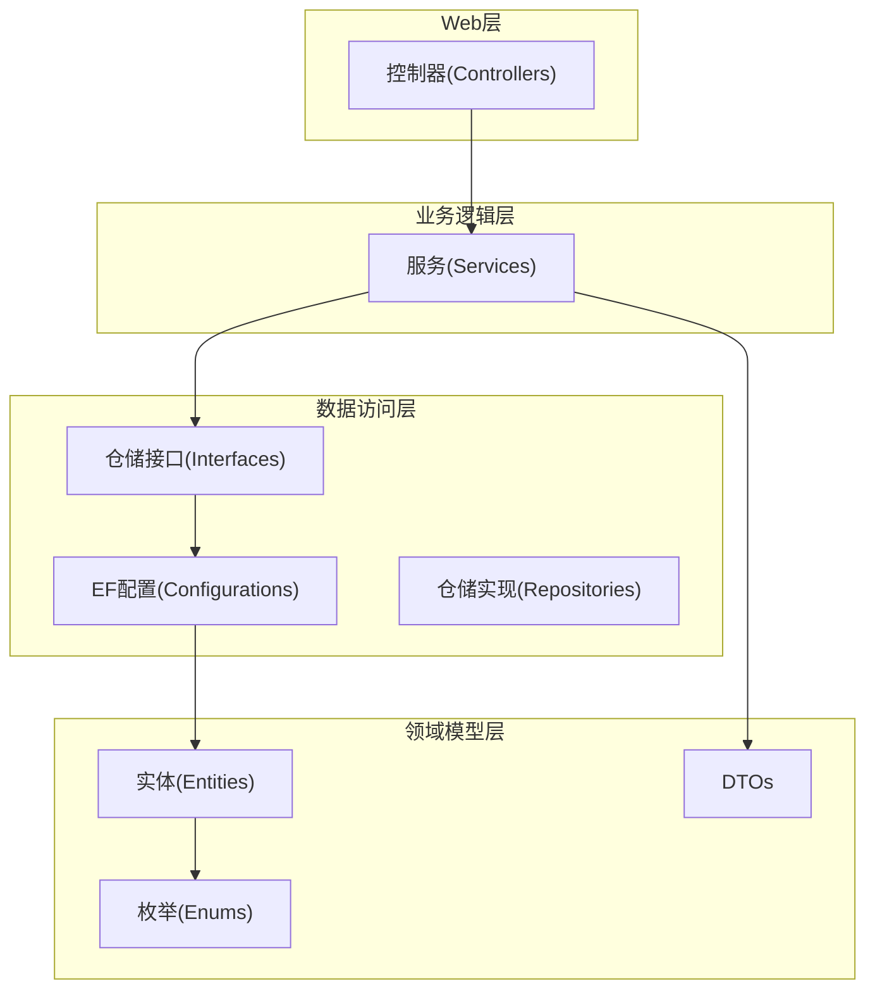

[本节为概念性结构说明，不直接分析具体文件，故无“章节来源”]

## 核心组件
- 采购域
  - 采购订单：PurPurchaseOrder、PurPurchaseOrderDetail
  - 采购入库：PurPurchaseIn、PurPurchaseInDetail
  - 采购退货：PurPurchaseReturn、PurPurchaseReturnDetail
- 销售域
  - 销售订单：SaleSaleOrder、SaleSaleOrderDetail
  - 销售出库：SaleSaleOut、SaleSaleOutDetail
  - 销售退货：SaleReturn、SaleReturnDetail
- 基础主数据
  - 供应商：BaseSupplier
  - 客户：BaseCustomer
  - 产品：BaseProduct
  - 仓库：BaseWarehouse
  - 产品库存：BaseProductStock
- 库存流水
  - 库存交易：InvStockTransaction
- 状态枚举
  - 采购订单状态、采购入库状态、采购退货状态
  - 销售订单状态、销售出库状态、销售退货状态
  - 库存交易类型

上述组件共同构成采购销售的主流程与逆向流程，并通过库存交易记录实现库存联动。

**章节来源**
- [PurPurchaseOrder.cs](file://EquipmentIMS.Models/Entities/PurPurchaseOrder.cs)
- [PurPurchaseOrderDetail.cs](file://EquipmentIMS.Models/Entities/PurPurchaseOrderDetail.cs)
- [PurPurchaseIn.cs](file://EquipmentIMS.Models/Entities/PurPurchaseIn.cs)
- [PurPurchaseInDetail.cs](file://EquipmentIMS.Models/Entities/PurPurchaseInDetail.cs)
- [PurPurchaseReturn.cs](file://EquipmentIMS.Models/Entities/PurPurchaseReturn.cs)
- [PurPurchaseReturnDetail.cs](file://EquipmentIMS.Models/Entities/PurPurchaseReturnDetail.cs)
- [SaleSaleOrder.cs](file://EquipmentIMS.Models/Entities/SaleSaleOrder.cs)
- [SaleSaleOrderDetail.cs](file://EquipmentIMS.Models/Entities/SaleSaleOrderDetail.cs)
- [SaleSaleOut.cs](file://EquipmentIMS.Models/Entities/SaleSaleOut.cs)
- [SaleSaleOutDetail.cs](file://EquipmentIMS.Models/Entities/SaleSaleOutDetail.cs)
- [SaleReturn.cs](file://EquipmentIMS.Models/Entities/SaleReturn.cs)
- [SaleReturnDetail.cs](file://EquipmentIMS.Models/Entities/SaleReturnDetail.cs)
- [BaseSupplier.cs](file://EquipmentIMS.Models/Entities/BaseSupplier.cs)
- [BaseCustomer.cs](file://EquipmentIMS.Models/Entities/BaseCustomer.cs)
- [BaseProduct.cs](file://EquipmentIMS.Models/Entities/BaseProduct.cs)
- [BaseWarehouse.cs](file://EquipmentIMS.Models/Entities/BaseWarehouse.cs)
- [BaseProductStock.cs](file://EquipmentIMS.Models/Entities/BaseProductStock.cs)
- [InvStockTransaction.cs](file://EquipmentIMS.Models/Entities/InvStockTransaction.cs)
- [PurchaseOrderStatus.cs](file://EquipmentIMS.Models/Enums/PurchaseOrderStatus.cs)
- [PurchaseInStatus.cs](file://EquipmentIMS.Models/Enums/PurchaseInStatus.cs)
- [PurchaseReturnStatus.cs](file://EquipmentIMS.Models/Enums/PurchaseReturnStatus.cs)
- [SaleOrderStatus.cs](file://EquipmentIMS.Models/Enums/SaleOrderStatus.cs)
- [SaleOutStatus.cs](file://EquipmentIMS.Models/Enums/SaleOutStatus.cs)
- [SaleReturnStatus.cs](file://EquipmentIMS.Models/Enums/SaleReturnStatus.cs)
- [TransactionType.cs](file://EquipmentIMS.Models/Enums/TransactionType.cs)

## 架构总览
采购销售整体架构遵循“控制器→服务→仓储→数据库”的分层调用路径，关键业务在BLL服务中编排，涉及库存变动的操作统一通过库存交易记录落库，保证可追溯与一致性。

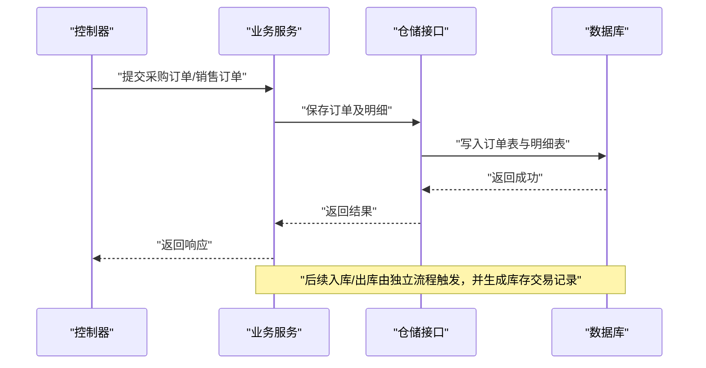

**图表来源**
- [PurchaseService.cs](file://EquipmentIMS.BLL/Services/PurchaseService.cs)
- [SaleService.cs](file://EquipmentIMS.BLL/Services/SaleService.cs)
- [IPurchaseOrderRepository.cs](file://EquipmentIMS.DAL/Interfaces/IPurchaseOrderRepository.cs)
- [ISaleOrderRepository.cs](file://EquipmentIMS.DAL/Interfaces/ISaleOrderRepository.cs)

**章节来源**
- [PurchaseService.cs](file://EquipmentIMS.BLL/Services/PurchaseService.cs)
- [SaleService.cs](file://EquipmentIMS.BLL/Services/SaleService.cs)
- [IPurchaseOrderRepository.cs](file://EquipmentIMS.DAL/Interfaces/IPurchaseOrderRepository.cs)
- [ISaleOrderRepository.cs](file://EquipmentIMS.DAL/Interfaces/ISaleOrderRepository.cs)

## 详细组件分析

### 实体与关系总览（ER图）
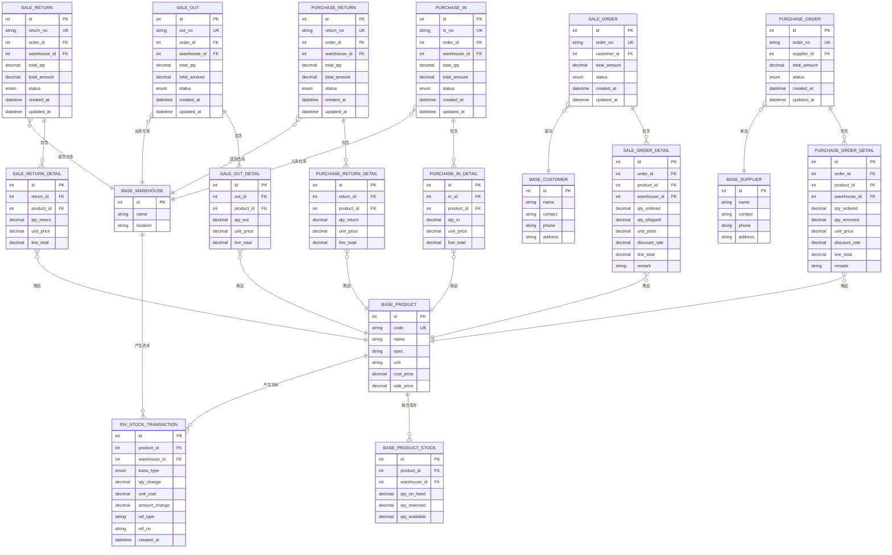

**图表来源**
- [PurPurchaseOrder.cs](file://EquipmentIMS.Models/Entities/PurPurchaseOrder.cs)
- [PurPurchaseOrderDetail.cs](file://EquipmentIMS.Models/Entities/PurPurchaseOrderDetail.cs)
- [PurPurchaseIn.cs](file://EquipmentIMS.Models/Entities/PurPurchaseIn.cs)
- [PurPurchaseInDetail.cs](file://EquipmentIMS.Models/Entities/PurPurchaseInDetail.cs)
- [PurPurchaseReturn.cs](file://EquipmentIMS.Models/Entities/PurPurchaseReturn.cs)
- [PurPurchaseReturnDetail.cs](file://EquipmentIMS.Models/Entities/PurPurchaseReturnDetail.cs)
- [SaleSaleOrder.cs](file://EquipmentIMS.Models/Entities/SaleSaleOrder.cs)
- [SaleSaleOrderDetail.cs](file://EquipmentIMS.Models/Entities/SaleSaleOrderDetail.cs)
- [SaleSaleOut.cs](file://EquipmentIMS.Models/Entities/SaleSaleOut.cs)
- [SaleSaleOutDetail.cs](file://EquipmentIMS.Models/Entities/SaleSaleOutDetail.cs)
- [SaleReturn.cs](file://EquipmentIMS.Models/Entities/SaleReturn.cs)
- [SaleReturnDetail.cs](file://EquipmentIMS.Models/Entities/SaleReturnDetail.cs)
- [BaseSupplier.cs](file://EquipmentIMS.Models/Entities/BaseSupplier.cs)
- [BaseCustomer.cs](file://EquipmentIMS.Models/Entities/BaseCustomer.cs)
- [BaseProduct.cs](file://EquipmentIMS.Models/Entities/BaseProduct.cs)
- [BaseWarehouse.cs](file://EquipmentIMS.Models/Entities/BaseWarehouse.cs)
- [BaseProductStock.cs](file://EquipmentIMS.Models/Entities/BaseProductStock.cs)
- [InvStockTransaction.cs](file://EquipmentIMS.Models/Entities/InvStockTransaction.cs)

**章节来源**
- [PurPurchaseOrderConfiguration.cs](file://EquipmentIMS.DAL/Configurations/PurPurchaseOrderConfiguration.cs)
- [PurPurchaseOrderDetailConfiguration.cs](file://EquipmentIMS.DAL/Configurations/PurPurchaseOrderDetailConfiguration.cs)
- [PurPurchaseInConfiguration.cs](file://EquipmentIMS.DAL/Configurations/PurPurchaseInConfiguration.cs)
- [PurPurchaseInDetailConfiguration.cs](file://EquipmentIMS.DAL/Configurations/PurPurchaseInDetailConfiguration.cs)
- [PurPurchaseReturnConfiguration.cs](file://EquipmentIMS.DAL/Configurations/PurPurchaseReturnConfiguration.cs)
- [PurPurchaseReturnDetailConfiguration.cs](file://EquipmentIMS.DAL/Configurations/PurPurchaseReturnDetailConfiguration.cs)
- [SaleSaleOrderConfiguration.cs](file://EquipmentIMS.DAL/Configurations/SaleSaleOrderConfiguration.cs)
- [SaleSaleOrderDetailConfiguration.cs](file://EquipmentIMS.DAL/Configurations/SaleSaleOrderDetailConfiguration.cs)
- [SaleSaleOutConfiguration.cs](file://EquipmentIMS.DAL/Configurations/SaleSaleOutConfiguration.cs)
- [SaleSaleOutDetailConfiguration.cs](file://EquipmentIMS.DAL/Configurations/SaleSaleOutDetailConfiguration.cs)
- [SaleReturnConfiguration.cs](file://EquipmentIMS.DAL/Configurations/SaleReturnConfiguration.cs)
- [SaleReturnDetailConfiguration.cs](file://EquipmentIMS.DAL/Configurations/SaleReturnDetailConfiguration.cs)
- [BaseSupplierConfiguration.cs](file://EquipmentIMS.DAL/Configurations/BaseSupplierConfiguration.cs)
- [BaseCustomerConfiguration.cs](file://EquipmentIMS.DAL/Configurations/BaseCustomerConfiguration.cs)
- [BaseProductConfiguration.cs](file://EquipmentIMS.DAL/Configurations/BaseProductConfiguration.cs)
- [BaseWarehouseConfiguration.cs](file://EquipmentIMS.DAL/Configurations/BaseWarehouseConfiguration.cs)
- [BaseProductStockConfiguration.cs](file://EquipmentIMS.DAL/Configurations/BaseProductStockConfiguration.cs)
- [InvStockTransactionConfiguration.cs](file://EquipmentIMS.DAL/Configurations/InvStockTransactionConfiguration.cs)

### 采购订单与明细（字段与流程）
- 采购订单主表关键字段
  - 单号、供应商、总金额、状态、创建/更新时间
- 采购订单明细关键字段
  - 商品、仓库、订购数量、已入库数量、单价、折扣率、行金额、备注
- 业务流程要点
  - 订单创建后进入待审核/待确认状态
  - 根据明细生成采购入库计划
  - 入库完成后更新明细已入库数量与订单状态


**图表来源**
- [PurPurchaseOrder.cs](file://EquipmentIMS.Models/Entities/PurPurchaseOrder.cs)
- [PurPurchaseOrderDetail.cs](file://EquipmentIMS.Models/Entities/PurPurchaseOrderDetail.cs)
- [PurchaseOrderStatus.cs](file://EquipmentIMS.Models/Enums/PurchaseOrderStatus.cs)

**章节来源**
- [PurPurchaseOrder.cs](file://EquipmentIMS.Models/Entities/PurPurchaseOrder.cs)
- [PurPurchaseOrderDetail.cs](file://EquipmentIMS.Models/Entities/PurPurchaseOrderDetail.cs)
- [PurchaseOrderStatus.cs](file://EquipmentIMS.Models/Enums/PurchaseOrderStatus.cs)

### 销售订单与明细（字段与流程）
- 销售订单主表关键字段
  - 单号、客户、总金额、状态、创建/更新时间
- 销售订单明细关键字段
  - 商品、仓库、订购数量、已出库数量、单价、折扣率、行金额、备注
- 业务流程要点
  - 订单创建后进入待审核/待确认状态
  - 根据明细生成销售出库计划
  - 出库完成后更新明细已出库数量与订单状态

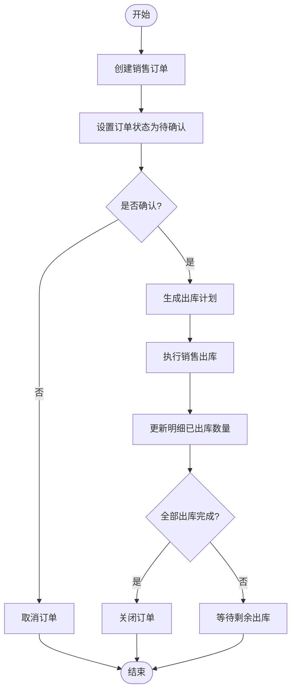

**图表来源**
- [SaleSaleOrder.cs](file://EquipmentIMS.Models/Entities/SaleSaleOrder.cs)
- [SaleSaleOrderDetail.cs](file://EquipmentIMS.Models/Entities/SaleSaleOrderDetail.cs)
- [SaleOrderStatus.cs](file://EquipmentIMS.Models/Enums/SaleOrderStatus.cs)

**章节来源**
- [SaleSaleOrder.cs](file://EquipmentIMS.Models/Entities/SaleSaleOrder.cs)
- [SaleSaleOrderDetail.cs](file://EquipmentIMS.Models/Entities/SaleSaleOrderDetail.cs)
- [SaleOrderStatus.cs](file://EquipmentIMS.Models/Enums/SaleOrderStatus.cs)

### 采购入库与库存联动
- 采购入库主表关键字段
  - 入库单号、关联采购订单、仓库、入库总量、入库总金额、状态、时间戳
- 采购入库明细关键字段
  - 商品、入库数量、单价、行金额
- 库存联动机制
  - 入库成功后，增加对应仓库的商品可用库存
  - 生成库存交易记录（类型为入库），记录数量变动、单位成本与金额变动
  - 同步更新采购订单明细的已入库数量与订单状态

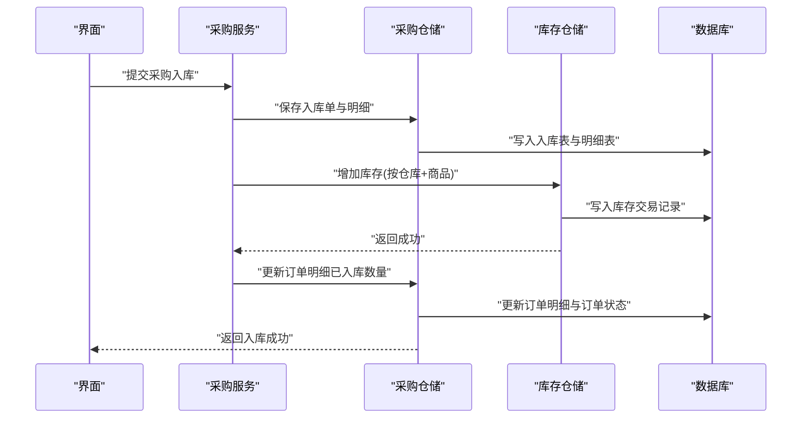

**图表来源**
- [PurPurchaseIn.cs](file://EquipmentIMS.Models/Entities/PurPurchaseIn.cs)
- [PurPurchaseInDetail.cs](file://EquipmentIMS.Models/Entities/PurPurchaseInDetail.cs)
- [PurPurchaseOrderDetail.cs](file://EquipmentIMS.Models/Entities/PurPurchaseOrderDetail.cs)
- [BaseProductStock.cs](file://EquipmentIMS.Models/Entities/BaseProductStock.cs)
- [InvStockTransaction.cs](file://EquipmentIMS.Models/Entities/InvStockTransaction.cs)
- [PurchaseService.cs](file://EquipmentIMS.BLL/Services/PurchaseService.cs)
- [StockService.cs](file://EquipmentIMS.BLL/Services/StockService.cs)
- [IStockRepository.cs](file://EquipmentIMS.DAL/Interfaces/IStockRepository.cs)
- [IStockTransactionRepository.cs](file://EquipmentIMS.DAL/Interfaces/IStockTransactionRepository.cs)

**章节来源**
- [PurPurchaseIn.cs](file://EquipmentIMS.Models/Entities/PurPurchaseIn.cs)
- [PurPurchaseInDetail.cs](file://EquipmentIMS.Models/Entities/PurPurchaseInDetail.cs)
- [PurPurchaseOrderDetail.cs](file://EquipmentIMS.Models/Entities/PurPurchaseOrderDetail.cs)
- [BaseProductStock.cs](file://EquipmentIMS.Models/Entities/BaseProductStock.cs)
- [InvStockTransaction.cs](file://EquipmentIMS.Models/Entities/InvStockTransaction.cs)
- [PurchaseService.cs](file://EquipmentIMS.BLL/Services/PurchaseService.cs)
- [StockService.cs](file://EquipmentIMS.BLL/Services/StockService.cs)
- [IStockRepository.cs](file://EquipmentIMS.DAL/Interfaces/IStockRepository.cs)
- [IStockTransactionRepository.cs](file://EquipmentIMS.DAL/Interfaces/IStockTransactionRepository.cs)

### 销售出库与库存联动
- 销售出库主表关键字段
  - 出库单号、关联销售订单、仓库、出库总量、出库总金额、状态、时间戳
- 销售出库明细关键字段
  - 商品、出库数量、单价、行金额
- 库存联动机制
  - 出库成功后，减少对应仓库的商品可用库存
  - 生成库存交易记录（类型为出库），记录数量变动、单位成本与金额变动
  - 同步更新销售订单明细的已出库数量与订单状态

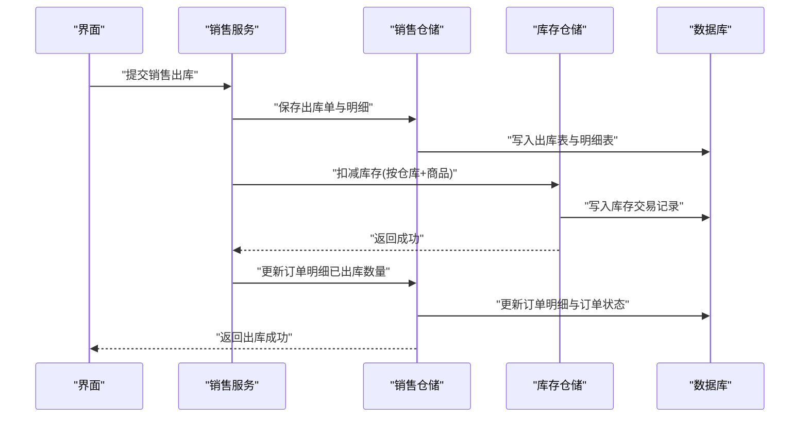

**图表来源**
- [SaleSaleOut.cs](file://EquipmentIMS.Models/Entities/SaleSaleOut.cs)
- [SaleSaleOutDetail.cs](file://EquipmentIMS.Models/Entities/SaleSaleOutDetail.cs)
- [SaleSaleOrderDetail.cs](file://EquipmentIMS.Models/Entities/SaleSaleOrderDetail.cs)
- [BaseProductStock.cs](file://EquipmentIMS.Models/Entities/BaseProductStock.cs)
- [InvStockTransaction.cs](file://EquipmentIMS.Models/Entities/InvStockTransaction.cs)
- [SaleService.cs](file://EquipmentIMS.BLL/Services/SaleService.cs)
- [StockService.cs](file://EquipmentIMS.BLL/Services/StockService.cs)
- [IStockRepository.cs](file://EquipmentIMS.DAL/Interfaces/IStockRepository.cs)
- [IStockTransactionRepository.cs](file://EquipmentIMS.DAL/Interfaces/IStockTransactionRepository.cs)

**章节来源**
- [SaleSaleOut.cs](file://EquipmentIMS.Models/Entities/SaleSaleOut.cs)
- [SaleSaleOutDetail.cs](file://EquipmentIMS.Models/Entities/SaleSaleOutDetail.cs)
- [SaleSaleOrderDetail.cs](file://EquipmentIMS.Models/Entities/SaleSaleOrderDetail.cs)
- [BaseProductStock.cs](file://EquipmentIMS.Models/Entities/BaseProductStock.cs)
- [InvStockTransaction.cs](file://EquipmentIMS.Models/Entities/InvStockTransaction.cs)
- [SaleService.cs](file://EquipmentIMS.BLL/Services/SaleService.cs)
- [StockService.cs](file://EquipmentIMS.BLL/Services/StockService.cs)
- [IStockRepository.cs](file://EquipmentIMS.DAL/Interfaces/IStockRepository.cs)
- [IStockTransactionRepository.cs](file://EquipmentIMS.DAL/Interfaces/IStockTransactionRepository.cs)

### 订单明细设计模式、价格计算与折扣
- 设计模式
  - 主从表结构：订单主表与明细表一对多
  - 明细维度：商品、仓库、数量、单价、折扣率、行金额、备注
- 价格计算逻辑
  - 行金额 = 数量 × 单价 × (1 - 折扣率)
  - 订单总金额 = 所有明细行金额之和
- 折扣处理数据结构
  - 折扣率字段位于明细行，支持按行折扣
  - 如需全局折扣，可在订单主表增加折扣字段并在汇总时应用

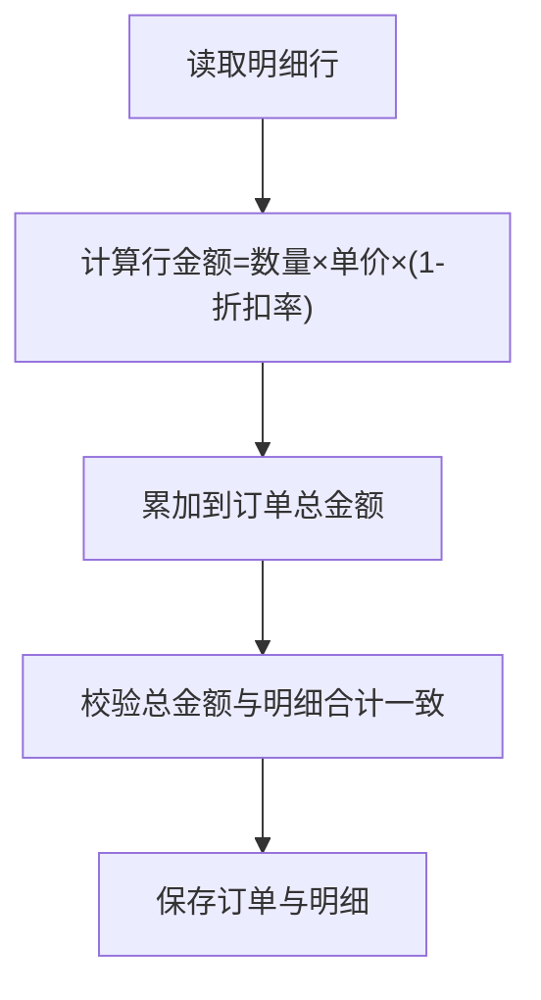

**图表来源**
- [PurPurchaseOrderDetail.cs](file://EquipmentIMS.Models/Entities/PurPurchaseOrderDetail.cs)
- [SaleSaleOrderDetail.cs](file://EquipmentIMS.Models/Entities/SaleSaleOrderDetail.cs)

**章节来源**
- [PurPurchaseOrderDetail.cs](file://EquipmentIMS.Models/Entities/PurPurchaseOrderDetail.cs)
- [SaleSaleOrderDetail.cs](file://EquipmentIMS.Models/Entities/SaleSaleOrderDetail.cs)

### 采购退货与销售退货（逆向流程）
- 采购退货
  - 退货单关联原采购订单与仓库
  - 退货明细包含商品、退货数量、单价、行金额
  - 退货成功后减少库存，生成库存交易记录（类型为退货入库或负向入库）
  - 更新原订单明细的已入库数量与订单状态
- 销售退货
  - 退货单关联原销售订单与仓库
  - 退货明细包含商品、退货数量、单价、行金额
  - 退货成功后增加库存，生成库存交易记录（类型为退货出库或正向入库）
  - 更新原订单明细的已出库数量与订单状态

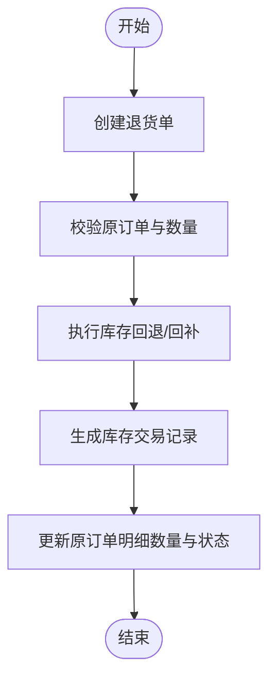

**图表来源**
- [PurPurchaseReturn.cs](file://EquipmentIMS.Models/Entities/PurPurchaseReturn.cs)
- [PurPurchaseReturnDetail.cs](file://EquipmentIMS.Models/Entities/PurPurchaseReturnDetail.cs)
- [SaleReturn.cs](file://EquipmentIMS.Models/Entities/SaleReturn.cs)
- [SaleReturnDetail.cs](file://EquipmentIMS.Models/Entities/SaleReturnDetail.cs)
- [InvStockTransaction.cs](file://EquipmentIMS.Models/Entities/InvStockTransaction.cs)

**章节来源**
- [PurPurchaseReturn.cs](file://EquipmentIMS.Models/Entities/PurPurchaseReturn.cs)
- [PurPurchaseReturnDetail.cs](file://EquipmentIMS.Models/Entities/PurPurchaseReturnDetail.cs)
- [SaleReturn.cs](file://EquipmentIMS.Models/Entities/SaleReturn.cs)
- [SaleReturnDetail.cs](file://EquipmentIMS.Models/Entities/SaleReturnDetail.cs)
- [InvStockTransaction.cs](file://EquipmentIMS.Models/Entities/InvStockTransaction.cs)

### 供应商与客户与订单的关联
- 供应商
  - 采购订单主表通过外键关联供应商
  - 供应商信息包括名称、联系人、电话、地址等
- 客户
  - 销售订单主表通过外键关联客户
  - 客户信息包括名称、联系人、电话、地址等

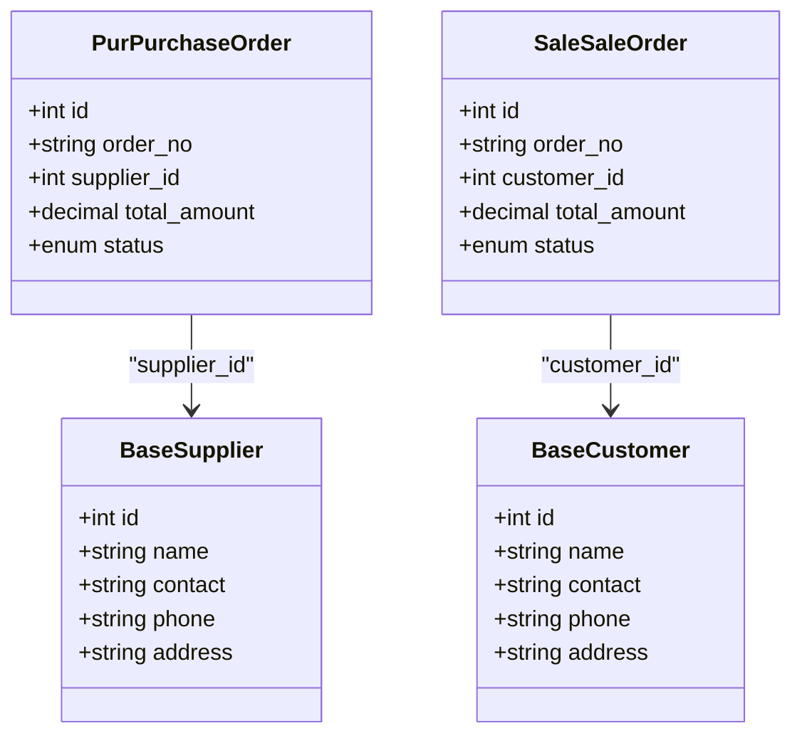

**图表来源**
- [BaseSupplier.cs](file://EquipmentIMS.Models/Entities/BaseSupplier.cs)
- [BaseCustomer.cs](file://EquipmentIMS.Models/Entities/BaseCustomer.cs)
- [PurPurchaseOrder.cs](file://EquipmentIMS.Models/Entities/PurPurchaseOrder.cs)
- [SaleSaleOrder.cs](file://EquipmentIMS.Models/Entities/SaleSaleOrder.cs)

**章节来源**
- [BaseSupplier.cs](file://EquipmentIMS.Models/Entities/BaseSupplier.cs)
- [BaseCustomer.cs](file://EquipmentIMS.Models/Entities/BaseCustomer.cs)
- [PurPurchaseOrder.cs](file://EquipmentIMS.Models/Entities/PurPurchaseOrder.cs)
- [SaleSaleOrder.cs](file://EquipmentIMS.Models/Entities/SaleSaleOrder.cs)

### 状态机设计
- 采购订单状态机
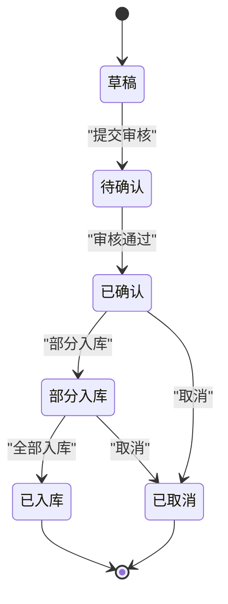

- 销售订单状态机
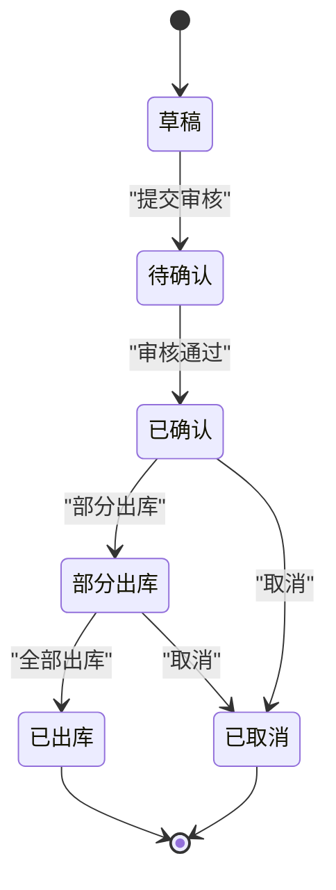

**图表来源**
- [PurchaseOrderStatus.cs](file://EquipmentIMS.Models/Enums/PurchaseOrderStatus.cs)
- [SaleOrderStatus.cs](file://EquipmentIMS.Models/Enums/SaleOrderStatus.cs)

**章节来源**
- [PurchaseOrderStatus.cs](file://EquipmentIMS.Models/Enums/PurchaseOrderStatus.cs)
- [SaleOrderStatus.cs](file://EquipmentIMS.Models/Enums/SaleOrderStatus.cs)

## 依赖关系分析
- 服务层依赖仓储接口，仓储接口由具体仓储实现，最终通过EF配置映射到数据库实体
- 库存联动由库存服务与库存仓储协作完成，确保交易记录与库存快照一致

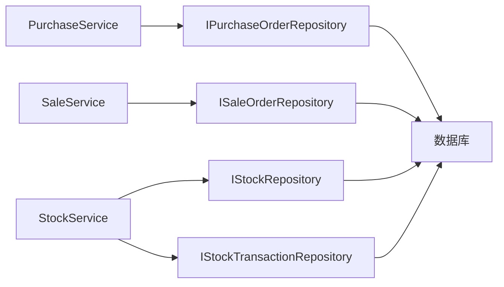

**图表来源**
- [PurchaseService.cs](file://EquipmentIMS.BLL/Services/PurchaseService.cs)
- [SaleService.cs](file://EquipmentIMS.BLL/Services/SaleService.cs)
- [StockService.cs](file://EquipmentIMS.BLL/Services/StockService.cs)
- [IPurchaseOrderRepository.cs](file://EquipmentIMS.DAL/Interfaces/IPurchaseOrderRepository.cs)
- [ISaleOrderRepository.cs](file://EquipmentIMS.DAL/Interfaces/ISaleOrderRepository.cs)
- [IStockRepository.cs](file://EquipmentIMS.DAL/Interfaces/IStockRepository.cs)
- [IStockTransactionRepository.cs](file://EquipmentIMS.DAL/Interfaces/IStockTransactionRepository.cs)

**章节来源**
- [PurchaseService.cs](file://EquipmentIMS.BLL/Services/PurchaseService.cs)
- [SaleService.cs](file://EquipmentIMS.BLL/Services/SaleService.cs)
- [StockService.cs](file://EquipmentIMS.BLL/Services/StockService.cs)
- [IPurchaseOrderRepository.cs](file://EquipmentIMS.DAL/Interfaces/IPurchaseOrderRepository.cs)
- [ISaleOrderRepository.cs](file://EquipmentIMS.DAL/Interfaces/ISaleOrderRepository.cs)
- [IStockRepository.cs](file://EquipmentIMS.DAL/Interfaces/IStockRepository.cs)
- [IStockTransactionRepository.cs](file://EquipmentIMS.DAL/Interfaces/IStockTransactionRepository.cs)

## 性能考虑
- 索引建议
  - 订单与出入库单号唯一索引
  - 商品+仓库组合索引用于库存查询
  - 交易记录按商品、仓库、时间范围建立复合索引
- 批量操作
  - 入库/出库明细批量写入，减少往返次数
- 事务边界
  - 将订单更新与库存交易置于同一事务，避免不一致
- 分页与过滤
  - 列表查询使用分页与条件过滤，避免全表扫描

[本节为通用性能建议，不直接分析具体文件，故无“章节来源”]

## 故障排查指南
- 常见错误
  - 库存不足：检查库存交易记录与当前库存快照
  - 数量不一致：核对订单明细累计数量与出入库明细数量
  - 状态非法转换：检查状态机约束与业务规则
- 定位方法
  - 通过单号查询订单与明细
  - 通过商品+仓库查询库存快照与交易流水
  - 查看服务层日志与异常堆栈

**章节来源**
- [InvStockTransaction.cs](file://EquipmentIMS.Models/Entities/InvStockTransaction.cs)
- [BaseProductStock.cs](file://EquipmentIMS.Models/Entities/BaseProductStock.cs)

## 结论
本模型以主从表结构组织采购销售业务，结合库存交易记录实现库存联动与可追溯。通过明确的状态机与统一的折扣计算逻辑，保障业务流程的一致性与扩展性。建议在报表与查询场景中使用聚合视图与索引优化提升性能。

[本节为总结性内容，不直接分析具体文件，故无“章节来源”]

## 附录

### 复杂查询与报表统计SQL示例
以下为常用查询与报表统计的SQL示例（基于ER图字段命名约定；实际列名以数据库为准）：

- 采购订单汇总（含供应商与状态）
```sql
SELECT
    po.order_no,
    s.name AS supplier_name,
    po.total_amount,
    po.status,
    po.created_at
FROM pur_purchase_order po
JOIN base_supplier s ON po.supplier_id = s.id
ORDER BY po.created_at DESC;
```

- 销售订单汇总（含客户与状态）
```sql
SELECT
    so.order_no,
    c.name AS customer_name,
    so.total_amount,
    so.status,
    so.created_at
FROM sale_sale_order so
JOIN base_customer c ON so.customer_id = c.id
ORDER BY so.created_at DESC;
```

- 某商品在某仓库的可用库存
```sql
SELECT
    bps.product_id,
    bps.warehouse_id,
    bps.qty_on_hand,
    bps.qty_reserved,
    bps.qty_available
FROM base_product_stock bps
WHERE bps.product_id = @productId
  AND bps.warehouse_id = @warehouseId;
```

- 某时间段内采购入库明细与总金额
```sql
SELECT
    pid.in_id,
    pord.order_no,
    pid.product_id,
    pid.qty_in,
    pid.unit_price,
    pid.line_total
FROM pur_purchase_in_detail pid
JOIN pur_purchase_in pi ON pid.in_id = pi.id
JOIN pur_purchase_order pord ON pi.order_id = pord.id
WHERE pi.created_at BETWEEN @start AND @end
ORDER BY pi.created_at DESC;
```

- 某时间段内销售出库明细与总金额
```sql
SELECT
    sod.out_id,
    sold.order_no,
    sod.product_id,
    sod.qty_out,
    sod.unit_price,
    sod.line_total
FROM sale_sale_out_detail sod
JOIN sale_sale_out so ON sod.out_id = so.id
JOIN sale_sale_order sold ON so.order_id = sold.id
WHERE so.created_at BETWEEN @start AND @end
ORDER BY so.created_at DESC;
```

- 库存交易流水（按商品+仓库+时间范围）
```sql
SELECT
    ist.product_id,
    ist.warehouse_id,
    ist.trans_type,
    ist.qty_change,
    ist.unit_cost,
    ist.amount_change,
    ist.ref_type,
    ist.ref_no,
    ist.created_at
FROM inv_stock_transaction ist
WHERE ist.product_id = @productId
  AND ist.warehouse_id = @warehouseId
  AND ist.created_at BETWEEN @start AND @end
ORDER BY ist.created_at ASC;
```

- 采购退货汇总（按供应商与时间段）
```sql
SELECT
    pr.return_no,
    pord.order_no,
    w.name AS warehouse_name,
    pr.total_qty,
    pr.total_amount,
    pr.status,
    pr.created_at
FROM pur_purchase_return pr
JOIN pur_purchase_order pord ON pr.order_id = pord.id
JOIN base_warehouse w ON pr.warehouse_id = w.id
WHERE pr.created_at BETWEEN @start AND @end
ORDER BY pr.created_at DESC;
```

- 销售退货汇总（按客户与时间段）
```sql
SELECT
    sr.return_no,
    sold.order_no,
    w.name AS warehouse_name,
    sr.total_qty,
    sr.total_amount,
    sr.status,
    sr.created_at
FROM sale_return sr
JOIN sale_sale_order sold ON sr.order_id = sold.id
JOIN base_warehouse w ON sr.warehouse_id = w.id
WHERE sr.created_at BETWEEN @start AND @end
ORDER BY sr.created_at DESC;
```

- 报表：月度采购总额与笔数
```sql
SELECT
    DATE_FORMAT(pi.created_at, '%Y-%m') AS month,
    COUNT(DISTINCT pi.id) AS order_count,
    SUM(pi.total_amount) AS total_amount
FROM pur_purchase_in pi
GROUP BY DATE_FORMAT(pi.created_at, '%Y-%m')
ORDER BY month DESC;
```

- 报表：月度销售总额与笔数
```sql
SELECT
    DATE_FORMAT(so.created_at, '%Y-%m') AS month,
    COUNT(DISTINCT so.id) AS order_count,
    SUM(so.total_amount) AS total_amount
FROM sale_sale_out so
GROUP BY DATE_FORMAT(so.created_at, '%Y-%m')
ORDER BY month DESC;
```

**章节来源**
- [ReportService.cs](file://EquipmentIMS.BLL/Services/ReportService.cs)
- [ReportPurchaseDtos.cs](file://EquipmentIMS.Models/DTOs/Reports/ReportPurchaseDtos.cs)
- [ReportSaleDtos.cs](file://EquipmentIMS.Models/DTOs/Reports/ReportSaleDtos.cs)