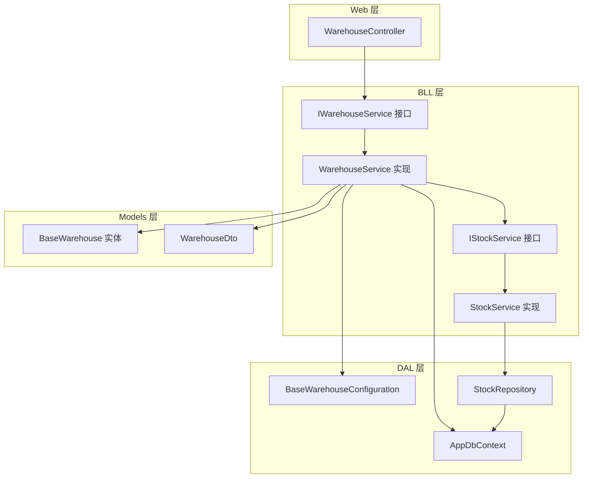
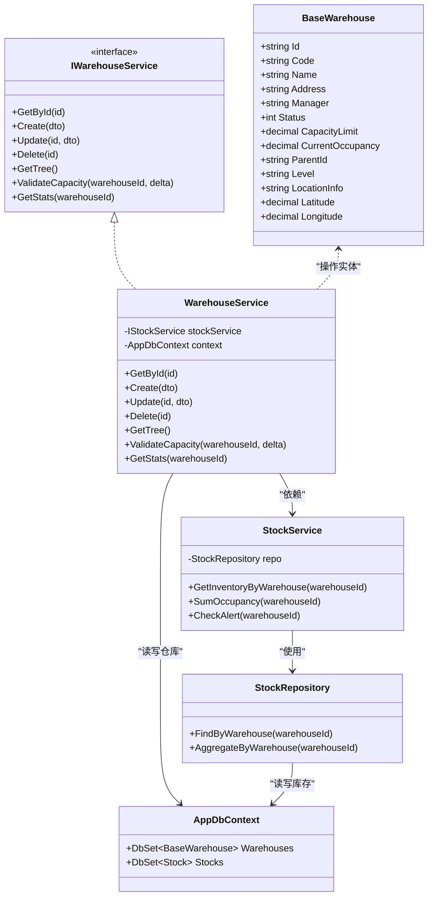
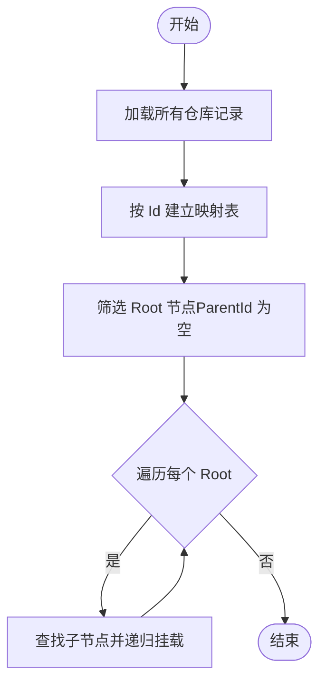
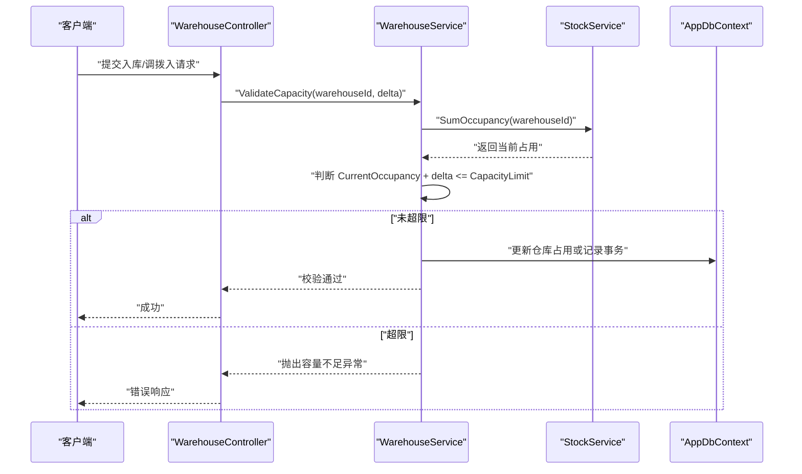
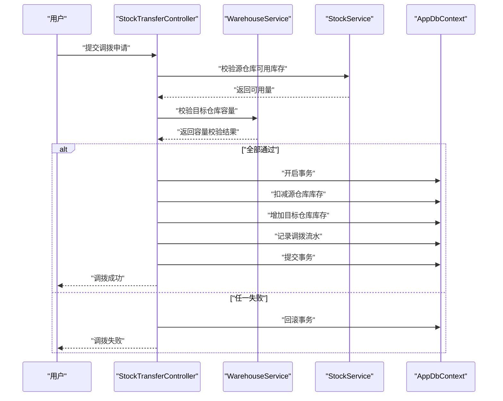
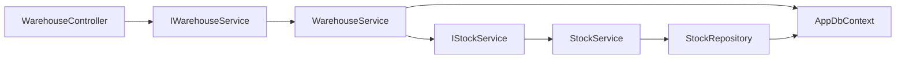

# 仓库管理模块

<cite>
**本文引用的文件**   
- [WarehouseService.cs](file://EquipmentIMS.BLL/Services/WarehouseService.cs)
- [IWarehouseService.cs](file://EquipmentIMS.BLL/Interfaces/IWarehouseService.cs)
- [BaseWarehouse.cs](file://EquipmentIMS.Models/Entities/BaseWarehouse.cs)
- [BaseWarehouseConfiguration.cs](file://EquipmentIMS.DAL/Configurations/BaseWarehouseConfiguration.cs)
- [WarehouseController.cs](file://EquipmentIMS.Web/Controllers/WarehouseController.cs)
- [WarehouseDto.cs](file://EquipmentIMS.Models/DTOs/WarehouseDto.cs)
- [StockService.cs](file://EquipmentIMS.BLL/Services/StockService.cs)
- [IStockService.cs](file://EquipmentIMS.BLL/Interfaces/IStockService.cs)
- [StockRepository.cs](file://EquipmentIMS.DAL/Repositories/StockRepository.cs)
- [AppDbContext.cs](file://EquipmentIMS.DAL/AppDbContext.cs)
</cite>

## 目录
1. [简介](#简介)
2. [项目结构](#项目结构)
3. [核心组件](#核心组件)
4. [架构总览](#架构总览)
5. [详细组件分析](#详细组件分析)
6. [依赖关系分析](#依赖关系分析)
7. [性能考虑](#性能考虑)
8. [故障排查指南](#故障排查指南)
9. [结论](#结论)
10. [附录](#附录)

## 简介
本章节面向仓库管理模块，围绕仓库信息管理、仓库容量管理、仓库位置管理三大核心能力展开。文档重点阐述 WarehouseService 的业务逻辑实现、仓库层级结构管理、仓库容量监控机制，并说明仓库与库存管理的集成关系以及多仓库库存调拨的实现原理。同时提供仓库 CRUD、容量计算、位置规划等关键流程的参考路径，并给出仓库布局优化、容量规划与仓储效率提升的策略建议。

## 项目结构
仓库管理模块采用分层架构：Web 层通过控制器暴露接口，BLL 层承载业务逻辑（以 WarehouseService 为核心），DAL 层负责数据访问与实体映射，Models 层定义领域模型、DTO 与枚举。

图表来源
- [WarehouseController.cs](file://EquipmentIMS.Web/Controllers/WarehouseController.cs)
- [IWarehouseService.cs](file://EquipmentIMS.BLL/Interfaces/IWarehouseService.cs)
- [WarehouseService.cs](file://EquipmentIMS.BLL/Services/WarehouseService.cs)
- [IStockService.cs](file://EquipmentIMS.BLL/Interfaces/IStockService.cs)
- [StockService.cs](file://EquipmentIMS.BLL/Services/StockService.cs)
- [StockRepository.cs](file://EquipmentIMS.DAL/Repositories/StockRepository.cs)
- [AppDbContext.cs](file://EquipmentIMS.DAL/AppDbContext.cs)
- [BaseWarehouseConfiguration.cs](file://EquipmentIMS.DAL/Configurations/BaseWarehouseConfiguration.cs)
- [BaseWarehouse.cs](file://EquipmentIMS.Models/Entities/BaseWarehouse.cs)
- [WarehouseDto.cs](file://EquipmentIMS.Models/DTOs/WarehouseDto.cs)

章节来源
- [WarehouseController.cs](file://EquipmentIMS.Web/Controllers/WarehouseController.cs)
- [IWarehouseService.cs](file://EquipmentIMS.BLL/Interfaces/IWarehouseService.cs)
- [WarehouseService.cs](file://EquipmentIMS.BLL/Services/WarehouseService.cs)
- [StockService.cs](file://EquipmentIMS.BLL/Services/StockService.cs)
- [StockRepository.cs](file://EquipmentIMS.DAL/Repositories/StockRepository.cs)
- [AppDbContext.cs](file://EquipmentIMS.DAL/AppDbContext.cs)
- [BaseWarehouseConfiguration.cs](file://EquipmentIMS.DAL/Configurations/BaseWarehouseConfiguration.cs)
- [BaseWarehouse.cs](file://EquipmentIMS.Models/Entities/BaseWarehouse.cs)
- [WarehouseDto.cs](file://EquipmentIMS.Models/DTOs/WarehouseDto.cs)

## 核心组件
- 仓库实体与配置
  - BaseWarehouse：仓库主数据实体，包含仓库编码、名称、地址、负责人、状态、容量上限、当前占用、层级标识、父仓库标识、坐标信息等字段，用于支撑仓库基本信息维护、层级结构与位置管理。
  - BaseWarehouseConfiguration：EF Core 配置，定义仓库表结构、索引与约束，确保查询与写入性能。
- 服务接口与实现
  - IWarehouseService：声明仓库相关的增删改查、层级树构建、容量校验、统计报表等契约。
  - WarehouseService：实现仓库全生命周期管理与容量监控，协调 StockService 完成库存联动。
- 控制器与 DTO
  - WarehouseController：对外暴露仓库管理 API，接收请求参数，调用服务层处理，返回统一响应。
  - WarehouseDto：仓库输入输出数据传输对象，屏蔽实体细节，便于前后端交互。
- 库存集成
  - StockService/IStockService：提供库存查询、汇总、预警等能力，供仓库容量监控与调拨使用。
  - StockRepository：底层库存数据访问封装，配合 AppDbContext 进行持久化。

章节来源
- [BaseWarehouse.cs](file://EquipmentIMS.Models/Entities/BaseWarehouse.cs)
- [BaseWarehouseConfiguration.cs](file://EquipmentIMS.DAL/Configurations/BaseWarehouseConfiguration.cs)
- [IWarehouseService.cs](file://EquipmentIMS.BLL/Interfaces/IWarehouseService.cs)
- [WarehouseService.cs](file://EquipmentIMS.BLL/Services/WarehouseService.cs)
- [WarehouseController.cs](file://EquipmentIMS.Web/Controllers/WarehouseController.cs)
- [WarehouseDto.cs](file://EquipmentIMS.Models/DTOs/WarehouseDto.cs)
- [StockService.cs](file://EquipmentIMS.BLL/Services/StockService.cs)
- [IStockService.cs](file://EquipmentIMS.BLL/Interfaces/IStockService.cs)
- [StockRepository.cs](file://EquipmentIMS.DAL/Repositories/StockRepository.cs)
- [AppDbContext.cs](file://EquipmentIMS.DAL/AppDbContext.cs)

## 架构总览
仓库管理模块遵循“控制器→服务→仓储”的分层设计，仓库实体由 EF Core 配置驱动，DTO 作为边界契约，库存服务作为横向能力被仓库服务复用。

图表来源
- [BaseWarehouse.cs](file://EquipmentIMS.Models/Entities/BaseWarehouse.cs)
- [IWarehouseService.cs](file://EquipmentIMS.BLL/Interfaces/IWarehouseService.cs)
- [WarehouseService.cs](file://EquipmentIMS.BLL/Services/WarehouseService.cs)
- [StockService.cs](file://EquipmentIMS.BLL/Services/StockService.cs)
- [StockRepository.cs](file://EquipmentIMS.DAL/Repositories/StockRepository.cs)
- [AppDbContext.cs](file://EquipmentIMS.DAL/AppDbContext.cs)

## 详细组件分析

### 仓库基本信息维护（CRUD）
- 功能要点
  - 创建仓库：校验编码唯一性、必填字段、容量上限非负；保存后初始化当前占用为 0。
  - 更新仓库：支持修改名称、地址、负责人、状态、容量上限、位置信息；若容量上限变更需校验现有占用是否超限。
  - 删除仓库：检查是否存在子仓库或关联库存记录，防止破坏完整性。
  - 查询仓库：按 ID 获取详情，支持分页列表与条件筛选。
- 关键流程
  - 控制器接收 DTO → 服务层校验与转换 → 上下文持久化 → 返回结果。
- 参考路径
  - 控制器入口：[WarehouseController.cs](file://EquipmentIMS.Web/Controllers/WarehouseController.cs)
  - 服务契约与实现：[IWarehouseService.cs](file://EquipmentIMS.BLL/Interfaces/IWarehouseService.cs)、[WarehouseService.cs](file://EquipmentIMS.BLL/Services/WarehouseService.cs)
  - 实体与配置：[BaseWarehouse.cs](file://EquipmentIMS.Models/Entities/BaseWarehouse.cs)、[BaseWarehouseConfiguration.cs](file://EquipmentIMS.DAL/Configurations/BaseWarehouseConfiguration.cs)
  - DTO：[WarehouseDto.cs](file://EquipmentIMS.Models/DTOs/WarehouseDto.cs)

章节来源
- [WarehouseController.cs](file://EquipmentIMS.Web/Controllers/WarehouseController.cs)
- [IWarehouseService.cs](file://EquipmentIMS.BLL/Interfaces/IWarehouseService.cs)
- [WarehouseService.cs](file://EquipmentIMS.BLL/Services/WarehouseService.cs)
- [BaseWarehouse.cs](file://EquipmentIMS.Models/Entities/BaseWarehouse.cs)
- [BaseWarehouseConfiguration.cs](file://EquipmentIMS.DAL/Configurations/BaseWarehouseConfiguration.cs)
- [WarehouseDto.cs](file://EquipmentIMS.Models/DTOs/WarehouseDto.cs)

### 仓库层级结构管理
- 功能要点
  - 父子关系：通过 ParentId 与 Level 字段表达仓库层级，支持多级仓库组织。
  - 树形构建：从根节点出发递归组装子节点，形成完整层级树，便于前端展示与权限控制。
  - 移动与重排：调整 ParentId 与 Level，保证层级一致性与无环结构。
- 算法流程

图表来源
- [WarehouseService.cs](file://EquipmentIMS.BLL/Services/WarehouseService.cs)

章节来源
- [WarehouseService.cs](file://EquipmentIMS.BLL/Services/WarehouseService.cs)

### 仓库容量监控机制
- 功能要点
  - 容量上限：CapacityLimit 表示仓库最大可容纳量。
  - 当前占用：CurrentOccupancy 实时反映仓库已占用量，来源于库存汇总。
  - 校验规则：在入库、调拨入、手动调整时，校验 delta 是否导致超过上限。
  - 预警阈值：结合 StockService 的 CheckAlert 能力，当占用率超过阈值触发告警。
- 容量校验流程

图表来源
- [WarehouseService.cs](file://EquipmentIMS.BLL/Services/WarehouseService.cs)
- [StockService.cs](file://EquipmentIMS.BLL/Services/StockService.cs)
- [AppDbContext.cs](file://EquipmentIMS.DAL/AppDbContext.cs)

章节来源
- [WarehouseService.cs](file://EquipmentIMS.BLL/Services/WarehouseService.cs)
- [StockService.cs](file://EquipmentIMS.BLL/Services/StockService.cs)
- [AppDbContext.cs](file://EquipmentIMS.DAL/AppDbContext.cs)

### 仓库位置管理
- 功能要点
  - 位置信息：LocationInfo 描述库区/货架/层位等结构化地址。
  - 地理坐标：Latitude/Longitude 用于地图展示与路径规划。
  - 搜索与筛选：支持按区域、坐标范围、关键字检索仓库。
- 参考路径
  - 实体字段与配置：[BaseWarehouse.cs](file://EquipmentIMS.Models/Entities/BaseWarehouse.cs)、[BaseWarehouseConfiguration.cs](file://EquipmentIMS.DAL/Configurations/BaseWarehouseConfiguration.cs)
  - 控制器查询接口：[WarehouseController.cs](file://EquipmentIMS.Web/Controllers/WarehouseController.cs)

章节来源
- [BaseWarehouse.cs](file://EquipmentIMS.Models/Entities/BaseWarehouse.cs)
- [BaseWarehouseConfiguration.cs](file://EquipmentIMS.DAL/Configurations/BaseWarehouseConfiguration.cs)
- [WarehouseController.cs](file://EquipmentIMS.Web/Controllers/WarehouseController.cs)

### 仓库状态管理
- 功能要点
  - 状态枚举：启用/停用/维修中/冻结等状态，影响仓库可用性。
  - 状态流转：仅允许合法状态迁移，如停用不可直接启用需审批。
  - 业务影响：停用仓库禁止新增库存与调拨入，但允许历史查询。
- 参考路径
  - 实体状态字段：[BaseWarehouse.cs](file://EquipmentIMS.Models/Entities/BaseWarehouse.cs)
  - 服务层校验逻辑：[WarehouseService.cs](file://EquipmentIMS.BLL/Services/WarehouseService.cs)

章节来源
- [BaseWarehouse.cs](file://EquipmentIMS.Models/Entities/BaseWarehouse.cs)
- [WarehouseService.cs](file://EquipmentIMS.BLL/Services/WarehouseService.cs)

### 仓库统计报表
- 功能要点
  - 仓库维度统计：仓库数量、启用比例、平均占用率、峰值占用率。
  - 产品维度统计：各仓库库存分布、周转率、滞销预警。
  - 导出能力：支持 Excel/PDF 导出，便于线下分析与归档。
- 参考路径
  - 服务层统计方法：[WarehouseService.cs](file://EquipmentIMS.BLL/Services/WarehouseService.cs)
  - 库存汇总能力：[StockService.cs](file://EquipmentIMS.BLL/Services/StockService.cs)

章节来源
- [WarehouseService.cs](file://EquipmentIMS.BLL/Services/WarehouseService.cs)
- [StockService.cs](file://EquipmentIMS.BLL/Services/StockService.cs)

### 仓库与库存管理的集成关系
- 集成点
  - 容量校验：仓库服务在入库/调拨入前调用库存服务汇总占用，确保不超上限。
  - 占用同步：库存变动后，仓库服务的 CurrentOccupancy 需要同步更新。
  - 预警联动：库存服务根据占用率阈值触发告警，仓库服务可订阅通知。
- 参考路径
  - 仓库服务：[WarehouseService.cs](file://EquipmentIMS.BLL/Services/WarehouseService.cs)
  - 库存服务：[StockService.cs](file://EquipmentIMS.BLL/Services/StockService.cs)
  - 库存仓储：[StockRepository.cs](file://EquipmentIMS.DAL/Repositories/StockRepository.cs)
  - 上下文：[AppDbContext.cs](file://EquipmentIMS.DAL/AppDbContext.cs)

章节来源
- [WarehouseService.cs](file://EquipmentIMS.BLL/Services/WarehouseService.cs)
- [StockService.cs](file://EquipmentIMS.BLL/Services/StockService.cs)
- [StockRepository.cs](file://EquipmentIMS.DAL/Repositories/StockRepository.cs)
- [AppDbContext.cs](file://EquipmentIMS.DAL/AppDbContext.cs)

### 多仓库库存调拨的实现原理
- 流程概述
  - 创建调拨单：指定源仓库、目标仓库、明细项（产品、数量）。
  - 预占校验：对源仓库执行可用库存校验，对目标仓库执行容量校验。
  - 扣减与增加：在事务内完成源仓库扣减与目标仓库增加，保证一致性。
  - 记录流水：生成库存交易流水，支持审计与追溯。
- 时序图

图表来源
- [WarehouseService.cs](file://EquipmentIMS.BLL/Services/WarehouseService.cs)
- [StockService.cs](file://EquipmentIMS.BLL/Services/StockService.cs)
- [AppDbContext.cs](file://EquipmentIMS.DAL/AppDbContext.cs)

章节来源
- [WarehouseService.cs](file://EquipmentIMS.BLL/Services/WarehouseService.cs)
- [StockService.cs](file://EquipmentIMS.BLL/Services/StockService.cs)
- [AppDbContext.cs](file://EquipmentIMS.DAL/AppDbContext.cs)

### 代码示例参考路径
- 仓库 CRUD 操作
  - 控制器接口：[WarehouseController.cs](file://EquipmentIMS.Web/Controllers/WarehouseController.cs)
  - 服务实现：[WarehouseService.cs](file://EquipmentIMS.BLL/Services/WarehouseService.cs)
  - 实体与配置：[BaseWarehouse.cs](file://EquipmentIMS.Models/Entities/BaseWarehouse.cs)、[BaseWarehouseConfiguration.cs](file://EquipmentIMS.DAL/Configurations/BaseWarehouseConfiguration.cs)
  - DTO：[WarehouseDto.cs](file://EquipmentIMS.Models/DTOs/WarehouseDto.cs)
- 容量计算
  - 容量校验与汇总：[WarehouseService.cs](file://EquipmentIMS.BLL/Services/WarehouseService.cs)、[StockService.cs](file://EquipmentIMS.BLL/Services/StockService.cs)
- 位置规划
  - 位置信息与坐标：[BaseWarehouse.cs](file://EquipmentIMS.Models/Entities/BaseWarehouse.cs)
  - 查询与筛选：[WarehouseController.cs](file://EquipmentIMS.Web/Controllers/WarehouseController.cs)

章节来源
- [WarehouseController.cs](file://EquipmentIMS.Web/Controllers/WarehouseController.cs)
- [WarehouseService.cs](file://EquipmentIMS.BLL/Services/WarehouseService.cs)
- [StockService.cs](file://EquipmentIMS.BLL/Services/StockService.cs)
- [BaseWarehouse.cs](file://EquipmentIMS.Models/Entities/BaseWarehouse.cs)
- [BaseWarehouseConfiguration.cs](file://EquipmentIMS.DAL/Configurations/BaseWarehouseConfiguration.cs)
- [WarehouseDto.cs](file://EquipmentIMS.Models/DTOs/WarehouseDto.cs)

## 依赖关系分析
- 耦合与内聚
  - WarehouseService 对 StockService 存在横向依赖，体现职责分离与能力复用。
  - 控制器与服务之间通过接口解耦，便于替换实现与单元测试。
- 外部依赖
  - EF Core 上下文 AppDbContext 提供数据库访问能力。
  - 仓储层 StockRepository 封装库存相关查询与聚合。
- 潜在循环依赖
  - 仓库服务与库存服务单向依赖，避免循环引用。

图表来源
- [WarehouseController.cs](file://EquipmentIMS.Web/Controllers/WarehouseController.cs)
- [IWarehouseService.cs](file://EquipmentIMS.BLL/Interfaces/IWarehouseService.cs)
- [WarehouseService.cs](file://EquipmentIMS.BLL/Services/WarehouseService.cs)
- [IStockService.cs](file://EquipmentIMS.BLL/Interfaces/IStockService.cs)
- [StockService.cs](file://EquipmentIMS.BLL/Services/StockService.cs)
- [StockRepository.cs](file://EquipmentIMS.DAL/Repositories/StockRepository.cs)
- [AppDbContext.cs](file://EquipmentIMS.DAL/AppDbContext.cs)

章节来源
- [WarehouseController.cs](file://EquipmentIMS.Web/Controllers/WarehouseController.cs)
- [IWarehouseService.cs](file://EquipmentIMS.BLL/Interfaces/IWarehouseService.cs)
- [WarehouseService.cs](file://EquipmentIMS.BLL/Services/WarehouseService.cs)
- [IStockService.cs](file://EquipmentIMS.BLL/Interfaces/IStockService.cs)
- [StockService.cs](file://EquipmentIMS.BLL/Services/StockService.cs)
- [StockRepository.cs](file://EquipmentIMS.DAL/Repositories/StockRepository.cs)
- [AppDbContext.cs](file://EquipmentIMS.DAL/AppDbContext.cs)

## 性能考虑
- 索引与查询
  - 为仓库编码、父仓库标识、状态、位置坐标等高频查询字段建立索引，减少扫描成本。
- 容量汇总
  - 使用聚合查询与缓存策略降低 SumOccupancy 的重复计算开销。
- 事务与并发
  - 调拨与入库操作使用短事务，避免长事务锁表；在高并发场景下引入乐观锁或版本号控制。
- 分页与过滤
  - 列表查询采用分页与条件过滤，避免一次性拉取大量数据。

## 故障排查指南
- 常见问题
  - 容量不足：入库或调拨入时报错，检查 CapacityLimit 与 CurrentOccupancy 是否正确同步。
  - 层级异常：树形结构出现环或不连通，检查 ParentId 与 Level 的一致性。
  - 状态非法：停用仓库仍发生库存变动，检查状态校验逻辑。
- 定位步骤
  - 查看控制器日志与异常堆栈，确认请求参数与调用链。
  - 核对仓库实体与配置，验证字段默认值与约束。
  - 检查库存服务汇总与预警逻辑，确认阈值设置与告警通道。
- 参考路径
  - 服务层校验与异常抛出：[WarehouseService.cs](file://EquipmentIMS.BLL/Services/WarehouseService.cs)
  - 库存汇总与预警：[StockService.cs](file://EquipmentIMS.BLL/Services/StockService.cs)
  - 上下文与配置：[AppDbContext.cs](file://EquipmentIMS.DAL/AppDbContext.cs)、[BaseWarehouseConfiguration.cs](file://EquipmentIMS.DAL/Configurations/BaseWarehouseConfiguration.cs)

章节来源
- [WarehouseService.cs](file://EquipmentIMS.BLL/Services/WarehouseService.cs)
- [StockService.cs](file://EquipmentIMS.BLL/Services/StockService.cs)
- [AppDbContext.cs](file://EquipmentIMS.DAL/AppDbContext.cs)
- [BaseWarehouseConfiguration.cs](file://EquipmentIMS.DAL/Configurations/BaseWarehouseConfiguration.cs)

## 结论
仓库管理模块以 WarehouseService 为核心，围绕仓库基本信息、层级结构、位置信息与容量监控展开，并通过与库存服务的集成实现多仓库调拨与预警。整体架构清晰、职责分明，具备良好的扩展性与可维护性。后续可在容量预测、智能布局与自动化调度方面持续优化，进一步提升仓储效率。

## 附录
- 术语
  - 仓库容量：仓库可容纳的最大库存量。
  - 当前占用：仓库实际已占用的库存量。
  - 调拨：在不同仓库之间转移库存的操作。
- 最佳实践
  - 合理划分仓库层级，避免过深嵌套。
  - 定期评估容量上限，结合历史数据动态调整。
  - 完善位置编码规范，提升拣货与盘点效率。