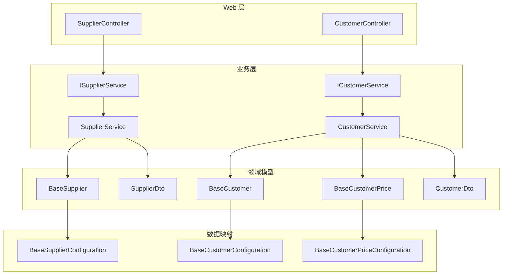
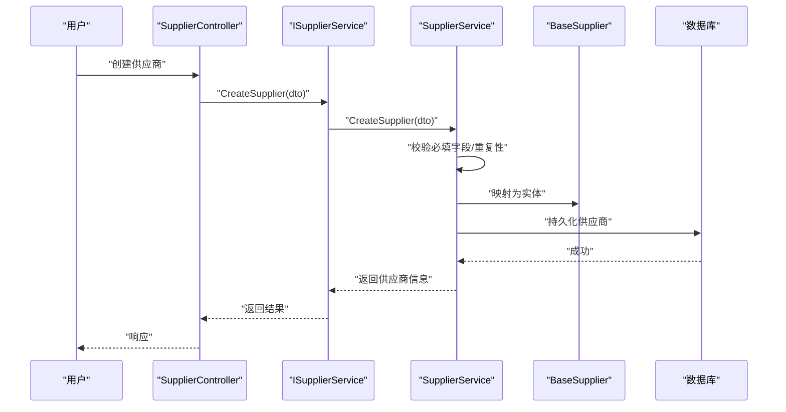
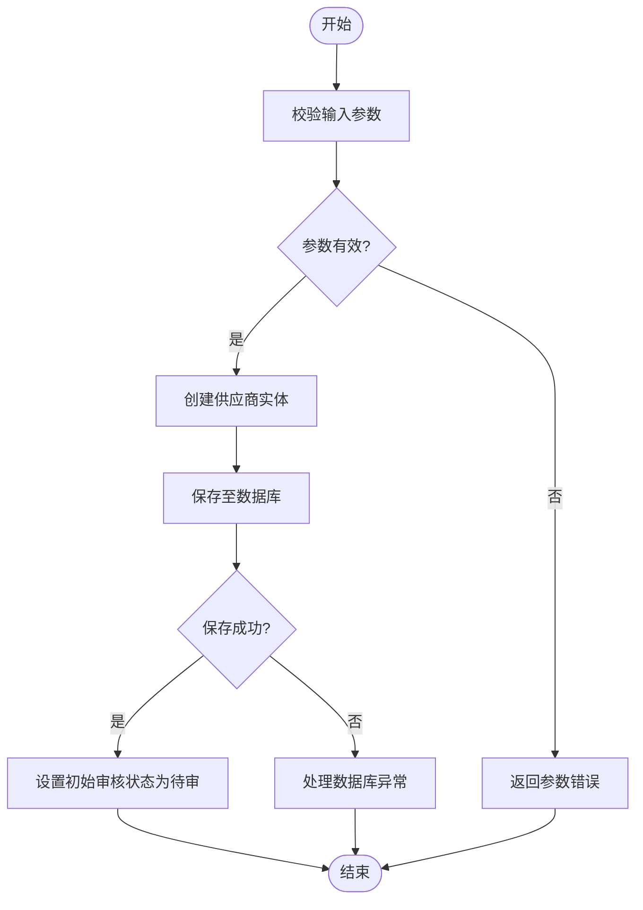
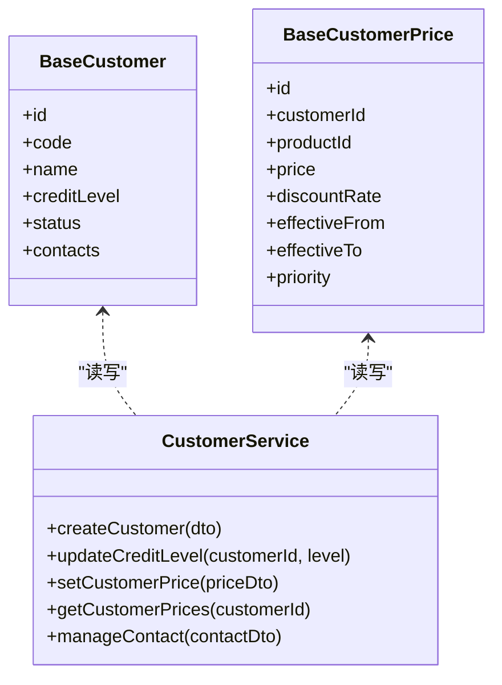
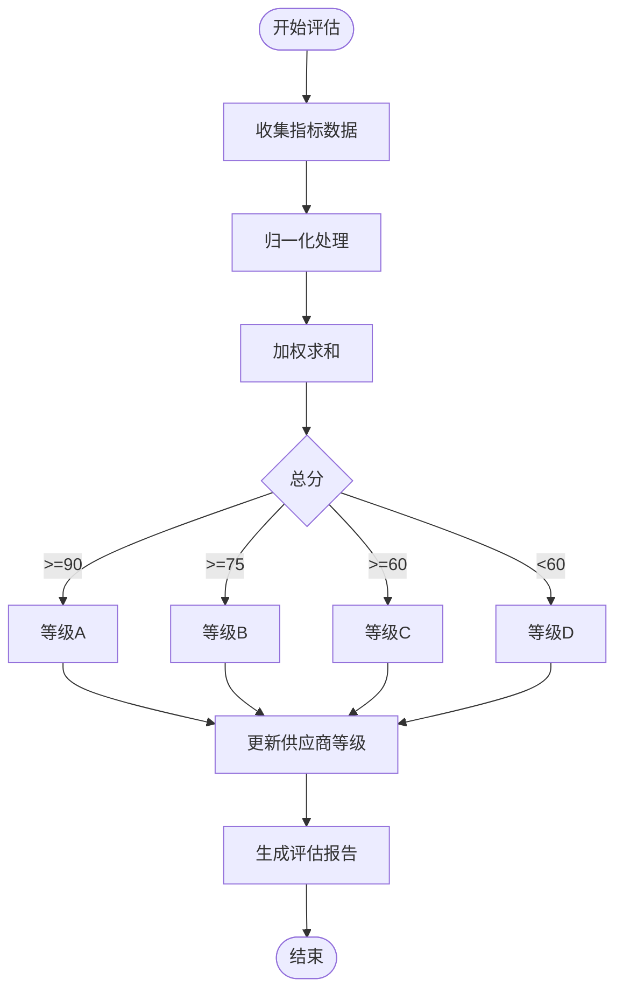
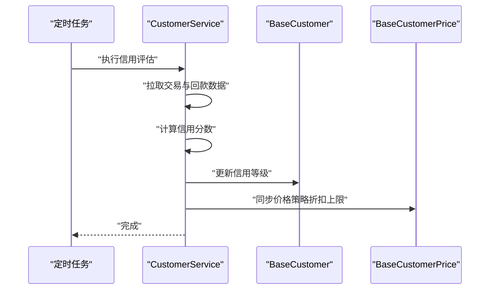
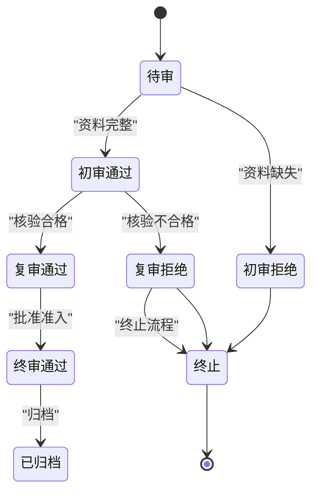
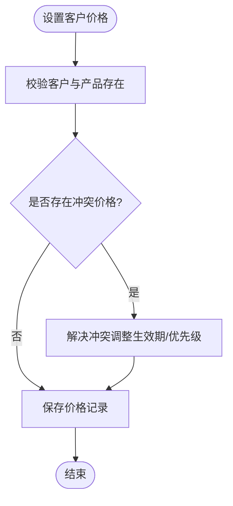
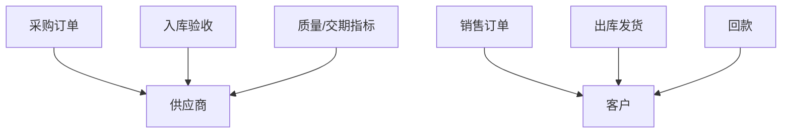
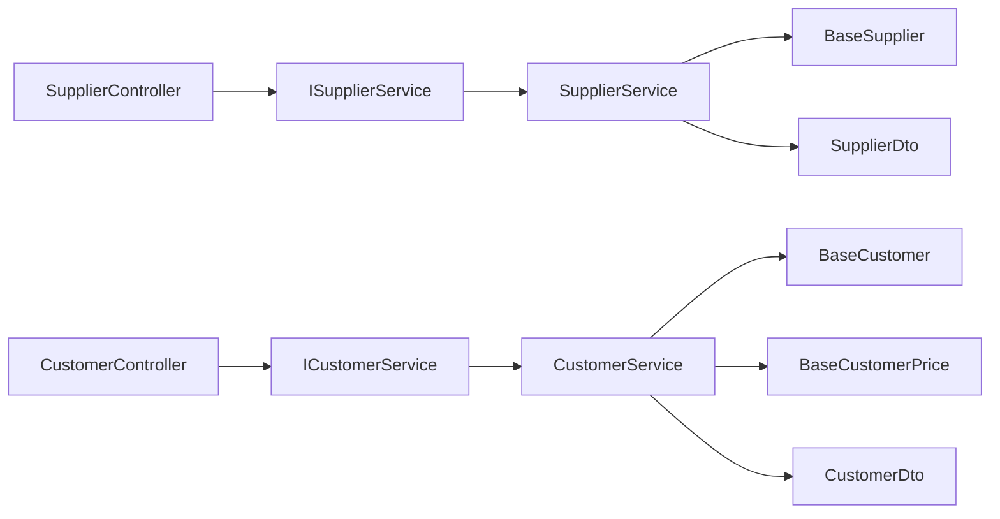

# 供应商与客户管理模块

<cite>
**本文引用的文件**   
- [SupplierService.cs](file://EquipmentIMS.BLL/Services/SupplierService.cs)
- [ISupplierService.cs](file://EquipmentIMS.BLL/Interfaces/ISupplierService.cs)
- [CustomerService.cs](file://EquipmentIMS.BLL/Services/CustomerService.cs)
- [ICustomerService.cs](file://EquipmentIMS.BLL/Interfaces/ICustomerService.cs)
- [BaseSupplier.cs](file://EquipmentIMS.Models/Entities/BaseSupplier.cs)
- [BaseCustomer.cs](file://EquipmentIMS.Models/Entities/BaseCustomer.cs)
- [BaseCustomerPrice.cs](file://EquipmentIMS.Models/Entities/BaseCustomerPrice.cs)
- [SupplierDto.cs](file://EquipmentIMS.Models/DTOs/SupplierDto.cs)
- [CustomerDto.cs](file://EquipmentIMS.Models/DTOs/CustomerDto.cs)
- [SupplierController.cs](file://EquipmentIMS.Web/Controllers/SupplierController.cs)
- [CustomerController.cs](file://EquipmentIMS.Web/Controllers/CustomerController.cs)
- [BaseSupplierConfiguration.cs](file://EquipmentIMS.DAL/Configurations/BaseSupplierConfiguration.cs)
- [BaseCustomerConfiguration.cs](file://EquipmentIMS.DAL/Configurations/BaseCustomerConfiguration.cs)
- [BaseCustomerPriceConfiguration.cs](file://EquipmentIMS.DAL/Configurations/BaseCustomerPriceConfiguration.cs)
</cite>

## 目录
1. [简介](#简介)
2. [项目结构](#项目结构)
3. [核心组件](#核心组件)
4. [架构总览](#架构总览)
5. [详细组件分析](#详细组件分析)
6. [依赖关系分析](#依赖关系分析)
7. [性能考虑](#性能考虑)
8. [故障排查指南](#故障排查指南)
9. [结论](#结论)
10. [附录](#附录)

## 简介
本模块聚焦于“供应商与客户管理”，覆盖以下关键能力：
- 供应商信息管理：供应商的增删改查、准入审核流程、评估机制与联系人管理。
- 客户信息管理：客户档案维护、信用等级管理、价格体系（按客户×产品定价）与联系人管理。
- 业务关联：供应商在采购业务中的角色，客户在销售业务中的角色，以及两者在订单、出入库等流程中的联动。

文档将深入解析 SupplierService 与 CustomerService 的业务逻辑实现，并结合实体模型、DTO、控制器与数据映射配置，给出端到端的调用序列图、类关系图与流程图，帮助读者快速理解并扩展该模块。

## 项目结构
围绕供应商与客户管理的代码主要分布在三层：
- Web 层（Controllers）：对外暴露 REST 接口，负责参数校验、权限控制与结果封装。
- 业务层（BLL Services）：承载核心业务规则，如供应商准入审核、供应商评估、客户信用与价格策略计算。
- 领域模型与数据访问（Models/DAL）：定义实体、DTO、枚举及 EF Core 配置；仓储与上下文由通用基础设施提供。

图表来源
- [SupplierController.cs](file://EquipmentIMS.Web/Controllers/SupplierController.cs)
- [CustomerController.cs](file://EquipmentIMS.Web/Controllers/CustomerController.cs)
- [ISupplierService.cs](file://EquipmentIMS.BLL/Interfaces/ISupplierService.cs)
- [SupplierService.cs](file://EquipmentIMS.BLL/Services/SupplierService.cs)
- [ICustomerService.cs](file://EquipmentIMS.BLL/Interfaces/ICustomerService.cs)
- [CustomerService.cs](file://EquipmentIMS.BLL/Services/CustomerService.cs)
- [BaseSupplier.cs](file://EquipmentIMS.Models/Entities/BaseSupplier.cs)
- [BaseCustomer.cs](file://EquipmentIMS.Models/Entities/BaseCustomer.cs)
- [BaseCustomerPrice.cs](file://EquipmentIMS.Models/Entities/BaseCustomerPrice.cs)
- [SupplierDto.cs](file://EquipmentIMS.Models/DTOs/SupplierDto.cs)
- [CustomerDto.cs](file://EquipmentIMS.Models/DTOs/CustomerDto.cs)
- [BaseSupplierConfiguration.cs](file://EquipmentIMS.DAL/Configurations/BaseSupplierConfiguration.cs)
- [BaseCustomerConfiguration.cs](file://EquipmentIMS.DAL/Configurations/BaseCustomerConfiguration.cs)
- [BaseCustomerPriceConfiguration.cs](file://EquipmentIMS.DAL/Configurations/BaseCustomerPriceConfiguration.cs)

章节来源
- [SupplierController.cs](file://EquipmentIMS.Web/Controllers/SupplierController.cs)
- [CustomerController.cs](file://EquipmentIMS.Web/Controllers/CustomerController.cs)
- [ISupplierService.cs](file://EquipmentIMS.BLL/Interfaces/ISupplierService.cs)
- [SupplierService.cs](file://EquipmentIMS.BLL/Services/SupplierService.cs)
- [ICustomerService.cs](file://EquipmentIMS.BLL/Interfaces/ICustomerService.cs)
- [CustomerService.cs](file://EquipmentIMS.BLL/Services/CustomerService.cs)
- [BaseSupplier.cs](file://EquipmentIMS.Models/Entities/BaseSupplier.cs)
- [BaseCustomer.cs](file://EquipmentIMS.Models/Entities/BaseCustomer.cs)
- [BaseCustomerPrice.cs](file://EquipmentIMS.Models/Entities/BaseCustomerPrice.cs)
- [SupplierDto.cs](file://EquipmentIMS.Models/DTOs/SupplierDto.cs)
- [CustomerDto.cs](file://EquipmentIMS.Models/DTOs/CustomerDto.cs)
- [BaseSupplierConfiguration.cs](file://EquipmentIMS.DAL/Configurations/BaseSupplierConfiguration.cs)
- [BaseCustomerConfiguration.cs](file://EquipmentIMS.DAL/Configurations/BaseCustomerConfiguration.cs)
- [BaseCustomerPriceConfiguration.cs](file://EquipmentIMS.DAL/Configurations/BaseCustomerPriceConfiguration.cs)

## 核心组件
- 供应商服务（SupplierService）
  - 职责：供应商主数据的 CRUD、准入审核状态流转、供应商评估打分与等级调整、联系人维护。
  - 关键能力：
    - 准入审核：从“待审”到“通过/拒绝”的状态机控制，记录审核意见与时间戳。
    - 评估机制：基于质量、交期、价格竞争力、合规等多维度指标生成评分，驱动等级变更。
    - 联系人管理：支持多联系人绑定、默认联系人设置、联系方式有效性校验。
- 客户服务（CustomerService）
  - 职责：客户主数据 CRUD、信用等级管理、客户价格体系（按客户×产品定价）、联系人维护。
  - 关键能力：
    - 信用等级：根据历史交易、回款周期、违约次数等自动或手动调整等级。
    - 价格体系：为每个客户维护产品价格表，支持折扣率、阶梯价、生效期与优先级。
    - 联系人管理：同供应商，支持多联系人、默认联系人、联系方式校验。

章节来源
- [SupplierService.cs](file://EquipmentIMS.BLL/Services/SupplierService.cs)
- [ISupplierService.cs](file://EquipmentIMS.BLL/Interfaces/ISupplierService.cs)
- [CustomerService.cs](file://EquipmentIMS.BLL/Services/CustomerService.cs)
- [ICustomerService.cs](file://EquipmentIMS.BLL/Interfaces/ICustomerService.cs)

## 架构总览
供应商与客户管理采用分层架构：
- Web 控制器接收请求，调用对应 Service 接口。
- Service 实现业务规则，操作领域实体与 DTO，必要时调用仓储与缓存。
- 领域实体通过 EF Core 配置映射到数据库表。

图表来源
- [SupplierController.cs](file://EquipmentIMS.Web/Controllers/SupplierController.cs)
- [ISupplierService.cs](file://EquipmentIMS.BLL/Interfaces/ISupplierService.cs)
- [SupplierService.cs](file://EquipmentIMS.BLL/Services/SupplierService.cs)
- [BaseSupplier.cs](file://EquipmentIMS.Models/Entities/BaseSupplier.cs)

## 详细组件分析

### 供应商管理（SupplierService）
- 功能要点
  - 准入审核：支持提交审核申请、审批通过/拒绝、记录审核意见与时间。
  - 评估机制：综合质量、交期、价格、合规等维度进行评分，更新供应商等级。
  - 联系人管理：新增/编辑/删除联系人，设置默认联系人，校验手机号/邮箱格式。
- 数据结构与复杂度
  - 供应商实体包含基础信息、资质材料、审核状态、等级、评分等字段。
  - 评估算法通常为 O(n) 遍历指标项求加权总分，再映射到等级区间。
- 错误处理
  - 重复供应商编码、必填字段缺失、审核状态不合法、联系人格式错误等抛出业务异常。
- 优化建议
  - 批量导入时采用事务与分批写入。
  - 评估打分可引入缓存减少重复计算。

图表来源
- [SupplierService.cs](file://EquipmentIMS.BLL/Services/SupplierService.cs)
- [BaseSupplier.cs](file://EquipmentIMS.Models/Entities/BaseSupplier.cs)

章节来源
- [SupplierService.cs](file://EquipmentIMS.BLL/Services/SupplierService.cs)
- [ISupplierService.cs](file://EquipmentIMS.BLL/Interfaces/ISupplierService.cs)
- [BaseSupplier.cs](file://EquipmentIMS.Models/Entities/BaseSupplier.cs)
- [BaseSupplierConfiguration.cs](file://EquipmentIMS.DAL/Configurations/BaseSupplierConfiguration.cs)

### 客户管理（CustomerService）
- 功能要点
  - 客户档案：基本信息、行业分类、结算方式、开票信息等。
  - 信用等级：依据交易规模、回款及时率、违约次数等计算或人工调整。
  - 价格体系：按客户×产品维护价格，支持折扣率、阶梯价、生效期与优先级。
  - 联系人管理：多联系人、默认联系人、联系方式校验。
- 数据结构与复杂度
  - 客户实体与价格实体分离，价格表以“客户ID+产品ID”为主键组合，查询复杂度 O(log n)。
  - 信用等级计算可按规则引擎或简单加权公式实现。
- 错误处理
  - 重复客户编码、价格冲突（同一客户×产品存在多条未过期且优先级相同的价格）、联系人格式错误等。
- 优化建议
  - 价格查询使用索引（客户ID、产品ID、生效期）。
  - 信用等级可异步刷新，避免阻塞主流程。

图表来源
- [CustomerService.cs](file://EquipmentIMS.BLL/Services/CustomerService.cs)
- [BaseCustomer.cs](file://EquipmentIMS.Models/Entities/BaseCustomer.cs)
- [BaseCustomerPrice.cs](file://EquipmentIMS.Models/Entities/BaseCustomerPrice.cs)

章节来源
- [CustomerService.cs](file://EquipmentIMS.BLL/Services/CustomerService.cs)
- [ICustomerService.cs](file://EquipmentIMS.BLL/Interfaces/ICustomerService.cs)
- [BaseCustomer.cs](file://EquipmentIMS.Models/Entities/BaseCustomer.cs)
- [BaseCustomerPrice.cs](file://EquipmentIMS.Models/Entities/BaseCustomerPrice.cs)
- [BaseCustomerConfiguration.cs](file://EquipmentIMS.DAL/Configurations/BaseCustomerConfiguration.cs)
- [BaseCustomerPriceConfiguration.cs](file://EquipmentIMS.DAL/Configurations/BaseCustomerPriceConfiguration.cs)

### 供应商评估机制
- 评估维度
  - 质量合格率、准时交付率、价格竞争力、合规与认证、售后响应速度。
- 评分与等级映射
  - 各维度权重相加得到总分，按阈值映射为 A/B/C/D 等级。
- 触发时机
  - 定期任务（月度/季度）或事件驱动（入库验收后、付款完成后）。
- 输出
  - 更新供应商等级、生成评估报告、触发预警（如降级）。

图表来源
- [SupplierService.cs](file://EquipmentIMS.BLL/Services/SupplierService.cs)
- [BaseSupplier.cs](file://EquipmentIMS.Models/Entities/BaseSupplier.cs)

章节来源
- [SupplierService.cs](file://EquipmentIMS.BLL/Services/SupplierService.cs)
- [BaseSupplier.cs](file://EquipmentIMS.Models/Entities/BaseSupplier.cs)

### 客户信用等级管理
- 信用因子
  - 累计交易额、平均回款天数、逾期次数、退货率、投诉次数。
- 计算与调整
  - 自动计算：周期性任务汇总指标，应用规则得出等级。
  - 手动调整：管理员可干预并记录原因。
- 影响范围
  - 影响授信额度、账期、价格折扣上限、下单限制等。

图表来源
- [CustomerService.cs](file://EquipmentIMS.BLL/Services/CustomerService.cs)
- [BaseCustomer.cs](file://EquipmentIMS.Models/Entities/BaseCustomer.cs)
- [BaseCustomerPrice.cs](file://EquipmentIMS.Models/Entities/BaseCustomerPrice.cs)

章节来源
- [CustomerService.cs](file://EquipmentIMS.BLL/Services/CustomerService.cs)
- [BaseCustomer.cs](file://EquipmentIMS.Models/Entities/BaseCustomer.cs)
- [BaseCustomerPrice.cs](file://EquipmentIMS.Models/Entities/BaseCustomerPrice.cs)

### 供应商准入审核流程
- 流程步骤
  - 提交申请（上传资质、填写基本信息）→ 初审（资料完整性）→ 复审（现场/远程核验）→ 终审（决策）→ 归档。
- 状态机
  - 待审 → 初审通过/拒绝 → 复审通过/拒绝 → 终审通过/拒绝 → 已归档。
- 审计追踪
  - 每次状态变更记录操作人、时间、意见。

图表来源
- [SupplierService.cs](file://EquipmentIMS.BLL/Services/SupplierService.cs)
- [BaseSupplier.cs](file://EquipmentIMS.Models/Entities/BaseSupplier.cs)

章节来源
- [SupplierService.cs](file://EquipmentIMS.BLL/Services/SupplierService.cs)
- [BaseSupplier.cs](file://EquipmentIMS.Models/Entities/BaseSupplier.cs)

### 客户价格体系与联系人管理
- 价格体系
  - 按客户×产品维护价格，支持折扣率、阶梯价、生效期与优先级。
  - 查询时优先匹配最近生效且优先级最高的价格。
- 联系人管理
  - 支持多个联系人，设置默认联系人，校验手机号/邮箱格式。
  - 在订单中自动带出默认联系人信息。

图表来源
- [CustomerService.cs](file://EquipmentIMS.BLL/Services/CustomerService.cs)
- [BaseCustomerPrice.cs](file://EquipmentIMS.Models/Entities/BaseCustomerPrice.cs)

章节来源
- [CustomerService.cs](file://EquipmentIMS.BLL/Services/CustomerService.cs)
- [BaseCustomerPrice.cs](file://EquipmentIMS.Models/Entities/BaseCustomerPrice.cs)

### 供应商与客户在采购与销售中的关联
- 供应商与采购
  - 采购订单关联供应商，入库验收影响供应商评估指标（质量、交期）。
- 客户与销售
  - 销售订单关联客户，出库与回款影响客户信用等级与价格策略。
- 数据联动
  - 供应商等级影响采购配额与价格谈判策略。
  - 客户信用等级影响授信额度、账期与折扣上限。

图表来源
- [BaseSupplier.cs](file://EquipmentIMS.Models/Entities/BaseSupplier.cs)
- [BaseCustomer.cs](file://EquipmentIMS.Models/Entities/BaseCustomer.cs)

章节来源
- [BaseSupplier.cs](file://EquipmentIMS.Models/Entities/BaseSupplier.cs)
- [BaseCustomer.cs](file://EquipmentIMS.Models/Entities/BaseCustomer.cs)

## 依赖关系分析
- 控制器与服务
  - SupplierController 依赖 ISupplierService，CustomerController 依赖 ICustomerService。
- 服务与模型
  - SupplierService 操作 BaseSupplier 与 SupplierDto。
  - CustomerService 操作 BaseCustomer、BaseCustomerPrice 与 CustomerDto。
- 数据映射
  - EF Core 配置分别定义 BaseSupplier、BaseCustomer、BaseCustomerPrice 的表结构与约束。

图表来源
- [SupplierController.cs](file://EquipmentIMS.Web/Controllers/SupplierController.cs)
- [CustomerController.cs](file://EquipmentIMS.Web/Controllers/CustomerController.cs)
- [ISupplierService.cs](file://EquipmentIMS.BLL/Interfaces/ISupplierService.cs)
- [SupplierService.cs](file://EquipmentIMS.BLL/Services/SupplierService.cs)
- [ICustomerService.cs](file://EquipmentIMS.BLL/Interfaces/ICustomerService.cs)
- [CustomerService.cs](file://EquipmentIMS.BLL/Services/CustomerService.cs)
- [BaseSupplier.cs](file://EquipmentIMS.Models/Entities/BaseSupplier.cs)
- [BaseCustomer.cs](file://EquipmentIMS.Models/Entities/BaseCustomer.cs)
- [BaseCustomerPrice.cs](file://EquipmentIMS.Models/Entities/BaseCustomerPrice.cs)
- [SupplierDto.cs](file://EquipmentIMS.Models/DTOs/SupplierDto.cs)
- [CustomerDto.cs](file://EquipmentIMS.Models/DTOs/CustomerDto.cs)

章节来源
- [SupplierController.cs](file://EquipmentIMS.Web/Controllers/SupplierController.cs)
- [CustomerController.cs](file://EquipmentIMS.Web/Controllers/CustomerController.cs)
- [ISupplierService.cs](file://EquipmentIMS.BLL/Interfaces/ISupplierService.cs)
- [SupplierService.cs](file://EquipmentIMS.BLL/Services/SupplierService.cs)
- [ICustomerService.cs](file://EquipmentIMS.BLL/Interfaces/ICustomerService.cs)
- [CustomerService.cs](file://EquipmentIMS.BLL/Services/CustomerService.cs)
- [BaseSupplier.cs](file://EquipmentIMS.Models/Entities/BaseSupplier.cs)
- [BaseCustomer.cs](file://EquipmentIMS.Models/Entities/BaseCustomer.cs)
- [BaseCustomerPrice.cs](file://EquipmentIMS.Models/Entities/BaseCustomerPrice.cs)
- [SupplierDto.cs](file://EquipmentIMS.Models/DTOs/SupplierDto.cs)
- [CustomerDto.cs](file://EquipmentIMS.Models/DTOs/CustomerDto.cs)

## 性能考虑
- 索引设计
  - 客户价格表对“客户ID+产品ID+生效期”建立复合索引，提升价格查询效率。
- 批量操作
  - 供应商/客户批量导入使用事务与分批写入，降低锁竞争。
- 缓存策略
  - 供应商评估得分、客户信用等级可短期缓存，减少重复计算。
- 异步处理
  - 信用等级与评估打分可异步执行，避免阻塞主业务流程。

## 故障排查指南
- 常见错误
  - 重复编码：供应商/客户编码唯一性冲突。
  - 参数无效：必填字段缺失、日期范围非法、联系人格式错误。
  - 价格冲突：同一客户×产品存在多条未过期且优先级相同的价格。
  - 审核状态非法：状态机不允许的跳转。
- 定位方法
  - 检查控制器入参校验日志。
  - 查看服务层抛出的业务异常类型与消息。
  - 核对数据库约束与索引是否命中。
- 修复建议
  - 修正重复编码或清理历史数据。
  - 完善前端校验与后端验证一致性。
  - 调整价格生效期或优先级以避免冲突。
  - 遵循状态机规则进行状态变更。

章节来源
- [SupplierService.cs](file://EquipmentIMS.BLL/Services/SupplierService.cs)
- [CustomerService.cs](file://EquipmentIMS.BLL/Services/CustomerService.cs)

## 结论
供应商与客户管理模块通过清晰的分层设计与明确的服务职责，实现了供应商准入审核、评估机制、客户信用等级与价格体系等核心能力。结合联系人管理与业务关联（采购/销售），形成完整的供应链上下游数据闭环。建议在后续迭代中持续优化评估与信用计算的准确性与性能，并完善审计与可视化报表，以提升运营效率与风险控制能力。

## 附录
- 代码示例路径（不含具体代码内容）
  - 供应商 CRUD：参考 [SupplierController.cs](file://EquipmentIMS.Web/Controllers/SupplierController.cs) 与 [SupplierService.cs](file://EquipmentIMS.BLL/Services/SupplierService.cs)
  - 客户价格设置：参考 [CustomerController.cs](file://EquipmentIMS.Web/Controllers/CustomerController.cs) 与 [CustomerService.cs](file://EquipmentIMS.BLL/Services/CustomerService.cs)
  - 联系人管理：参考 [CustomerService.cs](file://EquipmentIMS.BLL/Services/CustomerService.cs) 与 [SupplierService.cs](file://EquipmentIMS.BLL/Services/SupplierService.cs)
- 模型与配置
  - 供应商实体与映射：[BaseSupplier.cs](file://EquipmentIMS.Models/Entities/BaseSupplier.cs)、[BaseSupplierConfiguration.cs](file://EquipmentIMS.DAL/Configurations/BaseSupplierConfiguration.cs)
  - 客户实体与映射：[BaseCustomer.cs](file://EquipmentIMS.Models/Entities/BaseCustomer.cs)、[BaseCustomerConfiguration.cs](file://EquipmentIMS.DAL/Configurations/BaseCustomerConfiguration.cs)
  - 客户价格实体与映射：[BaseCustomerPrice.cs](file://EquipmentIMS.Models/Entities/BaseCustomerPrice.cs)、[BaseCustomerPriceConfiguration.cs](file://EquipmentIMS.DAL/Configurations/BaseCustomerPriceConfiguration.cs)
- DTO 参考
  - 供应商 DTO：[SupplierDto.cs](file://EquipmentIMS.Models/DTOs/SupplierDto.cs)
  - 客户 DTO：[CustomerDto.cs](file://EquipmentIMS.Models/DTOs/CustomerDto.cs)