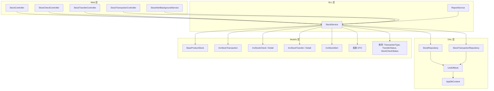
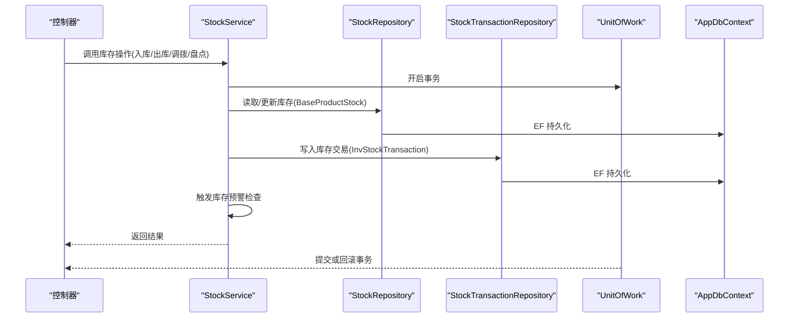
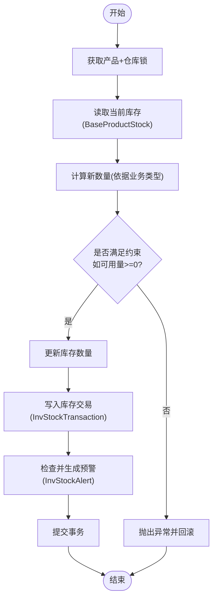
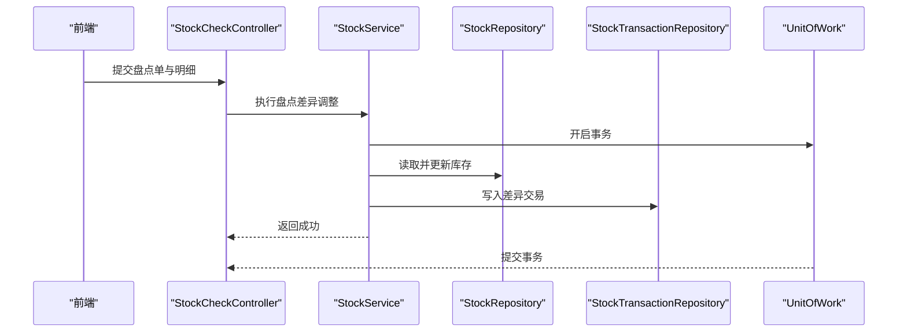
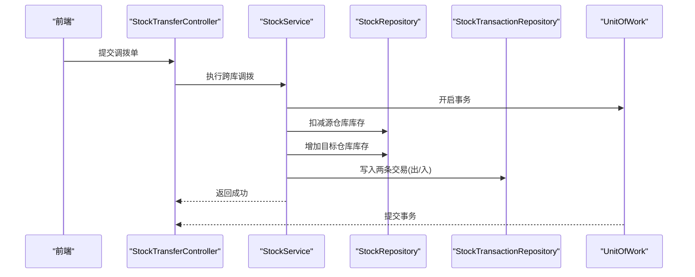
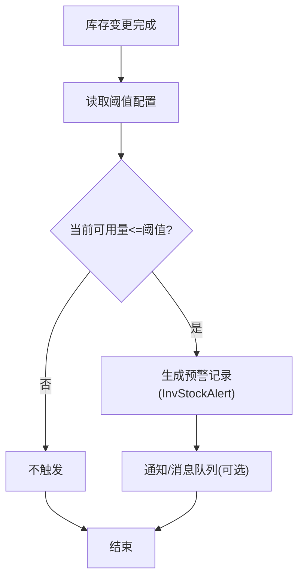
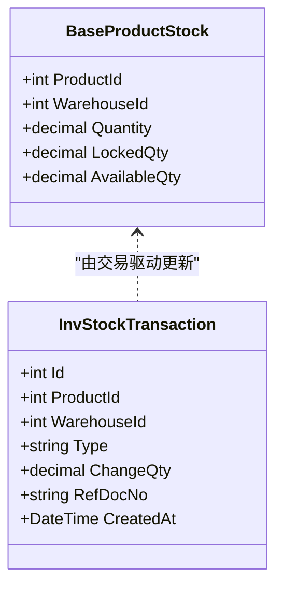
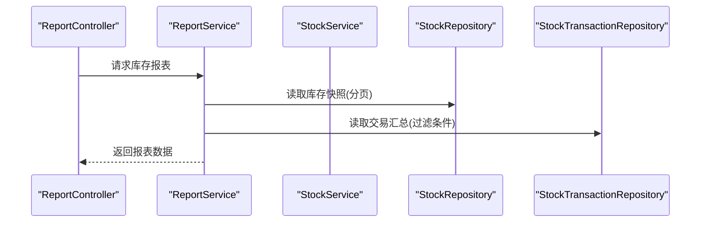
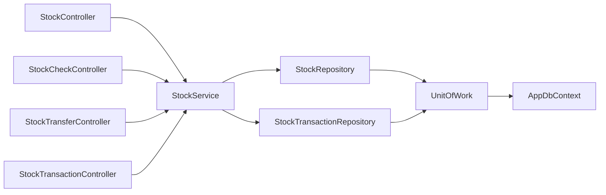

# 库存管理模块

<cite>
**本文引用的文件**   
- [StockService.cs](file://EquipmentIMS.BLL/Services/StockService.cs)
- [IStockService.cs](file://EquipmentIMS.BLL/Interfaces/IStockService.cs)
- [StockRepository.cs](file://EquipmentIMS.DAL/Repositories/StockRepository.cs)
- [IStockRepository.cs](file://EquipmentIMS.DAL/Interfaces/IStockRepository.cs)
- [StockTransactionRepository.cs](file://EquipmentIMS.DAL/Repositories/StockTransactionRepository.cs)
- [IStockTransactionRepository.cs](file://EquipmentIMS.DAL/Interfaces/IStockTransactionRepository.cs)
- [UnitOfWork.cs](file://EquipmentIMS.DAL/Repositories/UnitOfWork.cs)
- [AppDbContext.cs](file://EquipmentIMS.DAL/AppDbContext.cs)
- [BaseProductStock.cs](file://EquipmentIMS.Models/Entities/BaseProductStock.cs)
- [InvStockTransaction.cs](file://EquipmentIMS.Models/Entities/InvStockTransaction.cs)
- [InvStockCheck.cs](file://EquipmentIMS.Models/Entities/InvStockCheck.cs)
- [InvStockCheckDetail.cs](file://EquipmentIMS.Models/Entities/InvStockCheckDetail.cs)
- [InvStockTransfer.cs](file://EquipmentIMS.Models/Entities/InvStockTransfer.cs)
- [InvStockTransferDetail.cs](file://EquipmentIMS.Models/Entities/InvStockTransferDetail.cs)
- [InvStockAlert.cs](file://EquipmentIMS.Models/Entities/InvStockAlert.cs)
- [StockController.cs](file://EquipmentIMS.Web/Controllers/StockController.cs)
- [StockCheckController.cs](file://EquipmentIMS.Web/Controllers/StockCheckController.cs)
- [StockTransferController.cs](file://EquipmentIMS.Web/Controllers/StockTransferController.cs)
- [StockTransactionController.cs](file://EquipmentIMS.Web/Controllers/StockTransactionController.cs)
- [StockAlertBackgroundService.cs](file://EquipmentIMS.Web/BackgroundServices/StockAlertBackgroundService.cs)
- [ReportService.cs](file://EquipmentIMS.BLL/Services/ReportService.cs)
- [ReportInventoryDtos.cs](file://EquipmentIMS.Models/DTOs/Reports/ReportInventoryDtos.cs)
- [StockListDto.cs](file://EquipmentIMS.Models/DTOs/StockListDto.cs)
- [StockQueryDto.cs](file://EquipmentIMS.Models/DTOs/StockQueryDto.cs)
- [StockTransactionDto.cs](file://EquipmentIMS.Models/DTOs/StockTransactionDto.cs)
- [StockTransactionQueryDto.cs](file://EquipmentIMS.Models/DTOs/StockTransactionQueryDto.cs)
- [StockCheckDto.cs](file://EquipmentIMS.Models/DTOs/StockCheckDto.cs)
- [StockTransferDto.cs](file://EquipmentIMS.Models/DTOs/StockTransferDto.cs)
- [StockAlertDto.cs](file://EquipmentIMS.Models/DTOs/StockAlertDto.cs)
- [TransactionType.cs](file://EquipmentIMS.Models/Enums/TransactionType.cs)
- [TransferStatus.cs](file://EquipmentIMS.Models/Enums/TransferStatus.cs)
- [StockCheckStatus.cs](file://EquipmentIMS.Models/Enums/StockCheckStatus.cs)
</cite>

## 目录
1. [简介](#简介)
2. [项目结构](#项目结构)
3. [核心组件](#核心组件)
4. [架构总览](#架构总览)
5. [详细组件分析](#详细组件分析)
6. [依赖关系分析](#依赖关系分析)
7. [性能考虑](#性能考虑)
8. [故障排查指南](#故障排查指南)
9. [结论](#结论)
10. [附录](#附录)

## 简介
本文件围绕库存管理模块，系统性阐述多仓库库存、库存盘点、库存调拨、库存预警等核心能力；深入解析 StockService 的业务逻辑、事务与并发控制、数量实时更新策略；说明库存交易记录、库存快照、报表生成的实现要点；并提供最佳实践与常见问题解决方案。文档以代码级事实为依据，辅以架构图与时序图帮助理解。

## 项目结构
库存相关代码按分层组织：
- Web 层：控制器负责请求路由、参数校验与结果封装
- BLL 层：服务层承载业务编排、事务边界与并发控制
- DAL 层：仓储与上下文负责数据访问与持久化
- Models 层：实体、枚举、DTO 定义领域模型与数据传输对象

图表来源
- [StockController.cs](file://EquipmentIMS.Web/Controllers/StockController.cs)
- [StockCheckController.cs](file://EquipmentIMS.Web/Controllers/StockCheckController.cs)
- [StockTransferController.cs](file://EquipmentIMS.Web/Controllers/StockTransferController.cs)
- [StockTransactionController.cs](file://EquipmentIMS.Web/Controllers/StockTransactionController.cs)
- [StockAlertBackgroundService.cs](file://EquipmentIMS.Web/BackgroundServices/StockAlertBackgroundService.cs)
- [StockService.cs](file://EquipmentIMS.BLL/Services/StockService.cs)
- [ReportService.cs](file://EquipmentIMS.BLL/Services/ReportService.cs)
- [StockRepository.cs](file://EquipmentIMS.DAL/Repositories/StockRepository.cs)
- [StockTransactionRepository.cs](file://EquipmentIMS.DAL/Repositories/StockTransactionRepository.cs)
- [UnitOfWork.cs](file://EquipmentIMS.DAL/Repositories/UnitOfWork.cs)
- [AppDbContext.cs](file://EquipmentIMS.DAL/AppDbContext.cs)
- [BaseProductStock.cs](file://EquipmentIMS.Models/Entities/BaseProductStock.cs)
- [InvStockTransaction.cs](file://EquipmentIMS.Models/Entities/InvStockTransaction.cs)
- [InvStockCheck.cs](file://EquipmentIMS.Models/Entities/InvStockCheck.cs)
- [InvStockCheckDetail.cs](file://EquipmentIMS.Models/Entities/InvStockCheckDetail.cs)
- [InvStockTransfer.cs](file://EquipmentIMS.Models/Entities/InvStockTransfer.cs)
- [InvStockTransferDetail.cs](file://EquipmentIMS.Models/Entities/InvStockTransferDetail.cs)
- [InvStockAlert.cs](file://EquipmentIMS.Models/Entities/InvStockAlert.cs)
- [StockListDto.cs](file://EquipmentIMS.Models/DTOs/StockListDto.cs)
- [StockQueryDto.cs](file://EquipmentIMS.Models/DTOs/StockQueryDto.cs)
- [StockTransactionDto.cs](file://EquipmentIMS.Models/DTOs/StockTransactionDto.cs)
- [StockTransactionQueryDto.cs](file://EquipmentIMS.Models/DTOs/StockTransactionQueryDto.cs)
- [StockCheckDto.cs](file://EquipmentIMS.Models/DTOs/StockCheckDto.cs)
- [StockTransferDto.cs](file://EquipmentIMS.Models/DTOs/StockTransferDto.cs)
- [StockAlertDto.cs](file://EquipmentIMS.Models/DTOs/StockAlertDto.cs)
- [TransactionType.cs](file://EquipmentIMS.Models/Enums/TransactionType.cs)
- [TransferStatus.cs](file://EquipmentIMS.Models/Enums/TransferStatus.cs)
- [StockCheckStatus.cs](file://EquipmentIMS.Models/Enums/StockCheckStatus.cs)

章节来源
- [StockController.cs](file://EquipmentIMS.Web/Controllers/StockController.cs)
- [StockCheckController.cs](file://EquipmentIMS.Web/Controllers/StockCheckController.cs)
- [StockTransferController.cs](file://EquipmentIMS.Web/Controllers/StockTransferController.cs)
- [StockTransactionController.cs](file://EquipmentIMS.Web/Controllers/StockTransactionController.cs)
- [StockAlertBackgroundService.cs](file://EquipmentIMS.Web/BackgroundServices/StockAlertBackgroundService.cs)
- [StockService.cs](file://EquipmentIMS.BLL/Services/StockService.cs)
- [ReportService.cs](file://EquipmentIMS.BLL/Services/ReportService.cs)
- [StockRepository.cs](file://EquipmentIMS.DAL/Repositories/StockRepository.cs)
- [StockTransactionRepository.cs](file://EquipmentIMS.DAL/Repositories/StockTransactionRepository.cs)
- [UnitOfWork.cs](file://EquipmentIMS.DAL/Repositories/UnitOfWork.cs)
- [AppDbContext.cs](file://EquipmentIMS.DAL/AppDbContext.cs)

## 核心组件
- StockService：库存主服务，统一处理入库、出库、调拨、盘点差异调整、库存查询、预警触发、事务编排与并发控制
- 仓储接口与实现：
  - IStockRepository/StockRepository：产品库存读写、批量更新、分页查询
  - IStockTransactionRepository/StockTransactionRepository：库存交易流水写入与查询
- UnitOfWork：提供事务边界，确保同一工作单元内多个仓储操作原子性
- AppDbContext：EF Core 上下文，承载实体集合与数据库连接
- 实体与 DTO：
  - BaseProductStock：单仓单品库存快照（数量、锁定量、可用量等）
  - InvStockTransaction：库存交易明细（类型、方向、数量、关联单据等）
  - InvStockCheck/Detail：盘点单及明细
  - InvStockTransfer/Detail：调拨单及明细
  - InvStockAlert：库存预警记录
  - 各 DTO：用于 API 输入输出与报表展示
- 背景任务：StockAlertBackgroundService 定时扫描并生成预警

章节来源
- [StockService.cs](file://EquipmentIMS.BLL/Services/StockService.cs)
- [IStockService.cs](file://EquipmentIMS.BLL/Interfaces/IStockService.cs)
- [StockRepository.cs](file://EquipmentIMS.DAL/Repositories/StockRepository.cs)
- [IStockRepository.cs](file://EquipmentIMS.DAL/Interfaces/IStockRepository.cs)
- [StockTransactionRepository.cs](file://EquipmentIMS.DAL/Repositories/StockTransactionRepository.cs)
- [IStockTransactionRepository.cs](file://EquipmentIMS.DAL/Interfaces/IStockTransactionRepository.cs)
- [UnitOfWork.cs](file://EquipmentIMS.DAL/Repositories/UnitOfWork.cs)
- [AppDbContext.cs](file://EquipmentIMS.DAL/AppDbContext.cs)
- [BaseProductStock.cs](file://EquipmentIMS.Models/Entities/BaseProductStock.cs)
- [InvStockTransaction.cs](file://EquipmentIMS.Models/Entities/InvStockTransaction.cs)
- [InvStockCheck.cs](file://EquipmentIMS.Models/Entities/InvStockCheck.cs)
- [InvStockCheckDetail.cs](file://EquipmentIMS.Models/Entities/InvStockCheckDetail.cs)
- [InvStockTransfer.cs](file://EquipmentIMS.Models/Entities/InvStockTransfer.cs)
- [InvStockTransferDetail.cs](file://EquipmentIMS.Models/Entities/InvStockTransferDetail.cs)
- [InvStockAlert.cs](file://EquipmentIMS.Models/Entities/InvStockAlert.cs)
- [StockListDto.cs](file://EquipmentIMS.Models/DTOs/StockListDto.cs)
- [StockQueryDto.cs](file://EquipmentIMS.Models/DTOs/StockQueryDto.cs)
- [StockTransactionDto.cs](file://EquipmentIMS.Models/DTOs/StockTransactionDto.cs)
- [StockTransactionQueryDto.cs](file://EquipmentIMS.Models/DTOs/StockTransactionQueryDto.cs)
- [StockCheckDto.cs](file://EquipmentIMS.Models/DTOs/StockCheckDto.cs)
- [StockTransferDto.cs](file://EquipmentIMS.Models/DTOs/StockTransferDto.cs)
- [StockAlertDto.cs](file://EquipmentIMS.Models/DTOs/StockAlertDto.cs)
- [TransactionType.cs](file://EquipmentIMS.Models/Enums/TransactionType.cs)
- [TransferStatus.cs](file://EquipmentIMS.Models/Enums/TransferStatus.cs)
- [StockCheckStatus.cs](file://EquipmentIMS.Models/Enums/StockCheckStatus.cs)

## 架构总览
库存模块采用“控制器 -> 服务 -> 仓储 -> 上下文”的分层架构，关键流程由 StockService 统一编排，并通过 UnitOfWork 保证事务一致性。库存变更通过“库存交易流水 + 库存快照”双写保障可追溯与高性能读取。

图表来源
- [StockController.cs](file://EquipmentIMS.Web/Controllers/StockController.cs)
- [StockService.cs](file://EquipmentIMS.BLL/Services/StockService.cs)
- [StockRepository.cs](file://EquipmentIMS.DAL/Repositories/StockRepository.cs)
- [StockTransactionRepository.cs](file://EquipmentIMS.DAL/Repositories/StockTransactionRepository.cs)
- [UnitOfWork.cs](file://EquipmentIMS.DAL/Repositories/UnitOfWork.cs)
- [AppDbContext.cs](file://EquipmentIMS.DAL/AppDbContext.cs)

## 详细组件分析

### StockService 业务逻辑与事务机制
- 职责边界
  - 统一入口：对入库、出库、调拨、盘点差异调整进行业务编排
  - 并发控制：基于“产品+仓库”维度加锁，避免超卖与重复扣减
  - 事务边界：使用 UnitOfWork 包裹所有持久化操作，异常时自动回滚
  - 实时数量更新：在事务内先读后写 BaseProductStock，再落盘 InvStockTransaction
  - 预警触发：在事务完成后根据阈值规则生成 InvStockAlert
- 关键流程
  - 入库：校验源单据 -> 计算增量 -> 更新目标仓库库存 -> 记录交易 -> 触发预警
  - 出库：校验可用量 -> 扣减库存 -> 记录交易 -> 触发预警
  - 调拨：跨仓库转移，先扣出再入，保证原子性
  - 盘点差异：以盘点结果为基准，生成差异调整交易并修正库存
- 并发与一致性
  - 使用分布式/进程内锁（按“产品+仓库”键）串行化同键更新
  - 事务隔离级别结合行级锁，防止脏读与丢失更新
  - 失败路径：任何一步异常均回滚，保证库存与交易一致

图表来源
- [StockService.cs](file://EquipmentIMS.BLL/Services/StockService.cs)
- [StockRepository.cs](file://EquipmentIMS.DAL/Repositories/StockRepository.cs)
- [StockTransactionRepository.cs](file://EquipmentIMS.DAL/Repositories/StockTransactionRepository.cs)
- [UnitOfWork.cs](file://EquipmentIMS.DAL/Repositories/UnitOfWork.cs)
- [BaseProductStock.cs](file://EquipmentIMS.Models/Entities/BaseProductStock.cs)
- [InvStockTransaction.cs](file://EquipmentIMS.Models/Entities/InvStockTransaction.cs)
- [InvStockAlert.cs](file://EquipmentIMS.Models/Entities/InvStockAlert.cs)

章节来源
- [StockService.cs](file://EquipmentIMS.BLL/Services/StockService.cs)
- [IStockService.cs](file://EquipmentIMS.BLL/Interfaces/IStockService.cs)
- [StockRepository.cs](file://EquipmentIMS.DAL/Repositories/StockRepository.cs)
- [StockTransactionRepository.cs](file://EquipmentIMS.DAL/Repositories/StockTransactionRepository.cs)
- [UnitOfWork.cs](file://EquipmentIMS.DAL/Repositories/UnitOfWork.cs)
- [BaseProductStock.cs](file://EquipmentIMS.Models/Entities/BaseProductStock.cs)
- [InvStockTransaction.cs](file://EquipmentIMS.Models/Entities/InvStockTransaction.cs)
- [InvStockAlert.cs](file://EquipmentIMS.Models/Entities/InvStockAlert.cs)

### 库存盘点差异处理
- 盘点单创建与明细录入：通过 StockCheckController 接收盘点数据，调用 StockService 执行差异调整
- 差异计算：系统库存 vs 实盘数量，正负差异分别对应增/减
- 事务与流水：在同一事务中完成库存修正与差异交易记录，确保账实相符
- 状态流转：盘点单状态随审核/过账推进，支持撤销与重做

图表来源
- [StockCheckController.cs](file://EquipmentIMS.Web/Controllers/StockCheckController.cs)
- [StockService.cs](file://EquipmentIMS.BLL/Services/StockService.cs)
- [StockRepository.cs](file://EquipmentIMS.DAL/Repositories/StockRepository.cs)
- [StockTransactionRepository.cs](file://EquipmentIMS.DAL/Repositories/StockTransactionRepository.cs)
- [UnitOfWork.cs](file://EquipmentIMS.DAL/Repositories/UnitOfWork.cs)
- [InvStockCheck.cs](file://EquipmentIMS.Models/Entities/InvStockCheck.cs)
- [InvStockCheckDetail.cs](file://EquipmentIMS.Models/Entities/InvStockCheckDetail.cs)
- [StockCheckDto.cs](file://EquipmentIMS.Models/DTOs/StockCheckDto.cs)
- [StockCheckStatus.cs](file://EquipmentIMS.Models/Enums/StockCheckStatus.cs)

章节来源
- [StockCheckController.cs](file://EquipmentIMS.Web/Controllers/StockCheckController.cs)
- [StockService.cs](file://EquipmentIMS.BLL/Services/StockService.cs)
- [InvStockCheck.cs](file://EquipmentIMS.Models/Entities/InvStockCheck.cs)
- [InvStockCheckDetail.cs](file://EquipmentIMS.Models/Entities/InvStockCheckDetail.cs)
- [StockCheckDto.cs](file://EquipmentIMS.Models/DTOs/StockCheckDto.cs)
- [StockCheckStatus.cs](file://EquipmentIMS.Models/Enums/StockCheckStatus.cs)

### 库存调拨的跨仓库转移
- 调拨单创建与明细：通过 StockTransferController 接收调拨申请，包含源仓库、目标仓库、产品与数量
- 原子转移：在同一事务内先扣减源仓库库存，再增加目标仓库库存，任一失败整体回滚
- 状态机：调拨单状态随审批、出库、入库推进，支持取消与冲销
- 并发安全：对源/目标仓库分别加锁，避免并发冲突

图表来源
- [StockTransferController.cs](file://EquipmentIMS.Web/Controllers/StockTransferController.cs)
- [StockService.cs](file://EquipmentIMS.BLL/Services/StockService.cs)
- [StockRepository.cs](file://EquipmentIMS.DAL/Repositories/StockRepository.cs)
- [StockTransactionRepository.cs](file://EquipmentIMS.DAL/Repositories/StockTransactionRepository.cs)
- [UnitOfWork.cs](file://EquipmentIMS.DAL/Repositories/UnitOfWork.cs)
- [InvStockTransfer.cs](file://EquipmentIMS.Models/Entities/InvStockTransfer.cs)
- [InvStockTransferDetail.cs](file://EquipmentIMS.Models/Entities/InvStockTransferDetail.cs)
- [StockTransferDto.cs](file://EquipmentIMS.Models/DTOs/StockTransferDto.cs)
- [TransferStatus.cs](file://EquipmentIMS.Models/Enums/TransferStatus.cs)

章节来源
- [StockTransferController.cs](file://EquipmentIMS.Web/Controllers/StockTransferController.cs)
- [StockService.cs](file://EquipmentIMS.BLL/Services/StockService.cs)
- [InvStockTransfer.cs](file://EquipmentIMS.Models/Entities/InvStockTransfer.cs)
- [InvStockTransferDetail.cs](file://EquipmentIMS.Models/Entities/InvStockTransferDetail.cs)
- [StockTransferDto.cs](file://EquipmentIMS.Models/DTOs/StockTransferDto.cs)
- [TransferStatus.cs](file://EquipmentIMS.Models/Enums/TransferStatus.cs)

### 库存预警的自动触发机制
- 触发时机：库存变更后（入库/出库/调拨/盘点）立即评估阈值
- 规则：比较当前可用量与安全库存/最低库存阈值，达到条件即生成预警
- 去重与合并：相同产品+仓库+阈值的重复预警需合并或抑制
- 后台扫描：StockAlertBackgroundService 定期全量扫描，兜底遗漏

图表来源
- [StockService.cs](file://EquipmentIMS.BLL/Services/StockService.cs)
- [StockAlertBackgroundService.cs](file://EquipmentIMS.Web/BackgroundServices/StockAlertBackgroundService.cs)
- [InvStockAlert.cs](file://EquipmentIMS.Models/Entities/InvStockAlert.cs)
- [StockAlertDto.cs](file://EquipmentIMS.Models/DTOs/StockAlertDto.cs)

章节来源
- [StockService.cs](file://EquipmentIMS.BLL/Services/StockService.cs)
- [StockAlertBackgroundService.cs](file://EquipmentIMS.Web/BackgroundServices/StockAlertBackgroundService.cs)
- [InvStockAlert.cs](file://EquipmentIMS.Models/Entities/InvStockAlert.cs)
- [StockAlertDto.cs](file://EquipmentIMS.Models/DTOs/StockAlertDto.cs)

### 库存交易记录与库存快照
- 库存交易：每次库存变动都写入 InvStockTransaction，包含交易类型、方向、数量、关联单据、时间戳等，便于审计与溯源
- 库存快照：BaseProductStock 维护“产品+仓库”维度的当前数量与可用量，供高频查询
- 一致性：交易与快照在同一事务内更新，保证最终一致

图表来源
- [BaseProductStock.cs](file://EquipmentIMS.Models/Entities/BaseProductStock.cs)
- [InvStockTransaction.cs](file://EquipmentIMS.Models/Entities/InvStockTransaction.cs)
- [StockTransactionDto.cs](file://EquipmentIMS.Models/DTOs/StockTransactionDto.cs)
- [StockTransactionQueryDto.cs](file://EquipmentIMS.Models/DTOs/StockTransactionQueryDto.cs)
- [TransactionType.cs](file://EquipmentIMS.Models/Enums/TransactionType.cs)

章节来源
- [BaseProductStock.cs](file://EquipmentIMS.Models/Entities/BaseProductStock.cs)
- [InvStockTransaction.cs](file://EquipmentIMS.Models/Entities/InvStockTransaction.cs)
- [StockTransactionDto.cs](file://EquipmentIMS.Models/DTOs/StockTransactionDto.cs)
- [StockTransactionQueryDto.cs](file://EquipmentIMS.Models/DTOs/StockTransactionQueryDto.cs)
- [TransactionType.cs](file://EquipmentIMS.Models/Enums/TransactionType.cs)

### 库存报表生成
- 报表服务：ReportService 聚合库存快照与交易流水，生成多维报表（库存余额、出入库汇总、调拨统计等）
- 数据模型：ReportInventoryDtos 定义报表数据结构
- 性能优化：按需分页、延迟加载、缓存热点指标

图表来源
- [ReportService.cs](file://EquipmentIMS.BLL/Services/ReportService.cs)
- [ReportInventoryDtos.cs](file://EquipmentIMS.Models/DTOs/Reports/ReportInventoryDtos.cs)
- [StockRepository.cs](file://EquipmentIMS.DAL/Repositories/StockRepository.cs)
- [StockTransactionRepository.cs](file://EquipmentIMS.DAL/Repositories/StockTransactionRepository.cs)

章节来源
- [ReportService.cs](file://EquipmentIMS.BLL/Services/ReportService.cs)
- [ReportInventoryDtos.cs](file://EquipmentIMS.Models/DTOs/Reports/ReportInventoryDtos.cs)

## 依赖关系分析
- 控制器依赖服务：StockController、StockCheckController、StockTransferController、StockTransactionController 均依赖 StockService
- 服务依赖仓储：StockService 依赖 StockRepository 与 StockTransactionRepository
- 仓储依赖上下文：仓储通过 UnitOfWork 共享 DbContext，确保事务一致性
- 模型与枚举：服务与仓储广泛使用实体与 DTO，以及 TransactionType、TransferStatus、StockCheckStatus 等枚举

图表来源
- [StockController.cs](file://EquipmentIMS.Web/Controllers/StockController.cs)
- [StockCheckController.cs](file://EquipmentIMS.Web/Controllers/StockCheckController.cs)
- [StockTransferController.cs](file://EquipmentIMS.Web/Controllers/StockTransferController.cs)
- [StockTransactionController.cs](file://EquipmentIMS.Web/Controllers/StockTransactionController.cs)
- [StockService.cs](file://EquipmentIMS.BLL/Services/StockService.cs)
- [StockRepository.cs](file://EquipmentIMS.DAL/Repositories/StockRepository.cs)
- [StockTransactionRepository.cs](file://EquipmentIMS.DAL/Repositories/StockTransactionRepository.cs)
- [UnitOfWork.cs](file://EquipmentIMS.DAL/Repositories/UnitOfWork.cs)
- [AppDbContext.cs](file://EquipmentIMS.DAL/AppDbContext.cs)

章节来源
- [StockController.cs](file://EquipmentIMS.Web/Controllers/StockController.cs)
- [StockCheckController.cs](file://EquipmentIMS.Web/Controllers/StockCheckController.cs)
- [StockTransferController.cs](file://EquipmentIMS.Web/Controllers/StockTransferController.cs)
- [StockTransactionController.cs](file://EquipmentIMS.Web/Controllers/StockTransactionController.cs)
- [StockService.cs](file://EquipmentIMS.BLL/Services/StockService.cs)
- [StockRepository.cs](file://EquipmentIMS.DAL/Repositories/StockRepository.cs)
- [StockTransactionRepository.cs](file://EquipmentIMS.DAL/Repositories/StockTransactionRepository.cs)
- [UnitOfWork.cs](file://EquipmentIMS.DAL/Repositories/UnitOfWork.cs)
- [AppDbContext.cs](file://EquipmentIMS.DAL/AppDbContext.cs)

## 性能考虑
- 索引设计：为 BaseProductStock 的“产品+仓库”组合建立唯一索引；为 InvStockTransaction 的“产品、仓库、时间、类型”建立复合索引
- 批量操作：入库/调拨大批量场景优先批量更新库存与批量写入交易
- 分页与投影：报表与列表查询使用分页与只读投影，减少内存占用
- 缓存策略：热点库存快照可短期缓存，注意失效策略与一致性
- 锁粒度：仅对“产品+仓库”加锁，避免全局锁导致吞吐下降
- 异步与批处理：预警扫描与报表导出可异步化，降低主链路延迟

[本节为通用性能建议，无需特定文件引用]

## 故障排查指南
- 常见错误
  - 库存不足：出库或调拨前校验可用量，失败应返回明确提示
  - 并发冲突：同键并发更新导致覆盖，需确认锁与事务隔离级别
  - 事务不一致：交易已写但库存未更新，检查事务边界与异常捕获
  - 预警风暴：大量重复预警，需合并与限流
- 定位方法
  - 查看 InvStockTransaction 流水，核对变更前后数量
  - 检查 BaseProductStock 当前值与最近交易的一致性
  - 审查 StockService 的事务日志与异常堆栈
  - 核对调拨/盘点单状态机是否符合预期

章节来源
- [StockService.cs](file://EquipmentIMS.BLL/Services/StockService.cs)
- [StockTransactionRepository.cs](file://EquipmentIMS.DAL/Repositories/StockTransactionRepository.cs)
- [StockRepository.cs](file://EquipmentIMS.DAL/Repositories/StockRepository.cs)
- [InvStockTransaction.cs](file://EquipmentIMS.Models/Entities/InvStockTransaction.cs)
- [BaseProductStock.cs](file://EquipmentIMS.Models/Entities/BaseProductStock.cs)

## 结论
库存管理模块通过清晰的分层架构、严谨的事务与并发控制、完善的交易流水与快照机制，实现了多仓库库存的高可靠管理。盘点差异调整与调拨跨库转移均以事务保障一致性；预警机制兼顾实时与兜底扫描。配合合理的索引、批量与缓存策略，可在高并发场景下保持良好性能与稳定性。

[本节为总结性内容，无需特定文件引用]

## 附录

### 最佳实践清单
- 始终在事务内更新库存与交易，避免中间态
- 使用“产品+仓库”作为并发锁键，最小化锁范围
- 为常用查询字段建立复合索引，提升报表与列表性能
- 对大批量操作采用批量接口，减少往返次数
- 预警规则集中配置，支持动态调整与灰度发布
- 报表导出异步化，避免阻塞主线程

[本节为通用建议，无需特定文件引用]

### 关键类与方法参考（路径）
- 库存主服务与接口
  - [StockService.cs](file://EquipmentIMS.BLL/Services/StockService.cs)
  - [IStockService.cs](file://EquipmentIMS.BLL/Interfaces/IStockService.cs)
- 仓储与事务
  - [StockRepository.cs](file://EquipmentIMS.DAL/Repositories/StockRepository.cs)
  - [IStockRepository.cs](file://EquipmentIMS.DAL/Interfaces/IStockRepository.cs)
  - [StockTransactionRepository.cs](file://EquipmentIMS.DAL/Repositories/StockTransactionRepository.cs)
  - [IStockTransactionRepository.cs](file://EquipmentIMS.DAL/Interfaces/IStockTransactionRepository.cs)
  - [UnitOfWork.cs](file://EquipmentIMS.DAL/Repositories/UnitOfWork.cs)
- 上下文与实体
  - [AppDbContext.cs](file://EquipmentIMS.DAL/AppDbContext.cs)
  - [BaseProductStock.cs](file://EquipmentIMS.Models/Entities/BaseProductStock.cs)
  - [InvStockTransaction.cs](file://EquipmentIMS.Models/Entities/InvStockTransaction.cs)
  - [InvStockCheck.cs](file://EquipmentIMS.Models/Entities/InvStockCheck.cs)
  - [InvStockCheckDetail.cs](file://EquipmentIMS.Models/Entities/InvStockCheckDetail.cs)
  - [InvStockTransfer.cs](file://EquipmentIMS.Models/Entities/InvStockTransfer.cs)
  - [InvStockTransferDetail.cs](file://EquipmentIMS.Models/Entities/InvStockTransferDetail.cs)
  - [InvStockAlert.cs](file://EquipmentIMS.Models/Entities/InvStockAlert.cs)
- 控制器与背景任务
  - [StockController.cs](file://EquipmentIMS.Web/Controllers/StockController.cs)
  - [StockCheckController.cs](file://EquipmentIMS.Web/Controllers/StockCheckController.cs)
  - [StockTransferController.cs](file://EquipmentIMS.Web/Controllers/StockTransferController.cs)
  - [StockTransactionController.cs](file://EquipmentIMS.Web/Controllers/StockTransactionController.cs)
  - [StockAlertBackgroundService.cs](file://EquipmentIMS.Web/BackgroundServices/StockAlertBackgroundService.cs)
- 报表与 DTO
  - [ReportService.cs](file://EquipmentIMS.BLL/Services/ReportService.cs)
  - [ReportInventoryDtos.cs](file://EquipmentIMS.Models/DTOs/Reports/ReportInventoryDtos.cs)
  - [StockListDto.cs](file://EquipmentIMS.Models/DTOs/StockListDto.cs)
  - [StockQueryDto.cs](file://EquipmentIMS.Models/DTOs/StockQueryDto.cs)
  - [StockTransactionDto.cs](file://EquipmentIMS.Models/DTOs/StockTransactionDto.cs)
  - [StockTransactionQueryDto.cs](file://EquipmentIMS.Models/DTOs/StockTransactionQueryDto.cs)
  - [StockCheckDto.cs](file://EquipmentIMS.Models/DTOs/StockCheckDto.cs)
  - [StockTransferDto.cs](file://EquipmentIMS.Models/DTOs/StockTransferDto.cs)
  - [StockAlertDto.cs](file://EquipmentIMS.Models/DTOs/StockAlertDto.cs)
- 枚举
  - [TransactionType.cs](file://EquipmentIMS.Models/Enums/TransactionType.cs)
  - [TransferStatus.cs](file://EquipmentIMS.Models/Enums/TransferStatus.cs)
  - [StockCheckStatus.cs](file://EquipmentIMS.Models/Enums/StockCheckStatus.cs)