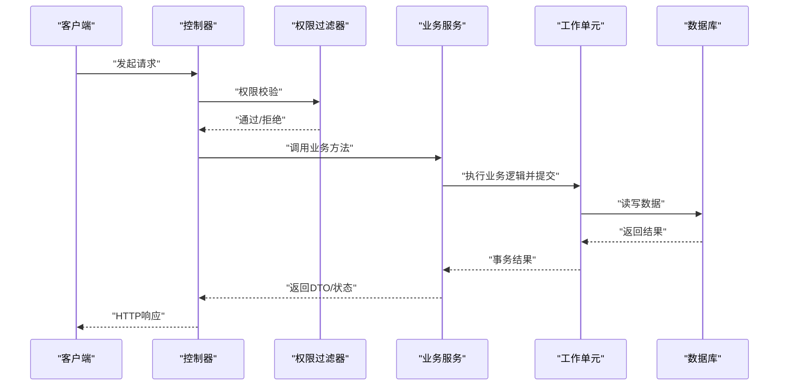
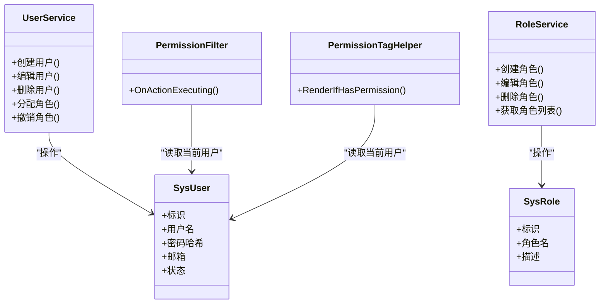
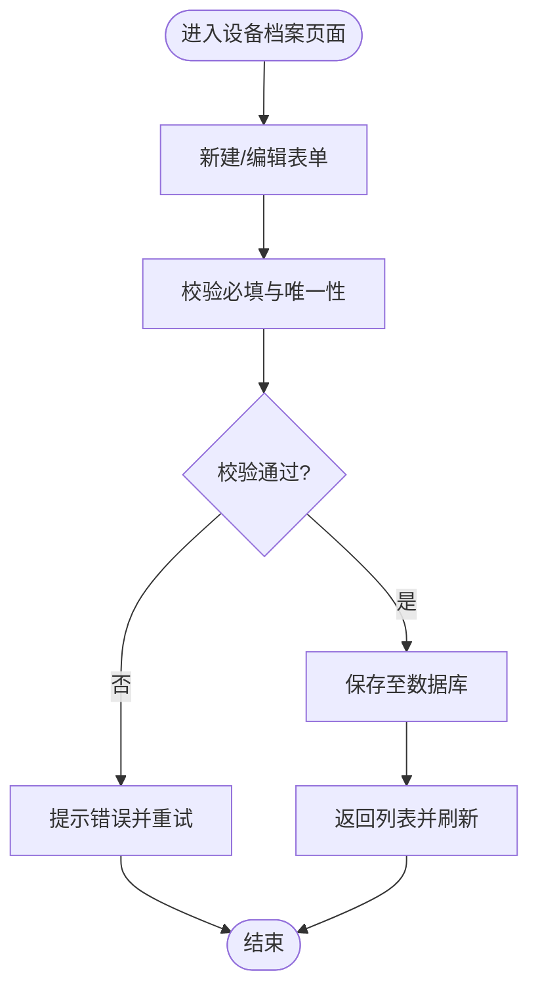
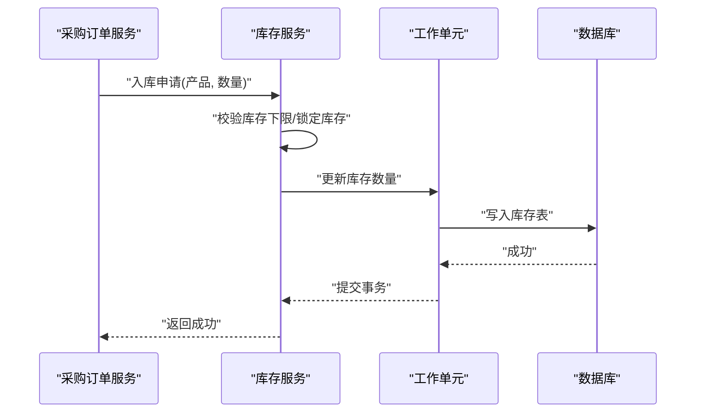
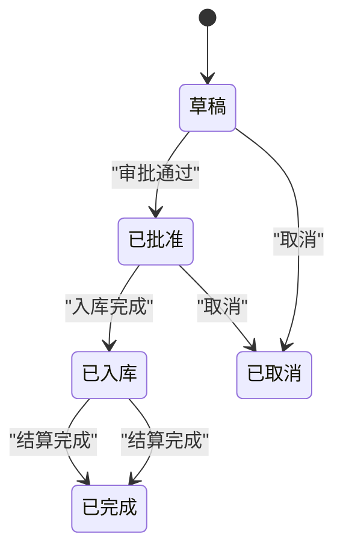
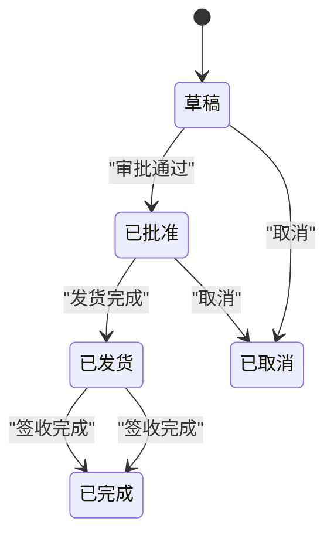
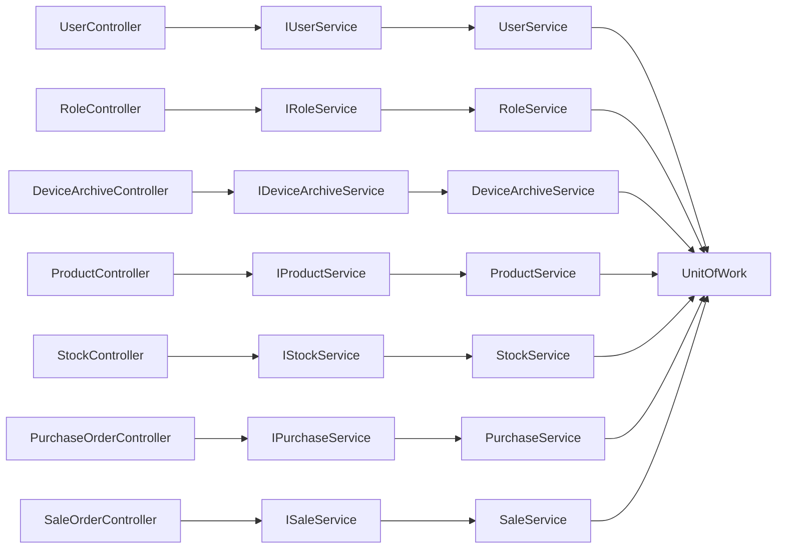

# 核心业务模块

<cite>
**本文引用的文件**   
- [EquipmentIMS.Web/Controllers/UserController.cs](file://EquipmentIMS.Web/Controllers/UserController.cs)
- [EquipmentIMS.Web/Controllers/RoleController.cs](file://EquipmentIMS.Web/Controllers/RoleController.cs)
- [EquipmentIMS.Web/Controllers/DeviceArchiveController.cs](file://EquipmentIMS.Web/Controllers/DeviceArchiveController.cs)
- [EquipmentIMS.Web/Controllers/ProductController.cs](file://EquipmentIMS.Web/Controllers/ProductController.cs)
- [EquipmentIMS.Web/Controllers/StockController.cs](file://EquipmentIMS.Web/Controllers/StockController.cs)
- [EquipmentIMS.Web/Controllers/PurchaseOrderController.cs](file://EquipmentIMS.Web/Controllers/PurchaseOrderController.cs)
- [EquipmentIMS.Web/Controllers/SaleOrderController.cs](file://EquipmentIMS.Web/Controllers/SaleOrderController.cs)
- [EquipmentIMS.BLL/Interfaces/IUserService.cs](file://EquipmentIMS.BLL/Interfaces/IUserService.cs)
- [EquipmentIMS.BLL/Interfaces/IRoleService.cs](file://EquipmentIMS.BLL/Interfaces/IRoleService.cs)
- [EquipmentIMS.BLL/Interfaces/IDeviceArchiveService.cs](file://EquipmentIMS.BLL/Interfaces/IDeviceArchiveService.cs)
- [EquipmentIMS.BLL/Interfaces/IProductService.cs](file://EquipmentIMS.BLL/Interfaces/IProductService.cs)
- [EquipmentIMS.BLL/Interfaces/IStockService.cs](file://EquipmentIMS.BLL/Interfaces/IStockService.cs)
- [EquipmentIMS.BLL/Interfaces/IPurchaseService.cs](file://EquipmentIMS.BLL/Interfaces/IPurchaseService.cs)
- [EquipmentIMS.BLL/Interfaces/ISaleService.cs](file://EquipmentIMS.BLL/Interfaces/ISaleService.cs)
- [EquipmentIMS.BLL/Services/UserService.cs](file://EquipmentIMS.BLL/Services/UserService.cs)
- [EquipmentIMS.BLL/Services/RoleService.cs](file://EquipmentIMS.BLL/Services/RoleService.cs)
- [EquipmentIMS.BLL/Services/DeviceArchiveService.cs](file://EquipmentIMS.BLL/Services/DeviceArchiveService.cs)
- [EquipmentIMS.BLL/Services/ProductService.cs](file://EquipmentIMS.BLL/Services/ProductService.cs)
- [EquipmentIMS.BLL/Services/StockService.cs](file://EquipmentIMS.BLL/Services/StockService.cs)
- [EquipmentIMS.BLL/Services/PurchaseService.cs](file://EquipmentIMS.BLL/Services/PurchaseService.cs)
- [EquipmentIMS.BLL/Services/SaleService.cs](file://EquipmentIMS.BLL/Services/SaleService.cs)
- [EquipmentIMS.DAL/Repositories/UnitOfWork.cs](file://EquipmentIMS.DAL/Repositories/UnitOfWork.cs)
- [EquipmentIMS.Models/Entities/SysUser.cs](file://EquipmentIMS.Models/Entities/SysUser.cs)
- [EquipmentIMS.Models/Entities/SysRole.cs](file://EquipmentIMS.Models/Entities/SysRole.cs)
- [EquipmentIMS.Models/Entities/MaintDeviceArchive.cs](file://EquipmentIMS.Models/Entities/MaintDeviceArchive.cs)
- [EquipmentIMS.Models/Entities/BaseProduct.cs](file://EquipmentIMS.Models/Entities/BaseProduct.cs)
- [EquipmentIMS.Models/Entities/BaseProductStock.cs](file://EquipmentIMS.Models/Entities/BaseProductStock.cs)
- [EquipmentIMS.Models/Entities/PurPurchaseOrder.cs](file://EquipmentIMS.Models/Entities/PurPurchaseOrder.cs)
- [EquipmentIMS.Models/Entities/SaleSaleOrder.cs](file://EquipmentIMS.Models/Entities/SaleSaleOrder.cs)
- [EquipmentIMS.Models/Enums/PurchaseOrderStatus.cs](file://EquipmentIMS.Models/Enums/PurchaseOrderStatus.cs)
- [EquipmentIMS.Models/Enums/SaleOrderStatus.cs](file://EquipmentIMS.Models/Enums/SaleOrderStatus.cs)
- [EquipmentIMS.Models/Exceptions/BusinessException.cs](file://EquipmentIMS.Models/Exceptions/BusinessException.cs)
- [EquipmentIMS.Models/Exceptions/NotFoundException.cs](file://EquipmentIMS.Models/Exceptions/NotFoundException.cs)
- [EquipmentIMS.Models/Exceptions/ValidationException.cs](file://EquipmentIMS.Models/Exceptions/ValidationException.cs)
- [EquipmentIMS.Web/Filters/GlobalExceptionMiddleware.cs](file://EquipmentIMS.Web/Filters/GlobalExceptionMiddleware.cs)
- [EquipmentIMS.Web/Filters/PermissionFilter.cs](file://EquipmentIMS.Web/Filters/PermissionFilter.cs)
- [EquipmentIMS.Web/Extensions/PermissionTagHelper.cs](file://EquipmentIMS.Web/Extensions/PermissionTagHelper.cs)
</cite>

## 目录
1. [简介](#简介)
2. [项目结构](#项目结构)
3. [核心组件](#核心组件)
4. [架构总览](#架构总览)
5. [详细组件分析](#详细组件分析)
6. [依赖关系分析](#依赖关系分析)
7. [性能考虑](#性能考虑)
8. [故障排查指南](#故障排查指南)
9. [结论](#结论)
10. [附录](#附录)

## 简介
本文件面向THMS系统的核心业务模块，聚焦用户权限管理、设备档案管理、库存管理、采购管理、销售管理等关键领域。文档从系统架构、组件职责、数据流转、业务规则与状态机、接口契约、服务调用示例、错误处理策略以及最佳实践等维度进行系统化说明，帮助读者快速理解并高效使用各模块。

## 项目结构
系统采用分层架构：Web层（控制器与过滤器）、BLL层（服务与扩展）、DAL层（仓储与上下文）、Models层（实体、DTO、枚举、异常）。各层通过接口解耦，便于测试与替换实现。

```mermaid
graph TB
subgraph "Web层"
C_User["UserController"]
C_Role["RoleController"]
C_Device["DeviceArchiveController"]
C_Product["ProductController"]
C_Stock["StockController"]
C_Purchase["PurchaseOrderController"]
C_Sale["SaleOrderController"]
F_Permission["PermissionFilter"]
F_Exception["GlobalExceptionMiddleware"]
end
subgraph "BLL层"
S_User["UserService"]
S_Role["RoleService"]
S_Device["DeviceArchiveService"]
S_Product["ProductService"]
S_Stock["StockService"]
S_Purchase["PurchaseService"]
S_Sale["SaleService"]
end
subgraph "DAL层"
UoW["UnitOfWork"]
end
subgraph "模型层"
E_User["SysUser"]
E_Role["SysRole"]
E_Device["MaintDeviceArchive"]
E_Product["BaseProduct"]
E_Stock["BaseProductStock"]
E_PO["PurPurchaseOrder"]
E_SO["SaleSaleOrder"]
Enum_PO["PurchaseOrderStatus"]
Enum_SO["SaleOrderStatus"]
Ex_Biz["BusinessException"]
Ex_NotFound["NotFoundException"]
Ex_Validate["ValidationException"]
end
C_User --> S_User
C_Role --> S_Role
C_Device --> S_Device
C_Product --> S_Product
C_Stock --> S_Stock
C_Purchase --> S_Purchase
C_Sale --> S_Sale
S_User --> UoW
S_Role --> UoW
S_Device --> UoW
S_Product --> UoW
S_Stock --> UoW
S_Purchase --> UoW
S_Sale --> UoW
S_User --> E_User
S_Role --> E_Role
S_Device --> E_Device
S_Product --> E_Product
S_Stock --> E_Stock
S_Purchase --> E_PO
S_Sale --> E_SO
S_Purchase --> Enum_PO
S_Sale --> Enum_SO
F_Permission --> C_User
F_Permission --> C_Role
F_Permission --> C_Device
F_Permission --> C_Product
F_Permission --> C_Stock
F_Permission --> C_Purchase
F_Permission --> C_Sale
F_Exception --> C_User
F_Exception --> C_Role
F_Exception --> C_Device
F_Exception --> C_Product
F_Exception --> C_Stock
F_Exception --> C_Purchase
F_Exception --> C_Sale
S_User --> Ex_Biz
S_Role --> Ex_Biz
S_Device --> Ex_Biz
S_Product --> Ex_Biz
S_Stock --> Ex_Biz
S_Purchase --> Ex_Biz
S_Sale --> Ex_Biz
```

图表来源
- [EquipmentIMS.Web/Controllers/UserController.cs](file://EquipmentIMS.Web/Controllers/UserController.cs)
- [EquipmentIMS.Web/Controllers/RoleController.cs](file://EquipmentIMS.Web/Controllers/RoleController.cs)
- [EquipmentIMS.Web/Controllers/DeviceArchiveController.cs](file://EquipmentIMS.Web/Controllers/DeviceArchiveController.cs)
- [EquipmentIMS.Web/Controllers/ProductController.cs](file://EquipmentIMS.Web/Controllers/ProductController.cs)
- [EquipmentIMS.Web/Controllers/StockController.cs](file://EquipmentIMS.Web/Controllers/StockController.cs)
- [EquipmentIMS.Web/Controllers/PurchaseOrderController.cs](file://EquipmentIMS.Web/Controllers/PurchaseOrderController.cs)
- [EquipmentIMS.Web/Controllers/SaleOrderController.cs](file://EquipmentIMS.Web/Controllers/SaleOrderController.cs)
- [EquipmentIMS.BLL/Services/UserService.cs](file://EquipmentIMS.BLL/Services/UserService.cs)
- [EquipmentIMS.BLL/Services/RoleService.cs](file://EquipmentIMS.BLL/Services/RoleService.cs)
- [EquipmentIMS.BLL/Services/DeviceArchiveService.cs](file://EquipmentIMS.BLL/Services/DeviceArchiveService.cs)
- [EquipmentIMS.BLL/Services/ProductService.cs](file://EquipmentIMS.BLL/Services/ProductService.cs)
- [EquipmentIMS.BLL/Services/StockService.cs](file://EquipmentIMS.BLL/Services/StockService.cs)
- [EquipmentIMS.BLL/Services/PurchaseService.cs](file://EquipmentIMS.BLL/Services/PurchaseService.cs)
- [EquipmentIMS.BLL/Services/SaleService.cs](file://EquipmentIMS.BLL/Services/SaleService.cs)
- [EquipmentIMS.DAL/Repositories/UnitOfWork.cs](file://EquipmentIMS.DAL/Repositories/UnitOfWork.cs)
- [EquipmentIMS.Models/Entities/SysUser.cs](file://EquipmentIMS.Models/Entities/SysUser.cs)
- [EquipmentIMS.Models/Entities/SysRole.cs](file://EquipmentIMS.Models/Entities/SysRole.cs)
- [EquipmentIMS.Models/Entities/MaintDeviceArchive.cs](file://EquipmentIMS.Models/Entities/MaintDeviceArchive.cs)
- [EquipmentIMS.Models/Entities/BaseProduct.cs](file://EquipmentIMS.Models/Entities/BaseProduct.cs)
- [EquipmentIMS.Models/Entities/BaseProductStock.cs](file://EquipmentIMS.Models/Entities/BaseProductStock.cs)
- [EquipmentIMS.Models/Entities/PurPurchaseOrder.cs](file://EquipmentIMS.Models/Entities/PurPurchaseOrder.cs)
- [EquipmentIMS.Models/Entities/SaleSaleOrder.cs](file://EquipmentIMS.Models/Entities/SaleSaleOrder.cs)
- [EquipmentIMS.Models/Enums/PurchaseOrderStatus.cs](file://EquipmentIMS.Models/Enums/PurchaseOrderStatus.cs)
- [EquipmentIMS.Models/Enums/SaleOrderStatus.cs](file://EquipmentIMS.Models/Enums/SaleOrderStatus.cs)
- [EquipmentIMS.Models/Exceptions/BusinessException.cs](file://EquipmentIMS.Models/Exceptions/BusinessException.cs)
- [EquipmentIMS.Models/Exceptions/NotFoundException.cs](file://EquipmentIMS.Models/Exceptions/NotFoundException.cs)
- [EquipmentIMS.Models/Exceptions/ValidationException.cs](file://EquipmentIMS.Models/Exceptions/ValidationException.cs)
- [EquipmentIMS.Web/Filters/GlobalExceptionMiddleware.cs](file://EquipmentIMS.Web/Filters/GlobalExceptionMiddleware.cs)
- [EquipmentIMS.Web/Filters/PermissionFilter.cs](file://EquipmentIMS.Web/Filters/PermissionFilter.cs)

章节来源
- [EquipmentIMS.Web/Controllers/UserController.cs](file://EquipmentIMS.Web/Controllers/UserController.cs)
- [EquipmentIMS.Web/Controllers/RoleController.cs](file://EquipmentIMS.Web/Controllers/RoleController.cs)
- [EquipmentIMS.Web/Controllers/DeviceArchiveController.cs](file://EquipmentIMS.Web/Controllers/DeviceArchiveController.cs)
- [EquipmentIMS.Web/Controllers/ProductController.cs](file://EquipmentIMS.Web/Controllers/ProductController.cs)
- [EquipmentIMS.Web/Controllers/StockController.cs](file://EquipmentIMS.Web/Controllers/StockController.cs)
- [EquipmentIMS.Web/Controllers/PurchaseOrderController.cs](file://EquipmentIMS.Web/Controllers/PurchaseOrderController.cs)
- [EquipmentIMS.Web/Controllers/SaleOrderController.cs](file://EquipmentIMS.Web/Controllers/SaleOrderController.cs)
- [EquipmentIMS.BLL/Services/UserService.cs](file://EquipmentIMS.BLL/Services/UserService.cs)
- [EquipmentIMS.BLL/Services/RoleService.cs](file://EquipmentIMS.BLL/Services/RoleService.cs)
- [EquipmentIMS.BLL/Services/DeviceArchiveService.cs](file://EquipmentIMS.BLL/Services/DeviceArchiveService.cs)
- [EquipmentIMS.BLL/Services/ProductService.cs](file://EquipmentIMS.BLL/Services/ProductService.cs)
- [EquipmentIMS.BLL/Services/StockService.cs](file://EquipmentIMS.BLL/Services/StockService.cs)
- [EquipmentIMS.BLL/Services/PurchaseService.cs](file://EquipmentIMS.BLL/Services/PurchaseService.cs)
- [EquipmentIMS.BLL/Services/SaleService.cs](file://EquipmentIMS.BLL/Services/SaleService.cs)
- [EquipmentIMS.DAL/Repositories/UnitOfWork.cs](file://EquipmentIMS.DAL/Repositories/UnitOfWork.cs)
- [EquipmentIMS.Models/Entities/SysUser.cs](file://EquipmentIMS.Models/Entities/SysUser.cs)
- [EquipmentIMS.Models/Entities/SysRole.cs](file://EquipmentIMS.Models/Entities/SysRole.cs)
- [EquipmentIMS.Models/Entities/MaintDeviceArchive.cs](file://EquipmentIMS.Models/Entities/MaintDeviceArchive.cs)
- [EquipmentIMS.Models/Entities/BaseProduct.cs](file://EquipmentIMS.Models/Entities/BaseProduct.cs)
- [EquipmentIMS.Models/Entities/BaseProductStock.cs](file://EquipmentIMS.Models/Entities/BaseProductStock.cs)
- [EquipmentIMS.Models/Entities/PurPurchaseOrder.cs](file://EquipmentIMS.Models/Entities/PurPurchaseOrder.cs)
- [EquipmentIMS.Models/Entities/SaleSaleOrder.cs](file://EquipmentIMS.Models/Entities/SaleSaleOrder.cs)
- [EquipmentIMS.Models/Enums/PurchaseOrderStatus.cs](file://EquipmentIMS.Models/Enums/PurchaseOrderStatus.cs)
- [EquipmentIMS.Models/Enums/SaleOrderStatus.cs](file://EquipmentIMS.Models/Enums/SaleOrderStatus.cs)
- [EquipmentIMS.Models/Exceptions/BusinessException.cs](file://EquipmentIMS.Models/Exceptions/BusinessException.cs)
- [EquipmentIMS.Models/Exceptions/NotFoundException.cs](file://EquipmentIMS.Models/Exceptions/NotFoundException.cs)
- [EquipmentIMS.Models/Exceptions/ValidationException.cs](file://EquipmentIMS.Models/Exceptions/ValidationException.cs)
- [EquipmentIMS.Web/Filters/GlobalExceptionMiddleware.cs](file://EquipmentIMS.Web/Filters/GlobalExceptionMiddleware.cs)
- [EquipmentIMS.Web/Filters/PermissionFilter.cs](file://EquipmentIMS.Web/Filters/PermissionFilter.cs)

## 核心组件
- 用户权限管理
  - 控制器：UserController、RoleController
  - 服务：IUserService/UserService、IRoleService/RoleService
  - 实体：SysUser、SysRole
  - 能力：用户CRUD、角色CRUD、用户-角色分配、基于角色的访问控制（RBAC）
- 设备档案管理
  - 控制器：DeviceArchiveController
  - 服务：IDeviceArchiveService/DeviceArchiveService
  - 实体：MaintDeviceArchive
  - 能力：设备档案增删改查、详情查看、基础维护信息维护
- 库存管理
  - 控制器：StockController
  - 服务：IStockService/StockService
  - 实体：BaseProduct、BaseProductStock
  - 能力：产品主数据、库存数量查询、库存预警（由后台任务驱动）
- 采购管理
  - 控制器：PurchaseOrderController
  - 服务：IPurchaseService/PurchaseService
  - 实体：PurPurchaseOrder、PurchaseOrderStatus
  - 能力：采购订单创建、审批、入库联动（后续可对接入库流程）
- 销售管理
  - 控制器：SaleOrderController
  - 服务：ISaleService/SaleService
  - 实体：SaleSaleOrder、SaleOrderStatus
  - 能力：销售订单创建、发货出库联动（后续可对接出库流程）

章节来源
- [EquipmentIMS.Web/Controllers/UserController.cs](file://EquipmentIMS.Web/Controllers/UserController.cs)
- [EquipmentIMS.Web/Controllers/RoleController.cs](file://EquipmentIMS.Web/Controllers/RoleController.cs)
- [EquipmentIMS.Web/Controllers/DeviceArchiveController.cs](file://EquipmentIMS.Web/Controllers/DeviceArchiveController.cs)
- [EquipmentIMS.Web/Controllers/ProductController.cs](file://EquipmentIMS.Web/Controllers/ProductController.cs)
- [EquipmentIMS.Web/Controllers/StockController.cs](file://EquipmentIMS.Web/Controllers/StockController.cs)
- [EquipmentIMS.Web/Controllers/PurchaseOrderController.cs](file://EquipmentIMS.Web/Controllers/PurchaseOrderController.cs)
- [EquipmentIMS.Web/Controllers/SaleOrderController.cs](file://EquipmentIMS.Web/Controllers/SaleOrderController.cs)
- [EquipmentIMS.BLL/Interfaces/IUserService.cs](file://EquipmentIMS.BLL/Interfaces/IUserService.cs)
- [EquipmentIMS.BLL/Interfaces/IRoleService.cs](file://EquipmentIMS.BLL/Interfaces/IRoleService.cs)
- [EquipmentIMS.BLL/Interfaces/IDeviceArchiveService.cs](file://EquipmentIMS.BLL/Interfaces/IDeviceArchiveService.cs)
- [EquipmentIMS.BLL/Interfaces/IProductService.cs](file://EquipmentIMS.BLL/Interfaces/IProductService.cs)
- [EquipmentIMS.BLL/Interfaces/IStockService.cs](file://EquipmentIMS.BLL/Interfaces/IStockService.cs)
- [EquipmentIMS.BLL/Interfaces/IPurchaseService.cs](file://EquipmentIMS.BLL/Interfaces/IPurchaseService.cs)
- [EquipmentIMS.BLL/Interfaces/ISaleService.cs](file://EquipmentIMS.BLL/Interfaces/ISaleService.cs)
- [EquipmentIMS.BLL/Services/UserService.cs](file://EquipmentIMS.BLL/Services/UserService.cs)
- [EquipmentIMS.BLL/Services/RoleService.cs](file://EquipmentIMS.BLL/Services/RoleService.cs)
- [EquipmentIMS.BLL/Services/DeviceArchiveService.cs](file://EquipmentIMS.BLL/Services/DeviceArchiveService.cs)
- [EquipmentIMS.BLL/Services/ProductService.cs](file://EquipmentIMS.BLL/Services/ProductService.cs)
- [EquipmentIMS.BLL/Services/StockService.cs](file://EquipmentIMS.BLL/Services/StockService.cs)
- [EquipmentIMS.BLL/Services/PurchaseService.cs](file://EquipmentIMS.BLL/Services/PurchaseService.cs)
- [EquipmentIMS.BLL/Services/SaleService.cs](file://EquipmentIMS.BLL/Services/SaleService.cs)
- [EquipmentIMS.Models/Entities/SysUser.cs](file://EquipmentIMS.Models/Entities/SysUser.cs)
- [EquipmentIMS.Models/Entities/SysRole.cs](file://EquipmentIMS.Models/Entities/SysRole.cs)
- [EquipmentIMS.Models/Entities/MaintDeviceArchive.cs](file://EquipmentIMS.Models/Entities/MaintDeviceArchive.cs)
- [EquipmentIMS.Models/Entities/BaseProduct.cs](file://EquipmentIMS.Models/Entities/BaseProduct.cs)
- [EquipmentIMS.Models/Entities/BaseProductStock.cs](file://EquipmentIMS.Models/Entities/BaseProductStock.cs)
- [EquipmentIMS.Models/Entities/PurPurchaseOrder.cs](file://EquipmentIMS.Models/Entities/PurPurchaseOrder.cs)
- [EquipmentIMS.Models/Entities/SaleSaleOrder.cs](file://EquipmentIMS.Models/Entities/SaleSaleOrder.cs)
- [EquipmentIMS.Models/Enums/PurchaseOrderStatus.cs](file://EquipmentIMS.Models/Enums/PurchaseOrderStatus.cs)
- [EquipmentIMS.Models/Enums/SaleOrderStatus.cs](file://EquipmentIMS.Models/Enums/SaleOrderStatus.cs)

## 架构总览
- 请求入口：Web控制器接收HTTP请求，执行参数校验与权限过滤。
- 业务编排：控制器调用BLL服务接口，服务内完成业务规则验证、事务边界控制、领域对象操作。
- 数据持久化：服务通过UnitOfWork统一提交变更，DAL层负责具体仓储实现与EF映射。
- 全局异常：GlobalExceptionMiddleware捕获未处理异常，转换为统一响应格式。
- 权限控制：PermissionFilter在控制器方法前检查角色/权限；前端通过PermissionTagHelper渲染可见性。

图表来源
- [EquipmentIMS.Web/Filters/PermissionFilter.cs](file://EquipmentIMS.Web/Filters/PermissionFilter.cs)
- [EquipmentIMS.Web/Filters/GlobalExceptionMiddleware.cs](file://EquipmentIMS.Web/Filters/GlobalExceptionMiddleware.cs)
- [EquipmentIMS.DAL/Repositories/UnitOfWork.cs](file://EquipmentIMS.DAL/Repositories/UnitOfWork.cs)

## 详细组件分析

### 用户权限管理
- 功能特性
  - 用户与角色的增删改查
  - 用户-角色分配与撤销
  - 基于角色的访问控制（RBAC），结合过滤器与标签助手实现前后端一体化鉴权
- 业务流程
  - 登录成功后，根据用户角色生成会话或令牌（由上层认证机制决定）
  - 访问受保护资源时，PermissionFilter校验当前用户是否具备所需角色/权限
  - 前端页面通过PermissionTagHelper按权限动态显示菜单或按钮
- 关键实现要点
  - 控制器仅做参数绑定与简单校验，复杂逻辑下沉至服务层
  - 服务层对重复用户名、非法角色分配等进行业务规则校验
  - 使用UnitOfWork保证用户-角色关联更新的事务一致性
- 典型使用场景
  - 管理员新增用户并分配“采购员”角色
  - 普通用户尝试访问“系统配置”页面被拒绝
- 最佳实践
  - 将权限点细粒度化，避免过粗的角色定义
  - 为敏感操作增加二次确认与审计日志
  - 前端与后端同时校验权限，防止越权

图表来源
- [EquipmentIMS.Models/Entities/SysUser.cs](file://EquipmentIMS.Models/Entities/SysUser.cs)
- [EquipmentIMS.Models/Entities/SysRole.cs](file://EquipmentIMS.Models/Entities/SysRole.cs)
- [EquipmentIMS.BLL/Services/UserService.cs](file://EquipmentIMS.BLL/Services/UserService.cs)
- [EquipmentIMS.BLL/Services/RoleService.cs](file://EquipmentIMS.BLL/Services/RoleService.cs)
- [EquipmentIMS.Web/Filters/PermissionFilter.cs](file://EquipmentIMS.Web/Filters/PermissionFilter.cs)
- [EquipmentIMS.Web/Extensions/PermissionTagHelper.cs](file://EquipmentIMS.Web/Extensions/PermissionTagHelper.cs)

章节来源
- [EquipmentIMS.Web/Controllers/UserController.cs](file://EquipmentIMS.Web/Controllers/UserController.cs)
- [EquipmentIMS.Web/Controllers/RoleController.cs](file://EquipmentIMS.Web/Controllers/RoleController.cs)
- [EquipmentIMS.BLL/Services/UserService.cs](file://EquipmentIMS.BLL/Services/UserService.cs)
- [EquipmentIMS.BLL/Services/RoleService.cs](file://EquipmentIMS.BLL/Services/RoleService.cs)
- [EquipmentIMS.Web/Filters/PermissionFilter.cs](file://EquipmentIMS.Web/Filters/PermissionFilter.cs)
- [EquipmentIMS.Web/Extensions/PermissionTagHelper.cs](file://EquipmentIMS.Web/Extensions/PermissionTagHelper.cs)

### 设备档案管理
- 功能特性
  - 设备档案的创建、编辑、删除、分页查询与详情查看
  - 支持基础字段维护（如名称、型号、序列号、所属仓库等）
- 业务流程
  - 创建/编辑时进行必填项与唯一性校验
  - 删除前检查是否存在关联记录（如维修单、盘点记录等）
- 关键实现要点
  - 控制器接收DTO并委托服务层处理
  - 服务层封装领域规则与数据访问
- 典型使用场景
  - 资产管理员录入新购设备信息
  - 运维人员查看设备历史与维护计划
- 最佳实践
  - 为常用查询条件建立索引
  - 对大字段采用懒加载或分片展示

图表来源
- [EquipmentIMS.Web/Controllers/DeviceArchiveController.cs](file://EquipmentIMS.Web/Controllers/DeviceArchiveController.cs)
- [EquipmentIMS.BLL/Services/DeviceArchiveService.cs](file://EquipmentIMS.BLL/Services/DeviceArchiveService.cs)
- [EquipmentIMS.Models/Entities/MaintDeviceArchive.cs](file://EquipmentIMS.Models/Entities/MaintDeviceArchive.cs)

章节来源
- [EquipmentIMS.Web/Controllers/DeviceArchiveController.cs](file://EquipmentIMS.Web/Controllers/DeviceArchiveController.cs)
- [EquipmentIMS.BLL/Services/DeviceArchiveService.cs](file://EquipmentIMS.BLL/Services/DeviceArchiveService.cs)
- [EquipmentIMS.Models/Entities/MaintDeviceArchive.cs](file://EquipmentIMS.Models/Entities/MaintDeviceArchive.cs)

### 库存管理
- 功能特性
  - 产品主数据管理（名称、规格、单位、分类等）
  - 库存数量查询与汇总
  - 库存预警（由后台任务扫描阈值并生成通知）
- 业务流程
  - 产品创建后自动初始化库存记录（若需要）
  - 采购入库与销售出库触发库存变动（与采购/销售模块联动）
- 关键实现要点
  - 库存扣减需保证并发安全（建议行级锁或乐观锁）
  - 库存变动应记录流水以便追溯
- 典型使用场景
  - 仓库管理员核对库存差异
  - 运营人员查看低库存预警并补货
- 最佳实践
  - 对高频查询字段建立复合索引
  - 批量操作时使用批处理减少往返次数

图表来源
- [EquipmentIMS.BLL/Services/StockService.cs](file://EquipmentIMS.BLL/Services/StockService.cs)
- [EquipmentIMS.BLL/Services/PurchaseService.cs](file://EquipmentIMS.BLL/Services/PurchaseService.cs)
- [EquipmentIMS.DAL/Repositories/UnitOfWork.cs](file://EquipmentIMS.DAL/Repositories/UnitOfWork.cs)
- [EquipmentIMS.Models/Entities/BaseProduct.cs](file://EquipmentIMS.Models/Entities/BaseProduct.cs)
- [EquipmentIMS.Models/Entities/BaseProductStock.cs](file://EquipmentIMS.Models/Entities/BaseProductStock.cs)

章节来源
- [EquipmentIMS.Web/Controllers/ProductController.cs](file://EquipmentIMS.Web/Controllers/ProductController.cs)
- [EquipmentIMS.Web/Controllers/StockController.cs](file://EquipmentIMS.Web/Controllers/StockController.cs)
- [EquipmentIMS.BLL/Services/ProductService.cs](file://EquipmentIMS.BLL/Services/ProductService.cs)
- [EquipmentIMS.BLL/Services/StockService.cs](file://EquipmentIMS.BLL/Services/StockService.cs)
- [EquipmentIMS.Models/Entities/BaseProduct.cs](file://EquipmentIMS.Models/Entities/BaseProduct.cs)
- [EquipmentIMS.Models/Entities/BaseProductStock.cs](file://EquipmentIMS.Models/Entities/BaseProductStock.cs)

### 采购管理
- 功能特性
  - 采购订单创建、编辑、审批、关闭
  - 订单状态机：草稿→已批准→已入库→已完成/已取消
- 业务流程
  - 创建订单时校验供应商与产品可用性
  - 批准后冻结可用库存（如需）
  - 入库完成后更新库存并标记订单完成
- 关键实现要点
  - 使用枚举约束状态转换，禁止非法跳转
  - 跨表更新（订单明细、库存、流水）必须置于同一事务
- 典型使用场景
  - 采购员创建订单并提交审批
  - 仓库收货后完成入库，库存自动增加
- 最佳实践
  - 为订单编号生成器提供幂等保障
  - 对审批流引入审计日志与回滚策略

图表来源
- [EquipmentIMS.Models/Enums/PurchaseOrderStatus.cs](file://EquipmentIMS.Models/Enums/PurchaseOrderStatus.cs)
- [EquipmentIMS.BLL/Services/PurchaseService.cs](file://EquipmentIMS.BLL/Services/PurchaseService.cs)
- [EquipmentIMS.Models/Entities/PurPurchaseOrder.cs](file://EquipmentIMS.Models/Entities/PurPurchaseOrder.cs)

章节来源
- [EquipmentIMS.Web/Controllers/PurchaseOrderController.cs](file://EquipmentIMS.Web/Controllers/PurchaseOrderController.cs)
- [EquipmentIMS.BLL/Services/PurchaseService.cs](file://EquipmentIMS.BLL/Services/PurchaseService.cs)
- [EquipmentIMS.Models/Entities/PurPurchaseOrder.cs](file://EquipmentIMS.Models/Entities/PurPurchaseOrder.cs)
- [EquipmentIMS.Models/Enums/PurchaseOrderStatus.cs](file://EquipmentIMS.Models/Enums/PurchaseOrderStatus.cs)

### 销售管理
- 功能特性
  - 销售订单创建、编辑、发货、关闭
  - 订单状态机：草稿→已批准→已发货→已完成/已取消
- 业务流程
  - 创建订单时校验客户与产品库存
  - 批准后预占库存（如需）
  - 发货完成后扣减库存并标记订单完成
- 关键实现要点
  - 库存扣减需原子操作，避免超卖
  - 订单与库存变动的强一致性通过事务保证
- 典型使用场景
  - 销售员创建订单并选择发货仓库
  - 仓库拣货发货后，库存自动扣减
- 最佳实践
  - 对高并发下单场景引入排队与限流
  - 发货失败时及时释放预占库存

图表来源
- [EquipmentIMS.Models/Enums/SaleOrderStatus.cs](file://EquipmentIMS.Models/Enums/SaleOrderStatus.cs)
- [EquipmentIMS.BLL/Services/SaleService.cs](file://EquipmentIMS.BLL/Services/SaleService.cs)
- [EquipmentIMS.Models/Entities/SaleSaleOrder.cs](file://EquipmentIMS.Models/Entities/SaleSaleOrder.cs)

章节来源
- [EquipmentIMS.Web/Controllers/SaleOrderController.cs](file://EquipmentIMS.Web/Controllers/SaleOrderController.cs)
- [EquipmentIMS.BLL/Services/SaleService.cs](file://EquipmentIMS.BLL/Services/SaleService.cs)
- [EquipmentIMS.Models/Entities/SaleSaleOrder.cs](file://EquipmentIMS.Models/Entities/SaleSaleOrder.cs)
- [EquipmentIMS.Models/Enums/SaleOrderStatus.cs](file://EquipmentIMS.Models/Enums/SaleOrderStatus.cs)

## 依赖关系分析
- 控制器与服务之间通过接口解耦，便于替换与单元测试
- 服务依赖UnitOfWork进行事务提交，降低耦合度
- 模型层提供实体、枚举与异常类型，贯穿全栈
- 权限过滤器与标签助手依赖当前用户上下文，实现前后端一致的安全策略

图表来源
- [EquipmentIMS.Web/Controllers/UserController.cs](file://EquipmentIMS.Web/Controllers/UserController.cs)
- [EquipmentIMS.Web/Controllers/RoleController.cs](file://EquipmentIMS.Web/Controllers/RoleController.cs)
- [EquipmentIMS.Web/Controllers/DeviceArchiveController.cs](file://EquipmentIMS.Web/Controllers/DeviceArchiveController.cs)
- [EquipmentIMS.Web/Controllers/ProductController.cs](file://EquipmentIMS.Web/Controllers/ProductController.cs)
- [EquipmentIMS.Web/Controllers/StockController.cs](file://EquipmentIMS.Web/Controllers/StockController.cs)
- [EquipmentIMS.Web/Controllers/PurchaseOrderController.cs](file://EquipmentIMS.Web/Controllers/PurchaseOrderController.cs)
- [EquipmentIMS.Web/Controllers/SaleOrderController.cs](file://EquipmentIMS.Web/Controllers/SaleOrderController.cs)
- [EquipmentIMS.BLL/Interfaces/IUserService.cs](file://EquipmentIMS.BLL/Interfaces/IUserService.cs)
- [EquipmentIMS.BLL/Interfaces/IRoleService.cs](file://EquipmentIMS.BLL/Interfaces/IRoleService.cs)
- [EquipmentIMS.BLL/Interfaces/IDeviceArchiveService.cs](file://EquipmentIMS.BLL/Interfaces/IDeviceArchiveService.cs)
- [EquipmentIMS.BLL/Interfaces/IProductService.cs](file://EquipmentIMS.BLL/Interfaces/IProductService.cs)
- [EquipmentIMS.BLL/Interfaces/IStockService.cs](file://EquipmentIMS.BLL/Interfaces/IStockService.cs)
- [EquipmentIMS.BLL/Interfaces/IPurchaseService.cs](file://EquipmentIMS.BLL/Interfaces/IPurchaseService.cs)
- [EquipmentIMS.BLL/Interfaces/ISaleService.cs](file://EquipmentIMS.BLL/Interfaces/ISaleService.cs)
- [EquipmentIMS.BLL/Services/UserService.cs](file://EquipmentIMS.BLL/Services/UserService.cs)
- [EquipmentIMS.BLL/Services/RoleService.cs](file://EquipmentIMS.BLL/Services/RoleService.cs)
- [EquipmentIMS.BLL/Services/DeviceArchiveService.cs](file://EquipmentIMS.BLL/Services/DeviceArchiveService.cs)
- [EquipmentIMS.BLL/Services/ProductService.cs](file://EquipmentIMS.BLL/Services/ProductService.cs)
- [EquipmentIMS.BLL/Services/StockService.cs](file://EquipmentIMS.BLL/Services/StockService.cs)
- [EquipmentIMS.BLL/Services/PurchaseService.cs](file://EquipmentIMS.BLL/Services/PurchaseService.cs)
- [EquipmentIMS.BLL/Services/SaleService.cs](file://EquipmentIMS.BLL/Services/SaleService.cs)
- [EquipmentIMS.DAL/Repositories/UnitOfWork.cs](file://EquipmentIMS.DAL/Repositories/UnitOfWork.cs)

章节来源
- [EquipmentIMS.Web/Controllers/UserController.cs](file://EquipmentIMS.Web/Controllers/UserController.cs)
- [EquipmentIMS.Web/Controllers/RoleController.cs](file://EquipmentIMS.Web/Controllers/RoleController.cs)
- [EquipmentIMS.Web/Controllers/DeviceArchiveController.cs](file://EquipmentIMS.Web/Controllers/DeviceArchiveController.cs)
- [EquipmentIMS.Web/Controllers/ProductController.cs](file://EquipmentIMS.Web/Controllers/ProductController.cs)
- [EquipmentIMS.Web/Controllers/StockController.cs](file://EquipmentIMS.Web/Controllers/StockController.cs)
- [EquipmentIMS.Web/Controllers/PurchaseOrderController.cs](file://EquipmentIMS.Web/Controllers/PurchaseOrderController.cs)
- [EquipmentIMS.Web/Controllers/SaleOrderController.cs](file://EquipmentIMS.Web/Controllers/SaleOrderController.cs)
- [EquipmentIMS.BLL/Interfaces/IUserService.cs](file://EquipmentIMS.BLL/Interfaces/IUserService.cs)
- [EquipmentIMS.BLL/Interfaces/IRoleService.cs](file://EquipmentIMS.BLL/Interfaces/IRoleService.cs)
- [EquipmentIMS.BLL/Interfaces/IDeviceArchiveService.cs](file://EquipmentIMS.BLL/Interfaces/IDeviceArchiveService.cs)
- [EquipmentIMS.BLL/Interfaces/IProductService.cs](file://EquipmentIMS.BLL/Interfaces/IProductService.cs)
- [EquipmentIMS.BLL/Interfaces/IStockService.cs](file://EquipmentIMS.BLL/Interfaces/IStockService.cs)
- [EquipmentIMS.BLL/Interfaces/IPurchaseService.cs](file://EquipmentIMS.BLL/Interfaces/IPurchaseService.cs)
- [EquipmentIMS.BLL/Interfaces/ISaleService.cs](file://EquipmentIMS.BLL/Interfaces/ISaleService.cs)
- [EquipmentIMS.BLL/Services/UserService.cs](file://EquipmentIMS.BLL/Services/UserService.cs)
- [EquipmentIMS.BLL/Services/RoleService.cs](file://EquipmentIMS.BLL/Services/RoleService.cs)
- [EquipmentIMS.BLL/Services/DeviceArchiveService.cs](file://EquipmentIMS.BLL/Services/DeviceArchiveService.cs)
- [EquipmentIMS.BLL/Services/ProductService.cs](file://EquipmentIMS.BLL/Services/ProductService.cs)
- [EquipmentIMS.BLL/Services/StockService.cs](file://EquipmentIMS.BLL/Services/StockService.cs)
- [EquipmentIMS.BLL/Services/PurchaseService.cs](file://EquipmentIMS.BLL/Services/PurchaseService.cs)
- [EquipmentIMS.BLL/Services/SaleService.cs](file://EquipmentIMS.BLL/Services/SaleService.cs)
- [EquipmentIMS.DAL/Repositories/UnitOfWork.cs](file://EquipmentIMS.DAL/Repositories/UnitOfWork.cs)

## 性能考虑
- 数据库层面
  - 为常用查询字段建立索引，避免全表扫描
  - 分页查询限制每页大小，避免一次性拉取大量数据
- 应用层面
  - 批量操作合并SQL以减少往返
  - 热点数据缓存（如字典、配置）降低数据库压力
- 并发与一致性
  - 库存扣减使用行级锁或乐观锁，避免超卖
  - 长事务拆分为短事务，提高吞吐

[本节为通用指导，不直接分析具体文件]

## 故障排查指南
- 常见异常类型
  - 业务异常：用于表达业务规则违反（如库存不足、状态非法）
  - 未找到异常：资源不存在时的标准返回
  - 校验异常：输入参数不符合要求
- 全局异常处理
  - GlobalExceptionMiddleware统一捕获未处理异常，转换为标准响应体
  - 建议在日志中记录堆栈与上下文信息，便于定位问题
- 权限相关问题
  - 若出现无权限访问，检查PermissionFilter配置与用户角色
  - 前端按钮不可见，检查PermissionTagHelper权限点是否与后端一致

章节来源
- [EquipmentIMS.Models/Exceptions/BusinessException.cs](file://EquipmentIMS.Models/Exceptions/BusinessException.cs)
- [EquipmentIMS.Models/Exceptions/NotFoundException.cs](file://EquipmentIMS.Models/Exceptions/NotFoundException.cs)
- [EquipmentIMS.Models/Exceptions/ValidationException.cs](file://EquipmentIMS.Models/Exceptions/ValidationException.cs)
- [EquipmentIMS.Web/Filters/GlobalExceptionMiddleware.cs](file://EquipmentIMS.Web/Filters/GlobalExceptionMiddleware.cs)
- [EquipmentIMS.Web/Filters/PermissionFilter.cs](file://EquipmentIMS.Web/Filters/PermissionFilter.cs)

## 结论
THMS核心业务模块以清晰的分层架构与接口解耦为基础，围绕用户权限、设备档案、库存、采购与销售五大领域构建。通过严格的状态机、事务与异常策略，保障了业务的一致性与可维护性。建议在生产环境中持续优化索引与缓存策略，完善审计与监控，提升系统稳定性与用户体验。

[本节为总结性内容，不直接分析具体文件]

## 附录
- 接口与服务调用示例（路径参考）
  - 用户管理：控制器与方法路径参见 UserController
  - 角色管理：控制器与方法路径参见 RoleController
  - 设备档案：控制器与方法路径参见 DeviceArchiveController
  - 产品与库存：控制器与方法路径参见 ProductController、StockController
  - 采购订单：控制器与方法路径参见 PurchaseOrderController
  - 销售订单：控制器与方法路径参见 SaleOrderController
- 服务契约（路径参考）
  - IUserService、IRoleService、IDeviceArchiveService、IProductService、IStockService、IPurchaseService、ISaleService
- 实体与枚举（路径参考）
  - SysUser、SysRole、MaintDeviceArchive、BaseProduct、BaseProductStock、PurPurchaseOrder、SaleSaleOrder
  - PurchaseOrderStatus、SaleOrderStatus
- 异常与中间件（路径参考）
  - BusinessException、NotFoundException、ValidationException
  - GlobalExceptionMiddleware、PermissionFilter

[本节为导航性内容，不直接分析具体文件]