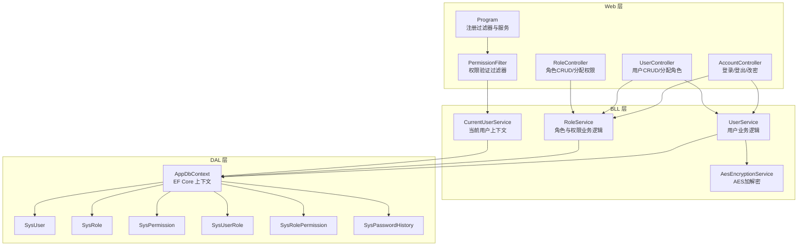
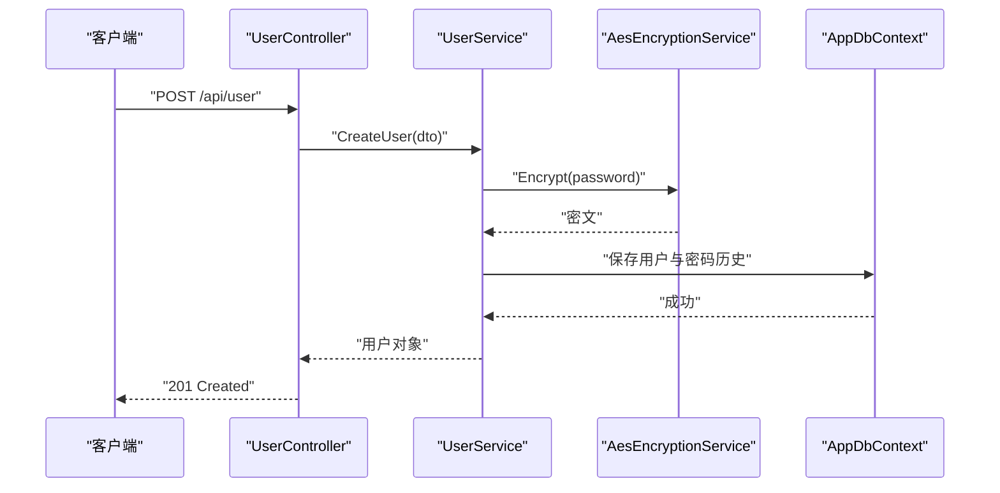
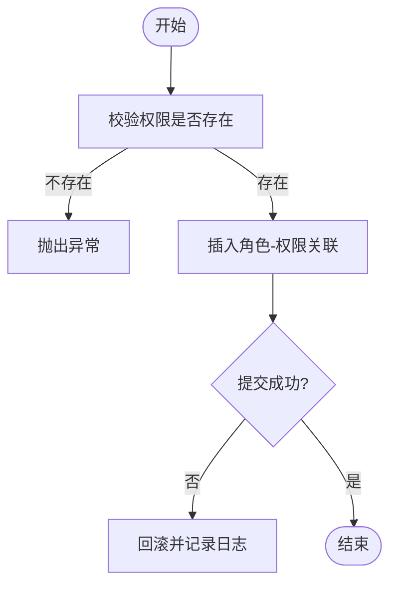
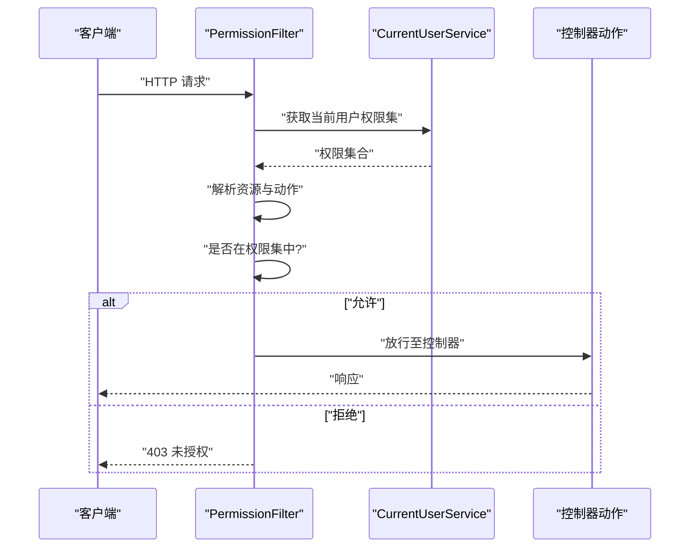
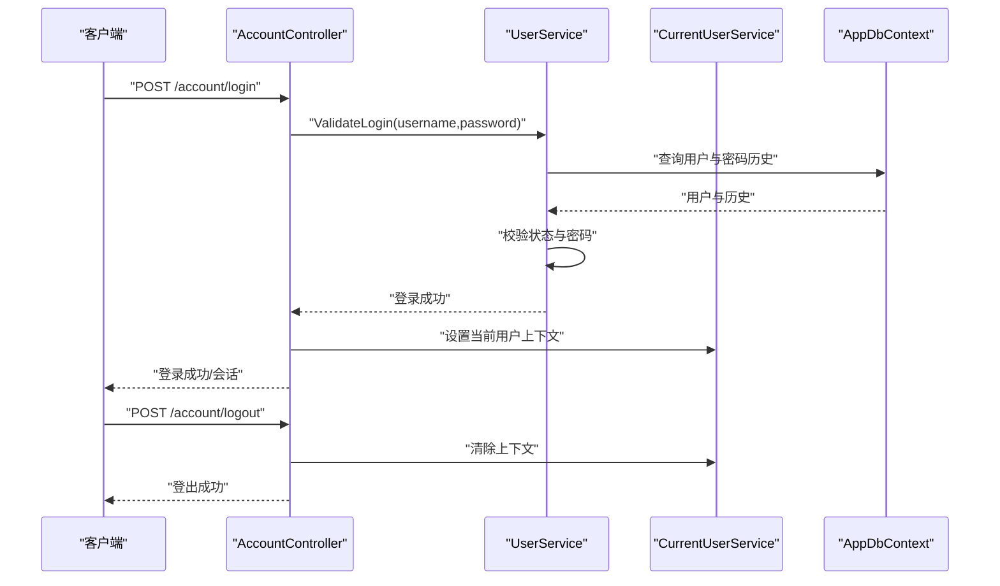
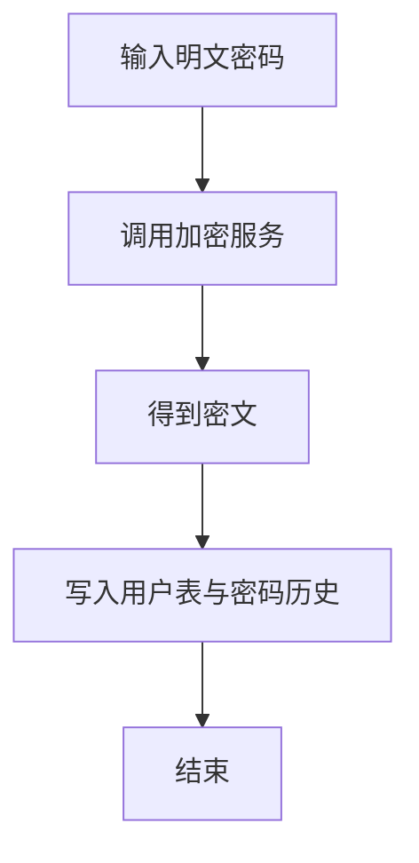
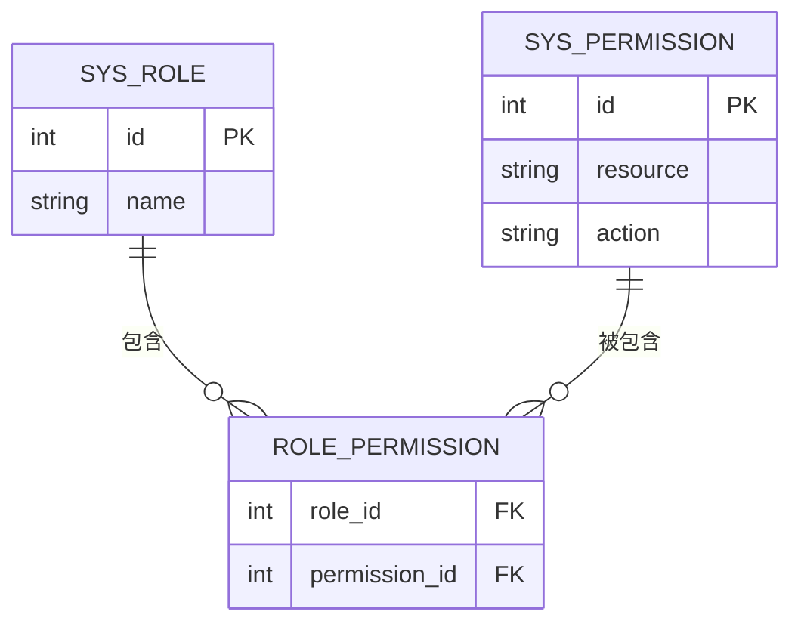
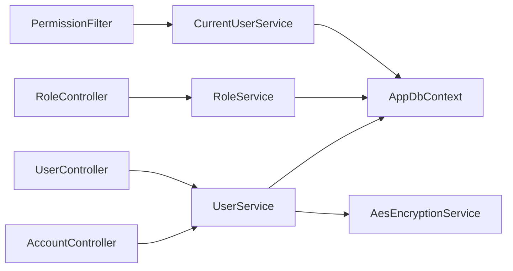

# 用户权限管理模块

<cite>
**本文引用的文件**   
- [UserService.cs](file://EquipmentIMS.BLL/Services/UserService.cs)
- [IRoleService.cs](file://EquipmentIMS.BLL/Interfaces/IRoleService.cs)
- [RoleService.cs](file://EquipmentIMS.BLL/Services/RoleService.cs)
- [PermissionFilter.cs](file://EquipmentIMS.Web/Filters/PermissionFilter.cs)
- [AccountController.cs](file://EquipmentIMS.Web/Controllers/AccountController.cs)
- [UserController.cs](file://EquipmentIMS.Web/Controllers/UserController.cs)
- [RoleController.cs](file://EquipmentIMS.Web/Controllers/RoleController.cs)
- [SysUser.cs](file://EquipmentIMS.Models/Entities/SysUser.cs)
- [SysRole.cs](file://EquipmentIMS.Models/Entities/SysRole.cs)
- [SysPermission.cs](file://EquipmentIMS.Models/Entities/SysPermission.cs)
- [SysUserRole.cs](file://EquipmentIMS.Models/Entities/SysUserRole.cs)
- [SysRolePermission.cs](file://EquipmentIMS.Models/Entities/SysRolePermission.cs)
- [SysPasswordHistory.cs](file://EquipmentIMS.Models/Entities/SysPasswordHistory.cs)
- [IAesEncryptionService.cs](file://EquipmentIMS.BLL/Interfaces/IAesEncryptionService.cs)
- [AesEncryptionService.cs](file://EquipmentIMS.BLL/Services/AesEncryptionService.cs)
- [CurrentUserService.cs](file://EquipmentIMS.BLL/Services/CurrentUserService.cs)
- [ICurrentUserService.cs](file://EquipmentIMS.BLL/Interfaces/ICurrentUserService.cs)
- [AppDbContext.cs](file://EquipmentIMS.DAL/AppDbContext.cs)
- [Program.cs](file://EquipmentIMS.Web/Program.cs)
</cite>

## 目录
1. [简介](#简介)
2. [项目结构](#项目结构)
3. [核心组件](#核心组件)
4. [架构总览](#架构总览)
5. [详细组件分析](#详细组件分析)
6. [依赖关系分析](#依赖关系分析)
7. [性能考虑](#性能考虑)
8. [故障排查指南](#故障排查指南)
9. [结论](#结论)
10. [附录](#附录)

## 简介
本模块围绕基于角色的访问控制（RBAC）模型，提供用户、角色与权限的完整管理能力，并集成认证、会话管理与密码安全存储等安全机制。核心业务由 UserService 与 RoleService 承载，通过 PermissionFilter 在请求管道中进行权限校验；数据层使用 EF Core 实体与配置进行持久化。文档面向开发者与实施人员，既包含架构与流程说明，也给出最佳实践与常见问题解决方案。

## 项目结构
权限相关代码分布在三层：
- Web 层：控制器与过滤器负责接收请求、编排调用与鉴权拦截
- 业务层：服务实现用户、角色、权限的业务逻辑与安全处理
- 数据层：EF Core 上下文与实体定义 RBAC 数据模型



图表来源
- [Program.cs](file://EquipmentIMS.Web/Program.cs)
- [PermissionFilter.cs](file://EquipmentIMS.Web/Filters/PermissionFilter.cs)
- [AccountController.cs](file://EquipmentIMS.Web/Controllers/AccountController.cs)
- [UserController.cs](file://EquipmentIMS.Web/Controllers/UserController.cs)
- [RoleController.cs](file://EquipmentIMS.Web/Controllers/RoleController.cs)
- [UserService.cs](file://EquipmentIMS.BLL/Services/UserService.cs)
- [RoleService.cs](file://EquipmentIMS.BLL/Services/RoleService.cs)
- [CurrentUserService.cs](file://EquipmentIMS.BLL/Services/CurrentUserService.cs)
- [AesEncryptionService.cs](file://EquipmentIMS.BLL/Services/AesEncryptionService.cs)
- [AppDbContext.cs](file://EquipmentIMS.DAL/AppDbContext.cs)
- [SysUser.cs](file://EquipmentIMS.Models/Entities/SysUser.cs)
- [SysRole.cs](file://EquipmentIMS.Models/Entities/SysRole.cs)
- [SysPermission.cs](file://EquipmentIMS.Models/Entities/SysPermission.cs)
- [SysUserRole.cs](file://EquipmentIMS.Models/Entities/SysUserRole.cs)
- [SysRolePermission.cs](file://EquipmentIMS.Models/Entities/SysRolePermission.cs)
- [SysPasswordHistory.cs](file://EquipmentIMS.Models/Entities/SysPasswordHistory.cs)

章节来源
- [Program.cs](file://EquipmentIMS.Web/Program.cs)
- [PermissionFilter.cs](file://EquipmentIMS.Web/Filters/PermissionFilter.cs)
- [AccountController.cs](file://EquipmentIMS.Web/Controllers/AccountController.cs)
- [UserController.cs](file://EquipmentIMS.Web/Controllers/UserController.cs)
- [RoleController.cs](file://EquipmentIMS.Web/Controllers/RoleController.cs)
- [UserService.cs](file://EquipmentIMS.BLL/Services/UserService.cs)
- [RoleService.cs](file://EquipmentIMS.BLL/Services/RoleService.cs)
- [CurrentUserService.cs](file://EquipmentIMS.BLL/Services/CurrentUserService.cs)
- [AesEncryptionService.cs](file://EquipmentIMS.BLL/Services/AesEncryptionService.cs)
- [AppDbContext.cs](file://EquipmentIMS.DAL/AppDbContext.cs)
- [SysUser.cs](file://EquipmentIMS.Models/Entities/SysUser.cs)
- [SysRole.cs](file://EquipmentIMS.Models/Entities/SysRole.cs)
- [SysPermission.cs](file://EquipmentIMS.Models/Entities/SysPermission.cs)
- [SysUserRole.cs](file://EquipmentIMS.Models/Entities/SysUserRole.cs)
- [SysRolePermission.cs](file://EquipmentIMS.Models/Entities/SysRolePermission.cs)
- [SysPasswordHistory.cs](file://EquipmentIMS.Models/Entities/SysPasswordHistory.cs)

## 核心组件
- 用户服务（UserService）
  - 职责：用户生命周期管理、角色分配、密码加密与历史校验、分页查询等
  - 关键能力：创建/更新/删除用户、批量分配角色、密码强度与历史去重、敏感信息脱敏返回
- 角色服务（RoleService）
  - 职责：角色生命周期管理、权限矩阵维护、角色-权限关系操作
  - 关键能力：创建/编辑/删除角色、为角色授予或撤销权限、按权限筛选角色
- 权限过滤器（PermissionFilter）
  - 职责：在请求进入控制器前检查当前用户是否具备所需权限
  - 关键能力：从当前用户上下文解析已授权集合，匹配资源与动作，拒绝无权限访问
- 当前用户上下文（CurrentUserService）
  - 职责：封装当前登录用户的身份与权限缓存
  - 关键能力：读取 Claims/Session 中的用户标识与角色/权限集，提供便捷判断方法
- 加密服务（AesEncryptionService）
  - 职责：对称加密/解密，用于密码与敏感字段的安全存储与读取
  - 关键能力：生成密钥、加密明文、解密密文、异常兜底

章节来源
- [UserService.cs](file://EquipmentIMS.BLL/Services/UserService.cs)
- [RoleService.cs](file://EquipmentIMS.BLL/Services/RoleService.cs)
- [PermissionFilter.cs](file://EquipmentIMS.Web/Filters/PermissionFilter.cs)
- [CurrentUserService.cs](file://EquipmentIMS.BLL/Services/CurrentUserService.cs)
- [IAesEncryptionService.cs](file://EquipmentIMS.BLL/Interfaces/IAesEncryptionService.cs)
- [AesEncryptionService.cs](file://EquipmentIMS.BLL/Services/AesEncryptionService.cs)

## 架构总览
RBAC 数据模型与权限校验链路如下：

```mermaid
classDiagram
class SysUser {
+主键
+用户名
+密码(密文)
+状态
+创建时间
+更新时间
}
class SysRole {
+主键
+角色名
+描述
+状态
}
class SysPermission {
+主键
+资源
+动作
+显示名称
+层级
}
class SysUserRole {
+用户ID(FK)
+角色ID(FK)
}
class SysRolePermission {
+角色ID(FK)
+权限ID(FK)
}
class SysPasswordHistory {
+用户ID(FK)
+密码哈希
+更新时间
}
SysUser ||--o{ SysUserRole : "拥有多个角色"
SysRole ||--o{ SysUserRole : "被多个用户拥有"
SysRole ||--o{ SysRolePermission : "包含多个权限"
SysPermission ||--o{ SysRolePermission : "被多个角色包含"
SysUser ||--o{ SysPasswordHistory : "密码历史"
```

图表来源
- [SysUser.cs](file://EquipmentIMS.Models/Entities/SysUser.cs)
- [SysRole.cs](file://EquipmentIMS.Models/Entities/SysRole.cs)
- [SysPermission.cs](file://EquipmentIMS.Models/Entities/SysPermission.cs)
- [SysUserRole.cs](file://EquipmentIMS.Models/Entities/SysUserRole.cs)
- [SysRolePermission.cs](file://EquipmentIMS.Models/Entities/SysRolePermission.cs)
- [SysPasswordHistory.cs](file://EquipmentIMS.Models/Entities/SysPasswordHistory.cs)

## 详细组件分析

### 用户服务（UserService）分析
- 设计要点
  - 对用户实体的增删改查进行封装，统一参数校验与异常转换
  - 密码处理通过加密服务完成，避免明文落库
  - 支持用户-角色多对多关系的批量分配与回滚
- 典型流程
  - 创建用户：校验唯一性 -> 加密密码 -> 写入用户表 -> 记录密码历史 -> 提交事务
  - 分配角色：先清理旧关联 -> 插入新关联 -> 失败回滚
  - 查询列表：分页、过滤、排序、结果映射
- 复杂度与优化
  - 批量分配采用批量插入减少往返
  - 查询条件尽量走索引字段（如用户名、状态）
- 错误处理
  - 重复用户名/邮箱抛出业务异常
  - 数据库约束冲突捕获并转换为友好提示
  - 事务失败时记录日志并回滚



图表来源
- [UserController.cs](file://EquipmentIMS.Web/Controllers/UserController.cs)
- [UserService.cs](file://EquipmentIMS.BLL/Services/UserService.cs)
- [AesEncryptionService.cs](file://EquipmentIMS.BLL/Services/AesEncryptionService.cs)
- [AppDbContext.cs](file://EquipmentIMS.DAL/AppDbContext.cs)

章节来源
- [UserService.cs](file://EquipmentIMS.BLL/Services/UserService.cs)
- [UserController.cs](file://EquipmentIMS.Web/Controllers/UserController.cs)
- [AesEncryptionService.cs](file://EquipmentIMS.BLL/Services/AesEncryptionService.cs)
- [AppDbContext.cs](file://EquipmentIMS.DAL/AppDbContext.cs)

### 角色服务（RoleService）分析
- 设计要点
  - 角色与权限的多对多维护，提供“授予/撤销”原子操作
  - 支持按权限反查角色，便于权限矩阵展示
- 典型流程
  - 授予权限：校验权限存在 -> 插入角色-权限关联 -> 提交
  - 撤销权限：根据角色与权限集合删除关联
  - 变更角色后，建议失效相关用户缓存（若启用）
- 复杂度与优化
  - 批量授予/撤销使用批量 SQL 提升性能
  - 高频查询可结合内存缓存（可选）



图表来源
- [RoleService.cs](file://EquipmentIMS.BLL/Services/RoleService.cs)
- [AppDbContext.cs](file://EquipmentIMS.DAL/AppDbContext.cs)

章节来源
- [RoleService.cs](file://EquipmentIMS.BLL/Services/RoleService.cs)
- [AppDbContext.cs](file://EquipmentIMS.DAL/AppDbContext.cs)

### 权限验证过滤器（PermissionFilter）工作原理
- 触发时机
  - 在控制器动作执行前运行，依据装饰器或全局注册生效
- 校验逻辑
  - 从当前用户上下文获取已授权集合
  - 解析目标资源的“资源+动作”标识
  - 若不在授权集合中则拒绝访问（返回 403）
- 扩展点
  - 支持白名单路径跳过校验
  - 支持自定义策略（如最小权限原则、动态资源）



图表来源
- [PermissionFilter.cs](file://EquipmentIMS.Web/Filters/PermissionFilter.cs)
- [CurrentUserService.cs](file://EquipmentIMS.BLL/Services/CurrentUserService.cs)

章节来源
- [PermissionFilter.cs](file://EquipmentIMS.Web/Filters/PermissionFilter.cs)
- [CurrentUserService.cs](file://EquipmentIMS.BLL/Services/CurrentUserService.cs)

### 用户认证流程与会话管理
- 登录流程
  - 客户端提交用户名与密码
  - 服务端校验用户状态与密码（对比密文）
  - 成功后建立会话/令牌，写入当前用户上下文
- 登出流程
  - 清除会话/令牌，使当前用户上下文失效
- 改密流程
  - 校验旧密码与新密码差异与历史去重
  - 加密新密码并写入历史表



图表来源
- [AccountController.cs](file://EquipmentIMS.Web/Controllers/AccountController.cs)
- [UserService.cs](file://EquipmentIMS.BLL/Services/UserService.cs)
- [CurrentUserService.cs](file://EquipmentIMS.BLL/Services/CurrentUserService.cs)
- [AppDbContext.cs](file://EquipmentIMS.DAL/AppDbContext.cs)

章节来源
- [AccountController.cs](file://EquipmentIMS.Web/Controllers/AccountController.cs)
- [UserService.cs](file://EquipmentIMS.BLL/Services/UserService.cs)
- [CurrentUserService.cs](file://EquipmentIMS.BLL/Services/CurrentUserService.cs)
- [AppDbContext.cs](file://EquipmentIMS.DAL/AppDbContext.cs)

### 密码加密存储与安全机制
- 加密方案
  - 使用对称加密服务对密码进行加密后再持久化
  - 每次修改密码均记录到密码历史表，防止重用
- 安全要点
  - 禁止明文落库
  - 密钥管理需纳入系统配置与密钥轮换策略
  - 登录比对时使用相同算法计算后比较



图表来源
- [AesEncryptionService.cs](file://EquipmentIMS.BLL/Services/AesEncryptionService.cs)
- [SysPasswordHistory.cs](file://EquipmentIMS.Models/Entities/SysPasswordHistory.cs)
- [SysUser.cs](file://EquipmentIMS.Models/Entities/SysUser.cs)

章节来源
- [AesEncryptionService.cs](file://EquipmentIMS.BLL/Services/AesEncryptionService.cs)
- [SysPasswordHistory.cs](file://EquipmentIMS.Models/Entities/SysPasswordHistory.cs)
- [SysUser.cs](file://EquipmentIMS.Models/Entities/SysUser.cs)

### 用户CRUD与角色分配示例（以路径引用代替代码）
- 用户创建
  - 参考路径：[UserController.cs](file://EquipmentIMS.Web/Controllers/UserController.cs)、[UserService.cs](file://EquipmentIMS.BLL/Services/UserService.cs)
- 用户编辑与禁用/启用
  - 参考路径：[UserController.cs](file://EquipmentIMS.Web/Controllers/UserController.cs)、[UserService.cs](file://EquipmentIMS.BLL/Services/UserService.cs)
- 用户删除（软删除/硬删除视实现而定）
  - 参考路径：[UserController.cs](file://EquipmentIMS.Web/Controllers/UserController.cs)、[UserService.cs](file://EquipmentIMS.BLL/Services/UserService.cs)
- 为用户分配/移除角色
  - 参考路径：[UserController.cs](file://EquipmentIMS.Web/Controllers/UserController.cs)、[UserService.cs](file://EquipmentIMS.BLL/Services/UserService.cs)

章节来源
- [UserController.cs](file://EquipmentIMS.Web/Controllers/UserController.cs)
- [UserService.cs](file://EquipmentIMS.BLL/Services/UserService.cs)

### 角色权限矩阵与权限继承
- 权限矩阵
  - 角色-权限多对多关系，便于可视化勾选与批量授予
  - 参考路径：[RoleController.cs](file://EquipmentIMS.Web/Controllers/RoleController.cs)、[RoleService.cs](file://EquipmentIMS.BLL/Services/RoleService.cs)
- 权限继承（概念）
  - 可通过角色层级或权限分组实现“父角色继承子角色权限”，或在权限树中按节点聚合
  - 建议在 CurrentUserService 中预计算并缓存最终权限集合，降低运行时开销



图表来源
- [SysRolePermission.cs](file://EquipmentIMS.Models/Entities/SysRolePermission.cs)
- [SysRole.cs](file://EquipmentIMS.Models/Entities/SysRole.cs)
- [SysPermission.cs](file://EquipmentIMS.Models/Entities/SysPermission.cs)

章节来源
- [RoleController.cs](file://EquipmentIMS.Web/Controllers/RoleController.cs)
- [RoleService.cs](file://EquipmentIMS.BLL/Services/RoleService.cs)
- [SysRolePermission.cs](file://EquipmentIMS.Models/Entities/SysRolePermission.cs)
- [SysRole.cs](file://EquipmentIMS.Models/Entities/SysRole.cs)
- [SysPermission.cs](file://EquipmentIMS.Models/Entities/SysPermission.cs)

## 依赖关系分析
- 组件耦合
  - 控制器依赖服务接口，服务依赖数据上下文与加密服务
  - 过滤器依赖当前用户上下文，形成横切关注点
- 外部依赖
  - EF Core 上下文与实体
  - 对称加密服务（可替换为其他加密实现）
- 潜在循环依赖
  - 当前实现未见循环引用；若引入缓存服务需注意注入顺序



图表来源
- [AccountController.cs](file://EquipmentIMS.Web/Controllers/AccountController.cs)
- [UserController.cs](file://EquipmentIMS.Web/Controllers/UserController.cs)
- [RoleController.cs](file://EquipmentIMS.Web/Controllers/RoleController.cs)
- [PermissionFilter.cs](file://EquipmentIMS.Web/Filters/PermissionFilter.cs)
- [UserService.cs](file://EquipmentIMS.BLL/Services/UserService.cs)
- [RoleService.cs](file://EquipmentIMS.BLL/Services/RoleService.cs)
- [CurrentUserService.cs](file://EquipmentIMS.BLL/Services/CurrentUserService.cs)
- [AesEncryptionService.cs](file://EquipmentIMS.BLL/Services/AesEncryptionService.cs)
- [AppDbContext.cs](file://EquipmentIMS.DAL/AppDbContext.cs)

章节来源
- [AccountController.cs](file://EquipmentIMS.Web/Controllers/AccountController.cs)
- [UserController.cs](file://EquipmentIMS.Web/Controllers/UserController.cs)
- [RoleController.cs](file://EquipmentIMS.Web/Controllers/RoleController.cs)
- [PermissionFilter.cs](file://EquipmentIMS.Web/Filters/PermissionFilter.cs)
- [UserService.cs](file://EquipmentIMS.BLL/Services/UserService.cs)
- [RoleService.cs](file://EquipmentIMS.BLL/Services/RoleService.cs)
- [CurrentUserService.cs](file://EquipmentIMS.BLL/Services/CurrentUserService.cs)
- [AesEncryptionService.cs](file://EquipmentIMS.BLL/Services/AesEncryptionService.cs)
- [AppDbContext.cs](file://EquipmentIMS.DAL/AppDbContext.cs)

## 性能考虑
- 权限校验
  - 将当前用户权限集合缓存于会话或内存，避免每次请求都跨表查询
  - 对资源与动作建立索引，加速匹配
- 批量操作
  - 用户-角色、角色-权限的批量分配使用批量插入，减少往返
- 查询优化
  - 分页查询仅选择必要字段，避免 N+1 查询
- 并发与一致性
  - 关键写操作使用事务包裹，保证用户-角色、权限-角色关系的一致性

## 故障排查指南
- 登录失败
  - 检查用户状态、密码历史去重逻辑与加密算法一致性
  - 参考路径：[AccountController.cs](file://EquipmentIMS.Web/Controllers/AccountController.cs)、[UserService.cs](file://EquipmentIMS.BLL/Services/UserService.cs)
- 403 未授权
  - 确认当前用户是否已分配相应角色与权限
  - 检查过滤器白名单与资源/动作命名约定
  - 参考路径：[PermissionFilter.cs](file://EquipmentIMS.Web/Filters/PermissionFilter.cs)、[CurrentUserService.cs](file://EquipmentIMS.BLL/Services/CurrentUserService.cs)
- 角色权限不生效
  - 确认角色-权限关联是否正确写入
  - 若启用了缓存，检查缓存失效策略
  - 参考路径：[RoleService.cs](file://EquipmentIMS.BLL/Services/RoleService.cs)
- 密码相关问题
  - 确认加密服务配置与密钥管理
  - 检查密码历史表是否记录正确
  - 参考路径：[AesEncryptionService.cs](file://EquipmentIMS.BLL/Services/AesEncryptionService.cs)、[SysPasswordHistory.cs](file://EquipmentIMS.Models/Entities/SysPasswordHistory.cs)

章节来源
- [AccountController.cs](file://EquipmentIMS.Web/Controllers/AccountController.cs)
- [UserService.cs](file://EquipmentIMS.BLL/Services/UserService.cs)
- [PermissionFilter.cs](file://EquipmentIMS.Web/Filters/PermissionFilter.cs)
- [CurrentUserService.cs](file://EquipmentIMS.BLL/Services/CurrentUserService.cs)
- [RoleService.cs](file://EquipmentIMS.BLL/Services/RoleService.cs)
- [AesEncryptionService.cs](file://EquipmentIMS.BLL/Services/AesEncryptionService.cs)
- [SysPasswordHistory.cs](file://EquipmentIMS.Models/Entities/SysPasswordHistory.cs)

## 结论
本模块以 RBAC 为核心，通过清晰的分层设计与过滤器机制，实现了用户、角色与权限的统一管理。配合会话/上下文与加密服务，提供了完整的认证、鉴权与数据安全能力。建议在生产环境完善权限缓存、审计日志与密钥轮换策略，以获得更高的安全性与可扩展性。

## 附录
- 最佳实践
  - 最小权限原则：默认拒绝，按需授予
  - 资源与动作命名规范化：便于过滤器解析与前端按钮级控制
  - 幂等与回滚：批量分配/撤销需保证原子性
  - 审计与追踪：记录关键权限变更与登录行为
- 常见配置项
  - 过滤器白名单路径
  - 权限缓存过期时间
  - 密码历史保留条数
  - 加密算法与密钥来源