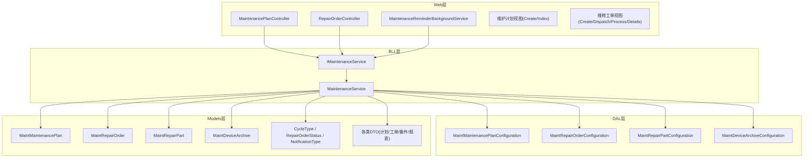
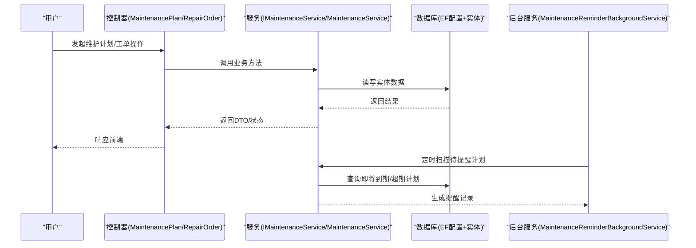
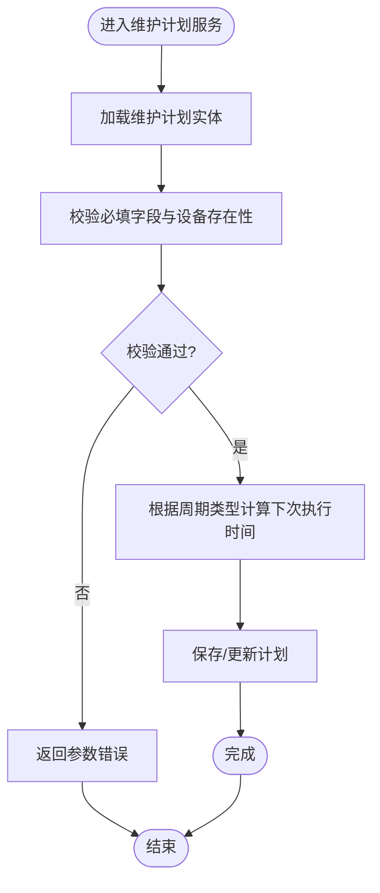
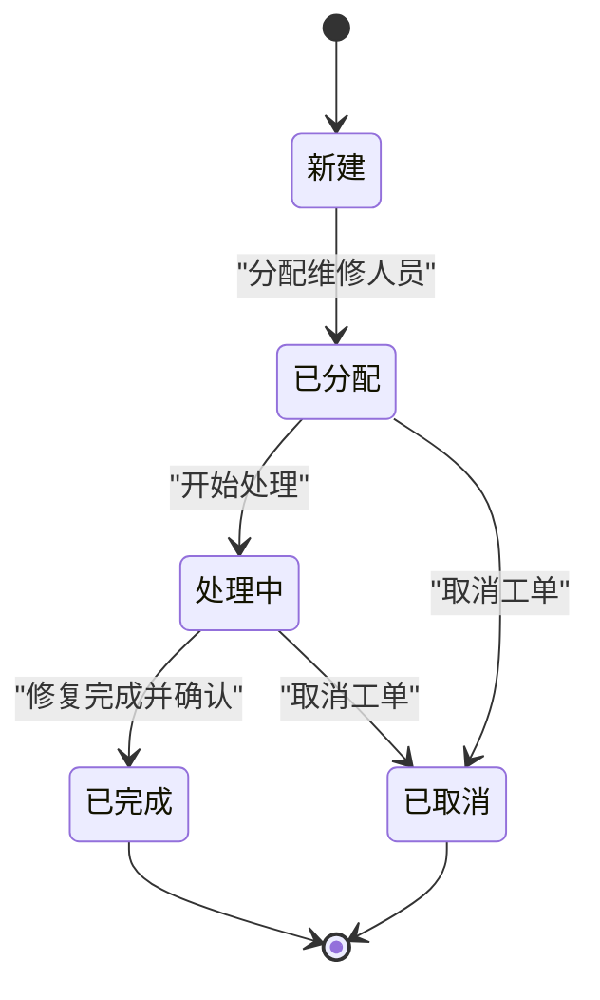
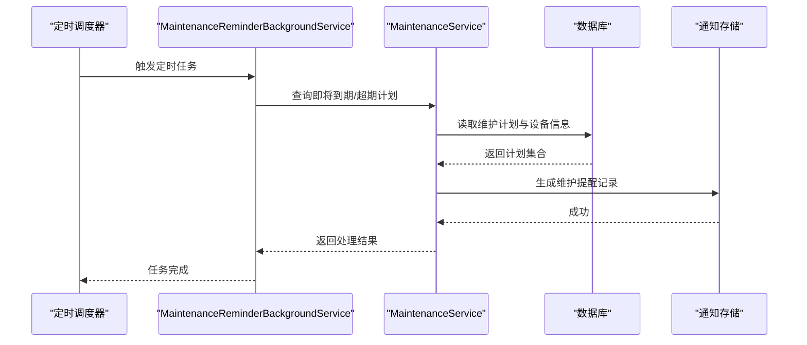
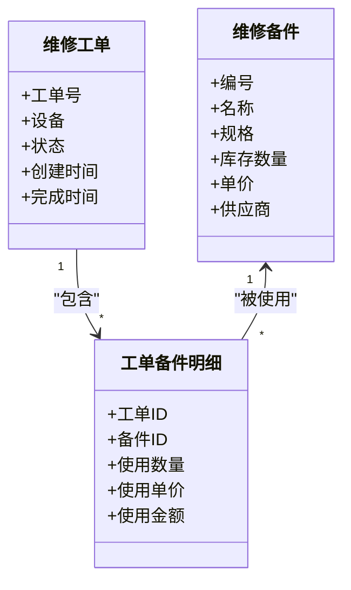
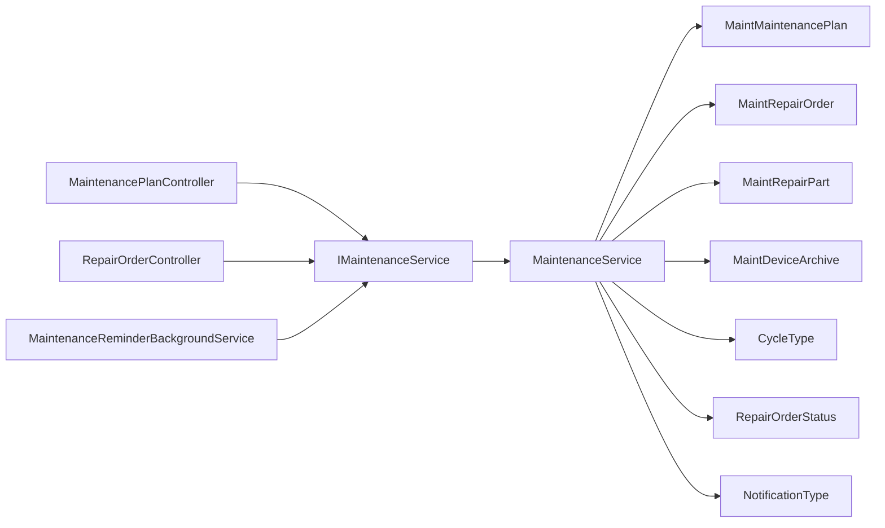

# 维护管理模块

<cite>
**本文引用的文件**   
- [MaintenanceService.cs](file://EquipmentIMS.BLL/Services/MaintenanceService.cs)
- [IMaintenanceService.cs](file://EquipmentIMS.BLL/Interfaces/IMaintenanceService.cs)
- [MaintenancePlanController.cs](file://EquipmentIMS.Web/Controllers/MaintenancePlanController.cs)
- [RepairOrderController.cs](file://EquipmentIMS.Web/Controllers/RepairOrderController.cs)
- [MaintenanceReminderBackgroundService.cs](file://EquipmentIMS.Web/BackgroundServices/MaintenanceReminderBackgroundService.cs)
- [MaintMaintenancePlanConfiguration.cs](file://EquipmentIMS.DAL/Configurations/MaintMaintenancePlanConfiguration.cs)
- [MaintRepairOrderConfiguration.cs](file://EquipmentIMS.DAL/Configurations/MaintRepairOrderConfiguration.cs)
- [MaintRepairPartConfiguration.cs](file://EquipmentIMS.DAL/Configurations/MaintRepairPartConfiguration.cs)
- [MaintDeviceArchiveConfiguration.cs](file://EquipmentIMS.DAL/Configurations/MaintDeviceArchiveConfiguration.cs)
- [MaintMaintenancePlan.cs](file://EquipmentIMS.Models/Entities/MaintMaintenancePlan.cs)
- [MaintRepairOrder.cs](file://EquipmentIMS.Models/Entities/MaintRepairOrder.cs)
- [MaintRepairPart.cs](file://EquipmentIMS.Models/Entities/MaintRepairPart.cs)
- [MaintDeviceArchive.cs](file://EquipmentIMS.Models/Entities/MaintDeviceArchive.cs)
- [CycleType.cs](file://EquipmentIMS.Models/Enums/CycleType.cs)
- [RepairOrderStatus.cs](file://EquipmentIMS.Models/Enums/RepairOrderStatus.cs)
- [NotificationType.cs](file://EquipmentIMS.Models/Enums/NotificationType.cs)
- [MaintenancePlanDto.cs](file://EquipmentIMS.Models/DTOs/MaintenancePlanDto.cs)
- [MaintenancePlanListDto.cs](file://EquipmentIMS.Models/DTOs/MaintenancePlanListDto.cs)
- [RepairOrderDto.cs](file://EquipmentIMS.Models/DTOs/RepairOrderDto.cs)
- [RepairOrderListDto.cs](file://EquipmentIMS.Models/DTOs/RepairOrderListDto.cs)
- [RepairPartDto.cs](file://EquipmentIMS.Models/DTOs/RepairPartDto.cs)
- [ReportRepairDtos.cs](file://EquipmentIMS.Models/DTOs/Reports/ReportRepairDtos.cs)
- [Create.cshtml](file://EquipmentIMS.Web/Views/MaintenancePlan/Create.cshtml)
- [Index.cshtml](file://EquipmentIMS.Web/Views/MaintenancePlan/Index.cshtml)
- [Create.cshtml](file://EquipmentIMS.Web/Views/RepairOrder/Create.cshtml)
- [Dispatch.cshtml](file://EquipmentIMS.Web/Views/RepairOrder/Dispatch.cshtml)
- [Process.cshtml](file://EquipmentIMS.Web/Views/RepairOrder/Process.cshtml)
- [Details.cshtml](file://EquipmentIMS.Web/Views/RepairOrder/Details.cshtml)
- [Program.cs](file://EquipmentIMS.Web/Program.cs)
</cite>

## 目录
1. [简介](#简介)
2. [项目结构](#项目结构)
3. [核心组件](#核心组件)
4. [架构总览](#架构总览)
5. [详细组件分析](#详细组件分析)
6. [依赖关系分析](#依赖关系分析)
7. [性能考虑](#性能考虑)
8. [故障排查指南](#故障排查指南)
9. [结论](#结论)
10. [附录](#附录)

## 简介
本章节面向“设备维护管理”子域，覆盖以下能力：
- 维护计划管理：制定、提醒、执行跟踪与统计
- 维修工单处理：创建、分配、处理、完成的全流程闭环
- 后台定时任务：维护提醒的调度机制
- 维修备件：管理与使用统计
- 成本计算与效果评估：维护成本归集、预防性维护策略建议

该模块采用分层架构（Web/BLL/DAL/Models），通过控制器暴露API，业务逻辑集中在服务层，数据访问由仓储与EF配置完成。

## 项目结构
维护相关代码分布在如下层次：
- Web层：控制器与视图负责请求路由与页面交互
- BLL层：维护服务实现核心业务规则（计划CRUD、工单流转、提醒生成）
- DAL层：实体映射配置与数据库上下文
- Models层：实体、枚举、DTO定义

图表来源
- [MaintenancePlanController.cs](file://EquipmentIMS.Web/Controllers/MaintenancePlanController.cs)
- [RepairOrderController.cs](file://EquipmentIMS.Web/Controllers/RepairOrderController.cs)
- [MaintenanceReminderBackgroundService.cs](file://EquipmentIMS.Web/BackgroundServices/MaintenanceReminderBackgroundService.cs)
- [IMaintenanceService.cs](file://EquipmentIMS.BLL/Interfaces/IMaintenanceService.cs)
- [MaintenanceService.cs](file://EquipmentIMS.BLL/Services/MaintenanceService.cs)
- [MaintMaintenancePlanConfiguration.cs](file://EquipmentIMS.DAL/Configurations/MaintMaintenancePlanConfiguration.cs)
- [MaintRepairOrderConfiguration.cs](file://EquipmentIMS.DAL/Configurations/MaintRepairOrderConfiguration.cs)
- [MaintRepairPartConfiguration.cs](file://EquipmentIMS.DAL/Configurations/MaintRepairPartConfiguration.cs)
- [MaintDeviceArchiveConfiguration.cs](file://EquipmentIMS.DAL/Configurations/MaintDeviceArchiveConfiguration.cs)
- [MaintMaintenancePlan.cs](file://EquipmentIMS.Models/Entities/MaintMaintenancePlan.cs)
- [MaintRepairOrder.cs](file://EquipmentIMS.Models/Entities/MaintRepairOrder.cs)
- [MaintRepairPart.cs](file://EquipmentIMS.Models/Entities/MaintRepairPart.cs)
- [MaintDeviceArchive.cs](file://EquipmentIMS.Models/Entities/MaintDeviceArchive.cs)
- [CycleType.cs](file://EquipmentIMS.Models/Enums/CycleType.cs)
- [RepairOrderStatus.cs](file://EquipmentIMS.Models/Enums/RepairOrderStatus.cs)
- [NotificationType.cs](file://EquipmentIMS.Models/Enums/NotificationType.cs)
- [MaintenancePlanDto.cs](file://EquipmentIMS.Models/DTOs/MaintenancePlanDto.cs)
- [MaintenancePlanListDto.cs](file://EquipmentIMS.Models/DTOs/MaintenancePlanListDto.cs)
- [RepairOrderDto.cs](file://EquipmentIMS.Models/DTOs/RepairOrderDto.cs)
- [RepairOrderListDto.cs](file://EquipmentIMS.Models/DTOs/RepairOrderListDto.cs)
- [RepairPartDto.cs](file://EquipmentIMS.Models/DTOs/RepairPartDto.cs)
- [ReportRepairDtos.cs](file://EquipmentIMS.Models/DTOs/Reports/ReportRepairDtos.cs)

章节来源
- [Program.cs](file://EquipmentIMS.Web/Program.cs)

## 核心组件
- 维护计划服务接口与实现
  - 接口：提供维护计划的查询、新增、更新、删除等能力
  - 实现：封装计划周期计算、状态判定、提醒触发、与设备档案关联等
- 维修工单控制器
  - 提供工单创建、派发、处理、关闭等HTTP端点
- 维护提醒后台服务
  - 周期性扫描即将到期或超期的维护计划，生成维护提醒通知
- 数据模型与映射
  - 维护计划、维修工单、维修备件、设备档案实体及其EF配置
- DTO与枚举
  - 用于前后端数据传输与状态/周期类型表达

章节来源
- [IMaintenanceService.cs](file://EquipmentIMS.BLL/Interfaces/IMaintenanceService.cs)
- [MaintenanceService.cs](file://EquipmentIMS.BLL/Services/MaintenanceService.cs)
- [MaintenancePlanController.cs](file://EquipmentIMS.Web/Controllers/MaintenancePlanController.cs)
- [RepairOrderController.cs](file://EquipmentIMS.Web/Controllers/RepairOrderController.cs)
- [MaintenanceReminderBackgroundService.cs](file://EquipmentIMS.Web/BackgroundServices/MaintenanceReminderBackgroundService.cs)
- [MaintMaintenancePlan.cs](file://EquipmentIMS.Models/Entities/MaintMaintenancePlan.cs)
- [MaintRepairOrder.cs](file://EquipmentIMS.Models/Entities/MaintRepairOrder.cs)
- [MaintRepairPart.cs](file://EquipmentIMS.Models/Entities/MaintRepairPart.cs)
- [MaintDeviceArchive.cs](file://EquipmentIMS.Models/Entities/MaintDeviceArchive.cs)
- [CycleType.cs](file://EquipmentIMS.Models/Enums/CycleType.cs)
- [RepairOrderStatus.cs](file://EquipmentIMS.Models/Enums/RepairOrderStatus.cs)
- [NotificationType.cs](file://EquipmentIMS.Models/Enums/NotificationType.cs)
- [MaintenancePlanDto.cs](file://EquipmentIMS.Models/DTOs/MaintenancePlanDto.cs)
- [MaintenancePlanListDto.cs](file://EquipmentIMS.Models/DTOs/MaintenancePlanListDto.cs)
- [RepairOrderDto.cs](file://EquipmentIMS.Models/DTOs/RepairOrderDto.cs)
- [RepairOrderListDto.cs](file://EquipmentIMS.Models/DTOs/RepairOrderListDto.cs)
- [RepairPartDto.cs](file://EquipmentIMS.Models/DTOs/RepairPartDto.cs)
- [ReportRepairDtos.cs](file://EquipmentIMS.Models/DTOs/Reports/ReportRepairDtos.cs)

## 架构总览
维护管理模块遵循典型分层架构：
- 控制器接收请求并调用服务接口
- 服务层编排业务规则、事务边界与领域事件（如提醒）
- 数据访问层通过EF配置与实体进行持久化
- 后台服务按周期扫描并触发提醒

图表来源
- [MaintenancePlanController.cs](file://EquipmentIMS.Web/Controllers/MaintenancePlanController.cs)
- [RepairOrderController.cs](file://EquipmentIMS.Web/Controllers/RepairOrderController.cs)
- [IMaintenanceService.cs](file://EquipmentIMS.BLL/Interfaces/IMaintenanceService.cs)
- [MaintenanceService.cs](file://EquipmentIMS.BLL/Services/MaintenanceService.cs)
- [MaintenanceReminderBackgroundService.cs](file://EquipmentIMS.Web/BackgroundServices/MaintenanceReminderBackgroundService.cs)
- [MaintMaintenancePlanConfiguration.cs](file://EquipmentIMS.DAL/Configurations/MaintMaintenancePlanConfiguration.cs)
- [MaintRepairOrderConfiguration.cs](file://EquipmentIMS.DAL/Configurations/MaintRepairOrderConfiguration.cs)

## 详细组件分析

### 维护计划管理（CRUD与周期计算）
- 功能要点
  - 计划创建：选择设备、维护类型、周期类型（日/周/月/年）、下次执行时间
  - 计划更新：调整周期、负责人、备注等
  - 计划删除：软删或硬删（依据业务约束）
  - 列表查询：支持分页、筛选（设备、状态、周期类型）
  - 周期计算：根据周期类型与上次执行时间推算下次执行时间
- 关键实现位置
  - 控制器：维护计划增删改查入口
  - 服务：周期计算、状态判定、与设备档案关联校验
  - 实体与配置：维护计划表结构映射
  - DTO：计划详情与列表展示字段

图表来源
- [MaintenanceService.cs](file://EquipmentIMS.BLL/Services/MaintenanceService.cs)
- [MaintMaintenancePlan.cs](file://EquipmentIMS.Models/Entities/MaintMaintenancePlan.cs)
- [MaintMaintenancePlanConfiguration.cs](file://EquipmentIMS.DAL/Configurations/MaintMaintenancePlanConfiguration.cs)
- [CycleType.cs](file://EquipmentIMS.Models/Enums/CycleType.cs)
- [MaintenancePlanDto.cs](file://EquipmentIMS.Models/DTOs/MaintenancePlanDto.cs)
- [MaintenancePlanListDto.cs](file://EquipmentIMS.Models/DTOs/MaintenancePlanListDto.cs)

章节来源
- [MaintenancePlanController.cs](file://EquipmentIMS.Web/Controllers/MaintenancePlanController.cs)
- [IMaintenanceService.cs](file://EquipmentIMS.BLL/Interfaces/IMaintenanceService.cs)
- [MaintenanceService.cs](file://EquipmentIMS.BLL/Services/MaintenanceService.cs)
- [MaintMaintenancePlan.cs](file://EquipmentIMS.Models/Entities/MaintMaintenancePlan.cs)
- [MaintMaintenancePlanConfiguration.cs](file://EquipmentIMS.DAL/Configurations/MaintMaintenancePlanConfiguration.cs)
- [CycleType.cs](file://EquipmentIMS.Models/Enums/CycleType.cs)
- [MaintenancePlanDto.cs](file://EquipmentIMS.Models/DTOs/MaintenancePlanDto.cs)
- [MaintenancePlanListDto.cs](file://EquipmentIMS.Models/DTOs/MaintenancePlanListDto.cs)

### 维修工单全流程（创建-分配-处理-完成）
- 功能要点
  - 创建工单：关联设备、故障描述、优先级、期望完成时间
  - 分配工单：指派维修人员/班组
  - 处理工单：记录处理过程、更换备件、工时、费用
  - 完成工单：确认修复、归档记录、生成维护报告
- 状态流转
  - 新建 -> 已分配 -> 处理中 -> 已完成/已取消
- 关键实现位置
  - 控制器：工单各阶段操作入口
  - 服务：状态机校验、成本汇总、备件扣减
  - 实体与配置：工单主表、备件明细表映射
  - 枚举：工单状态、通知类型

图表来源
- [RepairOrderController.cs](file://EquipmentIMS.Web/Controllers/RepairOrderController.cs)
- [IMaintenanceService.cs](file://EquipmentIMS.BLL/Interfaces/IMaintenanceService.cs)
- [MaintenanceService.cs](file://EquipmentIMS.BLL/Services/MaintenanceService.cs)
- [MaintRepairOrder.cs](file://EquipmentIMS.Models/Entities/MaintRepairOrder.cs)
- [MaintRepairOrderConfiguration.cs](file://EquipmentIMS.DAL/Configurations/MaintRepairOrderConfiguration.cs)
- [RepairOrderStatus.cs](file://EquipmentIMS.Models/Enums/RepairOrderStatus.cs)

章节来源
- [RepairOrderController.cs](file://EquipmentIMS.Web/Controllers/RepairOrderController.cs)
- [IMaintenanceService.cs](file://EquipmentIMS.BLL/Interfaces/IMaintenanceService.cs)
- [MaintenanceService.cs](file://EquipmentIMS.BLL/Services/MaintenanceService.cs)
- [MaintRepairOrder.cs](file://EquipmentIMS.Models/Entities/MaintRepairOrder.cs)
- [MaintRepairOrderConfiguration.cs](file://EquipmentIMS.DAL/Configurations/MaintRepairOrderConfiguration.cs)
- [RepairOrderStatus.cs](file://EquipmentIMS.Models/Enums/RepairOrderStatus.cs)

### 维护提醒后台服务（定时任务）
- 功能要点
  - 周期性扫描维护计划，判断是否到达提醒阈值（例如提前N天）
  - 为符合条件的计划生成维护提醒通知
  - 支持可配置的提醒策略（提前天数、重复提醒间隔）
- 关键实现位置
  - 后台服务：定时任务注册与执行逻辑
  - 服务：查询即将到期的计划、生成通知
  - 枚举：通知类型

图表来源
- [MaintenanceReminderBackgroundService.cs](file://EquipmentIMS.Web/BackgroundServices/MaintenanceReminderBackgroundService.cs)
- [MaintenanceService.cs](file://EquipmentIMS.BLL/Services/MaintenanceService.cs)
- [MaintMaintenancePlan.cs](file://EquipmentIMS.Models/Entities/MaintMaintenancePlan.cs)
- [NotificationType.cs](file://EquipmentIMS.Models/Enums/NotificationType.cs)

章节来源
- [MaintenanceReminderBackgroundService.cs](file://EquipmentIMS.Web/BackgroundServices/MaintenanceReminderBackgroundService.cs)
- [MaintenanceService.cs](file://EquipmentIMS.BLL/Services/MaintenanceService.cs)
- [NotificationType.cs](file://EquipmentIMS.Models/Enums/NotificationType.cs)

### 维修备件管理与使用统计
- 功能要点
  - 备件登记：名称、规格、库存数量、单价
  - 工单领用：在工单处理过程中记录使用的备件及数量
  - 库存扣减：工单完成后自动扣减对应备件库存
  - 使用统计：按设备、工单、时间段统计备件消耗
- 关键实现位置
  - 实体与配置：维修备件实体与映射
  - 服务：备件领用与库存变更逻辑
  - DTO：备件详情与列表展示
  - 报表DTO：维修相关统计维度

图表来源
- [MaintRepairPart.cs](file://EquipmentIMS.Models/Entities/MaintRepairPart.cs)
- [MaintRepairPartConfiguration.cs](file://EquipmentIMS.DAL/Configurations/MaintRepairPartConfiguration.cs)
- [MaintRepairOrder.cs](file://EquipmentIMS.Models/Entities/MaintRepairOrder.cs)
- [RepairPartDto.cs](file://EquipmentIMS.Models/DTOs/RepairPartDto.cs)
- [ReportRepairDtos.cs](file://EquipmentIMS.Models/DTOs/Reports/ReportRepairDtos.cs)

章节来源
- [MaintRepairPart.cs](file://EquipmentIMS.Models/Entities/MaintRepairPart.cs)
- [MaintRepairPartConfiguration.cs](file://EquipmentIMS.DAL/Configurations/MaintRepairPartConfiguration.cs)
- [RepairPartDto.cs](file://EquipmentIMS.Models/DTOs/RepairPartDto.cs)
- [ReportRepairDtos.cs](file://EquipmentIMS.Models/DTOs/Reports/ReportRepairDtos.cs)

### 维护成本计算
- 成本构成
  - 人工成本：按工时与费率计算
  - 备件成本：按使用数量与单价计算
  - 其他费用：差旅、外包服务等
- 计算时机
  - 工单处理过程中累计各项费用
  - 工单完成时汇总并写入工单成本字段
- 关键实现位置
  - 服务：费用累加与汇总逻辑
  - DTO：成本字段传输
  - 报表：维修成本统计

章节来源
- [MaintenanceService.cs](file://EquipmentIMS.BLL/Services/MaintenanceService.cs)
- [RepairOrderDto.cs](file://EquipmentIMS.Models/DTOs/RepairOrderDto.cs)
- [ReportRepairDtos.cs](file://EquipmentIMS.Models/DTOs/Reports/ReportRepairDtos.cs)

### 维护效果评估与预防性维护策略
- 效果评估指标
  - 设备可用率：计划维护完成率与故障停机时长对比
  - 故障复发率：同一设备短期内重复报修比例
  - 平均修复时间（MTTR）：从分配到完成的平均耗时
  - 维护成本占比：维护费用占设备资产价值比例
- 预防性维护策略
  - 基于运行时长/周期的计划维护
  - 基于历史故障趋势的动态调整（缩短周期、增加检查项）
  - 关键设备优先策略（高价值/高风险设备提高维护频次）
- 关键实现位置
  - 服务：指标计算与策略建议
  - 报表DTO：指标输出结构

章节来源
- [MaintenanceService.cs](file://EquipmentIMS.BLL/Services/MaintenanceService.cs)
- [ReportRepairDtos.cs](file://EquipmentIMS.Models/DTOs/Reports/ReportRepairDtos.cs)

## 依赖关系分析
- 控制器依赖服务接口，服务实现依赖实体与配置
- 后台服务依赖服务接口以获取待提醒计划
- 实体之间通过外键建立关系（工单-设备、工单-备件明细）
- 枚举在各层共享，确保状态与周期类型一致

图表来源
- [MaintenancePlanController.cs](file://EquipmentIMS.Web/Controllers/MaintenancePlanController.cs)
- [RepairOrderController.cs](file://EquipmentIMS.Web/Controllers/RepairOrderController.cs)
- [MaintenanceReminderBackgroundService.cs](file://EquipmentIMS.Web/BackgroundServices/MaintenanceReminderBackgroundService.cs)
- [IMaintenanceService.cs](file://EquipmentIMS.BLL/Interfaces/IMaintenanceService.cs)
- [MaintenanceService.cs](file://EquipmentIMS.BLL/Services/MaintenanceService.cs)
- [MaintMaintenancePlan.cs](file://EquipmentIMS.Models/Entities/MaintMaintenancePlan.cs)
- [MaintRepairOrder.cs](file://EquipmentIMS.Models/Entities/MaintRepairOrder.cs)
- [MaintRepairPart.cs](file://EquipmentIMS.Models/Entities/MaintRepairPart.cs)
- [MaintDeviceArchive.cs](file://EquipmentIMS.Models/Entities/MaintDeviceArchive.cs)
- [CycleType.cs](file://EquipmentIMS.Models/Enums/CycleType.cs)
- [RepairOrderStatus.cs](file://EquipmentIMS.Models/Enums/RepairOrderStatus.cs)
- [NotificationType.cs](file://EquipmentIMS.Models/Enums/NotificationType.cs)

章节来源
- [Program.cs](file://EquipmentIMS.Web/Program.cs)

## 性能考虑
- 批量查询与分页：维护计划与工单列表应使用分页与索引优化
- 提醒任务批处理：后台服务按批次扫描，避免一次性加载大量数据
- 事务边界：工单状态变更与备件扣减应在同一事务内保证一致性
- 缓存策略：对常用字典（周期类型、状态枚举）进行缓存以减少数据库访问

## 故障排查指南
- 常见问题
  - 周期计算异常：检查周期类型与上次执行时间是否为空
  - 工单状态非法转换：核对当前状态与目标状态的允许转换规则
  - 备件库存不足：在领用前校验库存并提示
  - 提醒未生成：检查后台服务是否启动、提醒阈值配置是否正确
- 定位步骤
  - 查看控制器日志与服务层异常堆栈
  - 检查数据库记录的状态与时间戳
  - 验证后台服务运行时间与最近一次执行结果

章节来源
- [MaintenanceService.cs](file://EquipmentIMS.BLL/Services/MaintenanceService.cs)
- [MaintenanceReminderBackgroundService.cs](file://EquipmentIMS.Web/BackgroundServices/MaintenanceReminderBackgroundService.cs)

## 结论
维护管理模块通过清晰的分层设计与明确的状态机，实现了从计划制定、提醒触发到工单处理与备件管理的完整闭环。结合成本计算与效果评估，可为企业设备运维提供数据驱动的决策支持。后续可进一步引入更智能的预测性维护算法与可视化看板，提升运维效率与可靠性。

## 附录
- 前端视图参考
  - 维护计划：创建与列表页面
  - 维修工单：创建、派发、处理、详情页面

章节来源
- [Create.cshtml](file://EquipmentIMS.Web/Views/MaintenancePlan/Create.cshtml)
- [Index.cshtml](file://EquipmentIMS.Web/Views/MaintenancePlan/Index.cshtml)
- [Create.cshtml](file://EquipmentIMS.Web/Views/RepairOrder/Create.cshtml)
- [Dispatch.cshtml](file://EquipmentIMS.Web/Views/RepairOrder/Dispatch.cshtml)
- [Process.cshtml](file://EquipmentIMS.Web/Views/RepairOrder/Process.cshtml)
- [Details.cshtml](file://EquipmentIMS.Web/Views/RepairOrder/Details.cshtml)