# 设备档案管理模块

<cite>
**本文引用的文件**   
- [DeviceArchiveService.cs](file://EquipmentIMS.BLL/Services/DeviceArchiveService.cs)
- [IDeviceArchiveService.cs](file://EquipmentIMS.BLL/Interfaces/IDeviceArchiveService.cs)
- [MaintDeviceArchive.cs](file://EquipmentIMS.Models/Entities/MaintDeviceArchive.cs)
- [DeviceStatus.cs](file://EquipmentIMS.Models/Enums/DeviceStatus.cs)
- [DeviceArchiveDto.cs](file://EquipmentIMS.Models/DTOs/DeviceArchiveDto.cs)
- [DeviceArchiveListDto.cs](file://EquipmentIMS.Models/DTOs/DeviceArchiveListDto.cs)
- [InitialImportDto.cs](file://EquipmentIMS.Models/DTOs/InitialImportDto.cs)
- [PagedResult.cs](file://EquipmentIMS.Models/DTOs/PagedResult.cs)
- [MappingProfile.cs](file://EquipmentIMS.BLL/Mappings/MappingProfile.cs)
- [AppDbContext.cs](file://EquipmentIMS.DAL/AppDbContext.cs)
- [GenericRepository.cs](file://EquipmentIMS.DAL/Repositories/GenericRepository.cs)
- [UnitOfWork.cs](file://EquipmentIMS.DAL/Repositories/UnitOfWork.cs)
- [IRepository.cs](file://EquipmentIMS.DAL/Interfaces/IRepository.cs)
- [IUnitOfWork.cs](file://EquipmentIMS.DAL/Interfaces/IUnitOfWork.cs)
- [DeviceArchiveController.cs](file://EquipmentIMS.Web/Controllers/DeviceArchiveController.cs)
- [DeviceArchiveViewModel.cs](file://EquipmentIMS.Web/Models/DeviceArchiveViewModel.cs)
- [ExcelExportHelper.cs](file://EquipmentIMS.Web/Helpers/ExcelExportHelper.cs)
</cite>

## 目录
1. [简介](#简介)
2. [项目结构](#项目结构)
3. [核心组件](#核心组件)
4. [架构总览](#架构总览)
5. [详细组件分析](#详细组件分析)
6. [依赖关系分析](#依赖关系分析)
7. [性能考虑](#性能考虑)
8. [故障排查指南](#故障排查指南)
9. [结论](#结论)
10. [附录](#附录)

## 简介
本模块聚焦于“设备档案”的全生命周期管理，覆盖设备信息录入、状态跟踪、分类管理、增删改查、批量导入导出、关联关系管理等核心能力。通过分层架构（Web 控制器 -> BLL 服务层 -> DAL 仓储与上下文）实现职责清晰、可测试、可扩展的设备管理能力。重点包括：
- 设备实体与枚举定义
- DTO 映射与数据验证规则
- 设备状态流转机制
- 查询与分页优化策略
- 批量导入导出流程
- 典型使用场景的代码级调用序列

## 项目结构
设备档案管理相关代码分布在以下层次：
- Web 层：控制器与视图模型，负责请求解析、响应封装与页面展示
- 业务层（BLL）：设备档案服务，承载核心业务逻辑、校验、状态流转、导入导出编排
- 数据访问层（DAL）：EF Core 上下文、通用仓储与单元工作，提供持久化能力
- 模型层（Models）：实体、DTO、枚举、分页结果等共享类型

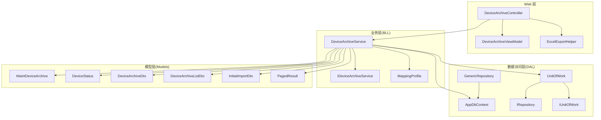

图表来源
- [DeviceArchiveController.cs](file://EquipmentIMS.Web/Controllers/DeviceArchiveController.cs)
- [DeviceArchiveService.cs](file://EquipmentIMS.BLL/Services/DeviceArchiveService.cs)
- [IDeviceArchiveService.cs](file://EquipmentIMS.BLL/Interfaces/IDeviceArchiveService.cs)
- [MappingProfile.cs](file://EquipmentIMS.BLL/Mappings/MappingProfile.cs)
- [AppDbContext.cs](file://EquipmentIMS.DAL/AppDbContext.cs)
- [GenericRepository.cs](file://EquipmentIMS.DAL/Repositories/GenericRepository.cs)
- [UnitOfWork.cs](file://EquipmentIMS.DAL/Repositories/UnitOfWork.cs)
- [IRepository.cs](file://EquipmentIMS.DAL/Interfaces/IRepository.cs)
- [IUnitOfWork.cs](file://EquipmentIMS.DAL/Interfaces/IUnitOfWork.cs)
- [MaintDeviceArchive.cs](file://EquipmentIMS.Models/Entities/MaintDeviceArchive.cs)
- [DeviceStatus.cs](file://EquipmentIMS.Models/Enums/DeviceStatus.cs)
- [DeviceArchiveDto.cs](file://EquipmentIMS.Models/DTOs/DeviceArchiveDto.cs)
- [DeviceArchiveListDto.cs](file://EquipmentIMS.Models/DTOs/DeviceArchiveListDto.cs)
- [InitialImportDto.cs](file://EquipmentIMS.Models/DTOs/InitialImportDto.cs)
- [PagedResult.cs](file://EquipmentIMS.Models/DTOs/PagedResult.cs)
- [ExcelExportHelper.cs](file://EquipmentIMS.Web/Helpers/ExcelExportHelper.cs)

章节来源
- [DeviceArchiveController.cs](file://EquipmentIMS.Web/Controllers/DeviceArchiveController.cs)
- [DeviceArchiveService.cs](file://EquipmentIMS.BLL/Services/DeviceArchiveService.cs)
- [AppDbContext.cs](file://EquipmentIMS.DAL/AppDbContext.cs)
- [GenericRepository.cs](file://EquipmentIMS.DAL/Repositories/GenericRepository.cs)
- [UnitOfWork.cs](file://EquipmentIMS.DAL/Repositories/UnitOfWork.cs)
- [MaintDeviceArchive.cs](file://EquipmentIMS.Models/Entities/MaintDeviceArchive.cs)
- [DeviceStatus.cs](file://EquipmentIMS.Models/Enums/DeviceStatus.cs)
- [DeviceArchiveDto.cs](file://EquipmentIMS.Models/DTOs/DeviceArchiveDto.cs)
- [DeviceArchiveListDto.cs](file://EquipmentIMS.Models/DTOs/DeviceArchiveListDto.cs)
- [InitialImportDto.cs](file://EquipmentIMS.Models/DTOs/InitialImportDto.cs)
- [PagedResult.cs](file://EquipmentIMS.Models/DTOs/PagedResult.cs)
- [ExcelExportHelper.cs](file://EquipmentIMS.Web/Helpers/ExcelExportHelper.cs)

## 核心组件
- 设备实体与状态
  - 设备实体用于持久化设备基础信息与生命周期字段
  - 设备状态枚举定义了设备从入库到报废的完整状态空间
- 服务接口与实现
  - 接口定义对外暴露的增删改查、状态变更、导入导出、分页查询等方法
  - 服务实现封装业务规则、校验、状态机约束、事务边界与映射转换
- 数据访问
  - 通用仓储提供基于 EF Core 的 CRUD 与条件查询能力
  - 单元工作统一事务提交与资源释放
- DTO 与映射
  - 输入输出 DTO 隔离领域模型与外部契约
  - AutoMapper 配置集中维护 DTO 与实体的映射关系
- Web 控制器
  - 接收 HTTP 请求，绑定 ViewModel，调用服务并返回标准化响应或文件流

章节来源
- [IDeviceArchiveService.cs](file://EquipmentIMS.BLL/Interfaces/IDeviceArchiveService.cs)
- [DeviceArchiveService.cs](file://EquipmentIMS.BLL/Services/DeviceArchiveService.cs)
- [IRepository.cs](file://EquipmentIMS.DAL/Interfaces/IRepository.cs)
- [IUnitOfWork.cs](file://EquipmentIMS.DAL/Interfaces/IUnitOfWork.cs)
- [GenericRepository.cs](file://EquipmentIMS.DAL/Repositories/GenericRepository.cs)
- [UnitOfWork.cs](file://EquipmentIMS.DAL/Repositories/UnitOfWork.cs)
- [DeviceArchiveDto.cs](file://EquipmentIMS.Models/DTOs/DeviceArchiveDto.cs)
- [DeviceArchiveListDto.cs](file://EquipmentIMS.Models/DTOs/DeviceArchiveListDto.cs)
- [InitialImportDto.cs](file://EquipmentIMS.Models/DTOs/InitialImportDto.cs)
- [PagedResult.cs](file://EquipmentIMS.Models/DTOs/PagedResult.cs)
- [MappingProfile.cs](file://EquipmentIMS.BLL/Mappings/MappingProfile.cs)
- [DeviceArchiveController.cs](file://EquipmentIMS.Web/Controllers/DeviceArchiveController.cs)

## 架构总览
设备档案管理采用典型的三层架构，结合仓储模式与单元工作，确保业务逻辑与数据访问解耦；通过 DTO 与 AutoMapper 完成对象映射；控制器仅承担请求处理与响应包装职责。

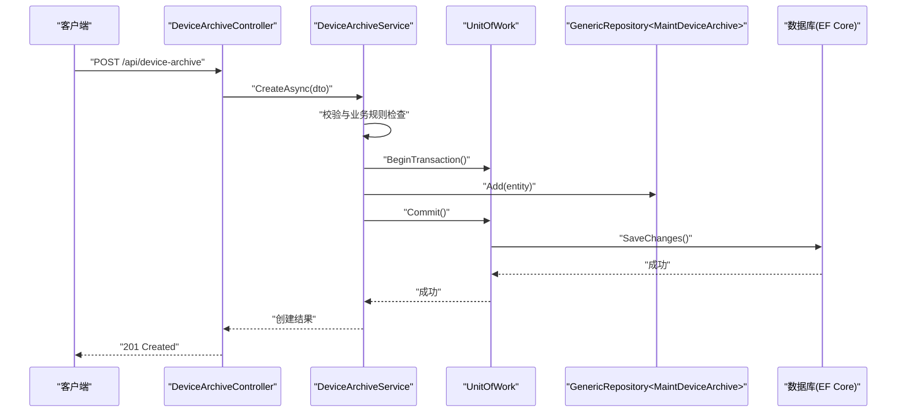

图表来源
- [DeviceArchiveController.cs](file://EquipmentIMS.Web/Controllers/DeviceArchiveController.cs)
- [DeviceArchiveService.cs](file://EquipmentIMS.BLL/Services/DeviceArchiveService.cs)
- [UnitOfWork.cs](file://EquipmentIMS.DAL/Repositories/UnitOfWork.cs)
- [GenericRepository.cs](file://EquipmentIMS.DAL/Repositories/GenericRepository.cs)
- [AppDbContext.cs](file://EquipmentIMS.DAL/AppDbContext.cs)

## 详细组件分析

### 设备实体与状态枚举
- 设备实体包含设备编号、名称、型号、类别、供应商、仓库、位置、序列号、购买日期、保修期、当前状态、备注等关键属性
- 设备状态枚举涵盖“在库、在用、维修中、停用、报废”等状态，作为状态机的合法取值集合

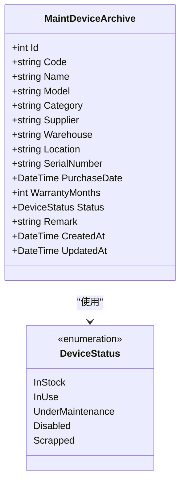

图表来源
- [MaintDeviceArchive.cs](file://EquipmentIMS.Models/Entities/MaintDeviceArchive.cs)
- [DeviceStatus.cs](file://EquipmentIMS.Models/Enums/DeviceStatus.cs)

章节来源
- [MaintDeviceArchive.cs](file://EquipmentIMS.Models/Entities/MaintDeviceArchive.cs)
- [DeviceStatus.cs](file://EquipmentIMS.Models/Enums/DeviceStatus.cs)

### 服务接口与实现（DeviceArchiveService）
- 接口职责
  - 定义设备的增删改查、状态更新、批量导入、分页查询、导出等能力
- 实现要点
  - 参数校验：对必填字段、格式、范围进行校验
  - 状态机：依据当前状态与目标状态判断是否允许流转
  - 事务：以单元工作包裹写操作，保证一致性
  - 映射：使用 AutoMapper 将 DTO 与实体互转
  - 查询：支持多条件组合、排序与分页

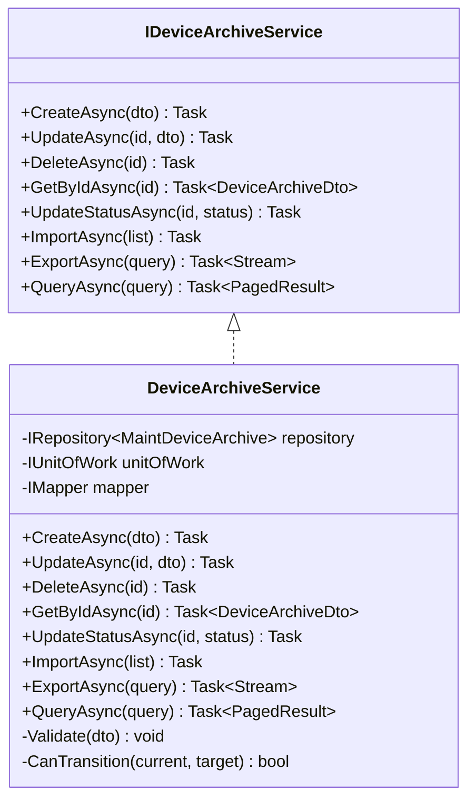

图表来源
- [IDeviceArchiveService.cs](file://EquipmentIMS.BLL/Interfaces/IDeviceArchiveService.cs)
- [DeviceArchiveService.cs](file://EquipmentIMS.BLL/Services/DeviceArchiveService.cs)

章节来源
- [IDeviceArchiveService.cs](file://EquipmentIMS.BLL/Interfaces/IDeviceArchiveService.cs)
- [DeviceArchiveService.cs](file://EquipmentIMS.BLL/Services/DeviceArchiveService.cs)

### 设备状态流转机制
- 合法流转示例
  - 在库 -> 在用：设备已入库且无异常
  - 在用 -> 维修中：发起报修或计划性维护
  - 维修中 -> 在用：维修完成并验收
  - 在用/在库 -> 停用：长期闲置或故障不可修复
  - 停用/在用/在库 -> 报废：达到使用年限或无法继续使用
- 非法流转保护
  - 未入库直接报废、停用前未完成必要校验等将被拒绝并返回错误

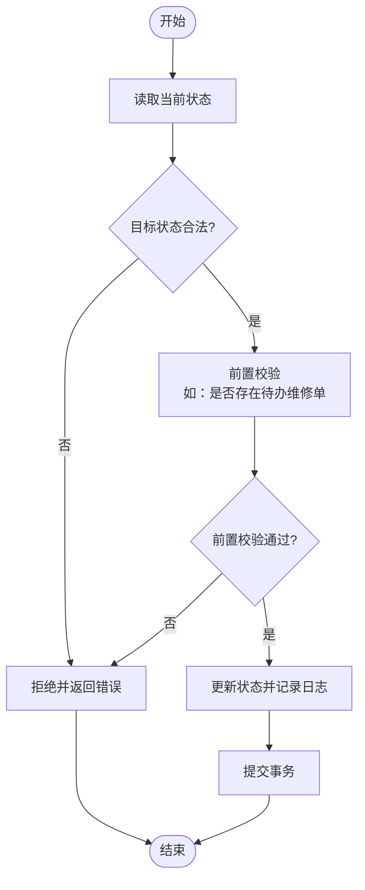

图表来源
- [DeviceArchiveService.cs](file://EquipmentIMS.BLL/Services/DeviceArchiveService.cs)
- [DeviceStatus.cs](file://EquipmentIMS.Models/Enums/DeviceStatus.cs)

章节来源
- [DeviceArchiveService.cs](file://EquipmentIMS.BLL/Services/DeviceArchiveService.cs)
- [DeviceStatus.cs](file://EquipmentIMS.Models/Enums/DeviceStatus.cs)

### 设备搜索与分页查询优化
- 查询能力
  - 支持按编号、名称、型号、类别、供应商、仓库、位置、状态等多条件筛选
  - 支持时间范围（购买日期、更新时间）、模糊匹配与精确匹配
  - 支持排序字段与方向控制
- 分页策略
  - 服务端分页：仅加载当前页数据，降低内存占用与网络传输
  - 索引建议：对常用过滤字段建立数据库索引以提升查询性能
- 表达式构建
  - 动态拼接 LINQ 条件，避免 N+1 查询与过度投影

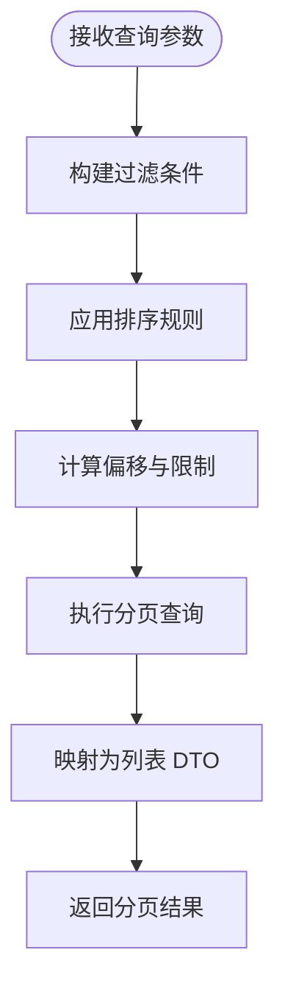

图表来源
- [DeviceArchiveService.cs](file://EquipmentIMS.BLL/Services/DeviceArchiveService.cs)
- [DeviceArchiveListDto.cs](file://EquipmentIMS.Models/DTOs/DeviceArchiveListDto.cs)
- [PagedResult.cs](file://EquipmentIMS.Models/DTOs/PagedResult.cs)

章节来源
- [DeviceArchiveService.cs](file://EquipmentIMS.BLL/Services/DeviceArchiveService.cs)
- [DeviceArchiveListDto.cs](file://EquipmentIMS.Models/DTOs/DeviceArchiveListDto.cs)
- [PagedResult.cs](file://EquipmentIMS.Models/DTOs/PagedResult.cs)

### 批量导入与导出
- 导入流程
  - 上传 Excel/CSV -> 解析行数据 -> 逐条校验 -> 批量写入 -> 汇总结果（成功/失败明细）
  - 支持重复检测、必填项校验、枚举值合法性校验
- 导出流程
  - 根据查询条件导出数据 -> 生成 Excel 流 -> 返回文件下载
- 错误处理
  - 记录失败原因与行号，便于用户修正后重试

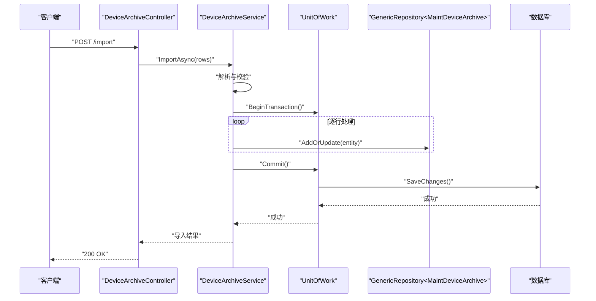

图表来源
- [DeviceArchiveController.cs](file://EquipmentIMS.Web/Controllers/DeviceArchiveController.cs)
- [DeviceArchiveService.cs](file://EquipmentIMS.BLL/Services/DeviceArchiveService.cs)
- [UnitOfWork.cs](file://EquipmentIMS.DAL/Repositories/UnitOfWork.cs)
- [GenericRepository.cs](file://EquipmentIMS.DAL/Repositories/GenericRepository.cs)
- [InitialImportDto.cs](file://EquipmentIMS.Models/DTOs/InitialImportDto.cs)

章节来源
- [DeviceArchiveController.cs](file://EquipmentIMS.Web/Controllers/DeviceArchiveController.cs)
- [DeviceArchiveService.cs](file://EquipmentIMS.BLL/Services/DeviceArchiveService.cs)
- [InitialImportDto.cs](file://EquipmentIMS.Models/DTOs/InitialImportDto.cs)

### 设备关联关系管理
- 常见关联
  - 设备与类别：通过类别字段或外键关联，便于分类统计
  - 设备与仓库/位置：记录存放位置，支持库存盘点
  - 设备与供应商：追溯采购来源
- 关系维护
  - 在创建/编辑时校验关联实体的存在性与有效性
  - 删除设备时考虑级联策略与审计日志

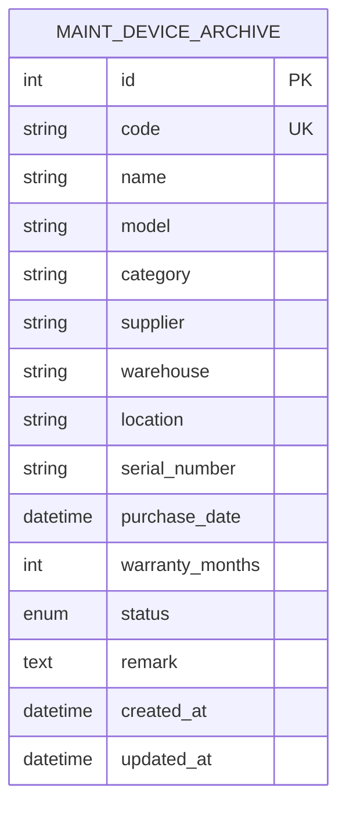

图表来源
- [MaintDeviceArchive.cs](file://EquipmentIMS.Models/Entities/MaintDeviceArchive.cs)

章节来源
- [MaintDeviceArchive.cs](file://EquipmentIMS.Models/Entities/MaintDeviceArchive.cs)

### DTO 对象映射与数据验证
- DTO 设计
  - 设备详情 DTO：用于新增/编辑表单与详情展示
  - 设备列表 DTO：用于列表展示，减少不必要字段
  - 初始导入 DTO：用于批量导入模板字段
- 映射配置
  - 使用 AutoMapper 配置双向映射，必要时自定义转换器
- 验证规则
  - 必填字段、长度限制、格式校验（如编号唯一性、序列号格式）
  - 业务校验（如状态合法性、时间先后顺序）

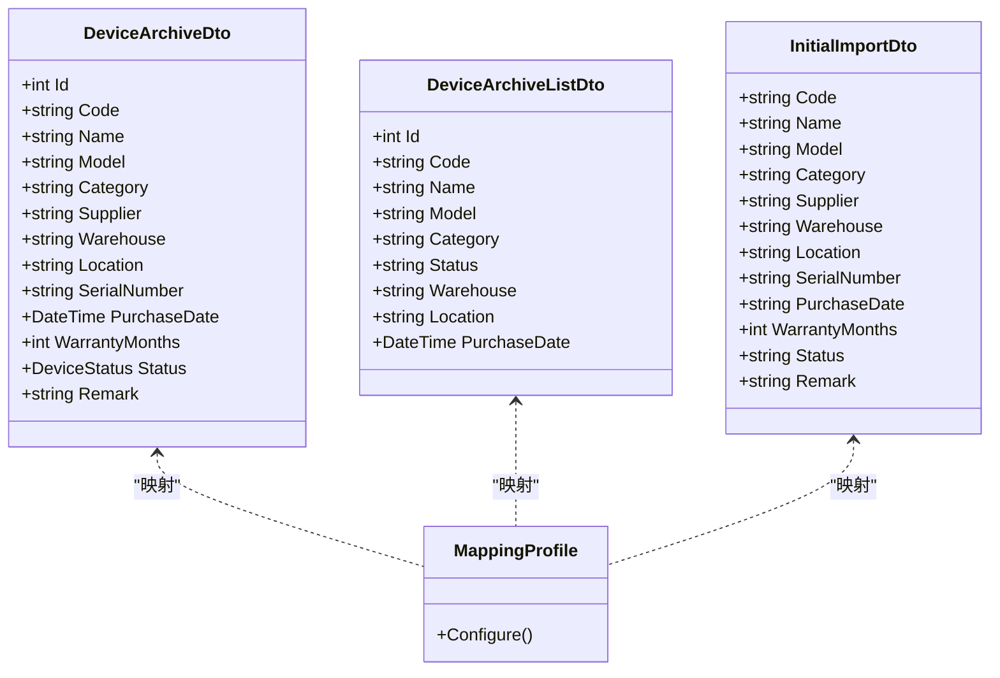

图表来源
- [DeviceArchiveDto.cs](file://EquipmentIMS.Models/DTOs/DeviceArchiveDto.cs)
- [DeviceArchiveListDto.cs](file://EquipmentIMS.Models/DTOs/DeviceArchiveListDto.cs)
- [InitialImportDto.cs](file://EquipmentIMS.Models/DTOs/InitialImportDto.cs)
- [MappingProfile.cs](file://EquipmentIMS.BLL/Mappings/MappingProfile.cs)

章节来源
- [DeviceArchiveDto.cs](file://EquipmentIMS.Models/DTOs/DeviceArchiveDto.cs)
- [DeviceArchiveListDto.cs](file://EquipmentIMS.Models/DTOs/DeviceArchiveListDto.cs)
- [InitialImportDto.cs](file://EquipmentIMS.Models/DTOs/InitialImportDto.cs)
- [MappingProfile.cs](file://EquipmentIMS.BLL/Mappings/MappingProfile.cs)

### 典型使用场景与调用序列

#### 场景一：新增设备
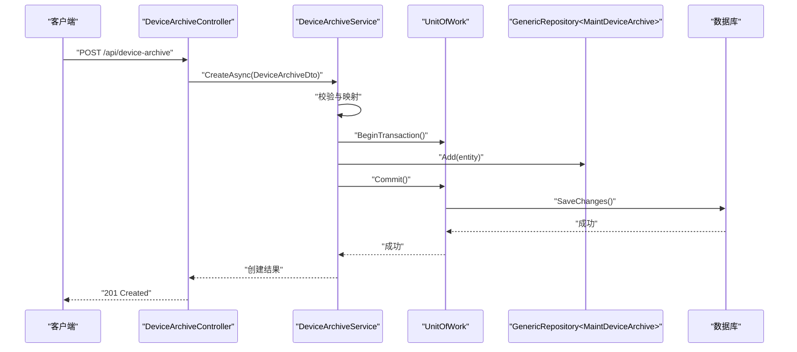

图表来源
- [DeviceArchiveController.cs](file://EquipmentIMS.Web/Controllers/DeviceArchiveController.cs)
- [DeviceArchiveService.cs](file://EquipmentIMS.BLL/Services/DeviceArchiveService.cs)
- [UnitOfWork.cs](file://EquipmentIMS.DAL/Repositories/UnitOfWork.cs)
- [GenericRepository.cs](file://EquipmentIMS.DAL/Repositories/GenericRepository.cs)
- [AppDbContext.cs](file://EquipmentIMS.DAL/AppDbContext.cs)

章节来源
- [DeviceArchiveController.cs](file://EquipmentIMS.Web/Controllers/DeviceArchiveController.cs)
- [DeviceArchiveService.cs](file://EquipmentIMS.BLL/Services/DeviceArchiveService.cs)

#### 场景二：更新设备状态
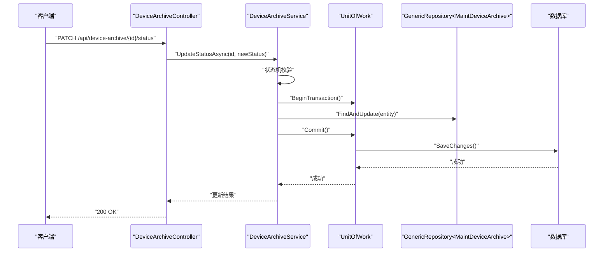

图表来源
- [DeviceArchiveController.cs](file://EquipmentIMS.Web/Controllers/DeviceArchiveController.cs)
- [DeviceArchiveService.cs](file://EquipmentIMS.BLL/Services/DeviceArchiveService.cs)
- [UnitOfWork.cs](file://EquipmentIMS.DAL/Repositories/UnitOfWork.cs)
- [GenericRepository.cs](file://EquipmentIMS.DAL/Repositories/GenericRepository.cs)
- [AppDbContext.cs](file://EquipmentIMS.DAL/AppDbContext.cs)

章节来源
- [DeviceArchiveController.cs](file://EquipmentIMS.Web/Controllers/DeviceArchiveController.cs)
- [DeviceArchiveService.cs](file://EquipmentIMS.BLL/Services/DeviceArchiveService.cs)

#### 场景三：分页查询设备列表
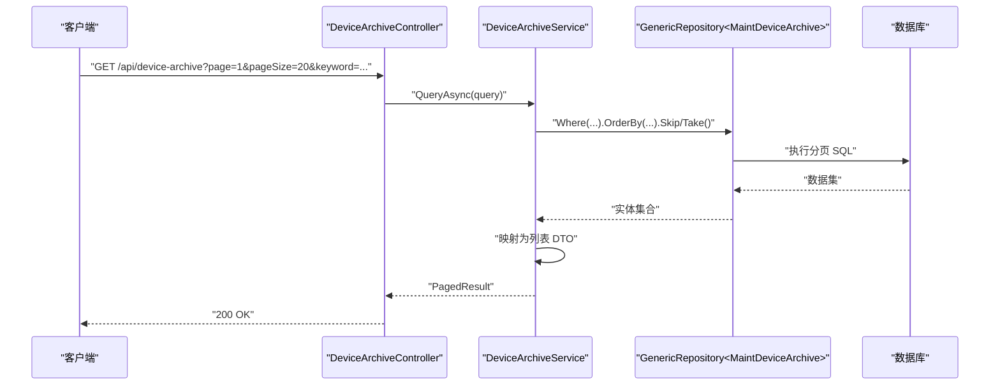

图表来源
- [DeviceArchiveController.cs](file://EquipmentIMS.Web/Controllers/DeviceArchiveController.cs)
- [DeviceArchiveService.cs](file://EquipmentIMS.BLL/Services/DeviceArchiveService.cs)
- [GenericRepository.cs](file://EquipmentIMS.DAL/Repositories/GenericRepository.cs)
- [AppDbContext.cs](file://EquipmentIMS.DAL/AppDbContext.cs)
- [DeviceArchiveListDto.cs](file://EquipmentIMS.Models/DTOs/DeviceArchiveListDto.cs)
- [PagedResult.cs](file://EquipmentIMS.Models/DTOs/PagedResult.cs)

章节来源
- [DeviceArchiveController.cs](file://EquipmentIMS.Web/Controllers/DeviceArchiveController.cs)
- [DeviceArchiveService.cs](file://EquipmentIMS.BLL/Services/DeviceArchiveService.cs)
- [DeviceArchiveListDto.cs](file://EquipmentIMS.Models/DTOs/DeviceArchiveListDto.cs)
- [PagedResult.cs](file://EquipmentIMS.Models/DTOs/PagedResult.cs)

#### 场景四：导出设备档案
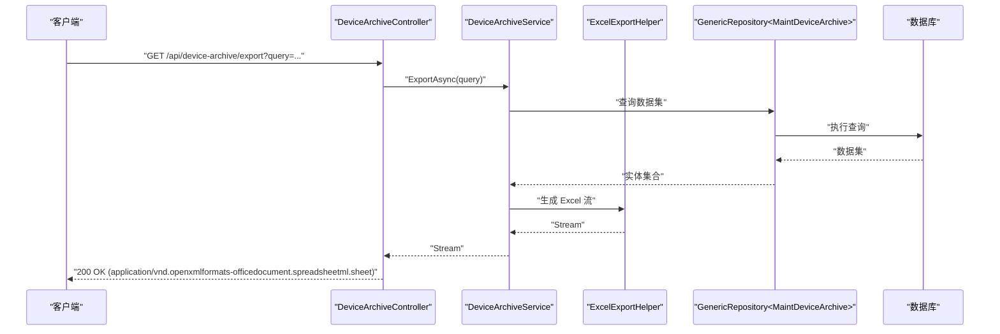

图表来源
- [DeviceArchiveController.cs](file://EquipmentIMS.Web/Controllers/DeviceArchiveController.cs)
- [DeviceArchiveService.cs](file://EquipmentIMS.BLL/Services/DeviceArchiveService.cs)
- [ExcelExportHelper.cs](file://EquipmentIMS.Web/Helpers/ExcelExportHelper.cs)
- [GenericRepository.cs](file://EquipmentIMS.DAL/Repositories/GenericRepository.cs)
- [AppDbContext.cs](file://EquipmentIMS.DAL/AppDbContext.cs)

章节来源
- [DeviceArchiveController.cs](file://EquipmentIMS.Web/Controllers/DeviceArchiveController.cs)
- [DeviceArchiveService.cs](file://EquipmentIMS.BLL/Services/DeviceArchiveService.cs)
- [ExcelExportHelper.cs](file://EquipmentIMS.Web/Helpers/ExcelExportHelper.cs)

## 依赖关系分析
- 控制器依赖服务接口，服务实现依赖仓储与单元工作
- 服务实现依赖 AutoMapper 进行 DTO 与实体映射
- 仓储依赖 EF Core 上下文，单元工作负责事务与资源管理
- 模型层提供实体、DTO、枚举与分页结果等共享类型

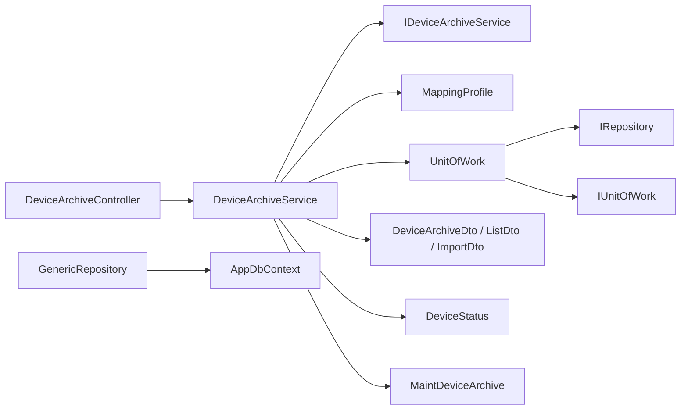

图表来源
- [DeviceArchiveController.cs](file://EquipmentIMS.Web/Controllers/DeviceArchiveController.cs)
- [DeviceArchiveService.cs](file://EquipmentIMS.BLL/Services/DeviceArchiveService.cs)
- [IDeviceArchiveService.cs](file://EquipmentIMS.BLL/Interfaces/IDeviceArchiveService.cs)
- [MappingProfile.cs](file://EquipmentIMS.BLL/Mappings/MappingProfile.cs)
- [UnitOfWork.cs](file://EquipmentIMS.DAL/Repositories/UnitOfWork.cs)
- [IRepository.cs](file://EquipmentIMS.DAL/Interfaces/IRepository.cs)
- [IUnitOfWork.cs](file://EquipmentIMS.DAL/Interfaces/IUnitOfWork.cs)
- [GenericRepository.cs](file://EquipmentIMS.DAL/Repositories/GenericRepository.cs)
- [AppDbContext.cs](file://EquipmentIMS.DAL/AppDbContext.cs)
- [DeviceArchiveDto.cs](file://EquipmentIMS.Models/DTOs/DeviceArchiveDto.cs)
- [DeviceArchiveListDto.cs](file://EquipmentIMS.Models/DTOs/DeviceArchiveListDto.cs)
- [InitialImportDto.cs](file://EquipmentIMS.Models/DTOs/InitialImportDto.cs)
- [DeviceStatus.cs](file://EquipmentIMS.Models/Enums/DeviceStatus.cs)
- [MaintDeviceArchive.cs](file://EquipmentIMS.Models/Entities/MaintDeviceArchive.cs)

章节来源
- [DeviceArchiveController.cs](file://EquipmentIMS.Web/Controllers/DeviceArchiveController.cs)
- [DeviceArchiveService.cs](file://EquipmentIMS.BLL/Services/DeviceArchiveService.cs)
- [IDeviceArchiveService.cs](file://EquipmentIMS.BLL/Interfaces/IDeviceArchiveService.cs)
- [MappingProfile.cs](file://EquipmentIMS.BLL/Mappings/MappingProfile.cs)
- [UnitOfWork.cs](file://EquipmentIMS.DAL/Repositories/UnitOfWork.cs)
- [IRepository.cs](file://EquipmentIMS.DAL/Interfaces/IRepository.cs)
- [IUnitOfWork.cs](file://EquipmentIMS.DAL/Interfaces/IUnitOfWork.cs)
- [GenericRepository.cs](file://EquipmentIMS.DAL/Repositories/GenericRepository.cs)
- [AppDbContext.cs](file://EquipmentIMS.DAL/AppDbContext.cs)
- [DeviceArchiveDto.cs](file://EquipmentIMS.Models/DTOs/DeviceArchiveDto.cs)
- [DeviceArchiveListDto.cs](file://EquipmentIMS.Models/DTOs/DeviceArchiveListDto.cs)
- [InitialImportDto.cs](file://EquipmentIMS.Models/DTOs/InitialImportDto.cs)
- [DeviceStatus.cs](file://EquipmentIMS.Models/Enums/DeviceStatus.cs)
- [MaintDeviceArchive.cs](file://EquipmentIMS.Models/Entities/MaintDeviceArchive.cs)

## 性能考虑
- 服务端分页：避免一次性加载全量数据，降低内存与带宽消耗
- 查询优化：
  - 合理选择过滤字段，避免过度模糊匹配
  - 对高频过滤字段建立数据库索引
  - 使用投影只返回必要字段，减少数据传输
- 批量操作：
  - 导入时使用批量插入/更新，减少往返次数
  - 分批次提交事务，避免长事务锁表
- 缓存策略：
  - 对字典类数据（如类别、仓库）进行短期缓存，提升查询效率

[本节为通用指导，不直接分析具体文件]

## 故障排查指南
- 常见问题
  - 状态流转被拒绝：检查当前状态与目标状态是否符合规则
  - 导入失败：查看失败明细与错误原因，修正后重试
  - 查询缓慢：确认是否缺少索引或使用了低效的模糊匹配
- 定位方法
  - 启用日志记录，关注服务层异常堆栈与事务提交情况
  - 使用数据库慢查询日志定位耗时 SQL
  - 核对 DTO 映射配置是否正确

章节来源
- [DeviceArchiveService.cs](file://EquipmentIMS.BLL/Services/DeviceArchiveService.cs)
- [DeviceArchiveController.cs](file://EquipmentIMS.Web/Controllers/DeviceArchiveController.cs)

## 结论
设备档案管理模块通过清晰的三层架构与仓储模式，实现了设备全生命周期的标准化管理。服务层封装了状态机、校验与映射逻辑，控制器专注于请求处理，数据访问层提供稳定可靠的持久化能力。配合分页查询、批量导入导出与完善的错误处理，能够满足企业级设备管理的复杂需求。

[本节为总结性内容，不直接分析具体文件]

## 附录
- 术语说明
  - 设备档案：记录设备基础信息与生命周期状态的主体数据
  - 状态机：定义设备状态及其合法流转的规则集合
  - DTO：数据传输对象，用于隔离领域模型与外部契约
- 参考路径
  - 控制器入口：[DeviceArchiveController.cs](file://EquipmentIMS.Web/Controllers/DeviceArchiveController.cs)
  - 服务实现：[DeviceArchiveService.cs](file://EquipmentIMS.BLL/Services/DeviceArchiveService.cs)
  - 实体与枚举：[MaintDeviceArchive.cs](file://EquipmentIMS.Models/Entities/MaintDeviceArchive.cs)、[DeviceStatus.cs](file://EquipmentIMS.Models/Enums/DeviceStatus.cs)
  - DTO 与映射：[DeviceArchiveDto.cs](file://EquipmentIMS.Models/DTOs/DeviceArchiveDto.cs)、[DeviceArchiveListDto.cs](file://EquipmentIMS.Models/DTOs/DeviceArchiveListDto.cs)、[InitialImportDto.cs](file://EquipmentIMS.Models/DTOs/InitialImportDto.cs)、[MappingProfile.cs](file://EquipmentIMS.BLL/Mappings/MappingProfile.cs)
  - 数据访问：[AppDbContext.cs](file://EquipmentIMS.DAL/AppDbContext.cs)、[GenericRepository.cs](file://EquipmentIMS.DAL/Repositories/GenericRepository.cs)、[UnitOfWork.cs](file://EquipmentIMS.DAL/Repositories/UnitOfWork.cs)