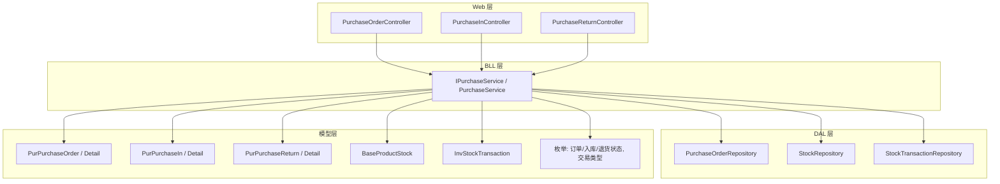
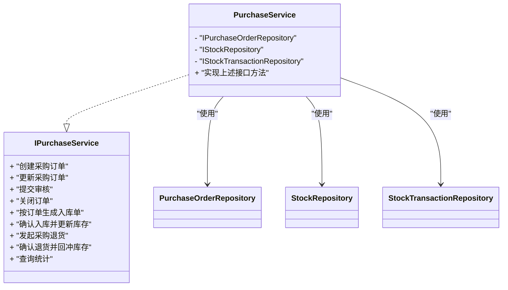
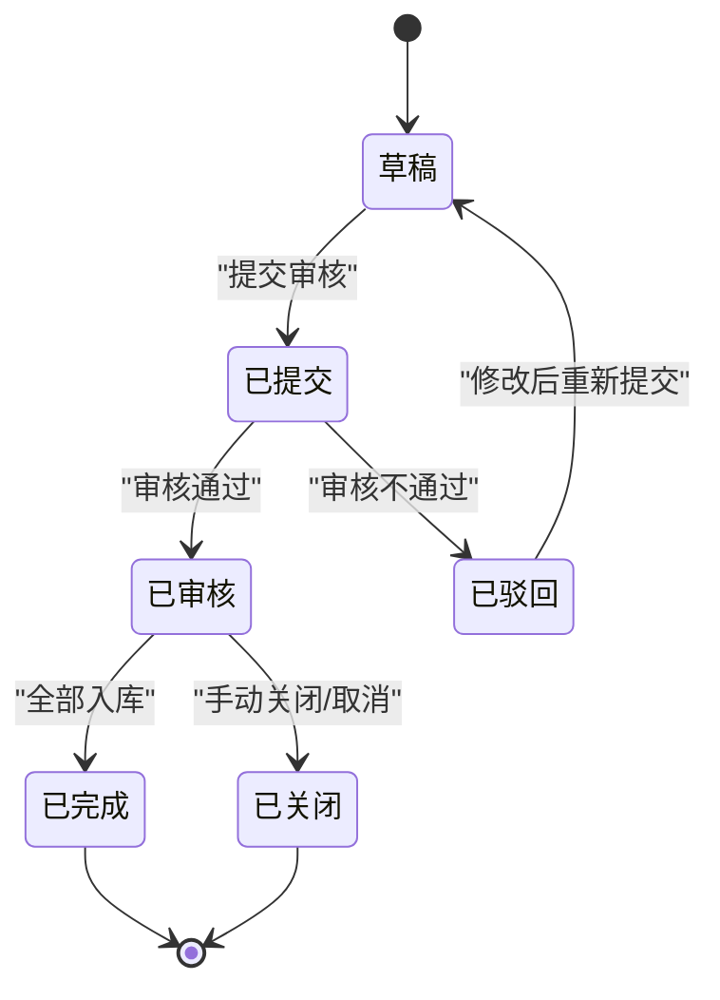
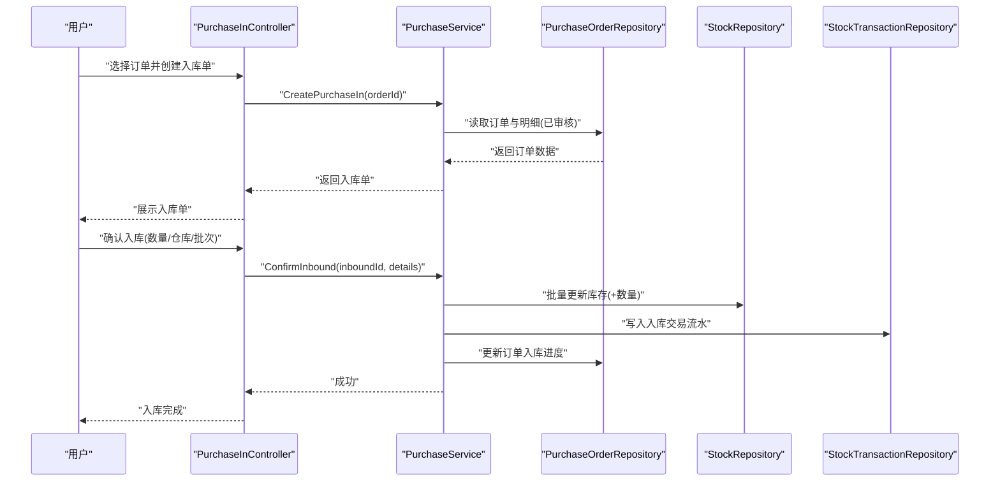
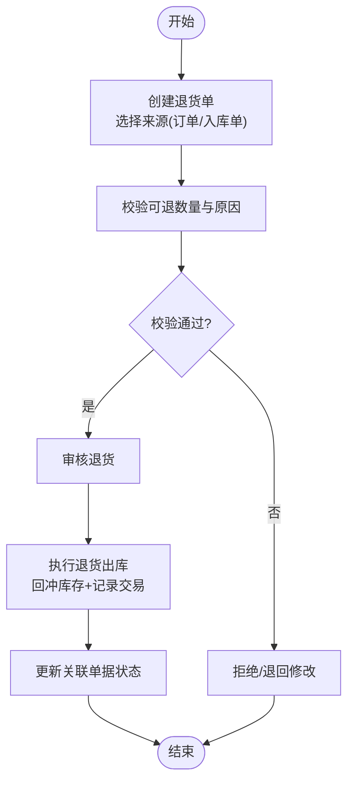
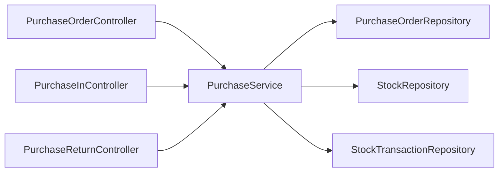
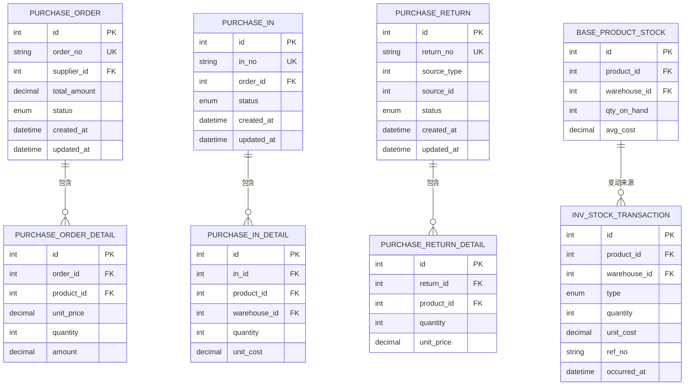

# 采购管理模块

<cite>
**本文引用的文件**   
- [PurchaseService.cs](file://EquipmentIMS.BLL/Services/PurchaseService.cs)
- [IPurchaseService.cs](file://EquipmentIMS.BLL/Interfaces/IPurchaseService.cs)
- [PurchaseOrderController.cs](file://EquipmentIMS.Web/Controllers/PurchaseOrderController.cs)
- [PurchaseInController.cs](file://EquipmentIMS.Web/Controllers/PurchaseInController.cs)
- [PurchaseReturnController.cs](file://EquipmentIMS.Web/Controllers/PurchaseReturnController.cs)
- [PurchaseOrderRepository.cs](file://EquipmentIMS.DAL/Repositories/PurchaseOrderRepository.cs)
- [StockRepository.cs](file://EquipmentIMS.DAL/Repositories/StockRepository.cs)
- [StockTransactionRepository.cs](file://EquipmentIMS.DAL/Repositories/StockTransactionRepository.cs)
- [PurPurchaseOrder.cs](file://EquipmentIMS.Models/Entities/PurPurchaseOrder.cs)
- [PurPurchaseOrderDetail.cs](file://EquipmentIMS.Models/Entities/PurPurchaseOrderDetail.cs)
- [PurPurchaseIn.cs](file://EquipmentIMS.Models/Entities/PurPurchaseIn.cs)
- [PurPurchaseInDetail.cs](file://EquipmentIMS.Models/Entities/PurPurchaseInDetail.cs)
- [PurPurchaseReturn.cs](file://EquipmentIMS.Models/Entities/PurPurchaseReturn.cs)
- [PurPurchaseReturnDetail.cs](file://EquipmentIMS.Models/Entities/PurPurchaseReturnDetail.cs)
- [BaseProductStock.cs](file://EquipmentIMS.Models/Entities/BaseProductStock.cs)
- [InvStockTransaction.cs](file://EquipmentIMS.Models/Entities/InvStockTransaction.cs)
- [PurchaseOrderStatus.cs](file://EquipmentIMS.Models/Enums/PurchaseOrderStatus.cs)
- [PurchaseInStatus.cs](file://EquipmentIMS.Models/Enums/PurchaseInStatus.cs)
- [PurchaseReturnStatus.cs](file://EquipmentIMS.Models/Enums/PurchaseReturnStatus.cs)
- [TransactionType.cs](file://EquipmentIMS.Models/Enums/TransactionType.cs)
- [ReportPurchaseDtos.cs](file://EquipmentIMS.Models/DTOs/Reports/ReportPurchaseDtos.cs)
- [PurchaseOrderDto.cs](file://EquipmentIMS.Models/DTOs/PurchaseOrderDto.cs)
- [PurchaseInDto.cs](file://EquipmentIMS.Models/DTOs/PurchaseInDto.cs)
- [PurchaseInRequestDto.cs](file://EquipmentIMS.Models/DTOs/PurchaseInRequestDto.cs)
- [PurchaseInDetailDto.cs](file://EquipmentIMS.Models/DTOs/PurchaseInDetailDto.cs)
- [PurchaseReturnDto.cs](file://EquipmentIMS.Models/DTOs/PurchaseReturnDto.cs)
- [PurchaseOrderDetailDto.cs](file://EquipmentIMS.Models/DTOs/PurchaseOrderDetailDto.cs)
</cite>

## 目录
1. [简介](#简介)
2. [项目结构](#项目结构)
3. [核心组件](#核心组件)
4. [架构总览](#架构总览)
5. [详细组件分析](#详细组件分析)
6. [依赖关系分析](#依赖关系分析)
7. [性能考虑](#性能考虑)
8. [故障排查指南](#故障排查指南)
9. [结论](#结论)
10. [附录](#附录)

## 简介
本模块围绕“采购订单管理、采购入库、采购退货”三大业务主线，提供端到端的流程实现与数据联动。重点包括：
- 采购订单的创建、编辑、审核、关闭等状态流转
- 采购入库单生成与库存联动更新（含事务性保证）
- 采购退货处理与库存回冲
- 供应商结算与采购统计分析
- 与库存、财务系统的集成点说明
- 成本控制、供应商评估与采购优化的策略建议

## 项目结构
采购相关代码遵循分层架构：Web 控制器层调用 BLL 服务层，服务层通过 DAL 仓储访问数据库实体与枚举。关键文件分布如下：
- Web 层：采购订单、入库、退货控制器
- BLL 层：采购服务实现与接口
- DAL 层：采购订单仓储、库存仓储、库存交易仓储
- 模型层：实体、DTO、枚举定义

图表来源
- [PurchaseOrderController.cs](file://EquipmentIMS.Web/Controllers/PurchaseOrderController.cs)
- [PurchaseInController.cs](file://EquipmentIMS.Web/Controllers/PurchaseInController.cs)
- [PurchaseReturnController.cs](file://EquipmentIMS.Web/Controllers/PurchaseReturnController.cs)
- [PurchaseService.cs](file://EquipmentIMS.BLL/Services/PurchaseService.cs)
- [IPurchaseService.cs](file://EquipmentIMS.BLL/Interfaces/IPurchaseService.cs)
- [PurchaseOrderRepository.cs](file://EquipmentIMS.DAL/Repositories/PurchaseOrderRepository.cs)
- [StockRepository.cs](file://EquipmentIMS.DAL/Repositories/StockRepository.cs)
- [StockTransactionRepository.cs](file://EquipmentIMS.DAL/Repositories/StockTransactionRepository.cs)
- [PurPurchaseOrder.cs](file://EquipmentIMS.Models/Entities/PurPurchaseOrder.cs)
- [PurPurchaseOrderDetail.cs](file://EquipmentIMS.Models/Entities/PurPurchaseOrderDetail.cs)
- [PurPurchaseIn.cs](file://EquipmentIMS.Models/Entities/PurPurchaseIn.cs)
- [PurPurchaseInDetail.cs](file://EquipmentIMS.Models/Entities/PurPurchaseInDetail.cs)
- [PurPurchaseReturn.cs](file://EquipmentIMS.Models/Entities/PurPurchaseReturn.cs)
- [PurPurchaseReturnDetail.cs](file://EquipmentIMS.Models/Entities/PurPurchaseReturnDetail.cs)
- [BaseProductStock.cs](file://EquipmentIMS.Models/Entities/BaseProductStock.cs)
- [InvStockTransaction.cs](file://EquipmentIMS.Models/Entities/InvStockTransaction.cs)
- [PurchaseOrderStatus.cs](file://EquipmentIMS.Models/Enums/PurchaseOrderStatus.cs)
- [PurchaseInStatus.cs](file://EquipmentIMS.Models/Enums/PurchaseInStatus.cs)
- [PurchaseReturnStatus.cs](file://EquipmentIMS.Models/Enums/PurchaseReturnStatus.cs)
- [TransactionType.cs](file://EquipmentIMS.Models/Enums/TransactionType.cs)

章节来源
- [PurchaseService.cs](file://EquipmentIMS.BLL/Services/PurchaseService.cs)
- [IPurchaseService.cs](file://EquipmentIMS.BLL/Interfaces/IPurchaseService.cs)
- [PurchaseOrderController.cs](file://EquipmentIMS.Web/Controllers/PurchaseOrderController.cs)
- [PurchaseInController.cs](file://EquipmentIMS.Web/Controllers/PurchaseInController.cs)
- [PurchaseReturnController.cs](file://EquipmentIMS.Web/Controllers/PurchaseReturnController.cs)
- [PurchaseOrderRepository.cs](file://EquipmentIMS.DAL/Repositories/PurchaseOrderRepository.cs)
- [StockRepository.cs](file://EquipmentIMS.DAL/Repositories/StockRepository.cs)
- [StockTransactionRepository.cs](file://EquipmentIMS.DAL/Repositories/StockTransactionRepository.cs)
- [PurPurchaseOrder.cs](file://EquipmentIMS.Models/Entities/PurPurchaseOrder.cs)
- [PurPurchaseOrderDetail.cs](file://EquipmentIMS.Models/Entities/PurPurchaseOrderDetail.cs)
- [PurPurchaseIn.cs](file://EquipmentIMS.Models/Entities/PurPurchaseIn.cs)
- [PurPurchaseInDetail.cs](file://EquipmentIMS.Models/Entities/PurPurchaseInDetail.cs)
- [PurPurchaseReturn.cs](file://EquipmentIMS.Models/Entities/PurPurchaseReturn.cs)
- [PurPurchaseReturnDetail.cs](file://EquipmentIMS.Models/Entities/PurPurchaseReturnDetail.cs)
- [BaseProductStock.cs](file://EquipmentIMS.Models/Entities/BaseProductStock.cs)
- [InvStockTransaction.cs](file://EquipmentIMS.Models/Entities/InvStockTransaction.cs)
- [PurchaseOrderStatus.cs](file://EquipmentIMS.Models/Enums/PurchaseOrderStatus.cs)
- [PurchaseInStatus.cs](file://EquipmentIMS.Models/Enums/PurchaseInStatus.cs)
- [PurchaseReturnStatus.cs](file://EquipmentIMS.Models/Enums/PurchaseReturnStatus.cs)
- [TransactionType.cs](file://EquipmentIMS.Models/Enums/TransactionType.cs)

## 核心组件
- 采购服务接口与实现
  - 接口定义采购订单、入库、退货的核心能力边界
  - 实现类封装业务规则、状态校验、库存联动与审计日志
- 控制器
  - 采购订单控制器：CRUD、提交审核、关闭等
  - 采购入库控制器：按订单生成入库单、确认入库并扣减应付
  - 采购退货控制器：按订单或入库单发起退货、回冲库存
- 仓储层
  - 采购订单仓储：订单及明细持久化
  - 库存仓储：产品库存读写
  - 库存交易仓储：记录出入库流水，支撑对账与分析

章节来源
- [IPurchaseService.cs](file://EquipmentIMS.BLL/Interfaces/IPurchaseService.cs)
- [PurchaseService.cs](file://EquipmentIMS.BLL/Services/PurchaseService.cs)
- [PurchaseOrderController.cs](file://EquipmentIMS.Web/Controllers/PurchaseOrderController.cs)
- [PurchaseInController.cs](file://EquipmentIMS.Web/Controllers/PurchaseInController.cs)
- [PurchaseReturnController.cs](file://EquipmentIMS.Web/Controllers/PurchaseReturnController.cs)
- [PurchaseOrderRepository.cs](file://EquipmentIMS.DAL/Repositories/PurchaseOrderRepository.cs)
- [StockRepository.cs](file://EquipmentIMS.DAL/Repositories/StockRepository.cs)
- [StockTransactionRepository.cs](file://EquipmentIMS.DAL/Repositories/StockTransactionRepository.cs)

## 架构总览
采购模块采用典型的三层架构，服务层作为业务编排中心，协调仓储与领域模型，确保一致性。

图表来源
- [IPurchaseService.cs](file://EquipmentIMS.BLL/Interfaces/IPurchaseService.cs)
- [PurchaseService.cs](file://EquipmentIMS.BLL/Services/PurchaseService.cs)
- [PurchaseOrderRepository.cs](file://EquipmentIMS.DAL/Repositories/PurchaseOrderRepository.cs)
- [StockRepository.cs](file://EquipmentIMS.DAL/Repositories/StockRepository.cs)
- [StockTransactionRepository.cs](file://EquipmentIMS.DAL/Repositories/StockTransactionRepository.cs)

## 详细组件分析

### 采购订单管理（CRUD 与状态流转）
- 功能要点
  - 创建/编辑/删除采购订单与明细
  - 提交审核：校验必填项、价格、数量、供应商信息
  - 关闭订单：释放预留、归档历史
- 状态机
  - 草稿 → 已提交 → 已审核 → 已完成/已关闭
  - 异常分支：驳回、取消

图表来源
- [PurchaseOrderStatus.cs](file://EquipmentIMS.Models/Enums/PurchaseOrderStatus.cs)
- [PurchaseService.cs](file://EquipmentIMS.BLL/Services/PurchaseService.cs)
- [PurPurchaseOrder.cs](file://EquipmentIMS.Models/Entities/PurPurchaseOrder.cs)

章节来源
- [PurchaseOrderController.cs](file://EquipmentIMS.Web/Controllers/PurchaseOrderController.cs)
- [PurchaseService.cs](file://EquipmentIMS.BLL/Services/PurchaseService.cs)
- [PurchaseOrderStatus.cs](file://EquipmentIMS.Models/Enums/PurchaseOrderStatus.cs)
- [PurPurchaseOrder.cs](file://EquipmentIMS.Models/Entities/PurPurchaseOrder.cs)
- [PurPurchaseOrderDetail.cs](file://EquipmentIMS.Models/Entities/PurPurchaseOrderDetail.cs)

### 采购入库与库存联动
- 业务流程
  - 根据已审核订单生成入库单（支持部分入库）
  - 确认入库：增加库存、写入库存交易流水、更新应付
- 关键点
  - 批次/仓库维度库存更新
  - 事务性保证：库存与交易一致
  - 超入控制：防止超过订单可入数量

图表来源
- [PurchaseInController.cs](file://EquipmentIMS.Web/Controllers/PurchaseInController.cs)
- [PurchaseService.cs](file://EquipmentIMS.BLL/Services/PurchaseService.cs)
- [PurchaseOrderRepository.cs](file://EquipmentIMS.DAL/Repositories/PurchaseOrderRepository.cs)
- [StockRepository.cs](file://EquipmentIMS.DAL/Repositories/StockRepository.cs)
- [StockTransactionRepository.cs](file://EquipmentIMS.DAL/Repositories/StockTransactionRepository.cs)
- [PurPurchaseIn.cs](file://EquipmentIMS.Models/Entities/PurPurchaseIn.cs)
- [PurPurchaseInDetail.cs](file://EquipmentIMS.Models/Entities/PurPurchaseInDetail.cs)
- [BaseProductStock.cs](file://EquipmentIMS.Models/Entities/BaseProductStock.cs)
- [InvStockTransaction.cs](file://EquipmentIMS.Models/Entities/InvStockTransaction.cs)
- [PurchaseInStatus.cs](file://EquipmentIMS.Models/Enums/PurchaseInStatus.cs)
- [TransactionType.cs](file://EquipmentIMS.Models/Enums/TransactionType.cs)

章节来源
- [PurchaseInController.cs](file://EquipmentIMS.Web/Controllers/PurchaseInController.cs)
- [PurchaseService.cs](file://EquipmentIMS.BLL/Services/PurchaseService.cs)
- [PurPurchaseIn.cs](file://EquipmentIMS.Models/Entities/PurPurchaseIn.cs)
- [PurPurchaseInDetail.cs](file://EquipmentIMS.Models/Entities/PurPurchaseInDetail.cs)
- [BaseProductStock.cs](file://EquipmentIMS.Models/Entities/BaseProductStock.cs)
- [InvStockTransaction.cs](file://EquipmentIMS.Models/Entities/InvStockTransaction.cs)
- [PurchaseInStatus.cs](file://EquipmentIMS.Models/Enums/PurchaseInStatus.cs)
- [TransactionType.cs](file://EquipmentIMS.Models/Enums/TransactionType.cs)

### 采购退货处理
- 业务流程
  - 基于订单或入库单发起退货申请
  - 审核通过后执行退货出库，回冲库存并减少应付
- 关键点
  - 退货数量不得超过已入库数量
  - 退货原因与质检结果记录
  - 退货完成后更新关联单据状态

图表来源
- [PurchaseReturnController.cs](file://EquipmentIMS.Web/Controllers/PurchaseReturnController.cs)
- [PurchaseService.cs](file://EquipmentIMS.BLL/Services/PurchaseService.cs)
- [PurPurchaseReturn.cs](file://EquipmentIMS.Models/Entities/PurPurchaseReturn.cs)
- [PurPurchaseReturnDetail.cs](file://EquipmentIMS.Models/Entities/PurPurchaseReturnDetail.cs)
- [PurchaseReturnStatus.cs](file://EquipmentIMS.Models/Enums/PurchaseReturnStatus.cs)
- [StockRepository.cs](file://EquipmentIMS.DAL/Repositories/StockRepository.cs)
- [StockTransactionRepository.cs](file://EquipmentIMS.DAL/Repositories/StockTransactionRepository.cs)

章节来源
- [PurchaseReturnController.cs](file://EquipmentIMS.Web/Controllers/PurchaseReturnController.cs)
- [PurchaseService.cs](file://EquipmentIMS.BLL/Services/PurchaseService.cs)
- [PurPurchaseReturn.cs](file://EquipmentIMS.Models/Entities/PurPurchaseReturn.cs)
- [PurPurchaseReturnDetail.cs](file://EquipmentIMS.Models/Entities/PurPurchaseReturnDetail.cs)
- [PurchaseReturnStatus.cs](file://EquipmentIMS.Models/Enums/PurchaseReturnStatus.cs)

### 供应商结算与应付
- 结算触发
  - 入库确认后累计应付金额
  - 退货确认后扣减应付金额
- 结算周期
  - 支持按月度/季度/年度汇总
  - 支持发票匹配与付款计划
- 数据落盘
  - 应付台账与交易流水一一对应，便于对账

章节来源
- [PurchaseService.cs](file://EquipmentIMS.BLL/Services/PurchaseService.cs)
- [PurPurchaseIn.cs](file://EquipmentIMS.Models/Entities/PurPurchaseIn.cs)
- [PurPurchaseReturn.cs](file://EquipmentIMS.Models/Entities/PurPurchaseReturn.cs)
- [InvStockTransaction.cs](file://EquipmentIMS.Models/Entities/InvStockTransaction.cs)

### 采购统计分析
- 指标维度
  - 采购总额、平均单价、到货及时率、退货率
  - 供应商排名、品类占比、仓库分布
- 数据来源
  - 订单、入库、退货、库存交易流水
- 输出形式
  - 报表 DTO 聚合、导出 Excel、可视化图表

章节来源
- [ReportPurchaseDtos.cs](file://EquipmentIMS.Models/DTOs/Reports/ReportPurchaseDtos.cs)
- [PurchaseService.cs](file://EquipmentIMS.BLL/Services/PurchaseService.cs)

### 采购订单与库存、财务系统集成
- 与库存系统
  - 入库：增加库存、记录入库交易
  - 退货：减少库存、记录退货交易
- 与财务系统
  - 应付：入库产生应付，退货冲减应付
  - 成本：以入库单价为基础计算库存成本
  - 对账：交易流水与应付台账双向核对

章节来源
- [StockRepository.cs](file://EquipmentIMS.DAL/Repositories/StockRepository.cs)
- [StockTransactionRepository.cs](file://EquipmentIMS.DAL/Repositories/StockTransactionRepository.cs)
- [InvStockTransaction.cs](file://EquipmentIMS.Models/Entities/InvStockTransaction.cs)
- [PurchaseService.cs](file://EquipmentIMS.BLL/Services/PurchaseService.cs)

### 代码示例路径（不含具体代码内容）
- 创建采购订单
  - [PurchaseOrderController.cs](file://EquipmentIMS.Web/Controllers/PurchaseOrderController.cs)
  - [PurchaseService.cs](file://EquipmentIMS.BLL/Services/PurchaseService.cs)
  - [PurchaseOrderRepository.cs](file://EquipmentIMS.DAL/Repositories/PurchaseOrderRepository.cs)
  - [PurPurchaseOrder.cs](file://EquipmentIMS.Models/Entities/PurPurchaseOrder.cs)
  - [PurPurchaseOrderDetail.cs](file://EquipmentIMS.Models/Entities/PurPurchaseOrderDetail.cs)
  - [PurchaseOrderDto.cs](file://EquipmentIMS.Models/DTOs/PurchaseOrderDto.cs)
  - [PurchaseOrderDetailDto.cs](file://EquipmentIMS.Models/DTOs/PurchaseOrderDetailDto.cs)
- 生成入库单并确认入库
  - [PurchaseInController.cs](file://EquipmentIMS.Web/Controllers/PurchaseInController.cs)
  - [PurchaseService.cs](file://EquipmentIMS.BLL/Services/PurchaseService.cs)
  - [PurPurchaseIn.cs](file://EquipmentIMS.Models/Entities/PurPurchaseIn.cs)
  - [PurPurchaseInDetail.cs](file://EquipmentIMS.Models/Entities/PurPurchaseInDetail.cs)
  - [PurchaseInDto.cs](file://EquipmentIMS.Models/DTOs/PurchaseInDto.cs)
  - [PurchaseInRequestDto.cs](file://EquipmentIMS.Models/DTOs/PurchaseInRequestDto.cs)
  - [PurchaseInDetailDto.cs](file://EquipmentIMS.Models/DTOs/PurchaseInDetailDto.cs)
  - [StockRepository.cs](file://EquipmentIMS.DAL/Repositories/StockRepository.cs)
  - [StockTransactionRepository.cs](file://EquipmentIMS.DAL/Repositories/StockTransactionRepository.cs)
  - [BaseProductStock.cs](file://EquipmentIMS.Models/Entities/BaseProductStock.cs)
  - [InvStockTransaction.cs](file://EquipmentIMS.Models/Entities/InvStockTransaction.cs)
- 发起退货并确认
  - [PurchaseReturnController.cs](file://EquipmentIMS.Web/Controllers/PurchaseReturnController.cs)
  - [PurchaseService.cs](file://EquipmentIMS.BLL/Services/PurchaseService.cs)
  - [PurPurchaseReturn.cs](file://EquipmentIMS.Models/Entities/PurPurchaseReturn.cs)
  - [PurPurchaseReturnDetail.cs](file://EquipmentIMS.Models/Entities/PurPurchaseReturnDetail.cs)
  - [PurchaseReturnDto.cs](file://EquipmentIMS.Models/DTOs/PurchaseReturnDto.cs)

## 依赖关系分析
- 耦合与内聚
  - 控制器仅负责请求解析与响应包装，业务逻辑集中在服务层
  - 服务层依赖仓储接口，避免直接操作 EF 上下文
- 外部依赖
  - 库存与交易仓储为强依赖，需保证事务一致性
  - 枚举集中定义状态与类型，降低硬编码风险

图表来源
- [PurchaseOrderController.cs](file://EquipmentIMS.Web/Controllers/PurchaseOrderController.cs)
- [PurchaseInController.cs](file://EquipmentIMS.Web/Controllers/PurchaseInController.cs)
- [PurchaseReturnController.cs](file://EquipmentIMS.Web/Controllers/PurchaseReturnController.cs)
- [PurchaseService.cs](file://EquipmentIMS.BLL/Services/PurchaseService.cs)
- [PurchaseOrderRepository.cs](file://EquipmentIMS.DAL/Repositories/PurchaseOrderRepository.cs)
- [StockRepository.cs](file://EquipmentIMS.DAL/Repositories/StockRepository.cs)
- [StockTransactionRepository.cs](file://EquipmentIMS.DAL/Repositories/StockTransactionRepository.cs)

章节来源
- [PurchaseService.cs](file://EquipmentIMS.BLL/Services/PurchaseService.cs)
- [PurchaseOrderRepository.cs](file://EquipmentIMS.DAL/Repositories/PurchaseOrderRepository.cs)
- [StockRepository.cs](file://EquipmentIMS.DAL/Repositories/StockRepository.cs)
- [StockTransactionRepository.cs](file://EquipmentIMS.DAL/Repositories/StockTransactionRepository.cs)

## 性能考虑
- 批量操作
  - 入库时批量更新库存与写入交易流水，减少往返次数
- 索引优化
  - 订单号、供应商、产品、仓库、时间范围建立复合索引
- 分页与投影
  - 列表查询使用分页与只读投影，避免加载大对象
- 事务边界
  - 将库存与交易写入置于同一事务，失败自动回滚
- 缓存策略
  - 基础字典（供应商、仓库、产品）可短期缓存，注意失效策略

[本节为通用指导，无需源码引用]

## 故障排查指南
- 常见错误
  - 超入：入库数量大于订单剩余可入数量
  - 超退：退货数量大于已入库数量
  - 并发冲突：多用户同时操作同一订单导致状态不一致
- 定位步骤
  - 检查订单/入库/退货状态是否满足转换条件
  - 核对库存交易流水是否成对出现（入库为正、退货为负）
  - 查看事务日志与异常堆栈，确认是否中途回滚
- 修复建议
  - 在入库前预检剩余可入数量
  - 引入乐观锁或版本号字段避免并发覆盖
  - 对关键操作增加幂等键，防止重复提交

章节来源
- [PurchaseService.cs](file://EquipmentIMS.BLL/Services/PurchaseService.cs)
- [StockTransactionRepository.cs](file://EquipmentIMS.DAL/Repositories/StockTransactionRepository.cs)
- [PurchaseOrderStatus.cs](file://EquipmentIMS.Models/Enums/PurchaseOrderStatus.cs)
- [PurchaseInStatus.cs](file://EquipmentIMS.Models/Enums/PurchaseInStatus.cs)
- [PurchaseReturnStatus.cs](file://EquipmentIMS.Models/Enums/PurchaseReturnStatus.cs)

## 结论
本模块以清晰的分层设计与严谨的状态机约束，实现了从采购下单到入库、退货的全链路闭环。通过库存交易流水与应付联动，保证了库存与财务的一致性。建议在后续迭代中完善供应商评估模型、动态安全库存与智能补货策略，进一步提升供应链效率与成本控制能力。

[本节为总结性内容，无需源码引用]

## 附录

### 数据模型概览

图表来源
- [PurPurchaseOrder.cs](file://EquipmentIMS.Models/Entities/PurPurchaseOrder.cs)
- [PurPurchaseOrderDetail.cs](file://EquipmentIMS.Models/Entities/PurPurchaseOrderDetail.cs)
- [PurPurchaseIn.cs](file://EquipmentIMS.Models/Entities/PurPurchaseIn.cs)
- [PurPurchaseInDetail.cs](file://EquipmentIMS.Models/Entities/PurPurchaseInDetail.cs)
- [PurPurchaseReturn.cs](file://EquipmentIMS.Models/Entities/PurPurchaseReturn.cs)
- [PurPurchaseReturnDetail.cs](file://EquipmentIMS.Models/Entities/PurPurchaseReturnDetail.cs)
- [BaseProductStock.cs](file://EquipmentIMS.Models/Entities/BaseProductStock.cs)
- [InvStockTransaction.cs](file://EquipmentIMS.Models/Entities/InvStockTransaction.cs)

### 采购优化与供应商评估策略
- 成本控制
  - 设置目标价与浮动阈值，超阈预警
  - 引入阶梯折扣与批量采购策略
- 供应商评估
  - 质量合格率、交期达成率、价格竞争力、售后响应
  - 评分模型与黑白名单机制
- 采购优化
  - 安全库存与再订货点计算
  - 需求预测与智能补货建议
  - 替代物料与多源供应策略

[本节为策略建议，无需源码引用]