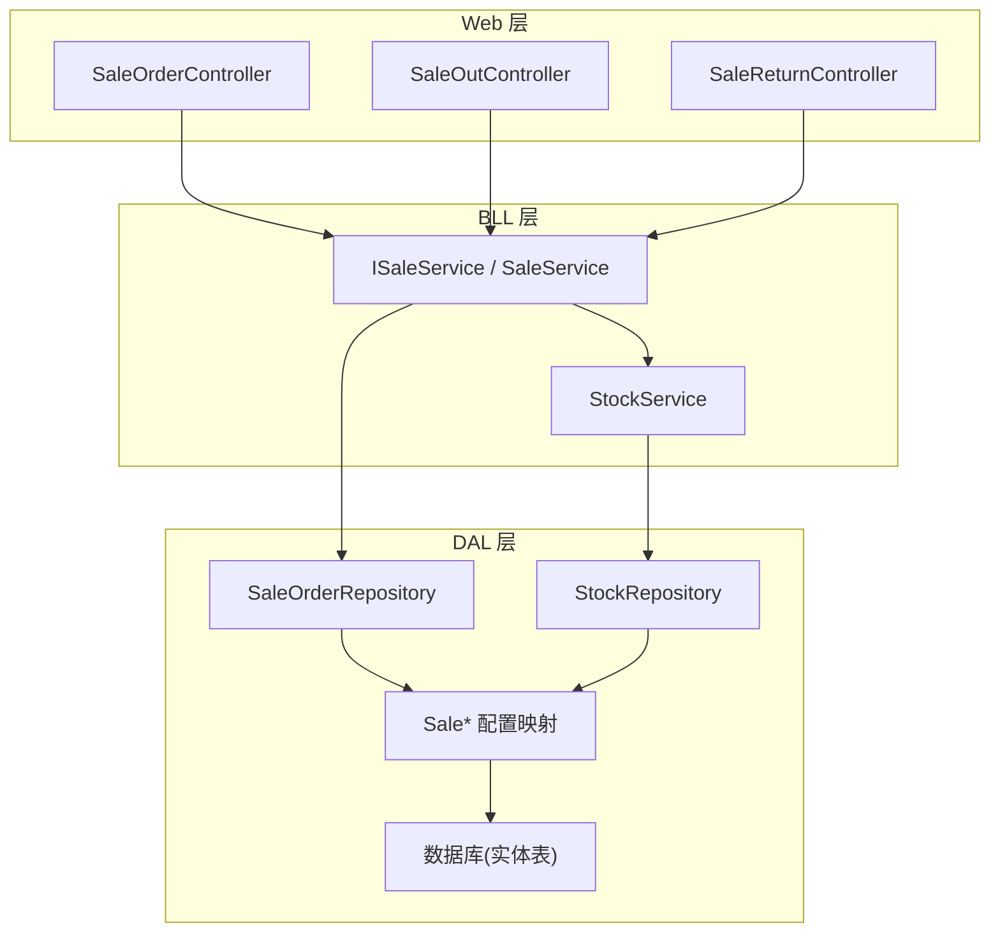
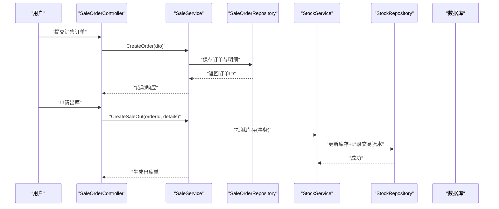
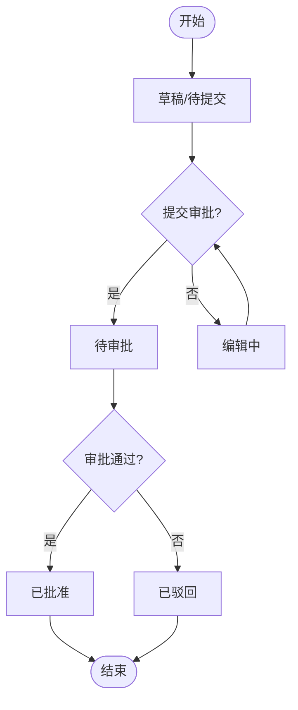
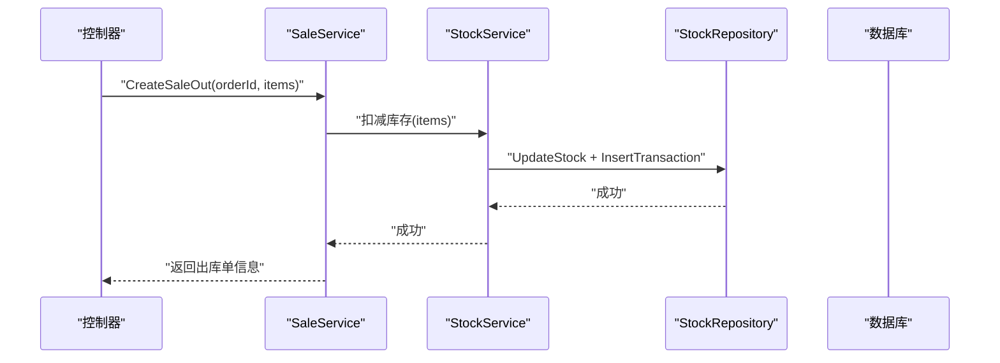
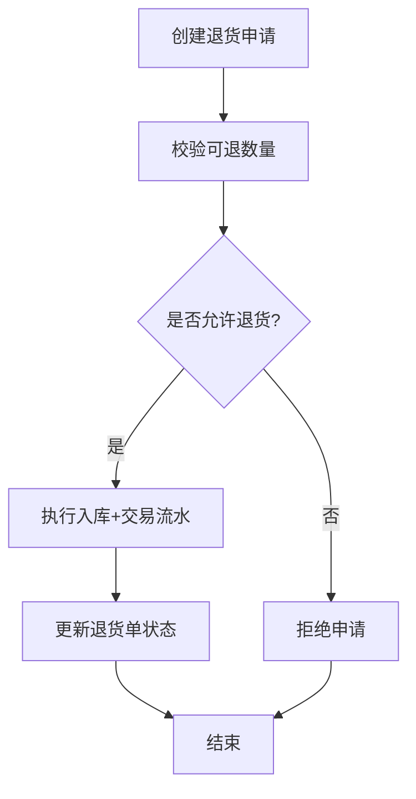
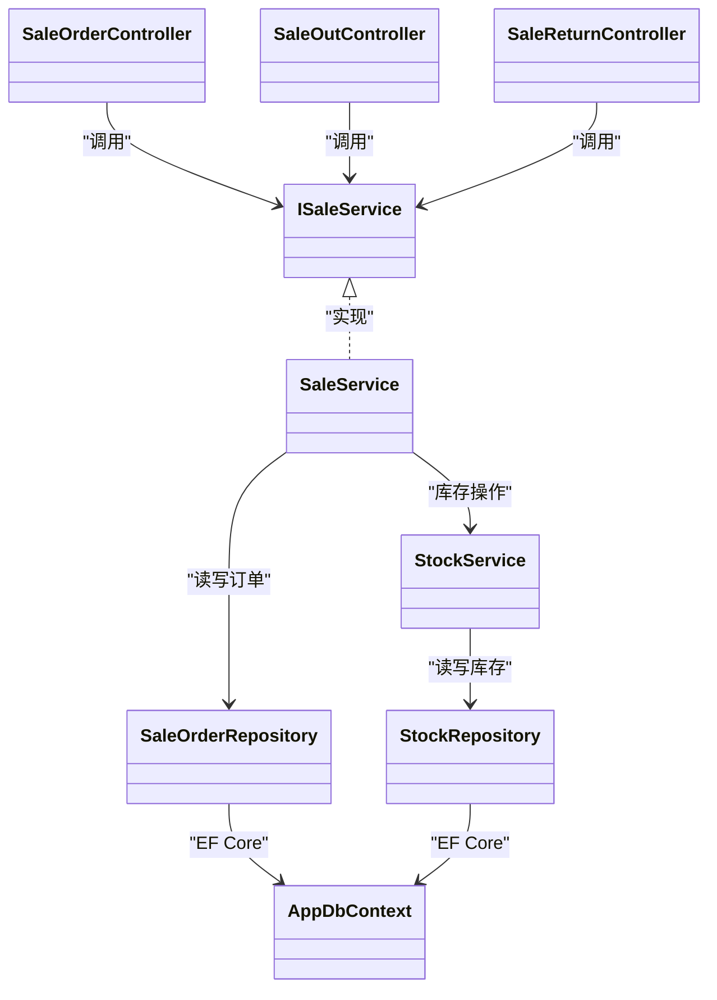

# 销售管理模块

<cite>
**本文引用的文件**   
- [SaleService.cs](file://EquipmentIMS.BLL/Services/SaleService.cs)
- [ISaleService.cs](file://EquipmentIMS.BLL/Interfaces/ISaleService.cs)
- [SaleOrderController.cs](file://EquipmentIMS.Web/Controllers/SaleOrderController.cs)
- [SaleOutController.cs](file://EquipmentIMS.Web/Controllers/SaleOutController.cs)
- [SaleReturnController.cs](file://EquipmentIMS.Web/Controllers/SaleReturnController.cs)
- [StockService.cs](file://EquipmentIMS.BLL/Services/StockService.cs)
- [IStockRepository.cs](file://EquipmentIMS.DAL/Interfaces/IStockRepository.cs)
- [StockRepository.cs](file://EquipmentIMS.DAL/Repositories/StockRepository.cs)
- [SaleOrderRepository.cs](file://EquipmentIMS.DAL/Repositories/SaleOrderRepository.cs)
- [SaleSaleOrderConfiguration.cs](file://EquipmentIMS.DAL/Configurations/SaleSaleOrderConfiguration.cs)
- [SaleSaleOrderDetailConfiguration.cs](file://EquipmentIMS.DAL/Configurations/SaleSaleOrderDetailConfiguration.cs)
- [SaleSaleOutConfiguration.cs](file://EquipmentIMS.DAL/Configurations/SaleSaleOutConfiguration.cs)
- [SaleSaleOutDetailConfiguration.cs](file://EquipmentIMS.DAL/Configurations/SaleSaleOutDetailConfiguration.cs)
- [SaleReturnConfiguration.cs](file://EquipmentIMS.DAL/Configurations/SaleReturnConfiguration.cs)
- [SaleReturnDetailConfiguration.cs](file://EquipmentIMS.DAL/Configurations/SaleReturnDetailConfiguration.cs)
- [BaseCustomerPriceConfiguration.cs](file://EquipmentIMS.DAL/Configurations/BaseCustomerPriceConfiguration.cs)
- [SaleOrderDto.cs](file://EquipmentIMS.Models/DTOs/SaleOrderDto.cs)
- [SaleOutDto.cs](file://EquipmentIMS.Models/DTOs/SaleOutDto.cs)
- [SaleReturnDto.cs](file://EquipmentIMS.Models/DTOs/SaleReturnDto.cs)
- [ReportSaleDtos.cs](file://EquipmentIMS.Models/DTOs/Reports/ReportSaleDtos.cs)
- [SaleOrderStatus.cs](file://EquipmentIMS.Models/Enums/SaleOrderStatus.cs)
- [SaleOutStatus.cs](file://EquipmentIMS.Models/Enums/SaleOutStatus.cs)
- [SaleReturnStatus.cs](file://EquipmentIMS.Models/Enums/SaleReturnStatus.cs)
- [TransactionType.cs](file://EquipmentIMS.Models/Enums/TransactionType.cs)
- [AppDbContext.cs](file://EquipmentIMS.DAL/AppDbContext.cs)
</cite>

## 目录
1. [简介](#简介)
2. [项目结构](#项目结构)
3. [核心组件](#核心组件)
4. [架构总览](#架构总览)
5. [详细组件分析](#详细组件分析)
6. [依赖关系分析](#依赖关系分析)
7. [性能考虑](#性能考虑)
8. [故障排查指南](#故障排查指南)
9. [结论](#结论)
10. [附录](#附录)

## 简介
本文件面向销售管理模块，系统性阐述销售订单管理、销售出库、销售退货的核心功能与业务流程；深入解析 SaleService 的业务逻辑实现、销售订单审批流程、销售出库的库存扣减机制；说明销售退货处理流程、客户信用管理与销售统计分析能力；并描述销售系统与库存、财务系统的集成关系。文档同时提供关键操作的代码示例路径，便于快速定位实现细节。

## 项目结构
销售管理模块遵循分层架构：Web 控制器层负责请求路由与参数校验，BLL 业务服务层封装领域逻辑（如订单审批、出库扣减、退货入库），DAL 数据访问层通过仓储与配置映射实体到数据库，Models 层定义 DTO、实体与枚举。

图表来源
- [SaleOrderController.cs](file://EquipmentIMS.Web/Controllers/SaleOrderController.cs)
- [SaleOutController.cs](file://EquipmentIMS.Web/Controllers/SaleOutController.cs)
- [SaleReturnController.cs](file://EquipmentIMS.Web/Controllers/SaleReturnController.cs)
- [ISaleService.cs](file://EquipmentIMS.BLL/Interfaces/ISaleService.cs)
- [SaleService.cs](file://EquipmentIMS.BLL/Services/SaleService.cs)
- [StockService.cs](file://EquipmentIMS.BLL/Services/StockService.cs)
- [SaleOrderRepository.cs](file://EquipmentIMS.DAL/Repositories/SaleOrderRepository.cs)
- [StockRepository.cs](file://EquipmentIMS.DAL/Repositories/StockRepository.cs)
- [SaleSaleOrderConfiguration.cs](file://EquipmentIMS.DAL/Configurations/SaleSaleOrderConfiguration.cs)
- [SaleSaleOutConfiguration.cs](file://EquipmentIMS.DAL/Configurations/SaleSaleOutConfiguration.cs)
- [SaleReturnConfiguration.cs](file://EquipmentIMS.DAL/Configurations/SaleReturnConfiguration.cs)

章节来源
- [SaleOrderController.cs](file://EquipmentIMS.Web/Controllers/SaleOrderController.cs)
- [SaleOutController.cs](file://EquipmentIMS.Web/Controllers/SaleOutController.cs)
- [SaleReturnController.cs](file://EquipmentIMS.Web/Controllers/SaleReturnController.cs)
- [ISaleService.cs](file://EquipmentIMS.BLL/Interfaces/ISaleService.cs)
- [SaleService.cs](file://EquipmentIMS.BLL/Services/SaleService.cs)
- [StockService.cs](file://EquipmentIMS.BLL/Services/StockService.cs)
- [SaleOrderRepository.cs](file://EquipmentIMS.DAL/Repositories/SaleOrderRepository.cs)
- [StockRepository.cs](file://EquipmentIMS.DAL/Repositories/StockRepository.cs)
- [SaleSaleOrderConfiguration.cs](file://EquipmentIMS.DAL/Configurations/SaleSaleOrderConfiguration.cs)
- [SaleSaleOutConfiguration.cs](file://EquipmentIMS.DAL/Configurations/SaleSaleOutConfiguration.cs)
- [SaleReturnConfiguration.cs](file://EquipmentIMS.DAL/Configurations/SaleReturnConfiguration.cs)

## 核心组件
- 销售服务接口与实现
  - ISaleService：定义销售相关业务能力边界（订单、出库、退货、统计等）。
  - SaleService：聚合订单生命周期、出库扣减、退货入库、报表数据组装等核心逻辑。
- 库存服务与仓储
  - StockService：封装库存事务、交易流水记录、可用量计算等。
  - IStockRepository / StockRepository：对库存表与交易流水表的增删改查与批量操作。
- 销售仓储
  - SaleOrderRepository：销售订单及明细的持久化查询与写入。
- 配置映射
  - Sale* 系列 Configuration：定义销售订单、出库、退货及其明细的 EF Core 映射规则。
- DTO 与枚举
  - SaleOrderDto / SaleOutDto / SaleReturnDto：对外交互的数据载体。
  - ReportSaleDtos：销售统计与分析所需的数据模型。
  - SaleOrderStatus / SaleOutStatus / SaleReturnStatus / TransactionType：状态与类型枚举。

章节来源
- [ISaleService.cs](file://EquipmentIMS.BLL/Interfaces/ISaleService.cs)
- [SaleService.cs](file://EquipmentIMS.BLL/Services/SaleService.cs)
- [StockService.cs](file://EquipmentIMS.BLL/Services/StockService.cs)
- [IStockRepository.cs](file://EquipmentIMS.DAL/Interfaces/IStockRepository.cs)
- [StockRepository.cs](file://EquipmentIMS.DAL/Repositories/StockRepository.cs)
- [SaleOrderRepository.cs](file://EquipmentIMS.DAL/Repositories/SaleOrderRepository.cs)
- [SaleSaleOrderConfiguration.cs](file://EquipmentIMS.DAL/Configurations/SaleSaleOrderConfiguration.cs)
- [SaleSaleOrderDetailConfiguration.cs](file://EquipmentIMS.DAL/Configurations/SaleSaleOrderDetailConfiguration.cs)
- [SaleSaleOutConfiguration.cs](file://EquipmentIMS.DAL/Configurations/SaleSaleOutConfiguration.cs)
- [SaleSaleOutDetailConfiguration.cs](file://EquipmentIMS.DAL/Configurations/SaleSaleOutDetailConfiguration.cs)
- [SaleReturnConfiguration.cs](file://EquipmentIMS.DAL/Configurations/SaleReturnConfiguration.cs)
- [SaleReturnDetailConfiguration.cs](file://EquipmentIMS.DAL/Configurations/SaleReturnDetailConfiguration.cs)
- [SaleOrderDto.cs](file://EquipmentIMS.Models/DTOs/SaleOrderDto.cs)
- [SaleOutDto.cs](file://EquipmentIMS.Models/DTOs/SaleOutDto.cs)
- [SaleReturnDto.cs](file://EquipmentIMS.Models/DTOs/SaleReturnDto.cs)
- [ReportSaleDtos.cs](file://EquipmentIMS.Models/DTOs/Reports/ReportSaleDtos.cs)
- [SaleOrderStatus.cs](file://EquipmentIMS.Models/Enums/SaleOrderStatus.cs)
- [SaleOutStatus.cs](file://EquipmentIMS.Models/Enums/SaleOutStatus.cs)
- [SaleReturnStatus.cs](file://EquipmentIMS.Models/Enums/SaleReturnStatus.cs)
- [TransactionType.cs](file://EquipmentIMS.Models/Enums/TransactionType.cs)

## 架构总览
销售管理模块采用“控制器→服务→仓储→数据库”的分层调用链，结合 DTO 与枚举进行跨层数据传输与状态表达。销售出库与退货均通过库存服务完成库存变动与交易流水记录，确保账实一致。

图表来源
- [SaleOrderController.cs](file://EquipmentIMS.Web/Controllers/SaleOrderController.cs)
- [SaleService.cs](file://EquipmentIMS.BLL/Services/SaleService.cs)
- [SaleOrderRepository.cs](file://EquipmentIMS.DAL/Repositories/SaleOrderRepository.cs)
- [StockService.cs](file://EquipmentIMS.BLL/Services/StockService.cs)
- [StockRepository.cs](file://EquipmentIMS.DAL/Repositories/StockRepository.cs)

## 详细组件分析

### SaleService 业务逻辑
- 职责范围
  - 销售订单 CRUD：创建、读取、更新、删除，含明细维护与汇总计算。
  - 销售出库：基于已审批订单生成出库单，触发库存扣减与交易流水。
  - 销售退货：根据退货申请执行入库与交易流水记录，支持部分退货。
  - 销售统计：按时间、客户、产品维度聚合销售额、数量、毛利等指标。
- 关键设计点
  - 使用事务保证订单/出库/退货的原子性。
  - 通过枚举约束状态机流转，避免非法状态变更。
  - 价格策略与客户定价在订单创建时计算并落库。
- 典型方法（以路径引用代替代码）
  - 创建销售订单：[SaleService.cs](file://EquipmentIMS.BLL/Services/SaleService.cs)
  - 审批销售订单：[SaleService.cs](file://EquipmentIMS.BLL/Services/SaleService.cs)
  - 生成销售出库：[SaleService.cs](file://EquipmentIMS.BLL/Services/SaleService.cs)
  - 处理销售退货：[SaleService.cs](file://EquipmentIMS.BLL/Services/SaleService.cs)
  - 销售统计查询：[SaleService.cs](file://EquipmentIMS.BLL/Services/SaleService.cs)

章节来源
- [SaleService.cs](file://EquipmentIMS.BLL/Services/SaleService.cs)
- [ISaleService.cs](file://EquipmentIMS.BLL/Interfaces/ISaleService.cs)

#### 销售订单审批流程

图表来源
- [SaleOrderStatus.cs](file://EquipmentIMS.Models/Enums/SaleOrderStatus.cs)
- [SaleService.cs](file://EquipmentIMS.BLL/Services/SaleService.cs)

章节来源
- [SaleOrderStatus.cs](file://EquipmentIMS.Models/Enums/SaleOrderStatus.cs)
- [SaleService.cs](file://EquipmentIMS.BLL/Services/SaleService.cs)

#### 销售出库的库存扣减机制
- 触发条件：订单处于“已批准”，且未完全出库。
- 扣减步骤：
  - 校验库存可用量（可用量=现有量-锁定量+在途量，视具体字段而定）。
  - 在事务内更新库存表对应仓库与产品的数量。
  - 写入库存交易流水，标记类型为“销售出库”。
  - 更新出库单状态为“已出库”或“部分出库”。
- 并发控制：通过仓储层的乐观锁或行级锁保障一致性。
- 异常回滚：任一环节失败则整体回滚，保证账实一致。

图表来源
- [SaleService.cs](file://EquipmentIMS.BLL/Services/SaleService.cs)
- [StockService.cs](file://EquipmentIMS.BLL/Services/StockService.cs)
- [StockRepository.cs](file://EquipmentIMS.DAL/Repositories/StockRepository.cs)
- [TransactionType.cs](file://EquipmentIMS.Models/Enums/TransactionType.cs)

章节来源
- [SaleService.cs](file://EquipmentIMS.BLL/Services/SaleService.cs)
- [StockService.cs](file://EquipmentIMS.BLL/Services/StockService.cs)
- [StockRepository.cs](file://EquipmentIMS.DAL/Repositories/StockRepository.cs)
- [TransactionType.cs](file://EquipmentIMS.Models/Enums/TransactionType.cs)

#### 销售退货处理流程
- 触发条件：客户发起退货申请，支持整单或部分退货。
- 处理步骤：
  - 校验原出库单与退货明细的可退数量。
  - 在事务内增加库存并写入“销售退货”类型的交易流水。
  - 更新退货单状态为“已入库”或“部分入库”。
  - 若涉及金额调整，联动财务系统（见集成关系）。
- 风险控制：防止重复退货与超退。

图表来源
- [SaleService.cs](file://EquipmentIMS.BLL/Services/SaleService.cs)
- [SaleReturnConfiguration.cs](file://EquipmentIMS.DAL/Configurations/SaleReturnConfiguration.cs)
- [SaleReturnDetailConfiguration.cs](file://EquipmentIMS.DAL/Configurations/SaleReturnDetailConfiguration.cs)
- [SaleReturnStatus.cs](file://EquipmentIMS.Models/Enums/SaleReturnStatus.cs)

章节来源
- [SaleService.cs](file://EquipmentIMS.BLL/Services/SaleService.cs)
- [SaleReturnConfiguration.cs](file://EquipmentIMS.DAL/Configurations/SaleReturnConfiguration.cs)
- [SaleReturnDetailConfiguration.cs](file://EquipmentIMS.DAL/Configurations/SaleReturnDetailConfiguration.cs)
- [SaleReturnStatus.cs](file://EquipmentIMS.Models/Enums/SaleReturnStatus.cs)

#### 客户信用管理
- 信用额度：基于 BaseCustomerPrice 配置的客户等级与价格策略，结合历史应收与退货影响评估信用占用。
- 风控策略：
  - 下单前检查客户信用余额是否充足。
  - 超限拦截或转人工审批。
- 数据来源：
  - 客户主数据与价格配置：[BaseCustomerPriceConfiguration.cs](file://EquipmentIMS.DAL/Configurations/BaseCustomerPriceConfiguration.cs)
  - 销售订单与退货累计：通过销售服务聚合计算。

章节来源
- [BaseCustomerPriceConfiguration.cs](file://EquipmentIMS.DAL/Configurations/BaseCustomerPriceConfiguration.cs)
- [SaleService.cs](file://EquipmentIMS.BLL/Services/SaleService.cs)

#### 销售统计分析
- 指标维度：时间（日/周/月）、客户、产品、仓库、销售员等。
- 指标内容：销售额、销售数量、毛利率、退货率、回款进度等。
- 数据源：
  - 销售订单与明细、出库与退货、交易流水。
  - 报告 DTO：[ReportSaleDtos.cs](file://EquipmentIMS.Models/DTOs/Reports/ReportSaleDtos.cs)

章节来源
- [ReportSaleDtos.cs](file://EquipmentIMS.Models/DTOs/Reports/ReportSaleDtos.cs)
- [SaleService.cs](file://EquipmentIMS.BLL/Services/SaleService.cs)

### 控制器与 API 入口
- 销售订单控制器
  - 提供订单列表、详情、创建、更新、删除、审批等操作入口。
  - 参考路径：[SaleOrderController.cs](file://EquipmentIMS.Web/Controllers/SaleOrderController.cs)
- 销售出库控制器
  - 提供出库单列表、详情、创建、打印等操作入口。
  - 参考路径：[SaleOutController.cs](file://EquipmentIMS.Web/Controllers/SaleOutController.cs)
- 销售退货控制器
  - 提供退货单列表、详情、创建等操作入口。
  - 参考路径：[SaleReturnController.cs](file://EquipmentIMS.Web/Controllers/SaleReturnController.cs)

章节来源
- [SaleOrderController.cs](file://EquipmentIMS.Web/Controllers/SaleOrderController.cs)
- [SaleOutController.cs](file://EquipmentIMS.Web/Controllers/SaleOutController.cs)
- [SaleReturnController.cs](file://EquipmentIMS.Web/Controllers/SaleReturnController.cs)

### 数据模型与映射
- 实体与配置映射
  - 销售订单与明细：[SaleSaleOrderConfiguration.cs](file://EquipmentIMS.DAL/Configurations/SaleSaleOrderConfiguration.cs)、[SaleSaleOrderDetailConfiguration.cs](file://EquipmentIMS.DAL/Configurations/SaleSaleOrderDetailConfiguration.cs)
  - 销售出库与明细：[SaleSaleOutConfiguration.cs](file://EquipmentIMS.DAL/Configurations/SaleSaleOutConfiguration.cs)、[SaleSaleOutDetailConfiguration.cs](file://EquipmentIMS.DAL/Configurations/SaleSaleOutDetailConfiguration.cs)
  - 销售退货与明细：[SaleReturnConfiguration.cs](file://EquipmentIMS.DAL/Configurations/SaleReturnConfiguration.cs)、[SaleReturnDetailConfiguration.cs](file://EquipmentIMS.DAL/Configurations/SaleReturnDetailConfiguration.cs)
- 上下文
  - 统一 DbContext：[AppDbContext.cs](file://EquipmentIMS.DAL/AppDbContext.cs)

章节来源
- [SaleSaleOrderConfiguration.cs](file://EquipmentIMS.DAL/Configurations/SaleSaleOrderConfiguration.cs)
- [SaleSaleOrderDetailConfiguration.cs](file://EquipmentIMS.DAL/Configurations/SaleSaleOrderDetailConfiguration.cs)
- [SaleSaleOutConfiguration.cs](file://EquipmentIMS.DAL/Configurations/SaleSaleOutConfiguration.cs)
- [SaleSaleOutDetailConfiguration.cs](file://EquipmentIMS.DAL/Configurations/SaleSaleOutDetailConfiguration.cs)
- [SaleReturnConfiguration.cs](file://EquipmentIMS.DAL/Configurations/SaleReturnConfiguration.cs)
- [SaleReturnDetailConfiguration.cs](file://EquipmentIMS.DAL/Configurations/SaleReturnDetailConfiguration.cs)
- [AppDbContext.cs](file://EquipmentIMS.DAL/AppDbContext.cs)

## 依赖关系分析
- 控制器依赖服务接口，服务实现依赖仓储与库存服务，仓储依赖 EF Core 配置映射与数据库。
- 状态与类型由枚举集中管理，避免魔法值。
- DTO 作为跨层契约，屏蔽内部实体变化。

图表来源
- [SaleOrderController.cs](file://EquipmentIMS.Web/Controllers/SaleOrderController.cs)
- [SaleOutController.cs](file://EquipmentIMS.Web/Controllers/SaleOutController.cs)
- [SaleReturnController.cs](file://EquipmentIMS.Web/Controllers/SaleReturnController.cs)
- [ISaleService.cs](file://EquipmentIMS.BLL/Interfaces/ISaleService.cs)
- [SaleService.cs](file://EquipmentIMS.BLL/Services/SaleService.cs)
- [StockService.cs](file://EquipmentIMS.BLL/Services/StockService.cs)
- [SaleOrderRepository.cs](file://EquipmentIMS.DAL/Repositories/SaleOrderRepository.cs)
- [StockRepository.cs](file://EquipmentIMS.DAL/Repositories/StockRepository.cs)
- [AppDbContext.cs](file://EquipmentIMS.DAL/AppDbContext.cs)

章节来源
- [SaleOrderController.cs](file://EquipmentIMS.Web/Controllers/SaleOrderController.cs)
- [SaleOutController.cs](file://EquipmentIMS.Web/Controllers/SaleOutController.cs)
- [SaleReturnController.cs](file://EquipmentIMS.Web/Controllers/SaleReturnController.cs)
- [ISaleService.cs](file://EquipmentIMS.BLL/Interfaces/ISaleService.cs)
- [SaleService.cs](file://EquipmentIMS.BLL/Services/SaleService.cs)
- [StockService.cs](file://EquipmentIMS.BLL/Services/StockService.cs)
- [SaleOrderRepository.cs](file://EquipmentIMS.DAL/Repositories/SaleOrderRepository.cs)
- [StockRepository.cs](file://EquipmentIMS.DAL/Repositories/StockRepository.cs)
- [AppDbContext.cs](file://EquipmentIMS.DAL/AppDbContext.cs)

## 性能考虑
- 批量操作：出库与退货涉及的库存更新与交易流水写入应批量提交，减少往返次数。
- 索引优化：订单号、出库单号、退货单号、产品ID、仓库ID、时间戳等常用查询字段建立索引。
- 分页与投影：列表查询使用分页与只读投影，避免加载大对象。
- 缓存策略：热销产品库存快照与价格策略可短期缓存，注意失效与一致性。
- 事务粒度：尽量缩小事务范围，避免长事务导致锁竞争。

## 故障排查指南
- 常见错误
  - 库存不足：检查可用量计算与锁定量是否正确，确认并发场景下的锁策略。
  - 状态不合法：核对当前状态与目标状态的转换规则，避免非法跳转。
  - 数据不一致：核查交易流水与库存表是否在同一事务内提交。
- 定位建议
  - 查看控制器日志与服务层异常堆栈。
  - 检查数据库事务日志与死锁信息。
  - 使用报表与交易流水回溯问题单据。

## 结论
销售管理模块以 SaleService 为核心，串联订单、出库、退货三大业务域，并通过库存服务与仓储层保障数据一致性与可追溯性。配合清晰的枚举状态机与 DTO 契约，模块具备良好的扩展性与可维护性。后续可在客户信用、定价策略与销售预测方面进一步增强，以满足更复杂的商业需求。

## 附录

### 代码示例路径（CRUD 与关键流程）
- 销售订单创建与审批
  - 控制器入口：[SaleOrderController.cs](file://EquipmentIMS.Web/Controllers/SaleOrderController.cs)
  - 业务实现：[SaleService.cs](file://EquipmentIMS.BLL/Services/SaleService.cs)
  - 仓储访问：[SaleOrderRepository.cs](file://EquipmentIMS.DAL/Repositories/SaleOrderRepository.cs)
- 销售出库与库存扣减
  - 控制器入口：[SaleOutController.cs](file://EquipmentIMS.Web/Controllers/SaleOutController.cs)
  - 业务实现：[SaleService.cs](file://EquipmentIMS.BLL/Services/SaleService.cs)
  - 库存服务：[StockService.cs](file://EquipmentIMS.BLL/Services/StockService.cs)
  - 库存仓储：[StockRepository.cs](file://EquipmentIMS.DAL/Repositories/StockRepository.cs)
- 销售退货与入库
  - 控制器入口：[SaleReturnController.cs](file://EquipmentIMS.Web/Controllers/SaleReturnController.cs)
  - 业务实现：[SaleService.cs](file://EquipmentIMS.BLL/Services/SaleService.cs)
  - 配置映射：[SaleReturnConfiguration.cs](file://EquipmentIMS.DAL/Configurations/SaleReturnConfiguration.cs)、[SaleReturnDetailConfiguration.cs](file://EquipmentIMS.DAL/Configurations/SaleReturnDetailConfiguration.cs)

### 销售定价策略方案
- 基础价格：产品主数据中的标准价。
- 客户等级价：基于 BaseCustomerPrice 配置的客户等级折扣或加价策略。
- 促销与合同价：在订单创建时覆盖默认价格，保留审计轨迹。
- 价格生效期：支持有效期与版本控制，确保历史订单价格不变。

章节来源
- [BaseCustomerPriceConfiguration.cs](file://EquipmentIMS.DAL/Configurations/BaseCustomerPriceConfiguration.cs)
- [SaleService.cs](file://EquipmentIMS.BLL/Services/SaleService.cs)

### 客户管理方案
- 客户主数据：基本信息、联系人、结算方式、信用额度。
- 价格策略绑定：客户等级与价格模板关联。
- 信用监控：实时计算占用与剩余，超限预警与拦截。

章节来源
- [BaseCustomerPriceConfiguration.cs](file://EquipmentIMS.DAL/Configurations/BaseCustomerPriceConfiguration.cs)
- [SaleService.cs](file://EquipmentIMS.BLL/Services/SaleService.cs)

### 销售预测方案
- 历史数据：近 N 期销售数量与金额。
- 趋势与季节性：移动平均、指数平滑、季节因子分解。
- 外部因素：促销活动、市场波动纳入修正。
- 输出：未来周期销量与备货建议，联动库存预警。

### 系统集成关系
- 与库存系统
  - 出库扣减与退货入库通过库存服务与交易流水保持一致。
  - 参考：[StockService.cs](file://EquipmentIMS.BLL/Services/StockService.cs)、[StockRepository.cs](file://EquipmentIMS.DAL/Repositories/StockRepository.cs)
- 与财务系统
  - 订单金额、退货冲销、回款核销可通过接口或消息队列同步至财务模块。
  - 建议在销售服务中预留财务事件发布点，解耦集成。

章节来源
- [StockService.cs](file://EquipmentIMS.BLL/Services/StockService.cs)
- [StockRepository.cs](file://EquipmentIMS.DAL/Repositories/StockRepository.cs)
- [SaleService.cs](file://EquipmentIMS.BLL/Services/SaleService.cs)