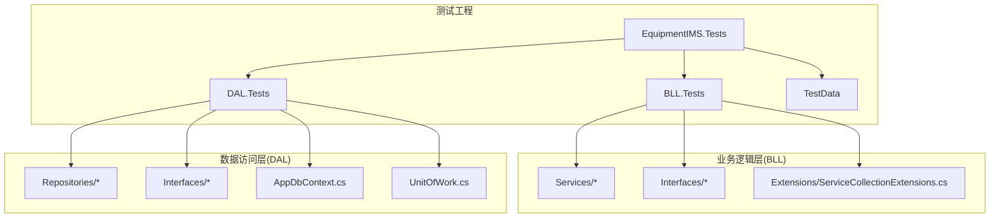
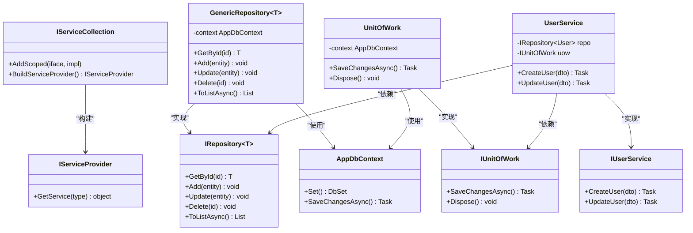
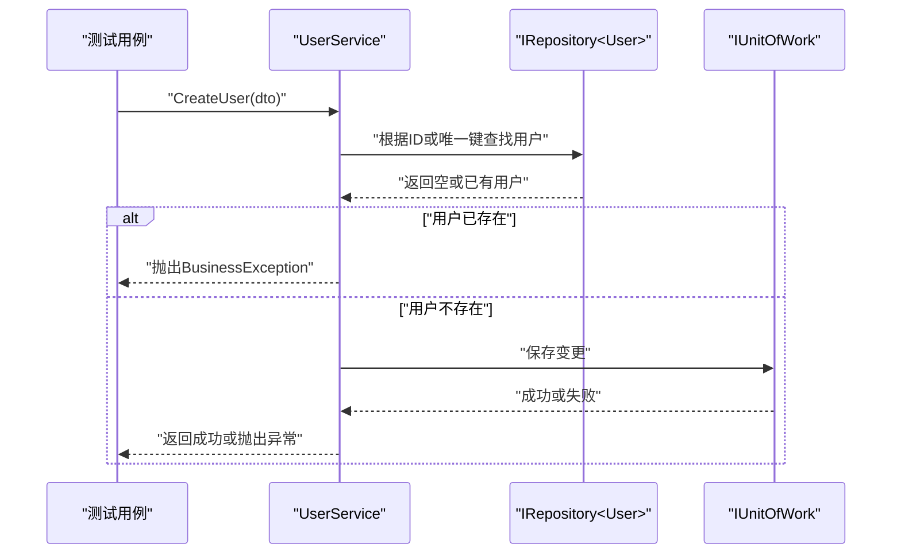
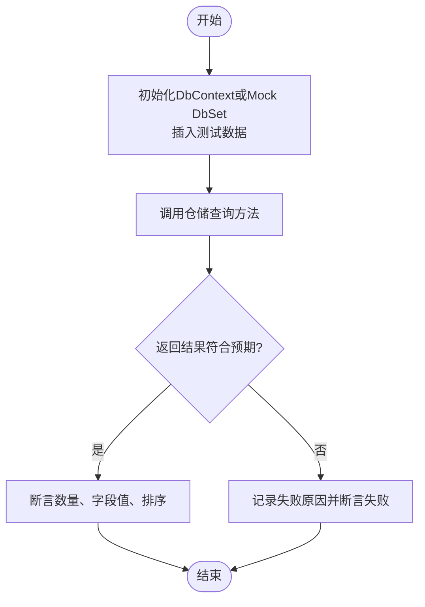
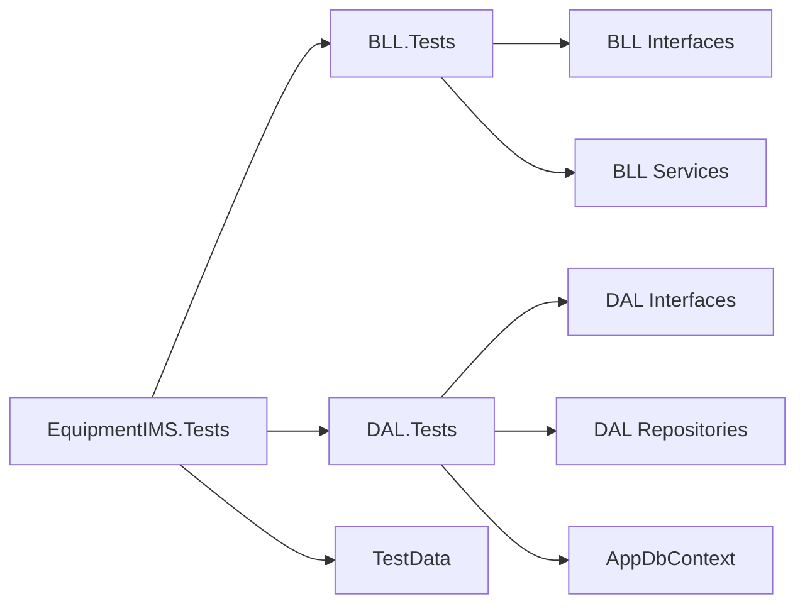

# 单元测试编写

<cite>
**本文引用的文件**   
- [EquipmentIMS.Tests.csproj](file://EquipmentIMS.Tests/EquipmentIMS.Tests.csproj)
- [ServiceCollectionExtensions.cs](file://EquipmentIMS.BLL/Extensions/ServiceCollectionExtensions.cs)
- [AppDbContext.cs](file://EquipmentIMS.DAL/AppDbContext.cs)
- [GenericRepository.cs](file://EquipmentIMS.DAL/Repositories/GenericRepository.cs)
- [IRepository.cs](file://EquipmentIMS.DAL/Interfaces/IRepository.cs)
- [UnitOfWork.cs](file://EquipmentIMS.DAL/Repositories/UnitOfWork.cs)
- [IUnitOfWork.cs](file://EquipmentIMS.DAL/Interfaces/IUnitOfWork.cs)
- [UserService.cs](file://EquipmentIMS.BLL/Services/UserService.cs)
- [IUserService.cs](file://EquipmentIMS.BLL/Interfaces/IUserService.cs)
- [ProductService.cs](file://EquipmentIMS.BLL/Services/ProductService.cs)
- [IPurchaseOrderRepository.cs](file://EquipmentIMS.DAL/Interfaces/IPurchaseOrderRepository.cs)
- [PurchaseOrderRepository.cs](file://EquipmentIMS.DAL/Repositories/PurchaseOrderRepository.cs)
- [BusinessException.cs](file://EquipmentIMS.Models/Exceptions/BusinessException.cs)
- [NotFoundException.cs](file://EquipmentIMS.Models/Exceptions/NotFoundException.cs)
- [ValidationException.cs](file://EquipmentIMS.Models/Exceptions/ValidationException.cs)
</cite>

## 目录
1. [简介](#简介)
2. [项目结构](#项目结构)
3. [核心组件](#核心组件)
4. [架构总览](#架构总览)
5. [详细组件分析](#详细组件分析)
6. [依赖关系分析](#依赖关系分析)
7. [性能考虑](#性能考虑)
8. [故障排查指南](#故障排查指南)
9. [结论](#结论)
10. [附录](#附录)

## 简介
本指南面向THMS系统的业务逻辑层（BLL）与数据访问层（DAL），提供基于xUnit或NUnit的单元测试编写规范与实践。内容涵盖：
- 测试工程组织、命名规范与断言最佳实践
- 使用Mock框架对IServiceCollection、DbContext、仓储与服务的模拟与配置
- Service层方法、Repository层查询与业务规则验证的测试示例路径
- 异常处理、边界条件与并发场景的测试方法
- 覆盖率工具的使用与报告生成

## 项目结构
测试工程位于独立的测试项目中，按分层组织测试用例：
- EquipmentIMS.Tests/BLL.Tests：业务逻辑层测试
- EquipmentIMS.Tests/DAL.Tests：数据访问层测试
- EquipmentIMS.Tests/TestData：测试数据与夹具

图表来源
- [EquipmentIMS.Tests.csproj](file://EquipmentIMS.Tests/EquipmentIMS.Tests.csproj)
- [ServiceCollectionExtensions.cs](file://EquipmentIMS.BLL/Extensions/ServiceCollectionExtensions.cs)
- [AppDbContext.cs](file://EquipmentIMS.DAL/AppDbContext.cs)
- [GenericRepository.cs](file://EquipmentIMS.DAL/Repositories/GenericRepository.cs)
- [UnitOfWork.cs](file://EquipmentIMS.DAL/Repositories/UnitOfWork.cs)

章节来源
- [EquipmentIMS.Tests.csproj](file://EquipmentIMS.Tests/EquipmentIMS.Tests.csproj)

## 核心组件
- 服务接口与实现：如用户、产品等业务服务，均通过接口注入，便于在测试中替换为Mock对象。
- 仓储接口与通用仓储：通过IRepository<T>和具体仓储封装EF Core操作；UnitOfWork用于事务管理。
- DbContext：数据上下文，测试中通常使用内存数据库或Mock DbSet以隔离外部依赖。
- 自定义异常：BusinessException、NotFoundException、ValidationException用于表达业务错误。

章节来源
- [UserService.cs](file://EquipmentIMS.BLL/Services/UserService.cs)
- [IUserService.cs](file://EquipmentIMS.BLL/Interfaces/IUserService.cs)
- [ProductService.cs](file://EquipmentIMS.BLL/Services/ProductService.cs)
- [GenericRepository.cs](file://EquipmentIMS.DAL/Repositories/GenericRepository.cs)
- [IRepository.cs](file://EquipmentIMS.DAL/Interfaces/IRepository.cs)
- [UnitOfWork.cs](file://EquipmentIMS.DAL/Repositories/UnitOfWork.cs)
- [IUnitOfWork.cs](file://EquipmentIMS.DAL/Interfaces/IUnitOfWork.cs)
- [AppDbContext.cs](file://EquipmentIMS.DAL/AppDbContext.cs)
- [BusinessException.cs](file://EquipmentIMS.Models/Exceptions/BusinessException.cs)
- [NotFoundException.cs](file://EquipmentIMS.Models/Exceptions/NotFoundException.cs)
- [ValidationException.cs](file://EquipmentIMS.Models/Exceptions/ValidationException.cs)

## 架构总览
下图展示测试视角下的关键依赖关系：测试通过Mock服务与仓储，驱动Service层逻辑；DAL层测试可结合内存数据库或Mock DbSet进行。

图表来源
- [ServiceCollectionExtensions.cs](file://EquipmentIMS.BLL/Extensions/ServiceCollectionExtensions.cs)
- [AppDbContext.cs](file://EquipmentIMS.DAL/AppDbContext.cs)
- [GenericRepository.cs](file://EquipmentIMS.DAL/Repositories/GenericRepository.cs)
- [IRepository.cs](file://EquipmentIMS.DAL/Interfaces/IRepository.cs)
- [UnitOfWork.cs](file://EquipmentIMS.DAL/Repositories/UnitOfWork.cs)
- [IUnitOfWork.cs](file://EquipmentIMS.DAL/Interfaces/IUnitOfWork.cs)
- [UserService.cs](file://EquipmentIMS.BLL/Services/UserService.cs)
- [IUserService.cs](file://EquipmentIMS.BLL/Interfaces/IUserService.cs)

## 详细组件分析

### 测试工程与框架选择
- 测试框架：推荐使用xUnit（也可使用NUnit）。xUnit具备并行执行、强约定等特性；NUnit具备丰富的断言与属性化配置。
- 测试项目引用：确保测试项目引用被测的BLL与DAL项目，并引入Mock库（如Moq）、内存数据库（如Microsoft.EntityFrameworkCore.InMemory）或SQLite。
- 测试类命名：采用“被测试类型名+Test”的形式，例如“UserServiceTests”。
- 测试方法命名：采用“方法名_场景_期望结果”，例如“CreateUser_当输入无效时_抛出ValidationException”。

章节来源
- [EquipmentIMS.Tests.csproj](file://EquipmentIMS.Tests/EquipmentIMS.Tests.csproj)

### Mock对象的创建与配置
- IServiceCollection与DI容器
  - 在测试中构造IServiceCollection，注册被测服务及其依赖（仓储、工作单元、缓存等），然后调用BuildServiceProvider获取实例。
  - 对于需要Mock的服务或仓储，先创建Mock对象，再将其作为实现注册到容器中。
  - 参考路径：[ServiceCollectionExtensions.cs](file://EquipmentIMS.BLL/Extensions/ServiceCollectionExtensions.cs)
- DbContext与DbSet的模拟
  - 方案A：使用内存数据库（InMemory）或SQLite，快速搭建轻量级数据环境，适合DAL层集成测试。
  - 方案B：使用Mock框架将DbSet<T>设为Mock，仅模拟必要的数据集与行为，适合纯单元测试。
  - 参考路径：[AppDbContext.cs](file://EquipmentIMS.DAL/AppDbContext.cs)
- 仓储与工作单元的模拟
  - 对IRepository<T>与IUnitOfWork创建Mock对象，设置返回数据或抛出异常，以覆盖不同分支。
  - 参考路径：
    - [IRepository.cs](file://EquipmentIMS.DAL/Interfaces/IRepository.cs)
    - [GenericRepository.cs](file://EquipmentIMS.DAL/Repositories/GenericRepository.cs)
    - [IUnitOfWork.cs](file://EquipmentIMS.DAL/Interfaces/IUnitOfWork.cs)
    - [UnitOfWork.cs](file://EquipmentIMS.DAL/Repositories/UnitOfWork.cs)

章节来源
- [ServiceCollectionExtensions.cs](file://EquipmentIMS.BLL/Extensions/ServiceCollectionExtensions.cs)
- [AppDbContext.cs](file://EquipmentIMS.DAL/AppDbContext.cs)
- [IRepository.cs](file://EquipmentIMS.DAL/Interfaces/IRepository.cs)
- [GenericRepository.cs](file://EquipmentIMS.DAL/Repositories/GenericRepository.cs)
- [IUnitOfWork.cs](file://EquipmentIMS.DAL/Interfaces/IUnitOfWork.cs)
- [UnitOfWork.cs](file://EquipmentIMS.DAL/Repositories/UnitOfWork.cs)

### Service层方法测试（以用户服务为例）
- 目标：验证UserService的业务逻辑，包括参数校验、状态更新、异常抛出等。
- 步骤建议：
  - 准备：创建IRepository<User>与IUnitOfWork的Mock对象，配置必要的返回值。
  - 组装：通过IServiceCollection注册UserService与其依赖，或使用构造函数直接注入Mock。
  - 执行：调用待测方法，传入不同输入（有效、无效、边界值）。
  - 断言：检查是否抛出预期异常、是否调用了仓储/工作单元的方法、返回值是否符合预期。
- 参考路径：
  - [UserService.cs](file://EquipmentIMS.BLL/Services/UserService.cs)
  - [IUserService.cs](file://EquipmentIMS.BLL/Interfaces/IUserService.cs)

图表来源
- [UserService.cs](file://EquipmentIMS.BLL/Services/UserService.cs)
- [IRepository.cs](file://EquipmentIMS.DAL/Interfaces/IRepository.cs)
- [IUnitOfWork.cs](file://EquipmentIMS.DAL/Interfaces/IUnitOfWork.cs)

章节来源
- [UserService.cs](file://EquipmentIMS.BLL/Services/UserService.cs)
- [IUserService.cs](file://EquipmentIMS.BLL/Interfaces/IUserService.cs)

### Repository层查询测试（以采购订单仓储为例）
- 目标：验证仓储查询逻辑是否正确映射到数据库上下文，或在Mock环境下返回正确集合。
- 步骤建议：
  - 使用内存数据库或Mock DbSet，插入少量测试数据。
  - 调用仓储方法（如按条件查询、分页、排序）。
  - 断言返回结果的数量、字段值与顺序。
- 参考路径：
  - [IPurchaseOrderRepository.cs](file://EquipmentIMS.DAL/Interfaces/IPurchaseOrderRepository.cs)
  - [PurchaseOrderRepository.cs](file://EquipmentIMS.DAL/Repositories/PurchaseOrderRepository.cs)
  - [AppDbContext.cs](file://EquipmentIMS.DAL/AppDbContext.cs)

图表来源
- [PurchaseOrderRepository.cs](file://EquipmentIMS.DAL/Repositories/PurchaseOrderRepository.cs)
- [IPurchaseOrderRepository.cs](file://EquipmentIMS.DAL/Interfaces/IPurchaseOrderRepository.cs)
- [AppDbContext.cs](file://EquipmentIMS.DAL/AppDbContext.cs)

章节来源
- [PurchaseOrderRepository.cs](file://EquipmentIMS.DAL/Repositories/PurchaseOrderRepository.cs)
- [IPurchaseOrderRepository.cs](file://EquipmentIMS.DAL/Interfaces/IPurchaseOrderRepository.cs)
- [AppDbContext.cs](file://EquipmentIMS.DAL/AppDbContext.cs)

### 业务规则验证（以产品服务为例）
- 目标：验证 ProductService 中的库存扣减、价格计算、审批流程等规则。
- 步骤建议：
  - 针对每种业务规则设计一个测试用例，明确前置条件、输入与期望结果。
  - 使用Mock仓储模拟库存变化，断言仓储方法被调用次数与参数。
  - 对非法输入或越界条件，断言抛出相应异常。
- 参考路径：
  - [ProductService.cs](file://EquipmentIMS.BLL/Services/ProductService.cs)

章节来源
- [ProductService.cs](file://EquipmentIMS.BLL/Services/ProductService.cs)

### 异常处理测试
- 目标：确保业务异常能被正确抛出并被上层捕获。
- 步骤建议：
  - 触发已知异常路径（如资源不存在、权限不足、数据冲突）。
  - 断言抛出的异常类型与消息包含关键信息。
- 参考路径：
  - [BusinessException.cs](file://EquipmentIMS.Models/Exceptions/BusinessException.cs)
  - [NotFoundException.cs](file://EquipmentIMS.Models/Exceptions/NotFoundException.cs)
  - [ValidationException.cs](file://EquipmentIMS.Models/Exceptions/ValidationException.cs)

章节来源
- [BusinessException.cs](file://EquipmentIMS.Models/Exceptions/BusinessException.cs)
- [NotFoundException.cs](file://EquipmentIMS.Models/Exceptions/NotFoundException.cs)
- [ValidationException.cs](file://EquipmentIMS.Models/Exceptions/ValidationException.cs)

### 边界条件测试
- 目标：覆盖空集合、单元素集合、极大/极小值、重复键、跨页查询等边界情况。
- 步骤建议：
  - 为每个关键方法设计至少一个边界用例。
  - 使用最小数据集与最大数据集分别验证性能与稳定性。
- 参考路径：
  - [GenericRepository.cs](file://EquipmentIMS.DAL/Repositories/GenericRepository.cs)

章节来源
- [GenericRepository.cs](file://EquipmentIMS.DAL/Repositories/GenericRepository.cs)

### 并发场景测试
- 目标：验证在高并发下的一致性、幂等性与锁策略。
- 步骤建议：
  - 使用Task并行发起多个请求，模拟并发写入或读取。
  - 断言最终一致性（如库存不为负、计数正确）。
  - 必要时引入线程安全的Mock或同步原语控制时序。
- 参考路径：
  - [UnitOfWork.cs](file://EquipmentIMS.DAL/Repositories/UnitOfWork.cs)
  - [IUnitOfWork.cs](file://EquipmentIMS.DAL/Interfaces/IUnitOfWork.cs)

章节来源
- [UnitOfWork.cs](file://EquipmentIMS.DAL/Repositories/UnitOfWork.cs)
- [IUnitOfWork.cs](file://EquipmentIMS.DAL/Interfaces/IUnitOfWork.cs)

## 依赖关系分析
测试工程中各模块的依赖如下：
- BLL.Tests依赖BLL的接口与实现，并通过Mock替代外部依赖。
- DAL.Tests依赖DAL的接口与实现，可通过内存数据库或Mock DbSet运行。
- TestData提供共享的测试数据与辅助方法。

图表来源
- [EquipmentIMS.Tests.csproj](file://EquipmentIMS.Tests/EquipmentIMS.Tests.csproj)
- [ServiceCollectionExtensions.cs](file://EquipmentIMS.BLL/Extensions/ServiceCollectionExtensions.cs)
- [AppDbContext.cs](file://EquipmentIMS.DAL/AppDbContext.cs)
- [GenericRepository.cs](file://EquipmentIMS.DAL/Repositories/GenericRepository.cs)

章节来源
- [EquipmentIMS.Tests.csproj](file://EquipmentIMS.Tests/EquipmentIMS.Tests.csproj)

## 性能考虑
- 优先使用Mock减少IO开销，仅在必要时使用内存数据库。
- 避免在单元测试中进行真实网络或磁盘IO。
- 合理拆分测试用例，避免单个用例过长导致执行缓慢。
- 使用并行执行（xUnit默认支持）提升整体速度。

## 故障排查指南
- 常见问题
  - 未正确注册服务导致无法解析依赖：检查IServiceCollection的注册顺序与生命周期。
  - Mock DbSet未正确配置：确认ToObservableQuery或AsQueryable的转换与数据源。
  - 事务未提交导致断言失败：在集成测试中确保SaveChangesAsync被调用。
- 定位技巧
  - 打印Mock方法的调用历史与参数，确认调用链。
  - 缩小范围：先验证仓储层，再向上验证服务层。
  - 使用最小复现用例隔离问题。

章节来源
- [ServiceCollectionExtensions.cs](file://EquipmentIMS.BLL/Extensions/ServiceCollectionExtensions.cs)
- [AppDbContext.cs](file://EquipmentIMS.DAL/AppDbContext.cs)
- [GenericRepository.cs](file://EquipmentIMS.DAL/Repositories/GenericRepository.cs)

## 结论
通过规范的测试组织、清晰的Mock策略与完善的断言实践，可以高效地保障THMS系统BLL与DAL层的正确性与稳定性。建议在CI流水线中集成测试与覆盖率报告，持续监控质量指标。

## 附录
- 命名规范
  - 测试类：被测试类型名+Tests
  - 测试方法：方法名_场景_期望结果
- 断言最佳实践
  - 明确断言点：只断言与当前用例相关的行为
  - 使用有意义的错误消息：便于失败时快速定位
- 覆盖率工具
  - 推荐工具：OpenCover、ReportGenerator、coverlet（xUnit/NUnit均可）
  - 生成报告：在测试命令中加入覆盖率开关，输出HTML或XML报告
  - 阈值策略：设定最低覆盖率阈值，未达标则构建失败