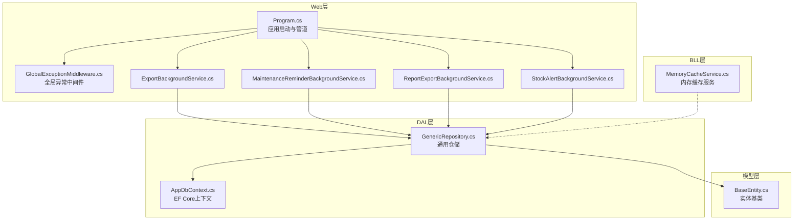
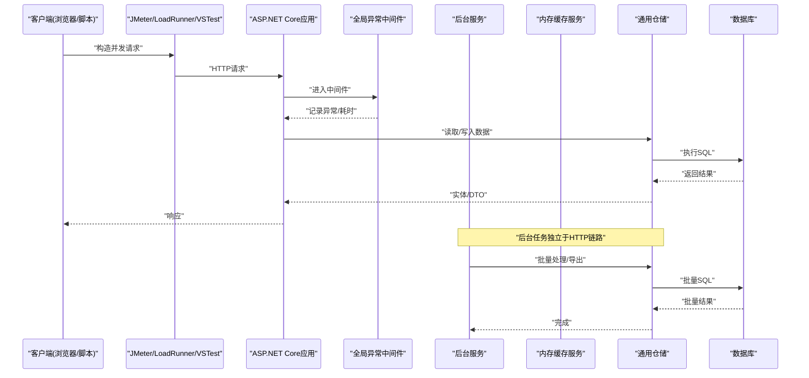
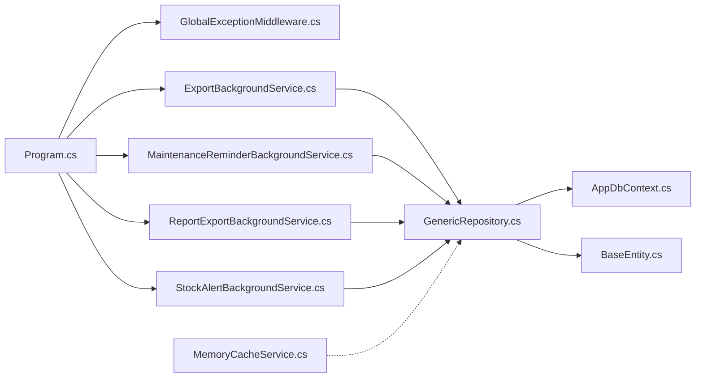

# 性能测试方法

<cite>
**本文引用的文件**   
- [EquipmentIMS.Web/Program.cs](file://EquipmentIMS.Web/Program.cs)
- [EquipmentIMS.Web/appsettings.json](file://EquipmentIMS.Web/appsettings.json)
- [EquipmentIMS.Web/Filters/GlobalExceptionMiddleware.cs](file://EquipmentIMS.Web/Filters/GlobalExceptionMiddleware.cs)
- [EquipmentIMS.Web/BackgroundServices/ExportBackgroundService.cs](file://EquipmentIMS.Web/BackgroundServices/ExportBackgroundService.cs)
- [EquipmentIMS.Web/BackgroundServices/MaintenanceReminderBackgroundService.cs](file://EquipmentIMS.Web/BackgroundServices/MaintenanceReminderBackgroundService.cs)
- [EquipmentIMS.Web/BackgroundServices/ReportExportBackgroundService.cs](file://EquipmentIMS.Web/BackgroundServices/ReportExportBackgroundService.cs)
- [EquipmentIMS.Web/BackgroundServices/StockAlertBackgroundService.cs](file://EquipmentIMS.Web/BackgroundServices/StockAlertBackgroundService.cs)
- [EquipmentIMS.BLL/Services/MemoryCacheService.cs](file://EquipmentIMS.BLL/Services/MemoryCacheService.cs)
- [EquipmentIMS.DAL/AppDbContext.cs](file://EquipmentIMS.DAL/AppDbContext.cs)
- [EquipmentIMS.DAL/Repositories/GenericRepository.cs](file://EquipmentIMS.DAL/Repositories/GenericRepository.cs)
- [EquipmentIMS.Models/Entities/BaseEntity.cs](file://EquipmentIMS.Models/Entities/BaseEntity.cs)
</cite>

## 目录
1. [引言](#引言)
2. [项目结构](#项目结构)
3. [核心组件](#核心组件)
4. [架构总览](#架构总览)
5. [详细组件分析](#详细组件分析)
6. [依赖分析](#依赖分析)
7. [性能考虑](#性能考虑)
8. [故障排查指南](#故障排查指南)
9. [结论](#结论)
10. [附录](#附录)

## 引言
本文件面向THMS（设备库存管理系统）的性能测试与优化，提供基于JMeter、LoadRunner与Visual Studio Load Test的端到端压测方案。内容覆盖关键指标监控与分析（响应时间、吞吐量、资源利用率）、数据库查询性能优化测试、并发访问压力测试、内存泄漏检测、后台任务与文件处理性能测试、缓存效果验证、基准建立与回归测试、瓶颈定位技术，以及生产环境监控与告警配置建议。文档同时结合代码仓库中的Web入口、中间件、后台服务、缓存实现与数据访问层，给出可落地的测试策略与观测点。

## 项目结构
THMS采用分层架构：Web层（控制器、过滤器、中间件、后台服务）、BLL业务层（服务与缓存）、DAL数据访问层（EF Core上下文与仓储）、Models领域模型。该结构为性能测试提供了清晰的切入点：
- Web层：HTTP接口、全局异常中间件、后台任务队列
- BLL层：内存缓存服务、业务逻辑
- DAL层：EF Core DbContext、通用仓储、实体基类
- Models层：DTO/实体定义

图表来源
- [EquipmentIMS.Web/Program.cs](file://EquipmentIMS.Web/Program.cs)
- [EquipmentIMS.Web/Filters/GlobalExceptionMiddleware.cs](file://EquipmentIMS.Web/Filters/GlobalExceptionMiddleware.cs)
- [EquipmentIMS.Web/BackgroundServices/ExportBackgroundService.cs](file://EquipmentIMS.Web/BackgroundServices/ExportBackgroundService.cs)
- [EquipmentIMS.Web/BackgroundServices/MaintenanceReminderBackgroundService.cs](file://EquipmentIMS.Web/BackgroundServices/MaintenanceReminderBackgroundService.cs)
- [EquipmentIMS.Web/BackgroundServices/ReportExportBackgroundService.cs](file://EquipmentIMS.Web/BackgroundServices/ReportExportBackgroundService.cs)
- [EquipmentIMS.Web/BackgroundServices/StockAlertBackgroundService.cs](file://EquipmentIMS.Web/BackgroundServices/StockAlertBackgroundService.cs)
- [EquipmentIMS.BLL/Services/MemoryCacheService.cs](file://EquipmentIMS.BLL/Services/MemoryCacheService.cs)
- [EquipmentIMS.DAL/AppDbContext.cs](file://EquipmentIMS.DAL/AppDbContext.cs)
- [EquipmentIMS.DAL/Repositories/GenericRepository.cs](file://EquipmentIMS.DAL/Repositories/GenericRepository.cs)
- [EquipmentIMS.Models/Entities/BaseEntity.cs](file://EquipmentIMS.Models/Entities/BaseEntity.cs)

章节来源
- [EquipmentIMS.Web/Program.cs](file://EquipmentIMS.Web/Program.cs)
- [EquipmentIMS.Web/appsettings.json](file://EquipmentIMS.Web/appsettings.json)

## 核心组件
- 应用启动与中间件：Program负责注册中间件与服务；全局异常中间件用于统一错误处理与日志记录，是压测时观察错误率与异常分布的关键点。
- 后台服务：导出、报表导出、维护提醒、库存预警等后台任务，适合进行异步吞吐与资源占用测试。
- 缓存服务：内存缓存服务用于热点数据加速，需验证命中率、过期策略与并发安全。
- 数据访问：EF Core上下文与通用仓储封装了CRUD与事务边界，是SQL执行计划与连接池调优的重点。

章节来源
- [EquipmentIMS.Web/Filters/GlobalExceptionMiddleware.cs](file://EquipmentIMS.Web/Filters/GlobalExceptionMiddleware.cs)
- [EquipmentIMS.Web/BackgroundServices/ExportBackgroundService.cs](file://EquipmentIMS.Web/BackgroundServices/ExportBackgroundService.cs)
- [EquipmentIMS.Web/BackgroundServices/ReportExportBackgroundService.cs](file://EquipmentIMS.Web/BackgroundServices/ReportExportBackgroundService.cs)
- [EquipmentIMS.BLL/Services/MemoryCacheService.cs](file://EquipmentIMS.BLL/Services/MemoryCacheService.cs)
- [EquipmentIMS.DAL/AppDbContext.cs](file://EquipmentIMS.DAL/AppDbContext.cs)
- [EquipmentIMS.DAL/Repositories/GenericRepository.cs](file://EquipmentIMS.DAL/Repositories/GenericRepository.cs)

## 架构总览
下图展示从客户端到数据库的完整调用链，标注了压测观测点（响应时间、错误率、CPU/内存、DB连接数、慢查询）。

图表来源
- [EquipmentIMS.Web/Filters/GlobalExceptionMiddleware.cs](file://EquipmentIMS.Web/Filters/GlobalExceptionMiddleware.cs)
- [EquipmentIMS.BLL/Services/MemoryCacheService.cs](file://EquipmentIMS.BLL/Services/MemoryCacheService.cs)
- [EquipmentIMS.DAL/Repositories/GenericRepository.cs](file://EquipmentIMS.DAL/Repositories/GenericRepository.cs)
- [EquipmentIMS.DAL/AppDbContext.cs](file://EquipmentIMS.DAL/AppDbContext.cs)
- [EquipmentIMS.Web/BackgroundServices/ExportBackgroundService.cs](file://EquipmentIMS.Web/BackgroundServices/ExportBackgroundService.cs)
- [EquipmentIMS.Web/BackgroundServices/ReportExportBackgroundService.cs](file://EquipmentIMS.Web/BackgroundServices/ReportExportBackgroundService.cs)

## 详细组件分析

### HTTP接口与中间件压测
- 目标：评估典型接口的P95/P99响应时间、错误率、吞吐与资源消耗。
- 步骤：
  - 使用JMeter/LoadRunner/VSTest构造登录、列表查询、创建/更新等场景。
  - 在中间件处采集异常与耗时，关注异常类型分布与慢请求占比。
  - 设置阶梯并发与恒定负载，观察拐点与饱和点。
- 观测点：
  - 应用层：请求计数、平均/分位响应时间、错误率、线程池等待。
  - 系统层：CPU使用率、内存RSS、GC次数与暂停、磁盘IO、网络带宽。
  - 数据库层：连接数、活跃会话、锁等待、慢查询数量。

章节来源
- [EquipmentIMS.Web/Filters/GlobalExceptionMiddleware.cs](file://EquipmentIMS.Web/Filters/GlobalExceptionMiddleware.cs)

### 后台任务性能测试
- 目标：评估导出、报表生成、维护提醒、库存预警等任务的吞吐与稳定性。
- 步骤：
  - 通过触发入口或API发起批量任务，或使用定时任务注入高负载。
  - 监控任务队列长度、处理时长、失败重试与死信情况。
  - 对大文件导出进行I/O与内存峰值测试，验证是否出现OOM或频繁GC。
- 观测点：
  - 任务成功率、平均处理时间、最大排队深度。
  - CPU/内存曲线、文件写入吞吐、临时文件清理。
  - 数据库批处理效率与锁竞争。

章节来源
- [EquipmentIMS.Web/BackgroundServices/ExportBackgroundService.cs](file://EquipmentIMS.Web/BackgroundServices/ExportBackgroundService.cs)
- [EquipmentIMS.Web/BackgroundServices/ReportExportBackgroundService.cs](file://EquipmentIMS.Web/BackgroundServices/ReportExportBackgroundService.cs)
- [EquipmentIMS.Web/BackgroundServices/MaintenanceReminderBackgroundService.cs](file://EquipmentIMS.Web/BackgroundServices/MaintenanceReminderBackgroundService.cs)
- [EquipmentIMS.Web/BackgroundServices/StockAlertBackgroundService.cs](file://EquipmentIMS.Web/BackgroundServices/StockAlertBackgroundService.cs)

### 缓存效果验证
- 目标：验证热点读路径的命中率、延迟降低与一致性保障。
- 步骤：
  - 设计“先写后读”与“纯读”场景，对比开启/关闭缓存的响应时间与QPS。
  - 模拟高并发读，观察缓存命中与未命中的比例。
  - 验证过期策略与并发更新下的正确性。
- 观测点：
  - 缓存命中率、平均命中延迟、未命中回源延迟。
  - 内存占用增长与回收行为。
  - 数据一致性与失效传播时效。

章节来源
- [EquipmentIMS.BLL/Services/MemoryCacheService.cs](file://EquipmentIMS.BLL/Services/MemoryCacheService.cs)

### 数据库查询性能优化测试
- 目标：识别慢查询、索引缺失与N+1问题，验证优化效果。
- 步骤：
  - 在仓储层与EF上下文中启用慢查询日志，收集执行计划。
  - 针对高频查询添加必要索引，避免SELECT *，减少不必要关联。
  - 使用分页与投影减少数据传输量。
- 观测点：
  - SQL执行时间、扫描行数、索引使用情况。
  - 连接池大小、长事务与锁等待。
  - 应用层CPU与内存随查询复杂度变化。

章节来源
- [EquipmentIMS.DAL/AppDbContext.cs](file://EquipmentIMS.DAL/AppDbContext.cs)
- [EquipmentIMS.DAL/Repositories/GenericRepository.cs](file://EquipmentIMS.DAL/Repositories/GenericRepository.cs)
- [EquipmentIMS.Models/Entities/BaseEntity.cs](file://EquipmentIMS.Models/Entities/BaseEntity.cs)

### 并发访问压力测试
- 目标：评估系统在多用户并发下的稳定性与容量上限。
- 步骤：
  - 构建混合工作负载（读多写少/读写均衡），逐步提升并发度。
  - 观察错误率上升拐点、响应时间抖动与资源饱和。
  - 引入限流与熔断策略，验证降级行为。
- 观测点：
  - 线程池队列长度、同步原语等待、上下文切换。
  - GC停顿时间与对象分配速率。
  - 数据库连接耗尽与超时。

章节来源
- [EquipmentIMS.Web/Program.cs](file://EquipmentIMS.Web/Program.cs)
- [EquipmentIMS.Web/Filters/GlobalExceptionMiddleware.cs](file://EquipmentIMS.Web/Filters/GlobalExceptionMiddleware.cs)

### 内存泄漏检测
- 目标：发现并定位长期运行下的内存泄漏。
- 步骤：
  - 长时间压测（如24小时）并采集堆快照，比较对象增长趋势。
  - 关注静态集合、事件订阅、未释放资源与第三方库引用。
  - 结合GC统计与内存采样工具定位热点对象。
- 观测点：
  - RSS持续增长、Gen2堆增大、Finalizer队列堆积。
  - 特定类型实例数量不降反升。
  - 大对象堆碎片化与频繁LOH分配。

章节来源
- [EquipmentIMS.BLL/Services/MemoryCacheService.cs](file://EquipmentIMS.BLL/Services/MemoryCacheService.cs)

### 文件处理性能测试
- 目标：评估导入/导出大文件的吞吐与稳定性。
- 步骤：
  - 使用不同大小的CSV/Excel文件进行导入导出，测量端到端耗时与峰值内存。
  - 验证流式处理与分批写入，避免一次性加载全部数据。
  - 检查磁盘空间与临时文件清理机制。
- 观测点：
  - I/O吞吐、磁盘队列长度、进程内存峰值。
  - 压缩/解压CPU开销与网络带宽占用。

章节来源
- [EquipmentIMS.Web/BackgroundServices/ExportBackgroundService.cs](file://EquipmentIMS.Web/BackgroundServices/ExportBackgroundService.cs)
- [EquipmentIMS.Web/BackgroundServices/ReportExportBackgroundService.cs](file://EquipmentIMS.Web/BackgroundServices/ReportExportBackgroundService.cs)

## 依赖分析
- 组件耦合：
  - Web层依赖中间件与后台服务；后台服务依赖仓储与数据库。
  - 缓存服务作为横切能力被业务层复用，需保证线程安全与一致性。
- 外部依赖：
  - EF Core与数据库驱动、日志框架、缓存实现。
- 潜在风险：
  - 仓储层未显式分页导致全表扫描。
  - 缓存未设置合理过期与淘汰策略引发内存膨胀。
  - 后台任务无背压控制导致队列无限增长。

图表来源
- [EquipmentIMS.Web/Program.cs](file://EquipmentIMS.Web/Program.cs)
- [EquipmentIMS.Web/Filters/GlobalExceptionMiddleware.cs](file://EquipmentIMS.Web/Filters/GlobalExceptionMiddleware.cs)
- [EquipmentIMS.Web/BackgroundServices/ExportBackgroundService.cs](file://EquipmentIMS.Web/BackgroundServices/ExportBackgroundService.cs)
- [EquipmentIMS.Web/BackgroundServices/MaintenanceReminderBackgroundService.cs](file://EquipmentIMS.Web/BackgroundServices/MaintenanceReminderBackgroundService.cs)
- [EquipmentIMS.Web/BackgroundServices/ReportExportBackgroundService.cs](file://EquipmentIMS.Web/BackgroundServices/ReportExportBackgroundService.cs)
- [EquipmentIMS.Web/BackgroundServices/StockAlertBackgroundService.cs](file://EquipmentIMS.Web/BackgroundServices/StockAlertBackgroundService.cs)
- [EquipmentIMS.BLL/Services/MemoryCacheService.cs](file://EquipmentIMS.BLL/Services/MemoryCacheService.cs)
- [EquipmentIMS.DAL/Repositories/GenericRepository.cs](file://EquipmentIMS.DAL/Repositories/GenericRepository.cs)
- [EquipmentIMS.DAL/AppDbContext.cs](file://EquipmentIMS.DAL/AppDbContext.cs)
- [EquipmentIMS.Models/Entities/BaseEntity.cs](file://EquipmentIMS.Models/Entities/BaseEntity.cs)

章节来源
- [EquipmentIMS.Web/Program.cs](file://EquipmentIMS.Web/Program.cs)
- [EquipmentIMS.BLL/Services/MemoryCacheService.cs](file://EquipmentIMS.BLL/Services/MemoryCacheService.cs)
- [EquipmentIMS.DAL/Repositories/GenericRepository.cs](file://EquipmentIMS.DAL/Repositories/GenericRepository.cs)

## 性能考虑
- 指标体系
  - 响应时间：平均、P95、P99、最大值。
  - 吞吐量：每秒请求数（RPS/QPS）、事务数。
  - 错误率：5xx比例、超时比例、业务错误码分布。
  - 资源利用率：CPU、内存、磁盘IO、网络带宽、线程池。
  - 数据库：连接数、慢查询、锁等待、缓冲命中率。
- 压测策略
  - 基准建立：单用户稳定负载下采集基线，记录关键指标阈值。
  - 回归测试：每次变更复跑基准场景，对比指标偏差。
  - 容量规划：找到饱和点与拐点，确定水平扩展与参数调优方向。
- 优化建议
  - 接口层：启用Gzip、减少响应体、避免阻塞调用。
  - 缓存层：热点键预热、合理TTL、分布式一致性策略。
  - 数据层：索引优化、分页与投影、批量操作、连接池调优。
  - 后台任务：背压与限流、分片与并行度控制、失败重试与幂等。

[本节为通用指导，无需具体文件分析]

## 故障排查指南
- 快速定位
  - 查看全局异常中间件的错误日志，筛选高频异常与堆栈。
  - 对比压测前后指标，定位新增瓶颈（CPU尖峰、内存泄漏、慢查询增多）。
- 常见症状与对策
  - 响应时间抖动：检查GC停顿、线程池饥饿、数据库锁等待。
  - 错误率升高：关注超时、连接池耗尽、上游依赖不可用。
  - 内存持续增长：定位未释放资源、静态集合膨胀、缓存未过期。
- 工具与方法
  - 应用层：内置诊断端点、结构化日志、分布式追踪。
  - 系统层：操作系统监控、容器指标、网络抓包。
  - 数据库层：慢查询日志、执行计划、锁与等待视图。

章节来源
- [EquipmentIMS.Web/Filters/GlobalExceptionMiddleware.cs](file://EquipmentIMS.Web/Filters/GlobalExceptionMiddleware.cs)

## 结论
通过对THMS的分层架构与关键组件进行系统化压测与观测，可以建立可靠的性能基准，持续回归验证，并在变更中快速定位瓶颈。结合缓存、数据库与后台任务的专项测试，能够显著提升系统的吞吐与稳定性。生产环境应完善监控与告警，确保问题早发现、早处置。

[本节为总结，无需具体文件分析]

## 附录

### 工具与场景清单
- JMeter
  - HTTP请求、循环控制器、定时器、监听器（聚合报告、图形结果）。
  - 场景：登录、列表查询、创建/更新、导出报表。
- LoadRunner
  - Vuser脚本录制与回放、参数化、思考时间、事务划分。
  - 场景：混合负载、阶梯加压、持久会话。
- Visual Studio Load Test
  - 单元测试驱动压测、断言与指标收集、集成CI。
  - 场景：自动化回归、增量变更对比。

[本节为通用指导，无需具体文件分析]

### 监控与告警配置建议
- 应用指标
  - 请求计数、响应时间分位、错误率、线程池状态、GC统计。
- 系统指标
  - CPU、内存、磁盘IO、网络带宽、进程句柄数。
- 数据库指标
  - 连接池大小、活跃会话、慢查询、锁等待、缓冲命中率。
- 告警规则
  - P99响应时间超过阈值、错误率突增、内存持续增长、慢查询激增、连接池耗尽。

[本节为通用指导，无需具体文件分析]

### 基准与回归流程
- 基准建立
  - 固定数据集与环境，采集稳定负载下的指标作为基线。
- 回归测试
  - 每次发布前自动执行基准场景，对比指标偏差，超阈报警。
- 报告输出
  - 生成趋势图与差异报告，辅助决策是否需要扩容或优化。

[本节为通用指导，无需具体文件分析]