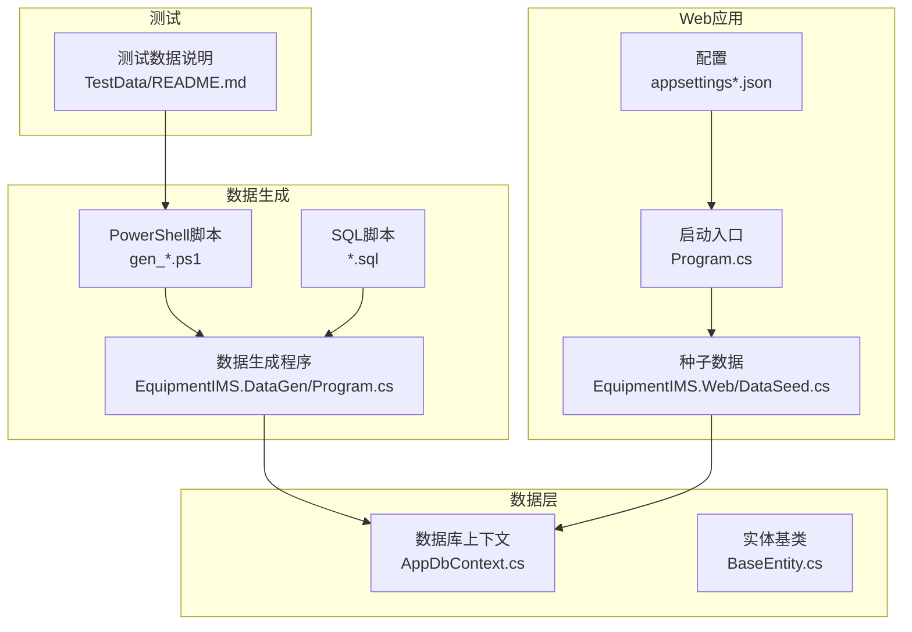
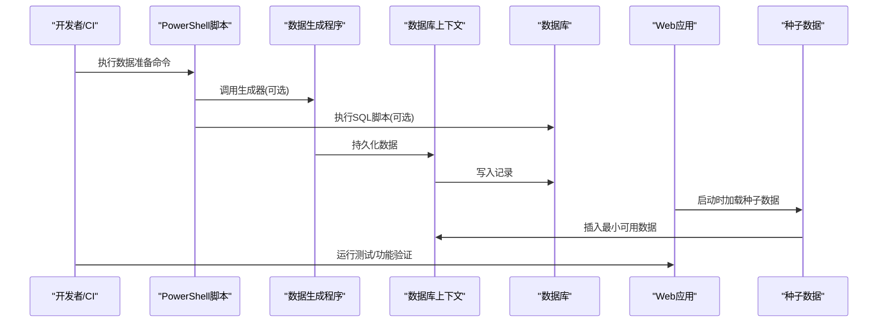
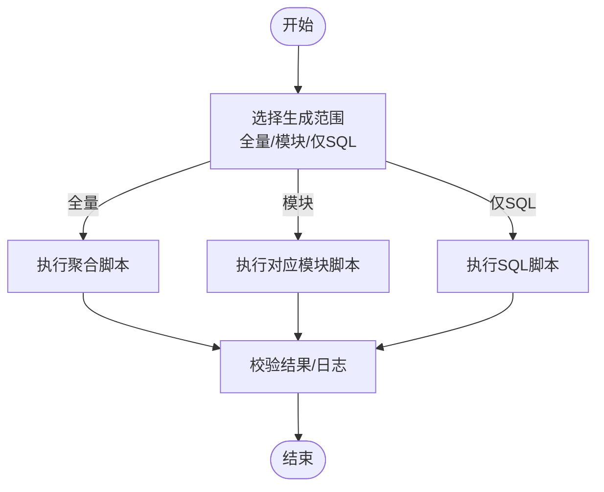
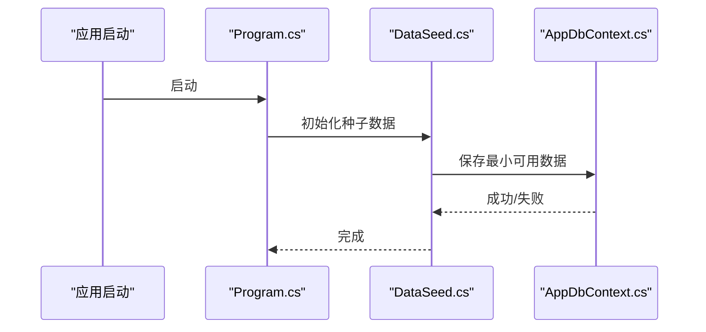
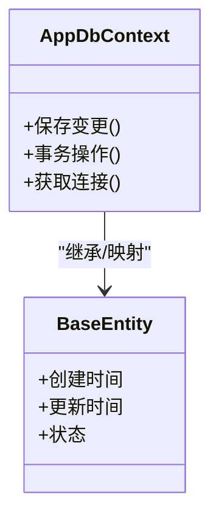
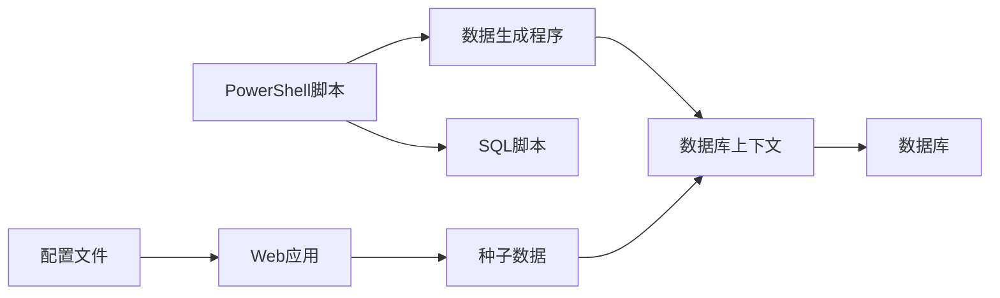

# 测试数据管理

<cite>
**本文引用的文件**   
- [EquipmentIMS.DataGen/Program.cs](file://EquipmentIMS.DataGen/Program.cs)
- [EquipmentIMS.Web/DataSeed.cs](file://EquipmentIMS.Web/DataSeed.cs)
- [EquipmentIMS.Web/appsettings.json](file://EquipmentIMS.Web/appsettings.json)
- [EquipmentIMS.Web/appsettings.Development.json](file://EquipmentIMS.Web/appsettings.Development.json)
- [EquipmentIMS.Web/Program.cs](file://EquipmentIMS.Web/Program.cs)
- [EquipmentIMS.DAL/AppDbContext.cs](file://EquipmentIMS.DAL/AppDbContext.cs)
- [EquipmentIMS.Models/Entities/BaseEntity.cs](file://EquipmentIMS.Models/Entities/BaseEntity.cs)
- [EquipmentIMS.Tests/TestData/README.md](file://EquipmentIMS.Tests/TestData/README.md)
- [gen_all.ps1](file://gen_all.ps1)
- [gen_sys.ps1](file://gen_sys.ps1)
- [gen_prod.ps1](file://gen_prod.ps1)
- [gen_pur.ps1](file://gen_pur.ps1)
- [gen_sale.ps1](file://gen_sale.ps1)
- [gen_stock.ps1](file://gen_stock.ps1)
- [gen_maint.ps1](file://gen_maint.ps1)
- [gen_inv.ps1](file://gen_inv.ps1)
- [base_data.sql](file://base_data.sql)
- [sys_data.sql](file://sys_data.sql)
- [demo_data.sql](file://demo_data.sql)
</cite>

## 目录
1. [简介](#简介)
2. [项目结构](#项目结构)
3. [核心组件](#核心组件)
4. [架构总览](#架构总览)
5. [详细组件分析](#详细组件分析)
6. [依赖关系分析](#依赖关系分析)
7. [性能考虑](#性能考虑)
8. [故障排查指南](#故障排查指南)
9. [结论](#结论)
10. [附录](#附录)

## 简介
本指南面向THMS（设备库存管理系统）的测试数据管理，覆盖以下目标：
- 测试数据的创建、组织与生命周期管理
- 使用数据生成工具批量创建基础数据、业务数据与边界数据
- 测试数据的版本控制、迁移与清理策略
- 不同测试场景的数据准备方法（正常流程、异常场景、性能大数据集）
- 敏感数据脱敏处理与测试环境独立数据源配置
- 数据一致性验证与测试数据快照管理

## 项目结构
仓库中与测试数据相关的核心位置包括：
- 数据生成程序：EquipmentIMS.DataGen
- Web应用种子数据：EquipmentIMS.Web/DataSeed.cs
- 数据库上下文与实体基类：EquipmentIMS.DAL/AppDbContext.cs、EquipmentIMS.Models/Entities/BaseEntity.cs
- 测试数据说明：EquipmentIMS.Tests/TestData/README.md
- PowerShell脚本与SQL脚本：根目录下的 gen_*.ps1 与 *.sql 文件
- 配置文件：appsettings.json、appsettings.Development.json、Program.cs

图表来源
- [EquipmentIMS.DataGen/Program.cs](file://EquipmentIMS.DataGen/Program.cs)
- [EquipmentIMS.Web/DataSeed.cs](file://EquipmentIMS.Web/DataSeed.cs)
- [EquipmentIMS.Web/appsettings.json](file://EquipmentIMS.Web/appsettings.json)
- [EquipmentIMS.Web/appsettings.Development.json](file://EquipmentIMS.Web/appsettings.Development.json)
- [EquipmentIMS.Web/Program.cs](file://EquipmentIMS.Web/Program.cs)
- [EquipmentIMS.DAL/AppDbContext.cs](file://EquipmentIMS.DAL/AppDbContext.cs)
- [EquipmentIMS.Models/Entities/BaseEntity.cs](file://EquipmentIMS.Models/Entities/BaseEntity.cs)
- [EquipmentIMS.Tests/TestData/README.md](file://EquipmentIMS.Tests/TestData/README.md)
- [gen_all.ps1](file://gen_all.ps1)
- [base_data.sql](file://base_data.sql)
- [sys_data.sql](file://sys_data.sql)
- [demo_data.sql](file://demo_data.sql)

章节来源
- [EquipmentIMS.DataGen/Program.cs](file://EquipmentIMS.DataGen/Program.cs)
- [EquipmentIMS.Web/DataSeed.cs](file://EquipmentIMS.Web/DataSeed.cs)
- [EquipmentIMS.Web/appsettings.json](file://EquipmentIMS.Web/appsettings.json)
- [EquipmentIMS.Web/appsettings.Development.json](file://EquipmentIMS.Web/appsettings.Development.json)
- [EquipmentIMS.Web/Program.cs](file://EquipmentIMS.Web/Program.cs)
- [EquipmentIMS.DAL/AppDbContext.cs](file://EquipmentIMS.DAL/AppDbContext.cs)
- [EquipmentIMS.Models/Entities/BaseEntity.cs](file://EquipmentIMS.Models/Entities/BaseEntity.cs)
- [EquipmentIMS.Tests/TestData/README.md](file://EquipmentIMS.Tests/TestData/README.md)
- [gen_all.ps1](file://gen_all.ps1)
- [gen_sys.ps1](file://gen_sys.ps1)
- [gen_prod.ps1](file://gen_prod.ps1)
- [gen_pur.ps1](file://gen_pur.ps1)
- [gen_sale.ps1](file://gen_sale.ps1)
- [gen_stock.ps1](file://gen_stock.ps1)
- [gen_maint.ps1](file://gen_maint.ps1)
- [gen_inv.ps1](file://gen_inv.ps1)
- [base_data.sql](file://base_data.sql)
- [sys_data.sql](file://sys_data.sql)
- [demo_data.sql](file://demo_data.sql)

## 核心组件
- 数据生成程序（DataGen）：提供批量生成基础、业务与边界数据的能力，支持按模块或全量执行。
- 种子数据（DataSeed）：在应用启动时注入最小可用数据集，确保系统可运行。
- 数据库上下文（AppDbContext）：统一数据访问入口，承载实体映射与事务边界。
- 实体基类（BaseEntity）：定义通用字段（如创建时间、更新时间等），保证数据一致性与审计能力。
- 测试数据说明（TestData/README.md）：规范测试数据存放、命名与使用说明。
- PowerShell脚本（gen_*.ps1）：编排SQL与生成器，实现一键化数据准备。
- SQL脚本（*.sql）：用于初始化基础字典、演示数据与系统配置。

章节来源
- [EquipmentIMS.DataGen/Program.cs](file://EquipmentIMS.DataGen/Program.cs)
- [EquipmentIMS.Web/DataSeed.cs](file://EquipmentIMS.Web/DataSeed.cs)
- [EquipmentIMS.DAL/AppDbContext.cs](file://EquipmentIMS.DAL/AppDbContext.cs)
- [EquipmentIMS.Models/Entities/BaseEntity.cs](file://EquipmentIMS.Models/Entities/BaseEntity.cs)
- [EquipmentIMS.Tests/TestData/README.md](file://EquipmentIMS.Tests/TestData/README.md)
- [gen_all.ps1](file://gen_all.ps1)
- [base_data.sql](file://base_data.sql)
- [sys_data.sql](file://sys_data.sql)
- [demo_data.sql](file://demo_data.sql)

## 架构总览
测试数据从“脚本/生成器”到“数据库”的整体路径如下：
- 通过PowerShell脚本调用SQL或直接驱动DataGen程序
- DataGen基于EF上下文写入数据库
- 应用启动时由DataSeed补充最小必要数据
- 测试用例读取已准备好的数据进行断言

图表来源
- [EquipmentIMS.DataGen/Program.cs](file://EquipmentIMS.DataGen/Program.cs)
- [EquipmentIMS.Web/DataSeed.cs](file://EquipmentIMS.Web/DataSeed.cs)
- [EquipmentIMS.Web/Program.cs](file://EquipmentIMS.Web/Program.cs)
- [EquipmentIMS.DAL/AppDbContext.cs](file://EquipmentIMS.DAL/AppDbContext.cs)
- [gen_all.ps1](file://gen_all.ps1)
- [base_data.sql](file://base_data.sql)
- [sys_data.sql](file://sys_data.sql)
- [demo_data.sql](file://demo_data.sql)

## 详细组件分析

### 数据生成程序（DataGen）
- 职责：集中式批量生成基础字典、主数据、业务单据与边界数据；支持按模块选择与全量生成。
- 关键能力：
  - 模块化生成：按业务域（系统、产品、采购、销售、库存、维护等）拆分脚本与参数
  - 幂等性：重复执行不产生重复数据（建议结合唯一键或存在性检查）
  - 失败回滚：对关键批处理采用事务包裹，失败自动回滚
  - 输出日志：生成err.txt/out.txt便于定位问题
- 典型用法：
  - 全量生成：执行聚合脚本
  - 分模块生成：分别执行系统、产品、采购、销售、库存、维护等脚本
  - 仅导入SQL：直接执行对应SQL脚本

图表来源
- [EquipmentIMS.DataGen/Program.cs](file://EquipmentIMS.DataGen/Program.cs)
- [gen_all.ps1](file://gen_all.ps1)
- [gen_sys.ps1](file://gen_sys.ps1)
- [gen_prod.ps1](file://gen_prod.ps1)
- [gen_pur.ps1](file://gen_pur.ps1)
- [gen_sale.ps1](file://gen_sale.ps1)
- [gen_stock.ps1](file://gen_stock.ps1)
- [gen_maint.ps1](file://gen_maint.ps1)
- [gen_inv.ps1](file://gen_inv.ps1)
- [base_data.sql](file://base_data.sql)
- [sys_data.sql](file://sys_data.sql)
- [demo_data.sql](file://demo_data.sql)

章节来源
- [EquipmentIMS.DataGen/Program.cs](file://EquipmentIMS.DataGen/Program.cs)
- [gen_all.ps1](file://gen_all.ps1)
- [gen_sys.ps1](file://gen_sys.ps1)
- [gen_prod.ps1](file://gen_prod.ps1)
- [gen_pur.ps1](file://gen_pur.ps1)
- [gen_sale.ps1](file://gen_sale.ps1)
- [gen_stock.ps1](file://gen_stock.ps1)
- [gen_maint.ps1](file://gen_maint.ps1)
- [gen_inv.ps1](file://gen_inv.ps1)
- [base_data.sql](file://base_data.sql)
- [sys_data.sql](file://sys_data.sql)
- [demo_data.sql](file://demo_data.sql)

### 种子数据（DataSeed）
- 职责：在应用启动阶段注入最小可用数据，保障系统可运行与权限体系可用。
- 触发时机：应用启动时由Program.cs引导加载。
- 内容范围：基础字典、默认角色/用户、必要系统配置等。
- 注意事项：
  - 避免与批量生成数据冲突（幂等设计）
  - 仅包含最小必需数据，复杂业务数据应由生成器负责

图表来源
- [EquipmentIMS.Web/DataSeed.cs](file://EquipmentIMS.Web/DataSeed.cs)
- [EquipmentIMS.Web/Program.cs](file://EquipmentIMS.Web/Program.cs)
- [EquipmentIMS.DAL/AppDbContext.cs](file://EquipmentIMS.DAL/AppDbContext.cs)

章节来源
- [EquipmentIMS.Web/DataSeed.cs](file://EquipmentIMS.Web/DataSeed.cs)
- [EquipmentIMS.Web/Program.cs](file://EquipmentIMS.Web/Program.cs)
- [EquipmentIMS.DAL/AppDbContext.cs](file://EquipmentIMS.DAL/AppDbContext.cs)

### 数据库上下文与实体基类
- AppDbContext：统一数据访问入口，承载实体映射、事务与连接字符串来源。
- BaseEntity：定义通用字段（如创建时间、更新时间等），为审计与一致性提供基础。

图表来源
- [EquipmentIMS.DAL/AppDbContext.cs](file://EquipmentIMS.DAL/AppDbContext.cs)
- [EquipmentIMS.Models/Entities/BaseEntity.cs](file://EquipmentIMS.Models/Entities/BaseEntity.cs)

章节来源
- [EquipmentIMS.DAL/AppDbContext.cs](file://EquipmentIMS.DAL/AppDbContext.cs)
- [EquipmentIMS.Models/Entities/BaseEntity.cs](file://EquipmentIMS.Models/Entities/BaseEntity.cs)

### 测试数据组织与说明
- 存放位置：EquipmentIMS.Tests/TestData
- 命名规范：按业务域与场景分类，例如“基础数据”、“业务流程”、“异常场景”、“性能数据”
- 版本控制：每个数据集附带版本标签与变更说明，便于回溯
- 使用方式：在测试前通过脚本或生成器准备数据，测试后清理或回滚

章节来源
- [EquipmentIMS.Tests/TestData/README.md](file://EquipmentIMS.Tests/TestData/README.md)

### 数据版本控制、迁移与清理策略
- 版本控制
  - 将SQL脚本与生成器参数纳入版本库，每次变更提交需包含数据影响说明
  - 为重要数据集打标签（如v1.0-base、v1.1-sale）
- 迁移
  - 增量迁移：新增字段/表时提供up/down脚本
  - 幂等执行：通过存在性判断避免重复插入
- 清理
  - 测试结束后按模块清理，保留基础字典
  - 提供一键清理脚本，支持选择性回滚

章节来源
- [EquipmentIMS.Tests/TestData/README.md](file://EquipmentIMS.Tests/TestData/README.md)
- [gen_all.ps1](file://gen_all.ps1)

### 不同测试场景的数据准备方法
- 正常流程数据
  - 使用聚合脚本或分模块脚本准备完整业务链路数据
  - 示例：采购订单→入库→库存变动→销售出库→退货
- 异常场景数据
  - 构造边界值与非法输入（负数数量、超库存、缺失必填项）
  - 通过SQL或生成器参数注入异常分支所需的基础数据
- 性能测试大数据集
  - 使用生成器批量生产大量主数据与交易流水
  - 分批提交与索引优化，避免单次事务过大

章节来源
- [EquipmentIMS.DataGen/Program.cs](file://EquipmentIMS.DataGen/Program.cs)
- [gen_all.ps1](file://gen_all.ps1)
- [gen_pur.ps1](file://gen_pur.ps1)
- [gen_sale.ps1](file://gen_sale.ps1)
- [gen_stock.ps1](file://gen_stock.ps1)
- [gen_maint.ps1](file://gen_maint.ps1)
- [gen_inv.ps1](file://gen_inv.ps1)

### 敏感数据脱敏与测试环境独立数据源
- 脱敏原则
  - 姓名、手机号、邮箱、地址等个人信息必须脱敏
  - 金额、单价等数值型字段保持合理分布但非真实值
- 脱敏实现
  - 在生成器中内置脱敏规则，替换真实值
  - SQL脚本中使用函数或占位符替换
- 独立数据源
  - 通过配置文件指定测试数据库连接串
  - 开发环境与测试环境分离，避免污染生产数据

章节来源
- [EquipmentIMS.Web/appsettings.json](file://EquipmentIMS.Web/appsettings.json)
- [EquipmentIMS.Web/appsettings.Development.json](file://EquipmentIMS.Web/appsettings.Development.json)
- [EquipmentIMS.DataGen/Program.cs](file://EquipmentIMS.DataGen/Program.cs)

### 数据一致性验证与快照管理
- 一致性验证
  - 在数据准备完成后执行校验脚本，核对关键指标（总量、关联完整性、枚举值范围）
  - 对关键业务链进行端到端断言（如库存余额=期初+入库-出库）
- 快照管理
  - 为重要数据集导出快照（SQL备份或JSON序列化）
  - 快照命名包含版本号与用途，便于快速恢复

章节来源
- [EquipmentIMS.Tests/TestData/README.md](file://EquipmentIMS.Tests/TestData/README.md)
- [EquipmentIMS.DataGen/Program.cs](file://EquipmentIMS.DataGen/Program.cs)

## 依赖关系分析
- 生成器与脚本
  - PowerShell脚本作为编排层，调用SQL与生成器
  - 生成器依赖数据库上下文进行持久化
- 应用与种子数据
  - 应用启动时加载种子数据，确保最小可用状态
- 配置与环境
  - 通过配置文件切换不同环境的数据库连接

图表来源
- [EquipmentIMS.DataGen/Program.cs](file://EquipmentIMS.DataGen/Program.cs)
- [EquipmentIMS.Web/DataSeed.cs](file://EquipmentIMS.Web/DataSeed.cs)
- [EquipmentIMS.Web/Program.cs](file://EquipmentIMS.Web/Program.cs)
- [EquipmentIMS.DAL/AppDbContext.cs](file://EquipmentIMS.DAL/AppDbContext.cs)
- [EquipmentIMS.Web/appsettings.json](file://EquipmentIMS.Web/appsettings.json)
- [EquipmentIMS.Web/appsettings.Development.json](file://EquipmentIMS.Web/appsettings.Development.json)
- [gen_all.ps1](file://gen_all.ps1)
- [base_data.sql](file://base_data.sql)
- [sys_data.sql](file://sys_data.sql)
- [demo_data.sql](file://demo_data.sql)

章节来源
- [EquipmentIMS.DataGen/Program.cs](file://EquipmentIMS.DataGen/Program.cs)
- [EquipmentIMS.Web/DataSeed.cs](file://EquipmentIMS.Web/DataSeed.cs)
- [EquipmentIMS.Web/Program.cs](file://EquipmentIMS.Web/Program.cs)
- [EquipmentIMS.DAL/AppDbContext.cs](file://EquipmentIMS.DAL/AppDbContext.cs)
- [EquipmentIMS.Web/appsettings.json](file://EquipmentIMS.Web/appsettings.json)
- [EquipmentIMS.Web/appsettings.Development.json](file://EquipmentIMS.Web/appsettings.Development.json)
- [gen_all.ps1](file://gen_all.ps1)
- [base_data.sql](file://base_data.sql)
- [sys_data.sql](file://sys_data.sql)
- [demo_data.sql](file://demo_data.sql)

## 性能考虑
- 批量写入
  - 使用批量插入与事务合并，减少往返次数
  - 对高频写入表建立合适索引，避免锁竞争
- 数据规模
  - 性能测试数据集应分批次生成，避免单次事务过大导致超时
- 资源隔离
  - 测试数据库与生产数据库物理隔离，避免资源争用

[本节为通用指导，无需特定文件引用]

## 故障排查指南
- 常见问题
  - 连接失败：检查配置文件中的连接串是否正确指向测试数据库
  - 重复数据：确认生成器与SQL脚本是否具备幂等逻辑
  - 权限不足：确认数据库用户具备必要的DDL/DML权限
- 日志与输出
  - 查看生成器的err.txt/out.txt定位错误
  - 检查应用启动日志，确认种子数据是否成功加载
- 回滚与恢复
  - 使用快照恢复最近稳定版本
  - 提供清理脚本，按模块回滚数据

章节来源
- [EquipmentIMS.Web/appsettings.json](file://EquipmentIMS.Web/appsettings.json)
- [EquipmentIMS.Web/appsettings.Development.json](file://EquipmentIMS.Web/appsettings.Development.json)
- [EquipmentIMS.DataGen/Program.cs](file://EquipmentIMS.DataGen/Program.cs)
- [EquipmentIMS.Web/DataSeed.cs](file://EquipmentIMS.Web/DataSeed.cs)

## 结论
通过统一的生成器、脚本编排与种子数据机制，THMS实现了可复现、可追溯、可清理的测试数据管理体系。配合脱敏规则、独立数据源与一致性校验，能够支撑正常流程、异常场景与性能测试等多类需求，并具备良好的版本控制与快照管理能力。

[本节为总结性内容，无需特定文件引用]

## 附录
- 常用命令
  - 全量生成：执行聚合脚本
  - 分模块生成：分别执行系统、产品、采购、销售、库存、维护等脚本
  - 仅导入SQL：直接执行对应SQL脚本
- 参考文件
  - 生成器：EquipmentIMS.DataGen/Program.cs
  - 种子数据：EquipmentIMS.Web/DataSeed.cs
  - 上下文与基类：EquipmentIMS.DAL/AppDbContext.cs、EquipmentIMS.Models/Entities/BaseEntity.cs
  - 测试说明：EquipmentIMS.Tests/TestData/README.md
  - 脚本与SQL：gen_*.ps1、*.sql

章节来源
- [EquipmentIMS.DataGen/Program.cs](file://EquipmentIMS.DataGen/Program.cs)
- [EquipmentIMS.Web/DataSeed.cs](file://EquipmentIMS.Web/DataSeed.cs)
- [EquipmentIMS.DAL/AppDbContext.cs](file://EquipmentIMS.DAL/AppDbContext.cs)
- [EquipmentIMS.Models/Entities/BaseEntity.cs](file://EquipmentIMS.Models/Entities/BaseEntity.cs)
- [EquipmentIMS.Tests/TestData/README.md](file://EquipmentIMS.Tests/TestData/README.md)
- [gen_all.ps1](file://gen_all.ps1)
- [gen_sys.ps1](file://gen_sys.ps1)
- [gen_prod.ps1](file://gen_prod.ps1)
- [gen_pur.ps1](file://gen_pur.ps1)
- [gen_sale.ps1](file://gen_sale.ps1)
- [gen_stock.ps1](file://gen_stock.ps1)
- [gen_maint.ps1](file://gen_maint.ps1)
- [gen_inv.ps1](file://gen_inv.ps1)
- [base_data.sql](file://base_data.sql)
- [sys_data.sql](file://sys_data.sql)
- [demo_data.sql](file://demo_data.sql)