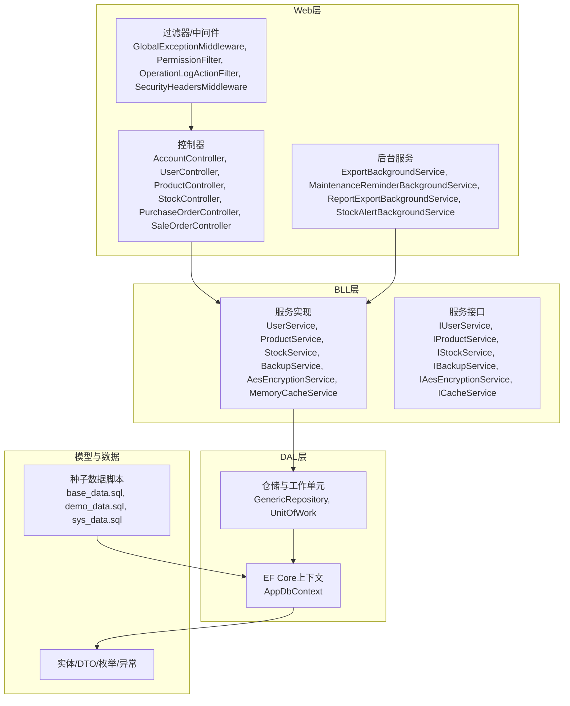
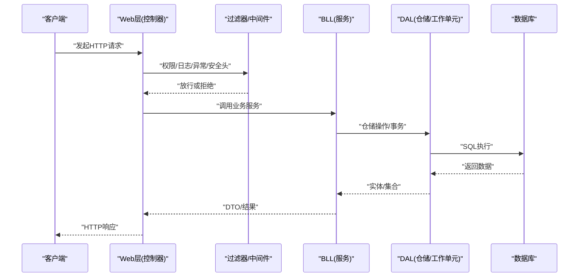
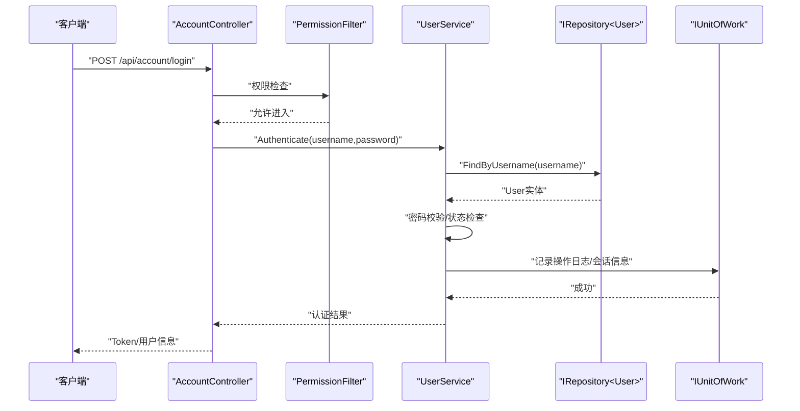
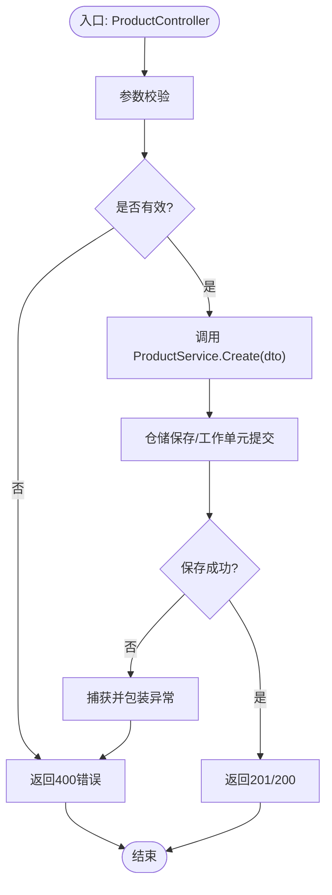
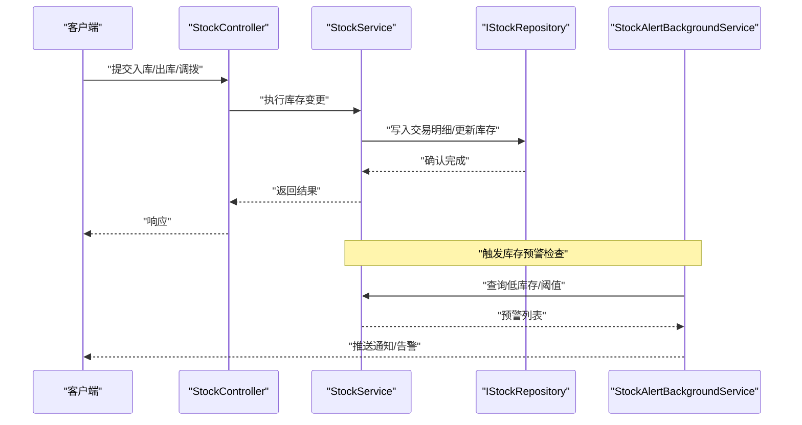
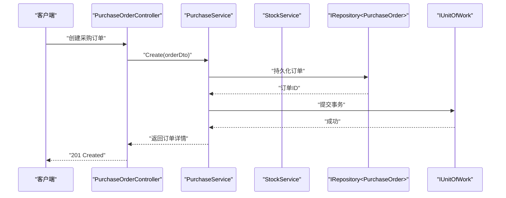
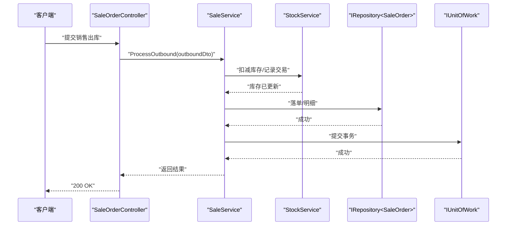
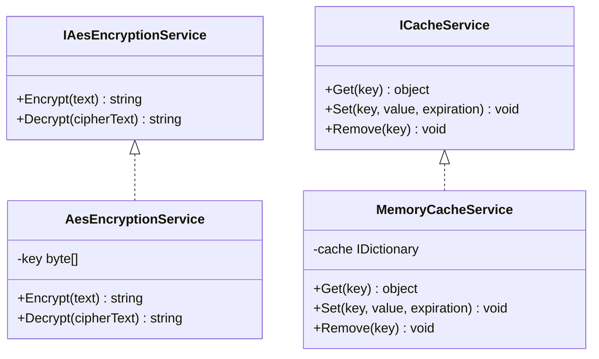
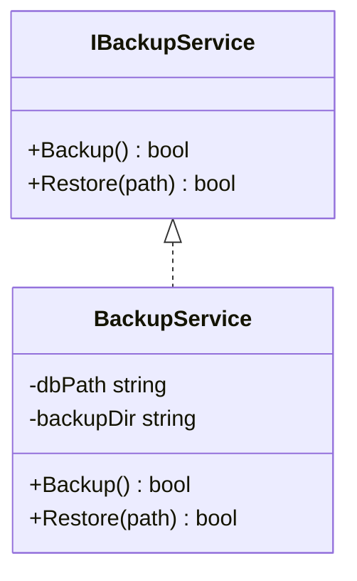
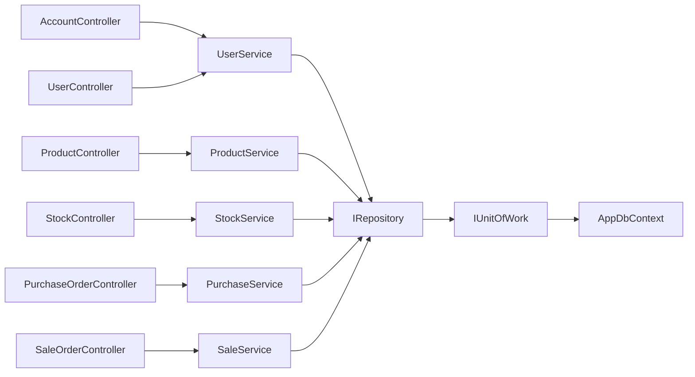

# 测试策略

<cite>
**本文引用的文件**   
- [EquipmentIMS.sln](file://EquipmentIMS.sln)
- [EquipmentIMS.Tests.csproj](file://EquipmentIMS.Tests/EquipmentIMS.Tests.csproj)
- [Program.cs](file://EquipmentIMS.Web/Program.cs)
- [AppDbContext.cs](file://EquipmentIMS.DAL/AppDbContext.cs)
- [ServiceCollectionExtensions.cs](file://EquipmentIMS.BLL/Extensions/ServiceCollectionExtensions.cs)
- [ServiceCollectionExtensions.cs](file://EquipmentIMS.DAL/Extensions/ServiceCollectionExtensions.cs)
- [GlobalExceptionMiddleware.cs](file://EquipmentIMS.Web/Filters/GlobalExceptionMiddleware.cs)
- [PermissionFilter.cs](file://EquipmentIMS.Web/Filters/PermissionFilter.cs)
- [OperationLogActionFilter.cs](file://EquipmentIMS.Web/Filters/OperationLogActionFilter.cs)
- [SecurityHeadersMiddleware.cs](file://EquipmentIMS.Web/Filters/SecurityHeadersMiddleware.cs)
- [ExportBackgroundService.cs](file://EquipmentIMS.Web/BackgroundServices/ExportBackgroundService.cs)
- [MaintenanceReminderBackgroundService.cs](file://EquipmentIMS.Web/BackgroundServices/MaintenanceReminderBackgroundService.cs)
- [ReportExportBackgroundService.cs](file://EquipmentIMS.Web/BackgroundServices/ReportExportBackgroundService.cs)
- [StockAlertBackgroundService.cs](file://EquipmentIMS.Web/BackgroundServices/StockAlertBackgroundService.cs)
- [GenericRepository.cs](file://EquipmentIMS.DAL/Repositories/GenericRepository.cs)
- [UnitOfWork.cs](file://EquipmentIMS.DAL/Repositories/UnitOfWork.cs)
- [IRepository.cs](file://EquipmentIMS.DAL/Interfaces/IRepository.cs)
- [IUnitOfWork.cs](file://EquipmentIMS.DAL/Interfaces/IUnitOfWork.cs)
- [MemoryCacheService.cs](file://EquipmentIMS.BLL/Services/MemoryCacheService.cs)
- [IAesEncryptionService.cs](file://EquipmentIMS.BLL/Interfaces/IAesEncryptionService.cs)
- [AesEncryptionService.cs](file://EquipmentIMS.BLL/Services/AesEncryptionService.cs)
- [ICacheService.cs](file://EquipmentIMS.BLL/Interfaces/ICacheService.cs)
- [BackupService.cs](file://EquipmentIMS.BLL/Services/BackupService.cs)
- [IBackupService.cs](file://EquipmentIMS.BLL/Interfaces/IBackupService.cs)
- [UserService.cs](file://EquipmentIMS.BLL/Services/UserService.cs)
- [IUserService.cs](file://EquipmentIMS.BLL/Interfaces/IUserService.cs)
- [ProductService.cs](file://EquipmentIMS.BLL/Services/ProductService.cs)
- [IProductService.cs](file://EquipmentIMS.BLL/Interfaces/IProductService.cs)
- [StockService.cs](file://EquipmentIMS.BLL/Services/StockService.cs)
- [IStockService.cs](file://EquipmentIMS.BLL/Interfaces/IStockService.cs)
- [PurchaseOrderService.cs](file://EquipmentIMS.BLL/Services/PurchaseService.cs)
- [IPurchaseService.cs](file://EquipmentIMS.BLL/Interfaces/IPurchaseService.cs)
- [SaleOrderService.cs](file://EquipmentIMS.BLL/Services/SaleService.cs)
- [ISaleService.cs](file://EquipmentIMS.BLL/Interfaces/ISaleService.cs)
- [AccountController.cs](file://EquipmentIMS.Web/Controllers/AccountController.cs)
- [UserController.cs](file://EquipmentIMS.Web/Controllers/UserController.cs)
- [ProductController.cs](file://EquipmentIMS.Web/Controllers/ProductController.cs)
- [StockController.cs](file://EquipmentIMS.Web/Controllers/StockController.cs)
- [PurchaseOrderController.cs](file://EquipmentIMS.Web/Controllers/PurchaseOrderController.cs)
- [SaleOrderController.cs](file://EquipmentIMS.Web/Controllers/SaleOrderController.cs)
- [DataSeed.cs](file://EquipmentIMS.Web/DataSeed.cs)
- [appsettings.json](file://EquipmentIMS.Web/appsettings.json)
- [appsettings.Development.json](file://EquipmentIMS.Web/appsettings.Development.json)
- [base_data.sql](file://base_data.sql)
- [demo_data.sql](file://demo_data.sql)
- [sys_data.sql](file://sys_data.sql)
- [gen_all.ps1](file://gen_all.ps1)
</cite>

## 目录
1. [引言](#引言)
2. [项目结构](#项目结构)
3. [核心组件](#核心组件)
4. [架构总览](#架构总览)
5. [详细组件分析](#详细组件分析)
6. [依赖关系分析](#依赖关系分析)
7. [性能考虑](#性能考虑)
8. [故障排查指南](#故障排查指南)
9. [结论](#结论)
10. [附录](#附录)

## 引言
本测试策略面向THMS（设备库存管理系统）的分层架构，覆盖单元测试、集成测试与端到端测试的层次结构与编写规范；明确Mock对象创建、测试数据准备、断言最佳实践；定义覆盖率目标、持续集成配置与自动化流程；给出性能与压力测试方法、工具推荐；并提供测试环境搭建、测试数据管理与结果分析指导；最后说明Bug复现、回归测试与质量保证流程。

## 项目结构
THMS采用典型分层架构：Web层（控制器、中间件、过滤器、后台服务）、BLL业务逻辑层（服务与接口）、DAL数据访问层（仓储、工作单元、EF Core上下文）、Models领域模型与DTOs。测试工程位于独立的测试项目中，便于隔离运行与并行执行。

图表来源
- [Program.cs](file://EquipmentIMS.Web/Program.cs)
- [AppDbContext.cs](file://EquipmentIMS.DAL/AppDbContext.cs)
- [ServiceCollectionExtensions.cs](file://EquipmentIMS.BLL/Extensions/ServiceCollectionExtensions.cs)
- [ServiceCollectionExtensions.cs](file://EquipmentIMS.DAL/Extensions/ServiceCollectionExtensions.cs)
- [GenericRepository.cs](file://EquipmentIMS.DAL/Repositories/GenericRepository.cs)
- [UnitOfWork.cs](file://EquipmentIMS.DAL/Repositories/UnitOfWork.cs)
- [AccountController.cs](file://EquipmentIMS.Web/Controllers/AccountController.cs)
- [UserController.cs](file://EquipmentIMS.Web/Controllers/UserController.cs)
- [ProductController.cs](file://EquipmentIMS.Web/Controllers/ProductController.cs)
- [StockController.cs](file://EquipmentIMS.Web/Controllers/StockController.cs)
- [PurchaseOrderController.cs](file://EquipmentIMS.Web/Controllers/PurchaseOrderController.cs)
- [SaleOrderController.cs](file://EquipmentIMS.Web/Controllers/SaleOrderController.cs)
- [ExportBackgroundService.cs](file://EquipmentIMS.Web/BackgroundServices/ExportBackgroundService.cs)
- [MaintenanceReminderBackgroundService.cs](file://EquipmentIMS.Web/BackgroundServices/MaintenanceReminderBackgroundService.cs)
- [ReportExportBackgroundService.cs](file://EquipmentIMS.Web/BackgroundServices/ReportExportBackgroundService.cs)
- [StockAlertBackgroundService.cs](file://EquipmentIMS.Web/BackgroundServices/StockAlertBackgroundService.cs)
- [GlobalExceptionMiddleware.cs](file://EquipmentIMS.Web/Filters/GlobalExceptionMiddleware.cs)
- [PermissionFilter.cs](file://EquipmentIMS.Web/Filters/PermissionFilter.cs)
- [OperationLogActionFilter.cs](file://EquipmentIMS.Web/Filters/OperationLogActionFilter.cs)
- [SecurityHeadersMiddleware.cs](file://EquipmentIMS.Web/Filters/SecurityHeadersMiddleware.cs)
- [base_data.sql](file://base_data.sql)
- [demo_data.sql](file://demo_data.sql)
- [sys_data.sql](file://sys_data.sql)

章节来源
- [EquipmentIMS.sln](file://EquipmentIMS.sln)
- [EquipmentIMS.Tests.csproj](file://EquipmentIMS.Tests/EquipmentIMS.Tests.csproj)
- [Program.cs](file://EquipmentIMS.Web/Program.cs)

## 核心组件
- 控制器层：负责HTTP请求处理、参数校验、权限控制与响应封装。
- 业务服务层：封装领域规则、事务边界、跨服务编排与外部依赖调用。
- 数据访问层：通过仓储模式抽象数据库操作，工作单元管理事务一致性。
- 中间件与过滤器：统一异常处理、日志记录、安全头注入与权限拦截。
- 后台服务：异步导出、维护提醒、报表导出与库存预警等定时任务。
- 测试工程：按BLL/DAL分层组织测试用例，提供测试数据与Mock基础设施。

章节来源
- [AccountController.cs](file://EquipmentIMS.Web/Controllers/AccountController.cs)
- [UserService.cs](file://EquipmentIMS.BLL/Services/UserService.cs)
- [IUserService.cs](file://EquipmentIMS.BLL/Interfaces/IUserService.cs)
- [GenericRepository.cs](file://EquipmentIMS.DAL/Repositories/GenericRepository.cs)
- [IRepository.cs](file://EquipmentIMS.DAL/Interfaces/IRepository.cs)
- [UnitOfWork.cs](file://EquipmentIMS.DAL/Repositories/UnitOfWork.cs)
- [IUnitOfWork.cs](file://EquipmentIMS.DAL/Interfaces/IUnitOfWork.cs)
- [GlobalExceptionMiddleware.cs](file://EquipmentIMS.Web/Filters/GlobalExceptionMiddleware.cs)
- [PermissionFilter.cs](file://EquipmentIMS.Web/Filters/PermissionFilter.cs)
- [OperationLogActionFilter.cs](file://EquipmentIMS.Web/Filters/OperationLogActionFilter.cs)
- [SecurityHeadersMiddleware.cs](file://EquipmentIMS.Web/Filters/SecurityHeadersMiddleware.cs)
- [ExportBackgroundService.cs](file://EquipmentIMS.Web/BackgroundServices/ExportBackgroundService.cs)
- [MaintenanceReminderBackgroundService.cs](file://EquipmentIMS.Web/BackgroundServices/MaintenanceReminderBackgroundService.cs)
- [ReportExportBackgroundService.cs](file://EquipmentIMS.Web/BackgroundServices/ReportExportBackgroundService.cs)
- [StockAlertBackgroundService.cs](file://EquipmentIMS.Web/BackgroundServices/StockAlertBackgroundService.cs)

## 架构总览
下图展示从HTTP请求到业务逻辑与数据访问的调用链，以及关键横切关注点（异常、日志、权限、安全头）的位置。

图表来源
- [Program.cs](file://EquipmentIMS.Web/Program.cs)
- [AccountController.cs](file://EquipmentIMS.Web/Controllers/AccountController.cs)
- [PermissionFilter.cs](file://EquipmentIMS.Web/Filters/PermissionFilter.cs)
- [OperationLogActionFilter.cs](file://EquipmentIMS.Web/Filters/OperationLogActionFilter.cs)
- [GlobalExceptionMiddleware.cs](file://EquipmentIMS.Web/Filters/GlobalExceptionMiddleware.cs)
- [SecurityHeadersMiddleware.cs](file://EquipmentIMS.Web/Filters/SecurityHeadersMiddleware.cs)
- [UserService.cs](file://EquipmentIMS.BLL/Services/UserService.cs)
- [GenericRepository.cs](file://EquipmentIMS.DAL/Repositories/GenericRepository.cs)
- [UnitOfWork.cs](file://EquipmentIMS.DAL/Repositories/UnitOfWork.cs)
- [AppDbContext.cs](file://EquipmentIMS.DAL/AppDbContext.cs)

## 详细组件分析

### 认证与授权流程（登录）
该序列图描述用户登录的关键路径，包括权限过滤、业务验证与响应生成。

图表来源
- [AccountController.cs](file://EquipmentIMS.Web/Controllers/AccountController.cs)
- [PermissionFilter.cs](file://EquipmentIMS.Web/Filters/PermissionFilter.cs)
- [UserService.cs](file://EquipmentIMS.BLL/Services/UserService.cs)
- [IRepository.cs](file://EquipmentIMS.DAL/Interfaces/IRepository.cs)
- [IUnitOfWork.cs](file://EquipmentIMS.DAL/Interfaces/IUnitOfWork.cs)

章节来源
- [AccountController.cs](file://EquipmentIMS.Web/Controllers/AccountController.cs)
- [PermissionFilter.cs](file://EquipmentIMS.Web/Filters/PermissionFilter.cs)
- [UserService.cs](file://EquipmentIMS.BLL/Services/UserService.cs)
- [IRepository.cs](file://EquipmentIMS.DAL/Interfaces/IRepository.cs)
- [IUnitOfWork.cs](file://EquipmentIMS.DAL/Interfaces/IUnitOfWork.cs)

### 产品增删改查（CRUD）

图表来源
- [ProductController.cs](file://EquipmentIMS.Web/Controllers/ProductController.cs)
- [ProductService.cs](file://EquipmentIMS.BLL/Services/ProductService.cs)
- [GenericRepository.cs](file://EquipmentIMS.DAL/Repositories/GenericRepository.cs)
- [UnitOfWork.cs](file://EquipmentIMS.DAL/Repositories/UnitOfWork.cs)

章节来源
- [ProductController.cs](file://EquipmentIMS.Web/Controllers/ProductController.cs)
- [ProductService.cs](file://EquipmentIMS.BLL/Services/ProductService.cs)
- [GenericRepository.cs](file://EquipmentIMS.DAL/Repositories/GenericRepository.cs)
- [UnitOfWork.cs](file://EquipmentIMS.DAL/Repositories/UnitOfWork.cs)

### 库存交易与预警

图表来源
- [StockController.cs](file://EquipmentIMS.Web/Controllers/StockController.cs)
- [StockService.cs](file://EquipmentIMS.BLL/Services/StockService.cs)
- [StockAlertBackgroundService.cs](file://EquipmentIMS.Web/BackgroundServices/StockAlertBackgroundService.cs)

章节来源
- [StockController.cs](file://EquipmentIMS.Web/Controllers/StockController.cs)
- [StockService.cs](file://EquipmentIMS.BLL/Services/StockService.cs)
- [StockAlertBackgroundService.cs](file://EquipmentIMS.Web/BackgroundServices/StockAlertBackgroundService.cs)

### 采购订单流程

图表来源
- [PurchaseOrderController.cs](file://EquipmentIMS.Web/Controllers/PurchaseOrderController.cs)
- [PurchaseService.cs](file://EquipmentIMS.BLL/Services/PurchaseService.cs)
- [StockService.cs](file://EquipmentIMS.BLL/Services/StockService.cs)
- [IRepository.cs](file://EquipmentIMS.DAL/Interfaces/IRepository.cs)
- [IUnitOfWork.cs](file://EquipmentIMS.DAL/Interfaces/IUnitOfWork.cs)

章节来源
- [PurchaseOrderController.cs](file://EquipmentIMS.Web/Controllers/PurchaseOrderController.cs)
- [PurchaseService.cs](file://EquipmentIMS.BLL/Services/PurchaseService.cs)
- [StockService.cs](file://EquipmentIMS.BLL/Services/StockService.cs)
- [IRepository.cs](file://EquipmentIMS.DAL/Interfaces/IRepository.cs)
- [IUnitOfWork.cs](file://EquipmentIMS.DAL/Interfaces/IUnitOfWork.cs)

### 销售订单流程

图表来源
- [SaleOrderController.cs](file://EquipmentIMS.Web/Controllers/SaleOrderController.cs)
- [SaleService.cs](file://EquipmentIMS.BLL/Services/SaleService.cs)
- [StockService.cs](file://EquipmentIMS.BLL/Services/StockService.cs)
- [IRepository.cs](file://EquipmentIMS.DAL/Interfaces/IRepository.cs)
- [IUnitOfWork.cs](file://EquipmentIMS.DAL/Interfaces/IUnitOfWork.cs)

章节来源
- [SaleOrderController.cs](file://EquipmentIMS.Web/Controllers/SaleOrderController.cs)
- [SaleService.cs](file://EquipmentIMS.BLL/Services/SaleService.cs)
- [StockService.cs](file://EquipmentIMS.BLL/Services/StockService.cs)
- [IRepository.cs](file://EquipmentIMS.DAL/Interfaces/IRepository.cs)
- [IUnitOfWork.cs](file://EquipmentIMS.DAL/Interfaces/IUnitOfWork.cs)

### 加密与缓存服务

图表来源
- [IAesEncryptionService.cs](file://EquipmentIMS.BLL/Interfaces/IAesEncryptionService.cs)
- [AesEncryptionService.cs](file://EquipmentIMS.BLL/Services/AesEncryptionService.cs)
- [ICacheService.cs](file://EquipmentIMS.BLL/Interfaces/ICacheService.cs)
- [MemoryCacheService.cs](file://EquipmentIMS.BLL/Services/MemoryCacheService.cs)

章节来源
- [IAesEncryptionService.cs](file://EquipmentIMS.BLL/Interfaces/IAesEncryptionService.cs)
- [AesEncryptionService.cs](file://EquipmentIMS.BLL/Services/AesEncryptionService.cs)
- [ICacheService.cs](file://EquipmentIMS.BLL/Interfaces/ICacheService.cs)
- [MemoryCacheService.cs](file://EquipmentIMS.BLL/Services/MemoryCacheService.cs)

### 备份服务

图表来源
- [IBackupService.cs](file://EquipmentIMS.BLL/Interfaces/IBackupService.cs)
- [BackupService.cs](file://EquipmentIMS.BLL/Services/BackupService.cs)

章节来源
- [IBackupService.cs](file://EquipmentIMS.BLL/Interfaces/IBackupService.cs)
- [BackupService.cs](file://EquipmentIMS.BLL/Services/BackupService.cs)

## 依赖关系分析
- 控制器依赖服务接口，服务依赖仓储接口与工作单元，仓储依赖EF Core上下文。
- 中间件与过滤器在管道中横切处理异常、日志、权限与安全头。
- 后台服务通过服务层订阅事件或定时调度，触发导出、提醒与预警。

图表来源
- [AccountController.cs](file://EquipmentIMS.Web/Controllers/AccountController.cs)
- [UserController.cs](file://EquipmentIMS.Web/Controllers/UserController.cs)
- [ProductController.cs](file://EquipmentIMS.Web/Controllers/ProductController.cs)
- [StockController.cs](file://EquipmentIMS.Web/Controllers/StockController.cs)
- [PurchaseOrderController.cs](file://EquipmentIMS.Web/Controllers/PurchaseOrderController.cs)
- [SaleOrderController.cs](file://EquipmentIMS.Web/Controllers/SaleOrderController.cs)
- [UserService.cs](file://EquipmentIMS.BLL/Services/UserService.cs)
- [ProductService.cs](file://EquipmentIMS.BLL/Services/ProductService.cs)
- [StockService.cs](file://EquipmentIMS.BLL/Services/StockService.cs)
- [PurchaseService.cs](file://EquipmentIMS.BLL/Services/PurchaseService.cs)
- [SaleService.cs](file://EquipmentIMS.BLL/Services/SaleService.cs)
- [IRepository.cs](file://EquipmentIMS.DAL/Interfaces/IRepository.cs)
- [IUnitOfWork.cs](file://EquipmentIMS.DAL/Interfaces/IUnitOfWork.cs)
- [AppDbContext.cs](file://EquipmentIMS.DAL/AppDbContext.cs)

章节来源
- [ServiceCollectionExtensions.cs](file://EquipmentIMS.BLL/Extensions/ServiceCollectionExtensions.cs)
- [ServiceCollectionExtensions.cs](file://EquipmentIMS.DAL/Extensions/ServiceCollectionExtensions.cs)
- [Program.cs](file://EquipmentIMS.Web/Program.cs)

## 性能考虑
- 单元测试：避免IO与网络调用，使用内存缓存与内存数据库，确保快速执行与可重复性。
- 集成测试：对关键路径进行端到端验证时，使用轻量级数据库（如SQLite）与最小数据集，减少启动开销。
- 端到端测试：仅覆盖核心业务流程，避免全量UI渲染；必要时使用无头浏览器与并发限制。
- 后台服务：在测试中禁用真实调度器或使用可控定时器，避免长时间阻塞。
- 缓存与加密：为缓存与加密服务提供Mock实现，避免真实计算与存储影响性能。

[本节为通用建议，不直接分析具体文件]

## 故障排查指南
- 全局异常处理：通过全局异常中间件统一捕获未处理异常，输出结构化错误信息，便于定位问题。
- 权限与日志：权限过滤器与操作日志过滤器应配合单元测试验证拦截与记录行为。
- 后台服务失败：导出与报表服务需具备重试与失败回调机制，测试中模拟失败场景验证恢复逻辑。
- 数据库连接与迁移：集成测试使用独立连接字符串与临时数据库，避免污染开发数据。

章节来源
- [GlobalExceptionMiddleware.cs](file://EquipmentIMS.Web/Filters/GlobalExceptionMiddleware.cs)
- [PermissionFilter.cs](file://EquipmentIMS.Web/Filters/PermissionFilter.cs)
- [OperationLogActionFilter.cs](file://EquipmentIMS.Web/Filters/OperationLogActionFilter.cs)
- [ExportBackgroundService.cs](file://EquipmentIMS.Web/BackgroundServices/ExportBackgroundService.cs)
- [ReportExportBackgroundService.cs](file://EquipmentIMS.Web/BackgroundServices/ReportExportBackgroundService.cs)

## 结论
本测试策略围绕THMS的分层架构，明确了三层测试的边界与职责，定义了Mock、数据准备与断言的最佳实践，提出覆盖率与CI要求，并给出性能与压力测试方法、环境搭建与数据管理指导，以及Bug复现与回归流程。遵循本策略可提升系统质量与交付效率。

[本节为总结性内容，不直接分析具体文件]

## 附录

### 测试层次与编写规范
- 单元测试
  - 范围：服务层、仓储接口、工具类、过滤器与中间件的纯逻辑分支。
  - Mock：对IRepository、IUnitOfWork、IAesEncryptionService、ICacheService、IBackupService等外部依赖使用Mock。
  - 数据：使用工厂或Builder模式构造最小必要数据。
  - 断言：断言返回值、副作用（如日志、缓存写入）、异常类型与消息。
- 集成测试
  - 范围：控制器到仓储/数据库的完整链路；使用In-Memory或SQLite数据库。
  - 数据：使用DataSeed与SQL脚本初始化基础数据。
  - 断言：断言HTTP状态码、响应体结构、数据库最终状态。
- 端到端测试
  - 范围：关键用户旅程（登录、下单、出库、报表导出）。
  - 工具：建议使用无头浏览器或HTTP客户端驱动。
  - 断言：页面元素可见性、导航跳转、后端API响应一致性。

章节来源
- [EquipmentIMS.Tests.csproj](file://EquipmentIMS.Tests/EquipmentIMS.Tests.csproj)
- [DataSeed.cs](file://EquipmentIMS.Web/DataSeed.cs)
- [base_data.sql](file://base_data.sql)
- [demo_data.sql](file://demo_data.sql)
- [sys_data.sql](file://sys_data.sql)

### Mock对象创建与测试数据准备
- Mock策略
  - 使用接口隔离外部依赖（仓储、缓存、加密、备份、通知等）。
  - 针对异步方法，提供同步或异步Mock实现以简化断言。
- 测试数据
  - 使用DataSeed与SQL脚本批量导入基础数据。
  - 为每个测试准备最小数据集，避免共享状态导致干扰。
- 断言最佳实践
  - 优先断言业务结果而非内部实现细节。
  - 对异常路径断言错误码与消息，确保用户友好提示。

章节来源
- [IAesEncryptionService.cs](file://EquipmentIMS.BLL/Interfaces/IAesEncryptionService.cs)
- [AesEncryptionService.cs](file://EquipmentIMS.BLL/Services/AesEncryptionService.cs)
- [ICacheService.cs](file://EquipmentIMS.BLL/Interfaces/ICacheService.cs)
- [MemoryCacheService.cs](file://EquipmentIMS.BLL/Services/MemoryCacheService.cs)
- [IBackupService.cs](file://EquipmentIMS.BLL/Interfaces/IBackupService.cs)
- [BackupService.cs](file://EquipmentIMS.BLL/Services/BackupService.cs)
- [IRepository.cs](file://EquipmentIMS.DAL/Interfaces/IRepository.cs)
- [IUnitOfWork.cs](file://EquipmentIMS.DAL/Interfaces/IUnitOfWork.cs)
- [DataSeed.cs](file://EquipmentIMS.Web/DataSeed.cs)
- [base_data.sql](file://base_data.sql)
- [demo_data.sql](file://demo_data.sql)
- [sys_data.sql](file://sys_data.sql)

### 测试覆盖率要求
- 行覆盖率：≥80%
- 分支覆盖率：≥70%
- 关键模块（认证、库存交易、采购与销售订单）覆盖率不低于90%
- 报告生成：在CI中生成覆盖率报告并作为质量门禁

[本节为通用建议，不直接分析具体文件]

### 持续集成配置与自动化测试流程
- 构建阶段：编译解决方案，运行单元测试与集成测试。
- 测试阶段：并行执行测试套件，收集覆盖率与测试结果。
- 发布阶段：仅在测试通过后打包与部署。
- 工具建议：GitHub Actions、Azure DevOps、Jenkins；测试框架xUnit/NUnit；覆盖率报告OpenCover/Coverlet。

[本节为通用建议，不直接分析具体文件]

### 性能测试与压力测试
- 方法
  - 基准测试：对热点服务方法建立基准用例，监控回归。
  - 负载测试：模拟多用户并发访问核心API，评估吞吐与延迟。
  - 压力测试：逐步增加并发直至系统瓶颈，识别资源上限。
- 工具推荐
  - JMeter、k6、Locust、dotnet-counters、PerfView
- 指标
  - QPS、P95/P99延迟、错误率、CPU/内存/IO占用、数据库连接池命中率

[本节为通用建议，不直接分析具体文件]

### 测试环境搭建与测试数据管理
- 环境
  - 使用独立连接字符串与临时数据库（SQLite或容器化SQL Server）。
  - 关闭生产特性（如真实邮件发送、第三方API调用），替换为Mock。
- 数据
  - 使用DataSeed与SQL脚本初始化基础数据。
  - 为每个测试准备隔离数据，测试后清理。
- 配置
  - 通过appsettings与环境变量区分测试配置。

章节来源
- [appsettings.json](file://EquipmentIMS.Web/appsettings.json)
- [appsettings.Development.json](file://EquipmentIMS.Web/appsettings.Development.json)
- [DataSeed.cs](file://EquipmentIMS.Web/DataSeed.cs)
- [base_data.sql](file://base_data.sql)
- [demo_data.sql](file://demo_data.sql)
- [sys_data.sql](file://sys_data.sql)

### 测试结果分析与可视化
- 报告
  - 生成JUnit XML与覆盖率HTML报告，便于查看失败用例与代码覆盖情况。
- 趋势
  - 跟踪覆盖率与失败率趋势，设置质量门禁。
- 根因分析
  - 结合日志与异常中间件输出，快速定位问题。

[本节为通用建议，不直接分析具体文件]

### Bug复现、回归测试与质量保证
- 复现
  - 基于失败用例的最小数据集与步骤，稳定复现问题。
- 回归
  - 新增回归用例，纳入自动化测试套件。
- 质量门禁
  - 覆盖率、静态分析、安全扫描与性能基线作为合并条件。

[本节为通用建议，不直接分析具体文件]

### 测试数据生成与管理脚本
- 使用PowerShell脚本批量生成演示与系统数据，便于快速搭建测试环境。
- 脚本示例：gen_all.ps1用于一次性生成全部数据。

章节来源
- [gen_all.ps1](file://gen_all.ps1)
- [base_data.sql](file://base_data.sql)
- [demo_data.sql](file://demo_data.sql)
- [sys_data.sql](file://sys_data.sql)