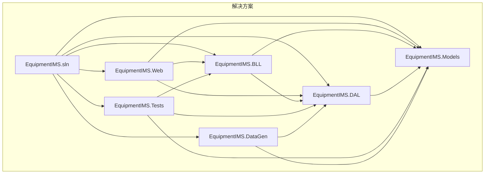
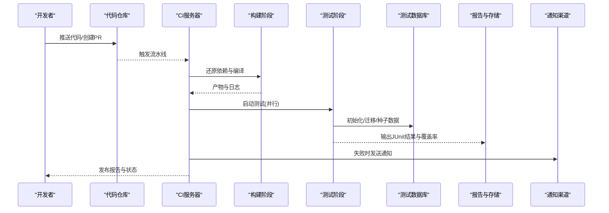
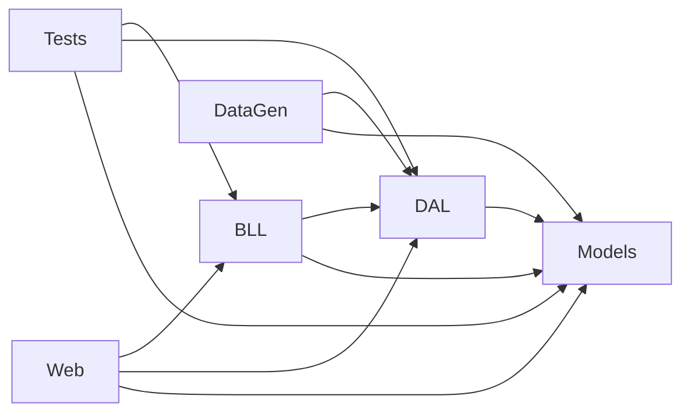

# 自动化测试流程

<cite>
**本文引用的文件**   
- [EquipmentIMS.sln](file://EquipmentIMS.sln)
- [Program.cs](file://EquipmentIMS.Web/Program.cs)
- [appsettings.json](file://EquipmentIMS.Web/appsettings.json)
- [DataSeed.cs](file://EquipmentIMS.Web/DataSeed.cs)
- [EquipmentIMS.Tests.csproj](file://EquipmentIMS.Tests/EquipmentIMS.Tests.csproj)
- [EquipmentIMS.DataGen.csproj](file://EquipmentIMS.DataGen/EquipmentIMS.DataGen.csproj)
- [Program.cs](file://EquipmentIMS.DataGen/Program.cs)
- [base_data.sql](file://base_data.sql)
- [sys_data.sql](file://sys_data.sql)
- [demo_data.sql](file://demo_data.sql)
- [gen_all.ps1](file://gen_all.ps1)
</cite>

## 目录
1. [简介](#简介)
2. [项目结构](#项目结构)
3. [核心组件](#核心组件)
4. [架构总览](#架构总览)
5. [详细组件分析](#详细组件分析)
6. [依赖关系分析](#依赖关系分析)
7. [性能考虑](#性能考虑)
8. [故障排查指南](#故障排查指南)
9. [结论](#结论)
10. [附录](#附录)

## 简介
本文件面向THMS（设备库存管理系统）的持续集成与自动化测试，目标是在GitHub Actions、Azure DevOps或Jenkins等流水线中实现：
- 自动执行单元测试与集成测试
- 并行化测试以提升CI速度
- 自动搭建测试环境、安装依赖、初始化数据库
- 收集测试结果与覆盖率报告，并生成可视化报告
- 失败通知与调试信息收集
- 多环境测试策略、测试数据同步与分析最佳实践

## 项目结构
仓库采用分层架构，包含业务层、数据访问层、Web应用、测试工程与数据生成工具。测试工程位于独立的测试项目中，便于在CI中单独构建与运行。

**图表来源** 
- [EquipmentIMS.sln](file://EquipmentIMS.sln)

**章节来源**
- [EquipmentIMS.sln](file://EquipmentIMS.sln)

## 核心组件
- 测试工程：用于承载单元测试与集成测试用例，引用BLL/DAL/Models以便进行服务与仓储层的验证。
- Web应用：提供API与服务入口，测试时可作为宿主或仅通过内存上下文进行集成测试。
- 数据访问层：基于EF Core的DbContext与仓储实现，测试时需准备可替换的数据源（如SQLite内存库）。
- 数据生成工具：用于批量导入基础数据与演示数据，可在CI中预置测试数据集。

**章节来源**
- [EquipmentIMS.Tests.csproj](file://EquipmentIMS.Tests/EquipmentIMS.Tests.csproj)
- [EquipmentIMS.Web/Program.cs](file://EquipmentIMS.Web/Program.cs)
- [EquipmentIMS.DataGen/Program.cs](file://EquipmentIMS.DataGen/Program.cs)

## 架构总览
下图展示CI流水线中的关键阶段与环境交互：代码拉取、依赖恢复、构建、测试、覆盖率统计、报告归档与通知。

[此图为概念性流程图，不直接映射具体源码文件]

## 详细组件分析

### 测试工程与框架配置
- 测试工程引用业务与数据访问层，适合编写针对Service与Repository的单元与集成测试。
- 建议在测试工程中配置xUnit/NUnit/MSTest与Moq/NSubstitute等模拟框架，并通过工厂方法或扩展方法快速构造测试上下文。
- 为提升稳定性，测试应隔离外部依赖（网络、文件系统、真实数据库），使用内存数据库或临时容器。

**章节来源**
- [EquipmentIMS.Tests.csproj](file://EquipmentIMS.Tests/EquipmentIMS.Tests.csproj)

### 数据访问层与数据库初始化
- DAL层基于EF Core的DbContext与仓储模式，测试时应提供可切换的数据源（例如SQLite内存库），避免对真实数据库产生副作用。
- 建议在测试前执行数据库迁移与种子数据注入，确保测试数据一致性与可重复性。
- 可使用事务包裹每个测试并在完成后回滚，或使用独立数据库实例配合清理脚本。

**章节来源**
- [EquipmentIMS.sln](file://EquipmentIMS.sln)

### 数据生成与测试数据准备
- DataGen工程提供批量数据生成能力，结合SQL脚本可快速填充基础与演示数据。
- 在CI中，可在测试阶段之前运行数据生成器，将基础数据导入测试数据库，保证所有测试拥有稳定起点。
- SQL脚本按模块划分（系统、库存、采购、销售等），可按需选择导入范围以缩短CI时间。

**章节来源**
- [EquipmentIMS.DataGen.csproj](file://EquipmentIMS.DataGen/EquipmentIMS.DataGen.csproj)
- [Program.cs](file://EquipmentIMS.DataGen/Program.cs)
- [base_data.sql](file://base_data.sql)
- [sys_data.sql](file://sys_data.sql)
- [demo_data.sql](file://demo_data.sql)
- [gen_all.ps1](file://gen_all.ps1)

### Web应用与测试宿主
- Web应用负责注册服务、中间件与配置，测试可通过最小化启动方式加载必要服务，减少启动开销。
- 若进行端到端测试，建议使用轻量级宿主（如Kestrel）与内存数据库组合，避免UI渲染带来的不稳定因素。

**章节来源**
- [Program.cs](file://EquipmentIMS.Web/Program.cs)
- [appsettings.json](file://EquipmentIMS.Web/appsettings.json)
- [DataSeed.cs](file://EquipmentIMS.Web/DataSeed.cs)

## 依赖关系分析
- 解决方案定义了各工程之间的依赖关系，测试工程依赖BLL/DAL/Models，便于对核心逻辑进行验证。
- 数据生成工具依赖DAL/Models，用于向数据库写入初始数据。
- Web应用依赖BLL/DAL/Models，测试时可复用其服务注册逻辑。

**图表来源**
- [EquipmentIMS.sln](file://EquipmentIMS.sln)

**章节来源**
- [EquipmentIMS.sln](file://EquipmentIMS.sln)

## 性能考虑
- 并行执行：将测试按模块或命名空间分组，启用并行执行以减少整体耗时。
- 数据库优化：使用内存数据库或专用测试数据库实例；避免跨测试共享状态；必要时使用连接池。
- 缓存与Mock：对外部依赖（邮件、文件、第三方API）使用Mock或内存缓存，降低I/O开销。
- 增量构建：利用CI缓存NuGet包与编译产物，缩短冷启动时间。

[本节为通用指导，无需源码引用]

## 故障排查指南
- 日志与断点：在测试中记录关键步骤日志，必要时在本地复现问题并开启调试。
- 数据库快照：在测试失败时导出当前数据库状态，便于对比差异。
- 环境变量：检查测试环境的连接字符串、密钥与路径配置是否正确。
- 资源清理：确保测试结束后释放数据库连接与临时文件，避免后续测试污染。

[本节为通用指导，无需源码引用]

## 结论
通过在CI中配置自动化测试、并行执行、数据初始化与覆盖率报告，并结合失败通知与质量门禁，可以显著提升THMS系统的交付质量与迭代效率。建议逐步完善测试覆盖与数据一致性保障，形成稳定的质量闭环。

[本节为总结性内容，无需源码引用]

## 附录

### GitHub Actions 流水线示例（概念说明）
- 触发条件：push到主分支或创建PR
- 阶段：设置.NET环境、还原依赖、构建、运行测试、生成覆盖率、上传结果、失败通知
- 并行：按测试集拆分作业或使用内置并行选项
- 缓存：缓存NuGet包与编译产物
- 报告：上传JUnit XML与覆盖率HTML

[此小节为概念性说明，不直接映射具体源码文件]

### Azure DevOps 流水线示例（概念说明）
- 任务：UseDotNet、dotnet restore/build/test
- 测试聚合：PublishTestResults与PublishCodeCoverageResults
- 并行：矩阵策略或多作业并行
- 缓存：Cache任务缓存依赖
- 通知：失败时发送邮件或Teams消息

[此小节为概念性说明，不直接映射具体源码文件]

### Jenkins 流水线示例（概念说明）
- 阶段：checkout、restore、build、test、publish results
- 并行：pipeline stages或agent并行
- 插件：JUnit、JaCoCo/Coverlet、Email/Slack通知
- 持久化：保存测试报告与覆盖率HTML

[此小节为概念性说明，不直接映射具体源码文件]

### 多环境测试策略
- 开发环境：使用内存数据库与最小种子数据，快速反馈
- 集成环境：使用专用数据库实例，完整种子数据与迁移
- 预生产环境：接近生产配置，增加端到端与性能测试
- 数据同步：使用统一的数据生成工具与脚本，确保各环境数据一致性

[此小节为概念性说明，不直接映射具体源码文件]

### 测试覆盖率与质量门禁
- 覆盖率工具：Coverlet + dotnet test /report
- 阈值门禁：设置最低覆盖率与趋势告警
- 报告归档：将HTML与XML上传至制品库或平台内报告中心

[此小节为概念性说明，不直接映射具体源码文件]