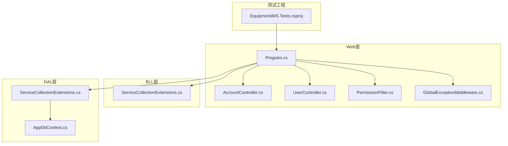
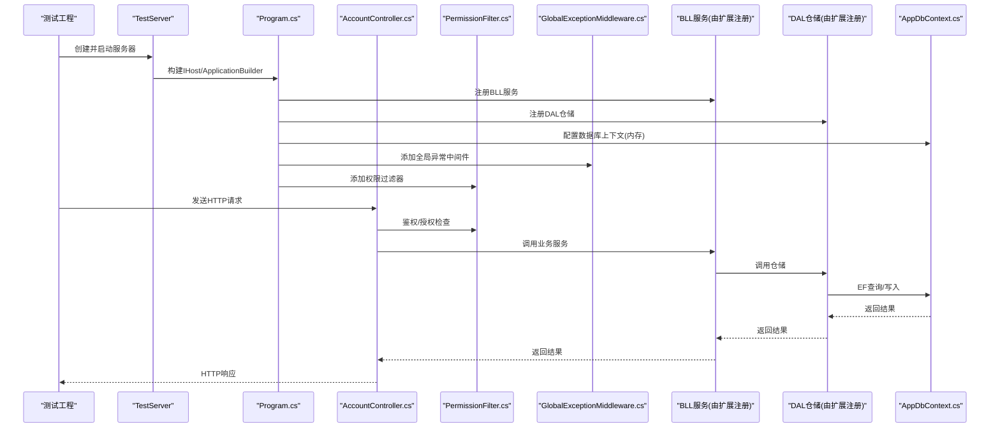
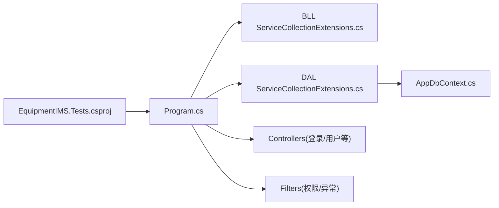

# 集成测试设计

<cite>
**本文引用的文件**   
- [Program.cs](file://EquipmentIMS.Web/Program.cs)
- [AccountController.cs](file://EquipmentIMS.Web/Controllers/AccountController.cs)
- [UserController.cs](file://EquipmentIMS.Web/Controllers/UserController.cs)
- [PermissionFilter.cs](file://EquipmentIMS.Web/Filters/PermissionFilter.cs)
- [GlobalExceptionMiddleware.cs](file://EquipmentIMS.Web/Filters/GlobalExceptionMiddleware.cs)
- [AppDbContext.cs](file://EquipmentIMS.DAL/AppDbContext.cs)
- [ServiceCollectionExtensions.cs](file://EquipmentIMS.BLL/Extensions/ServiceCollectionExtensions.cs)
- [ServiceCollectionExtensions.cs](file://EquipmentIMS.DAL/Extensions/ServiceCollectionExtensions.cs)
- [EquipmentIMS.Tests.csproj](file://EquipmentIMS.Tests/EquipmentIMS.Tests.csproj)
</cite>

## 目录
1. [引言](#引言)
2. [项目结构](#项目结构)
3. [核心组件](#核心组件)
4. [架构总览](#架构总览)
5. [详细组件分析](#详细组件分析)
6. [依赖关系分析](#依赖关系分析)
7. [性能考虑](#性能考虑)
8. [故障排查指南](#故障排查指南)
9. [结论](#结论)
10. [附录](#附录)

## 引言
本设计文档面向THMS（设备库存管理系统）的集成测试，聚焦控制器级别的API测试、数据库集成测试与跨层调用测试。文档将说明如何配置TestServer、使用内存数据库、准备测试数据，并给出HTTP请求模拟、响应验证与状态码检查的方法。同时覆盖认证授权、参数校验、错误处理、异步操作、文件上传下载以及外部服务集成的测试策略，并提供测试环境隔离与数据清理的最佳实践。

## 项目结构
THMS采用分层架构：Web层提供REST API，BLL层实现业务逻辑，DAL层通过EF Core访问数据库，Models层定义实体、DTO与异常类型。测试工程位于独立的测试项目中，便于与运行时代码解耦。

图表来源
- [Program.cs](file://EquipmentIMS.Web/Program.cs)
- [AccountController.cs](file://EquipmentIMS.Web/Controllers/AccountController.cs)
- [UserController.cs](file://EquipmentIMS.Web/Controllers/UserController.cs)
- [PermissionFilter.cs](file://EquipmentIMS.Web/Filters/PermissionFilter.cs)
- [GlobalExceptionMiddleware.cs](file://EquipmentIMS.Web/Filters/GlobalExceptionMiddleware.cs)
- [ServiceCollectionExtensions.cs](file://EquipmentIMS.BLL/Extensions/ServiceCollectionExtensions.cs)
- [ServiceCollectionExtensions.cs](file://EquipmentIMS.DAL/Extensions/ServiceCollectionExtensions.cs)
- [AppDbContext.cs](file://EquipmentIMS.DAL/AppDbContext.cs)
- [EquipmentIMS.Tests.csproj](file://EquipmentIMS.Tests/EquipmentIMS.Tests.csproj)

章节来源
- [Program.cs](file://EquipmentIMS.Web/Program.cs)
- [EquipmentIMS.Tests.csproj](file://EquipmentIMS.Tests/EquipmentIMS.Tests.csproj)

## 核心组件
- TestServer：用于在进程内启动Web应用，避免真实网络开销，适合端到端集成测试。
- 内存数据库：使用SQLite内存模式或InMemory提供程序，确保测试间隔离与快速执行。
- 服务注册扩展：BLL与DAL各自提供扩展方法，集中注册服务与仓储，便于测试中替换为内存实现。
- 中间件与过滤器：全局异常中间件统一错误格式；权限过滤器参与鉴权流程，需在测试中模拟上下文。
- 控制器：登录、用户管理等控制器作为API入口，是集成测试的主要目标。

章节来源
- [Program.cs](file://EquipmentIMS.Web/Program.cs)
- [ServiceCollectionExtensions.cs](file://EquipmentIMS.BLL/Extensions/ServiceCollectionExtensions.cs)
- [ServiceCollectionExtensions.cs](file://EquipmentIMS.DAL/Extensions/ServiceCollectionExtensions.cs)
- [AppDbContext.cs](file://EquipmentIMS.DAL/AppDbContext.cs)
- [PermissionFilter.cs](file://EquipmentIMS.Web/Filters/PermissionFilter.cs)
- [GlobalExceptionMiddleware.cs](file://EquipmentIMS.Web/Filters/GlobalExceptionMiddleware.cs)
- [AccountController.cs](file://EquipmentIMS.Web/Controllers/AccountController.cs)
- [UserController.cs](file://EquipmentIMS.Web/Controllers/UserController.cs)

## 架构总览
下图展示了从测试工程到Web层的请求路径，以及BLL/DAL的服务注册与数据库上下文的关系。

图表来源
- [Program.cs](file://EquipmentIMS.Web/Program.cs)
- [AccountController.cs](file://EquipmentIMS.Web/Controllers/AccountController.cs)
- [PermissionFilter.cs](file://EquipmentIMS.Web/Filters/PermissionFilter.cs)
- [GlobalExceptionMiddleware.cs](file://EquipmentIMS.Web/Filters/GlobalExceptionMiddleware.cs)
- [ServiceCollectionExtensions.cs](file://EquipmentIMS.BLL/Extensions/ServiceCollectionExtensions.cs)
- [ServiceCollectionExtensions.cs](file://EquipmentIMS.DAL/Extensions/ServiceCollectionExtensions.cs)
- [AppDbContext.cs](file://EquipmentIMS.DAL/AppDbContext.cs)

## 详细组件分析

### 控制器级API测试
- 目标：验证HTTP语义、路由、模型绑定、状态码与响应体结构。
- 要点：
  - 使用TestServer构造HttpClient，设置基础URL与必要头信息（如Authorization）。
  - 对登录接口进行成功与失败场景测试，包括无效凭据、缺失字段等。
  - 对受保护资源（如用户管理）进行无令牌、令牌过期、权限不足等场景测试。
  - 断言响应状态码、Content-Type、JSON结构关键字段。
- 示例路径参考：
  - 登录接口：[AccountController.cs](file://EquipmentIMS.Web/Controllers/AccountController.cs)
  - 用户管理接口：[UserController.cs](file://EquipmentIMS.Web/Controllers/UserController.cs)

章节来源
- [AccountController.cs](file://EquipmentIMS.Web/Controllers/AccountController.cs)
- [UserController.cs](file://EquipmentIMS.Web/Controllers/UserController.cs)

### 数据库集成测试
- 目标：验证EF Core映射、仓储逻辑与事务边界。
- 要点：
  - 使用内存数据库提供程序（如SQLite内存模式），每个测试用例独立实例化上下文，保证隔离。
  - 在测试前插入种子数据，测试后销毁上下文实例以清理数据。
  - 针对复杂查询与批量更新编写断言，确保一致性。
- 关键文件：
  - 数据库上下文：[AppDbContext.cs](file://EquipmentIMS.DAL/AppDbContext.cs)
  - DAL服务注册扩展：[ServiceCollectionExtensions.cs](file://EquipmentIMS.DAL/Extensions/ServiceCollectionExtensions.cs)

章节来源
- [AppDbContext.cs](file://EquipmentIMS.DAL/AppDbContext.cs)
- [ServiceCollectionExtensions.cs](file://EquipmentIMS.DAL/Extensions/ServiceCollectionExtensions.cs)

### 跨层调用测试
- 目标：验证从Web到BLL再到DAL的完整链路。
- 要点：
  - 通过TestServer发起HTTP请求，触发控制器→BLL→DAL→DB的调用链。
  - 使用内存数据库与内存缓存替代外部依赖，确保可重复性。
  - 断言最终HTTP响应与数据库状态变更的一致性。
- 关键文件：
  - Web启动与中间件：[Program.cs](file://EquipmentIMS.Web/Program.cs)
  - BLL服务注册扩展：[ServiceCollectionExtensions.cs](file://EquipmentIMS.BLL/Extensions/ServiceCollectionExtensions.cs)
  - DAL服务注册扩展：[ServiceCollectionExtensions.cs](file://EquipmentIMS.DAL/Extensions/ServiceCollectionExtensions.cs)

章节来源
- [Program.cs](file://EquipmentIMS.Web/Program.cs)
- [ServiceCollectionExtensions.cs](file://EquipmentIMS.BLL/Extensions/ServiceCollectionExtensions.cs)
- [ServiceCollectionExtensions.cs](file://EquipmentIMS.DAL/Extensions/ServiceCollectionExtensions.cs)

### TestServer配置与使用
- 目标：在测试工程中启动Web应用，注入内存数据库与测试用服务。
- 要点：
  - 自定义WebApplicationFactory或手动构建IHost，重写ConfigureServices以替换数据库与服务实现。
  - 使用内存数据库连接字符串或提供程序选项。
  - 注入测试用的CurrentUserService、CacheService等，避免真实外部依赖。
- 关键文件：
  - Web启动：[Program.cs](file://EquipmentIMS.Web/Program.cs)
  - BLL扩展：[ServiceCollectionExtensions.cs](file://EquipmentIMS.BLL/Extensions/ServiceCollectionExtensions.cs)
  - DAL扩展：[ServiceCollectionExtensions.cs](file://EquipmentIMS.DAL/Extensions/ServiceCollectionExtensions.cs)
  - 测试工程：[EquipmentIMS.Tests.csproj](file://EquipmentIMS.Tests/EquipmentIMS.Tests.csproj)

章节来源
- [Program.cs](file://EquipmentIMS.Web/Program.cs)
- [ServiceCollectionExtensions.cs](file://EquipmentIMS.BLL/Extensions/ServiceCollectionExtensions.cs)
- [ServiceCollectionExtensions.cs](file://EquipmentIMS.DAL/Extensions/ServiceCollectionExtensions.cs)
- [EquipmentIMS.Tests.csproj](file://EquipmentIMS.Tests/EquipmentIMS.Tests.csproj)

### HTTP请求模拟、响应验证与状态码检查
- 请求模拟：
  - 使用HttpClient发送GET/POST/PUT/DELETE请求，设置Headers与Body。
  - 对于文件上传，使用MultipartFormDataContent构造表单数据。
- 响应验证：
  - 断言StatusCode（如200、201、400、401、403、404、500）。
  - 解析响应体JSON，断言关键字段存在且值正确。
  - 对分页结果断言总数、页大小与数据项数量。
- 错误处理：
  - 全局异常中间件应返回一致的错误结构，测试需断言错误消息与错误码。

章节来源
- [GlobalExceptionMiddleware.cs](file://EquipmentIMS.Web/Filters/GlobalExceptionMiddleware.cs)

### 认证授权测试
- 目标：验证登录、令牌签发、权限过滤与访问控制。
- 要点：
  - 登录成功返回令牌，后续请求携带令牌访问受保护资源。
  - 无令牌或令牌过期时返回401；无权限时返回403。
  - 权限过滤器拦截未授权请求，测试需断言相应状态码与错误信息。
- 关键文件：
  - 登录控制器：[AccountController.cs](file://EquipmentIMS.Web/Controllers/AccountController.cs)
  - 权限过滤器：[PermissionFilter.cs](file://EquipmentIMS.Web/Filters/PermissionFilter.cs)

章节来源
- [AccountController.cs](file://EquipmentIMS.Web/Controllers/AccountController.cs)
- [PermissionFilter.cs](file://EquipmentIMS.Web/Filters/PermissionFilter.cs)

### 参数验证测试
- 目标：验证模型绑定与数据注解校验。
- 要点：
  - 提交缺失必填字段、类型不匹配、长度越界等数据，断言400与具体错误信息。
  - 对枚举、范围、正则表达式等约束进行覆盖。
- 示例路径参考：
  - 用户创建/编辑：[UserController.cs](file://EquipmentIMS.Web/Controllers/UserController.cs)

章节来源
- [UserController.cs](file://EquipmentIMS.Web/Controllers/UserController.cs)

### 错误处理测试
- 目标：验证全局异常中间件的错误格式化与日志记录。
- 要点：
  - 触发业务异常、未处理异常，断言返回的错误结构与状态码。
  - 确认敏感信息未泄露，错误消息符合约定。
- 关键文件：
  - 全局异常中间件：[GlobalExceptionMiddleware.cs](file://EquipmentIMS.Web/Filters/GlobalExceptionMiddleware.cs)

章节来源
- [GlobalExceptionMiddleware.cs](file://EquipmentIMS.Web/Filters/GlobalExceptionMiddleware.cs)

### 异步操作测试
- 目标：验证异步控制器方法与后台任务。
- 要点：
  - 使用异步HTTP客户端与Task组合，避免阻塞。
  - 对长时间运行的导出任务，采用轮询或回调机制验证完成状态。
  - 使用超时与重试策略提升稳定性。

### 文件上传下载测试
- 目标：验证文件上传与下载的完整性与安全性。
- 要点：
  - 上传：构造MultipartFormDataContent，包含文件流与元数据，断言201与返回的文件标识。
  - 下载：根据文件标识获取响应流，断言Content-Disposition与文件大小。
  - 安全：限制文件类型、大小，防止路径遍历与恶意内容。

### 外部服务集成测试策略
- 目标：在不依赖真实外部服务的情况下验证集成点。
- 要点：
  - 使用内存或轻量替代实现（如内存缓存、内存队列）替换外部服务。
  - 对必须的外部依赖，使用Mock或本地模拟服务（如WireMock）固定响应。
  - 明确区分“纯集成测试”与“端到端测试”，前者尽量隔离外部依赖。

## 依赖关系分析
下图展示测试工程与Web/BLL/DAL之间的依赖关系，以及服务注册扩展的作用。

图表来源
- [EquipmentIMS.Tests.csproj](file://EquipmentIMS.Tests/EquipmentIMS.Tests.csproj)
- [Program.cs](file://EquipmentIMS.Web/Program.cs)
- [ServiceCollectionExtensions.cs](file://EquipmentIMS.BLL/Extensions/ServiceCollectionExtensions.cs)
- [ServiceCollectionExtensions.cs](file://EquipmentIMS.DAL/Extensions/ServiceCollectionExtensions.cs)
- [AppDbContext.cs](file://EquipmentIMS.DAL/AppDbContext.cs)

章节来源
- [EquipmentIMS.Tests.csproj](file://EquipmentIMS.Tests/EquipmentIMS.Tests.csproj)
- [Program.cs](file://EquipmentIMS.Web/Program.cs)
- [ServiceCollectionExtensions.cs](file://EquipmentIMS.BLL/Extensions/ServiceCollectionExtensions.cs)
- [ServiceCollectionExtensions.cs](file://EquipmentIMS.DAL/Extensions/ServiceCollectionExtensions.cs)
- [AppDbContext.cs](file://EquipmentIMS.DAL/AppDbContext.cs)

## 性能考虑
- 使用内存数据库与内存缓存，减少IO与外部依赖开销。
- 并行执行测试用例，但确保数据库上下文与缓存实例隔离。
- 最小化测试数据量，仅保留必要字段与记录。
- 避免在测试中执行耗时任务（如大文件导出），必要时改为异步与超时控制。

## 故障排查指南
- 常见问题：
  - 数据库连接失败：检查内存数据库提供程序与连接字符串配置。
  - 权限过滤导致401/403：确认测试中是否正确注入当前用户与角色。
  - 全局异常未捕获：确认中间件顺序与异常类型是否被识别。
- 定位步骤：
  - 启用详细日志输出，查看中间件与仓储层日志。
  - 逐步缩小范围：先验证控制器返回，再检查BLL/DAL。
  - 使用最小复现用例，隔离问题。

章节来源
- [GlobalExceptionMiddleware.cs](file://EquipmentIMS.Web/Filters/GlobalExceptionMiddleware.cs)
- [PermissionFilter.cs](file://EquipmentIMS.Web/Filters/PermissionFilter.cs)

## 结论
通过TestServer与内存数据库的组合，可以在进程内高效地执行控制器级与跨层集成测试。结合统一的异常中间件与权限过滤器，能够全面覆盖认证授权、参数校验与错误处理等关键场景。遵循测试环境隔离与数据清理最佳实践，可显著提升测试的可重复性与稳定性。

## 附录
- 测试工程引用：
  - [EquipmentIMS.Tests.csproj](file://EquipmentIMS.Tests/EquipmentIMS.Tests.csproj)
- 关键入口与扩展：
  - [Program.cs](file://EquipmentIMS.Web/Program.cs)
  - [ServiceCollectionExtensions.cs](file://EquipmentIMS.BLL/Extensions/ServiceCollectionExtensions.cs)
  - [ServiceCollectionExtensions.cs](file://EquipmentIMS.DAL/Extensions/ServiceCollectionExtensions.cs)
- 控制器与过滤器：
  - [AccountController.cs](file://EquipmentIMS.Web/Controllers/AccountController.cs)
  - [UserController.cs](file://EquipmentIMS.Web/Controllers/UserController.cs)
  - [PermissionFilter.cs](file://EquipmentIMS.Web/Filters/PermissionFilter.cs)
  - [GlobalExceptionMiddleware.cs](file://EquipmentIMS.Web/Filters/GlobalExceptionMiddleware.cs)
- 数据库上下文：
  - [AppDbContext.cs](file://EquipmentIMS.DAL/AppDbContext.cs)