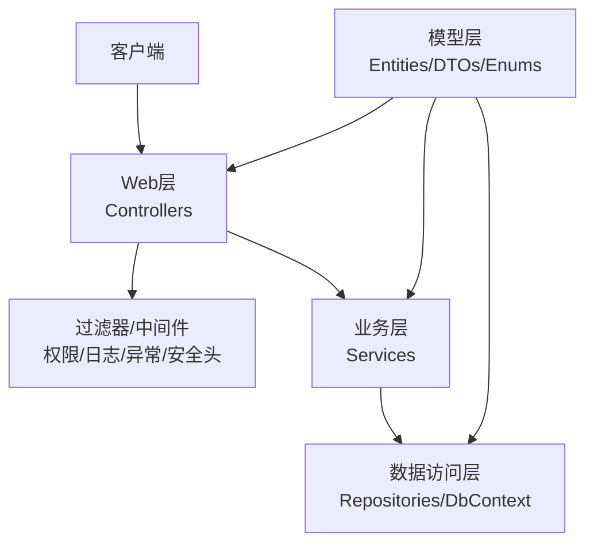
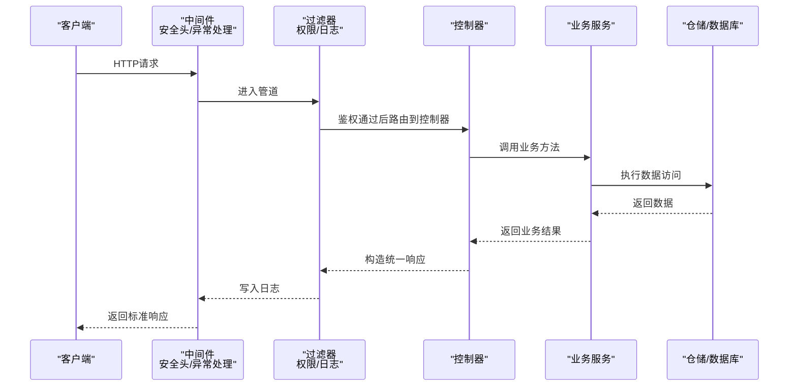
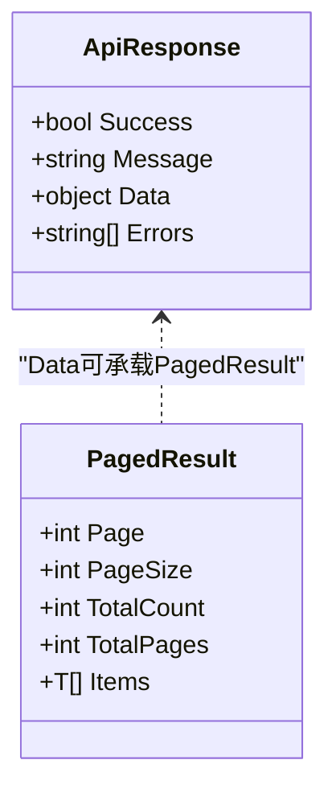
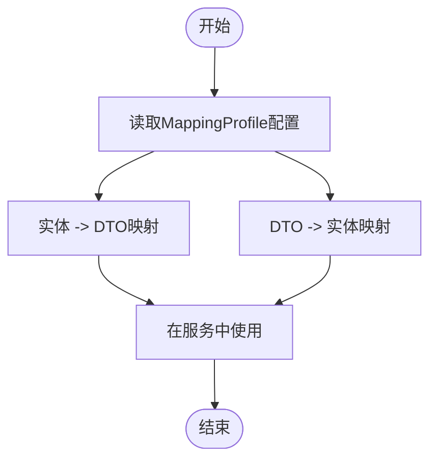
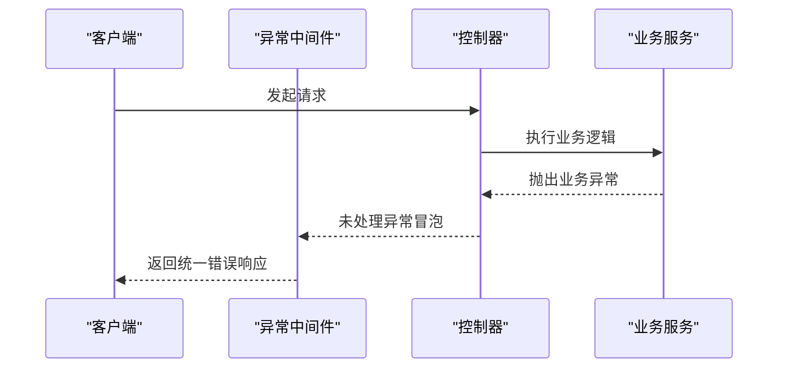
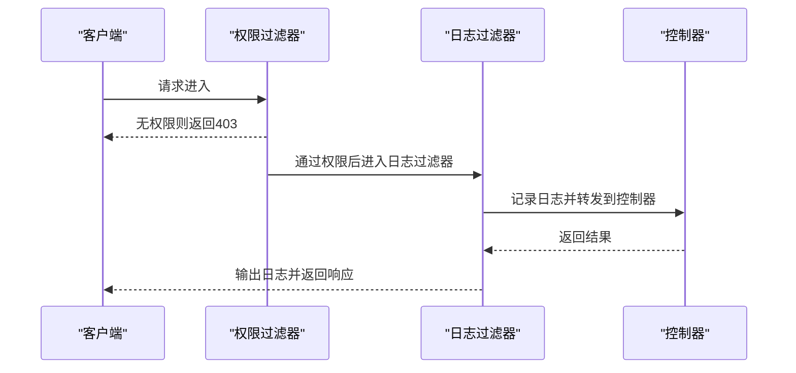
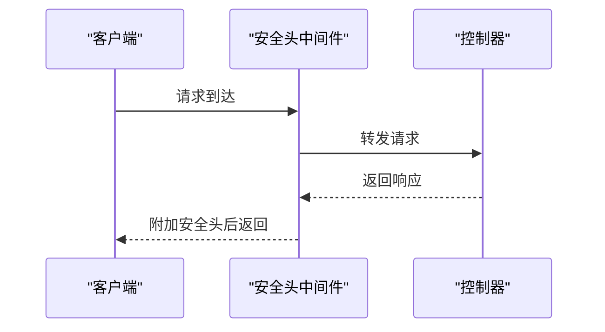
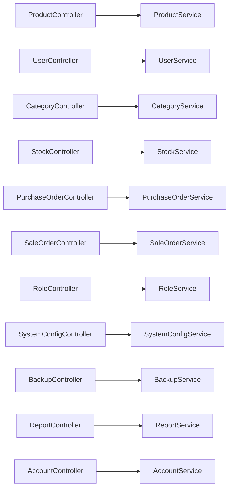

# API设计规范

<cite>
**本文引用的文件**   
- [Program.cs](file://EquipmentIMS.Web/Program.cs)
- [GlobalExceptionMiddleware.cs](file://EquipmentIMS.Web/Filters/GlobalExceptionMiddleware.cs)
- [PermissionFilter.cs](file://EquipmentIMS.Web/Filters/PermissionFilter.cs)
- [OperationLogActionFilter.cs](file://EquipmentIMS.Web/Filters/OperationLogActionFilter.cs)
- [SecurityHeadersMiddleware.cs](file://EquipmentIMS.Web/Filters/SecurityHeadersMiddleware.cs)
- [ApiResponse.cs](file://EquipmentIMS.Models/DTOs/ApiResponse.cs)
- [PagedResult.cs](file://EquipmentIMS.Models/DTOs/PagedResult.cs)
- [MappingProfile.cs](file://EquipmentIMS.BLL/Mappings/MappingProfile.cs)
- [ProductController.cs](file://EquipmentIMS.Web/Controllers/ProductController.cs)
- [UserController.cs](file://EquipmentIMS.Web/Controllers/UserController.cs)
- [CategoryController.cs](file://EquipmentIMS.Web/Controllers/CategoryController.cs)
- [StockController.cs](file://EquipmentIMS.Web/Controllers/StockController.cs)
- [PurchaseOrderController.cs](file://EquipmentIMS.Web/Controllers/PurchaseOrderController.cs)
- [SaleOrderController.cs](file://EquipmentIMS.Web/Controllers/SaleOrderController.cs)
- [RoleController.cs](file://EquipmentIMS.Web/Controllers/RoleController.cs)
- [SystemConfigController.cs](file://EquipmentIMS.Web/Controllers/SystemConfigController.cs)
- [BackupController.cs](file://EquipmentIMS.Web/Controllers/BackupController.cs)
- [ReportController.cs](file://EquipmentIMS.Web/Controllers/ReportController.cs)
- [AccountController.cs](file://EquipmentIMS.Web/Controllers/AccountController.cs)
- [appsettings.json](file://EquipmentIMS.Web/appsettings.json)
</cite>

## 目录
1. [简介](#简介)
2. [项目结构](#项目结构)
3. [核心组件](#核心组件)
4. [架构总览](#架构总览)
5. [详细组件分析](#详细组件分析)
6. [依赖关系分析](#依赖关系分析)
7. [性能考虑](#性能考虑)
8. [故障排查指南](#故障排查指南)
9. [结论](#结论)
10. [附录](#附录)

## 简介
本规范面向THMS（设备库存管理系统）的RESTful API设计，统一约定HTTP方法、URL路径、状态码、请求与响应格式、版本控制策略、参数验证规则、错误处理机制以及测试与调试方法。文档以现有代码库为依据，确保规范与实际实现一致，便于前后端协同开发与长期维护。

## 项目结构
系统采用分层架构：Web层提供API控制器，BLL层封装业务服务，DAL层负责数据访问，Models层定义实体、枚举、DTO及通用响应模型；Filters与中间件提供全局异常处理、权限校验、操作日志与安全头注入等横切关注点。

**图表来源**
- [Program.cs](file://EquipmentIMS.Web/Program.cs)
- [GlobalExceptionMiddleware.cs](file://EquipmentIMS.Web/Filters/GlobalExceptionMiddleware.cs)
- [PermissionFilter.cs](file://EquipmentIMS.Web/Filters/PermissionFilter.cs)
- [OperationLogActionFilter.cs](file://EquipmentIMS.Web/Filters/OperationLogActionFilter.cs)
- [SecurityHeadersMiddleware.cs](file://EquipmentIMS.Web/Filters/SecurityHeadersMiddleware.cs)

**章节来源**
- [Program.cs](file://EquipmentIMS.Web/Program.cs)
- [appsettings.json](file://EquipmentIMS.Web/appsettings.json)

## 核心组件
本节聚焦API设计的核心契约：统一响应格式、分页结果、AutoMapper映射配置，以及全局异常处理与权限过滤。

- 统一响应格式 ApiResponse
  - 用于所有API返回的标准包装，包含成功标志、消息、数据体与可选的错误信息。
  - 成功响应：data为业务对象或集合；错误响应：data可为空，errors包含具体错误详情。
  - 参考路径：[ApiResponse.cs](file://EquipmentIMS.Models/DTOs/ApiResponse.cs)

- 分页结果 PagedResult
  - 用于列表查询的分页封装，包含当前页、每页大小、总数、总页数与数据集合。
  - 参考路径：[PagedResult.cs](file://EquipmentIMS.Models/DTOs/PagedResult.cs)

- AutoMapper 映射配置 MappingProfile
  - 集中定义实体与DTO之间的映射规则，避免在控制器或服务中重复编写转换逻辑。
  - 参考路径：[MappingProfile.cs](file://EquipmentIMS.BLL/Mappings/MappingProfile.cs)

- 全局异常处理 GlobalExceptionMiddleware
  - 捕获未处理异常，转换为标准错误响应，记录必要上下文，保证对外一致性。
  - 参考路径：[GlobalExceptionMiddleware.cs](file://EquipmentIMS.Web/Filters/GlobalExceptionMiddleware.cs)

- 权限校验 PermissionFilter
  - 基于角色/权限对受保护接口进行访问控制，拒绝无权限请求并返回标准化错误。
  - 参考路径：[PermissionFilter.cs](file://EquipmentIMS.Web/Filters/PermissionFilter.cs)

- 操作日志 OperationLogActionFilter
  - 记录关键操作的入参、出参、耗时与用户信息，便于审计与问题定位。
  - 参考路径：[OperationLogActionFilter.cs](file://EquipmentIMS.Web/Filters/OperationLogActionFilter.cs)

- 安全头 SecurityHeadersMiddleware
  - 注入跨站脚本防护、内容类型嗅探防护等安全相关响应头。
  - 参考路径：[SecurityHeadersMiddleware.cs](file://EquipmentIMS.Web/Filters/SecurityHeadersMiddleware.cs)

**章节来源**
- [ApiResponse.cs](file://EquipmentIMS.Models/DTOs/ApiResponse.cs)
- [PagedResult.cs](file://EquipmentIMS.Models/DTOs/PagedResult.cs)
- [MappingProfile.cs](file://EquipmentIMS.BLL/Mappings/MappingProfile.cs)
- [GlobalExceptionMiddleware.cs](file://EquipmentIMS.Web/Filters/GlobalExceptionMiddleware.cs)
- [PermissionFilter.cs](file://EquipmentIMS.Web/Filters/PermissionFilter.cs)
- [OperationLogActionFilter.cs](file://EquipmentIMS.Web/Filters/OperationLogActionFilter.cs)
- [SecurityHeadersMiddleware.cs](file://EquipmentIMS.Web/Filters/SecurityHeadersMiddleware.cs)

## 架构总览
下图展示一次典型API请求从客户端到数据层的调用链，包括中间件与过滤器的参与顺序。

**图表来源**
- [Program.cs](file://EquipmentIMS.Web/Program.cs)
- [GlobalExceptionMiddleware.cs](file://EquipmentIMS.Web/Filters/GlobalExceptionMiddleware.cs)
- [PermissionFilter.cs](file://EquipmentIMS.Web/Filters/PermissionFilter.cs)
- [OperationLogActionFilter.cs](file://EquipmentIMS.Web/Filters/OperationLogActionFilter.cs)

## 详细组件分析

### RESTful API 设计原则与命名约定
- HTTP方法使用规范
  - GET：获取资源或列表（支持分页与筛选）
  - POST：创建新资源
  - PUT：全量更新资源
  - PATCH：部分更新资源
  - DELETE：删除资源
- URL路径设计
  - 使用复数名词表示资源集合，如 /api/products、/api/users
  - 子资源通过层级表达，如 /api/products/{id}/stock
  - 查询参数用于筛选、排序与分页，如 ?page=1&pageSize=20&keyword=...
- 状态码定义
  - 200：成功
  - 201：创建成功
  - 400：请求参数错误
  - 401：未认证
  - 403：无权限
  - 404：资源不存在
  - 409：资源冲突
  - 422：语义错误（如业务校验失败）
  - 500：服务器内部错误
- 版本控制策略
  - 建议采用URL前缀方式，如 /api/v1/...，并在路由注册时按版本分组
  - 重大变更需升级版本号，保持向后兼容

**章节来源**
- [ProductController.cs](file://EquipmentIMS.Web/Controllers/ProductController.cs)
- [UserController.cs](file://EquipmentIMS.Web/Controllers/UserController.cs)
- [CategoryController.cs](file://EquipmentIMS.Web/Controllers/CategoryController.cs)
- [StockController.cs](file://EquipmentIMS.Web/Controllers/StockController.cs)
- [PurchaseOrderController.cs](file://EquipmentIMS.Web/Controllers/PurchaseOrderController.cs)
- [SaleOrderController.cs](file://EquipmentIMS.Web/Controllers/SaleOrderController.cs)
- [RoleController.cs](file://EquipmentIMS.Web/Controllers/RoleController.cs)
- [SystemConfigController.cs](file://EquipmentIMS.Web/Controllers/SystemConfigController.cs)
- [BackupController.cs](file://EquipmentIMS.Web/Controllers/BackupController.cs)
- [ReportController.cs](file://EquipmentIMS.Web/Controllers/ReportController.cs)
- [AccountController.cs](file://EquipmentIMS.Web/Controllers/AccountController.cs)

### 统一响应格式 ApiResponse 与分页 PagedResult
- ApiResponse
  - 字段说明：是否成功、消息文本、数据体、错误列表
  - 使用场景：所有API返回均包裹在该结构中，便于前端统一处理
- PagedResult
  - 字段说明：当前页、每页大小、总数、总页数、数据集合
  - 使用场景：列表查询接口返回分页数据

**图表来源**
- [ApiResponse.cs](file://EquipmentIMS.Models/DTOs/ApiResponse.cs)
- [PagedResult.cs](file://EquipmentIMS.Models/DTOs/PagedResult.cs)

**章节来源**
- [ApiResponse.cs](file://EquipmentIMS.Models/DTOs/ApiResponse.cs)
- [PagedResult.cs](file://EquipmentIMS.Models/DTOs/PagedResult.cs)

### DTO 设计与 AutoMapper 配置
- DTO设计模式
  - 将领域实体与外部交互解耦，仅暴露必要的字段
  - 针对复杂查询与导出，定义专用DTO以减少冗余数据传输
- AutoMapper配置
  - 在MappingProfile中集中声明映射规则，提升可读性与可维护性
  - 支持双向映射与条件映射，减少样板代码

**图表来源**
- [MappingProfile.cs](file://EquipmentIMS.BLL/Mappings/MappingProfile.cs)

**章节来源**
- [MappingProfile.cs](file://EquipmentIMS.BLL/Mappings/MappingProfile.cs)

### 全局异常处理与错误响应流程
- 异常捕获
  - 中间件捕获未处理异常，转换为标准错误响应
- 业务异常
  - 自定义业务异常携带错误码与消息，便于前端提示
- 参数校验
  - 使用模型绑定与验证注解，非法参数返回400或422

**图表来源**
- [GlobalExceptionMiddleware.cs](file://EquipmentIMS.Web/Filters/GlobalExceptionMiddleware.cs)

**章节来源**
- [GlobalExceptionMiddleware.cs](file://EquipmentIMS.Web/Filters/GlobalExceptionMiddleware.cs)

### 权限校验与操作日志
- 权限校验
  - 过滤器检查用户角色/权限，拒绝无权限访问并返回403
- 操作日志
  - 记录关键操作的请求信息、响应摘要与耗时，便于审计

**图表来源**
- [PermissionFilter.cs](file://EquipmentIMS.Web/Filters/PermissionFilter.cs)
- [OperationLogActionFilter.cs](file://EquipmentIMS.Web/Filters/OperationLogActionFilter.cs)

**章节来源**
- [PermissionFilter.cs](file://EquipmentIMS.Web/Filters/PermissionFilter.cs)
- [OperationLogActionFilter.cs](file://EquipmentIMS.Web/Filters/OperationLogActionFilter.cs)

### 安全头注入
- 安全头
  - 注入X-Content-Type-Options、X-Frame-Options、Strict-Transport-Security等头部，增强安全性
- 适用场景
  - 所有HTTP响应均需附加安全头

**图表来源**
- [SecurityHeadersMiddleware.cs](file://EquipmentIMS.Web/Filters/SecurityHeadersMiddleware.cs)

**章节来源**
- [SecurityHeadersMiddleware.cs](file://EquipmentIMS.Web/Filters/SecurityHeadersMiddleware.cs)

### API示例（请求与响应完整格式）
以下为常见接口的示例格式，实际字段以DTO定义为准。

- 产品管理
  - 列出产品（分页）
    - 请求：GET /api/v1/products?page=1&pageSize=20
    - 响应：ApiResponse，Data为PagedResult<ProductDto>
  - 创建产品
    - 请求：POST /api/v1/products
    - 响应：ApiResponse，Data为ProductDto
  - 更新产品
    - 请求：PUT /api/v1/products/{id}
    - 响应：ApiResponse，Data为ProductDto
  - 删除产品
    - 请求：DELETE /api/v1/products/{id}
    - 响应：ApiResponse，Data为空
- 用户管理
  - 列出用户（分页）
    - 请求：GET /api/v1/users?page=1&pageSize=20
    - 响应：ApiResponse，Data为PagedResult<UserDto>
  - 创建用户
    - 请求：POST /api/v1/users
    - 响应：ApiResponse，Data为UserDto
- 分类管理
  - 列出分类
    - 请求：GET /api/v1/categories
    - 响应：ApiResponse，Data为List<CategoryDto>
- 库存管理
  - 查询库存
    - 请求：GET /api/v1/stock?productId=1
    - 响应：ApiResponse，Data为StockDto
- 采购订单
  - 创建采购订单
    - 请求：POST /api/v1/purchase-orders
    - 响应：ApiResponse，Data为PurchaseOrderDto
- 销售订单
  - 创建销售订单
    - 请求：POST /api/v1/sale-orders
    - 响应：ApiResponse，Data为SaleOrderDto
- 角色管理
  - 分配权限
    - 请求：PATCH /api/v1/roles/{id}/permissions
    - 响应：ApiResponse，Data为空
- 系统配置
  - 更新配置
    - 请求：PUT /api/v1/system-config
    - 响应：ApiResponse，Data为SystemConfigDto
- 备份
  - 触发备份
    - 请求：POST /api/v1/backup
    - 响应：ApiResponse，Data为BackupDto
- 报表
  - 导出报表
    - 请求：POST /api/v1/reports/export
    - 响应：ApiResponse，Data为导出任务ID
- 账户
  - 登录
    - 请求：POST /api/v1/account/login
    - 响应：ApiResponse，Data为Token信息

**章节来源**
- [ProductController.cs](file://EquipmentIMS.Web/Controllers/ProductController.cs)
- [UserController.cs](file://EquipmentIMS.Web/Controllers/UserController.cs)
- [CategoryController.cs](file://EquipmentIMS.Web/Controllers/CategoryController.cs)
- [StockController.cs](file://EquipmentIMS.Web/Controllers/StockController.cs)
- [PurchaseOrderController.cs](file://EquipmentIMS.Web/Controllers/PurchaseOrderController.cs)
- [SaleOrderController.cs](file://EquipmentIMS.Web/Controllers/SaleOrderController.cs)
- [RoleController.cs](file://EquipmentIMS.Web/Controllers/RoleController.cs)
- [SystemConfigController.cs](file://EquipmentIMS.Web/Controllers/SystemConfigController.cs)
- [BackupController.cs](file://EquipmentIMS.Web/Controllers/BackupController.cs)
- [ReportController.cs](file://EquipmentIMS.Web/Controllers/ReportController.cs)
- [AccountController.cs](file://EquipmentIMS.Web/Controllers/AccountController.cs)

## 依赖关系分析
控制器与服务、服务与仓储之间存在清晰的依赖方向，避免循环依赖。

**图表来源**
- [ProductController.cs](file://EquipmentIMS.Web/Controllers/ProductController.cs)
- [UserController.cs](file://EquipmentIMS.Web/Controllers/UserController.cs)
- [CategoryController.cs](file://EquipmentIMS.Web/Controllers/CategoryController.cs)
- [StockController.cs](file://EquipmentIMS.Web/Controllers/StockController.cs)
- [PurchaseOrderController.cs](file://EquipmentIMS.Web/Controllers/PurchaseOrderController.cs)
- [SaleOrderController.cs](file://EquipmentIMS.Web/Controllers/SaleOrderController.cs)
- [RoleController.cs](file://EquipmentIMS.Web/Controllers/RoleController.cs)
- [SystemConfigController.cs](file://EquipmentIMS.Web/Controllers/SystemConfigController.cs)
- [BackupController.cs](file://EquipmentIMS.Web/Controllers/BackupController.cs)
- [ReportController.cs](file://EquipmentIMS.Web/Controllers/ReportController.cs)
- [AccountController.cs](file://EquipmentIMS.Web/Controllers/AccountController.cs)

**章节来源**
- [ProductController.cs](file://EquipmentIMS.Web/Controllers/ProductController.cs)
- [UserController.cs](file://EquipmentIMS.Web/Controllers/UserController.cs)
- [CategoryController.cs](file://EquipmentIMS.Web/Controllers/CategoryController.cs)
- [StockController.cs](file://EquipmentIMS.Web/Controllers/StockController.cs)
- [PurchaseOrderController.cs](file://EquipmentIMS.Web/Controllers/PurchaseOrderController.cs)
- [SaleOrderController.cs](file://EquipmentIMS.Web/Controllers/SaleOrderController.cs)
- [RoleController.cs](file://EquipmentIMS.Web/Controllers/RoleController.cs)
- [SystemConfigController.cs](file://EquipmentIMS.Web/Controllers/SystemConfigController.cs)
- [BackupController.cs](file://EquipmentIMS.Web/Controllers/BackupController.cs)
- [ReportController.cs](file://EquipmentIMS.Web/Controllers/ReportController.cs)
- [AccountController.cs](file://EquipmentIMS.Web/Controllers/AccountController.cs)

## 性能考虑
- 分页与筛选
  - 默认限制每页大小，防止大数据集传输
- 缓存策略
  - 对热点只读数据使用内存缓存，降低数据库压力
- 异步处理
  - 长耗时任务（如报表导出）采用后台服务队列
- 连接池与超时
  - 合理设置数据库连接池与请求超时时间

[本节为通用指导，不直接分析具体文件]

## 故障排查指南
- 查看全局异常日志
  - 中间件会记录异常堆栈与请求上下文，便于快速定位
- 权限问题
  - 确认用户角色与权限配置，检查过滤器拦截原因
- 参数校验失败
  - 检查请求体结构与必填字段，参考DTO定义
- 操作审计
  - 通过操作日志过滤器记录的入参、出参与耗时进行分析

**章节来源**
- [GlobalExceptionMiddleware.cs](file://EquipmentIMS.Web/Filters/GlobalExceptionMiddleware.cs)
- [PermissionFilter.cs](file://EquipmentIMS.Web/Filters/PermissionFilter.cs)
- [OperationLogActionFilter.cs](file://EquipmentIMS.Web/Filters/OperationLogActionFilter.cs)

## 结论
本规范明确了THMS系统的RESTful API设计原则、统一响应格式、分页模型、DTO与AutoMapper使用、版本控制、参数验证与错误处理机制，并提供测试与调试建议。遵循该规范有助于提升接口一致性、可维护性与团队协作效率。

[本节为总结性内容，不直接分析具体文件]

## 附录
- 环境配置
  - 应用启动与中间件注册位于Program.cs，基础配置在appsettings.json
- 常用工具
  - 建议使用Postman或Swagger进行接口测试与调试
  - 结合NLog日志输出进行问题追踪

**章节来源**
- [Program.cs](file://EquipmentIMS.Web/Program.cs)
- [appsettings.json](file://EquipmentIMS.Web/appsettings.json)