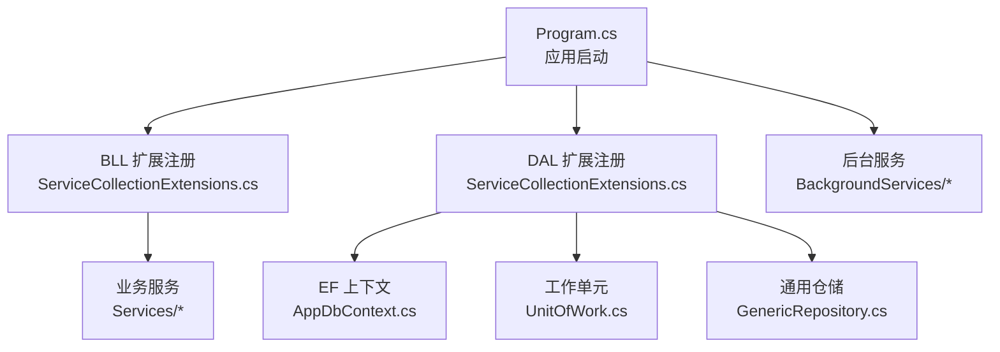
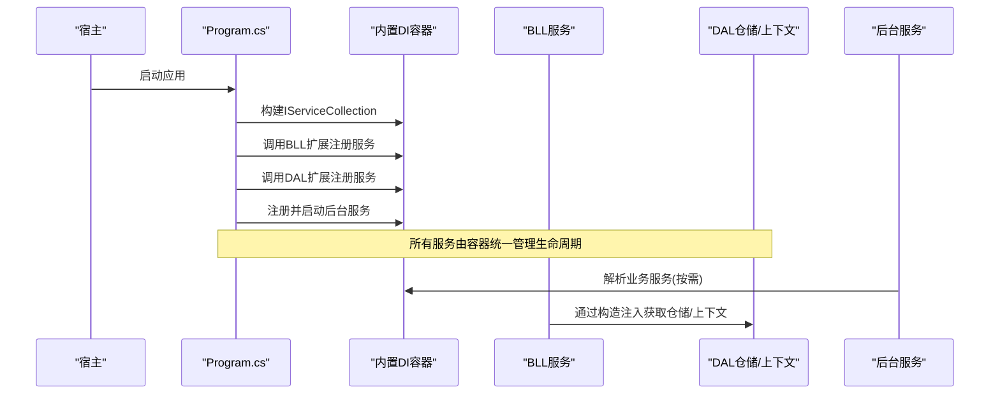
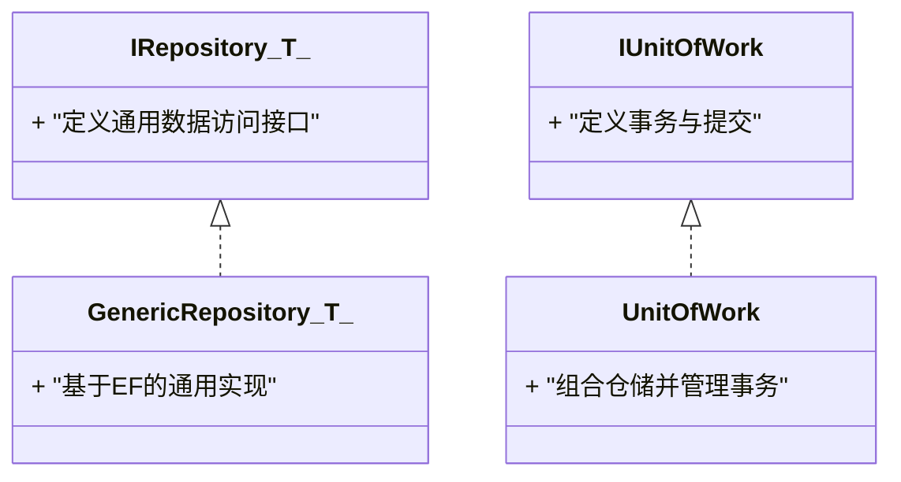
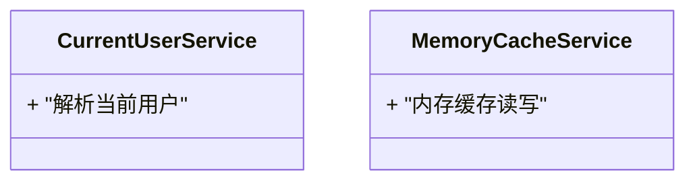
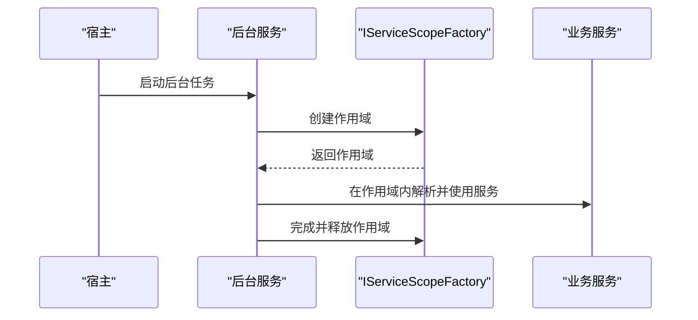
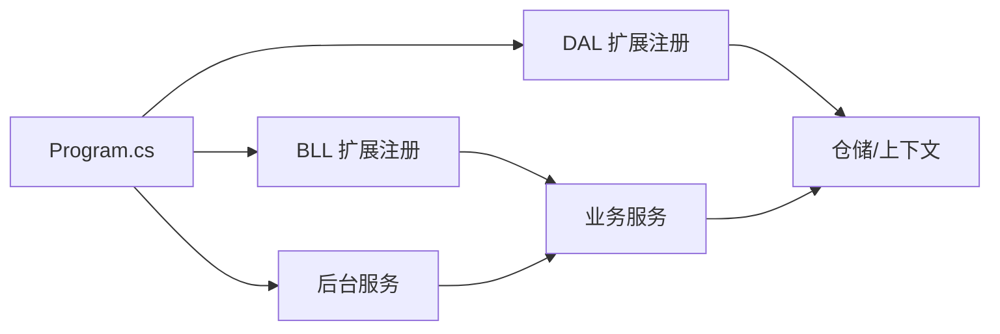

# 依赖注入与DI容器

<cite>
**本文引用的文件**   
- [Program.cs](file://EquipmentIMS.Web/Program.cs)
- [ServiceCollectionExtensions.cs](file://EquipmentIMS.BLL/Extensions/ServiceCollectionExtensions.cs)
- [ServiceCollectionExtensions.cs](file://EquipmentIMS.DAL/Extensions/ServiceCollectionExtensions.cs)
- [AppDbContext.cs](file://EquipmentIMS.DAL/AppDbContext.cs)
- [UnitOfWork.cs](file://EquipmentIMS.DAL/Repositories/UnitOfWork.cs)
- [GenericRepository.cs](file://EquipmentIMS.DAL/Repositories/GenericRepository.cs)
- [IRepository.cs](file://EquipmentIMS.DAL/Interfaces/IRepository.cs)
- [IUnitOfWork.cs](file://EquipmentIMS.DAL/Interfaces/IUnitOfWork.cs)
- [CurrentUserService.cs](file://EquipmentIMS.BLL/Services/CurrentUserService.cs)
- [MemoryCacheService.cs](file://EquipmentIMS.BLL/Services/MemoryCacheService.cs)
- [ExportBackgroundService.cs](file://EquipmentIMS.Web/BackgroundServices/ExportBackgroundService.cs)
- [ReportExportBackgroundService.cs](file://EquipmentIMS.Web/BackgroundServices/ReportExportBackgroundService.cs)
- [StockAlertBackgroundService.cs](file://EquipmentIMS.Web/BackgroundServices/StockAlertBackgroundService.cs)
- [MaintenanceReminderBackgroundService.cs](file://EquipmentIMS.Web/BackgroundServices/MaintenanceReminderBackgroundService.cs)
</cite>

## 目录
1. [简介](#简介)
2. [项目结构](#项目结构)
3. [核心组件](#核心组件)
4. [架构总览](#架构总览)
5. [详细组件分析](#详细组件分析)
6. [依赖关系分析](#依赖关系分析)
7. [性能考虑](#性能考虑)
8. [故障排查指南](#故障排查指南)
9. [结论](#结论)
10. [附录](#附录)

## 简介
本文件面向THMS系统的依赖注入（DI）容器使用与维护，聚焦.NET Core内置容器的配置与最佳实践。内容涵盖：
- 服务注册策略（Singleton、Scoped、Transient）的生命周期管理
- 各层服务的注册方式与接口抽象设计
- 构造函数注入与属性注入的使用场景与注意事项
- 循环依赖的避免策略与服务定位器反模式
- 性能优化建议与调试技巧

## 项目结构
THMS采用分层架构，Web层通过扩展方法集中注册BLL与DAL服务，并启动后台任务。关键入口与扩展点如下：
- Web应用入口：Program.cs
- BLL服务注册：EquipmentIMS.BLL.Extensions.ServiceCollectionExtensions.cs
- DAL服务注册：EquipmentIMS.DAL.Extensions.ServiceCollectionExtensions.cs
- EF上下文与仓储：EquipmentIMS.DAL.AppDbContext.cs、EquipmentIMS.DAL.Repositories/*
- 业务服务示例：EquipmentIMS.BLL.Services/*
- 后台服务：EquipmentIMS.Web.BackgroundServices/*

图表来源
- [Program.cs](file://EquipmentIMS.Web/Program.cs)
- [ServiceCollectionExtensions.cs](file://EquipmentIMS.BLL/Extensions/ServiceCollectionExtensions.cs)
- [ServiceCollectionExtensions.cs](file://EquipmentIMS.DAL/Extensions/ServiceCollectionExtensions.cs)
- [AppDbContext.cs](file://EquipmentIMS.DAL/AppDbContext.cs)
- [UnitOfWork.cs](file://EquipmentIMS.DAL/Repositories/UnitOfWork.cs)
- [GenericRepository.cs](file://EquipmentIMS.DAL/Repositories/GenericRepository.cs)

章节来源
- [Program.cs](file://EquipmentIMS.Web/Program.cs)
- [ServiceCollectionExtensions.cs](file://EquipmentIMS.BLL/Extensions/ServiceCollectionExtensions.cs)
- [ServiceCollectionExtensions.cs](file://EquipmentIMS.DAL/Extensions/ServiceCollectionExtensions.cs)

## 核心组件
- 服务注册扩展
  - BLL层：在ServiceCollectionExtensions中按领域聚合注册业务服务与其接口，统一生命周期策略。
  - DAL层：在ServiceCollectionExtensions中注册EF上下文、仓储与工作单元，提供数据访问抽象。
- 数据访问抽象
  - IRepository<T>：泛型仓储接口，定义CRUD与查询能力。
  - GenericRepository<T>：基于EF的通用实现。
  - IUnitOfWork / UnitOfWork：封装事务与多仓储协调。
- 业务服务
  - 以接口+实现形式组织，如CurrentUserService等，通过构造函数注入所需依赖。
- 缓存与当前用户
  - MemoryCacheService：内存缓存实现，适合轻量级缓存。
  - CurrentUserService：从请求上下文解析当前用户信息，通常作为Scoped服务。
- 后台服务
  - 多个BackgroundService用于异步导出、报表生成、库存预警与维护提醒等。

章节来源
- [ServiceCollectionExtensions.cs](file://EquipmentIMS.BLL/Extensions/ServiceCollectionExtensions.cs)
- [ServiceCollectionExtensions.cs](file://EquipmentIMS.DAL/Extensions/ServiceCollectionExtensions.cs)
- [IRepository.cs](file://EquipmentIMS.DAL/Interfaces/IRepository.cs)
- [GenericRepository.cs](file://EquipmentIMS.DAL/Repositories/GenericRepository.cs)
- [IUnitOfWork.cs](file://EquipmentIMS.DAL/Interfaces/IUnitOfWork.cs)
- [UnitOfWork.cs](file://EquipmentIMS.DAL/Repositories/UnitOfWork.cs)
- [CurrentUserService.cs](file://EquipmentIMS.BLL/Services/CurrentUserService.cs)
- [MemoryCacheService.cs](file://EquipmentIMS.BLL/Services/MemoryCacheService.cs)

## 架构总览
下图展示Web层如何通过内置DI容器装配BLL与DAL，以及后台服务如何消费业务服务。

图表来源
- [Program.cs](file://EquipmentIMS.Web/Program.cs)
- [ServiceCollectionExtensions.cs](file://EquipmentIMS.BLL/Extensions/ServiceCollectionExtensions.cs)
- [ServiceCollectionExtensions.cs](file://EquipmentIMS.DAL/Extensions/ServiceCollectionExtensions.cs)

## 详细组件分析

### 服务生命周期与注册策略
- Singleton（单例）
  - 适用：无状态、线程安全、全局共享的服务（如配置读取器、全局缓存）。
  - 注意：避免持有Scoped或Transient依赖；谨慎处理并发。
- Scoped（作用域）
  - 适用：每个HTTP请求或后台任务作用域内唯一（如当前用户、数据库上下文、工作单元）。
  - 典型：CurrentUserService、UnitOfWork、EF上下文。
- Transient（瞬时）
  - 适用：轻量、无状态、每次解析新建实例（如简单计算器、DTO映射器）。
  - 注意：避免频繁创建昂贵对象。

最佳实践
- 优先使用构造函数注入，明确依赖契约。
- 将需要请求级状态的服务标记为Scoped。
- 将纯计算/工具类标记为Transient或Singleton（视是否含状态而定）。

章节来源
- [ServiceCollectionExtensions.cs](file://EquipmentIMS.BLL/Extensions/ServiceCollectionExtensions.cs)
- [ServiceCollectionExtensions.cs](file://EquipmentIMS.DAL/Extensions/ServiceCollectionExtensions.cs)

### 数据访问层：仓储与工作单元
- 接口抽象
  - IRepository<T>：定义通用数据操作契约。
  - IUnitOfWork：定义事务边界与提交语义。
- 实现要点
  - GenericRepository<T>：基于EF的通用CRUD。
  - UnitOfWork：组合多个仓储，统一提交，确保一致性。
- 注册建议
  - 仓储与UoW通常为Scoped，随请求生命周期创建与释放。
  - EF上下文也应为Scoped，避免跨请求共享连接。

图表来源
- [IRepository.cs](file://EquipmentIMS.DAL/Interfaces/IRepository.cs)
- [GenericRepository.cs](file://EquipmentIMS.DAL/Repositories/GenericRepository.cs)
- [IUnitOfWork.cs](file://EquipmentIMS.DAL/Interfaces/IUnitOfWork.cs)
- [UnitOfWork.cs](file://EquipmentIMS.DAL/Repositories/UnitOfWork.cs)

章节来源
- [IRepository.cs](file://EquipmentIMS.DAL/Interfaces/IRepository.cs)
- [GenericRepository.cs](file://EquipmentIMS.DAL/Repositories/GenericRepository.cs)
- [IUnitOfWork.cs](file://EquipmentIMS.DAL/Interfaces/IUnitOfWork.cs)
- [UnitOfWork.cs](file://EquipmentIMS.DAL/Repositories/UnitOfWork.cs)

### 业务服务：当前用户与缓存
- CurrentUserService
  - 职责：从请求上下文解析当前用户信息。
  - 生命周期：Scoped（与请求绑定）。
  - 注入方式：构造函数注入。
- MemoryCacheService
  - 职责：提供轻量内存缓存能力。
  - 生命周期：根据实现决定（若内部有状态则建议Scoped；若完全无状态可Singleton）。

图表来源
- [CurrentUserService.cs](file://EquipmentIMS.BLL/Services/CurrentUserService.cs)
- [MemoryCacheService.cs](file://EquipmentIMS.BLL/Services/MemoryCacheService.cs)

章节来源
- [CurrentUserService.cs](file://EquipmentIMS.BLL/Services/CurrentUserService.cs)
- [MemoryCacheService.cs](file://EquipmentIMS.BLL/Services/MemoryCacheService.cs)

### 后台服务：导出、报表、库存预警与维护提醒
- 背景
  - 后台服务通过AddHostedService注册，由容器管理其生命周期。
  - 在后台任务中解析业务服务时，需显式创建独立的作用域，以避免与请求作用域混淆。
- 关键服务
  - ExportBackgroundService：通用导出任务。
  - ReportExportBackgroundService：报表导出任务。
  - StockAlertBackgroundService：库存预警任务。
  - MaintenanceReminderBackgroundService：维护提醒任务。

图表来源
- [ExportBackgroundService.cs](file://EquipmentIMS.Web/BackgroundServices/ExportBackgroundService.cs)
- [ReportExportBackgroundService.cs](file://EquipmentIMS.Web/BackgroundServices/ReportExportBackgroundService.cs)
- [StockAlertBackgroundService.cs](file://EquipmentIMS.Web/BackgroundServices/StockAlertBackgroundService.cs)
- [MaintenanceReminderBackgroundService.cs](file://EquipmentIMS.Web/BackgroundServices/MaintenanceReminderBackgroundService.cs)

章节来源
- [ExportBackgroundService.cs](file://EquipmentIMS.Web/BackgroundServices/ExportBackgroundService.cs)
- [ReportExportBackgroundService.cs](file://EquipmentIMS.Web/BackgroundServices/ReportExportBackgroundService.cs)
- [StockAlertBackgroundService.cs](file://EquipmentIMS.Web/BackgroundServices/StockAlertBackgroundService.cs)
- [MaintenanceReminderBackgroundService.cs](file://EquipmentIMS.Web/BackgroundServices/MaintenanceReminderBackgroundService.cs)

### 构造函数注入与属性注入
- 构造函数注入
  - 推荐：清晰表达依赖，便于测试与验证。
  - 适用：所有必需依赖。
- 属性注入
  - 谨慎：仅用于可选依赖或外部框架自动注入的场景。
  - 风险：可能导致隐式依赖与难以追踪的初始化顺序问题。
- 最佳实践
  - 保持构造函数参数数量合理，必要时引入门面或服务聚合。
  - 避免在服务中直接访问静态服务定位器。

章节来源
- [ServiceCollectionExtensions.cs](file://EquipmentIMS.BLL/Extensions/ServiceCollectionExtensions.cs)
- [ServiceCollectionExtensions.cs](file://EquipmentIMS.DAL/Extensions/ServiceCollectionExtensions.cs)

### 循环依赖的避免策略
- 识别
  - A依赖B，B又依赖A，导致容器无法解析。
- 解决
  - 提取公共逻辑到第三方服务C，使A与B都依赖C。
  - 使用事件总线或消息队列解耦。
  - 延迟解析（IServiceProvider.GetService）仅在必要时使用，并置于作用域内。
- 设计原则
  - 单向依赖：上层依赖下层，避免反向依赖。
  - 接口隔离：细化接口，减少不必要的耦合。

[本节为概念性指导，不直接分析具体文件]

### 服务定位器模式的反模式
- 反模式
  - 在服务中直接持有IServiceProvider并动态解析服务，破坏依赖可见性与可测试性。
- 替代方案
  - 通过构造函数注入显式声明依赖。
  - 对复杂用例使用工厂模式或专门的服务工厂。

[本节为概念性指导，不直接分析具体文件]

## 依赖关系分析
- 组件耦合
  - Web层仅依赖BLL接口，不感知DAL细节。
  - BLL依赖DAL接口（仓储/UoW），不感知EF实现。
- 直接依赖
  - Program -> BLL/DAL扩展注册
  - BLL服务 -> DAL仓储/UoW
  - 后台服务 -> 业务服务（在作用域内解析）
- 潜在循环
  - 检查是否存在双向业务依赖，必要时引入中间层或事件机制。

图表来源
- [Program.cs](file://EquipmentIMS.Web/Program.cs)
- [ServiceCollectionExtensions.cs](file://EquipmentIMS.BLL/Extensions/ServiceCollectionExtensions.cs)
- [ServiceCollectionExtensions.cs](file://EquipmentIMS.DAL/Extensions/ServiceCollectionExtensions.cs)

章节来源
- [Program.cs](file://EquipmentIMS.Web/Program.cs)
- [ServiceCollectionExtensions.cs](file://EquipmentIMS.BLL/Extensions/ServiceCollectionExtensions.cs)
- [ServiceCollectionExtensions.cs](file://EquipmentIMS.DAL/Extensions/ServiceCollectionExtensions.cs)

## 性能考虑
- 生命周期选择
  - 将无状态且昂贵的服务设为Singleton以减少分配。
  - 将包含请求级状态的服务设为Scoped，避免跨请求污染。
- 资源管理
  - 确保DbContext与UoW在作用域结束时正确释放。
  - 避免在Singleton中持有Scoped/Transient依赖。
- 缓存策略
  - 使用MemoryCacheService进行热点数据缓存，注意过期与失效策略。
- 后台任务
  - 在后台任务中创建独立作用域，避免与请求作用域共享资源。
- 监控与诊断
  - 启用日志记录服务解析与异常路径。
  - 使用性能计数器与分布式追踪评估瓶颈。

[本节为通用指导，不直接分析具体文件]

## 故障排查指南
- 常见错误
  - 循环依赖：容器抛出循环引用异常。
  - 作用域误用：在Singleton中解析Scoped服务导致异常。
  - 未注册服务：解析时抛出“未找到服务”异常。
- 定位步骤
  - 检查Program中的扩展注册是否完整。
  - 确认服务生命周期是否符合预期。
  - 在后台任务中使用作用域工厂解析服务。
- 调试技巧
  - 在开发环境输出详细的DI解析日志。
  - 使用最小化复现案例验证服务图。

章节来源
- [Program.cs](file://EquipmentIMS.Web/Program.cs)
- [ServiceCollectionExtensions.cs](file://EquipmentIMS.BLL/Extensions/ServiceCollectionExtensions.cs)
- [ServiceCollectionExtensions.cs](file://EquipmentIMS.DAL/Extensions/ServiceCollectionExtensions.cs)

## 结论
THMS系统通过分层设计与.NET Core内置DI容器实现了清晰的依赖管理与生命周期控制。遵循正确的注册策略、构造函数注入与作用域管理，可有效提升可维护性与性能。同时，应避免服务定位器反模式与循环依赖，确保系统稳定可扩展。

[本节为总结性内容，不直接分析具体文件]

## 附录
- 快速参考
  - 注册扩展位置：BLL与DAL的ServiceCollectionExtensions.cs
  - 数据访问抽象：IRepository、GenericRepository、IUnitOfWork、UnitOfWork
  - 当前用户与缓存：CurrentUserService、MemoryCacheService
  - 后台服务：ExportBackgroundService、ReportExportBackgroundService、StockAlertBackgroundService、MaintenanceReminderBackgroundService

章节来源
- [ServiceCollectionExtensions.cs](file://EquipmentIMS.BLL/Extensions/ServiceCollectionExtensions.cs)
- [ServiceCollectionExtensions.cs](file://EquipmentIMS.DAL/Extensions/ServiceCollectionExtensions.cs)
- [IRepository.cs](file://EquipmentIMS.DAL/Interfaces/IRepository.cs)
- [GenericRepository.cs](file://EquipmentIMS.DAL/Repositories/GenericRepository.cs)
- [IUnitOfWork.cs](file://EquipmentIMS.DAL/Interfaces/IUnitOfWork.cs)
- [UnitOfWork.cs](file://EquipmentIMS.DAL/Repositories/UnitOfWork.cs)
- [CurrentUserService.cs](file://EquipmentIMS.BLL/Services/CurrentUserService.cs)
- [MemoryCacheService.cs](file://EquipmentIMS.BLL/Services/MemoryCacheService.cs)
- [ExportBackgroundService.cs](file://EquipmentIMS.Web/BackgroundServices/ExportBackgroundService.cs)
- [ReportExportBackgroundService.cs](file://EquipmentIMS.Web/BackgroundServices/ReportExportBackgroundService.cs)
- [StockAlertBackgroundService.cs](file://EquipmentIMS.Web/BackgroundServices/StockAlertBackgroundService.cs)
- [MaintenanceReminderBackgroundService.cs](file://EquipmentIMS.Web/BackgroundServices/MaintenanceReminderBackgroundService.cs)