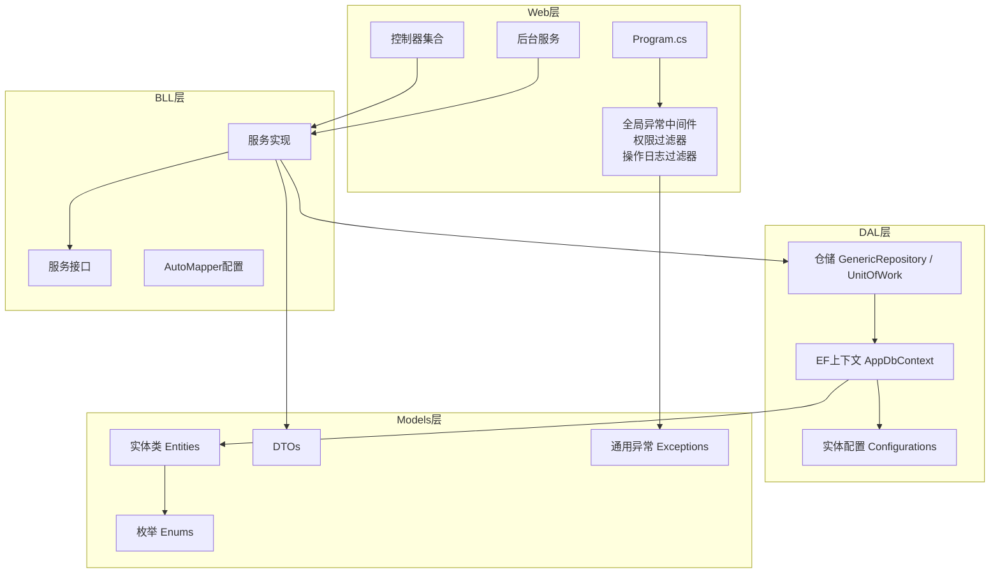
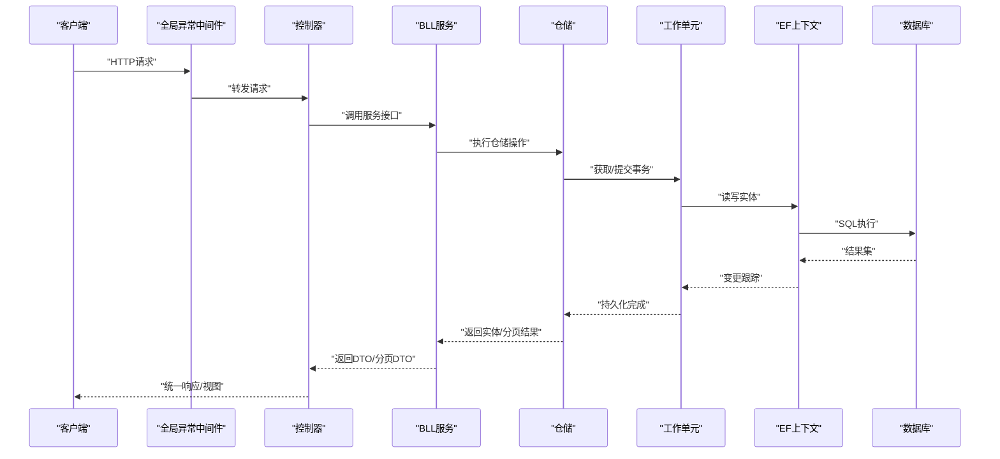
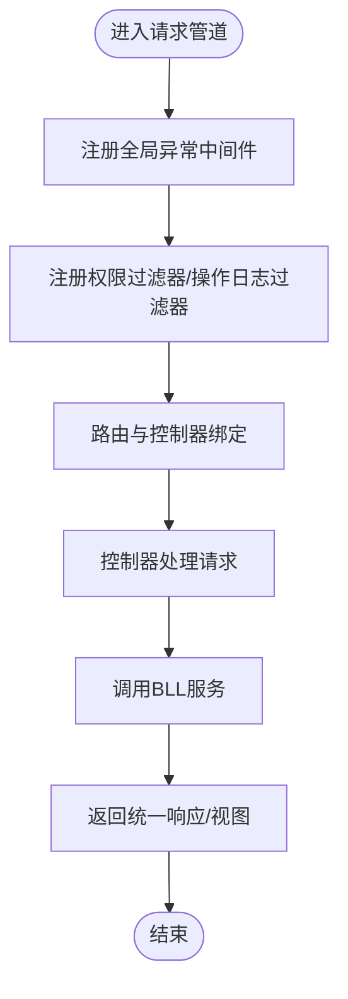
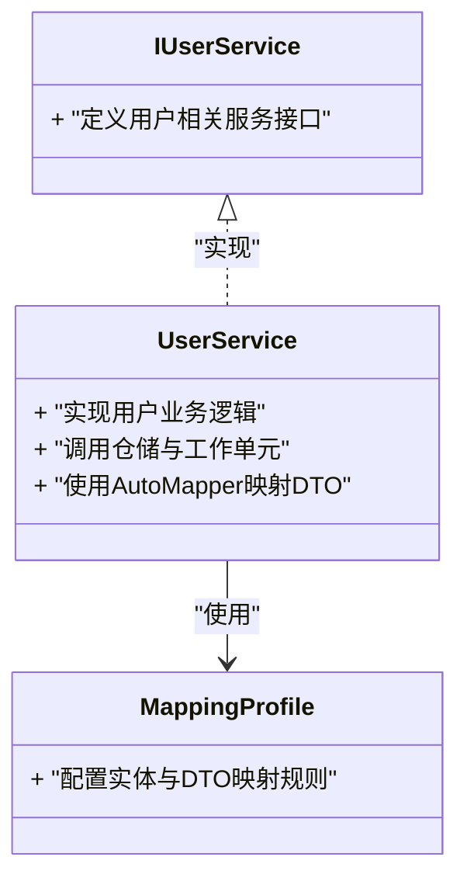
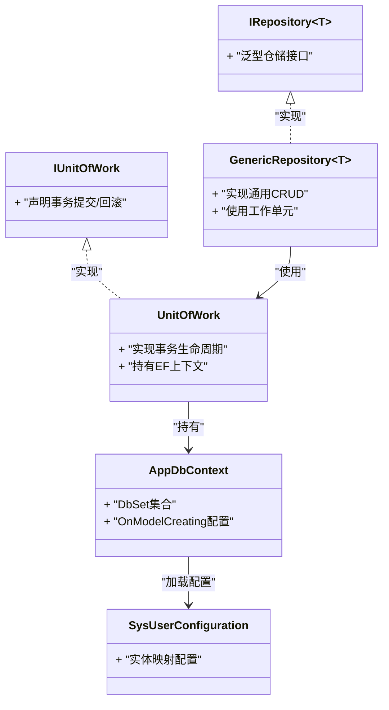
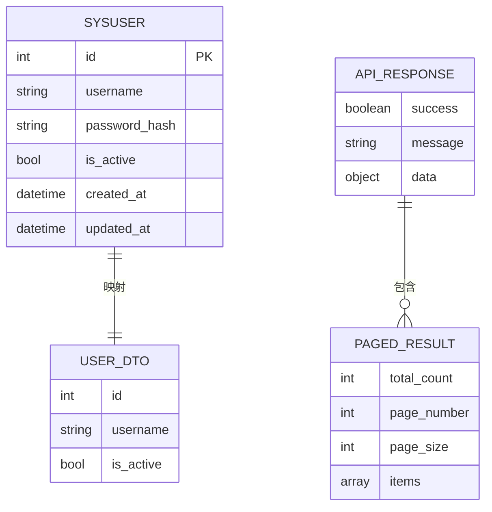
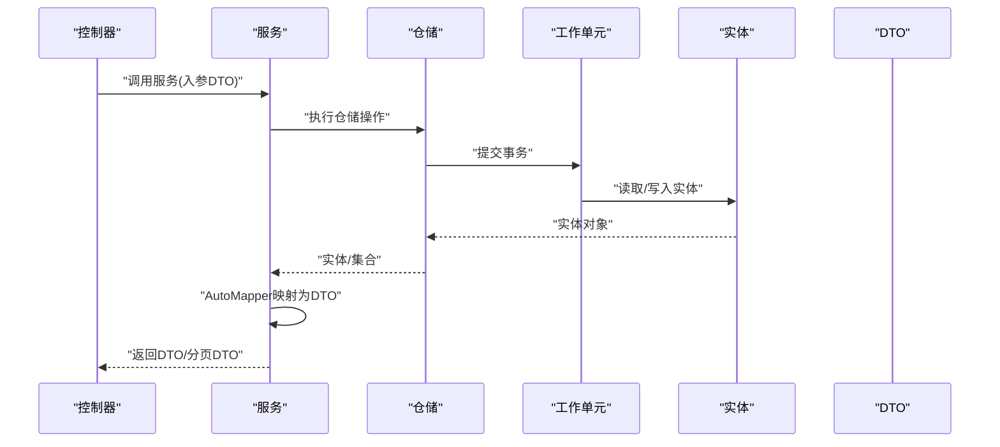
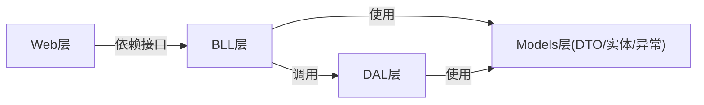

# 分层架构详解

<cite>
**本文引用的文件**   
- [Program.cs](file://EquipmentIMS.Web/Program.cs)
- [GlobalExceptionMiddleware.cs](file://EquipmentIMS.Web/Filters/GlobalExceptionMiddleware.cs)
- [PermissionFilter.cs](file://EquipmentIMS.Web/Filters/PermissionFilter.cs)
- [OperationLogActionFilter.cs](file://EquipmentIMS.Web/Filters/OperationLogActionFilter.cs)
- [AccountController.cs](file://EquipmentIMS.Web/Controllers/AccountController.cs)
- [ProductController.cs](file://EquipmentIMS.Web/Controllers/ProductController.cs)
- [UserService.cs](file://EquipmentIMS.BLL/Services/UserService.cs)
- [IUserService.cs](file://EquipmentIMS.BLL/Interfaces/IUserService.cs)
- [MappingProfile.cs](file://EquipmentIMS.BLL/Mappings/MappingProfile.cs)
- [GenericRepository.cs](file://EquipmentIMS.DAL/Repositories/GenericRepository.cs)
- [UnitOfWork.cs](file://EquipmentIMS.DAL/Repositories/UnitOfWork.cs)
- [AppDbContext.cs](file://EquipmentIMS.DAL/AppDbContext.cs)
- [SysUserConfiguration.cs](file://EquipmentIMS.DAL/Configurations/SysUserConfiguration.cs)
- [BaseEntity.cs](file://EquipmentIMS.Models/Entities/BaseEntity.cs)
- [SysUser.cs](file://EquipmentIMS.Models/Entities/SysUser.cs)
- [UserDto.cs](file://EquipmentIMS.Models/DTOs/UserDto.cs)
- [ApiResponse.cs](file://EquipmentIMS.Models/DTOs/ApiResponse.cs)
- [PagedResult.cs](file://EquipmentIMS.Models/DTOs/PagedResult.cs)
- [BusinessException.cs](file://EquipmentIMS.Models/Exceptions/BusinessException.cs)
- [NotFoundException.cs](file://EquipmentIMS.Models/Exceptions/NotFoundException.cs)
- [ValidationException.cs](file://EquipmentIMS.Models/Exceptions/ValidationException.cs)
</cite>

## 目录
1. [简介](#简介)
2. [项目结构](#项目结构)
3. [核心组件](#核心组件)
4. [架构总览](#架构总览)
5. [详细组件分析](#详细组件分析)
6. [依赖关系分析](#依赖关系分析)
7. [性能考虑](#性能考虑)
8. [故障排查指南](#故障排查指南)
9. [结论](#结论)
10. [附录](#附录)

## 简介
本文件面向THMS（设备库存管理系统）的分层架构，围绕Web层、BLL业务逻辑层、DAL数据访问层与Models模型层进行系统化说明。文档重点阐述四层职责边界、依赖方向、数据流向、异常处理策略以及层间通信机制，并通过架构图与交互图帮助读者快速理解系统结构与关键流程。

## 项目结构
THMS采用清晰的分层组织方式：
- Web层（EquipmentIMS.Web）：MVC控制器、视图模型、中间件与过滤器、后台任务、静态资源与视图。
- BLL层（EquipmentIMS.BLL）：服务接口与实现、DTO映射配置、扩展方法。
- DAL层（EquipmentIMS.DAL）：仓储模式、工作单元、EF Core上下文与实体配置。
- Models层（EquipmentIMS.Models）：实体类、DTO、枚举、通用异常类型。

图表来源
- [Program.cs](file://EquipmentIMS.Web/Program.cs)
- [GlobalExceptionMiddleware.cs](file://EquipmentIMS.Web/Filters/GlobalExceptionMiddleware.cs)
- [PermissionFilter.cs](file://EquipmentIMS.Web/Filters/PermissionFilter.cs)
- [OperationLogActionFilter.cs](file://EquipmentIMS.Web/Filters/OperationLogActionFilter.cs)
- [UserService.cs](file://EquipmentIMS.BLL/Services/UserService.cs)
- [IUserService.cs](file://EquipmentIMS.BLL/Interfaces/IUserService.cs)
- [MappingProfile.cs](file://EquipmentIMS.BLL/Mappings/MappingProfile.cs)
- [GenericRepository.cs](file://EquipmentIMS.DAL/Repositories/GenericRepository.cs)
- [UnitOfWork.cs](file://EquipmentIMS.DAL/Repositories/UnitOfWork.cs)
- [AppDbContext.cs](file://EquipmentIMS.DAL/AppDbContext.cs)
- [SysUserConfiguration.cs](file://EquipmentIMS.DAL/Configurations/SysUserConfiguration.cs)
- [BaseEntity.cs](file://EquipmentIMS.Models/Entities/BaseEntity.cs)
- [SysUser.cs](file://EquipmentIMS.Models/Entities/SysUser.cs)
- [UserDto.cs](file://EquipmentIMS.Models/DTOs/UserDto.cs)
- [ApiResponse.cs](file://EquipmentIMS.Models/DTOs/ApiResponse.cs)
- [PagedResult.cs](file://EquipmentIMS.Models/DTOs/PagedResult.cs)
- [BusinessException.cs](file://EquipmentIMS.Models/Exceptions/BusinessException.cs)
- [NotFoundException.cs](file://EquipmentIMS.Models/Exceptions/NotFoundException.cs)
- [ValidationException.cs](file://EquipmentIMS.Models/Exceptions/ValidationException.cs)

章节来源
- [Program.cs](file://EquipmentIMS.Web/Program.cs)
- [GlobalExceptionMiddleware.cs](file://EquipmentIMS.Web/Filters/GlobalExceptionMiddleware.cs)
- [PermissionFilter.cs](file://EquipmentIMS.Web/Filters/PermissionFilter.cs)
- [OperationLogActionFilter.cs](file://EquipmentIMS.Web/Filters/OperationLogActionFilter.cs)
- [UserService.cs](file://EquipmentIMS.BLL/Services/UserService.cs)
- [IUserService.cs](file://EquipmentIMS.BLL/Interfaces/IUserService.cs)
- [MappingProfile.cs](file://EquipmentIMS.BLL/Mappings/MappingProfile.cs)
- [GenericRepository.cs](file://EquipmentIMS.DAL/Repositories/GenericRepository.cs)
- [UnitOfWork.cs](file://EquipmentIMS.DAL/Repositories/UnitOfWork.cs)
- [AppDbContext.cs](file://EquipmentIMS.DAL/AppDbContext.cs)
- [SysUserConfiguration.cs](file://EquipmentIMS.DAL/Configurations/SysUserConfiguration.cs)
- [BaseEntity.cs](file://EquipmentIMS.Models/Entities/BaseEntity.cs)
- [SysUser.cs](file://EquipmentIMS.Models/Entities/SysUser.cs)
- [UserDto.cs](file://EquipmentIMS.Models/DTOs/UserDto.cs)
- [ApiResponse.cs](file://EquipmentIMS.Models/DTOs/ApiResponse.cs)
- [PagedResult.cs](file://EquipmentIMS.Models/DTOs/PagedResult.cs)
- [BusinessException.cs](file://EquipmentIMS.Models/Exceptions/BusinessException.cs)
- [NotFoundException.cs](file://EquipmentIMS.Models/Exceptions/NotFoundException.cs)
- [ValidationException.cs](file://EquipmentIMS.Models/Exceptions/ValidationException.cs)

## 核心组件
- Web层
  - 控制器：负责HTTP请求解析、参数校验、调用BLL服务、返回统一响应或视图。
  - 中间件与过滤器：全局异常处理、权限校验、操作日志记录等横切关注点。
  - 视图模型：用于视图渲染的数据载体。
- BLL层
  - 服务接口与实现：封装领域规则、编排业务流程、协调多个仓储与外部服务。
  - DTO映射：通过AutoMapper在实体与DTO之间转换。
- DAL层
  - 仓储与工作单元：提供统一的CRUD与事务边界，屏蔽EF细节。
  - EF上下文与配置：集中管理数据库连接、实体映射与查询优化。
- Models层
  - 实体与DTO：实体表示持久化模型；DTO用于跨层数据传输。
  - 枚举与异常：统一状态码与错误语义。

章节来源
- [UserService.cs](file://EquipmentIMS.BLL/Services/UserService.cs)
- [IUserService.cs](file://EquipmentIMS.BLL/Interfaces/IUserService.cs)
- [MappingProfile.cs](file://EquipmentIMS.BLL/Mappings/MappingProfile.cs)
- [GenericRepository.cs](file://EquipmentIMS.DAL/Repositories/GenericRepository.cs)
- [UnitOfWork.cs](file://EquipmentIMS.DAL/Repositories/UnitOfWork.cs)
- [AppDbContext.cs](file://EquipmentIMS.DAL/AppDbContext.cs)
- [SysUserConfiguration.cs](file://EquipmentIMS.DAL/Configurations/SysUserConfiguration.cs)
- [BaseEntity.cs](file://EquipmentIMS.Models/Entities/BaseEntity.cs)
- [SysUser.cs](file://EquipmentIMS.Models/Entities/SysUser.cs)
- [UserDto.cs](file://EquipmentIMS.Models/DTOs/UserDto.cs)
- [ApiResponse.cs](file://EquipmentIMS.Models/DTOs/ApiResponse.cs)
- [PagedResult.cs](file://EquipmentIMS.Models/DTOs/PagedResult.cs)
- [BusinessException.cs](file://EquipmentIMS.Models/Exceptions/BusinessException.cs)
- [NotFoundException.cs](file://EquipmentIMS.Models/Exceptions/NotFoundException.cs)
- [ValidationException.cs](file://EquipmentIMS.Models/Exceptions/ValidationException.cs)

## 架构总览
下图展示从HTTP请求到数据库的完整调用链，包括中间件、控制器、服务、仓储、工作单元与EF上下文之间的协作关系。

图表来源
- [GlobalExceptionMiddleware.cs](file://EquipmentIMS.Web/Filters/GlobalExceptionMiddleware.cs)
- [AccountController.cs](file://EquipmentIMS.Web/Controllers/AccountController.cs)
- [ProductController.cs](file://EquipmentIMS.Web/Controllers/ProductController.cs)
- [UserService.cs](file://EquipmentIMS.BLL/Services/UserService.cs)
- [IUserService.cs](file://EquipmentIMS.BLL/Interfaces/IUserService.cs)
- [GenericRepository.cs](file://EquipmentIMS.DAL/Repositories/GenericRepository.cs)
- [UnitOfWork.cs](file://EquipmentIMS.DAL/Repositories/UnitOfWork.cs)
- [AppDbContext.cs](file://EquipmentIMS.DAL/AppDbContext.cs)

## 详细组件分析

### Web层：控制器、中间件与过滤器
- 控制器职责
  - 接收并验证请求参数，调用BLL服务，组装统一响应或视图模型。
  - 示例路径：[AccountController.cs](file://EquipmentIMS.Web/Controllers/AccountController.cs)、[ProductController.cs](file://EquipmentIMS.Web/Controllers/ProductController.cs)。
- 中间件与过滤器
  - 全局异常中间件：捕获未处理异常，转换为统一响应格式。
  - 权限过滤器：基于角色/权限拦截请求。
  - 操作日志过滤器：记录关键操作的审计信息。
  - 示例路径：[GlobalExceptionMiddleware.cs](file://EquipmentIMS.Web/Filters/GlobalExceptionMiddleware.cs)、[PermissionFilter.cs](file://EquipmentIMS.Web/Filters/PermissionFilter.cs)、[OperationLogActionFilter.cs](file://EquipmentIMS.Web/Filters/OperationLogActionFilter.cs)。
- 启动与管道配置
  - Program.cs中注册中间件、过滤器、服务与EF上下文。
  - 示例路径：[Program.cs](file://EquipmentIMS.Web/Program.cs)。

图表来源
- [Program.cs](file://EquipmentIMS.Web/Program.cs)
- [GlobalExceptionMiddleware.cs](file://EquipmentIMS.Web/Filters/GlobalExceptionMiddleware.cs)
- [PermissionFilter.cs](file://EquipmentIMS.Web/Filters/PermissionFilter.cs)
- [OperationLogActionFilter.cs](file://EquipmentIMS.Web/Filters/OperationLogActionFilter.cs)
- [AccountController.cs](file://EquipmentIMS.Web/Controllers/AccountController.cs)
- [ProductController.cs](file://EquipmentIMS.Web/Controllers/ProductController.cs)

章节来源
- [Program.cs](file://EquipmentIMS.Web/Program.cs)
- [GlobalExceptionMiddleware.cs](file://EquipmentIMS.Web/Filters/GlobalExceptionMiddleware.cs)
- [PermissionFilter.cs](file://EquipmentIMS.Web/Filters/PermissionFilter.cs)
- [OperationLogActionFilter.cs](file://EquipmentIMS.Web/Filters/OperationLogActionFilter.cs)
- [AccountController.cs](file://EquipmentIMS.Web/Controllers/AccountController.cs)
- [ProductController.cs](file://EquipmentIMS.Web/Controllers/ProductController.cs)

### BLL层：服务接口与实现、DTO映射
- 服务设计
  - 以接口定义能力边界，实现类承载业务规则与流程编排。
  - 示例路径：[IUserService.cs](file://EquipmentIMS.BLL/Interfaces/IUserService.cs)、[UserService.cs](file://EquipmentIMS.BLL/Services/UserService.cs)。
- DTO映射
  - 使用AutoMapper将实体与DTO互转，保持层间解耦。
  - 示例路径：[MappingProfile.cs](file://EquipmentIMS.BLL/Mappings/MappingProfile.cs)。
- 典型流程
  - 控制器传入DTO -> 服务校验与业务处理 -> 调用仓储 -> 返回DTO或分页DTO。

图表来源
- [IUserService.cs](file://EquipmentIMS.BLL/Interfaces/IUserService.cs)
- [UserService.cs](file://EquipmentIMS.BLL/Services/UserService.cs)
- [MappingProfile.cs](file://EquipmentIMS.BLL/Mappings/MappingProfile.cs)

章节来源
- [IUserService.cs](file://EquipmentIMS.BLL/Interfaces/IUserService.cs)
- [UserService.cs](file://EquipmentIMS.BLL/Services/UserService.cs)
- [MappingProfile.cs](file://EquipmentIMS.BLL/Mappings/MappingProfile.cs)

### DAL层：仓储模式、工作单元、EF配置
- 仓储与工作单元
  - 通用仓储提供基础CRUD与查询能力，工作单元统一管理事务边界。
  - 示例路径：[GenericRepository.cs](file://EquipmentIMS.DAL/Repositories/GenericRepository.cs)、[UnitOfWork.cs](file://EquipmentIMS.DAL/Repositories/UnitOfWork.cs)。
- EF上下文与配置
  - 集中管理DbSet、连接字符串、实体配置与批量查询优化。
  - 示例路径：[AppDbContext.cs](file://EquipmentIMS.DAL/AppDbContext.cs)、[SysUserConfiguration.cs](file://EquipmentIMS.DAL/Configurations/SysUserConfiguration.cs)。

图表来源
- [GenericRepository.cs](file://EquipmentIMS.DAL/Repositories/GenericRepository.cs)
- [UnitOfWork.cs](file://EquipmentIMS.DAL/Repositories/UnitOfWork.cs)
- [AppDbContext.cs](file://EquipmentIMS.DAL/AppDbContext.cs)
- [SysUserConfiguration.cs](file://EquipmentIMS.DAL/Configurations/SysUserConfiguration.cs)

章节来源
- [GenericRepository.cs](file://EquipmentIMS.DAL/Repositories/GenericRepository.cs)
- [UnitOfWork.cs](file://EquipmentIMS.DAL/Repositories/UnitOfWork.cs)
- [AppDbContext.cs](file://EquipmentIMS.DAL/AppDbContext.cs)
- [SysUserConfiguration.cs](file://EquipmentIMS.DAL/Configurations/SysUserConfiguration.cs)

### Models层：实体类、DTO、枚举、异常
- 实体与基类
  - BaseEntity提供公共字段（如创建时间、更新时间等），具体实体继承基类。
  - 示例路径：[BaseEntity.cs](file://EquipmentIMS.Models/Entities/BaseEntity.cs)、[SysUser.cs](file://EquipmentIMS.Models/Entities/SysUser.cs)。
- DTO与分页
  - UserDto用于跨层传输用户信息；ApiResponse与PagedResult用于统一响应与分页。
  - 示例路径：[UserDto.cs](file://EquipmentIMS.Models/DTOs/UserDto.cs)、[ApiResponse.cs](file://EquipmentIMS.Models/DTOs/ApiResponse.cs)、[PagedResult.cs](file://EquipmentIMS.Models/DTOs/PagedResult.cs)。
- 异常类型
  - BusinessException、NotFoundException、ValidationException用于表达业务错误、未找到与校验失败。
  - 示例路径：[BusinessException.cs](file://EquipmentIMS.Models/Exceptions/BusinessException.cs)、[NotFoundException.cs](file://EquipmentIMS.Models/Exceptions/NotFoundException.cs)、[ValidationException.cs](file://EquipmentIMS.Models/Exceptions/ValidationException.cs)。

图表来源
- [BaseEntity.cs](file://EquipmentIMS.Models/Entities/BaseEntity.cs)
- [SysUser.cs](file://EquipmentIMS.Models/Entities/SysUser.cs)
- [UserDto.cs](file://EquipmentIMS.Models/DTOs/UserDto.cs)
- [ApiResponse.cs](file://EquipmentIMS.Models/DTOs/ApiResponse.cs)
- [PagedResult.cs](file://EquipmentIMS.Models/DTOs/PagedResult.cs)

章节来源
- [BaseEntity.cs](file://EquipmentIMS.Models/Entities/BaseEntity.cs)
- [SysUser.cs](file://EquipmentIMS.Models/Entities/SysUser.cs)
- [UserDto.cs](file://EquipmentIMS.Models/DTOs/UserDto.cs)
- [ApiResponse.cs](file://EquipmentIMS.Models/DTOs/ApiResponse.cs)
- [PagedResult.cs](file://EquipmentIMS.Models/DTOs/PagedResult.cs)
- [BusinessException.cs](file://EquipmentIMS.Models/Exceptions/BusinessException.cs)
- [NotFoundException.cs](file://EquipmentIMS.Models/Exceptions/NotFoundException.cs)
- [ValidationException.cs](file://EquipmentIMS.Models/Exceptions/ValidationException.cs)

### 层间通信与数据传递示例
- 控制器到服务
  - 控制器接收DTO，调用服务接口，服务返回DTO或分页DTO。
  - 参考路径：[AccountController.cs](file://EquipmentIMS.Web/Controllers/AccountController.cs)、[ProductController.cs](file://EquipmentIMS.Web/Controllers/ProductController.cs)、[IUserService.cs](file://EquipmentIMS.BLL/Interfaces/IUserService.cs)、[UserService.cs](file://EquipmentIMS.BLL/Services/UserService.cs)。
- 服务到仓储与工作单元
  - 服务通过仓储接口执行查询/更新，工作单元负责事务提交。
  - 参考路径：[GenericRepository.cs](file://EquipmentIMS.DAL/Repositories/GenericRepository.cs)、[UnitOfWork.cs](file://EquipmentIMS.DAL/Repositories/UnitOfWork.cs)。
- 实体与DTO映射
  - AutoMapper在BLL层完成实体与DTO的双向映射。
  - 参考路径：[MappingProfile.cs](file://EquipmentIMS.BLL/Mappings/MappingProfile.cs)。

图表来源
- [AccountController.cs](file://EquipmentIMS.Web/Controllers/AccountController.cs)
- [ProductController.cs](file://EquipmentIMS.Web/Controllers/ProductController.cs)
- [UserService.cs](file://EquipmentIMS.BLL/Services/UserService.cs)
- [IUserService.cs](file://EquipmentIMS.BLL/Interfaces/IUserService.cs)
- [GenericRepository.cs](file://EquipmentIMS.DAL/Repositories/GenericRepository.cs)
- [UnitOfWork.cs](file://EquipmentIMS.DAL/Repositories/UnitOfWork.cs)
- [MappingProfile.cs](file://EquipmentIMS.BLL/Mappings/MappingProfile.cs)

## 依赖关系分析
- 依赖方向
  - Web层依赖BLL接口，不直接依赖DAL。
  - BLL层依赖DAL接口与Models层DTO/实体。
  - DAL层依赖Models层实体与EF框架。
  - Models层无运行时依赖，仅定义数据结构与异常。
- 耦合与内聚
  - 通过接口隔离降低耦合，仓储与工作单元提升内聚性。
  - AutoMapper将实体与DTO解耦，避免层间强依赖。

图表来源
- [Program.cs](file://EquipmentIMS.Web/Program.cs)
- [UserService.cs](file://EquipmentIMS.BLL/Services/UserService.cs)
- [IUserService.cs](file://EquipmentIMS.BLL/Interfaces/IUserService.cs)
- [GenericRepository.cs](file://EquipmentIMS.DAL/Repositories/GenericRepository.cs)
- [AppDbContext.cs](file://EquipmentIMS.DAL/AppDbContext.cs)
- [BaseEntity.cs](file://EquipmentIMS.Models/Entities/BaseEntity.cs)
- [UserDto.cs](file://EquipmentIMS.Models/DTOs/UserDto.cs)

章节来源
- [Program.cs](file://EquipmentIMS.Web/Program.cs)
- [UserService.cs](file://EquipmentIMS.BLL/Services/UserService.cs)
- [IUserService.cs](file://EquipmentIMS.BLL/Interfaces/IUserService.cs)
- [GenericRepository.cs](file://EquipmentIMS.DAL/Repositories/GenericRepository.cs)
- [AppDbContext.cs](file://EquipmentIMS.DAL/AppDbContext.cs)
- [BaseEntity.cs](file://EquipmentIMS.Models/Entities/BaseEntity.cs)
- [UserDto.cs](file://EquipmentIMS.Models/DTOs/UserDto.cs)

## 性能考虑
- 分页与投影
  - 使用分页DTO减少网络传输与内存占用，结合仓储层高效查询。
- 异步与并发
  - 控制器与服务层尽量使用异步IO，提高吞吐。
- 缓存策略
  - 对热点数据引入缓存（如内存缓存），降低数据库压力。
- 批量操作
  - 大批量写入时利用工作单元事务与批量插入，减少往返次数。
- 索引与查询优化
  - 在EF配置中合理设置索引与Include策略，避免N+1查询。

## 故障排查指南
- 全局异常处理
  - 全局异常中间件捕获未处理异常，转换为统一响应格式，便于前端一致化处理。
  - 参考路径：[GlobalExceptionMiddleware.cs](file://EquipmentIMS.Web/Filters/GlobalExceptionMiddleware.cs)。
- 常见异常类型
  - 业务异常：用于表达业务规则违反。
  - 未找到异常：用于资源不存在场景。
  - 校验异常：用于参数校验失败。
  - 参考路径：[BusinessException.cs](file://EquipmentIMS.Models/Exceptions/BusinessException.cs)、[NotFoundException.cs](file://EquipmentIMS.Models/Exceptions/NotFoundException.cs)、[ValidationException.cs](file://EquipmentIMS.Models/Exceptions/ValidationException.cs)。
- 权限与审计
  - 权限过滤器拦截非法访问；操作日志过滤器记录关键操作，便于问题定位。
  - 参考路径：[PermissionFilter.cs](file://EquipmentIMS.Web/Filters/PermissionFilter.cs)、[OperationLogActionFilter.cs](file://EquipmentIMS.Web/Filters/OperationLogActionFilter.cs)。

章节来源
- [GlobalExceptionMiddleware.cs](file://EquipmentIMS.Web/Filters/GlobalExceptionMiddleware.cs)
- [BusinessException.cs](file://EquipmentIMS.Models/Exceptions/BusinessException.cs)
- [NotFoundException.cs](file://EquipmentIMS.Models/Exceptions/NotFoundException.cs)
- [ValidationException.cs](file://EquipmentIMS.Models/Exceptions/ValidationException.cs)
- [PermissionFilter.cs](file://EquipmentIMS.Web/Filters/PermissionFilter.cs)
- [OperationLogActionFilter.cs](file://EquipmentIMS.Web/Filters/OperationLogActionFilter.cs)

## 结论
THMS采用清晰的分层架构，通过接口与DTO解耦各层职责，借助仓储与工作单元统一数据访问与事务边界，配合全局异常中间件与过滤器保障系统的健壮性与可观测性。该设计有利于团队协作、测试与维护，并为后续扩展与性能优化奠定基础。

## 附录
- 关键路径参考
  - 启动与中间件注册：[Program.cs](file://EquipmentIMS.Web/Program.cs)
  - 全局异常处理：[GlobalExceptionMiddleware.cs](file://EquipmentIMS.Web/Filters/GlobalExceptionMiddleware.cs)
  - 权限与审计：[PermissionFilter.cs](file://EquipmentIMS.Web/Filters/PermissionFilter.cs)、[OperationLogActionFilter.cs](file://EquipmentIMS.Web/Filters/OperationLogActionFilter.cs)
  - 控制器示例：[AccountController.cs](file://EquipmentIMS.Web/Controllers/AccountController.cs)、[ProductController.cs](file://EquipmentIMS.Web/Controllers/ProductController.cs)
  - 服务接口与实现：[IUserService.cs](file://EquipmentIMS.BLL/Interfaces/IUserService.cs)、[UserService.cs](file://EquipmentIMS.BLL/Services/UserService.cs)
  - DTO映射：[MappingProfile.cs](file://EquipmentIMS.BLL/Mappings/MappingProfile.cs)
  - 仓储与工作单元：[GenericRepository.cs](file://EquipmentIMS.DAL/Repositories/GenericRepository.cs)、[UnitOfWork.cs](file://EquipmentIMS.DAL/Repositories/UnitOfWork.cs)
  - EF上下文与配置：[AppDbContext.cs](file://EquipmentIMS.DAL/AppDbContext.cs)、[SysUserConfiguration.cs](file://EquipmentIMS.DAL/Configurations/SysUserConfiguration.cs)
  - 实体与DTO：[BaseEntity.cs](file://EquipmentIMS.Models/Entities/BaseEntity.cs)、[SysUser.cs](file://EquipmentIMS.Models/Entities/SysUser.cs)、[UserDto.cs](file://EquipmentIMS.Models/DTOs/UserDto.cs)
  - 统一响应与分页：[ApiResponse.cs](file://EquipmentIMS.Models/DTOs/ApiResponse.cs)、[PagedResult.cs](file://EquipmentIMS.Models/DTOs/PagedResult.cs)
  - 异常类型：[BusinessException.cs](file://EquipmentIMS.Models/Exceptions/BusinessException.cs)、[NotFoundException.cs](file://EquipmentIMS.Models/Exceptions/NotFoundException.cs)、[ValidationException.cs](file://EquipmentIMS.Models/Exceptions/ValidationException.cs)