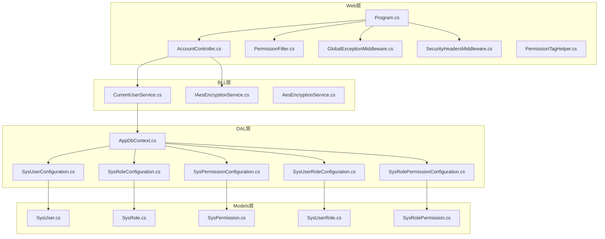
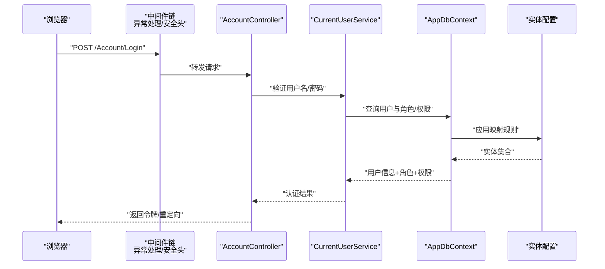
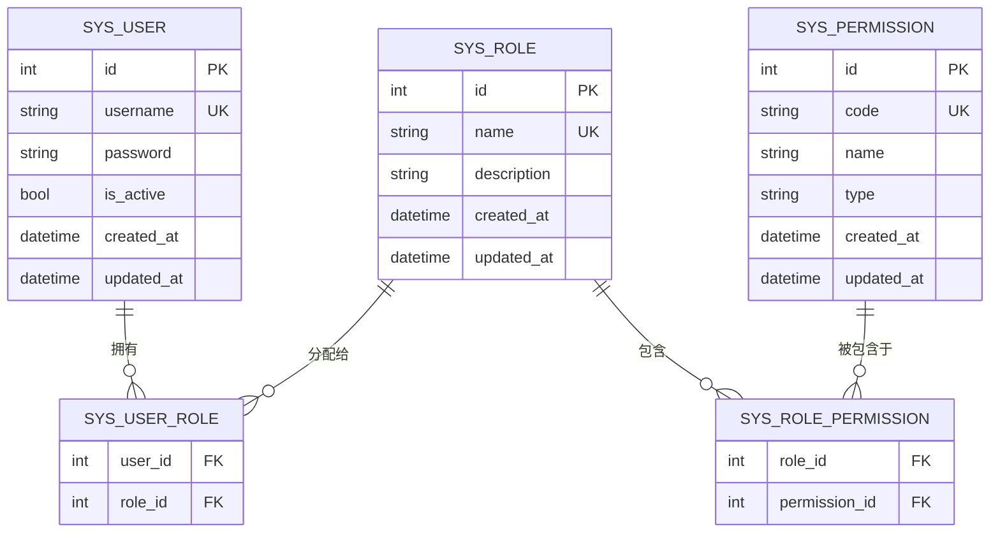
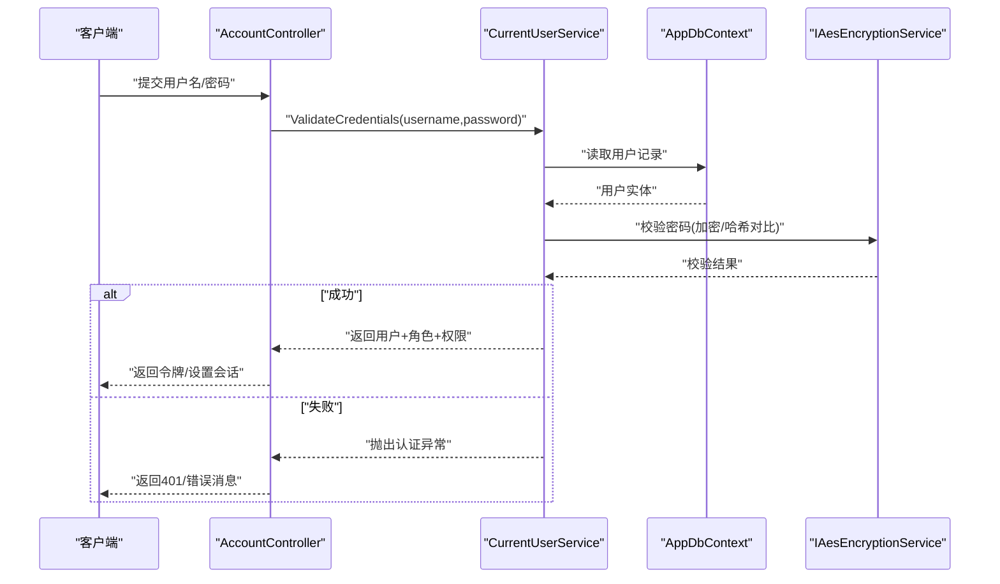
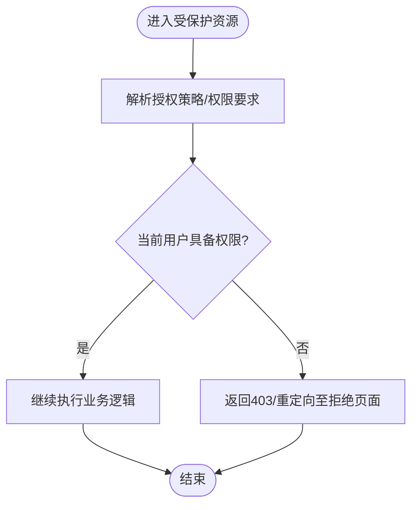
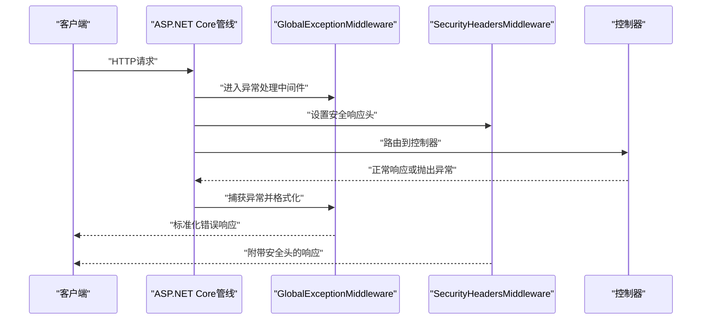
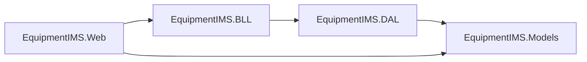

# 安全架构设计

<cite>
**本文引用的文件**   
- [Program.cs](file://EquipmentIMS.Web/Program.cs)
- [AccountController.cs](file://EquipmentIMS.Web/Controllers/AccountController.cs)
- [PermissionFilter.cs](file://EquipmentIMS.Web/Filters/PermissionFilter.cs)
- [GlobalExceptionMiddleware.cs](file://EquipmentIMS.Web/Filters/GlobalExceptionMiddleware.cs)
- [SecurityHeadersMiddleware.cs](file://EquipmentIMS.Web/Filters/SecurityHeadersMiddleware.cs)
- [PermissionTagHelper.cs](file://EquipmentIMS.Web/Extensions/PermissionTagHelper.cs)
- [CurrentUserService.cs](file://EquipmentIMS.BLL/Services/CurrentUserService.cs)
- [IAesEncryptionService.cs](file://EquipmentIMS.BLL/Interfaces/IAesEncryptionService.cs)
- [AesEncryptionService.cs](file://EquipmentIMS.BLL/Services/AesEncryptionService.cs)
- [SysUser.cs](file://EquipmentIMS.Models/Entities/SysUser.cs)
- [SysRole.cs](file://EquipmentIMS.Models/Entities/SysRole.cs)
- [SysPermission.cs](file://EquipmentIMS.Models/Entities/SysPermission.cs)
- [SysUserRole.cs](file://EquipmentIMS.Models/Entities/SysUserRole.cs)
- [SysRolePermission.cs](file://EquipmentIMS.Models/Entities/SysRolePermission.cs)
- [SysUserConfiguration.cs](file://EquipmentIMS.DAL/Configurations/SysUserConfiguration.cs)
- [SysRoleConfiguration.cs](file://EquipmentIMS.DAL/Configurations/SysRoleConfiguration.cs)
- [SysPermissionConfiguration.cs](file://EquipmentIMS.DAL/Configurations/SysPermissionConfiguration.cs)
- [SysUserRoleConfiguration.cs](file://EquipmentIMS.DAL/Configurations/SysUserRoleConfiguration.cs)
- [SysRolePermissionConfiguration.cs](file://EquipmentIMS.DAL/Configurations/SysRolePermissionConfiguration.cs)
- [AppDbContext.cs](file://EquipmentIMS.DAL/AppDbContext.cs)
- [LoginViewModel.cs](file://EquipmentIMS.Web/Models/LoginViewModel.cs)
- [ChangePasswordViewModel.cs](file://EquipmentIMS.Web/Models/ChangePasswordViewModel.cs)
</cite>

## 目录
1. [引言](#引言)
2. [项目结构](#项目结构)
3. [核心组件](#核心组件)
4. [架构总览](#架构总览)
5. [详细组件分析](#详细组件分析)
6. [依赖关系分析](#依赖关系分析)
7. [性能与安全考量](#性能与安全考量)
8. [故障排查指南](#故障排查指南)
9. [结论](#结论)
10. [附录](#附录)

## 引言
本文件面向THMS系统的安全架构设计，围绕基于角色的访问控制（RBAC）模型、身份认证与会话管理、授权控制（属性授权、自定义过滤器与权限标签助手）、全局异常处理中间件与安全头中间件等关键主题展开。文档同时覆盖密码加密存储、SQL注入防护、XSS防护等安全措施的实现要点，并提供最佳实践与常见漏洞防范建议。

## 项目结构
从安全视角看，本项目采用分层架构：Web层负责请求接入、认证入口与中间件；BLL层提供业务服务（含当前用户上下文与加密服务）；DAL层通过EF Core配置实体映射；Models层定义领域实体与DTO。

图表来源
- [Program.cs](file://EquipmentIMS.Web/Program.cs)
- [AccountController.cs](file://EquipmentIMS.Web/Controllers/AccountController.cs)
- [PermissionFilter.cs](file://EquipmentIMS.Web/Filters/PermissionFilter.cs)
- [GlobalExceptionMiddleware.cs](file://EquipmentIMS.Web/Filters/GlobalExceptionMiddleware.cs)
- [SecurityHeadersMiddleware.cs](file://EquipmentIMS.Web/Filters/SecurityHeadersMiddleware.cs)
- [PermissionTagHelper.cs](file://EquipmentIMS.Web/Extensions/PermissionTagHelper.cs)
- [CurrentUserService.cs](file://EquipmentIMS.BLL/Services/CurrentUserService.cs)
- [IAesEncryptionService.cs](file://EquipmentIMS.BLL/Interfaces/IAesEncryptionService.cs)
- [AesEncryptionService.cs](file://EquipmentIMS.BLL/Services/AesEncryptionService.cs)
- [AppDbContext.cs](file://EquipmentIMS.DAL/AppDbContext.cs)
- [SysUserConfiguration.cs](file://EquipmentIMS.DAL/Configurations/SysUserConfiguration.cs)
- [SysRoleConfiguration.cs](file://EquipmentIMS.DAL/Configurations/SysRoleConfiguration.cs)
- [SysPermissionConfiguration.cs](file://EquipmentIMS.DAL/Configurations/SysPermissionConfiguration.cs)
- [SysUserRoleConfiguration.cs](file://EquipmentIMS.DAL/Configurations/SysUserRoleConfiguration.cs)
- [SysRolePermissionConfiguration.cs](file://EquipmentIMS.DAL/Configurations/SysRolePermissionConfiguration.cs)
- [SysUser.cs](file://EquipmentIMS.Models/Entities/SysUser.cs)
- [SysRole.cs](file://EquipmentIMS.Models/Entities/SysRole.cs)
- [SysPermission.cs](file://EquipmentIMS.Models/Entities/SysPermission.cs)
- [SysUserRole.cs](file://EquipmentIMS.Models/Entities/SysUserRole.cs)
- [SysRolePermission.cs](file://EquipmentIMS.Models/Entities/SysRolePermission.cs)

章节来源
- [Program.cs](file://EquipmentIMS.Web/Program.cs)
- [AccountController.cs](file://EquipmentIMS.Web/Controllers/AccountController.cs)
- [PermissionFilter.cs](file://EquipmentIMS.Web/Filters/PermissionFilter.cs)
- [GlobalExceptionMiddleware.cs](file://EquipmentIMS.Web/Filters/GlobalExceptionMiddleware.cs)
- [SecurityHeadersMiddleware.cs](file://EquipmentIMS.Web/Filters/SecurityHeadersMiddleware.cs)
- [PermissionTagHelper.cs](file://EquipmentIMS.Web/Extensions/PermissionTagHelper.cs)
- [CurrentUserService.cs](file://EquipmentIMS.BLL/Services/CurrentUserService.cs)
- [IAesEncryptionService.cs](file://EquipmentIMS.BLL/Interfaces/IAesEncryptionService.cs)
- [AesEncryptionService.cs](file://EquipmentIMS.BLL/Services/AesEncryptionService.cs)
- [AppDbContext.cs](file://EquipmentIMS.DAL/AppDbContext.cs)
- [SysUserConfiguration.cs](file://EquipmentIMS.DAL/Configurations/SysUserConfiguration.cs)
- [SysRoleConfiguration.cs](file://EquipmentIMS.DAL/Configurations/SysRoleConfiguration.cs)
- [SysPermissionConfiguration.cs](file://EquipmentIMS.DAL/Configurations/SysPermissionConfiguration.cs)
- [SysUserRoleConfiguration.cs](file://EquipmentIMS.DAL/Configurations/SysUserRoleConfiguration.cs)
- [SysRolePermissionConfiguration.cs](file://EquipmentIMS.DAL/Configurations/SysRolePermissionConfiguration.cs)
- [SysUser.cs](file://EquipmentIMS.Models/Entities/SysUser.cs)
- [SysRole.cs](file://EquipmentIMS.Models/Entities/SysRole.cs)
- [SysPermission.cs](file://EquipmentIMS.Models/Entities/SysPermission.cs)
- [SysUserRole.cs](file://EquipmentIMS.Models/Entities/SysUserRole.cs)
- [SysRolePermission.cs](file://EquipmentIMS.Models/Entities/SysRolePermission.cs)

## 核心组件
- RBAC实体与映射：用户、角色、权限及其多对多关系由实体与EF配置共同描述，支持灵活的权限分配与继承扩展。
- 认证入口：登录控制器负责校验凭据、生成会话或令牌并返回响应。
- 授权控制：基于策略的Authorize特性结合自定义权限过滤器实现细粒度访问控制；视图层通过权限标签助手进行UI级权限渲染。
- 当前用户上下文：在请求管道中维护已认证用户的身份信息，供业务层使用。
- 安全中间件：全局异常处理统一错误输出；安全头中间件设置HTTP响应头以增强传输与渲染安全。
- 加密服务：提供对称加密能力，用于敏感数据（如密码）的加解密处理。

章节来源
- [SysUser.cs](file://EquipmentIMS.Models/Entities/SysUser.cs)
- [SysRole.cs](file://EquipmentIMS.Models/Entities/SysRole.cs)
- [SysPermission.cs](file://EquipmentIMS.Models/Entities/SysPermission.cs)
- [SysUserRole.cs](file://EquipmentIMS.Models/Entities/SysUserRole.cs)
- [SysRolePermission.cs](file://EquipmentIMS.Models/Entities/SysRolePermission.cs)
- [SysUserConfiguration.cs](file://EquipmentIMS.DAL/Configurations/SysUserConfiguration.cs)
- [SysRoleConfiguration.cs](file://EquipmentIMS.DAL/Configurations/SysRoleConfiguration.cs)
- [SysPermissionConfiguration.cs](file://EquipmentIMS.DAL/Configurations/SysPermissionConfiguration.cs)
- [SysUserRoleConfiguration.cs](file://EquipmentIMS.DAL/Configurations/SysUserRoleConfiguration.cs)
- [SysRolePermissionConfiguration.cs](file://EquipmentIMS.DAL/Configurations/SysRolePermissionConfiguration.cs)
- [AccountController.cs](file://EquipmentIMS.Web/Controllers/AccountController.cs)
- [PermissionFilter.cs](file://EquipmentIMS.Web/Filters/PermissionFilter.cs)
- [PermissionTagHelper.cs](file://EquipmentIMS.Web/Extensions/PermissionTagHelper.cs)
- [CurrentUserService.cs](file://EquipmentIMS.BLL/Services/CurrentUserService.cs)
- [IAesEncryptionService.cs](file://EquipmentIMS.BLL/Interfaces/IAesEncryptionService.cs)
- [AesEncryptionService.cs](file://EquipmentIMS.BLL/Services/AesEncryptionService.cs)
- [GlobalExceptionMiddleware.cs](file://EquipmentIMS.Web/Filters/GlobalExceptionMiddleware.cs)
- [SecurityHeadersMiddleware.cs](file://EquipmentIMS.Web/Filters/SecurityHeadersMiddleware.cs)

## 架构总览
下图展示从浏览器到数据库的关键安全路径：请求经中间件链进入控制器，控制器调用服务层完成认证与授权，最终访问持久化层。

图表来源
- [Program.cs](file://EquipmentIMS.Web/Program.cs)
- [AccountController.cs](file://EquipmentIMS.Web/Controllers/AccountController.cs)
- [CurrentUserService.cs](file://EquipmentIMS.BLL/Services/CurrentUserService.cs)
- [AppDbContext.cs](file://EquipmentIMS.DAL/AppDbContext.cs)
- [SysUserConfiguration.cs](file://EquipmentIMS.DAL/Configurations/SysUserConfiguration.cs)
- [SysRoleConfiguration.cs](file://EquipmentIMS.DAL/Configurations/SysRoleConfiguration.cs)
- [SysPermissionConfiguration.cs](file://EquipmentIMS.DAL/Configurations/SysPermissionConfiguration.cs)
- [SysUserRoleConfiguration.cs](file://EquipmentIMS.DAL/Configurations/SysUserRoleConfiguration.cs)
- [SysRolePermissionConfiguration.cs](file://EquipmentIMS.DAL/Configurations/SysRolePermissionConfiguration.cs)

## 详细组件分析

### RBAC模型与实体关系
- 实体说明
  - 用户：包含基本身份信息及状态字段。
  - 角色：代表一组权限集合。
  - 权限：表示最小可执行操作单元。
  - 用户-角色：多对多关联表。
  - 角色-权限：多对多关联表。
- EF配置
  - 各实体的主键、外键、索引与约束通过Configuration类明确定义，确保关系完整性与查询性能。
- 复杂度与性能
  - 典型查询为“用户→角色→权限”的三表连接，建议在常用查询路径上建立合适索引以提升性能。

图表来源
- [SysUser.cs](file://EquipmentIMS.Models/Entities/SysUser.cs)
- [SysRole.cs](file://EquipmentIMS.Models/Entities/SysRole.cs)
- [SysPermission.cs](file://EquipmentIMS.Models/Entities/SysPermission.cs)
- [SysUserRole.cs](file://EquipmentIMS.Models/Entities/SysUserRole.cs)
- [SysRolePermission.cs](file://EquipmentIMS.Models/Entities/SysRolePermission.cs)
- [SysUserConfiguration.cs](file://EquipmentIMS.DAL/Configurations/SysUserConfiguration.cs)
- [SysRoleConfiguration.cs](file://EquipmentIMS.DAL/Configurations/SysRoleConfiguration.cs)
- [SysPermissionConfiguration.cs](file://EquipmentIMS.DAL/Configurations/SysPermissionConfiguration.cs)
- [SysUserRoleConfiguration.cs](file://EquipmentIMS.DAL/Configurations/SysUserRoleConfiguration.cs)
- [SysRolePermissionConfiguration.cs](file://EquipmentIMS.DAL/Configurations/SysRolePermissionConfiguration.cs)

章节来源
- [SysUser.cs](file://EquipmentIMS.Models/Entities/SysUser.cs)
- [SysRole.cs](file://EquipmentIMS.Models/Entities/SysRole.cs)
- [SysPermission.cs](file://EquipmentIMS.Models/Entities/SysPermission.cs)
- [SysUserRole.cs](file://EquipmentIMS.Models/Entities/SysUserRole.cs)
- [SysRolePermission.cs](file://EquipmentIMS.Models/Entities/SysRolePermission.cs)
- [SysUserConfiguration.cs](file://EquipmentIMS.DAL/Configurations/SysUserConfiguration.cs)
- [SysRoleConfiguration.cs](file://EquipmentIMS.DAL/Configurations/SysRoleConfiguration.cs)
- [SysPermissionConfiguration.cs](file://EquipmentIMS.DAL/Configurations/SysPermissionConfiguration.cs)
- [SysUserRoleConfiguration.cs](file://EquipmentIMS.DAL/Configurations/SysUserRoleConfiguration.cs)
- [SysRolePermissionConfiguration.cs](file://EquipmentIMS.DAL/Configurations/SysRolePermissionConfiguration.cs)

### 身份认证机制（登录、会话与令牌）
- 登录流程
  - 控制器接收登录表单，调用服务层进行凭据校验。
  - 服务层通过上下文访问数据库获取用户、角色与权限。
  - 成功后生成令牌或建立会话，并将用户标识写入请求上下文。
- 会话与令牌
  - 若使用令牌模式，应在响应中安全地返回令牌并在后续请求携带。
  - 若使用会话模式，应启用安全Cookie选项（HttpOnly、Secure、SameSite）。
- 密码处理
  - 密码不应明文存储，应使用强哈希算法（如Argon2/BCrypt/PBKDF2）或对称加密服务进行保护。
  - 变更密码时需校验历史密码并更新密码历史表。

图表来源
- [AccountController.cs](file://EquipmentIMS.Web/Controllers/AccountController.cs)
- [CurrentUserService.cs](file://EquipmentIMS.BLL/Services/CurrentUserService.cs)
- [IAesEncryptionService.cs](file://EquipmentIMS.BLL/Interfaces/IAesEncryptionService.cs)
- [AesEncryptionService.cs](file://EquipmentIMS.BLL/Services/AesEncryptionService.cs)
- [AppDbContext.cs](file://EquipmentIMS.DAL/AppDbContext.cs)
- [LoginViewModel.cs](file://EquipmentIMS.Web/Models/LoginViewModel.cs)
- [ChangePasswordViewModel.cs](file://EquipmentIMS.Web/Models/ChangePasswordViewModel.cs)

章节来源
- [AccountController.cs](file://EquipmentIMS.Web/Controllers/AccountController.cs)
- [CurrentUserService.cs](file://EquipmentIMS.BLL/Services/CurrentUserService.cs)
- [IAesEncryptionService.cs](file://EquipmentIMS.BLL/Interfaces/IAesEncryptionService.cs)
- [AesEncryptionService.cs](file://EquipmentIMS.BLL/Services/AesEncryptionService.cs)
- [AppDbContext.cs](file://EquipmentIMS.DAL/AppDbContext.cs)
- [LoginViewModel.cs](file://EquipmentIMS.Web/Models/LoginViewModel.cs)
- [ChangePasswordViewModel.cs](file://EquipmentIMS.Web/Models/ChangePasswordViewModel.cs)

### 授权控制（属性授权、自定义过滤器与权限标签助手）
- 属性授权
  - 在控制器或动作方法上使用授权特性，结合策略指定所需权限代码或角色。
- 自定义权限过滤器
  - 在请求管道中拦截并检查当前用户是否具备目标权限，未通过则返回拒绝访问。
- 权限标签助手
  - 在视图中根据当前用户权限动态显示/隐藏菜单或按钮，避免越权UI暴露。

图表来源
- [PermissionFilter.cs](file://EquipmentIMS.Web/Filters/PermissionFilter.cs)
- [PermissionTagHelper.cs](file://EquipmentIMS.Web/Extensions/PermissionTagHelper.cs)
- [CurrentUserService.cs](file://EquipmentIMS.BLL/Services/CurrentUserService.cs)

章节来源
- [PermissionFilter.cs](file://EquipmentIMS.Web/Filters/PermissionFilter.cs)
- [PermissionTagHelper.cs](file://EquipmentIMS.Web/Extensions/PermissionTagHelper.cs)
- [CurrentUserService.cs](file://EquipmentIMS.BLL/Services/CurrentUserService.cs)

### 全局异常处理中间件与安全头中间件
- 全局异常处理
  - 捕获未处理异常，统一转换为标准JSON错误响应，避免泄露堆栈细节。
- 安全头
  - 设置响应头（如HSTS、X-Content-Type-Options、X-Frame-Options、Referrer-Policy等），降低点击劫持、MIME嗅探、跨站脚本等风险。

图表来源
- [GlobalExceptionMiddleware.cs](file://EquipmentIMS.Web/Filters/GlobalExceptionMiddleware.cs)
- [SecurityHeadersMiddleware.cs](file://EquipmentIMS.Web/Filters/SecurityHeadersMiddleware.cs)
- [Program.cs](file://EquipmentIMS.Web/Program.cs)

章节来源
- [GlobalExceptionMiddleware.cs](file://EquipmentIMS.Web/Filters/GlobalExceptionMiddleware.cs)
- [SecurityHeadersMiddleware.cs](file://EquipmentIMS.Web/Filters/SecurityHeadersMiddleware.cs)
- [Program.cs](file://EquipmentIMS.Web/Program.cs)

### 密码加密存储与敏感数据处理
- 加密服务接口与实现
  - 通过接口抽象加密能力，便于替换算法或引入密钥管理服务。
- 使用建议
  - 登录时对比哈希值而非明文；变更密码需记录历史并限制重用次数。
  - 对传输中的敏感数据启用HTTPS，避免中间人攻击。

章节来源
- [IAesEncryptionService.cs](file://EquipmentIMS.BLL/Interfaces/IAesEncryptionService.cs)
- [AesEncryptionService.cs](file://EquipmentIMS.BLL/Services/AesEncryptionService.cs)
- [SysUser.cs](file://EquipmentIMS.Models/Entities/SysUser.cs)

## 依赖关系分析
- 模块耦合
  - Web层依赖BLL的服务接口，BLL依赖DAL的数据上下文，Models作为共享契约。
- 外部依赖
  - ASP.NET Core中间件与授权框架；EF Core实体框架。
- 潜在循环依赖
  - 通过接口解耦与分层边界避免循环引用。

图表来源
- [Program.cs](file://EquipmentIMS.Web/Program.cs)
- [CurrentUserService.cs](file://EquipmentIMS.BLL/Services/CurrentUserService.cs)
- [AppDbContext.cs](file://EquipmentIMS.DAL/AppDbContext.cs)
- [SysUser.cs](file://EquipmentIMS.Models/Entities/SysUser.cs)

章节来源
- [Program.cs](file://EquipmentIMS.Web/Program.cs)
- [CurrentUserService.cs](file://EquipmentIMS.BLL/Services/CurrentUserService.cs)
- [AppDbContext.cs](file://EquipmentIMS.DAL/AppDbContext.cs)
- [SysUser.cs](file://EquipmentIMS.Models/Entities/SysUser.cs)

## 性能与安全考量
- 性能
  - 减少N+1查询，按需加载角色与权限；对高频查询建立复合索引。
  - 缓存热点权限集合并设置合理过期策略。
- 安全
  - 输入校验与参数绑定；输出编码防XSS。
  - 使用参数化查询与ORM默认行为防止SQL注入。
  - 启用严格的安全头与HTTPS强制跳转。
  - 对敏感日志脱敏，避免记录密码与令牌。

[本节为通用指导，不直接分析具体文件]

## 故障排查指南
- 登录失败
  - 检查凭据格式与大小写；确认密码哈希算法一致；查看异常中间件输出的错误详情。
- 权限不足
  - 核对用户-角色-权限映射；确认过滤器策略与权限代码匹配；检查视图标签助手条件。
- 安全头缺失
  - 确认中间件注册顺序与生效范围；检查反向代理是否重写响应头。

章节来源
- [GlobalExceptionMiddleware.cs](file://EquipmentIMS.Web/Filters/GlobalExceptionMiddleware.cs)
- [SecurityHeadersMiddleware.cs](file://EquipmentIMS.Web/Filters/SecurityHeadersMiddleware.cs)
- [PermissionFilter.cs](file://EquipmentIMS.Web/Filters/PermissionFilter.cs)
- [PermissionTagHelper.cs](file://EquipmentIMS.Web/Extensions/PermissionTagHelper.cs)

## 结论
THMS系统通过清晰的RBAC模型、完善的认证与授权机制、健壮的全局异常处理与安全头中间件，构建了多层次的安全防线。配合加密服务与输入输出防护，可有效抵御常见攻击面。建议在生产环境持续强化密钥管理、审计日志与渗透测试，确保安全基线持续提升。

[本节为总结性内容，不直接分析具体文件]

## 附录
- 最佳实践清单
  - 使用强哈希算法存储密码，定期轮换密钥。
  - 对所有API启用HTTPS与HSTS。
  - 实施最小权限原则，细化权限粒度。
  - 开启CSRF防护与严格的CORS策略。
  - 对文件上传进行类型与大小校验，并隔离存储。
  - 集中化日志与告警，保留必要审计轨迹。

[本节为通用指导，不直接分析具体文件]