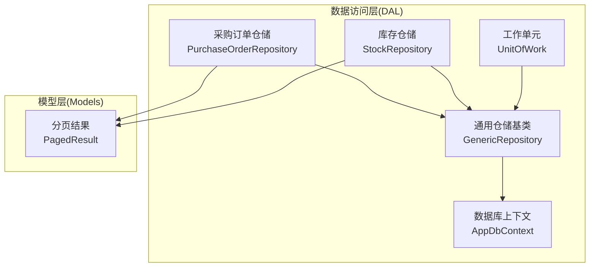
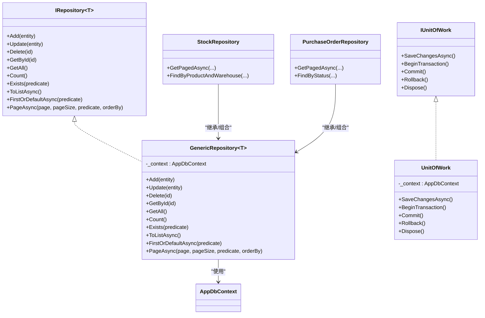
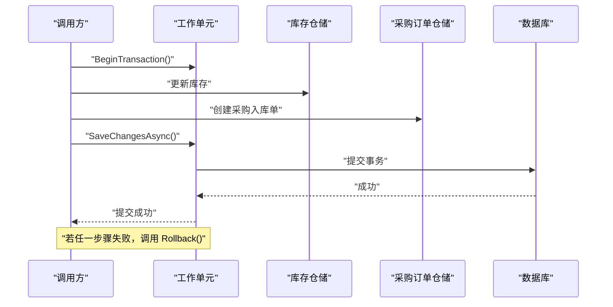
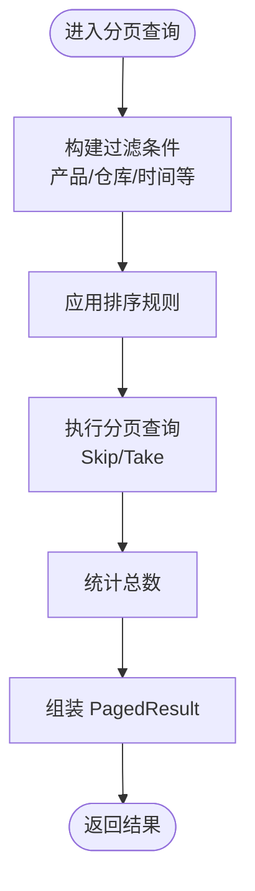
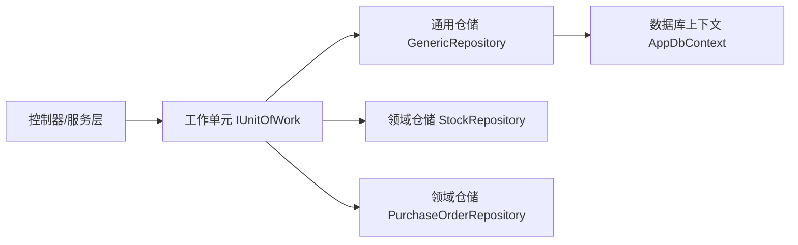

# 工作单元与仓储模式

<cite>
**本文引用的文件**   
- [IRepository.cs](file://EquipmentIMS.DAL/Interfaces/IRepository.cs)
- [GenericRepository.cs](file://EquipmentIMS.DAL/Repositories/GenericRepository.cs)
- [IUnitOfWork.cs](file://EquipmentIMS.DAL/Interfaces/IUnitOfWork.cs)
- [UnitOfWork.cs](file://EquipmentIMS.DAL/Repositories/UnitOfWork.cs)
- [AppDbContext.cs](file://EquipmentIMS.DAL/AppDbContext.cs)
- [StockRepository.cs](file://EquipmentIMS.DAL/Repositories/StockRepository.cs)
- [PurchaseOrderRepository.cs](file://EquipmentIMS.DAL/Repositories/PurchaseOrderRepository.cs)
- [PagedResult.cs](file://EquipmentIMS.Models/DTOs/PagedResult.cs)
- [ServiceCollectionExtensions.cs (DAL)](file://EquipmentIMS.DAL/Extensions/ServiceCollectionExtensions.cs)
</cite>

## 目录
1. [简介](#简介)
2. [项目结构](#项目结构)
3. [核心组件](#核心组件)
4. [架构总览](#架构总览)
5. [详细组件分析](#详细组件分析)
6. [依赖关系分析](#依赖关系分析)
7. [性能考虑](#性能考虑)
8. [故障排查指南](#故障排查指南)
9. [结论](#结论)
10. [附录](#附录)

## 简介
本文件围绕THMS系统的数据访问层，系统化阐述工作单元（Unit of Work）与仓储（Repository）模式的设计与实现。重点包括：
- 仓储模式的泛型设计与CRUD封装
- 查询构建器与分页支持
- 工作单元的事务管理与跨仓储一致性
- 具体仓储接口与实现（如库存、采购订单等）
- 事务处理示例与错误恢复策略
- 缓存集成与性能优化建议
- 单元测试编写与Mock对象创建指南

## 项目结构
数据访问相关代码主要位于 EquipmentIMS.DAL 项目中，包含通用仓储、工作单元、上下文配置以及领域仓储的具体实现；模型与分页结果定义在 EquipmentIMS.Models 中；服务注册在 DAL 的扩展文件中完成。

图表来源
- [UnitOfWork.cs](file://EquipmentIMS.DAL/Repositories/UnitOfWork.cs)
- [GenericRepository.cs](file://EquipmentIMS.DAL/Repositories/GenericRepository.cs)
- [AppDbContext.cs](file://EquipmentIMS.DAL/AppDbContext.cs)
- [StockRepository.cs](file://EquipmentIMS.DAL/Repositories/StockRepository.cs)
- [PurchaseOrderRepository.cs](file://EquipmentIMS.DAL/Repositories/PurchaseOrderRepository.cs)
- [PagedResult.cs](file://EquipmentIMS.Models/DTOs/PagedResult.cs)

章节来源
- [ServiceCollectionExtensions.cs (DAL)](file://EquipmentIMS.DAL/Extensions/ServiceCollectionExtensions.cs)

## 核心组件
- 通用仓储接口 IRepository<T>：定义实体类型的增删改查、计数、是否存在、批量操作等基础能力。
- 泛型仓储 GenericRepository<T>：基于 EF Core 的 DbContext 实现 IRepository<T>，提供默认 CRUD、异步方法、基本查询与分页。
- 工作单元 IUnitOfWork/UnitOfWork：聚合多个仓储实例，统一提交事务，确保跨仓储操作的原子性。
- 领域仓储 StockRepository、PurchaseOrderRepository：在通用仓储基础上，封装业务相关的复杂查询与分页。
- 分页结果 PagedResult<T>：承载分页数据的 DTO。

章节来源
- [IRepository.cs](file://EquipmentIMS.DAL/Interfaces/IRepository.cs)
- [GenericRepository.cs](file://EquipmentIMS.DAL/Repositories/GenericRepository.cs)
- [IUnitOfWork.cs](file://EquipmentIMS.DAL/Interfaces/IUnitOfWork.cs)
- [UnitOfWork.cs](file://EquipmentIMS.DAL/Repositories/UnitOfWork.cs)
- [StockRepository.cs](file://EquipmentIMS.DAL/Repositories/StockRepository.cs)
- [PurchaseOrderRepository.cs](file://EquipmentIMS.DAL/Repositories/PurchaseOrderRepository.cs)
- [PagedResult.cs](file://EquipmentIMS.Models/DTOs/PagedResult.cs)

## 架构总览
仓储与工作单元共同构成数据访问抽象层，向上屏蔽 EF Core 细节，向下通过 AppDbContext 访问数据库。工作单元负责事务边界，仓储负责单实体的数据访问逻辑，领域仓储则封装特定业务的查询与分页。

图表来源
- [IRepository.cs](file://EquipmentIMS.DAL/Interfaces/IRepository.cs)
- [GenericRepository.cs](file://EquipmentIMS.DAL/Repositories/GenericRepository.cs)
- [IUnitOfWork.cs](file://EquipmentIMS.DAL/Interfaces/IUnitOfWork.cs)
- [UnitOfWork.cs](file://EquipmentIMS.DAL/Repositories/UnitOfWork.cs)
- [StockRepository.cs](file://EquipmentIMS.DAL/Repositories/StockRepository.cs)
- [PurchaseOrderRepository.cs](file://EquipmentIMS.DAL/Repositories/PurchaseOrderRepository.cs)
- [AppDbContext.cs](file://EquipmentIMS.DAL/AppDbContext.cs)

## 详细组件分析

### 通用仓储接口与实现
- 设计要点
  - 以泛型 T 约束实体类型，统一暴露 Add/Update/Delete/GetById/GetAll/Count/Exists 等方法。
  - 提供异步版本与 LINQ 谓词查询，便于上层灵活组合条件。
  - PageAsync 返回 PagedResult<T>，支持页码、每页大小、过滤条件与排序。
- 复杂度与性能
  - 大多数操作为 O(1) 或 O(n)（取决于是否全表扫描）。
  - 分页查询应配合索引字段进行过滤与排序，避免全表扫描。
- 典型用法路径
  - 新增实体：调用 Add 后由工作单元统一 SaveChanges。
  - 删除实体：调用 Delete 并交由工作单元提交。
  - 分页查询：构造谓词与排序表达式，调用 PageAsync。

章节来源
- [IRepository.cs](file://EquipmentIMS.DAL/Interfaces/IRepository.cs)
- [GenericRepository.cs](file://EquipmentIMS.DAL/Repositories/GenericRepository.cs)
- [PagedResult.cs](file://EquipmentIMS.Models/DTOs/PagedResult.cs)

### 工作单元与事务管理
- 设计要点
  - IUnitOfWork 暴露 BeginTransaction/Commit/Rollback/SaveChangesAsync 等方法，用于控制事务边界。
  - UnitOfWork 内部持有 AppDbContext，所有仓储共享同一上下文，保证跨仓储操作的一致性。
  - 推荐在控制器或服务层中使用 using 或 try/finally 包裹事务生命周期，确保异常时回滚。
- 事务流程时序

图表来源
- [IUnitOfWork.cs](file://EquipmentIMS.DAL/Interfaces/IUnitOfWork.cs)
- [UnitOfWork.cs](file://EquipmentIMS.DAL/Repositories/UnitOfWork.cs)
- [StockRepository.cs](file://EquipmentIMS.DAL/Repositories/StockRepository.cs)
- [PurchaseOrderRepository.cs](file://EquipmentIMS.DAL/Repositories/PurchaseOrderRepository.cs)
- [AppDbContext.cs](file://EquipmentIMS.DAL/AppDbContext.cs)

- 错误恢复策略
  - 捕获异常后执行 Rollback，记录日志并返回友好错误信息。
  - 对幂等操作可重试（如网络抖动导致的超时），但需限制重试次数与退避策略。
  - 对于并发冲突，采用乐观锁或重试机制，避免脏写。

章节来源
- [IUnitOfWork.cs](file://EquipmentIMS.DAL/Interfaces/IUnitOfWork.cs)
- [UnitOfWork.cs](file://EquipmentIMS.DAL/Repositories/UnitOfWork.cs)

### 领域仓储：库存与采购订单
- 库存仓储 StockRepository
  - 职责：封装库存实体的复杂查询、按产品与仓库维度统计、分页列表等。
  - 典型方法：分页查询、按条件筛选、汇总计算。
- 采购订单仓储 PurchaseOrderRepository
  - 职责：封装采购订单及其明细的查询、状态过滤、分页导出等。
  - 典型方法：按状态分页、按供应商/时间范围筛选。

图表来源
- [StockRepository.cs](file://EquipmentIMS.DAL/Repositories/StockRepository.cs)
- [PurchaseOrderRepository.cs](file://EquipmentIMS.DAL/Repositories/PurchaseOrderRepository.cs)
- [PagedResult.cs](file://EquipmentIMS.Models/DTOs/PagedResult.cs)

章节来源
- [StockRepository.cs](file://EquipmentIMS.DAL/Repositories/StockRepository.cs)
- [PurchaseOrderRepository.cs](file://EquipmentIMS.DAL/Repositories/PurchaseOrderRepository.cs)
- [PagedResult.cs](file://EquipmentIMS.Models/DTOs/PagedResult.cs)

### 数据库上下文与配置
- AppDbContext 作为 EF Core 的上下文，集中管理 DbSet 与实体映射配置。
- 仓储与工作单元均通过注入获取上下文实例，确保在同一请求内共享连接与变更跟踪。

章节来源
- [AppDbContext.cs](file://EquipmentIMS.DAL/AppDbContext.cs)

## 依赖关系分析
- 耦合与内聚
  - 仓储与上下文解耦：通过接口与泛型基类降低耦合度。
  - 工作单元聚合仓储：提高内聚性，统一管理事务。
- 外部依赖
  - EF Core 提供 ORM 能力。
  - 可选缓存服务（如 MemoryCacheService）可在服务层集成，仓储层保持纯净。

图表来源
- [IUnitOfWork.cs](file://EquipmentIMS.DAL/Interfaces/IUnitOfWork.cs)
- [UnitOfWork.cs](file://EquipmentIMS.DAL/Repositories/UnitOfWork.cs)
- [GenericRepository.cs](file://EquipmentIMS.DAL/Repositories/GenericRepository.cs)
- [StockRepository.cs](file://EquipmentIMS.DAL/Repositories/StockRepository.cs)
- [PurchaseOrderRepository.cs](file://EquipmentIMS.DAL/Repositories/PurchaseOrderRepository.cs)
- [AppDbContext.cs](file://EquipmentIMS.DAL/AppDbContext.cs)

章节来源
- [ServiceCollectionExtensions.cs (DAL)](file://EquipmentIMS.DAL/Extensions/ServiceCollectionExtensions.cs)

## 性能考虑
- 查询优化
  - 分页查询务必结合索引字段进行过滤与排序，避免全表扫描。
  - 按需投影（Select）减少数据传输量。
- 事务粒度
  - 尽量缩小事务范围，减少长事务带来的锁竞争。
- 缓存策略
  - 热点数据在服务层引入缓存（如内存缓存），注意失效策略与一致性。
  - 仓储层保持无状态，避免引入缓存导致测试困难。
- 连接与并发
  - 合理设置最大连接数与命令超时。
  - 对高并发写入场景考虑分库分表或读写分离。

[本节为通用指导，不直接分析具体文件]

## 故障排查指南
- 常见问题
  - 事务未提交或回滚：检查工作单元的 BeginTransaction/Commit/Rollback 是否正确配对。
  - 分页结果不正确：确认 Skip/Take 参数与排序字段是否与索引匹配。
  - 性能问题：查看生成的 SQL，确认是否存在 N+1 查询或缺少索引。
- 调试建议
  - 启用 EF Core 日志输出，观察 SQL 语句与执行计划。
  - 在关键路径添加结构化日志，记录输入参数与耗时。
- 错误恢复
  - 捕获异常后执行 Rollback，记录错误详情并返回用户友好提示。
  - 对可重试的错误实施指数退避重试，限制最大重试次数。

章节来源
- [IUnitOfWork.cs](file://EquipmentIMS.DAL/Interfaces/IUnitOfWork.cs)
- [UnitOfWork.cs](file://EquipmentIMS.DAL/Repositories/UnitOfWork.cs)

## 结论
通过仓储与工作单元模式，THMS系统在数据访问层实现了清晰的职责划分与一致的事务管理。泛型仓储简化了 CRUD 操作，领域仓储聚焦业务查询与分页，工作单元保障跨仓储操作的原子性。配合合理的索引、分页与缓存策略，可有效提升系统性能与可维护性。

[本节为总结性内容，不直接分析具体文件]

## 附录

### 单元测试编写指南
- 目标
  - 验证仓储方法的正确性与边界条件。
  - 隔离数据库依赖，使用 Mock 或内存上下文进行测试。
- 建议
  - 使用 InMemory 数据库或 Mock 的 DbContext 模拟数据访问。
  - 针对分页查询，构造不同页码与过滤条件，断言返回结果与总数。
  - 对工作单元事务，验证提交与回滚行为。
- 参考路径
  - 仓储接口与实现：[IRepository.cs](file://EquipmentIMS.DAL/Interfaces/IRepository.cs)、[GenericRepository.cs](file://EquipmentIMS.DAL/Repositories/GenericRepository.cs)
  - 工作单元接口与实现：[IUnitOfWork.cs](file://EquipmentIMS.DAL/Interfaces/IUnitOfWork.cs)、[UnitOfWork.cs](file://EquipmentIMS.DAL/Repositories/UnitOfWork.cs)
  - 领域仓储：[StockRepository.cs](file://EquipmentIMS.DAL/Repositories/StockRepository.cs)、[PurchaseOrderRepository.cs](file://EquipmentIMS.DAL/Repositories/PurchaseOrderRepository.cs)
  - 分页结果：[PagedResult.cs](file://EquipmentIMS.Models/DTOs/PagedResult.cs)

章节来源
- [IRepository.cs](file://EquipmentIMS.DAL/Interfaces/IRepository.cs)
- [GenericRepository.cs](file://EquipmentIMS.DAL/Repositories/GenericRepository.cs)
- [IUnitOfWork.cs](file://EquipmentIMS.DAL/Interfaces/IUnitOfWork.cs)
- [UnitOfWork.cs](file://EquipmentIMS.DAL/Repositories/UnitOfWork.cs)
- [StockRepository.cs](file://EquipmentIMS.DAL/Repositories/StockRepository.cs)
- [PurchaseOrderRepository.cs](file://EquipmentIMS.DAL/Repositories/PurchaseOrderRepository.cs)
- [PagedResult.cs](file://EquipmentIMS.Models/DTOs/PagedResult.cs)