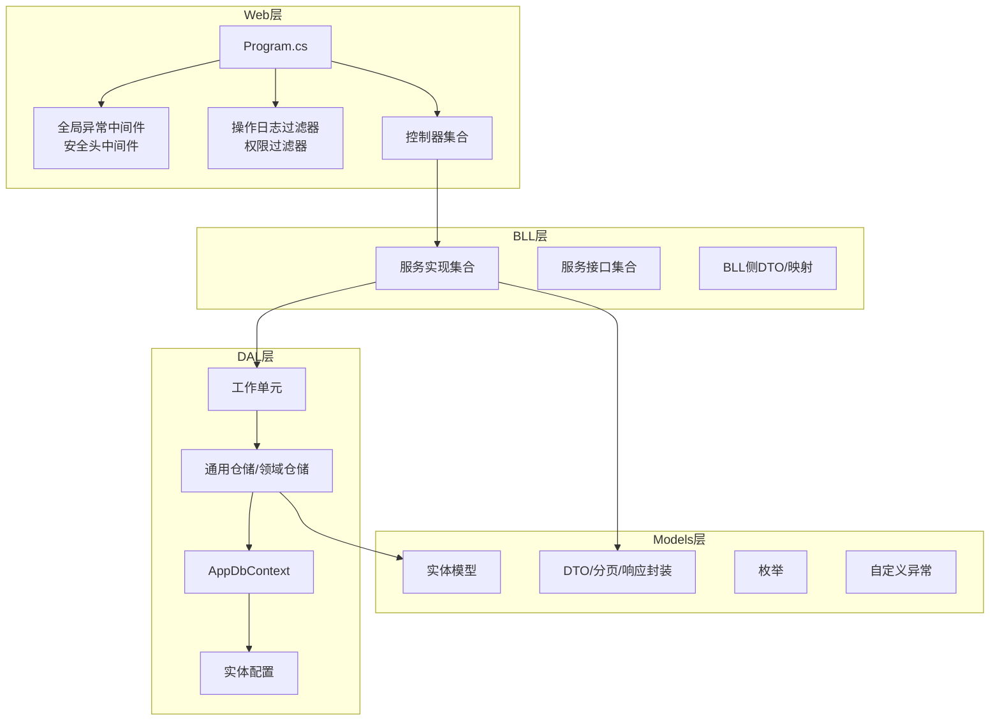
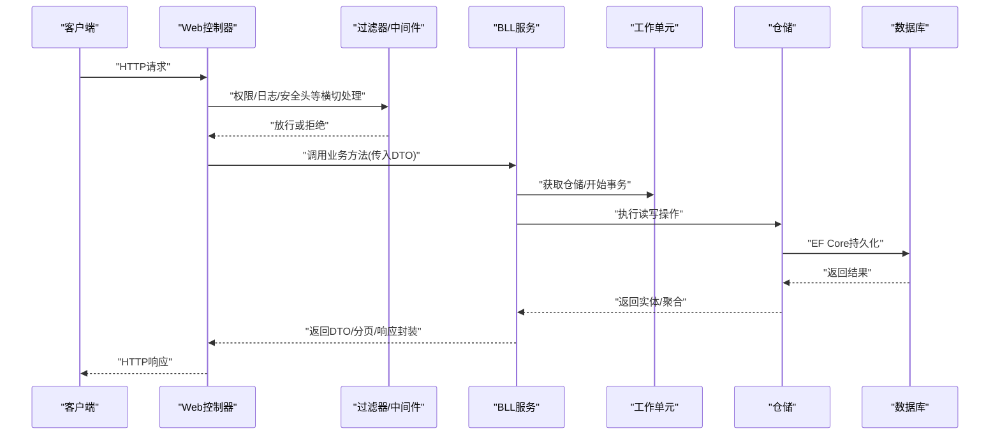
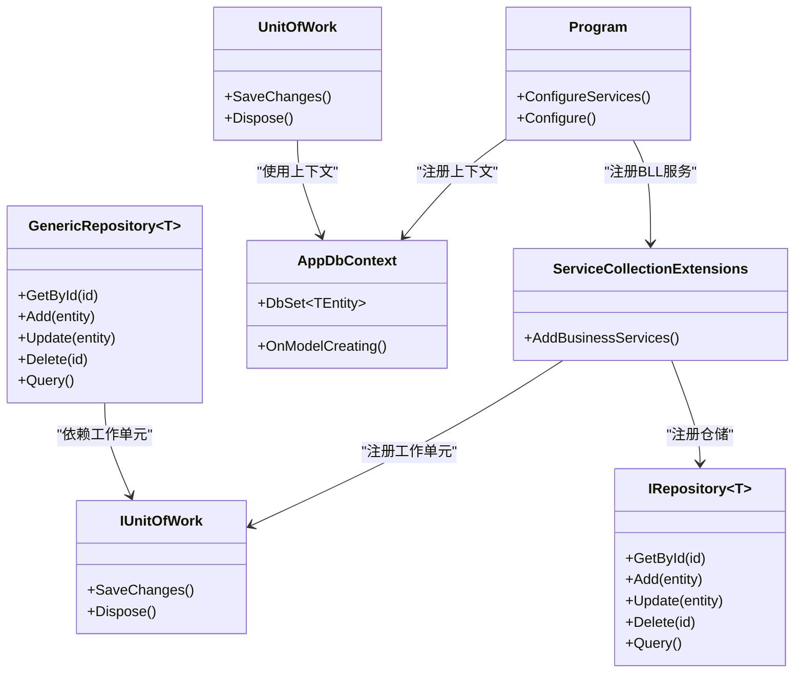
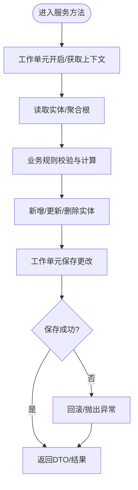
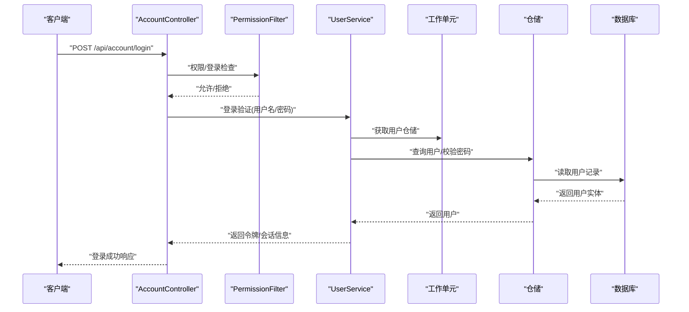
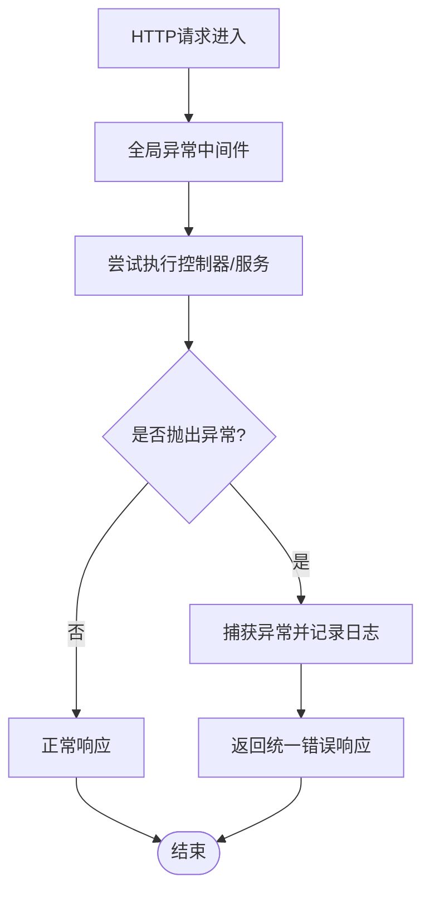
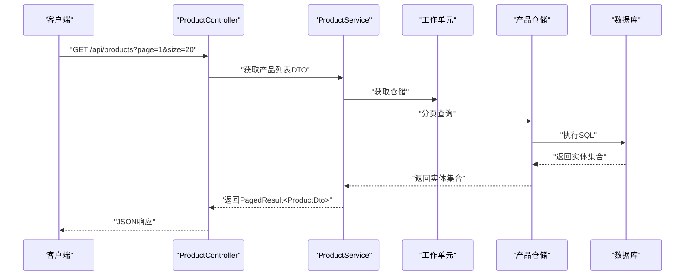
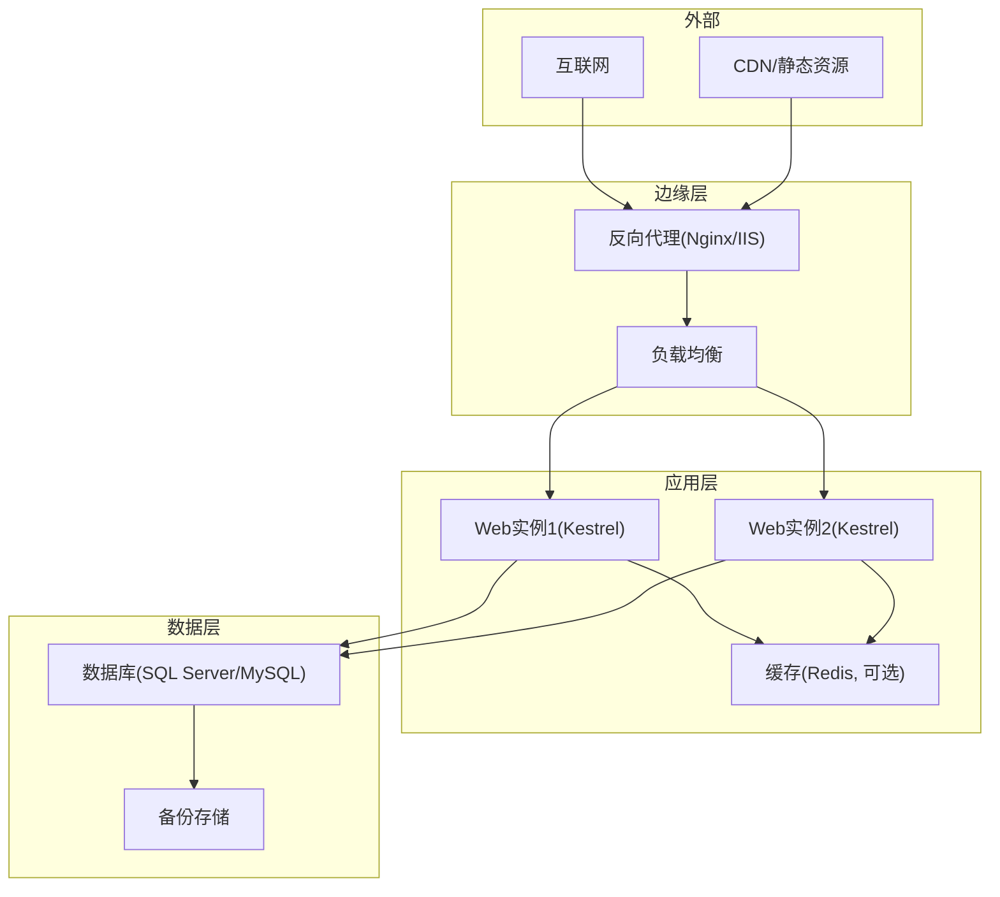
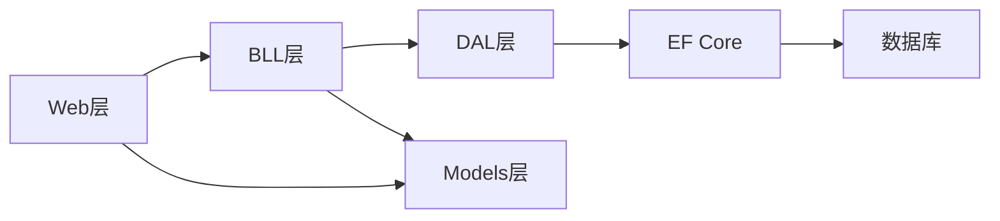

# 系统架构设计

<cite>
**本文引用的文件**   
- [Program.cs](file://EquipmentIMS.Web/Program.cs)
- [appsettings.json](file://EquipmentIMS.Web/appsettings.json)
- [GlobalExceptionMiddleware.cs](file://EquipmentIMS.Web/Filters/GlobalExceptionMiddleware.cs)
- [SecurityHeadersMiddleware.cs](file://EquipmentIMS.Web/Filters/SecurityHeadersMiddleware.cs)
- [OperationLogActionFilter.cs](file://EquipmentIMS.Web/Filters/OperationLogActionFilter.cs)
- [PermissionFilter.cs](file://EquipmentIMS.Web/Filters/PermissionFilter.cs)
- [AccountController.cs](file://EquipmentIMS.Web/Controllers/AccountController.cs)
- [ProductController.cs](file://EquipmentIMS.Web/Controllers/ProductController.cs)
- [StockController.cs](file://EquipmentIMS.Web/Controllers/StockController.cs)
- [ServiceCollectionExtensions.cs](file://EquipmentIMS.BLL/Extensions/ServiceCollectionExtensions.cs)
- [IRepository.cs](file://EquipmentIMS.DAL/Interfaces/IRepository.cs)
- [IUnitOfWork.cs](file://EquipmentIMS.DAL/Interfaces/IUnitOfWork.cs)
- [GenericRepository.cs](file://EquipmentIMS.DAL/Repositories/GenericRepository.cs)
- [UnitOfWork.cs](file://EquipmentIMS.DAL/Repositories/UnitOfWork.cs)
- [AppDbContext.cs](file://EquipmentIMS.DAL/AppDbContext.cs)
- [UserService.cs](file://EquipmentIMS.BLL/Services/UserService.cs)
- [ProductService.cs](file://EquipmentIMS.BLL/Services/ProductService.cs)
- [StockService.cs](file://EquipmentIMS.BLL/Services/StockService.cs)
- [ApiResponse.cs](file://EquipmentIMS.Models/DTOs/ApiResponse.cs)
- [PagedResult.cs](file://EquipmentIMS.Models/DTOs/PagedResult.cs)
- [UserDto.cs](file://EquipmentIMS.Models/DTOs/UserDto.cs)
- [ProductDto.cs](file://EquipmentIMS.Models/DTOs/ProductDto.cs)
- [SysUser.cs](file://EquipmentIMS.Models/Entities/SysUser.cs)
- [BaseProduct.cs](file://EquipmentIMS.Models/Entities/BaseProduct.cs)
</cite>

## 目录
1. [引言](#引言)
2. [项目结构](#项目结构)
3. [核心组件](#核心组件)
4. [架构总览](#架构总览)
5. [详细组件分析](#详细组件分析)
6. [依赖关系分析](#依赖关系分析)
7. [性能考虑](#性能考虑)
8. [故障排查指南](#故障排查指南)
9. [结论](#结论)
10. [附录](#附录)

## 引言
本文件为THMS（设备库存管理系统）的架构设计文档，面向技术与非技术读者，系统性阐述分层架构模式在Web层、BLL业务逻辑层、DAL数据访问层与Models模型层的职责分离；说明依赖注入容器的配置与使用；阐述工作单元与仓储模式的实现原理；描述前后端分离API设计原则与数据传输对象(DTO)策略；并提供系统组件交互图、数据流向图与部署架构图。同时覆盖安全机制、异常处理、日志记录等横切关注点的落地方案。

## 项目结构
仓库采用多项目解决方案，按领域与层次清晰划分：
- EquipmentIMS.Web：ASP.NET Core Web API/MVC应用，负责HTTP请求接入、路由、过滤器、中间件、视图渲染与后台任务。
- EquipmentIMS.BLL：业务逻辑层，定义服务接口与实现，编排业务流程，协调仓储与工作单元，进行校验与转换。
- EquipmentIMS.DAL：数据访问层，基于EF Core，提供通用仓储、工作单元与实体映射配置。
- EquipmentIMS.Models：共享模型，包含实体(Entities)、枚举、DTO、异常类型等。
- EquipmentIMS.Tests：测试工程（未在本文件中展开）。
- Database：数据库脚本与初始化数据（未在本文件中展开）。

图表来源
- [Program.cs](file://EquipmentIMS.Web/Program.cs)
- [GlobalExceptionMiddleware.cs](file://EquipmentIMS.Web/Filters/GlobalExceptionMiddleware.cs)
- [SecurityHeadersMiddleware.cs](file://EquipmentIMS.Web/Filters/SecurityHeadersMiddleware.cs)
- [OperationLogActionFilter.cs](file://EquipmentIMS.Web/Filters/OperationLogActionFilter.cs)
- [PermissionFilter.cs](file://EquipmentIMS.Web/Filters/PermissionFilter.cs)
- [ServiceCollectionExtensions.cs](file://EquipmentIMS.BLL/Extensions/ServiceCollectionExtensions.cs)
- [AppDbContext.cs](file://EquipmentIMS.DAL/AppDbContext.cs)
- [GenericRepository.cs](file://EquipmentIMS.DAL/Repositories/GenericRepository.cs)
- [UnitOfWork.cs](file://EquipmentIMS.DAL/Repositories/UnitOfWork.cs)
- [IRepository.cs](file://EquipmentIMS.DAL/Interfaces/IRepository.cs)
- [IUnitOfWork.cs](file://EquipmentIMS.DAL/Interfaces/IUnitOfWork.cs)

章节来源
- [Program.cs](file://EquipmentIMS.Web/Program.cs)
- [appsettings.json](file://EquipmentIMS.Web/appsettings.json)

## 核心组件
- 依赖注入容器：通过Web入口注册各层服务，BLL扩展类集中注册服务接口到实现，DAL扩展类注册仓储与工作单元，上下文与EF配置由DAL统一装配。
- 工作单元与仓储：DAL提供通用仓储接口与实现，以及工作单元接口与实现，用于事务边界管理与跨仓储一致性。
- DTO与响应封装：Models层提供统一的API响应包装与分页结果类型，控制器与服务之间以DTO传递数据，避免直接暴露实体。
- 横切关注点：全局异常中间件、安全头中间件、操作日志过滤器、权限过滤器贯穿请求生命周期。

章节来源
- [ServiceCollectionExtensions.cs](file://EquipmentIMS.BLL/Extensions/ServiceCollectionExtensions.cs)
- [IRepository.cs](file://EquipmentIMS.DAL/Interfaces/IRepository.cs)
- [IUnitOfWork.cs](file://EquipmentIMS.DAL/Interfaces/IUnitOfWork.cs)
- [GenericRepository.cs](file://EquipmentIMS.DAL/Repositories/GenericRepository.cs)
- [UnitOfWork.cs](file://EquipmentIMS.DAL/Repositories/UnitOfWork.cs)
- [ApiResponse.cs](file://EquipmentIMS.Models/DTOs/ApiResponse.cs)
- [PagedResult.cs](file://EquipmentIMS.Models/DTOs/PagedResult.cs)

## 架构总览
系统采用经典的分层架构：
- Web层：接收HTTP请求，参数校验、鉴权、日志记录、异常捕获，调用BLL服务。
- BLL层：承载业务规则、流程编排、领域事件触发、DTO映射与转换。
- DAL层：基于EF Core的数据访问抽象，提供通用CRUD与复杂查询能力，并通过工作单元管理事务。
- Models层：实体、枚举、DTO、异常等共享类型。

图表来源
- [AccountController.cs](file://EquipmentIMS.Web/Controllers/AccountController.cs)
- [ProductController.cs](file://EquipmentIMS.Web/Controllers/ProductController.cs)
- [StockController.cs](file://EquipmentIMS.Web/Controllers/StockController.cs)
- [UserService.cs](file://EquipmentIMS.BLL/Services/UserService.cs)
- [ProductService.cs](file://EquipmentIMS.BLL/Services/ProductService.cs)
- [StockService.cs](file://EquipmentIMS.BLL/Services/StockService.cs)
- [IUnitOfWork.cs](file://EquipmentIMS.DAL/Interfaces/IUnitOfWork.cs)
- [IRepository.cs](file://EquipmentIMS.DAL/Interfaces/IRepository.cs)
- [GenericRepository.cs](file://EquipmentIMS.DAL/Repositories/GenericRepository.cs)
- [AppDbContext.cs](file://EquipmentIMS.DAL/AppDbContext.cs)

## 详细组件分析

### 分层架构与职责分离
- Web层
  - 职责：路由、参数绑定、鉴权、日志、异常、视图渲染、静态资源。
  - 关键文件：控制器、过滤器、中间件、启动配置。
- BLL层
  - 职责：业务规则、流程编排、领域计算、DTO映射、异步任务编排。
  - 关键文件：服务接口与实现、服务注册扩展。
- DAL层
  - 职责：数据访问抽象、通用CRUD、复杂查询、事务边界、实体映射配置。
  - 关键文件：仓储接口与实现、工作单元、DbContext、实体配置。
- Models层
  - 职责：实体、枚举、DTO、异常、通用响应封装。
  - 关键文件：实体、DTO、枚举、异常类型。

章节来源
- [ServiceCollectionExtensions.cs](file://EquipmentIMS.BLL/Extensions/ServiceCollectionExtensions.cs)
- [IRepository.cs](file://EquipmentIMS.DAL/Interfaces/IRepository.cs)
- [IUnitOfWork.cs](file://EquipmentIMS.DAL/Interfaces/IUnitOfWork.cs)
- [GenericRepository.cs](file://EquipmentIMS.DAL/Repositories/GenericRepository.cs)
- [UnitOfWork.cs](file://EquipmentIMS.DAL/Repositories/UnitOfWork.cs)
- [AppDbContext.cs](file://EquipmentIMS.DAL/AppDbContext.cs)
- [ApiResponse.cs](file://EquipmentIMS.Models/DTOs/ApiResponse.cs)
- [PagedResult.cs](file://EquipmentIMS.Models/DTOs/PagedResult.cs)

### 依赖注入容器配置与使用
- 注册策略
  - Web入口集中构建服务容器，加载BLL与DAL的服务注册扩展。
  - BLL扩展类将服务接口映射到具体实现，支持单例/作用域/瞬态生命周期。
  - DAL扩展类注册仓储、工作单元与DbContext，并配置EF连接与迁移。
- 使用模式
  - 控制器通过构造函数注入服务接口。
  - 服务通过构造函数注入工作单元与仓储接口。
  - 避免在服务中直接持有DbContext，保持对DAL抽象的依赖。

图表来源
- [Program.cs](file://EquipmentIMS.Web/Program.cs)
- [ServiceCollectionExtensions.cs](file://EquipmentIMS.BLL/Extensions/ServiceCollectionExtensions.cs)
- [AppDbContext.cs](file://EquipmentIMS.DAL/AppDbContext.cs)
- [IRepository.cs](file://EquipmentIMS.DAL/Interfaces/IRepository.cs)
- [GenericRepository.cs](file://EquipmentIMS.DAL/Repositories/GenericRepository.cs)
- [IUnitOfWork.cs](file://EquipmentIMS.DAL/Interfaces/IUnitOfWork.cs)
- [UnitOfWork.cs](file://EquipmentIMS.DAL/Repositories/UnitOfWork.cs)

章节来源
- [Program.cs](file://EquipmentIMS.Web/Program.cs)
- [ServiceCollectionExtensions.cs](file://EquipmentIMS.BLL/Extensions/ServiceCollectionExtensions.cs)

### 工作单元与仓储模式
- 工作单元
  - 职责：统一管理DbContext实例，提供SaveChanges事务边界，确保跨仓储操作的原子性。
  - 关键点：在BLL服务中通过工作单元发起事务，必要时结合分布式事务或补偿机制。
- 仓储
  - 通用仓储：提供基础CRUD与简单查询，减少重复代码。
  - 领域仓储：针对复杂查询与领域语义封装，提高可读性与可维护性。
- 组合使用
  - 服务层通过工作单元获取仓储，执行业务逻辑后提交变更。

图表来源
- [IUnitOfWork.cs](file://EquipmentIMS.DAL/Interfaces/IUnitOfWork.cs)
- [UnitOfWork.cs](file://EquipmentIMS.DAL/Repositories/UnitOfWork.cs)
- [IRepository.cs](file://EquipmentIMS.DAL/Interfaces/IRepository.cs)
- [GenericRepository.cs](file://EquipmentIMS.DAL/Repositories/GenericRepository.cs)

章节来源
- [IUnitOfWork.cs](file://EquipmentIMS.DAL/Interfaces/IUnitOfWork.cs)
- [UnitOfWork.cs](file://EquipmentIMS.DAL/Repositories/UnitOfWork.cs)
- [IRepository.cs](file://EquipmentIMS.DAL/Interfaces/IRepository.cs)
- [GenericRepository.cs](file://EquipmentIMS.DAL/Repositories/GenericRepository.cs)

### 前后端分离API设计与DTO策略
- API设计原则
  - 无状态、幂等、RESTful风格；统一响应格式与错误码；分页与过滤参数标准化。
- DTO策略
  - 输入DTO：控制器接收前端数据，进行参数校验与转换。
  - 输出DTO：服务返回稳定契约，屏蔽内部实体变化。
  - 分页与响应封装：统一PagedResult与ApiResponse，便于前端一致处理。
- 示例路径
  - 用户相关：[UserDto.cs](file://EquipmentIMS.Models/DTOs/UserDto.cs)
  - 产品相关：[ProductDto.cs](file://EquipmentIMS.Models/DTOs/ProductDto.cs)
  - 通用响应：[ApiResponse.cs](file://EquipmentIMS.Models/DTOs/ApiResponse.cs)、[PagedResult.cs](file://EquipmentIMS.Models/DTOs/PagedResult.cs)

章节来源
- [UserDto.cs](file://EquipmentIMS.Models/DTOs/UserDto.cs)
- [ProductDto.cs](file://EquipmentIMS.Models/DTOs/ProductDto.cs)
- [ApiResponse.cs](file://EquipmentIMS.Models/DTOs/ApiResponse.cs)
- [PagedResult.cs](file://EquipmentIMS.Models/DTOs/PagedResult.cs)

### 安全机制
- 认证与授权
  - 控制器级权限过滤器，基于角色/权限控制访问。
  - 登录与账户管理控制器处理身份验证与会话/JWT签发（根据实际实现）。
- 安全头
  - 全局中间件设置CSP、HSTS、X-Frame-Options等安全响应头。
- 密码与敏感信息
  - 密码历史、加密服务等辅助能力（如AES加密服务）保障数据安全。

图表来源
- [AccountController.cs](file://EquipmentIMS.Web/Controllers/AccountController.cs)
- [PermissionFilter.cs](file://EquipmentIMS.Web/Filters/PermissionFilter.cs)
- [UserService.cs](file://EquipmentIMS.BLL/Services/UserService.cs)
- [IUnitOfWork.cs](file://EquipmentIMS.DAL/Interfaces/IUnitOfWork.cs)
- [IRepository.cs](file://EquipmentIMS.DAL/Interfaces/IRepository.cs)
- [GenericRepository.cs](file://EquipmentIMS.DAL/Repositories/GenericRepository.cs)
- [AppDbContext.cs](file://EquipmentIMS.DAL/AppDbContext.cs)

章节来源
- [PermissionFilter.cs](file://EquipmentIMS.Web/Filters/PermissionFilter.cs)
- [SecurityHeadersMiddleware.cs](file://EquipmentIMS.Web/Filters/SecurityHeadersMiddleware.cs)
- [AccountController.cs](file://EquipmentIMS.Web/Controllers/AccountController.cs)
- [UserService.cs](file://EquipmentIMS.BLL/Services/UserService.cs)

### 异常处理与日志记录
- 全局异常中间件
  - 捕获未处理异常，转换为统一错误响应，避免泄露堆栈细节。
- 操作日志过滤器
  - 记录关键操作的入参、出参、耗时、用户信息等，便于审计与排障。
- 日志配置
  - 通过配置文件指定日志级别、目标与轮转策略。

图表来源
- [GlobalExceptionMiddleware.cs](file://EquipmentIMS.Web/Filters/GlobalExceptionMiddleware.cs)
- [OperationLogActionFilter.cs](file://EquipmentIMS.Web/Filters/OperationLogActionFilter.cs)
- [nlog.config](file://EquipmentIMS.Web/nlog.config)

章节来源
- [GlobalExceptionMiddleware.cs](file://EquipmentIMS.Web/Filters/GlobalExceptionMiddleware.cs)
- [OperationLogActionFilter.cs](file://EquipmentIMS.Web/Filters/OperationLogActionFilter.cs)
- [nlog.config](file://EquipmentIMS.Web/nlog.config)

### 数据流向图（典型业务场景）
以“产品管理”为例，展示从控制器到数据库的数据流。

图表来源
- [ProductController.cs](file://EquipmentIMS.Web/Controllers/ProductController.cs)
- [ProductService.cs](file://EquipmentIMS.BLL/Services/ProductService.cs)
- [IUnitOfWork.cs](file://EquipmentIMS.DAL/Interfaces/IUnitOfWork.cs)
- [IRepository.cs](file://EquipmentIMS.DAL/Interfaces/IRepository.cs)
- [GenericRepository.cs](file://EquipmentIMS.DAL/Repositories/GenericRepository.cs)
- [AppDbContext.cs](file://EquipmentIMS.DAL/AppDbContext.cs)

章节来源
- [ProductController.cs](file://EquipmentIMS.Web/Controllers/ProductController.cs)
- [ProductService.cs](file://EquipmentIMS.BLL/Services/ProductService.cs)

### 部署架构图
建议的部署拓扑：
- 反向代理（Nginx/IIS）：HTTPS终止、静态资源缓存、负载均衡。
- Web应用（Kestrel）：运行ASP.NET Core进程，启用健康检查与优雅停机。
- 数据库（SQL Server/MySQL）：主备复制、定期备份、慢查询监控。
- 缓存（可选）：Redis用于热点数据与分布式锁。
- 日志与监控：集中式日志收集（ELK/NLog）、指标采集（Prometheus/Grafana）。

[此图为概念性部署图，不直接映射具体源码文件]

## 依赖关系分析
- 耦合与内聚
  - Web层仅依赖BLL服务接口，低耦合；BLL依赖DAL抽象；DAL依赖EF Core与数据库驱动。
  - Models层被Web与BLL共同引用，作为契约层，保证前后端稳定交互。
- 循环依赖
  - 通过接口隔离与依赖倒置避免循环依赖；服务与仓储均面向接口编程。
- 外部依赖
  - EF Core、数据库驱动、日志框架、缓存库（可选）。

图表来源
- [Program.cs](file://EquipmentIMS.Web/Program.cs)
- [ServiceCollectionExtensions.cs](file://EquipmentIMS.BLL/Extensions/ServiceCollectionExtensions.cs)
- [AppDbContext.cs](file://EquipmentIMS.DAL/AppDbContext.cs)

章节来源
- [Program.cs](file://EquipmentIMS.Web/Program.cs)
- [ServiceCollectionExtensions.cs](file://EquipmentIMS.BLL/Extensions/ServiceCollectionExtensions.cs)
- [AppDbContext.cs](file://EquipmentIMS.DAL/AppDbContext.cs)

## 性能考虑
- 数据库
  - 合理使用索引、避免N+1查询、分页与投影、批量操作。
  - 读写分离与连接池优化。
- 缓存
  - 热点数据缓存、分布式锁、缓存失效策略。
- 异步与并发
  - 异步I/O、避免阻塞线程、合理设置超时与重试。
- 序列化与传输
  - 压缩、按需字段、分页与增量更新。
- 监控与调优
  - 慢查询日志、APM、CPU/内存/IO监控。

[本节为通用指导，无需特定文件来源]

## 故障排查指南
- 常见问题定位
  - 查看全局异常中间件记录的错误详情与堆栈摘要。
  - 通过操作日志过滤器检索关键操作的入参与耗时。
  - 检查数据库连接字符串与权限、迁移状态。
- 日志与诊断
  - 调整日志级别与采样率，避免生产环境过度日志。
  - 使用结构化日志字段关联请求ID与用户上下文。
- 恢复策略
  - 自动重试与熔断降级、优雅停机与健康检查。

章节来源
- [GlobalExceptionMiddleware.cs](file://EquipmentIMS.Web/Filters/GlobalExceptionMiddleware.cs)
- [OperationLogActionFilter.cs](file://EquipmentIMS.Web/Filters/OperationLogActionFilter.cs)
- [nlog.config](file://EquipmentIMS.Web/nlog.config)

## 结论
THMS采用清晰的分层架构与依赖注入，结合工作单元与仓储模式，实现了高内聚、低耦合的系统结构。通过DTO与统一响应封装，保障了前后端契约的稳定与安全。横切关注点通过中间件与过滤器贯穿请求生命周期，提升了系统的健壮性与可观测性。建议在后续迭代中持续完善监控、缓存与性能调优，逐步引入更完善的可观测性与弹性能力。

## 附录
- 关键实体与DTO参考路径
  - 用户实体：[SysUser.cs](file://EquipmentIMS.Models/Entities/SysUser.cs)
  - 产品实体：[BaseProduct.cs](file://EquipmentIMS.Models/Entities/BaseProduct.cs)
  - 用户DTO：[UserDto.cs](file://EquipmentIMS.Models/DTOs/UserDto.cs)
  - 产品DTO：[ProductDto.cs](file://EquipmentIMS.Models/DTOs/ProductDto.cs)
  - 统一响应：[ApiResponse.cs](file://EquipmentIMS.Models/DTOs/ApiResponse.cs)
  - 分页结果：[PagedResult.cs](file://EquipmentIMS.Models/DTOs/PagedResult.cs)