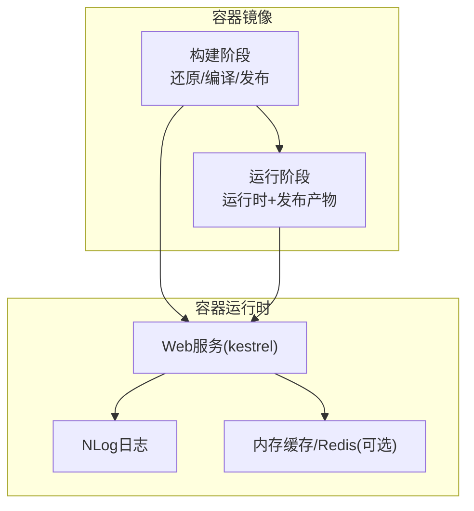
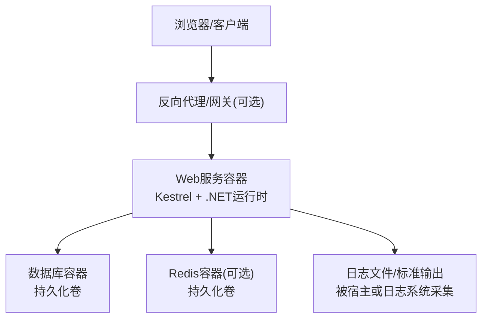
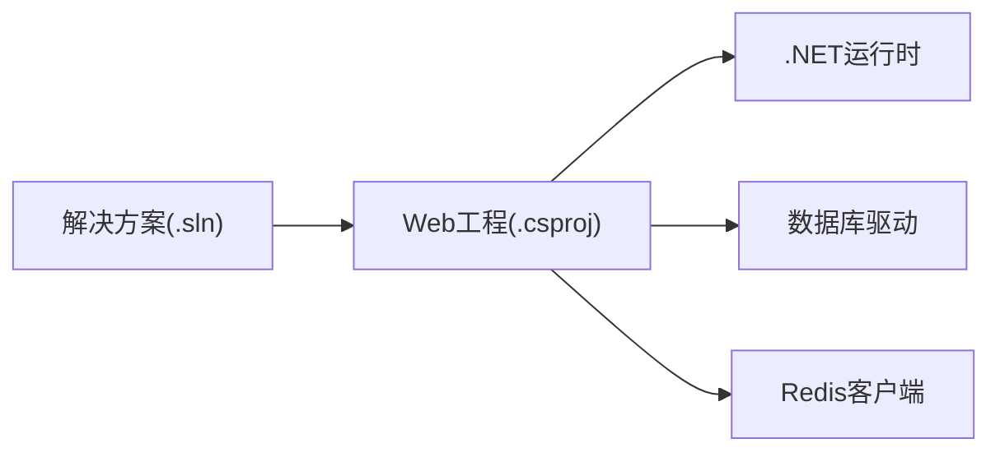

# Docker容器化部署

<cite>
**本文引用的文件**   
- [EquipmentIMS.Web/Program.cs](file://EquipmentIMS.Web/Program.cs)
- [EquipmentIMS.Web/appsettings.json](file://EquipmentIMS.Web/appsettings.json)
- [EquipmentIMS.Web/nlog.config](file://EquipmentIMS.Web/nlog.config)
- [EquipmentIMS.Web/Properties/launchSettings.json](file://EquipmentIMS.Web/Properties/launchSettings.json)
- [EquipmentIMS.Web/EquipmentIMS.Web.csproj](file://EquipmentIMS.Web/EquipmentIMS.Web.csproj)
- [EquipmentIMS.sln](file://EquipmentIMS.sln)
</cite>

## 目录
1. [简介](#简介)
2. [项目结构](#项目结构)
3. [核心组件](#核心组件)
4. [架构总览](#架构总览)
5. [详细组件分析](#详细组件分析)
6. [依赖分析](#依赖分析)
7. [性能考虑](#性能考虑)
8. [故障排查指南](#故障排查指南)
9. [结论](#结论)
10. [附录](#附录)

## 简介
本文件面向THMS（设备库存管理系统）的Docker容器化部署，提供从镜像构建、编排到运行期健康检查、日志与监控的完整实践指南。文档基于仓库中的Web应用与配置进行分析，给出多阶段构建优化、分层策略、依赖管理、端口暴露、服务编排、网络与数据卷、环境变量注入、健康检查、日志收集与监控指标的配置方法。

## 项目结构
THMS采用.NET分层架构，Web层位于EquipmentIMS.Web，包含控制器、视图、静态资源、后台任务与中间件；数据访问与业务逻辑位于其他工程。容器化主要围绕Web应用进行镜像构建与运行编排。

[本节为概念性说明，不直接分析具体文件]

## 核心组件
- Web入口与Kestrel：通过Program初始化主机、中间件、路由与服务注册，对外暴露HTTP端口。
- 配置系统：appsettings.json与环境变量共同决定连接串、缓存、日志等运行时参数。
- 日志框架：nlog.config定义日志输出目标与格式，便于容器内采集。
- 启动设置：launchSettings.json用于本地开发环境，容器化时以环境变量覆盖。

**章节来源**
- [EquipmentIMS.Web/Program.cs](file://EquipmentIMS.Web/Program.cs)
- [EquipmentIMS.Web/appsettings.json](file://EquipmentIMS.Web/appsettings.json)
- [EquipmentIMS.Web/nlog.config](file://EquipmentIMS.Web/nlog.config)
- [EquipmentIMS.Web/Properties/launchSettings.json](file://EquipmentIMS.Web/Properties/launchSettings.json)

## 架构总览
下图展示容器化后的整体架构：Web服务作为单进程容器，依赖外部数据库与可选的Redis缓存，通过Docker Compose编排，统一网络互通，持久化数据通过数据卷挂载。

[本节为概念性说明，不直接分析具体文件]

## 详细组件分析

### 镜像构建与Dockerfile编写指南
- 基础镜像选择
  - 使用官方.NET运行时精简镜像作为最终运行镜像，减小体积并减少攻击面。
  - 构建阶段使用SDK镜像，确保可执行还原、编译与发布。
- 多阶段构建优化
  - 第一阶段：安装依赖、还原NuGet包、恢复Razor视图预编译所需工具、编译并发布到独立输出目录。
  - 第二阶段：仅复制发布产物与必要的运行时依赖，避免携带源码与构建工具。
- 镜像分层策略
  - 将易变的代码与不变的依赖分层，提升缓存命中率。
  - 先复制项目文件与锁定文件，再复制源代码，最后执行发布命令。
- 依赖包管理
  - 利用NuGet缓存层加速构建；必要时在构建阶段清理不必要的缓存。
- 应用程序编译
  - 指定发布配置（如Release），启用自包含或框架依赖模式（根据目标宿主机环境选择）。
- 静态文件处理
  - wwwroot下的静态资源随发布产物一并打包，无需额外CDN即可由Kestrel托管。
- 端口暴露配置
  - 在Dockerfile中声明EXPOSE，并在Compose中映射到宿主机端口。
- 示例参考路径
  - 构建与发布流程参考：[EquipmentIMS.Web/EquipmentIMS.Web.csproj](file://EquipmentIMS.Web/EquipmentIMS.Web.csproj)
  - 入口与中间件注册参考：[EquipmentIMS.Web/Program.cs](file://EquipmentIMS.Web/Program.cs)

**章节来源**
- [EquipmentIMS.Web/EquipmentIMS.Web.csproj](file://EquipmentIMS.Web/EquipmentIMS.Web.csproj)
- [EquipmentIMS.Web/Program.cs](file://EquipmentIMS.Web/Program.cs)

### Docker Compose编排配置
- 服务定义
  - web：构建镜像并启动Web服务，映射端口，注入环境变量，挂载必要卷。
  - db：数据库服务，定义端口、用户名密码、初始脚本挂载点。
  - redis：缓存服务，定义端口与持久化卷。
- 服务发现
  - 使用Compose默认网络，服务间通过服务名解析访问。
- 环境变量注入
  - 通过环境变量覆盖连接串、缓存地址、日志级别等，避免硬编码。
- 端口映射
  - 将Web服务端口映射至宿主机，供外部访问。
- 数据卷挂载
  - 数据库与Redis数据目录挂载到宿主机，保证重启后数据不丢失。
- 示例参考路径
  - 解决方案与项目引用关系参考：[EquipmentIMS.sln](file://EquipmentIMS.sln)
  - 配置与环境覆盖参考：[EquipmentIMS.Web/appsettings.json](file://EquipmentIMS.Web/appsettings.json)

**章节来源**
- [EquipmentIMS.sln](file://EquipmentIMS.sln)
- [EquipmentIMS.Web/appsettings.json](file://EquipmentIMS.Web/appsettings.json)

### 容器网络配置
- 默认桥接网络
  - Compose自动创建网络，服务间通过服务名DNS解析通信。
- 自定义网络
  - 可按需定义子网、隔离不同环境（开发/测试/生产）。
- 端口暴露与访问控制
  - 仅暴露必要端口，结合反向代理实现TLS终止与访问控制。

[本节为通用实践说明，不直接分析具体文件]

### 数据卷挂载与持久化
- 数据库持久化
  - 将数据库数据目录挂载到宿主机，防止容器重建导致数据丢失。
- Redis持久化
  - 开启AOF/RDB并挂载数据目录，保障缓存数据可恢复。
- 日志与临时文件
  - 将日志输出到标准输出或挂载日志目录，便于集中采集。

[本节为通用实践说明，不直接分析具体文件]

### 环境变量注入最佳实践
- 连接字符串
  - 通过环境变量注入数据库连接串，避免写入镜像或配置文件。
- 缓存配置
  - 通过环境变量切换Redis地址与凭据。
- 日志级别
  - 动态调整日志级别，便于问题定位与性能调优。
- 安全敏感信息
  - 使用密钥管理服务或Compose secrets注入敏感配置。

**章节来源**
- [EquipmentIMS.Web/appsettings.json](file://EquipmentIMS.Web/appsettings.json)

### 容器健康检查
- HTTP健康检查
  - 针对Web服务提供轻量级健康端点，返回200表示就绪。
- 依赖健康检查
  - 对数据库与Redis进行连通性探测，失败则标记服务不健康。
- 启动延迟与重试
  - 合理设置初始延迟与重试次数，避免启动竞争导致误判。

[本节为通用实践说明，不直接分析具体文件]

### 日志收集
- NLog配置
  - 通过nlog.config定义控制台与文件输出目标，容器内优先输出到标准输出以便采集。
- 结构化日志
  - 建议输出JSON格式，便于ELK/Loki等日志系统解析。
- 日志轮转
  - 在宿主机或日志系统中配置轮转策略，避免磁盘占满。

**章节来源**
- [EquipmentIMS.Web/nlog.config](file://EquipmentIMS.Web/nlog.config)

### 监控指标
- 应用指标
  - 启用ASP.NET Core内置指标，暴露Prometheus抓取端点。
- 运行时指标
  - 采集.NET运行时GC、线程池、内存等指标。
- 基础设施指标
  - 采集CPU、内存、磁盘、网络等资源使用情况。

[本节为通用实践说明，不直接分析具体文件]

## 依赖分析
- 解决方案与项目
  - 解决方案文件定义了Web工程与其他工程的依赖关系，构建时需按顺序还原与编译。
- 运行时依赖
  - Web服务依赖.NET运行时、数据库驱动、Redis客户端等库。
- 外部依赖
  - 数据库与Redis作为外部服务，通过环境变量与网络可达性配置。

**图表来源**
- [EquipmentIMS.sln](file://EquipmentIMS.sln)
- [EquipmentIMS.Web/EquipmentIMS.Web.csproj](file://EquipmentIMS.Web/EquipmentIMS.Web.csproj)

**章节来源**
- [EquipmentIMS.sln](file://EquipmentIMS.sln)
- [EquipmentIMS.Web/EquipmentIMS.Web.csproj](file://EquipmentIMS.Web/EquipmentIMS.Web.csproj)

## 性能考虑
- 镜像体积优化
  - 使用精简运行时镜像，移除多余工具与文件。
- 构建缓存
  - 合理利用NuGet与SDK缓存，缩短CI/CD流水线时间。
- 并发与线程池
  - 根据容器资源限制调整工作线程数与最大并发请求。
- 静态资源
  - 启用压缩与缓存头，减少带宽占用。
- 数据库连接池
  - 合理设置连接池大小，避免连接耗尽。

[本节为通用实践说明，不直接分析具体文件]

## 故障排查指南
- 启动失败
  - 检查环境变量是否正确注入，确认数据库与Redis可达。
  - 查看容器日志，定位异常堆栈。
- 端口冲突
  - 确认宿主机端口未被占用，必要时调整映射端口。
- 权限问题
  - 检查数据卷挂载权限，确保应用有读写权限。
- 日志定位
  - 通过nlog.config调整输出级别，结合标准输出与文件日志交叉验证。

**章节来源**
- [EquipmentIMS.Web/nlog.config](file://EquipmentIMS.Web/nlog.config)
- [EquipmentIMS.Web/Properties/launchSettings.json](file://EquipmentIMS.Web/Properties/launchSettings.json)

## 结论
通过对THMS Web应用的容器化分析与实践，本文给出了从镜像构建、编排到运行期健康检查、日志与监控的完整方案。遵循多阶段构建与分层策略可显著提升构建效率与镜像安全性；通过环境变量与数据卷实现配置与数据的解耦；借助健康检查与日志体系保障系统的可观测性与稳定性。

[本节为总结性内容，不直接分析具体文件]

## 附录
- 关键参考路径
  - 入口与中间件：[EquipmentIMS.Web/Program.cs](file://EquipmentIMS.Web/Program.cs)
  - 应用配置：[EquipmentIMS.Web/appsettings.json](file://EquipmentIMS.Web/appsettings.json)
  - 日志配置：[EquipmentIMS.Web/nlog.config](file://EquipmentIMS.Web/nlog.config)
  - 本地启动设置：[EquipmentIMS.Web/Properties/launchSettings.json](file://EquipmentIMS.Web/Properties/launchSettings.json)
  - 项目与解决方案：[EquipmentIMS.Web/EquipmentIMS.Web.csproj](file://EquipmentIMS.Web/EquipmentIMS.Web.csproj)、[EquipmentIMS.sln](file://EquipmentIMS.sln)

[本节为索引性内容，不直接分析具体文件]