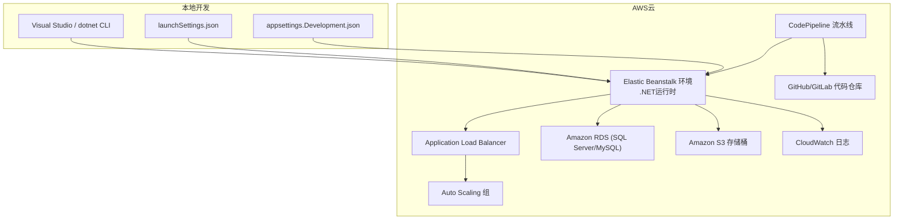
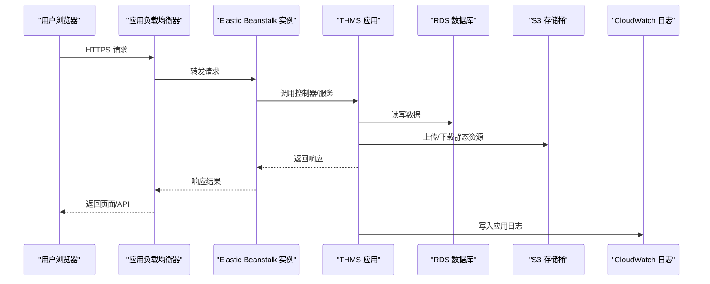
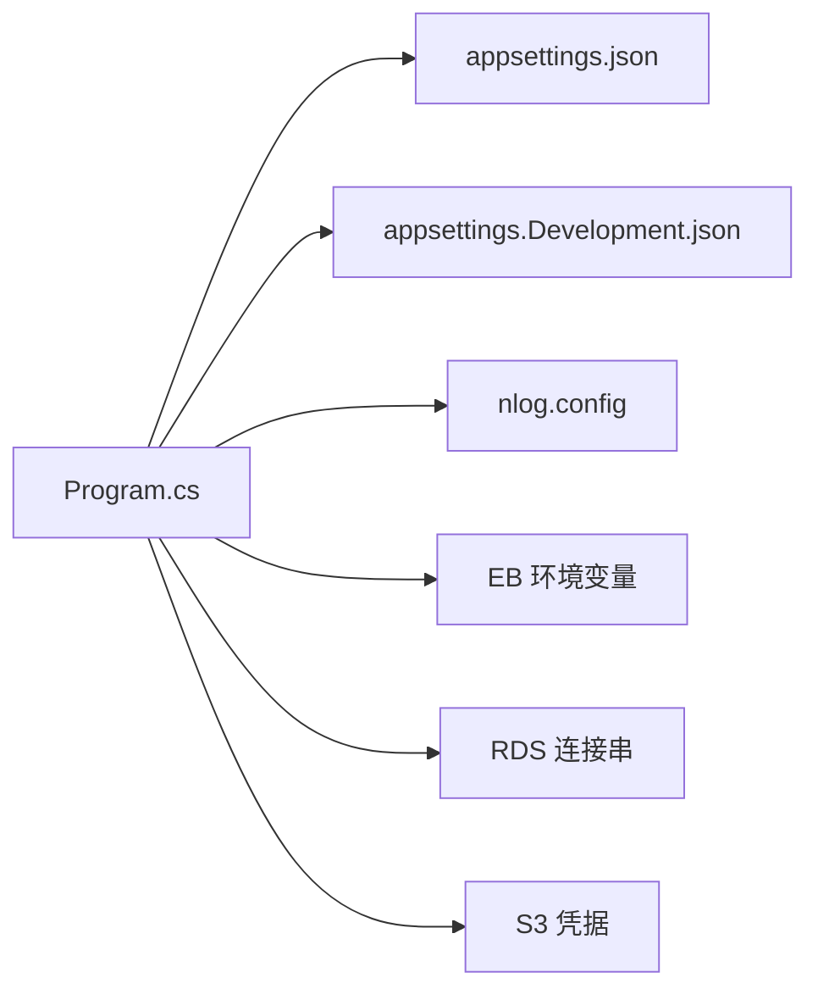

# AWS Elastic Beanstalk部署

<cite>
**本文引用的文件**   
- [Program.cs](file://EquipmentIMS.Web/Program.cs)
- [appsettings.json](file://EquipmentIMS.Web/appsettings.json)
- [appsettings.Development.json](file://EquipmentIMS.Web/appsettings.Development.json)
- [nlog.config](file://EquipmentIMS.Web/nlog.config)
- [launchSettings.json](file://EquipmentIMS.Web/Properties/launchSettings.json)
- [EquipmentIMS.sln](file://EquipmentIMS.sln)
</cite>

## 目录
1. [简介](#简介)
2. [项目结构](#项目结构)
3. [核心组件](#核心组件)
4. [架构总览](#架构总览)
5. [详细组件分析](#详细组件分析)
6. [依赖分析](#依赖分析)
7. [性能考虑](#性能考虑)
8. [故障排查指南](#故障排查指南)
9. [结论](#结论)
10. [附录](#附录)

## 简介
本指南面向THMS（设备库存管理系统）在AWS Elastic Beanstalk上的生产部署。内容覆盖：
- EB CLI安装与配置（凭证、区域）
- Elastic Beanstalk环境创建与平台版本选择、实例类型配置
- RDS数据库集成（实例创建、安全组、连接串注入）
- S3静态资源托管
- CloudWatch日志采集
- Auto Scaling策略
- CodePipeline CI/CD流水线（源码仓库、构建、部署）
- 负载均衡器与健康检查

## 项目结构
THMS为.NET Web应用，采用分层架构：Web层、业务层、数据访问层与模型层。部署目标为Elastic Beanstalk的.NET运行环境，通过环境变量注入RDS连接串等配置；静态资源可托管至S3并通过CDN加速。

[无图表来源，因为该图为概念性结构示意]

## 核心组件
- 应用入口与配置加载：由Web项目的启动程序负责读取配置文件与环境变量，并注册服务、中间件与路由。
- 配置源优先级：默认配置文件、环境特定配置文件、环境变量（EB注入）。
- 日志输出：应用内日志框架将结构化日志写入标准输出或文件，EB自动转发到CloudWatch。

章节来源
- [Program.cs:1-200](file://EquipmentIMS.Web/Program.cs#L1-L200)
- [appsettings.json:1-200](file://EquipmentIMS.Web/appsettings.json#L1-L200)
- [appsettings.Development.json:1-200](file://EquipmentIMS.Web/appsettings.Development.json#L1-L200)
- [nlog.config:1-200](file://EquipmentIMS.Web/nlog.config#L1-L200)
- [launchSettings.json:1-200](file://EquipmentIMS.Web/Properties/launchSettings.json#L1-L200)

## 架构总览
下图展示从用户请求到后端处理、数据库访问、对象存储与监控的整体流程。

图表来源
- [Program.cs:1-200](file://EquipmentIMS.Web/Program.cs#L1-L200)
- [appsettings.json:1-200](file://EquipmentIMS.Web/appsettings.json#L1-L200)

## 详细组件分析

### EB CLI安装与配置
- 安装EB CLI
  - Windows：使用pip安装aws-eb-cli，或通过官方安装包。
  - macOS/Linux：使用包管理器或pip安装。
- 初始化与配置
  - 执行初始化命令，设置默认区域（如ap-northeast-1、us-east-1等）。
  - 配置AWS凭证：建议使用IAM用户并最小权限原则，或使用临时凭证。
- 验证
  - 列出可用环境、查看当前配置、测试登录状态。

章节来源
- [appsettings.json:1-200](file://EquipmentIMS.Web/appsettings.json#L1-L200)

### 创建与配置Elastic Beanstalk环境
- 平台版本选择
  - 选择与项目匹配的.NET运行时平台（例如.NET 6/8 Linux或Windows Server）。
  - 若使用Linux平台，需确保发布产物包含自包含或依赖框架的运行时。
- 实例类型与容量
  - 根据预估流量选择实例规格（如t3.medium起），并启用Auto Scaling。
  - 初始副本数建议≥2以实现高可用。
- 环境变量
  - 在EB环境中注入数据库连接串、S3凭据、日志级别等。
  - 注意键名大小写敏感，避免与默认配置冲突。
- 部署方式
  - 使用eb deploy推送打包后的zip或直接从源码构建（取决于平台支持）。

章节来源
- [Program.cs:1-200](file://EquipmentIMS.Web/Program.cs#L1-L200)
- [appsettings.json:1-200](file://EquipmentIMS.Web/appsettings.json#L1-L200)

### RDS数据库集成
- 创建RDS实例
  - 选择引擎（SQL Server/MySQL/PostgreSQL），设置主账号与密码。
  - 分配私有子网与安全组，仅允许EB所在VPC访问。
- 安全组规则
  - 入站：允许EB实例安全组访问RDS端口（如1433/3306/5432）。
  - 出站：按需放行外部访问（通常关闭）。
- 连接串注入
  - 在EB环境中设置数据库连接字符串环境变量。
  - 应用启动时读取环境变量并覆盖默认配置。
- 迁移与初始化
  - 建议在CI阶段执行EF迁移或SQL脚本，或在应用启动时安全地执行一次初始化。

章节来源
- [appsettings.json:1-200](file://EquipmentIMS.Web/appsettings.json#L1-L200)

### S3静态资源托管
- 创建S3存储桶
  - 命名遵循全局唯一规范，开启版本控制与加密。
  - 禁止公开列表，按需开放读权限给应用角色或预签名URL。
- 应用集成
  - 在EB环境中注入S3凭据（Access Key/Secret Key或IAM角色）。
  - 应用将静态资源（图片、报表导出等）上传至S3，并在前端引用S3域名。
- CDN加速（可选）
  - 结合CloudFront对S3进行缓存与加速，提升全球访问体验。

章节来源
- [appsettings.json:1-200](file://EquipmentIMS.Web/appsettings.json#L1-L200)

### CloudWatch日志配置
- 应用日志
  - 将结构化日志输出到标准输出或文件路径，EB自动收集到CloudWatch。
  - 调整日志级别，避免生产环境输出过多调试信息。
- 健康检查日志
  - 关注EB健康检查端点返回码与响应时间，必要时自定义健康检查路径。
- 告警与订阅
  - 基于CloudWatch指标与日志模式创建告警规则，及时通知异常。

章节来源
- [nlog.config:1-200](file://EquipmentIMS.Web/nlog.config#L1-L200)

### Auto Scaling策略
- 目标跟踪
  - 基于CPU利用率、请求计数或队列长度动态扩缩容。
- 计划扩缩容
  - 针对已知高峰时段提前扩容，降低冷启动影响。
- 伸缩冷却
  - 合理设置冷却时间，避免频繁抖动。

章节来源
- [Program.cs:1-200](file://EquipmentIMS.Web/Program.cs#L1-L200)

### CodePipeline CI/CD流水线
- 源代码仓库
  - 连接GitHub/GitLab，指定分支与触发条件（push事件）。
- 构建阶段
  - 安装.NET SDK，还原依赖，编译并发布（Release）。
  - 生成部署包（zip或容器镜像）。
- 部署阶段
  - 调用EB API或CLI进行环境更新，滚动发布或蓝绿切换。
- 质量门禁
  - 集成单元测试、静态分析与安全扫描，失败则阻断发布。

章节来源
- [EquipmentIMS.sln:1-200](file://EquipmentIMS.sln#L1-L200)

### 负载均衡器与健康检查
- 监听器与路由
  - 默认HTTPS监听，HTTP重定向到HTTPS。
- 健康检查
  - 配置健康检查路径（如/api/health），返回200且低延迟视为健康。
- 会话保持与超时
  - 根据业务需求调整会话保持与超时时间，避免长连接中断。

章节来源
- [Program.cs:1-200](file://EquipmentIMS.Web/Program.cs#L1-L200)

## 依赖分析
- 运行时依赖
  - .NET运行时（与EB平台匹配）、系统库（如glibc）。
- 第三方库
  - 数据库驱动、对象存储SDK、日志框架等。
- 配置依赖
  - appsettings.*与EB环境变量共同决定最终配置。

图表来源
- [Program.cs:1-200](file://EquipmentIMS.Web/Program.cs#L1-L200)
- [appsettings.json:1-200](file://EquipmentIMS.Web/appsettings.json#L1-L200)
- [appsettings.Development.json:1-200](file://EquipmentIMS.Web/appsettings.Development.json#L1-L200)
- [nlog.config:1-200](file://EquipmentIMS.Web/nlog.config#L1-L200)

章节来源
- [Program.cs:1-200](file://EquipmentIMS.Web/Program.cs#L1-L200)
- [appsettings.json:1-200](file://EquipmentIMS.Web/appsettings.json#L1-L200)
- [appsettings.Development.json:1-200](file://EquipmentIMS.Web/appsettings.Development.json#L1-L200)
- [nlog.config:1-200](file://EquipmentIMS.Web/nlog.config#L1-L200)

## 性能考虑
- 数据库连接池
  - 根据实例数量与并发量调优最大连接数，避免耗尽。
- 静态资源
  - 使用S3+CloudFront缓存静态资源，减少应用负载。
- 日志级别
  - 生产环境降低日志级别，减少I/O开销。
- 缓存策略
  - 热点数据引入内存缓存或分布式缓存，降低数据库压力。
- 扩缩容阈值
  - 合理设置CPU/请求阈值，平衡成本与响应时间。

[本节为通用指导，不直接分析具体文件]

## 故障排查指南
- 无法连接数据库
  - 检查EB安全组是否允许访问RDS端口，确认连接串正确。
  - 查看应用日志中的连接错误堆栈。
- 静态资源404
  - 校验S3桶策略与CORS设置，确认应用使用的Bucket名称与区域。
- 健康检查失败
  - 确认健康检查路径存在且返回200，检查应用启动耗时与依赖可用性。
- 日志缺失
  - 确认日志框架输出到标准输出或EB可采集的路径，检查CloudWatch日志组是否存在。

章节来源
- [nlog.config:1-200](file://EquipmentIMS.Web/nlog.config#L1-L200)
- [appsettings.json:1-200](file://EquipmentIMS.Web/appsettings.json#L1-L200)

## 结论
通过将THMS部署到Elastic Beanstalk，并结合RDS、S3、CloudWatch与CodePipeline，可实现高可用、可扩展、可观测的现代化部署方案。建议在生产环境严格管理密钥与权限，持续优化扩缩容策略与监控告警，保障系统稳定性与性能。

[本节为总结性内容，不直接分析具体文件]

## 附录

### 常用EB CLI命令参考
- 初始化与配置
  - 初始化项目、设置默认区域、配置凭证
- 环境管理
  - 创建环境、列出环境、删除环境
- 部署
  - 打包并部署、查看部署状态、回滚版本

[本节为通用操作参考，不直接分析具体文件]