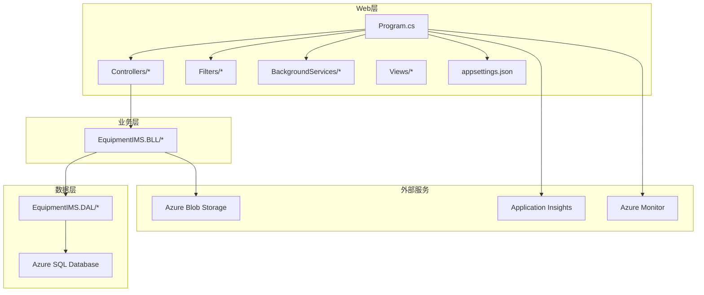
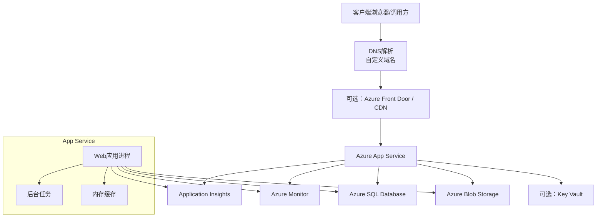
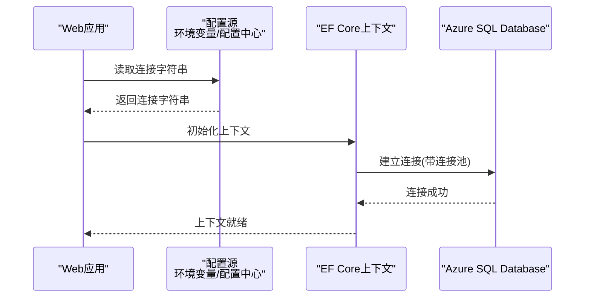
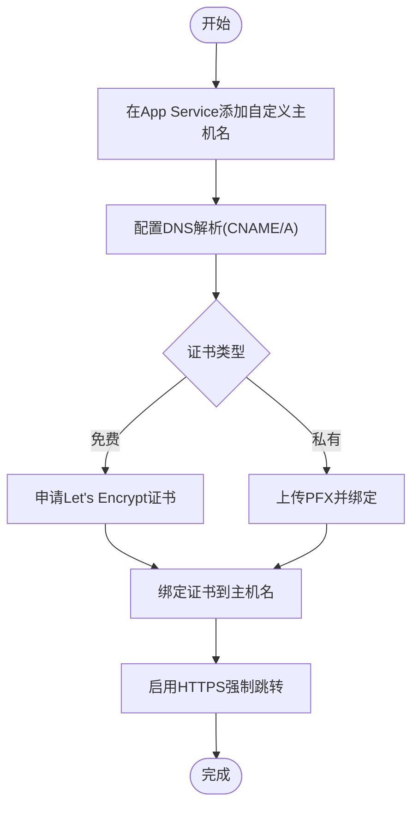
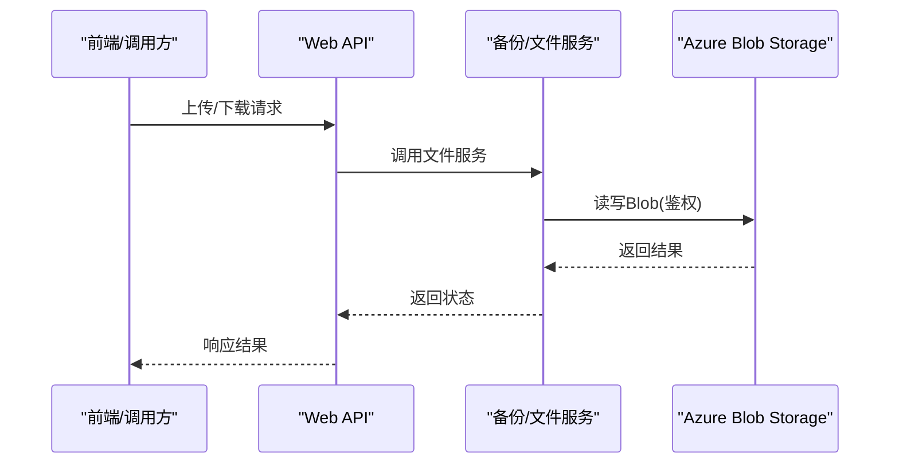
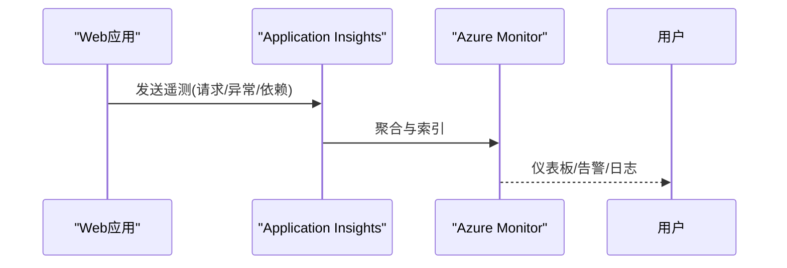
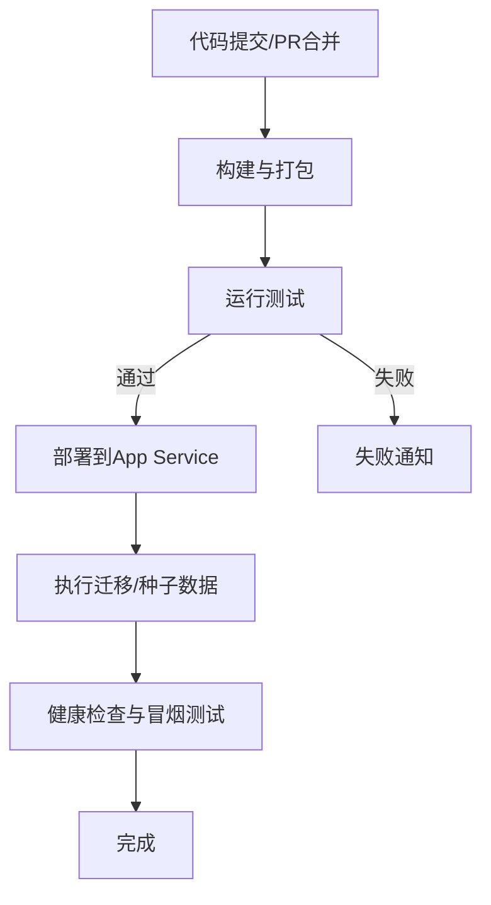
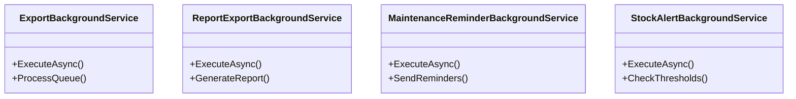
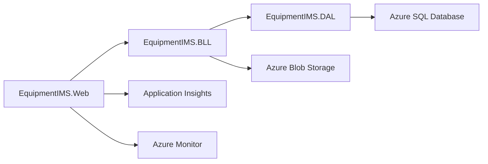

# Azure App Service部署

<cite>
**本文引用的文件**   
- [Program.cs](file://EquipmentIMS.Web/Program.cs)
- [appsettings.json](file://EquipmentIMS.Web/appsettings.json)
- [AppDbContext.cs](file://EquipmentIMS.DAL/AppDbContext.cs)
- [GlobalExceptionMiddleware.cs](file://EquipmentIMS.Web/Filters/GlobalExceptionMiddleware.cs)
- [SecurityHeadersMiddleware.cs](file://EquipmentIMS.Web/Filters/SecurityHeadersMiddleware.cs)
- [OperationLogActionFilter.cs](file://EquipmentIMS.Web/Filters/OperationLogActionFilter.cs)
- [BackupService.cs](file://EquipmentIMS.BLL/Services/BackupService.cs)
- [ExportBackgroundService.cs](file://EquipmentIMS.Web/BackgroundServices/ExportBackgroundService.cs)
- [ReportExportBackgroundService.cs](file://EquipmentIMS.Web/BackgroundServices/ReportExportBackgroundService.cs)
- [MaintenanceReminderBackgroundService.cs](file://EquipmentIMS.Web/BackgroundServices/MaintenanceReminderBackgroundService.cs)
- [StockAlertBackgroundService.cs](file://EquipmentIMS.Web/BackgroundServices/StockAlertBackgroundService.cs)
- [DataSeed.cs](file://EquipmentIMS.Web/DataSeed.cs)
</cite>

## 目录
1. [简介](#简介)
2. [项目结构](#项目结构)
3. [核心组件](#核心组件)
4. [架构总览](#架构总览)
5. [详细组件分析](#详细组件分析)
6. [依赖关系分析](#依赖关系分析)
7. [性能考虑](#性能考虑)
8. [故障排查指南](#故障排查指南)
9. [结论](#结论)
10. [附录](#附录)

## 简介
本指南面向在Azure App Service上部署THMS（设备库存管理系统）的工程师与运维人员，覆盖以下关键主题：
- 应用服务计划创建与配置（实例大小、自动扩缩容）
- 数据库连接字符串配置（Azure SQL Database集成、连接池优化）
- 域名绑定与SSL证书配置（自定义域名解析、免费证书申请）
- Azure存储账户配置（用于文件上传下载）
- Azure Monitor监控设置与Application Insights集成
- Azure DevOps CI/CD流水线示例（构建、测试、发布自动化）

## 项目结构
THMS采用分层架构，Web层通过控制器暴露API与MVC视图，BLL提供业务逻辑，DAL使用Entity Framework访问数据。Web层包含全局异常处理、安全头中间件、操作日志过滤器以及多个后台任务服务。

图表来源
- [Program.cs](file://EquipmentIMS.Web/Program.cs)
- [appsettings.json](file://EquipmentIMS.Web/appsettings.json)
- [AppDbContext.cs](file://EquipmentIMS.DAL/AppDbContext.cs)

章节来源
- [Program.cs](file://EquipmentIMS.Web/Program.cs)
- [appsettings.json](file://EquipmentIMS.Web/appsettings.json)
- [AppDbContext.cs](file://EquipmentIMS.DAL/AppDbContext.cs)

## 核心组件
- 应用启动与中间件管线：负责注册中间件、过滤器、背景服务、依赖注入与配置读取。
- 数据库上下文：定义EF Core上下文及连接字符串来源。
- 全局异常处理与安全头中间件：统一错误响应与HTTP安全头。
- 操作日志过滤器：记录请求级审计信息。
- 后台任务服务：导出、报表、维护提醒、库存预警等异步任务。
- 备份服务：支持数据库或文件备份到对象存储。

章节来源
- [Program.cs](file://EquipmentIMS.Web/Program.cs)
- [GlobalExceptionMiddleware.cs](file://EquipmentIMS.Web/Filters/GlobalExceptionMiddleware.cs)
- [SecurityHeadersMiddleware.cs](file://EquipmentIMS.Web/Filters/SecurityHeadersMiddleware.cs)
- [OperationLogActionFilter.cs](file://EquipmentIMS.Web/Filters/OperationLogActionFilter.cs)
- [ExportBackgroundService.cs](file://EquipmentIMS.Web/BackgroundServices/ExportBackgroundService.cs)
- [ReportExportBackgroundService.cs](file://EquipmentIMS.Web/BackgroundServices/ReportExportBackgroundService.cs)
- [MaintenanceReminderBackgroundService.cs](file://EquipmentIMS.Web/BackgroundServices/MaintenanceReminderBackgroundService.cs)
- [StockAlertBackgroundService.cs](file://EquipmentIMS.Web/BackgroundServices/StockAlertBackgroundService.cs)
- [BackupService.cs](file://EquipmentIMS.BLL/Services/BackupService.cs)

## 架构总览
下图展示THMS在Azure上的部署拓扑与关键集成点。

图表来源
- [Program.cs](file://EquipmentIMS.Web/Program.cs)
- [AppDbContext.cs](file://EquipmentIMS.DAL/AppDbContext.cs)
- [BackupService.cs](file://EquipmentIMS.BLL/Services/BackupService.cs)

## 详细组件分析

### 应用服务计划与运行环境
- 运行时选择：根据项目目标框架选择对应.NET版本（例如.NET 8）。
- 工作模式：启用“始终开启”和“预加载”，确保冷启动更快。
- 平台：Windows或Linux均可；若使用SQL Server ODBC驱动或特定Windows特性，优先Windows。
- 最小实例数：建议至少2个以支持零停机发布与健康检查。
- 自动扩缩容：基于CPU、内存、队列长度或自定义指标进行水平扩展。

章节来源
- [Program.cs](file://EquipmentIMS.Web/Program.cs)

### 数据库连接字符串与连接池优化
- 连接字符串来源：从环境变量或App Service配置中读取，避免硬编码。
- EF Core连接池：默认启用；可通过连接字符串参数控制最大连接数、超时与重试策略。
- 高可用：启用Azure SQL弹性池或Geo复制，结合应用侧重试与熔断。
- 初始化：首次部署可执行种子数据或迁移脚本。

图表来源
- [AppDbContext.cs](file://EquipmentIMS.DAL/AppDbContext.cs)
- [appsettings.json](file://EquipmentIMS.Web/appsettings.json)

章节来源
- [AppDbContext.cs](file://EquipmentIMS.DAL/AppDbContext.cs)
- [appsettings.json](file://EquipmentIMS.Web/appsettings.json)

### 域名绑定与SSL证书
- 自定义域名：在App Service中添加主机名并指向应用。
- DNS解析：在域名提供商处添加CNAME或A记录，指向App Service提供的地址。
- SSL证书：
  - 免费证书：使用Let's Encrypt或Azure Managed Certificate（如适用）。
  - 私有证书：导入PFX到App Service证书库并绑定到主机名。
- HTTPS强制：在应用层或反向代理层启用HTTPS重定向。

[本节为概念性流程，无需代码来源]

### Azure存储账户配置（文件上传下载）
- 容器与权限：创建Blob容器，设置匿名访问级别为仅容器或仅Blob（按需求），或使用SAS/密钥鉴权。
- 连接配置：将存储连接字符串放入环境变量或配置中心。
- 应用集成：在业务层或服务中使用SDK进行上传、下载、列表等操作。
- 安全建议：最小权限原则、网络VNet集成、静态加密与软删除。

图表来源
- [BackupService.cs](file://EquipmentIMS.BLL/Services/BackupService.cs)

章节来源
- [BackupService.cs](file://EquipmentIMS.BLL/Services/BackupService.cs)

### Azure Monitor与Application Insights集成
- 启用AI：在App Service中启用Application Insights并获取Instrumentation Key或连接字符串。
- 配置注入：将AI连接字符串作为环境变量注入应用。
- 采集项：请求、依赖、异常、性能计数器、自定义事件与指标。
- 告警与仪表板：基于AI查询创建告警规则与可视化仪表板。

图表来源
- [Program.cs](file://EquipmentIMS.Web/Program.cs)

章节来源
- [Program.cs](file://EquipmentIMS.Web/Program.cs)

### Azure DevOps CI/CD流水线示例
- 触发条件：推送至主分支或标签时触发。
- 构建阶段：还原依赖、编译、单元测试、打包发布。
- 测试阶段：集成测试、端到端冒烟测试。
- 发布阶段：部署到App Service（生产/预发环境），执行数据库迁移与种子数据。
- 安全与凭据：使用变量组与密钥管理敏感信息（连接字符串、证书等）。

[本节为概念性流程，无需代码来源]

### 后台任务与可扩展性
- 任务类型：导出、报表生成、维护提醒、库存预警等。
- 伸缩策略：根据任务队列长度或定时任务频率调整实例数量。
- 幂等与重试：确保任务可重试且具备去重机制。
- 资源隔离：将长耗时任务与在线请求分离，避免阻塞。

图表来源
- [ExportBackgroundService.cs](file://EquipmentIMS.Web/BackgroundServices/ExportBackgroundService.cs)
- [ReportExportBackgroundService.cs](file://EquipmentIMS.Web/BackgroundServices/ReportExportBackgroundService.cs)
- [MaintenanceReminderBackgroundService.cs](file://EquipmentIMS.Web/BackgroundServices/MaintenanceReminderBackgroundService.cs)
- [StockAlertBackgroundService.cs](file://EquipmentIMS.Web/BackgroundServices/StockAlertBackgroundService.cs)

章节来源
- [ExportBackgroundService.cs](file://EquipmentIMS.Web/BackgroundServices/ExportBackgroundService.cs)
- [ReportExportBackgroundService.cs](file://EquipmentIMS.Web/BackgroundServices/ReportExportBackgroundService.cs)
- [MaintenanceReminderBackgroundService.cs](file://EquipmentIMS.Web/BackgroundServices/MaintenanceReminderBackgroundService.cs)
- [StockAlertBackgroundService.cs](file://EquipmentIMS.Web/BackgroundServices/StockAlertBackgroundService.cs)

### 数据初始化与种子数据
- 首次部署：执行数据库迁移与种子数据，确保系统可用。
- 幂等设计：重复执行不产生副作用。
- 环境区分：开发/测试/生产使用不同种子集。

章节来源
- [DataSeed.cs](file://EquipmentIMS.Web/DataSeed.cs)

## 依赖关系分析
- 模块耦合：Web层依赖BLL与DAL；BLL可能依赖外部存储；DAL依赖数据库。
- 外部依赖：Azure SQL、Blob Storage、Application Insights、Azure Monitor。
- 循环依赖：应避免在BLL与DAL之间出现循环引用。
- 配置依赖：连接字符串、存储连接、AI连接字符串需集中管理。

图表来源
- [Program.cs](file://EquipmentIMS.Web/Program.cs)
- [AppDbContext.cs](file://EquipmentIMS.DAL/AppDbContext.cs)
- [BackupService.cs](file://EquipmentIMS.BLL/Services/BackupService.cs)

章节来源
- [Program.cs](file://EquipmentIMS.Web/Program.cs)
- [AppDbContext.cs](file://EquipmentIMS.DAL/AppDbContext.cs)
- [BackupService.cs](file://EquipmentIMS.BLL/Services/BackupService.cs)

## 性能考虑
- 连接池：合理设置最大连接数与超时，避免连接耗尽。
- 缓存：对热点数据使用内存缓存或分布式缓存（如Redis）。
- 压缩与静态资源：启用Gzip/Brotli，静态资源走CDN。
- 后台任务：使用队列与批处理，避免长时间占用请求线程。
- 监控与调优：基于AI与Monitor定位瓶颈，持续优化。

[本节为通用指导，无需代码来源]

## 故障排查指南
- 全局异常处理：统一捕获未处理异常，记录堆栈与上下文，返回友好错误码。
- 安全头中间件：确保X-Frame-Options、HSTS等头部正确设置。
- 操作日志：记录关键请求与操作，便于审计与回溯。
- 常见问题：
  - 数据库连接失败：检查连接字符串、防火墙、最小TLS版本。
  - 存储访问拒绝：检查容器权限、SAS/密钥、网络策略。
  - 证书错误：检查证书链、过期时间与绑定状态。
  - 性能问题：查看AI依赖延迟、SQL慢查询、CPU/内存峰值。

章节来源
- [GlobalExceptionMiddleware.cs](file://EquipmentIMS.Web/Filters/GlobalExceptionMiddleware.cs)
- [SecurityHeadersMiddleware.cs](file://EquipmentIMS.Web/Filters/SecurityHeadersMiddleware.cs)
- [OperationLogActionFilter.cs](file://EquipmentIMS.Web/Filters/OperationLogActionFilter.cs)

## 结论
通过在Azure App Service上合理配置应用服务计划、数据库连接、域名与SSL、存储账户、监控与CI/CD，THMS可实现高可用、易扩展、可观测的生产级部署。建议在生产环境启用多实例与自动扩缩容，结合AI与Monitor进行持续优化。

[本节为总结，无需代码来源]

## 附录
- 最佳实践清单：
  - 使用环境变量或配置中心管理敏感信息
  - 启用HTTPS与强安全头
  - 最小权限原则访问存储与数据库
  - 定期备份与恢复演练
  - 灰度发布与回滚策略
- 参考命令（概念性）：
  - 创建资源组与应用服务计划
  - 部署Web应用到App Service
  - 配置环境变量与连接字符串
  - 绑定自定义域名与证书
  - 启用Application Insights与监控告警

[本节为补充说明，无需代码来源]