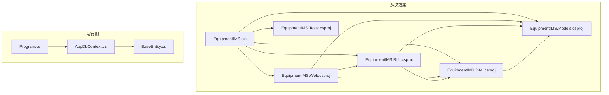
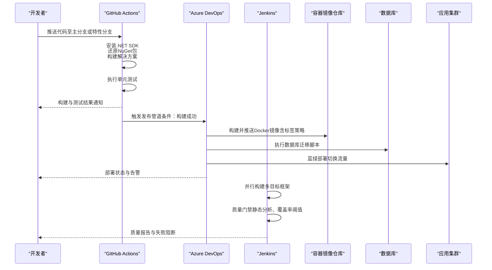
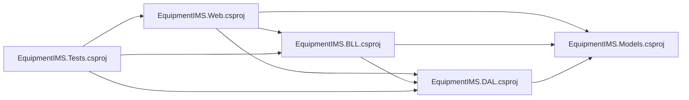

# CI/CD流水线配置

<cite>
**本文引用的文件**   
- [EquipmentIMS.sln](file://EquipmentIMS.sln)
- [Program.cs](file://EquipmentIMS.Web/Program.cs)
- [appsettings.json](file://EquipmentIMS.Web/appsettings.json)
- [appsettings.Development.json](file://EquipmentIMS.Web/appsettings.Development.json)
- [DataSeed.cs](file://EquipmentIMS.Web/DataSeed.cs)
- [EquipmentIMS.Tests.csproj](file://EquipmentIMS.Tests/EquipmentIMS.Tests.csproj)
- [EquipmentIMS.BLL.csproj](file://EquipmentIMS.BLL/EquipmentIMS.BLL.csproj)
- [EquipmentIMS.DAL.csproj](file://EquipmentIMS.DAL/EquipmentIMS.DAL.csproj)
- [EquipmentIMS.Web.csproj](file://EquipmentIMS.Web/EquipmentIMS.Web.csproj)
- [IAesEncryptionService.cs](file://EquipmentIMS.BLL/Interfaces/IAesEncryptionService.cs)
- [AesEncryptionService.cs](file://EquipmentIMS.BLL/Services/AesEncryptionService.cs)
- [AppDbContext.cs](file://EquipmentIMS.DAL/AppDbContext.cs)
- [BaseEntity.cs](file://EquipmentIMS.Models/Entities/BaseEntity.cs)
</cite>

## 目录
1. [简介](#简介)
2. [项目结构](#项目结构)
3. [核心组件](#核心组件)
4. [架构总览](#架构总览)
5. [详细组件分析](#详细组件分析)
6. [依赖分析](#依赖分析)
7. [性能考虑](#性能考虑)
8. [故障排查指南](#故障排查指南)
9. [结论](#结论)
10. [附录](#附录)

## 简介
本指南面向THMS（设备库存管理系统）的CI/CD流水线设计与落地，覆盖以下目标：
- GitHub Actions工作流：.NET Core构建、单元测试执行、NuGet包管理
- Azure DevOps管道：多环境部署策略与分支策略管理
- Jenkins流水线：并行构建、质量门禁设置
- Docker镜像自动化构建与推送：镜像标签策略与安全扫描集成
- 数据库迁移自动化执行与配置文件加密处理
- 回滚策略与蓝绿部署实现方案
- 构建缓存优化与并行测试执行等性能优化技巧

说明：仓库中未包含现成的CI/CD配置文件。本文基于现有.NET解决方案结构与代码组织，提供可直接落地的流水线设计、步骤编排与最佳实践建议。

## 项目结构
THMS采用分层架构：Web层、业务层(BLL)、数据访问层(DAL)、模型层(Models)以及测试工程。关键要点：
- Web应用入口位于Web工程的Program.cs，使用ASP.NET Core运行时
- 数据上下文在DAL层的AppDbContext.cs中定义，实体模型在Models层
- 测试工程为独立的.NET测试项目
- 多个.csproj文件定义了各层依赖关系，便于按层构建与缓存

图表来源
- [EquipmentIMS.sln](file://EquipmentIMS.sln)
- [EquipmentIMS.Web.csproj](file://EquipmentIMS.Web/EquipmentIMS.Web.csproj)
- [EquipmentIMS.BLL.csproj](file://EquipmentIMS.BLL/EquipmentIMS.BLL.csproj)
- [EquipmentIMS.DAL.csproj](file://EquipmentIMS.DAL/EquipmentIMS.DAL.csproj)
- [EquipmentIMS.Tests.csproj](file://EquipmentIMS.Tests/EquipmentIMS.Tests.csproj)
- [Program.cs](file://EquipmentIMS.Web/Program.cs)
- [AppDbContext.cs](file://EquipmentIMS.DAL/AppDbContext.cs)
- [BaseEntity.cs](file://EquipmentIMS.Models/Entities/BaseEntity.cs)

章节来源
- [EquipmentIMS.sln](file://EquipmentIMS.sln)
- [Program.cs](file://EquipmentIMS.Web/Program.cs)
- [AppDbContext.cs](file://EquipmentIMS.DAL/AppDbContext.cs)
- [EquipmentIMS.Tests.csproj](file://EquipmentIMS.Tests/EquipmentIMS.Tests.csproj)

## 核心组件
- 构建单元
  - 解决方案级构建：通过解决方案文件进行统一编译
  - 项目级构建：按层构建以利用增量与缓存
- 测试单元
  - 独立测试工程，支持dotnet test执行
- 运行期组件
  - Web入口Program.cs负责服务启动与中间件注册
  - 数据上下文AppDbContext.cs用于EF Core连接与迁移
  - 实体BaseEntity.cs作为基础模型
- 安全与配置
  - AesEncryptionService与接口用于配置项加密
  - appsettings.json与Development配置分离

章节来源
- [Program.cs](file://EquipmentIMS.Web/Program.cs)
- [AppDbContext.cs](file://EquipmentIMS.DAL/AppDbContext.cs)
- [BaseEntity.cs](file://EquipmentIMS.Models/Entities/BaseEntity.cs)
- [IAesEncryptionService.cs](file://EquipmentIMS.BLL/Interfaces/IAesEncryptionService.cs)
- [AesEncryptionService.cs](file://EquipmentIMS.BLL/Services/AesEncryptionService.cs)
- [appsettings.json](file://EquipmentIMS.Web/appsettings.json)
- [appsettings.Development.json](file://EquipmentIMS.Web/appsettings.Development.json)

## 架构总览
下图展示从代码提交到部署上线的端到端流水线，涵盖GitHub Actions、Azure DevOps、Jenkins、Docker与数据库迁移。

图表来源
- [EquipmentIMS.sln](file://EquipmentIMS.sln)
- [EquipmentIMS.Tests.csproj](file://EquipmentIMS.Tests/EquipmentIMS.Tests.csproj)
- [Program.cs](file://EquipmentIMS.Web/Program.cs)
- [AppDbContext.cs](file://EquipmentIMS.DAL/AppDbContext.cs)

## 详细组件分析

### GitHub Actions工作流设计
- 触发条件
  - 推送至main/master与release/*分支；Pull Request事件
- 作业划分
  - 构建作业：安装.NET SDK、还原NuGet包、构建解决方案
  - 测试作业：执行单元测试，生成测试报告
  - 打包作业：可选，生成NuGet包或发布产物
- 缓存策略
  - 缓存NuGet包目录与obj/bin输出，提升二次构建速度
- 环境变量与密钥
  - 使用GitHub Secrets存储敏感信息（如数据库连接串、镜像仓库凭据）
- 产物归档
  - 上传测试报告与构建日志，便于问题定位

章节来源
- [EquipmentIMS.sln](file://EquipmentIMS.sln)
- [EquipmentIMS.Tests.csproj](file://EquipmentIMS.Tests/EquipmentIMS.Tests.csproj)

### Azure DevOps管道设计
- 多环境策略
  - 开发环境：feature分支合并后自动构建与部署到Dev
  - 预生产环境：release分支或手动审批后部署到Staging
  - 生产环境：tag触发，严格审批与灰度发布
- 分支策略管理
  - GitFlow或Trunk-Based Development，结合PR检查与分支保护规则
- 容器化与镜像仓库
  - 构建Docker镜像并推送到Azure Container Registry或私有仓库
  - 镜像标签策略：语义版本、Git提交哈希、构建号组合
- 数据库迁移
  - 在部署前执行迁移脚本或EF Core迁移命令
- 蓝绿部署
  - 双实例组交替更新，负载均衡器切换流量，快速回滚

章节来源
- [AppDbContext.cs](file://EquipmentIMS.DAL/AppDbContext.cs)
- [Program.cs](file://EquipmentIMS.Web/Program.cs)

### Jenkins流水线脚本编写
- 并行构建
  - 针对多目标框架或多项目并行执行，缩短整体构建时间
- 质量门禁
  - 集成静态分析工具（如SonarQube）、覆盖率阈值、安全漏洞扫描
- 阶段化流程
  - 拉取代码→依赖还原→构建→测试→质量门禁→打包→部署
- 凭据管理
  - 使用Jenkins凭据插件管理数据库连接串、镜像仓库凭据等

章节来源
- [EquipmentIMS.sln](file://EquipmentIMS.sln)
- [EquipmentIMS.Tests.csproj](file://EquipmentIMS.Tests/EquipmentIMS.Tests.csproj)

### Docker镜像自动化构建与推送
- 构建流程
  - 使用多阶段构建减少镜像体积
  - 将构建产物与运行时分离，提高安全性
- 镜像标签策略
  - 主分支：latest与版本号
  - 特性分支：短提交哈希
  - Tag发布：精确版本与构建号
- 安全扫描集成
  - 在镜像构建后执行Trivy或Snyk扫描，阻断高危漏洞
- 推送与签名
  - 推送至受管镜像仓库，启用镜像签名与完整性校验

章节来源
- [Program.cs](file://EquipmentIMS.Web/Program.cs)

### 数据库迁移自动化执行
- 迁移方式
  - EF Core迁移：在部署前执行Update-Database或dotnet ef database update
  - SQL脚本：在容器中执行初始化与增量脚本
- 幂等性设计
  - 确保迁移脚本可重复执行且具备幂等性
- 回滚机制
  - 保留历史迁移脚本，支持向下迁移或快照恢复

章节来源
- [AppDbContext.cs](file://EquipmentIMS.DAL/AppDbContext.cs)
- [DataSeed.cs](file://EquipmentIMS.Web/DataSeed.cs)

### 配置文件加密处理
- 加密范围
  - 数据库连接串、第三方API密钥、证书路径等敏感配置
- 实现思路
  - 使用AesEncryptionService对配置值进行加解密
  - 在应用启动时加载并解密配置，注入到DI容器
- 密钥管理
  - 密钥由外部密钥管理服务（KMS）或环境变量注入，避免硬编码

章节来源
- [IAesEncryptionService.cs](file://EquipmentIMS.BLL/Interfaces/IAesEncryptionService.cs)
- [AesEncryptionService.cs](file://EquipmentIMS.BLL/Services/AesEncryptionService.cs)
- [appsettings.json](file://EquipmentIMS.Web/appsettings.json)
- [appsettings.Development.json](file://EquipmentIMS.Web/appsettings.Development.json)

### 回滚策略与蓝绿部署实现方案
- 回滚策略
  - 镜像版本回退：将负载均衡指向上一稳定镜像版本
  - 数据库回滚：执行反向迁移或从快照恢复
- 蓝绿部署
  - 维护两套相同环境实例，新部署到绿色实例，验证通过后切换流量
  - 失败则立即切回蓝色实例，保障业务连续性

章节来源
- [Program.cs](file://EquipmentIMS.Web/Program.cs)
- [AppDbContext.cs](file://EquipmentIMS.DAL/AppDbContext.cs)

## 依赖分析
- 项目依赖关系
  - Web依赖BLL、DAL、Models
  - BLL依赖DAL、Models
  - DAL依赖Models
  - Tests依赖Web/BLL/DAL以便进行集成与单元测试
- 外部依赖
  - .NET运行时与SDK
  - NuGet包源（官方与私有源）
  - 容器镜像仓库与数据库服务

图表来源
- [EquipmentIMS.Web.csproj](file://EquipmentIMS.Web/EquipmentIMS.Web.csproj)
- [EquipmentIMS.BLL.csproj](file://EquipmentIMS.BLL/EquipmentIMS.BLL.csproj)
- [EquipmentIMS.DAL.csproj](file://EquipmentIMS.DAL/EquipmentIMS.DAL.csproj)
- [EquipmentIMS.Tests.csproj](file://EquipmentIMS.Tests/EquipmentIMS.Tests.csproj)

章节来源
- [EquipmentIMS.Web.csproj](file://EquipmentIMS.Web/EquipmentIMS.Web.csproj)
- [EquipmentIMS.BLL.csproj](file://EquipmentIMS.BLL/EquipmentIMS.BLL.csproj)
- [EquipmentIMS.DAL.csproj](file://EquipmentIMS.DAL/EquipmentIMS.DAL.csproj)
- [EquipmentIMS.Tests.csproj](file://EquipmentIMS.Tests/EquipmentIMS.Tests.csproj)

## 性能考虑
- 构建缓存优化
  - 缓存NuGet包目录与obj/bin输出，减少重复下载与编译
  - 使用分层构建与只读镜像层，加速镜像构建与部署
- 并行测试执行
  - 使用dotnet test的并行选项，按项目或测试类并行执行
  - 隔离测试数据库或使用内存数据库，避免资源竞争
- 增量构建
  - 仅变更项目重新构建，减少整体构建时间
- 资源限制与并发控制
  - 合理设置CI节点CPU与内存配额，避免资源争用导致不稳定

[本节为通用指导，不直接分析具体文件]

## 故障排查指南
- 构建失败
  - 检查.NET SDK版本与目标框架是否匹配
  - 确认NuGet包还原是否成功，网络与代理配置是否正确
- 测试失败
  - 查看测试报告与日志，定位断言失败与异常堆栈
  - 检查测试数据准备与数据库连接配置
- 部署失败
  - 验证镜像标签与仓库权限
  - 检查环境变量与密钥注入是否生效
- 数据库迁移失败
  - 核对迁移脚本幂等性与目标数据库版本
  - 查看迁移日志与错误码，必要时回滚到上一个稳定版本

章节来源
- [EquipmentIMS.Tests.csproj](file://EquipmentIMS.Tests/EquipmentIMS.Tests.csproj)
- [AppDbContext.cs](file://EquipmentIMS.DAL/AppDbContext.cs)
- [Program.cs](file://EquipmentIMS.Web/Program.cs)

## 结论
通过上述CI/CD流水线设计，THMS可实现从代码提交到生产部署的全链路自动化，兼顾效率与稳定性。建议在团队内推广分支策略与质量门禁，持续优化构建与部署性能，并完善监控与告警体系，保障系统高可用。

[本节为总结性内容，不直接分析具体文件]

## 附录
- 术语表
  - 蓝绿部署：同时维护两套环境，通过切换流量实现零停机发布
  - 镜像标签策略：根据分支、版本与构建号规范镜像命名
  - 质量门禁：在流水线中设置的静态分析与覆盖率阈值，阻止不合格代码进入下游
- 参考清单
  - 解决方案与项目文件：用于构建与依赖解析
  - 应用入口与数据上下文：用于运行期行为与迁移执行
  - 加密服务与配置：用于敏感信息管理

[本节为补充信息，不直接分析具体文件]