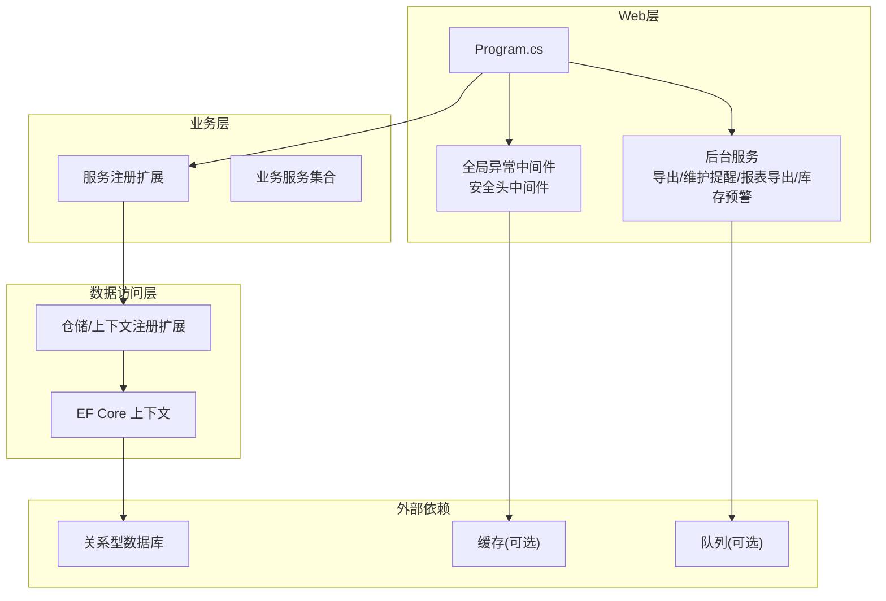
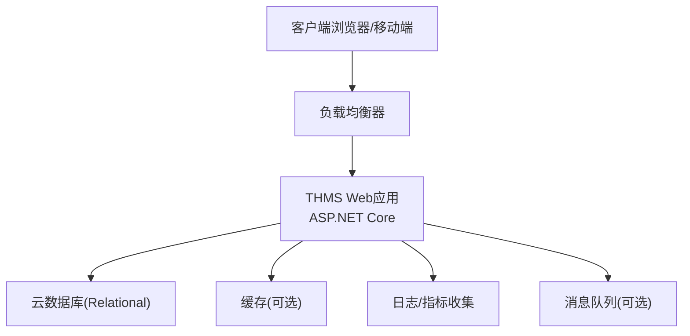
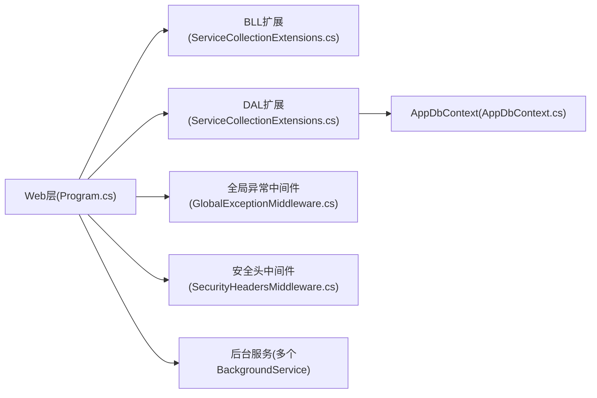

# 云平台部署

<cite>
**本文引用的文件**   
- [Program.cs](file://EquipmentIMS.Web/Program.cs)
- [appsettings.json](file://EquipmentIMS.Web/appsettings.json)
- [appsettings.Development.json](file://EquipmentIMS.Web/appsettings.Development.json)
- [AppDbContext.cs](file://EquipmentIMS.DAL/AppDbContext.cs)
- [ServiceCollectionExtensions.cs](file://EquipmentIMS.BLL/Extensions/ServiceCollectionExtensions.cs)
- [ServiceCollectionExtensions.cs](file://EquipmentIMS.DAL/Extensions/ServiceCollectionExtensions.cs)
- [GlobalExceptionMiddleware.cs](file://EquipmentIMS.Web/Filters/GlobalExceptionMiddleware.cs)
- [SecurityHeadersMiddleware.cs](file://EquipmentIMS.Web/Filters/SecurityHeadersMiddleware.cs)
- [ExportBackgroundService.cs](file://EquipmentIMS.Web/BackgroundServices/ExportBackgroundService.cs)
- [MaintenanceReminderBackgroundService.cs](file://EquipmentIMS.Web/BackgroundServices/MaintenanceReminderBackgroundService.cs)
- [ReportExportBackgroundService.cs](file://EquipmentIMS.Web/BackgroundServices/ReportExportBackgroundService.cs)
- [StockAlertBackgroundService.cs](file://EquipmentIMS.Web/BackgroundServices/StockAlertBackgroundService.cs)
</cite>

## 目录
1. [简介](#简介)
2. [项目结构](#项目结构)
3. [核心组件](#核心组件)
4. [架构总览](#架构总览)
5. [详细组件分析](#详细组件分析)
6. [依赖分析](#依赖分析)
7. [性能考虑](#性能考虑)
8. [故障排查指南](#故障排查指南)
9. [结论](#结论)
10. [附录](#附录)

## 简介
本指南面向THMS（设备库存管理系统）在主流云平台的部署与运维，覆盖以下目标：
- Azure App Service 部署流程：应用服务计划、数据库连接、域名绑定、SSL证书配置。
- AWS Elastic Beanstalk 部署方案：EB CLI使用、环境配置、自动扩缩容设置。
- 阿里云ACS容器编排：容器服务编排、负载均衡配置、云数据库集成。
- CI/CD流水线：GitHub Actions、Azure DevOps、Jenkins集成要点。
- 云原生最佳实践：配置中心、密钥管理、监控告警。

说明：
- 本文所有技术建议均基于代码库中Web入口、数据访问层、中间件与后台服务等实际实现进行适配性指导。
- 未直接提供CI/CD配置文件时，给出通用且可落地的步骤与关键参数位置指引。

## 项目结构
THMS采用分层架构：Web层（ASP.NET Core）、业务层（BLL）、数据访问层（DAL）、模型与DTO（Models），以及后台任务与过滤器等横切关注点。

图示来源
- [Program.cs](file://EquipmentIMS.Web/Program.cs)
- [ServiceCollectionExtensions.cs](file://EquipmentIMS.BLL/Extensions/ServiceCollectionExtensions.cs)
- [ServiceCollectionExtensions.cs](file://EquipmentIMS.DAL/Extensions/ServiceCollectionExtensions.cs)
- [AppDbContext.cs](file://EquipmentIMS.DAL/AppDbContext.cs)
- [GlobalExceptionMiddleware.cs](file://EquipmentIMS.Web/Filters/GlobalExceptionMiddleware.cs)
- [SecurityHeadersMiddleware.cs](file://EquipmentIMS.Web/Filters/SecurityHeadersMiddleware.cs)
- [ExportBackgroundService.cs](file://EquipmentIMS.Web/BackgroundServices/ExportBackgroundService.cs)
- [MaintenanceReminderBackgroundService.cs](file://EquipmentIMS.Web/BackgroundServices/MaintenanceReminderBackgroundService.cs)
- [ReportExportBackgroundService.cs](file://EquipmentIMS.Web/BackgroundServices/ReportExportBackgroundService.cs)
- [StockAlertBackgroundService.cs](file://EquipmentIMS.Web/BackgroundServices/StockAlertBackgroundService.cs)

章节来源
- [Program.cs](file://EquipmentIMS.Web/Program.cs)
- [appsettings.json](file://EquipmentIMS.Web/appsettings.json)
- [appsettings.Development.json](file://EquipmentIMS.Web/appsettings.Development.json)
- [AppDbContext.cs](file://EquipmentIMS.DAL/AppDbContext.cs)
- [ServiceCollectionExtensions.cs](file://EquipmentIMS.BLL/Extensions/ServiceCollectionExtensions.cs)
- [ServiceCollectionExtensions.cs](file://EquipmentIMS.DAL/Extensions/ServiceCollectionExtensions.cs)
- [GlobalExceptionMiddleware.cs](file://EquipmentIMS.Web/Filters/GlobalExceptionMiddleware.cs)
- [SecurityHeadersMiddleware.cs](file://EquipmentIMS.Web/Filters/SecurityHeadersMiddleware.cs)
- [ExportBackgroundService.cs](file://EquipmentIMS.Web/BackgroundServices/ExportBackgroundService.cs)
- [MaintenanceReminderBackgroundService.cs](file://EquipmentIMS.Web/BackgroundServices/MaintenanceReminderBackgroundService.cs)
- [ReportExportBackgroundService.cs](file://EquipmentIMS.Web/BackgroundServices/ReportExportBackgroundService.cs)
- [StockAlertBackgroundService.cs](file://EquipmentIMS.Web/BackgroundServices/StockAlertBackgroundService.cs)

## 核心组件
- 应用启动与配置加载
  - Program.cs负责构建主机、加载配置、注册中间件与服务、启动后台任务。
  - appsettings.json与appsettings.Development.json用于区分环境与敏感信息注入。
- 数据访问
  - AppDbContext定义EF Core上下文，结合DAL层的仓储与UnitOfWork模式。
  - DAL的ServiceCollectionExtensions集中注册数据库连接、仓储与上下文。
- 业务服务
  - BLL的ServiceCollectionExtensions注册业务服务，供控制器调用。
- 中间件与横切关注点
  - GlobalExceptionMiddleware统一异常处理。
  - SecurityHeadersMiddleware设置安全响应头。
- 后台任务
  - 多个IHostedService用于定时或异步任务（导出、维护提醒、报表导出、库存预警）。

章节来源
- [Program.cs](file://EquipmentIMS.Web/Program.cs)
- [appsettings.json](file://EquipmentIMS.Web/appsettings.json)
- [appsettings.Development.json](file://EquipmentIMS.Web/appsettings.Development.json)
- [AppDbContext.cs](file://EquipmentIMS.DAL/AppDbContext.cs)
- [ServiceCollectionExtensions.cs](file://EquipmentIMS.BLL/Extensions/ServiceCollectionExtensions.cs)
- [ServiceCollectionExtensions.cs](file://EquipmentIMS.DAL/Extensions/ServiceCollectionExtensions.cs)
- [GlobalExceptionMiddleware.cs](file://EquipmentIMS.Web/Filters/GlobalExceptionMiddleware.cs)
- [SecurityHeadersMiddleware.cs](file://EquipmentIMS.Web/Filters/SecurityHeadersMiddleware.cs)
- [ExportBackgroundService.cs](file://EquipmentIMS.Web/BackgroundServices/ExportBackgroundService.cs)
- [MaintenanceReminderBackgroundService.cs](file://EquipmentIMS.Web/BackgroundServices/MaintenanceReminderBackgroundService.cs)
- [ReportExportBackgroundService.cs](file://EquipmentIMS.Web/BackgroundServices/ReportExportBackgroundService.cs)
- [StockAlertBackgroundService.cs](file://EquipmentIMS.Web/BackgroundServices/StockAlertBackgroundService.cs)

## 架构总览
下图展示THMS在云端的典型部署形态：Web应用托管于平台服务，通过环境变量注入数据库连接串；后台任务由同一进程承载；日志与指标上报至云平台监控体系。

[此图为概念性架构图，不直接映射具体源码文件]

## 详细组件分析

### 应用启动与配置加载（Program.cs）
- 职责
  - 构建并运行ASP.NET Core主机。
  - 读取配置源（JSON、环境变量、云平台配置中心）。
  - 注册中间件（异常处理、安全头、静态资源、路由等）。
  - 注册业务与数据访问服务。
  - 启动后台任务。
- 云平台适配要点
  - 使用环境变量注入数据库连接串、密钥、第三方服务凭据。
  - 根据环境切换配置（Development/Production）。
  - 在云平台上启用HTTPS与安全头。

章节来源
- [Program.cs](file://EquipmentIMS.Web/Program.cs)
- [appsettings.json](file://EquipmentIMS.Web/appsettings.json)
- [appsettings.Development.json](file://EquipmentIMS.Web/appsettings.Development.json)

### 数据访问层（AppDbContext与DAL扩展）
- 职责
  - 定义实体映射与迁移策略。
  - 通过DAL扩展注册上下文、仓储与UnitOfWork。
- 云平台适配要点
  - 连接字符串从环境变量读取，避免硬编码。
  - 使用云数据库提供的VNet/私有子网接入，限制公网暴露。
  - 启用连接池与重试策略（由平台或驱动支持）。

章节来源
- [AppDbContext.cs](file://EquipmentIMS.DAL/AppDbContext.cs)
- [ServiceCollectionExtensions.cs](file://EquipmentIMS.DAL/Extensions/ServiceCollectionExtensions.cs)

### 业务服务注册（BLL扩展）
- 职责
  - 集中注册业务接口与实现，便于依赖注入。
- 云平台适配要点
  - 将外部依赖（如缓存、队列、对象存储）通过配置注入，便于按环境切换。

章节来源
- [ServiceCollectionExtensions.cs](file://EquipmentIMS.BLL/Extensions/ServiceCollectionExtensions.cs)

### 中间件（异常处理与安全头）
- 全局异常中间件
  - 统一捕获未处理异常，返回标准化错误响应，记录结构化日志。
- 安全头中间件
  - 设置CSP、HSTS、X-Frame-Options等响应头，提升安全性。
- 云平台适配要点
  - 在云网关/负载均衡处也开启WAF与限流，形成纵深防御。

章节来源
- [GlobalExceptionMiddleware.cs](file://EquipmentIMS.Web/Filters/GlobalExceptionMiddleware.cs)
- [SecurityHeadersMiddleware.cs](file://EquipmentIMS.Web/Filters/SecurityHeadersMiddleware.cs)

### 后台任务（IHostedService）
- 主要任务
  - 导出任务：批量数据导出到对象存储或共享目录。
  - 维护提醒：周期性检查并生成维护通知。
  - 报表导出：定时生成报表并归档。
  - 库存预警：扫描库存阈值并触发告警。
- 云平台适配要点
  - 合理设置执行间隔与超时，避免长时间占用实例。
  - 失败重试与幂等设计，结合队列与死信队列。
  - 输出结构化日志与指标，便于监控与排障。

章节来源
- [ExportBackgroundService.cs](file://EquipmentIMS.Web/BackgroundServices/ExportBackgroundService.cs)
- [MaintenanceReminderBackgroundService.cs](file://EquipmentIMS.Web/BackgroundServices/MaintenanceReminderBackgroundService.cs)
- [ReportExportBackgroundService.cs](file://EquipmentIMS.Web/BackgroundServices/ReportExportBackgroundService.cs)
- [StockAlertBackgroundService.cs](file://EquipmentIMS.Web/BackgroundServices/StockAlertBackgroundService.cs)

### 配置与密钥管理（云原生最佳实践）
- 配置中心
  - 使用平台配置中心（如Azure App Configuration、AWS AppConfig、阿里云配置服务）集中管理配置项。
  - 运行时热更新：在应用中监听配置变更并刷新相关服务。
- 密钥管理
  - 使用平台密钥管理服务（如Azure Key Vault、AWS Secrets Manager、阿里云KMS）注入敏感信息。
  - 最小权限原则：为应用分配仅访问所需密钥的IAM角色。
- 环境变量与机密
  - 在CI/CD阶段注入环境变量，避免写入代码仓库。
  - 对本地开发使用用户机密或模板化配置文件。

章节来源
- [appsettings.json](file://EquipmentIMS.Web/appsettings.json)
- [appsettings.Development.json](file://EquipmentIMS.Web/appsettings.Development.json)
- [Program.cs](file://EquipmentIMS.Web/Program.cs)

## 依赖分析
- 组件耦合
  - Web层依赖BLL与DAL的服务注册扩展。
  - DAL依赖EF Core上下文与数据库驱动。
  - 中间件与后台任务作为横切能力被Web层装配。
- 外部依赖
  - 数据库：通过连接字符串与环境变量注入。
  - 缓存/队列：按需引入，通过配置开关控制。
- 潜在风险
  - 循环依赖：确保服务注册无环。
  - 单点故障：数据库与缓存需高可用与多副本。
  - 配置泄露：严格管控环境变量与密钥。

图示来源
- [Program.cs](file://EquipmentIMS.Web/Program.cs)
- [ServiceCollectionExtensions.cs](file://EquipmentIMS.BLL/Extensions/ServiceCollectionExtensions.cs)
- [ServiceCollectionExtensions.cs](file://EquipmentIMS.DAL/Extensions/ServiceCollectionExtensions.cs)
- [AppDbContext.cs](file://EquipmentIMS.DAL/AppDbContext.cs)
- [GlobalExceptionMiddleware.cs](file://EquipmentIMS.Web/Filters/GlobalExceptionMiddleware.cs)
- [SecurityHeadersMiddleware.cs](file://EquipmentIMS.Web/Filters/SecurityHeadersMiddleware.cs)
- [ExportBackgroundService.cs](file://EquipmentIMS.Web/BackgroundServices/ExportBackgroundService.cs)
- [MaintenanceReminderBackgroundService.cs](file://EquipmentIMS.Web/BackgroundServices/MaintenanceReminderBackgroundService.cs)
- [ReportExportBackgroundService.cs](file://EquipmentIMS.Web/BackgroundServices/ReportExportBackgroundService.cs)
- [StockAlertBackgroundService.cs](file://EquipmentIMS.Web/BackgroundServices/StockAlertBackgroundService.cs)

章节来源
- [Program.cs](file://EquipmentIMS.Web/Program.cs)
- [ServiceCollectionExtensions.cs](file://EquipmentIMS.BLL/Extensions/ServiceCollectionExtensions.cs)
- [ServiceCollectionExtensions.cs](file://EquipmentIMS.DAL/Extensions/ServiceCollectionExtensions.cs)
- [AppDbContext.cs](file://EquipmentIMS.DAL/AppDbContext.cs)
- [GlobalExceptionMiddleware.cs](file://EquipmentIMS.Web/Filters/GlobalExceptionMiddleware.cs)
- [SecurityHeadersMiddleware.cs](file://EquipmentIMS.Web/Filters/SecurityHeadersMiddleware.cs)
- [ExportBackgroundService.cs](file://EquipmentIMS.Web/BackgroundServices/ExportBackgroundService.cs)
- [MaintenanceReminderBackgroundService.cs](file://EquipmentIMS.Web/BackgroundServices/MaintenanceReminderBackgroundService.cs)
- [ReportExportBackgroundService.cs](file://EquipmentIMS.Web/BackgroundServices/ReportExportBackgroundService.cs)
- [StockAlertBackgroundService.cs](file://EquipmentIMS.Web/BackgroundServices/StockAlertBackgroundService.cs)

## 性能考虑
- 连接池与并发
  - 调整数据库连接池大小，匹配实例规格与负载。
  - 启用HTTP/2与Keep-Alive，减少握手开销。
- 缓存与读写分离
  - 热点数据入缓存，读多写少场景显著降延迟。
  - 数据库主从或只读副本分担查询压力。
- 后台任务优化
  - 分片与批处理，避免长事务与大对象传输。
  - 失败重试与退避策略，降低瞬时抖动影响。
- 资源隔离
  - 将CPU密集型与IO密集型任务拆分到不同实例或容器。
- 监控与调优
  - 采集请求耗时、错误率、数据库慢查询、GC与内存使用。
  - 基于指标设置弹性伸缩策略。

[本节为通用性能建议，不直接分析具体文件]

## 故障排查指南
- 常见错误定位
  - 数据库连接失败：检查连接字符串、网络ACL、防火墙与DNS解析。
  - 403/404：确认路由、静态资源路径与权限。
  - 500内部错误：查看全局异常中间件输出的结构化日志。
- 日志与追踪
  - 启用分布式追踪ID，跨中间件与后台任务传递。
  - 将日志输出到平台日志服务，并设置保留策略。
- 健康检查与自恢复
  - 实现健康探针，配合平台重启与滚动升级。
  - 对后台任务增加幂等与补偿机制。

章节来源
- [GlobalExceptionMiddleware.cs](file://EquipmentIMS.Web/Filters/GlobalExceptionMiddleware.cs)
- [SecurityHeadersMiddleware.cs](file://EquipmentIMS.Web/Filters/SecurityHeadersMiddleware.cs)
- [ExportBackgroundService.cs](file://EquipmentIMS.Web/BackgroundServices/ExportBackgroundService.cs)
- [MaintenanceReminderBackgroundService.cs](file://EquipmentIMS.Web/BackgroundServices/MaintenanceReminderBackgroundService.cs)
- [ReportExportBackgroundService.cs](file://EquipmentIMS.Web/BackgroundServices/ReportExportBackgroundService.cs)
- [StockAlertBackgroundService.cs](file://EquipmentIMS.Web/BackgroundServices/StockAlertBackgroundService.cs)

## 结论
THMS采用清晰的层次化架构与可扩展的中间件/后台任务设计，适合在多云平台快速部署。通过环境变量与平台配置中心/密钥管理服务，可实现安全的配置与密钥管理；结合监控告警与弹性伸缩，可获得稳定高效的线上体验。

[本节为总结性内容，不直接分析具体文件]

## 附录

### Azure App Service 部署流程
- 前置准备
  - 创建资源组、应用服务计划（选择合适SKU与区域）。
  - 创建SQL数据库（Azure SQL Database），配置防火墙与登录账户。
- 应用发布
  - 使用Visual Studio Publish或CLI发布到App Service。
  - 在“配置”中设置环境变量（数据库连接串、密钥等）。
- 域名与SSL
  - 在自定义域中添加A/CNAME记录指向App Service。
  - 绑定免费或付费SSL证书，强制HTTPS。
- 高可用与扩容
  - 启用Always On与多实例。
  - 基于CPU/内存/请求数设置自动缩放规则。
- 监控与诊断
  - 启用Application Insights，采集请求、依赖与异常。
  - 配置日志流与实时诊断。

[本节为通用部署步骤，不直接分析具体文件]

### AWS Elastic Beanstalk 部署方案
- EB CLI工具使用
  - 初始化环境、创建版本、部署包。
  - 使用配置文件管理环境变量与选项集。
- 环境配置
  - 指定RDS实例或外部数据库连接串。
  - 配置S3用于静态资源与备份。
- 自动扩缩容
  - 基于CloudWatch指标（CPU、请求计数）设置伸缩策略。
  - 配置健康检查URL与实例生命周期钩子。
- 监控与告警
  - 集成CloudWatch Logs与Metrics。
  - 配置SNS告警与自动化修复动作。

[本节为通用部署步骤，不直接分析具体文件]

### 阿里云ACS容器编排部署
- 容器镜像构建
  - 使用Dockerfile构建镜像，推送至ACR。
- 编排与发布
  - 使用ACK（容器服务Kubernetes版）部署Deployment与Service。
  - 通过Ingress暴露HTTP/HTTPS，配置TLS证书。
- 负载均衡与弹性
  - 使用SLB/ALB做七层负载均衡。
  - 基于HPA实现Pod水平弹性伸缩。
- 云数据库集成
  - 使用RDS内网地址与Secrets管理凭据。
  - 配置网络ACL与白名单。
- 监控与日志
  - 使用ARMS/SLS采集应用日志与指标。
  - 配置告警规则与通知渠道。

[本节为通用部署步骤，不直接分析具体文件]

### CI/CD流水线配置
- GitHub Actions
  - 触发条件：push/PR。
  - 步骤：还原、构建、测试、打包镜像、推送镜像、部署到目标平台。
  - 使用仓库Secrets管理凭据。
- Azure DevOps
  - 管道定义：构建、测试、发布到Azure App Service或容器镜像仓库。
  - 使用变量组与密钥保管库集成。
- Jenkins
  - 插件：Git、Docker、Kubernetes、Azure/AWS插件。
  - 流水线脚本：构建、测试、部署、回滚策略。
  - 节点与凭据管理：使用凭据插件与SSH密钥。

[本节为通用流水线步骤，不直接分析具体文件]

### 云原生最佳实践清单
- 配置中心：集中化管理配置，支持热更新与灰度发布。
- 密钥管理：使用平台密钥服务，最小权限访问。
- 监控告警：全链路指标、日志、追踪与告警闭环。
- 弹性伸缩：基于指标与容量规划设置扩缩容策略。
- 安全加固：HTTPS强制、安全头、WAF、最小暴露面。
- 可观测性：健康检查、就绪探针、优雅停机。

[本节为通用最佳实践，不直接分析具体文件]