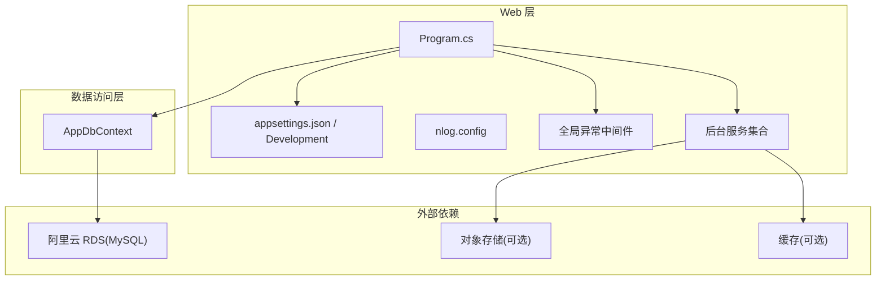
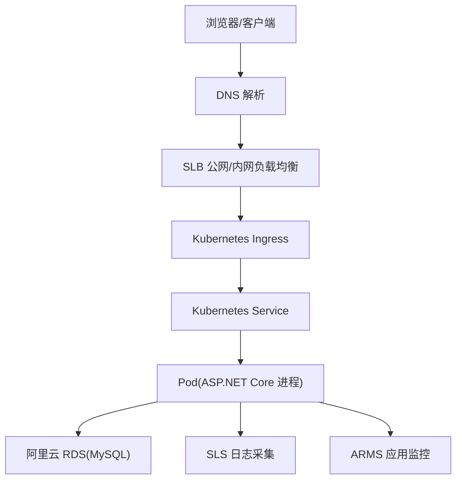
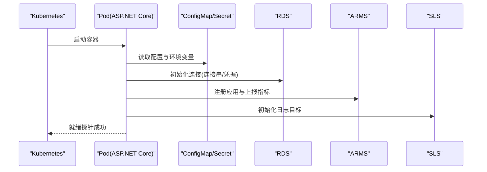
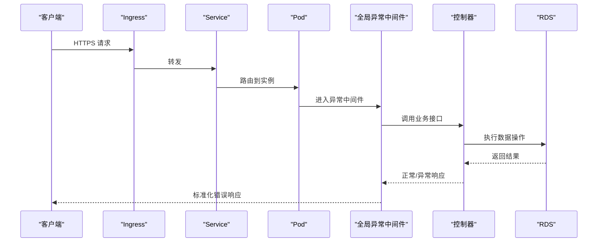
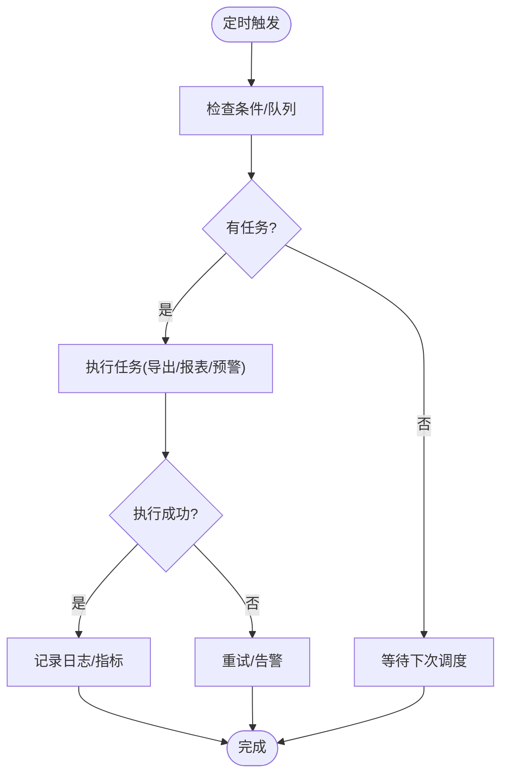
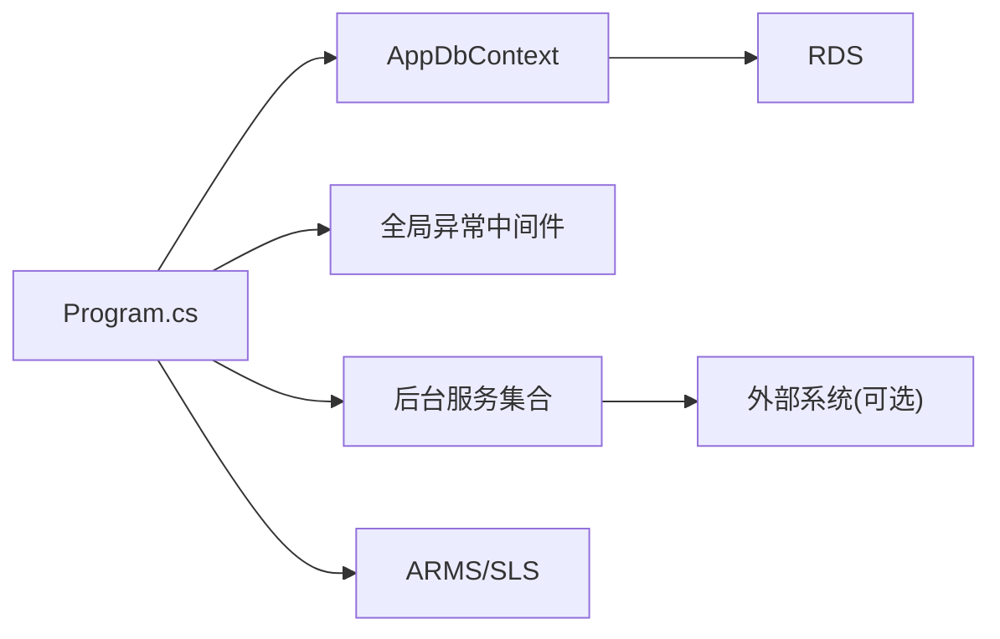

# 阿里云容器服务部署

<cite>
**本文引用的文件**   
- [EquipmentIMS.Web/Program.cs](file://EquipmentIMS.Web/Program.cs)
- [EquipmentIMS.Web/appsettings.json](file://EquipmentIMS.Web/appsettings.json)
- [EquipmentIMS.Web/appsettings.Development.json](file://EquipmentIMS.Web/appsettings.Development.json)
- [EquipmentIMS.Web/nlog.config](file://EquipmentIMS.Web/nlog.config)
- [EquipmentIMS.DAL/AppDbContext.cs](file://EquipmentIMS.DAL/AppDbContext.cs)
- [EquipmentIMS.Web/Filters/GlobalExceptionMiddleware.cs](file://EquipmentIMS.Web/Filters/GlobalExceptionMiddleware.cs)
- [EquipmentIMS.Web/BackgroundServices/ExportBackgroundService.cs](file://EquipmentIMS.Web/BackgroundServices/ExportBackgroundService.cs)
- [EquipmentIMS.Web/BackgroundServices/MaintenanceReminderBackgroundService.cs](file://EquipmentIMS.Web/BackgroundServices/MaintenanceReminderBackgroundService.cs)
- [EquipmentIMS.Web/BackgroundServices/ReportExportBackgroundService.cs](file://EquipmentIMS.Web/BackgroundServices/ReportExportBackgroundService.cs)
- [EquipmentIMS.Web/BackgroundServices/StockAlertBackgroundService.cs](file://EquipmentIMS.Web/BackgroundServices/StockAlertBackgroundService.cs)
</cite>

## 目录
1. [简介](#简介)
2. [项目结构](#项目结构)
3. [核心组件](#核心组件)
4. [架构总览](#架构总览)
5. [详细组件分析](#详细组件分析)
6. [依赖分析](#依赖分析)
7. [性能考虑](#性能考虑)
8. [故障排查指南](#故障排查指南)
9. [结论](#结论)
10. [附录](#附录)

## 简介
本指南面向在阿里云容器服务（ACK）上部署 THMS 系统的工程团队，覆盖以下关键主题：
- Docker 镜像构建与推送最佳实践与优化技巧
- ACK 集群创建与配置（节点池、网络插件）
- Kubernetes 部署清单（Deployment、Service、Ingress）
- 阿里云 RDS 集成（白名单、连接参数）
- SLB 负载均衡与 HTTPS 证书管理
- 云效 CI/CD 流水线（代码仓库、构建任务、部署策略）
- ARMS 应用监控与 SLS 日志服务集成

说明：本文基于仓库中现有 Web 应用与数据访问层代码进行适配性分析与建议，不包含具体代码片段，所有实现细节均以“章节来源”标注对应文件路径与行号。

## 项目结构
THMS 采用分层架构：Web 层（ASP.NET Core）、业务层（BLL）、数据访问层（DAL）、模型与 DTO（Models），以及后台任务与中间件等支撑能力。部署时主要关注 Web 入口、数据库上下文、日志与异常处理、后台服务等。

图表来源
- [EquipmentIMS.Web/Program.cs](file://EquipmentIMS.Web/Program.cs)
- [EquipmentIMS.Web/appsettings.json](file://EquipmentIMS.Web/appsettings.json)
- [EquipmentIMS.Web/appsettings.Development.json](file://EquipmentIMS.Web/appsettings.Development.json)
- [EquipmentIMS.Web/nlog.config](file://EquipmentIMS.Web/nlog.config)
- [EquipmentIMS.Web/Filters/GlobalExceptionMiddleware.cs](file://EquipmentIMS.Web/Filters/GlobalExceptionMiddleware.cs)
- [EquipmentIMS.Web/BackgroundServices/ExportBackgroundService.cs](file://EquipmentIMS.Web/BackgroundServices/ExportBackgroundService.cs)
- [EquipmentIMS.Web/BackgroundServices/MaintenanceReminderBackgroundService.cs](file://EquipmentIMS.Web/BackgroundServices/MaintenanceReminderBackgroundService.cs)
- [EquipmentIMS.Web/BackgroundServices/ReportExportBackgroundService.cs](file://EquipmentIMS.Web/BackgroundServices/ReportExportBackgroundService.cs)
- [EquipmentIMS.Web/BackgroundServices/StockAlertBackgroundService.cs](file://EquipmentIMS.Web/BackgroundServices/StockAlertBackgroundService.cs)
- [EquipmentIMS.DAL/AppDbContext.cs](file://EquipmentIMS.DAL/AppDbContext.cs)

章节来源
- [EquipmentIMS.Web/Program.cs](file://EquipmentIMS.Web/Program.cs)
- [EquipmentIMS.Web/appsettings.json](file://EquipmentIMS.Web/appsettings.json)
- [EquipmentIMS.Web/appsettings.Development.json](file://EquipmentIMS.Web/appsettings.Development.json)
- [EquipmentIMS.Web/nlog.config](file://EquipmentIMS.Web/nlog.config)
- [EquipmentIMS.DAL/AppDbContext.cs](file://EquipmentIMS.DAL/AppDbContext.cs)

## 核心组件
- Web 启动与配置
  - 通过 Program 初始化主机、中间件管线、依赖注入与后台服务。
  - 配置文件使用 appsettings.json 与运行环境变体，支持环境变量注入。
- 数据访问
  - AppDbContext 负责 EF Core 上下文与数据库连接，通常由 DI 注册并在控制器或服务中使用。
- 日志与异常
  - nlog.config 定义日志输出目标与格式；全局异常中间件统一捕获并返回标准化错误响应。
- 后台任务
  - 多个 IHostedService 实现用于导出、报表、库存预警与维护提醒等异步任务。

章节来源
- [EquipmentIMS.Web/Program.cs](file://EquipmentIMS.Web/Program.cs)
- [EquipmentIMS.Web/appsettings.json](file://EquipmentIMS.Web/appsettings.json)
- [EquipmentIMS.Web/appsettings.Development.json](file://EquipmentIMS.Web/appsettings.Development.json)
- [EquipmentIMS.Web/nlog.config](file://EquipmentIMS.Web/nlog.config)
- [EquipmentIMS.Web/Filters/GlobalExceptionMiddleware.cs](file://EquipmentIMS.Web/Filters/GlobalExceptionMiddleware.cs)
- [EquipmentIMS.Web/BackgroundServices/ExportBackgroundService.cs](file://EquipmentIMS.Web/BackgroundServices/ExportBackgroundService.cs)
- [EquipmentIMS.Web/BackgroundServices/MaintenanceReminderBackgroundService.cs](file://EquipmentIMS.Web/BackgroundServices/MaintenanceReminderBackgroundService.cs)
- [EquipmentIMS.Web/BackgroundServices/ReportExportBackgroundService.cs](file://EquipmentIMS.Web/BackgroundServices/ReportExportBackgroundService.cs)
- [EquipmentIMS.Web/BackgroundServices/StockAlertBackgroundService.cs](file://EquipmentIMS.Web/BackgroundServices/StockAlertBackgroundService.cs)
- [EquipmentIMS.DAL/AppDbContext.cs](file://EquipmentIMS.DAL/AppDbContext.cs)

## 架构总览
下图展示从客户端到 ACK 集群的端到端流量路径，包括 Ingress、Service、Pod、RDS 与可观测性组件。

图表来源
- [EquipmentIMS.Web/Program.cs](file://EquipmentIMS.Web/Program.cs)
- [EquipmentIMS.Web/nlog.config](file://EquipmentIMS.Web/nlog.config)
- [EquipmentIMS.DAL/AppDbContext.cs](file://EquipmentIMS.DAL/AppDbContext.cs)

## 详细组件分析

### Docker 镜像构建与推送
- 多阶段构建建议
  - 构建阶段：安装 .NET SDK，还原依赖、编译、发布。
  - 运行阶段：仅包含运行时与发布产物，最小化镜像体积。
- 镜像优化技巧
  - 使用 slim 或 alpine 基础镜像（注意 glibc 兼容）。
  - 合并 RUN 指令、利用构建缓存、避免将敏感信息打入镜像。
  - 启用压缩与并行构建，合理设置 .dockerignore。
- 安全加固
  - 非 root 用户运行、只读根文件系统、限制 Capabilities。
  - 定期扫描镜像漏洞，签名与校验。
- 推送与版本管理
  - 使用 ACR 私有仓库，按分支/标签命名规范推送。
  - 在 K8s 中通过 imagePullSecrets 拉取私有镜像。

[本节为通用实践指导，不直接分析具体文件]

### ACK 集群创建与配置
- 集群类型
  - 托管版 ACK：简化运维，推荐生产使用。
- 节点池
  - 系统节点池：运行系统组件。
  - 工作节点池：按 CPU/内存规格与可用区分布规划，开启弹性伸缩。
- 网络插件
  - Terway：提供 ENI 直通与 IP 直连，适合高性能场景。
  - Flannel：轻量，适合小规模或测试环境。
- 存储
  - 默认 CSI 驱动对接云盘/NAS/OSS，按需选择。
- 安全
  - 启用 RBAC、网络隔离、密钥管理（KMS/Secrets）。

[本节为通用实践指导，不直接分析具体文件]

### Kubernetes 部署清单配置
- Deployment
  - 副本数、资源请求/限制、健康检查（liveness/readiness）、滚动更新策略。
  - 挂载 ConfigMap/Secret 注入配置与证书。
- Service
  - ClusterIP 暴露内部服务，NodePort/LoadBalancer 仅在特定场景使用。
- Ingress
  - 使用 ALB Ingress Controller，绑定域名与 TLS 证书。
  - 配置路径路由、会话保持、限流与灰度策略。
- 配置与密钥
  - 使用 Secret 管理数据库密码、API Key 等敏感信息。
  - 使用 ConfigMap 管理非敏感配置，结合环境变量覆盖。

[本节为通用实践指导，不直接分析具体文件]

### 阿里云 RDS 数据库集成
- 白名单设置
  - 将 ACK 节点 CIDR 或 Pod CIDR 加入 RDS 白名单，确保连通性。
- 连接参数
  - 连接字符串包含主机名、端口、数据库名、用户名与密码。
  - 建议在 Secret 中保存凭据，通过环境变量注入到 Pod。
- 高可用与容灾
  - 主备实例、跨可用区部署、自动故障切换。
- 性能与安全
  - 连接池大小、超时与重试策略；SSL 加密传输。

章节来源
- [EquipmentIMS.DAL/AppDbContext.cs](file://EquipmentIMS.DAL/AppDbContext.cs)
- [EquipmentIMS.Web/appsettings.json](file://EquipmentIMS.Web/appsettings.json)
- [EquipmentIMS.Web/appsettings.Development.json](file://EquipmentIMS.Web/appsettings.Development.json)

### SLB 负载均衡器与 HTTPS 证书管理
- SLB 与 Ingress
  - 推荐使用 ALB Ingress Controller，自动创建与管理 SLB。
- HTTPS 证书
  - 在 ACM 或 Ingress 注解中引用证书，自动续期与热更新。
- 健康检查与回源
  - 配置后端健康检查、超时与重试，保障可用性。
- 访问控制
  - 结合 WAF 与 ACL 策略，限制恶意访问。

[本节为通用实践指导，不直接分析具体文件]

### 云效 CI/CD 流水线配置
- 代码仓库集成
  - 关联 Git 仓库，触发规则（分支/标签/PR）。
- 构建任务
  - 安装 .NET SDK，还原依赖、单元测试、打包发布。
  - 构建镜像并推送到 ACR，生成镜像标签（commit SHA/语义版本）。
- 部署策略
  - 蓝绿/金丝雀发布，基于 Ingress 权重或 Service 切换。
  - 失败回滚与人工审批关卡。
- 质量门禁
  - 静态扫描、依赖漏洞扫描、镜像签名。

[本节为通用实践指导，不直接分析具体文件]

### ARMS 应用监控与 SLS 日志服务集成
- ARMS 应用监控
  - 在 ASP.NET Core 应用中启用 ARMS Agent，采集指标、链路追踪与异常。
  - 配置告警规则与仪表盘，关注 P99 延迟、错误率与资源使用。
- SLS 日志服务
  - 在 nlog.config 中配置 SLS 目标，集中收集结构化日志。
  - 使用 Logtail 采集容器标准输出，建立索引与查询看板。
- 可观测性联动
  - 将 ARMS 指标与 SLS 日志关联，快速定位问题根因。

章节来源
- [EquipmentIMS.Web/nlog.config](file://EquipmentIMS.Web/nlog.config)
- [EquipmentIMS.Web/Program.cs](file://EquipmentIMS.Web/Program.cs)

### 关键流程时序图

#### 应用启动与配置加载

图表来源
- [EquipmentIMS.Web/Program.cs](file://EquipmentIMS.Web/Program.cs)
- [EquipmentIMS.Web/appsettings.json](file://EquipmentIMS.Web/appsettings.json)
- [EquipmentIMS.Web/nlog.config](file://EquipmentIMS.Web/nlog.config)
- [EquipmentIMS.DAL/AppDbContext.cs](file://EquipmentIMS.DAL/AppDbContext.cs)

#### 请求处理与异常统一返回

图表来源
- [EquipmentIMS.Web/Filters/GlobalExceptionMiddleware.cs](file://EquipmentIMS.Web/Filters/GlobalExceptionMiddleware.cs)
- [EquipmentIMS.Web/Program.cs](file://EquipmentIMS.Web/Program.cs)

#### 后台任务执行流程

图表来源
- [EquipmentIMS.Web/BackgroundServices/ExportBackgroundService.cs](file://EquipmentIMS.Web/BackgroundServices/ExportBackgroundService.cs)
- [EquipmentIMS.Web/BackgroundServices/ReportExportBackgroundService.cs](file://EquipmentIMS.Web/BackgroundServices/ReportExportBackgroundService.cs)
- [EquipmentIMS.Web/BackgroundServices/StockAlertBackgroundService.cs](file://EquipmentIMS.Web/BackgroundServices/StockAlertBackgroundService.cs)
- [EquipmentIMS.Web/BackgroundServices/MaintenanceReminderBackgroundService.cs](file://EquipmentIMS.Web/BackgroundServices/MaintenanceReminderBackgroundService.cs)

## 依赖分析
- 组件耦合
  - Program 聚合中间件、DI 与后台服务，属于装配中心。
  - AppDbContext 与 RDS 强耦合，需保证连接稳定与凭据安全。
  - 后台服务与外部系统（如对象存储、缓存）存在弱耦合，可通过配置开关控制。
- 外部依赖
  - RDS：数据库连接与事务一致性。
  - SLS/ARMS：可观测性依赖，不影响核心业务但影响排障效率。
- 潜在风险
  - 单点依赖：RDS 主库故障需具备自动切换与重试机制。
  - 配置泄露：Secret 管理不当可能导致凭据外泄。

图表来源
- [EquipmentIMS.Web/Program.cs](file://EquipmentIMS.Web/Program.cs)
- [EquipmentIMS.DAL/AppDbContext.cs](file://EquipmentIMS.DAL/AppDbContext.cs)
- [EquipmentIMS.Web/Filters/GlobalExceptionMiddleware.cs](file://EquipmentIMS.Web/Filters/GlobalExceptionMiddleware.cs)
- [EquipmentIMS.Web/BackgroundServices/ExportBackgroundService.cs](file://EquipmentIMS.Web/BackgroundServices/ExportBackgroundService.cs)
- [EquipmentIMS.Web/BackgroundServices/MaintenanceReminderBackgroundService.cs](file://EquipmentIMS.Web/BackgroundServices/MaintenanceReminderBackgroundService.cs)
- [EquipmentIMS.Web/BackgroundServices/ReportExportBackgroundService.cs](file://EquipmentIMS.Web/BackgroundServices/ReportExportBackgroundService.cs)
- [EquipmentIMS.Web/BackgroundServices/StockAlertBackgroundService.cs](file://EquipmentIMS.Web/BackgroundServices/StockAlertBackgroundService.cs)

章节来源
- [EquipmentIMS.Web/Program.cs](file://EquipmentIMS.Web/Program.cs)
- [EquipmentIMS.DAL/AppDbContext.cs](file://EquipmentIMS.DAL/AppDbContext.cs)
- [EquipmentIMS.Web/Filters/GlobalExceptionMiddleware.cs](file://EquipmentIMS.Web/Filters/GlobalExceptionMiddleware.cs)
- [EquipmentIMS.Web/BackgroundServices/ExportBackgroundService.cs](file://EquipmentIMS.Web/BackgroundServices/ExportBackgroundService.cs)
- [EquipmentIMS.Web/BackgroundServices/MaintenanceReminderBackgroundService.cs](file://EquipmentIMS.Web/BackgroundServices/MaintenanceReminderBackgroundService.cs)
- [EquipmentIMS.Web/BackgroundServices/ReportExportBackgroundService.cs](file://EquipmentIMS.Web/BackgroundServices/ReportExportBackgroundService.cs)
- [EquipmentIMS.Web/BackgroundServices/StockAlertBackgroundService.cs](file://EquipmentIMS.Web/BackgroundServices/StockAlertBackgroundService.cs)

## 性能考虑
- 应用层面
  - 启用响应压缩、静态资源缓存、数据库连接池调优。
  - 对热点接口增加缓存层（Redis），降低 RDS 压力。
- 容器层面
  - 合理设置 CPU/内存请求与限制，避免抖动。
  - 使用水平扩缩容（HPA）应对流量峰值。
- 网络层面
  - 使用 Terway 提升 Pod 间通信性能。
  - Ingress 开启 HTTP/2 与 Keep-Alive。
- 可观测性
  - 基于 ARMS 指标与 SLS 日志建立容量规划与瓶颈定位。

[本节为通用实践指导，不直接分析具体文件]

## 故障排查指南
- 启动失败
  - 检查环境变量与 Secret 是否正确注入。
  - 查看 liveness/readiness 探针状态与事件。
- 数据库连接异常
  - 验证 RDS 白名单、VPC 互通与账号权限。
  - 检查连接串格式与 SSL 配置。
- 日志缺失
  - 确认 nlog.config 目标是否启用，SLS 采集是否正常。
- 异常未统一返回
  - 检查全局异常中间件顺序与异常类型匹配。
- 后台任务未执行
  - 核对定时任务配置与依赖服务可用性。

章节来源
- [EquipmentIMS.Web/Filters/GlobalExceptionMiddleware.cs](file://EquipmentIMS.Web/Filters/GlobalExceptionMiddleware.cs)
- [EquipmentIMS.Web/nlog.config](file://EquipmentIMS.Web/nlog.config)
- [EquipmentIMS.Web/BackgroundServices/ExportBackgroundService.cs](file://EquipmentIMS.Web/BackgroundServices/ExportBackgroundService.cs)
- [EquipmentIMS.Web/BackgroundServices/MaintenanceReminderBackgroundService.cs](file://EquipmentIMS.Web/BackgroundServices/MaintenanceReminderBackgroundService.cs)
- [EquipmentIMS.Web/BackgroundServices/ReportExportBackgroundService.cs](file://EquipmentIMS.Web/BackgroundServices/ReportExportBackgroundService.cs)
- [EquipmentIMS.Web/BackgroundServices/StockAlertBackgroundService.cs](file://EquipmentIMS.Web/BackgroundServices/StockAlertBackgroundService.cs)
- [EquipmentIMS.DAL/AppDbContext.cs](file://EquipmentIMS.DAL/AppDbContext.cs)

## 结论
通过在 ACK 上部署 THMS，结合 RDS、ALB Ingress、ARMS 与 SLS，可实现高可用、可观测、易扩展的生产级应用。遵循镜像优化、安全加固与 CI/CD 自动化最佳实践，可显著提升交付效率与稳定性。

[本节为总结性内容，不直接分析具体文件]

## 附录
- 术语
  - ACK：阿里云容器服务 Kubernetes 版
  - ALB：应用型负载均衡
  - ARMS：应用实时监控服务
  - SLS：日志服务
  - ACR：容器镜像服务
- 参考清单要点
  - Deployment：副本、资源、探针、滚动更新、卷挂载
  - Service：ClusterIP、端口映射、会话保持
  - Ingress：域名、TLS、路径路由、限流与灰度
  - Secret/ConfigMap：敏感与非敏感配置分离
  - HPA：基于 CPU/自定义指标自动扩缩容

[本节为补充信息，不直接分析具体文件]