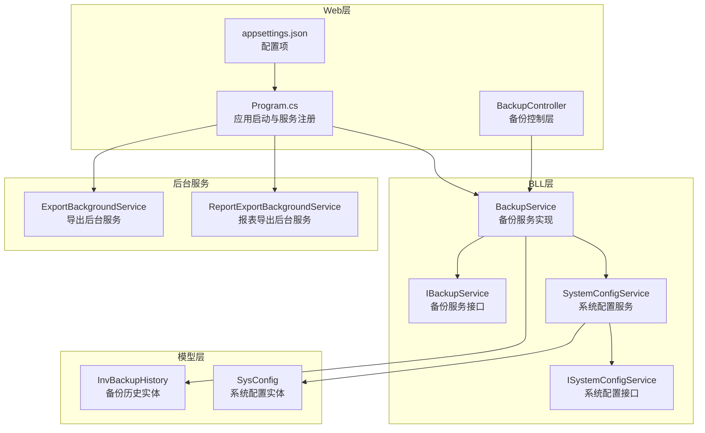
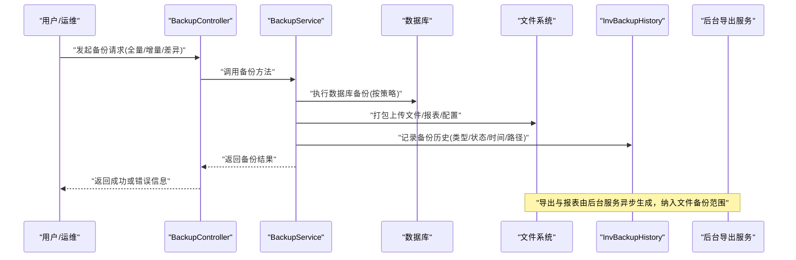
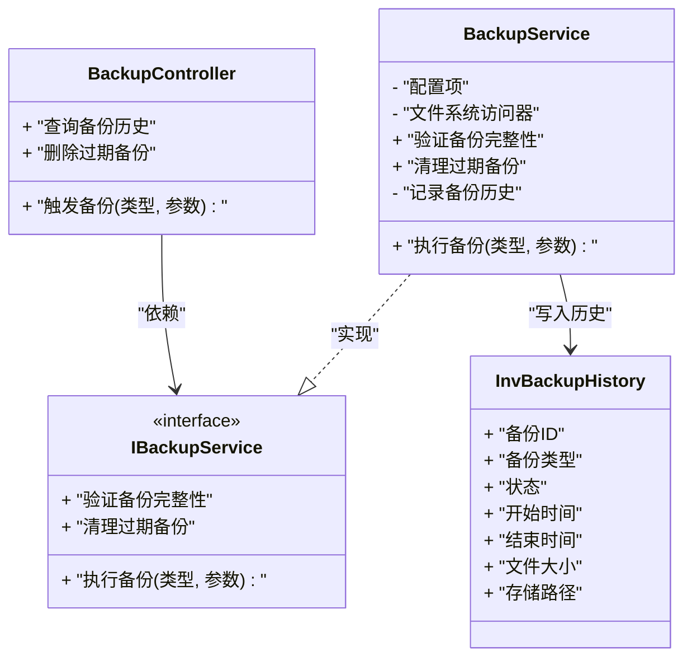
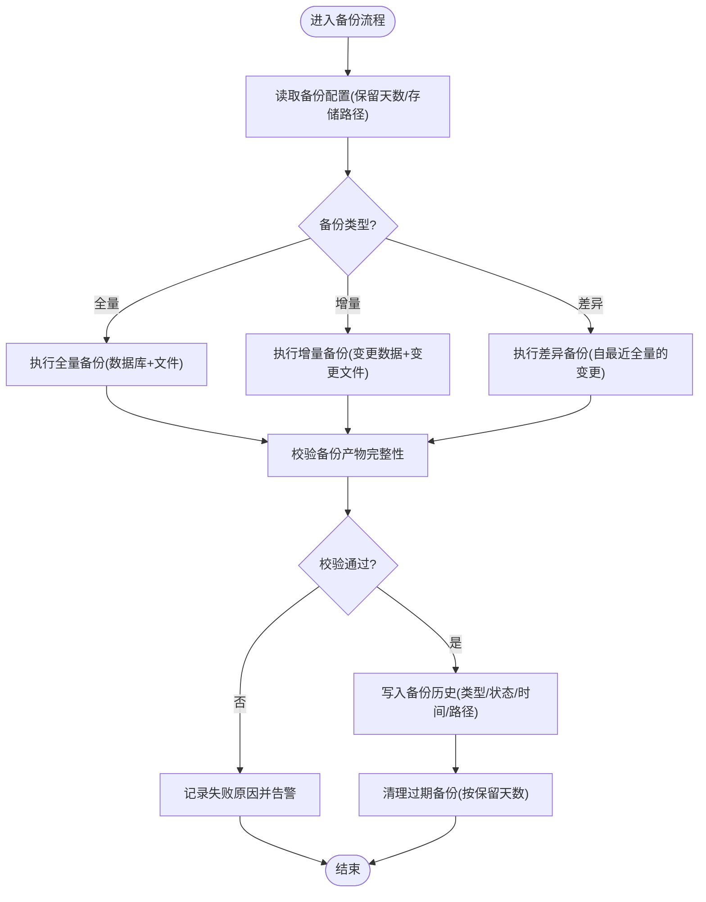
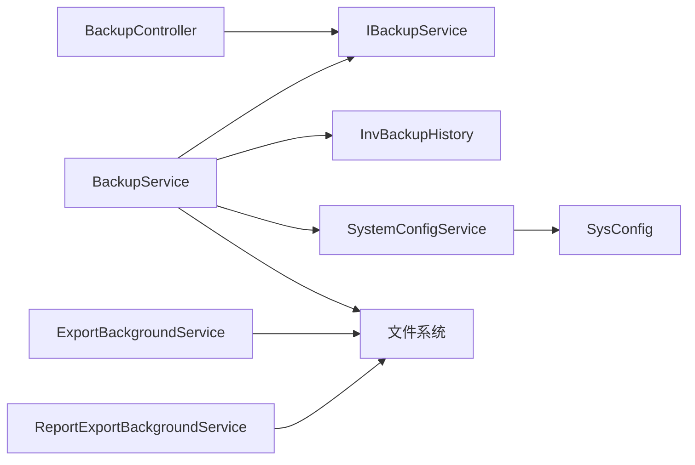

# 备份恢复策略

<cite>
**本文引用的文件**   
- [BackupController.cs](file://EquipmentIMS.Web/Controllers/BackupController.cs)
- [IBackupService.cs](file://EquipmentIMS.BLL/Interfaces/IBackupService.cs)
- [BackupService.cs](file://EquipmentIMS.BLL/Services/BackupService.cs)
- [InvBackupHistory.cs](file://EquipmentIMS.Models/Entities/InvBackupHistory.cs)
- [Program.cs](file://EquipmentIMS.Web/Program.cs)
- [appsettings.json](file://EquipmentIMS.Web/appsettings.json)
- [ExportBackgroundService.cs](file://EquipmentIMS.Web/BackgroundServices/ExportBackgroundService.cs)
- [ReportExportBackgroundService.cs](file://EquipmentIMS.Web/BackgroundServices/ReportExportBackgroundService.cs)
- [SystemConfigService.cs](file://EquipmentIMS.BLL/Services/SystemConfigService.cs)
- [ISystemConfigService.cs](file://EquipmentIMS.BLL/Interfaces/ISystemConfigService.cs)
- [SysConfig.cs](file://EquipmentIMS.Models/Entities/SysConfig.cs)
</cite>

## 目录
1. [引言](#引言)
2. [项目结构](#项目结构)
3. [核心组件](#核心组件)
4. [架构总览](#架构总览)
5. [详细组件分析](#详细组件分析)
6. [依赖关系分析](#依赖关系分析)
7. [性能考虑](#性能考虑)
8. [故障排查指南](#故障排查指南)
9. [结论](#结论)
10. [附录](#附录)

## 引言
本文件为THMS系统的完整备份与恢复策略文档，覆盖数据库备份（全量、增量、差异）、文件备份（用户上传文件、导出报表、系统配置）、自动化脚本与定时任务、灾难恢复流程（RTO/RPO目标、业务连续性保障）、以及备份监控告警。文档基于仓库中现有代码与实体进行梳理，并给出可落地的实施建议与流程图示。

## 项目结构
与备份恢复相关的代码主要分布在以下位置：
- Web层控制器：提供备份操作的HTTP接口
- BLL服务层：封装备份核心逻辑与服务编排
- 模型层：定义备份历史等持久化实体
- 后台服务：处理导出与报表的异步任务，便于将产物纳入文件备份范围
- 应用入口与配置：注册服务、读取配置项

图表来源
- [BackupController.cs](file://EquipmentIMS.Web/Controllers/BackupController.cs)
- [BackupService.cs](file://EquipmentIMS.BLL/Services/BackupService.cs)
- [IBackupService.cs](file://EquipmentIMS.BLL/Interfaces/IBackupService.cs)
- [InvBackupHistory.cs](file://EquipmentIMS.Models/Entities/InvBackupHistory.cs)
- [Program.cs](file://EquipmentIMS.Web/Program.cs)
- [appsettings.json](file://EquipmentIMS.Web/appsettings.json)
- [SystemConfigService.cs](file://EquipmentIMS.BLL/Services/SystemConfigService.cs)
- [ISystemConfigService.cs](file://EquipmentIMS.BLL/Interfaces/ISystemConfigService.cs)
- [SysConfig.cs](file://EquipmentIMS.Models/Entities/SysConfig.cs)
- [ExportBackgroundService.cs](file://EquipmentIMS.Web/BackgroundServices/ExportBackgroundService.cs)
- [ReportExportBackgroundService.cs](file://EquipmentIMS.Web/BackgroundServices/ReportExportBackgroundService.cs)

章节来源
- [BackupController.cs](file://EquipmentIMS.Web/Controllers/BackupController.cs)
- [BackupService.cs](file://EquipmentIMS.BLL/Services/BackupService.cs)
- [IBackupService.cs](file://EquipmentIMS.BLL/Interfaces/IBackupService.cs)
- [InvBackupHistory.cs](file://EquipmentIMS.Models/Entities/InvBackupHistory.cs)
- [Program.cs](file://EquipmentIMS.Web/Program.cs)
- [appsettings.json](file://EquipmentIMS.Web/appsettings.json)
- [SystemConfigService.cs](file://EquipmentIMS.BLL/Services/SystemConfigService.cs)
- [ISystemConfigService.cs](file://EquipmentIMS.BLL/Interfaces/ISystemConfigService.cs)
- [SysConfig.cs](file://EquipmentIMS.Models/Entities/SysConfig.cs)
- [ExportBackgroundService.cs](file://EquipmentIMS.Web/BackgroundServices/ExportBackgroundService.cs)
- [ReportExportBackgroundService.cs](file://EquipmentIMS.Web/BackgroundServices/ReportExportBackgroundService.cs)

## 核心组件
- 备份控制器：对外暴露备份相关API，接收请求参数并调用服务层执行备份。
- 备份服务接口与实现：定义备份能力契约，并在实现中协调数据库备份、文件打包、历史记录写入等操作。
- 备份历史实体：用于持久化每次备份任务的元数据（如类型、状态、时间、路径等），便于审计与恢复选择。
- 系统配置服务：读写系统配置，支撑备份策略参数（如保留天数、存储路径）的动态管理。
- 后台导出服务：负责生成导出与报表文件，这些文件应纳入文件备份范围。

章节来源
- [BackupController.cs](file://EquipmentIMS.Web/Controllers/BackupController.cs)
- [IBackupService.cs](file://EquipmentIMS.BLL/Interfaces/IBackupService.cs)
- [BackupService.cs](file://EquipmentIMS.BLL/Services/BackupService.cs)
- [InvBackupHistory.cs](file://EquipmentIMS.Models/Entities/InvBackupHistory.cs)
- [SystemConfigService.cs](file://EquipmentIMS.BLL/Services/SystemConfigService.cs)
- [ISystemConfigService.cs](file://EquipmentIMS.BLL/Interfaces/ISystemConfigService.cs)
- [SysConfig.cs](file://EquipmentIMS.Models/Entities/SysConfig.cs)
- [ExportBackgroundService.cs](file://EquipmentIMS.Web/BackgroundServices/ExportBackgroundService.cs)
- [ReportExportBackgroundService.cs](file://EquipmentIMS.Web/BackgroundServices/ReportExportBackgroundService.cs)

## 架构总览
下图展示从用户触发到备份完成的关键交互路径，包括控制器、服务、实体与后台服务的协作关系。

图表来源
- [BackupController.cs](file://EquipmentIMS.Web/Controllers/BackupController.cs)
- [BackupService.cs](file://EquipmentIMS.BLL/Services/BackupService.cs)
- [InvBackupHistory.cs](file://EquipmentIMS.Models/Entities/InvBackupHistory.cs)
- [ExportBackgroundService.cs](file://EquipmentIMS.Web/BackgroundServices/ExportBackgroundService.cs)
- [ReportExportBackgroundService.cs](file://EquipmentIMS.Web/BackgroundServices/ReportExportBackgroundService.cs)

## 详细组件分析

### 备份控制器分析
- 职责：接收备份请求，校验参数，委托服务层执行，返回统一响应。
- 关键流程：
  - 解析请求中的备份类型（全量/增量/差异）
  - 调用备份服务执行具体备份
  - 记录操作日志与异常信息
  - 返回结果给前端或调用方

章节来源
- [BackupController.cs](file://EquipmentIMS.Web/Controllers/BackupController.cs)

#### 类图（控制器与服务）

图表来源
- [BackupController.cs](file://EquipmentIMS.Web/Controllers/BackupController.cs)
- [IBackupService.cs](file://EquipmentIMS.BLL/Interfaces/IBackupService.cs)
- [BackupService.cs](file://EquipmentIMS.BLL/Services/BackupService.cs)
- [InvBackupHistory.cs](file://EquipmentIMS.Models/Entities/InvBackupHistory.cs)

### 备份服务分析
- 职责：实现备份策略的核心逻辑，协调数据库与文件系统的备份动作，维护备份历史。
- 备份类型说明：
  - 全量备份：对当前数据库与相关文件进行一次完整拷贝
  - 增量备份：仅备份自上次备份以来发生变化的数据与文件
  - 差异备份：备份自最近一次全量备份以来的变更数据与文件
- 关键流程：
  - 根据配置确定备份范围与目标存储
  - 执行数据库备份（通过底层驱动或外部工具）
  - 打包需要备份的文件（上传文件、导出报表、系统配置）
  - 校验备份产物完整性（大小、哈希等）
  - 写入备份历史，供后续恢复与审计使用

图表来源
- [BackupService.cs](file://EquipmentIMS.BLL/Services/BackupService.cs)
- [IBackupService.cs](file://EquipmentIMS.BLL/Interfaces/IBackupService.cs)
- [InvBackupHistory.cs](file://EquipmentIMS.Models/Entities/InvBackupHistory.cs)

章节来源
- [BackupService.cs](file://EquipmentIMS.BLL/Services/BackupService.cs)
- [IBackupService.cs](file://EquipmentIMS.BLL/Interfaces/IBackupService.cs)
- [InvBackupHistory.cs](file://EquipmentIMS.Models/Entities/InvBackupHistory.cs)

### 系统配置服务分析
- 职责：提供系统配置的读取与更新能力，支撑备份策略参数的动态管理（如保留天数、存储路径）。
- 与备份的关系：
  - 备份服务在运行时读取配置项以决定备份行为
  - 管理员可通过系统配置界面调整备份策略

章节来源
- [SystemConfigService.cs](file://EquipmentIMS.BLL/Services/SystemConfigService.cs)
- [ISystemConfigService.cs](file://EquipmentIMS.BLL/Interfaces/ISystemConfigService.cs)
- [SysConfig.cs](file://EquipmentIMS.Models/Entities/SysConfig.cs)

### 后台导出服务分析
- 职责：异步执行导出与报表生成任务，产出文件需纳入文件备份范围。
- 与备份的关系：
  - 导出完成后，文件落盘路径应被备份服务识别并打包
  - 建议在导出任务完成后触发“标记待备份”的事件或状态，以便备份服务捕获

章节来源
- [ExportBackgroundService.cs](file://EquipmentIMS.Web/BackgroundServices/ExportBackgroundService.cs)
- [ReportExportBackgroundService.cs](file://EquipmentIMS.Web/BackgroundServices/ReportExportBackgroundService.cs)

## 依赖关系分析
- 控制器依赖服务接口，服务实现依赖实体与配置服务
- 后台服务与备份服务通过文件系统与状态约定进行松耦合协作
- 配置项集中管理，便于统一调整备份策略

图表来源
- [BackupController.cs](file://EquipmentIMS.Web/Controllers/BackupController.cs)
- [IBackupService.cs](file://EquipmentIMS.BLL/Interfaces/IBackupService.cs)
- [BackupService.cs](file://EquipmentIMS.BLL/Services/BackupService.cs)
- [InvBackupHistory.cs](file://EquipmentIMS.Models/Entities/InvBackupHistory.cs)
- [SystemConfigService.cs](file://EquipmentIMS.BLL/Services/SystemConfigService.cs)
- [SysConfig.cs](file://EquipmentIMS.Models/Entities/SysConfig.cs)
- [ExportBackgroundService.cs](file://EquipmentIMS.Web/BackgroundServices/ExportBackgroundService.cs)
- [ReportExportBackgroundService.cs](file://EquipmentIMS.Web/BackgroundServices/ReportExportBackgroundService.cs)

章节来源
- [BackupController.cs](file://EquipmentIMS.Web/Controllers/BackupController.cs)
- [IBackupService.cs](file://EquipmentIMS.BLL/Interfaces/IBackupService.cs)
- [BackupService.cs](file://EquipmentIMS.BLL/Services/BackupService.cs)
- [InvBackupHistory.cs](file://EquipmentIMS.Models/Entities/InvBackupHistory.cs)
- [SystemConfigService.cs](file://EquipmentIMS.BLL/Services/SystemConfigService.cs)
- [SysConfig.cs](file://EquipmentIMS.Models/Entities/SysConfig.cs)
- [ExportBackgroundService.cs](file://EquipmentIMS.Web/BackgroundServices/ExportBackgroundService.cs)
- [ReportExportBackgroundService.cs](file://EquipmentIMS.Web/BackgroundServices/ReportExportBackgroundService.cs)

## 性能考虑
- 并发控制：避免同一时刻多个备份任务竞争资源，建议使用队列或分布式锁
- 分片与压缩：大库备份时采用分片与压缩降低I/O压力与存储空间占用
- 增量与差异策略：合理设置频率，减少全量备份次数，缩短备份窗口
- 校验开销：完整性校验应在低峰期执行，或使用异步校验机制
- 存储优化：冷热分离，近期备份存放于高性能介质，历史归档至低成本存储

[本节为通用指导，不直接分析具体文件]

## 故障排查指南
- 备份失败常见原因：
  - 权限不足：确保备份进程对数据库与文件系统具备读写权限
  - 磁盘空间不足：检查目标存储容量与配额
  - 网络不稳定：跨机备份时需保证网络连通性与带宽
- 定位步骤：
  - 查看备份历史记录的失败原因字段
  - 核对系统配置项是否正确（保留天数、存储路径）
  - 检查后台导出服务是否产生预期文件
- 恢复演练：
  - 定期选取历史备份进行恢复演练，验证RTO/RPO达成情况
  - 记录演练结果并持续优化流程

章节来源
- [InvBackupHistory.cs](file://EquipmentIMS.Models/Entities/InvBackupHistory.cs)
- [SystemConfigService.cs](file://EquipmentIMS.BLL/Services/SystemConfigService.cs)
- [ExportBackgroundService.cs](file://EquipmentIMS.Web/BackgroundServices/ExportBackgroundService.cs)
- [ReportExportBackgroundService.cs](file://EquipmentIMS.Web/BackgroundServices/ReportExportBackgroundService.cs)

## 结论
本策略围绕THMS系统的数据库与文件备份构建，结合现有控制器、服务与实体，形成可落地、可演进的备份与恢复体系。通过合理的策略配置、自动化执行与监控告警，可有效保障数据安全与业务连续性。建议在生产环境逐步完善增量/差异备份的实现细节，并建立常态化的恢复演练机制。

[本节为总结性内容，不直接分析具体文件]

## 附录

### 备份策略与执行计划建议
- 全量备份：每周一次，低峰期执行，保留N周
- 增量备份：每日多次，间隔可控，保留N天
- 差异备份：每日一次，保留N天
- 文件备份：与数据库备份同步进行，包含上传文件、导出报表、系统配置快照

章节来源
- [BackupService.cs](file://EquipmentIMS.BLL/Services/BackupService.cs)
- [IBackupService.cs](file://EquipmentIMS.BLL/Interfaces/IBackupService.cs)
- [InvBackupHistory.cs](file://EquipmentIMS.Models/Entities/InvBackupHistory.cs)

### 自动化备份脚本与定时任务
- 定时任务：
  - 操作系统级计划任务或容器调度器触发备份API
  - 后台服务周期性扫描待备份文件并打包
- 备份验证：
  - 自动计算校验值并与历史对比
  - 失败重试与告警通知
- 过期清理：
  - 依据保留天数策略自动删除过期备份
  - 清理前二次确认与审计记录

章节来源
- [BackupController.cs](file://EquipmentIMS.Web/Controllers/BackupController.cs)
- [BackupService.cs](file://EquipmentIMS.BLL/Services/BackupService.cs)
- [appsettings.json](file://EquipmentIMS.Web/appsettings.json)

### 灾难恢复流程与RTO/RPO目标
- RTO（恢复时间目标）：
  - 目标：在业务中断后尽快恢复服务，建议设定小时级目标
- RPO（恢复点目标）：
  - 目标：允许的数据丢失窗口，建议分钟级至小时级
- 恢复步骤：
  - 选择合适的全量与增量/差异备份集
  - 按顺序恢复数据库与文件
  - 校验数据一致性与业务可用性
  - 回切流量并监控运行状态

章节来源
- [InvBackupHistory.cs](file://EquipmentIMS.Models/Entities/InvBackupHistory.cs)
- [BackupService.cs](file://EquipmentIMS.BLL/Services/BackupService.cs)

### 备份监控告警配置
- 指标采集：
  - 备份任务成功率、耗时、文件大小
  - 存储容量与增长趋势
- 告警规则：
  - 连续失败阈值
  - 备份时长超过上限
  - 存储空间不足预警
- 通知渠道：
  - 邮件、短信、企业IM等

章节来源
- [BackupController.cs](file://EquipmentIMS.Web/Controllers/BackupController.cs)
- [BackupService.cs](file://EquipmentIMS.BLL/Services/BackupService.cs)
- [appsettings.json](file://EquipmentIMS.Web/appsettings.json)