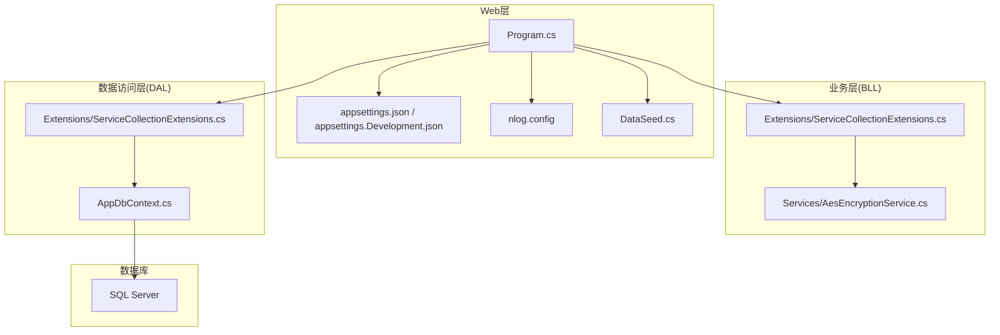
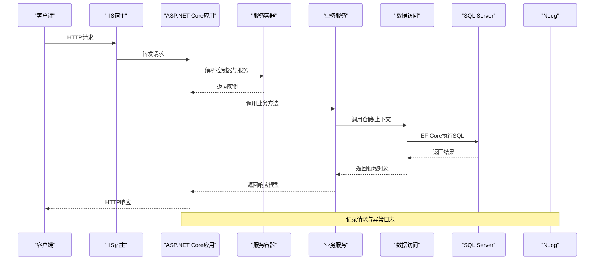
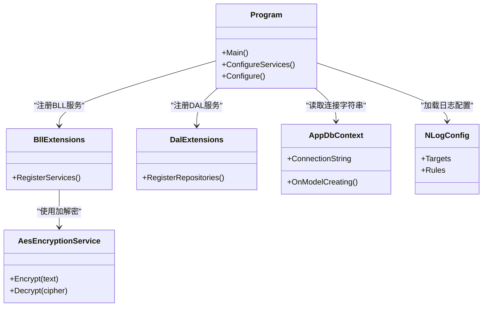

# 环境准备与配置

<cite>
**本文引用的文件**   
- [Program.cs](file://EquipmentIMS.Web/Program.cs)
- [appsettings.json](file://EquipmentIMS.Web/appsettings.json)
- [appsettings.Development.json](file://EquipmentIMS.Web/appsettings.Development.json)
- [launchSettings.json](file://EquipmentIMS.Web/Properties/launchSettings.json)
- [DataSeed.cs](file://EquipmentIMS.Web/DataSeed.cs)
- [AppDbContext.cs](file://EquipmentIMS.DAL/AppDbContext.cs)
- [ServiceCollectionExtensions.cs](file://EquipmentIMS.BLL/Extensions/ServiceCollectionExtensions.cs)
- [ServiceCollectionExtensions.cs](file://EquipmentIMS.DAL/Extensions/ServiceCollectionExtensions.cs)
- [AesEncryptionService.cs](file://EquipmentIMS.BLL/Services/AesEncryptionService.cs)
- [IAesEncryptionService.cs](file://EquipmentIMS.BLL/Interfaces/IAesEncryptionService.cs)
- [nlog.config](file://EquipmentIMS.Web/nlog.config)
- [base_data.sql](file://base_data.sql)
- [sys_data.sql](file://sys_data.sql)
- [demo_data.sql](file://demo_data.sql)
- [gen_sys.ps1](file://gen_sys.ps1)
- [gen_stock.ps1](file://gen_stock.ps1)
- [gen_sale.ps1](file://gen_sale.ps1)
- [gen_pur.ps1](file://gen_pur.ps1)
- [gen_maint.ps1](file://gen_maint.ps1)
- [gen_inv.ps1](file://gen_inv.ps1)
- [gen_prod.ps1](file://gen_prod.ps1)
</cite>

## 目录
1. [简介](#简介)
2. [项目结构](#项目结构)
3. [核心组件](#核心组件)
4. [架构总览](#架构总览)
5. [详细组件分析](#详细组件分析)
6. [依赖关系分析](#依赖关系分析)
7. [性能考虑](#性能考虑)
8. [故障排查指南](#故障排查指南)
9. [结论](#结论)
10. [附录](#附录)

## 简介
本指南面向THMS（设备库存管理系统）的生产环境部署与配置，覆盖以下关键主题：
- 生产环境的硬件与软件要求（.NET Core运行时、SQL Server版本、IIS服务器配置）
- 数据库初始化步骤（基础数据导入、表结构创建、索引优化建议）
- 配置文件管理策略（分段配置、环境变量、敏感信息加密存储）
- 开发环境与生产环境的差异化配置方案（连接字符串、日志级别、缓存等）

## 项目结构
THMS采用分层架构，Web层通过依赖注入注册BLL与DAL服务，使用Entity Framework Core访问SQL Server。配置由ASP.NET Core的配置系统加载，支持多环境覆盖与外部化配置。

图表来源
- [Program.cs](file://EquipmentIMS.Web/Program.cs)
- [appsettings.json](file://EquipmentIMS.Web/appsettings.json)
- [appsettings.Development.json](file://EquipmentIMS.Web/appsettings.Development.json)
- [nlog.config](file://EquipmentIMS.Web/nlog.config)
- [DataSeed.cs](file://EquipmentIMS.Web/DataSeed.cs)
- [ServiceCollectionExtensions.cs](file://EquipmentIMS.BLL/Extensions/ServiceCollectionExtensions.cs)
- [ServiceCollectionExtensions.cs](file://EquipmentIMS.DAL/Extensions/ServiceCollectionExtensions.cs)
- [AppDbContext.cs](file://EquipmentIMS.DAL/AppDbContext.cs)

章节来源
- [Program.cs](file://EquipmentIMS.Web/Program.cs)
- [appsettings.json](file://EquipmentIMS.Web/appsettings.json)
- [appsettings.Development.json](file://EquipmentIMS.Web/appsettings.Development.json)
- [nlog.config](file://EquipmentIMS.Web/nlog.config)
- [DataSeed.cs](file://EquipmentIMS.Web/DataSeed.cs)
- [ServiceCollectionExtensions.cs](file://EquipmentIMS.BLL/Extensions/ServiceCollectionExtensions.cs)
- [ServiceCollectionExtensions.cs](file://EquipmentIMS.DAL/Extensions/ServiceCollectionExtensions.cs)
- [AppDbContext.cs](file://EquipmentIMS.DAL/AppDbContext.cs)

## 核心组件
- 应用启动与配置加载：Program负责构建主机、加载配置、注册服务、中间件与路由，并执行种子数据初始化。
- 配置源：appsettings.json为默认配置，appsettings.Development.json用于开发环境覆盖；可通过环境变量或命令行参数进一步覆盖。
- 数据库上下文：AppDbContext定义EF Core上下文及实体映射，连接字符串来自配置。
- 服务注册：BLL与DAL的ServiceCollectionExtensions集中注册接口与实现，便于扩展与维护。
- 敏感信息处理：提供AES加解密服务接口与实现，可用于对敏感配置进行加密存储与动态解密。
- 日志：NLog配置文件控制输出目标与级别。

章节来源
- [Program.cs](file://EquipmentIMS.Web/Program.cs)
- [appsettings.json](file://EquipmentIMS.Web/appsettings.json)
- [appsettings.Development.json](file://EquipmentIMS.Web/appsettings.Development.json)
- [AppDbContext.cs](file://EquipmentIMS.DAL/AppDbContext.cs)
- [ServiceCollectionExtensions.cs](file://EquipmentIMS.BLL/Extensions/ServiceCollectionExtensions.cs)
- [ServiceCollectionExtensions.cs](file://EquipmentIMS.DAL/Extensions/ServiceCollectionExtensions.cs)
- [AesEncryptionService.cs](file://EquipmentIMS.BLL/Services/AesEncryptionService.cs)
- [IAesEncryptionService.cs](file://EquipmentIMS.BLL/Interfaces/IAesEncryptionService.cs)
- [nlog.config](file://EquipmentIMS.Web/nlog.config)

## 架构总览
下图展示从请求到数据持久化的端到端流程，以及配置与日志在运行时的参与方式。

图表来源
- [Program.cs](file://EquipmentIMS.Web/Program.cs)
- [AppDbContext.cs](file://EquipmentIMS.DAL/AppDbContext.cs)
- [nlog.config](file://EquipmentIMS.Web/nlog.config)

## 详细组件分析

### 运行时与环境要求
- .NET运行时
  - 建议使用与项目目标框架一致的长期支持版（LTS）。
  - 生产环境推荐安装ASP.NET Core运行时与托管捆绑包，以便IIS集成。
- SQL Server
  - 建议使用受支持的稳定版本（如2019及以上），并确保启用必要的功能（全文搜索、备份恢复等）。
  - 数据库兼容性级别应与SQL Server版本匹配。
- IIS
  - 安装ASP.NET Core Hosting Bundle以启用进程外托管。
  - 配置应用程序池为“无托管代码”、“集成管道模式”，并设置合适的标识与资源限制。
  - 绑定域名与HTTPS证书，启用HTTP严格传输安全与安全响应头。

章节来源
- [Program.cs](file://EquipmentIMS.Web/Program.cs)
- [launchSettings.json](file://EquipmentIMS.Web/Properties/launchSettings.json)

### 数据库初始化与基础数据导入
- 表结构与迁移
  - 若使用EF Core迁移，请在发布后于目标服务器执行迁移命令以创建/更新数据库结构。
  - 若使用脚本直导，请确保先执行DDL脚本再导入DML数据。
- 基础数据导入
  - 系统提供若干SQL脚本用于初始化系统字典、演示数据与业务数据，可按模块顺序导入。
  - 建议在低峰期执行，并在导入前做好数据库备份。
- 索引优化建议
  - 为常用查询条件列建立非聚集索引（如订单号、产品编码、仓库ID、时间范围字段）。
  - 对高频过滤与排序组合列建立复合索引，避免过度索引影响写入性能。
  - 定期统计信息更新，监控执行计划与锁等待。

章节来源
- [AppDbContext.cs](file://EquipmentIMS.DAL/AppDbContext.cs)
- [base_data.sql](file://base_data.sql)
- [sys_data.sql](file://sys_data.sql)
- [demo_data.sql](file://demo_data.sql)
- [gen_sys.ps1](file://gen_sys.ps1)
- [gen_stock.ps1](file://gen_stock.ps1)
- [gen_sale.ps1](file://gen_sale.ps1)
- [gen_pur.ps1](file://gen_pur.ps1)
- [gen_maint.ps1](file://gen_maint.ps1)
- [gen_inv.ps1](file://gen_inv.ps1)
- [gen_prod.ps1](file://gen_prod.ps1)

### 配置文件管理策略
- 分段配置与环境覆盖
  - 默认配置位于appsettings.json，开发环境覆盖位于appsettings.Development.json。
  - 生产环境可通过环境变量或命令行参数覆盖任意配置项，无需修改配置文件。
- 环境变量与外部化
  - 将连接字符串、密钥、第三方服务凭据等通过环境变量注入，避免硬编码。
  - 可在IIS站点或系统级设置环境变量，确保不同环境隔离。
- 敏感信息加密存储
  - 使用内置的用户密钥存储或外部密钥管理服务（KMS）保护敏感配置。
  - 结合AES加解密服务对特定字段进行加密/解密，降低明文泄露风险。
- 配置验证与默认值
  - 为关键配置项提供合理默认值，并在应用启动时校验必填项。
  - 对非法值抛出明确错误，便于快速定位问题。

章节来源
- [appsettings.json](file://EquipmentIMS.Web/appsettings.json)
- [appsettings.Development.json](file://EquipmentIMS.Web/appsettings.Development.json)
- [AesEncryptionService.cs](file://EquipmentIMS.BLL/Services/AesEncryptionService.cs)
- [IAesEncryptionService.cs](file://EquipmentIMS.BLL/Interfaces/IAesEncryptionService.cs)

### 开发环境与生产环境的差异化配置
- 连接字符串
  - 开发环境指向本地或测试数据库；生产环境指向高可用集群与只读副本。
  - 使用环境变量覆盖，避免提交敏感信息到版本库。
- 日志级别
  - 开发环境开启调试与详细日志；生产环境仅保留警告与错误，必要时按模块细化。
  - 通过NLog配置调整输出目标（文件、事件日志、远程收集器）。
- 缓存配置
  - 开发环境可使用内存缓存；生产环境可切换至分布式缓存或Redis以提升可扩展性。
  - 根据业务特性设置合理的过期时间与淘汰策略。
- 其他差异
  - 禁用不必要的诊断端点与调试中间件。
  - 启用HTTPS、CORS白名单、限流与重试策略。

章节来源
- [appsettings.json](file://EquipmentIMS.Web/appsettings.json)
- [appsettings.Development.json](file://EquipmentIMS.Web/appsettings.Development.json)
- [nlog.config](file://EquipmentIMS.Web/nlog.config)

### 数据种子与初始化工具
- 程序内种子
  - 应用启动时可执行DataSeed逻辑，用于创建默认管理员、基础字典与必要参考数据。
- 脚本与生成器
  - 提供PowerShell脚本批量生成与导入系统、库存、销售、采购、维护等模块数据。
  - 建议在首次部署或升级后按需执行，注意幂等与回滚策略。

章节来源
- [DataSeed.cs](file://EquipmentIMS.Web/DataSeed.cs)
- [gen_sys.ps1](file://gen_sys.ps1)
- [gen_stock.ps1](file://gen_stock.ps1)
- [gen_sale.ps1](file://gen_sale.ps1)
- [gen_pur.ps1](file://gen_pur.ps1)
- [gen_maint.ps1](file://gen_maint.ps1)
- [gen_inv.ps1](file://gen_inv.ps1)
- [gen_prod.ps1](file://gen_prod.ps1)

### 安全与敏感信息管理
- 密钥管理
  - 使用用户密钥或KMS管理对称密钥，避免将密钥硬编码进配置。
- 加解密服务
  - 通过AES服务对敏感数据进行加解密，适用于需要落库的机密字段。
- 最小权限原则
  - 数据库账号仅授予必要权限，禁止在生产环境使用sa等高权限账户。

章节来源
- [AesEncryptionService.cs](file://EquipmentIMS.BLL/Services/AesEncryptionService.cs)
- [IAesEncryptionService.cs](file://EquipmentIMS.BLL/Interfaces/IAesEncryptionService.cs)

## 依赖关系分析
- 服务注册与解耦
  - BLL与DAL分别通过各自的ServiceCollectionExtensions注册接口与实现，便于替换与测试。
- 配置与上下文
  - AppDbContext依赖配置中的连接字符串，统一由配置系统注入。
- 日志与中间件
  - NLog作为日志基础设施，贯穿控制器、服务与仓储层。

图表来源
- [Program.cs](file://EquipmentIMS.Web/Program.cs)
- [ServiceCollectionExtensions.cs](file://EquipmentIMS.BLL/Extensions/ServiceCollectionExtensions.cs)
- [ServiceCollectionExtensions.cs](file://EquipmentIMS.DAL/Extensions/ServiceCollectionExtensions.cs)
- [AppDbContext.cs](file://EquipmentIMS.DAL/AppDbContext.cs)
- [AesEncryptionService.cs](file://EquipmentIMS.BLL/Services/AesEncryptionService.cs)
- [nlog.config](file://EquipmentIMS.Web/nlog.config)

章节来源
- [Program.cs](file://EquipmentIMS.Web/Program.cs)
- [ServiceCollectionExtensions.cs](file://EquipmentIMS.BLL/Extensions/ServiceCollectionExtensions.cs)
- [ServiceCollectionExtensions.cs](file://EquipmentIMS.DAL/Extensions/ServiceCollectionExtensions.cs)
- [AppDbContext.cs](file://EquipmentIMS.DAL/AppDbContext.cs)
- [AesEncryptionService.cs](file://EquipmentIMS.BLL/Services/AesEncryptionService.cs)
- [nlog.config](file://EquipmentIMS.Web/nlog.config)

## 性能考虑
- 数据库
  - 合理设计索引与统计信息，避免全表扫描。
  - 使用读写分离与连接池，控制最大并发与超时时间。
- 应用层
  - 启用响应缓存与分布式缓存，减少重复计算与IO。
  - 异步化处理耗时任务，避免阻塞请求线程。
- IIS与运行时
  - 调整工作进程数与内存上限，启用GC调优参数。
  - 启用压缩与静态资源缓存，提升前端加载速度。

[本节为通用指导，不直接分析具体文件]

## 故障排查指南
- 连接失败
  - 检查连接字符串是否正确，网络可达性与防火墙规则。
  - 确认SQL Server服务状态与端口监听。
- 配置未生效
  - 核对环境变量命名与优先级，确认是否被覆盖。
  - 查看应用启动日志，确认配置加载路径。
- 日志缺失
  - 检查NLog配置的目标路径与权限。
  - 确认日志级别与过滤器设置。
- 权限与密钥
  - 验证数据库账号权限与用户密钥存储位置。
  - 检查AES密钥是否一致且未被篡改。

章节来源
- [nlog.config](file://EquipmentIMS.Web/nlog.config)
- [appsettings.json](file://EquipmentIMS.Web/appsettings.json)
- [appsettings.Development.json](file://EquipmentIMS.Web/appsettings.Development.json)

## 结论
通过规范的环境准备、严格的配置管理与完善的初始化流程，THMS可在生产环境中稳定运行。建议持续监控数据库与应用性能，定期评估索引与缓存策略，并结合安全最佳实践加固系统。

[本节为总结性内容，不直接分析具体文件]

## 附录
- 部署清单
  - 安装.NET运行时与IIS托管捆绑包
  - 创建数据库与账号，授予最小权限
  - 导入基础数据与演示数据
  - 配置环境变量与敏感信息
  - 启动应用并验证健康检查
- 常用脚本
  - 使用PowerShell脚本批量导入各模块数据，注意执行顺序与幂等性

章节来源
- [base_data.sql](file://base_data.sql)
- [sys_data.sql](file://sys_data.sql)
- [demo_data.sql](file://demo_data.sql)
- [gen_sys.ps1](file://gen_sys.ps1)
- [gen_stock.ps1](file://gen_stock.ps1)
- [gen_sale.ps1](file://gen_sale.ps1)
- [gen_pur.ps1](file://gen_pur.ps1)
- [gen_maint.ps1](file://gen_maint.ps1)
- [gen_inv.ps1](file://gen_inv.ps1)
- [gen_prod.ps1](file://gen_prod.ps1)