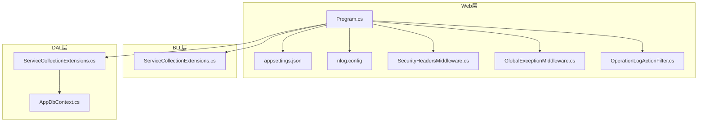
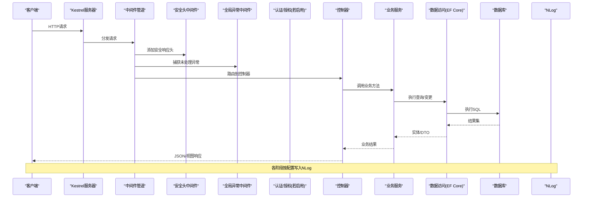
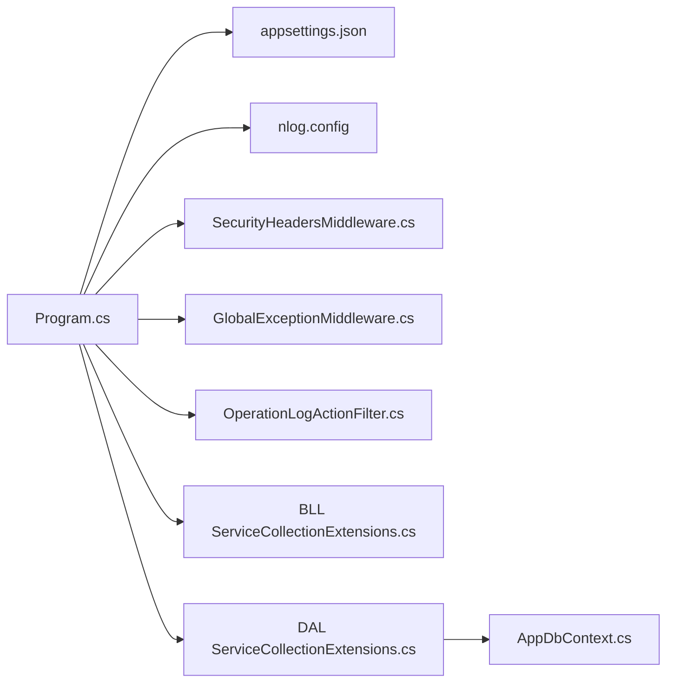

# 生产环境配置

<cite>
**本文引用的文件**   
- [Program.cs](file://EquipmentIMS.Web/Program.cs)
- [appsettings.json](file://EquipmentIMS.Web/appsettings.json)
- [nlog.config](file://EquipmentIMS.Web/nlog.config)
- [SecurityHeadersMiddleware.cs](file://EquipmentIMS.Web/Filters/SecurityHeadersMiddleware.cs)
- [GlobalExceptionMiddleware.cs](file://EquipmentIMS.Web/Filters/GlobalExceptionMiddleware.cs)
- [OperationLogActionFilter.cs](file://EquipmentIMS.Web/Filters/OperationLogActionFilter.cs)
- [AppDbContext.cs](file://EquipmentIMS.DAL/AppDbContext.cs)
- [ServiceCollectionExtensions.cs](file://EquipmentIMS.BLL/Extensions/ServiceCollectionExtensions.cs)
- [ServiceCollectionExtensions.cs](file://EquipmentIMS.DAL/Extensions/ServiceCollectionExtensions.cs)
</cite>

## 目录
1. [简介](#简介)
2. [项目结构](#项目结构)
3. [核心组件](#核心组件)
4. [架构总览](#架构总览)
5. [详细组件分析](#详细组件分析)
6. [依赖分析](#依赖分析)
7. [性能考虑](#性能考虑)
8. [故障排查指南](#故障排查指南)
9. [结论](#结论)
10. [附录](#附录)

## 简介
本指南面向THMS系统在“生产环境”的配置与优化，聚焦以下目标：
- NLog日志体系优化：轮转策略、异步写入、远程收集（如适用）
- ASP.NET Core生产优化：Kestrel参数、中间件管道顺序、静态资源缓存
- 数据库连接池与EF Core性能调优、事务最佳实践
- 安全加固：强制HTTPS、安全响应头、请求限制
- 性能监控：Application Insights集成、自定义指标、分布式追踪

## 项目结构
THMS采用分层架构：Web层（控制器、中间件、过滤器）、BLL业务层、DAL数据访问层、Models领域模型。生产相关的关键入口与配置集中在Web层的Program启动类、应用设置文件以及NLog配置文件；安全与异常处理通过中间件和过滤器实现；数据库上下文与扩展注册位于DAL与BLL的扩展文件中。

图表来源
- [Program.cs](file://EquipmentIMS.Web/Program.cs)
- [appsettings.json](file://EquipmentIMS.Web/appsettings.json)
- [nlog.config](file://EquipmentIMS.Web/nlog.config)
- [SecurityHeadersMiddleware.cs](file://EquipmentIMS.Web/Filters/SecurityHeadersMiddleware.cs)
- [GlobalExceptionMiddleware.cs](file://EquipmentIMS.Web/Filters/GlobalExceptionMiddleware.cs)
- [OperationLogActionFilter.cs](file://EquipmentIMS.Web/Filters/OperationLogActionFilter.cs)
- [ServiceCollectionExtensions.cs](file://EquipmentIMS.BLL/Extensions/ServiceCollectionExtensions.cs)
- [ServiceCollectionExtensions.cs](file://EquipmentIMS.DAL/Extensions/ServiceCollectionExtensions.cs)
- [AppDbContext.cs](file://EquipmentIMS.DAL/AppDbContext.cs)

章节来源
- [Program.cs](file://EquipmentIMS.Web/Program.cs)
- [appsettings.json](file://EquipmentIMS.Web/appsettings.json)
- [nlog.config](file://EquipmentIMS.Web/nlog.config)
- [SecurityHeadersMiddleware.cs](file://EquipmentIMS.Web/Filters/SecurityHeadersMiddleware.cs)
- [GlobalExceptionMiddleware.cs](file://EquipmentIMS.Web/Filters/GlobalExceptionMiddleware.cs)
- [OperationLogActionFilter.cs](file://EquipmentIMS.Web/Filters/OperationLogActionFilter.cs)
- [ServiceCollectionExtensions.cs](file://EquipmentIMS.BLL/Extensions/ServiceCollectionExtensions.cs)
- [ServiceCollectionExtensions.cs](file://EquipmentIMS.DAL/Extensions/ServiceCollectionExtensions.cs)
- [AppDbContext.cs](file://EquipmentIMS.DAL/AppDbContext.cs)

## 核心组件
- 应用启动与中间件管线：在Program中完成服务注册、中间件顺序编排、环境变量读取与特性开关控制。
- 日志系统：基于NLog进行本地文件输出、异步写入与可选远程目标；可通过配置切换级别与轮转策略。
- 安全中间件：统一注入安全响应头、强制HTTPS跳转、请求大小限制等。
- 全局异常处理：集中捕获未处理异常并返回标准化错误响应。
- 操作审计：通过Action Filter记录关键业务操作日志。
- 数据访问：EF Core DbContext与仓储/工作单元模式，连接字符串与连接池由配置驱动。

章节来源
- [Program.cs](file://EquipmentIMS.Web/Program.cs)
- [nlog.config](file://EquipmentIMS.Web/nlog.config)
- [SecurityHeadersMiddleware.cs](file://EquipmentIMS.Web/Filters/SecurityHeadersMiddleware.cs)
- [GlobalExceptionMiddleware.cs](file://EquipmentIMS.Web/Filters/GlobalExceptionMiddleware.cs)
- [OperationLogActionFilter.cs](file://EquipmentIMS.Web/Filters/OperationLogActionFilter.cs)
- [AppDbContext.cs](file://EquipmentIMS.DAL/AppDbContext.cs)

## 架构总览
下图展示了生产环境下请求从进入Kestrel到返回响应的关键路径，包括安全头、异常处理、日志与数据库访问。

图表来源
- [Program.cs](file://EquipmentIMS.Web/Program.cs)
- [SecurityHeadersMiddleware.cs](file://EquipmentIMS.Web/Filters/SecurityHeadersMiddleware.cs)
- [GlobalExceptionMiddleware.cs](file://EquipmentIMS.Web/Filters/GlobalExceptionMiddleware.cs)
- [AppDbContext.cs](file://EquipmentIMS.DAL/AppDbContext.cs)
- [nlog.config](file://EquipmentIMS.Web/nlog.config)

## 详细组件分析

### NLog日志配置优化
- 日志级别与过滤
  - 生产环境建议将根级别设置为Warn或Info，按需对特定命名空间降级为Debug。
  - 使用条件规则对敏感信息或高频低价值日志进行过滤。
- 异步写入与缓冲
  - 启用异步写入与内存缓冲，降低I/O阻塞对吞吐的影响。
  - 合理设置缓冲区大小与刷新间隔，平衡延迟与落盘开销。
- 文件轮转策略
  - 按文件大小与时间双维度轮转，保留固定数量历史文件，避免磁盘占满。
  - 压缩归档文件，减少存储占用。
- 远程日志收集（可选）
  - 如需集中化采集，可配置网络目标或对接第三方日志平台；注意网络超时与重试策略。
- 结构化日志
  - 使用属性化字段而非拼接字符串，便于检索与分析。
- 性能要点
  - 避免在热路径上频繁创建Logger实例，优先使用依赖注入获取单例。
  - 对高并发写入场景，评估多进程/多实例下的文件锁竞争，必要时拆分目标。

章节来源
- [nlog.config](file://EquipmentIMS.Web/nlog.config)

### ASP.NET Core生产环境优化
- Kestrel服务器
  - 绑定端口与主机地址，启用HTTP/2（若前端支持）。
  - 调整最大请求体大小、请求头限制、连接保持与并发上限。
  - 根据CPU核数与负载特征调节线程池与工作进程数。
- 中间件管道顺序
  - 错误处理与安全头中间件应尽早注册，确保所有响应均受保护。
  - 静态文件中间件置于路由之前，配合缓存头提升命中率。
  - 认证/授权中间件在业务控制器前注册。
- 静态文件缓存策略
  - 为版本化资源设置长期缓存与强校验；非版本化资源设置较短缓存。
  - 启用压缩（Gzip/Brotli）以减少带宽消耗。
- 环境变量与配置优先级
  - 使用环境变量覆盖appsettings中的敏感或环境差异配置。
  - 区分Development/Staging/Production配置片段。

章节来源
- [Program.cs](file://EquipmentIMS.Web/Program.cs)
- [appsettings.json](file://EquipmentIMS.Web/appsettings.json)

### 数据库连接池与EF Core性能
- 连接池参数
  - 根据并发与数据库容量设置最小/最大连接数、连接超时与命令超时。
  - 针对只读查询与写操作分离时，可考虑读写分离与不同连接串。
- EF Core优化
  - 关闭不必要的跟踪（AsNoTracking）用于只读列表查询。
  - 分页与投影（Select）减少数据传输量。
  - 批量更新/删除使用原生SQL或第三方库以提升性能。
- 事务管理最佳实践
  - 短事务原则：仅包裹必要的数据变更。
  - 明确提交/回滚边界，避免长事务持有锁。
  - 幂等设计，防止重复提交导致数据不一致。
- 索引与慢查询
  - 结合慢查询日志定位热点SQL，补充复合索引与覆盖索引。
  - 避免SELECT *，按需选择列。

章节来源
- [AppDbContext.cs](file://EquipmentIMS.DAL/AppDbContext.cs)
- [ServiceCollectionExtensions.cs](file://EquipmentIMS.DAL/Extensions/ServiceCollectionExtensions.cs)

### 安全配置加固
- HTTPS强制
  - 在生产环境中强制HTTPS，自动重定向HTTP至HTTPS。
- 安全响应头
  - 统一注入HSTS、X-Frame-Options、X-Content-Type-Options、Referrer-Policy、Permissions-Policy等。
- 请求限制
  - 限制最大请求体大小、请求头数量与长度，防范DoS攻击。
- 输入验证与输出编码
  - 服务端严格校验输入，输出侧启用防XSS编码。
- 认证与授权
  - 启用JWT或Cookie认证，最小权限原则，细粒度授权策略。

章节来源
- [SecurityHeadersMiddleware.cs](file://EquipmentIMS.Web/Filters/SecurityHeadersMiddleware.cs)
- [Program.cs](file://EquipmentIMS.Web/Program.cs)

### 性能监控与可观测性
- Application Insights集成
  - 启用请求/依赖遥测、异常捕获、性能计数器与自定义事件。
  - 配置采样率以平衡成本与覆盖率。
- 自定义指标收集
  - 使用计数器或遥测API上报业务指标（订单量、库存预警、导出任务队列长度等）。
- 分布式追踪
  - 关联请求ID与TraceId，跨服务链路追踪。
- 日志与指标联动
  - 将关键错误与告警同时写入日志与指标，便于快速定位。

章节来源
- [Program.cs](file://EquipmentIMS.Web/Program.cs)
- [nlog.config](file://EquipmentIMS.Web/nlog.config)

## 依赖分析
- 启动依赖
  - Program负责加载配置、注册服务、构建中间件管线。
- 模块耦合
  - Web层依赖BLL/DAL的服务注册扩展；DAL提供DbContext与仓储接口。
- 外部依赖
  - NLog作为日志提供者；EF Core作为ORM；可选Application Insights作为遥测后端。

图表来源
- [Program.cs](file://EquipmentIMS.Web/Program.cs)
- [appsettings.json](file://EquipmentIMS.Web/appsettings.json)
- [nlog.config](file://EquipmentIMS.Web/nlog.config)
- [SecurityHeadersMiddleware.cs](file://EquipmentIMS.Web/Filters/SecurityHeadersMiddleware.cs)
- [GlobalExceptionMiddleware.cs](file://EquipmentIMS.Web/Filters/GlobalExceptionMiddleware.cs)
- [OperationLogActionFilter.cs](file://EquipmentIMS.Web/Filters/OperationLogActionFilter.cs)
- [ServiceCollectionExtensions.cs](file://EquipmentIMS.BLL/Extensions/ServiceCollectionExtensions.cs)
- [ServiceCollectionExtensions.cs](file://EquipmentIMS.DAL/Extensions/ServiceCollectionExtensions.cs)
- [AppDbContext.cs](file://EquipmentIMS.DAL/AppDbContext.cs)

章节来源
- [Program.cs](file://EquipmentIMS.Web/Program.cs)
- [ServiceCollectionExtensions.cs](file://EquipmentIMS.BLL/Extensions/ServiceCollectionExtensions.cs)
- [ServiceCollectionExtensions.cs](file://EquipmentIMS.DAL/Extensions/ServiceCollectionExtensions.cs)
- [AppDbContext.cs](file://EquipmentIMS.DAL/AppDbContext.cs)

## 性能考虑
- I/O优化
  - 日志异步写入、静态文件缓存、数据库连接复用。
- CPU与内存
  - 合理设置线程池与工作进程；避免大对象分配与装箱拆箱。
- 数据库
  - 索引优化、分页与投影、批处理、连接池扩容。
- 网络
  - 启用HTTP/2与压缩；CDN缓存静态资源。
- 可观测性
  - 采样与限流遥测数据，避免监控本身成为瓶颈。

[本节为通用指导，不直接分析具体文件]

## 故障排查指南
- 日志定位
  - 检查NLog轮转是否生效、磁盘空间是否充足、异步缓冲是否溢出。
  - 确认日志级别与过滤规则是否符合预期。
- 异常处理
  - 全局异常中间件是否正确捕获并返回标准错误格式。
  - 关注未处理异常堆栈与上下文信息。
- 安全与请求失败
  - 检查HTTPS重定向与安全头是否生效。
  - 核对请求大小限制与CORS策略。
- 数据库问题
  - 连接池耗尽、死锁、慢查询；查看连接状态与SQL执行计划。
- 监控与告警
  - 确认Application Insights采样与传输正常；自定义指标是否上报。

章节来源
- [GlobalExceptionMiddleware.cs](file://EquipmentIMS.Web/Filters/GlobalExceptionMiddleware.cs)
- [SecurityHeadersMiddleware.cs](file://EquipmentIMS.Web/Filters/SecurityHeadersMiddleware.cs)
- [nlog.config](file://EquipmentIMS.Web/nlog.config)
- [AppDbContext.cs](file://EquipmentIMS.DAL/AppDbContext.cs)

## 结论
通过对NLog、ASP.NET Core、数据库与安全配置的精细化调优，并结合可观测性建设，THMS可在生产环境获得更高的稳定性、安全性与性能表现。建议在上线前进行压测与灰度发布，持续监控关键指标并根据实际负载动态调整。

[本节为总结性内容，不直接分析具体文件]

## 附录
- 常用环境变量键名建议
  - 日志级别、连接字符串、Application Insights Instrumentation Key、静态资源缓存策略等。
- 部署清单
  - 容器镜像、健康检查端点、优雅停机、滚动更新策略。
- 回滚预案
  - 配置快照、数据库迁移回滚脚本、日志与遥测保留策略。

[本节为概念性内容，不直接分析具体文件]