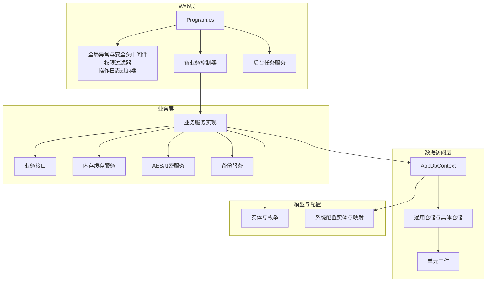
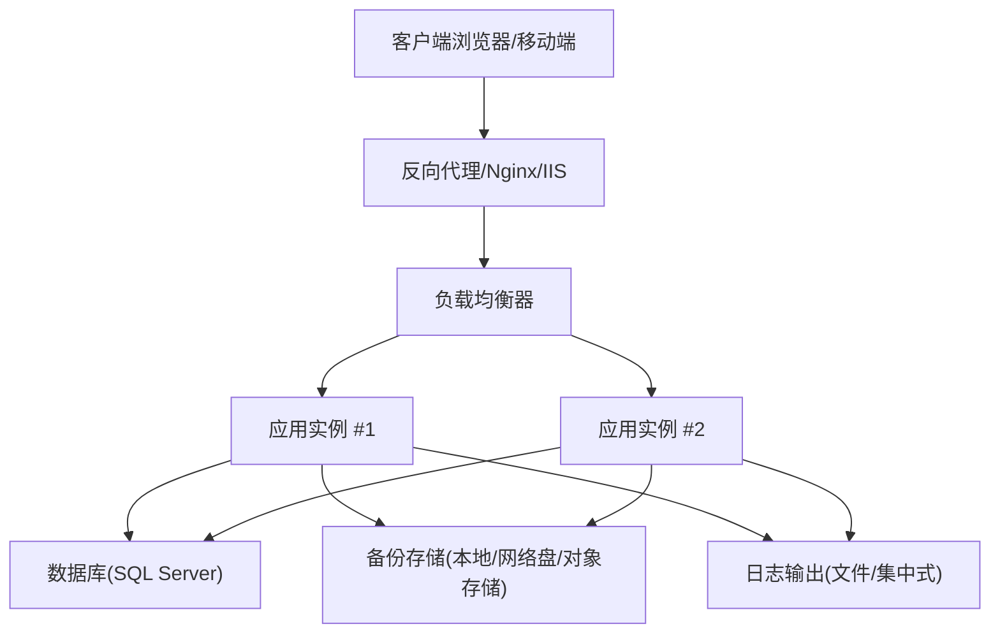
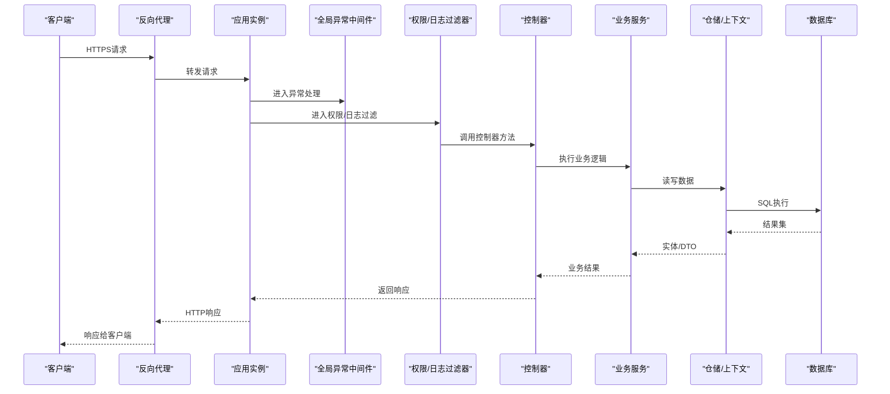
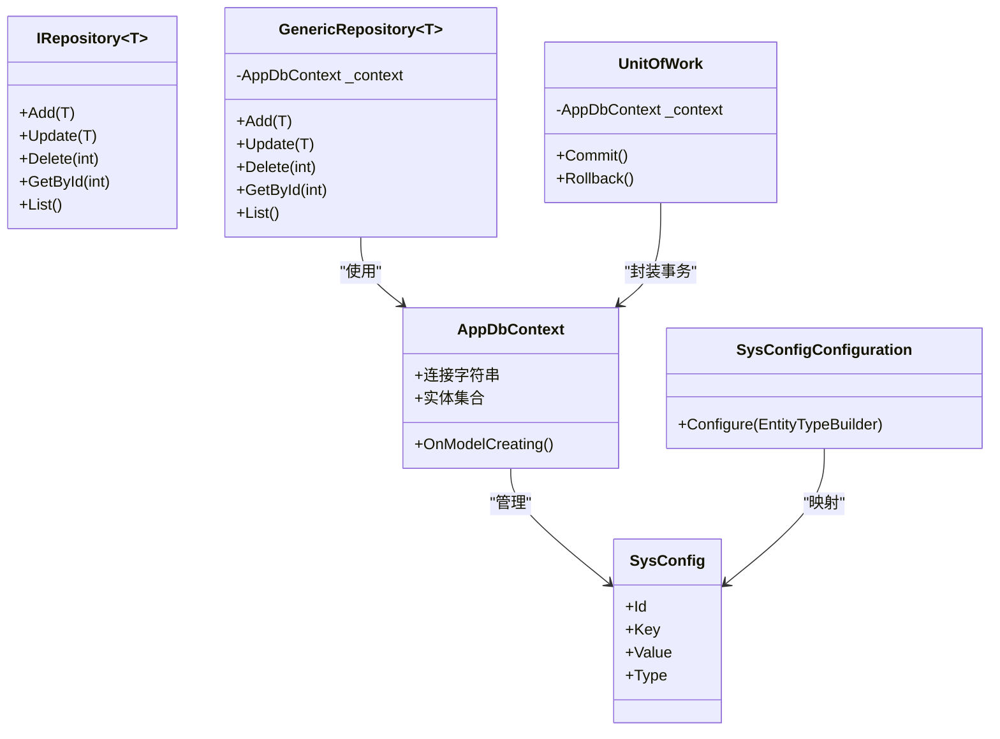
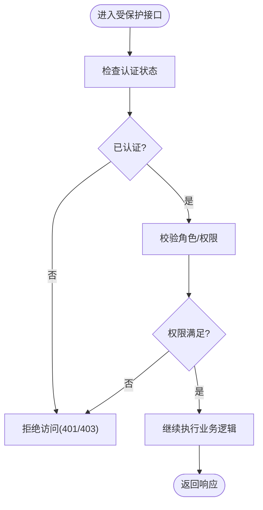
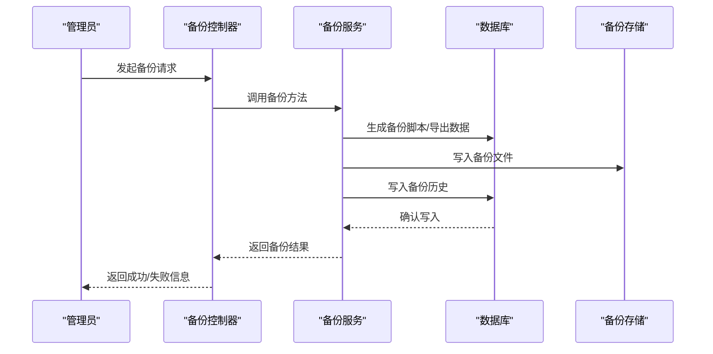
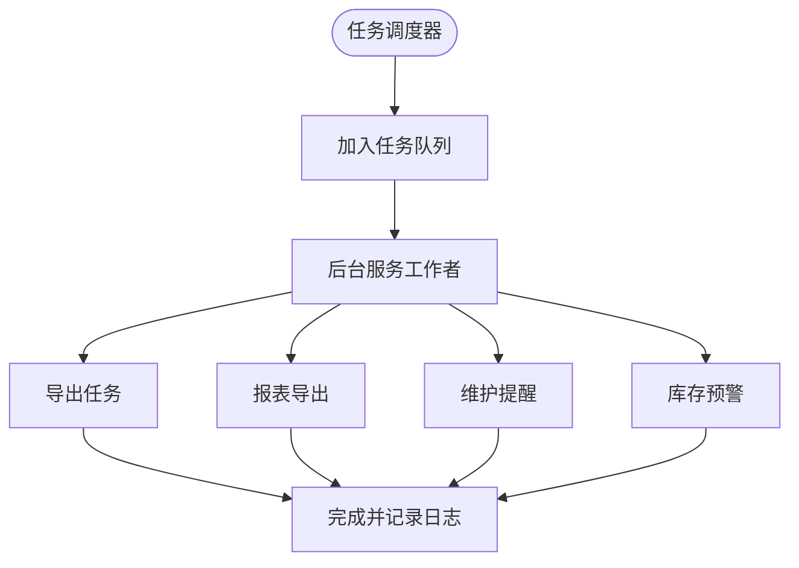
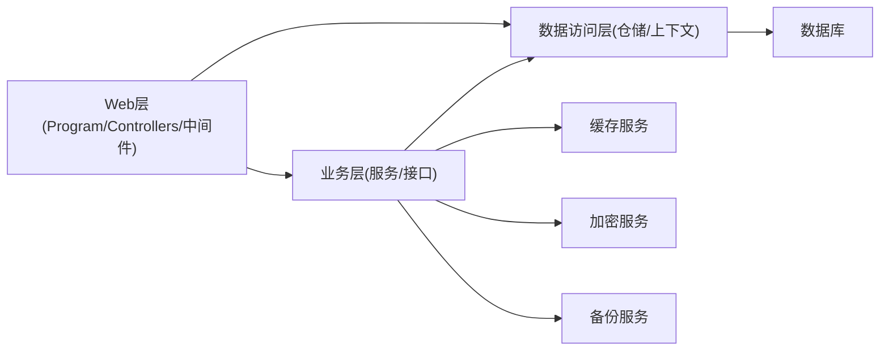

# 部署指南

<cite>
**本文引用的文件**   
- [Program.cs](file://EquipmentIMS.Web/Program.cs)
- [appsettings.json](file://EquipmentIMS.Web/appsettings.json)
- [appsettings.Development.json](file://EquipmentIMS.Web/appsettings.Development.json)
- [nlog.config](file://EquipmentIMS.Web/nlog.config)
- [GlobalExceptionMiddleware.cs](file://EquipmentIMS.Web/Filters/GlobalExceptionMiddleware.cs)
- [SecurityHeadersMiddleware.cs](file://EquipmentIMS.Web/Filters/SecurityHeadersMiddleware.cs)
- [OperationLogActionFilter.cs](file://EquipmentIMS.Web/Filters/OperationLogActionFilter.cs)
- [PermissionFilter.cs](file://EquipmentIMS.Web/Filters/PermissionFilter.cs)
- [AccountController.cs](file://EquipmentIMS.Web/Controllers/AccountController.cs)
- [BackupController.cs](file://EquipmentIMS.Web/Controllers/BackupController.cs)
- [SystemConfigController.cs](file://EquipmentIMS.Web/Controllers/SystemConfigController.cs)
- [AppDbContext.cs](file://EquipmentIMS.DAL/AppDbContext.cs)
- [ServiceCollectionExtensions.cs (DAL)](file://EquipmentIMS.DAL/Extensions/ServiceCollectionExtensions.cs)
- [ServiceCollectionExtensions.cs (BLL)](file://EquipmentIMS.BLL/Extensions/ServiceCollectionExtensions.cs)
- [IRepository.cs](file://EquipmentIMS.DAL/Interfaces/IRepository.cs)
- [GenericRepository.cs](file://EquipmentIMS.DAL/Repositories/GenericRepository.cs)
- [UnitOfWork.cs](file://EquipmentIMS.DAL/Repositories/UnitOfWork.cs)
- [IAesEncryptionService.cs](file://EquipmentIMS.BLL/Interfaces/IAesEncryptionService.cs)
- [AesEncryptionService.cs](file://EquipmentIMS.BLL/Services/AesEncryptionService.cs)
- [IBackupService.cs](file://EquipmentIMS.BLL/Interfaces/IBackupService.cs)
- [BackupService.cs](file://EquipmentIMS.BLL/Services/BackupService.cs)
- [ICacheService.cs](file://EquipmentIMS.BLL/Interfaces/ICacheService.cs)
- [MemoryCacheService.cs](file://EquipmentIMS.BLL/Services/MemoryCacheService.cs)
- [ExportBackgroundService.cs](file://EquipmentIMS.Web/BackgroundServices/ExportBackgroundService.cs)
- [MaintenanceReminderBackgroundService.cs](file://EquipmentIMS.Web/BackgroundServices/MaintenanceReminderBackgroundService.cs)
- [ReportExportBackgroundService.cs](file://EquipmentIMS.Web/BackgroundServices/ReportExportBackgroundService.cs)
- [StockAlertBackgroundService.cs](file://EquipmentIMS.Web/BackgroundServices/StockAlertBackgroundService.cs)
- [DataSeed.cs](file://EquipmentIMS.Web/DataSeed.cs)
- [SysConfig.cs](file://EquipmentIMS.Models/Entities/SysConfig.cs)
- [SystemConfigDto.cs](file://EquipmentIMS.Models/DTOs/SystemConfigDto.cs)
- [SysConfigConfiguration.cs](file://EquipmentIMS.DAL/Configurations/SysConfigConfiguration.cs)
- [SysUser.cs](file://EquipmentIMS.Models/Entities/SysUser.cs)
- [SysPasswordHistory.cs](file://EquipmentIMS.Models/Entities/SysPasswordHistory.cs)
- [SysRole.cs](file://EquipmentIMS.Models/Entities/SysRole.cs)
- [SysPermission.cs](file://EquipmentIMS.Models/Entities/SysPermission.cs)
- [SysUserRole.cs](file://EquipmentIMS.Models/Entities/SysUserRole.cs)
- [SysRolePermission.cs](file://EquipmentIMS.Models/Entities/SysRolePermission.cs)
- [SysNotification.cs](file://EquipmentIMS.Models/Entities/SysNotification.cs)
- [SysOperationLog.cs](file://EquipmentIMS.Models/Entities/SysOperationLog.cs)
- [InvBackupHistory.cs](file://EquipmentIMS.Models/Entities/InvBackupHistory.cs)
</cite>

## 目录
1. [简介](#简介)
2. [项目结构](#项目结构)
3. [核心组件](#核心组件)
4. [架构总览](#架构总览)
5. [详细组件分析](#详细组件分析)
6. [依赖关系分析](#依赖关系分析)
7. [性能考虑](#性能考虑)
8. [故障排查指南](#故障排查指南)
9. [结论](#结论)
10. [附录](#附录)

## 简介
本指南面向生产环境，提供THMS（设备库存管理系统）的完整部署说明。内容涵盖服务器与数据库要求、域名与SSL、反向代理与负载均衡、容器化与编排、CI/CD流水线、配置与环境变量管理、敏感信息保护、备份恢复策略、监控告警与日志收集、以及故障排查、性能调优与扩缩容操作手册。文档中的实现细节均基于仓库内现有代码与配置文件进行梳理，确保可落地执行。

## 项目结构
系统采用分层架构：Web层（控制器、中间件、后台任务）、业务层（服务与接口）、数据访问层（EF Core DbContext、仓储与单元工作）、模型与DTO定义。关键入口为Web项目的启动程序与配置加载逻辑，数据访问通过EF Core与SQL Server交互，业务服务通过依赖注入注册，后台任务以Windows服务方式运行。

图表来源
- [Program.cs](file://EquipmentIMS.Web/Program.cs)
- [GlobalExceptionMiddleware.cs](file://EquipmentIMS.Web/Filters/GlobalExceptionMiddleware.cs)
- [SecurityHeadersMiddleware.cs](file://EquipmentIMS.Web/Filters/SecurityHeadersMiddleware.cs)
- [OperationLogActionFilter.cs](file://EquipmentIMS.Web/Filters/OperationLogActionFilter.cs)
- [PermissionFilter.cs](file://EquipmentIMS.Web/Filters/PermissionFilter.cs)
- [AppDbContext.cs](file://EquipmentIMS.DAL/AppDbContext.cs)
- [ServiceCollectionExtensions.cs (DAL)](file://EquipmentIMS.DAL/Extensions/ServiceCollectionExtensions.cs)
- [ServiceCollectionExtensions.cs (BLL)](file://EquipmentIMS.BLL/Extensions/ServiceCollectionExtensions.cs)
- [MemoryCacheService.cs](file://EquipmentIMS.BLL/Services/MemoryCacheService.cs)
- [AesEncryptionService.cs](file://EquipmentIMS.BLL/Services/AesEncryptionService.cs)
- [BackupService.cs](file://EquipmentIMS.BLL/Services/BackupService.cs)
- [ExportBackgroundService.cs](file://EquipmentIMS.Web/BackgroundServices/ExportBackgroundService.cs)
- [MaintenanceReminderBackgroundService.cs](file://EquipmentIMS.Web/BackgroundServices/MaintenanceReminderBackgroundService.cs)
- [ReportExportBackgroundService.cs](file://EquipmentIMS.Web/BackgroundServices/ReportExportBackgroundService.cs)
- [StockAlertBackgroundService.cs](file://EquipmentIMS.Web/BackgroundServices/StockAlertBackgroundService.cs)

章节来源
- [Program.cs](file://EquipmentIMS.Web/Program.cs)
- [appsettings.json](file://EquipmentIMS.Web/appsettings.json)
- [appsettings.Development.json](file://EquipmentIMS.Web/appsettings.Development.json)

## 核心组件
- Web启动与管道
  - 启动程序负责加载配置、注册服务、启用中间件、创建并运行后台任务。
  - 全局异常中间件统一捕获未处理异常并返回结构化错误响应。
  - 安全头中间件设置HTTP安全相关响应头。
  - 权限过滤器与操作日志过滤器在请求进入控制器前/后执行鉴权与审计记录。
- 数据访问
  - EF Core上下文集中管理连接字符串与实体映射。
  - 通用仓储封装CRUD，具体仓储扩展复杂查询；单元工作保证事务一致性。
- 业务服务
  - 按领域划分的服务实现调用仓储与外部能力（如缓存、加密、备份）。
  - 内存缓存用于热点数据加速；AES加密服务用于敏感字段加解密。
  - 备份服务提供数据库备份与历史记录管理。
- 后台任务
  - 导出任务、报表导出、维护提醒、库存预警等定时或异步任务。
- 配置与密钥
  - appsettings系列文件承载应用配置；环境变量覆盖机制支持多环境差异化。
  - 系统配置表与DTO用于运行时动态配置项管理。

章节来源
- [Program.cs](file://EquipmentIMS.Web/Program.cs)
- [GlobalExceptionMiddleware.cs](file://EquipmentIMS.Web/Filters/GlobalExceptionMiddleware.cs)
- [SecurityHeadersMiddleware.cs](file://EquipmentIMS.Web/Filters/SecurityHeadersMiddleware.cs)
- [OperationLogActionFilter.cs](file://EquipmentIMS.Web/Filters/OperationLogActionFilter.cs)
- [PermissionFilter.cs](file://EquipmentIMS.Web/Filters/PermissionFilter.cs)
- [AppDbContext.cs](file://EquipmentIMS.DAL/AppDbContext.cs)
- [ServiceCollectionExtensions.cs (DAL)](file://EquipmentIMS.DAL/Extensions/ServiceCollectionExtensions.cs)
- [ServiceCollectionExtensions.cs (BLL)](file://EquipmentIMS.BLL/Extensions/ServiceCollectionExtensions.cs)
- [MemoryCacheService.cs](file://EquipmentIMS.BLL/Services/MemoryCacheService.cs)
- [AesEncryptionService.cs](file://EquipmentIMS.BLL/Services/AesEncryptionService.cs)
- [BackupService.cs](file://EquipmentIMS.BLL/Services/BackupService.cs)
- [ExportBackgroundService.cs](file://EquipmentIMS.Web/BackgroundServices/ExportBackgroundService.cs)
- [MaintenanceReminderBackgroundService.cs](file://EquipmentIMS.Web/BackgroundServices/MaintenanceReminderBackgroundService.cs)
- [ReportExportBackgroundService.cs](file://EquipmentIMS.Web/BackgroundServices/ReportExportBackgroundService.cs)
- [StockAlertBackgroundService.cs](file://EquipmentIMS.Web/BackgroundServices/StockAlertBackgroundService.cs)
- [appsettings.json](file://EquipmentIMS.Web/appsettings.json)
- [appsettings.Development.json](file://EquipmentIMS.Web/appsettings.Development.json)

## 架构总览
下图展示生产环境典型部署拓扑：客户端经反向代理（Nginx/IIS）接入，HTTPS终止于代理或应用层；应用实例水平扩展并由负载均衡分发；数据库独立部署；对象存储或共享文件系统用于备份文件持久化；日志由应用输出到文件或集中式日志平台。

[此图为概念性拓扑，不直接映射具体源码文件]

## 详细组件分析

### 启动与中间件管线
- 启动流程
  - 加载配置（包含连接字符串、日志、缓存、加密等）。
  - 注册服务（业务接口与实现、仓储、上下文、缓存、加密、备份）。
  - 启用中间件（异常处理、安全头、路由、静态资源、认证授权等）。
  - 初始化后台任务（导出、报表、维护提醒、库存预警）。
- 中间件职责
  - 全局异常中间件：捕获未处理异常，记录日志，返回统一错误格式。
  - 安全头中间件：设置CSP、HSTS、X-Frame-Options等安全头。
  - 权限过滤器：校验用户角色与权限。
  - 操作日志过滤器：记录关键操作的审计信息。

图表来源
- [Program.cs](file://EquipmentIMS.Web/Program.cs)
- [GlobalExceptionMiddleware.cs](file://EquipmentIMS.Web/Filters/GlobalExceptionMiddleware.cs)
- [SecurityHeadersMiddleware.cs](file://EquipmentIMS.Web/Filters/SecurityHeadersMiddleware.cs)
- [OperationLogActionFilter.cs](file://EquipmentIMS.Web/Filters/OperationLogActionFilter.cs)
- [PermissionFilter.cs](file://EquipmentIMS.Web/Filters/PermissionFilter.cs)
- [AppDbContext.cs](file://EquipmentIMS.DAL/AppDbContext.cs)

章节来源
- [Program.cs](file://EquipmentIMS.Web/Program.cs)
- [GlobalExceptionMiddleware.cs](file://EquipmentIMS.Web/Filters/GlobalExceptionMiddleware.cs)
- [SecurityHeadersMiddleware.cs](file://EquipmentIMS.Web/Filters/SecurityHeadersMiddleware.cs)
- [OperationLogActionFilter.cs](file://EquipmentIMS.Web/Filters/OperationLogActionFilter.cs)
- [PermissionFilter.cs](file://EquipmentIMS.Web/Filters/PermissionFilter.cs)

### 数据访问与仓储模式
- 上下文与映射
  - 使用EF Core上下文管理连接与实体映射，包括系统配置、用户、角色、权限、通知、操作日志、备份历史等。
- 仓储与单元工作
  - 通用仓储提供基础CRUD；具体仓储扩展复杂查询；单元工作封装事务边界，确保一致性。
- 配置实体
  - 系统配置实体与映射用于运行时配置项持久化，配合DTO暴露API供前端管理。

图表来源
- [AppDbContext.cs](file://EquipmentIMS.DAL/AppDbContext.cs)
- [IRepository.cs](file://EquipmentIMS.DAL/Interfaces/IRepository.cs)
- [GenericRepository.cs](file://EquipmentIMS.DAL/Repositories/GenericRepository.cs)
- [UnitOfWork.cs](file://EquipmentIMS.DAL/Repositories/UnitOfWork.cs)
- [SysConfig.cs](file://EquipmentIMS.Models/Entities/SysConfig.cs)
- [SysConfigConfiguration.cs](file://EquipmentIMS.DAL/Configurations/SysConfigConfiguration.cs)

章节来源
- [AppDbContext.cs](file://EquipmentIMS.DAL/AppDbContext.cs)
- [IRepository.cs](file://EquipmentIMS.DAL/Interfaces/IRepository.cs)
- [GenericRepository.cs](file://EquipmentIMS.DAL/Repositories/GenericRepository.cs)
- [UnitOfWork.cs](file://EquipmentIMS.DAL/Repositories/UnitOfWork.cs)
- [SysConfig.cs](file://EquipmentIMS.Models/Entities/SysConfig.cs)
- [SysConfigConfiguration.cs](file://EquipmentIMS.DAL/Configurations/SysConfigConfiguration.cs)

### 安全与敏感信息保护
- 密码与历史
  - 用户实体与密码历史实体用于账户管理与密码变更审计。
- AES加密服务
  - 提供对称加密能力，用于敏感字段（如配置值、凭证片段）的加解密。
- 权限与角色
  - 用户-角色-权限模型支撑细粒度访问控制；权限过滤器在请求阶段校验。
- 安全头
  - 安全头中间件设置必要的HTTP安全响应头，增强抗攻击能力。

图表来源
- [PermissionFilter.cs](file://EquipmentIMS.Web/Filters/PermissionFilter.cs)
- [SysUser.cs](file://EquipmentIMS.Models/Entities/SysUser.cs)
- [SysPasswordHistory.cs](file://EquipmentIMS.Models/Entities/SysPasswordHistory.cs)
- [SysRole.cs](file://EquipmentIMS.Models/Entities/SysRole.cs)
- [SysPermission.cs](file://EquipmentIMS.Models/Entities/SysPermission.cs)
- [SysUserRole.cs](file://EquipmentIMS.Models/Entities/SysUserRole.cs)
- [SysRolePermission.cs](file://EquipmentIMS.Models/Entities/SysRolePermission.cs)
- [IAesEncryptionService.cs](file://EquipmentIMS.BLL/Interfaces/IAesEncryptionService.cs)
- [AesEncryptionService.cs](file://EquipmentIMS.BLL/Services/AesEncryptionService.cs)
- [SecurityHeadersMiddleware.cs](file://EquipmentIMS.Web/Filters/SecurityHeadersMiddleware.cs)

章节来源
- [SysUser.cs](file://EquipmentIMS.Models/Entities/SysUser.cs)
- [SysPasswordHistory.cs](file://EquipmentIMS.Models/Entities/SysPasswordHistory.cs)
- [SysRole.cs](file://EquipmentIMS.Models/Entities/SysRole.cs)
- [SysPermission.cs](file://EquipmentIMS.Models/Entities/SysPermission.cs)
- [SysUserRole.cs](file://EquipmentIMS.Models/Entities/SysUserRole.cs)
- [SysRolePermission.cs](file://EquipmentIMS.Models/Entities/SysRolePermission.cs)
- [IAesEncryptionService.cs](file://EquipmentIMS.BLL/Interfaces/IAesEncryptionService.cs)
- [AesEncryptionService.cs](file://EquipmentIMS.BLL/Services/AesEncryptionService.cs)
- [PermissionFilter.cs](file://EquipmentIMS.Web/Filters/PermissionFilter.cs)
- [SecurityHeadersMiddleware.cs](file://EquipmentIMS.Web/Filters/SecurityHeadersMiddleware.cs)

### 备份与恢复
- 备份服务
  - 提供触发备份、查询备份历史、清理旧备份等功能；备份历史写入数据库以便追踪。
- 备份控制器
  - 暴露备份相关的API，供管理员在系统中发起备份与查看历史。
- 备份历史实体
  - 记录每次备份的时间、大小、路径、状态等信息。

图表来源
- [BackupController.cs](file://EquipmentIMS.Web/Controllers/BackupController.cs)
- [IBackupService.cs](file://EquipmentIMS.BLL/Interfaces/IBackupService.cs)
- [BackupService.cs](file://EquipmentIMS.BLL/Services/BackupService.cs)
- [InvBackupHistory.cs](file://EquipmentIMS.Models/Entities/InvBackupHistory.cs)

章节来源
- [BackupController.cs](file://EquipmentIMS.Web/Controllers/BackupController.cs)
- [IBackupService.cs](file://EquipmentIMS.BLL/Interfaces/IBackupService.cs)
- [BackupService.cs](file://EquipmentIMS.BLL/Services/BackupService.cs)
- [InvBackupHistory.cs](file://EquipmentIMS.Models/Entities/InvBackupHistory.cs)

### 后台任务与异步处理
- 导出任务
  - 将大量数据导出为文件，避免阻塞主线程。
- 报表导出
  - 定时或按需生成报表并落盘。
- 维护提醒
  - 定期检查维护计划并发送通知。
- 库存预警
  - 扫描库存阈值，触发告警通知。

图表来源
- [ExportBackgroundService.cs](file://EquipmentIMS.Web/BackgroundServices/ExportBackgroundService.cs)
- [ReportExportBackgroundService.cs](file://EquipmentIMS.Web/BackgroundServices/ReportExportBackgroundService.cs)
- [MaintenanceReminderBackgroundService.cs](file://EquipmentIMS.Web/BackgroundServices/MaintenanceReminderBackgroundService.cs)
- [StockAlertBackgroundService.cs](file://EquipmentIMS.Web/BackgroundServices/StockAlertBackgroundService.cs)

章节来源
- [ExportBackgroundService.cs](file://EquipmentIMS.Web/BackgroundServices/ExportBackgroundService.cs)
- [ReportExportBackgroundService.cs](file://EquipmentIMS.Web/BackgroundServices/ReportExportBackgroundService.cs)
- [MaintenanceReminderBackgroundService.cs](file://EquipmentIMS.Web/BackgroundServices/MaintenanceReminderBackgroundService.cs)
- [StockAlertBackgroundService.cs](file://EquipmentIMS.Web/BackgroundServices/StockAlertBackgroundService.cs)

### 配置与环境变量
- 配置文件
  - 应用级配置位于appsettings系列文件中，包含数据库连接、日志、缓存、加密等。
  - 开发环境与生产环境可通过不同配置文件与环境变量覆盖。
- 环境变量
  - 推荐在生产环境通过环境变量注入敏感信息（如连接字符串、密钥），避免硬编码。
- 系统配置
  - 运行时配置项通过系统配置实体与DTO持久化，并提供API进行管理。

章节来源
- [appsettings.json](file://EquipmentIMS.Web/appsettings.json)
- [appsettings.Development.json](file://EquipmentIMS.Web/appsettings.Development.json)
- [SystemConfigDto.cs](file://EquipmentIMS.Models/DTOs/SystemConfigDto.cs)
- [SysConfig.cs](file://EquipmentIMS.Models/Entities/SysConfig.cs)
- [SysConfigConfiguration.cs](file://EquipmentIMS.DAL/Configurations/SysConfigConfiguration.cs)

### 日志与审计
- NLog配置
  - 应用集成NLog，支持文件输出与结构化日志。
- 操作日志
  - 操作日志过滤器记录关键操作；操作日志实体持久化审计信息。
- 全局异常
  - 全局异常中间件捕获未处理异常并记录堆栈与上下文。

章节来源
- [nlog.config](file://EquipmentIMS.Web/nlog.config)
- [OperationLogActionFilter.cs](file://EquipmentIMS.Web/Filters/OperationLogActionFilter.cs)
- [SysOperationLog.cs](file://EquipmentIMS.Models/Entities/SysOperationLog.cs)
- [GlobalExceptionMiddleware.cs](file://EquipmentIMS.Web/Filters/GlobalExceptionMiddleware.cs)

### 初始数据与种子
- 数据种子
  - 提供初始数据导入逻辑，便于首次部署时快速建立基础数据。

章节来源
- [DataSeed.cs](file://EquipmentIMS.Web/DataSeed.cs)

## 依赖关系分析
- 服务注册
  - DAL与BLL分别通过扩展方法注册仓储、上下文、业务服务、缓存、加密、备份等。
- 模块耦合
  - Web层依赖BLL与DAL；BLL依赖DAL与缓存/加密/备份；DAL依赖EF Core与数据库驱动。
- 外部依赖
  - 数据库（SQL Server）、对象存储或共享文件系统（备份文件）、日志平台（可选）。

图表来源
- [ServiceCollectionExtensions.cs (DAL)](file://EquipmentIMS.DAL/Extensions/ServiceCollectionExtensions.cs)
- [ServiceCollectionExtensions.cs (BLL)](file://EquipmentIMS.BLL/Extensions/ServiceCollectionExtensions.cs)
- [AppDbContext.cs](file://EquipmentIMS.DAL/AppDbContext.cs)
- [MemoryCacheService.cs](file://EquipmentIMS.BLL/Services/MemoryCacheService.cs)
- [AesEncryptionService.cs](file://EquipmentIMS.BLL/Services/AesEncryptionService.cs)
- [BackupService.cs](file://EquipmentIMS.BLL/Services/BackupService.cs)

章节来源
- [ServiceCollectionExtensions.cs (DAL)](file://EquipmentIMS.DAL/Extensions/ServiceCollectionExtensions.cs)
- [ServiceCollectionExtensions.cs (BLL)](file://EquipmentIMS.BLL/Extensions/ServiceCollectionExtensions.cs)
- [AppDbContext.cs](file://EquipmentIMS.DAL/AppDbContext.cs)

## 性能考虑
- 数据库
  - 合理索引设计，避免全表扫描；对高频查询字段建立索引。
  - 连接池参数优化，根据并发量调整最大连接数。
- 缓存
  - 使用内存缓存缓存热点字典与配置，减少数据库压力。
- 异步与后台任务
  - 大文件导出与报表生成走后台任务，避免阻塞请求。
- 日志
  - 生产环境降低日志级别，仅保留必要信息；定期轮转与归档。
- 水平扩展
  - 无状态应用实例可横向扩展；会话与缓存需考虑分布式方案（如需）。

[本节为通用指导，不直接分析具体文件]

## 故障排查指南
- 常见问题定位
  - 连接失败：检查连接字符串、防火墙、数据库服务状态。
  - 权限不足：核对用户角色与权限分配，确认过滤器生效。
  - 备份失败：检查备份存储路径权限与空间，查看备份历史与日志。
  - 日志缺失：确认NLog配置与输出路径，检查磁盘空间与权限。
- 诊断步骤
  - 查看全局异常中间件记录的错误详情。
  - 检索操作日志与系统日志，定位异常时间点与操作上下文。
  - 验证环境变量与配置文件是否被正确加载。
  - 检查后台任务执行状态与错误输出。

章节来源
- [GlobalExceptionMiddleware.cs](file://EquipmentIMS.Web/Filters/GlobalExceptionMiddleware.cs)
- [OperationLogActionFilter.cs](file://EquipmentIMS.Web/Filters/OperationLogActionFilter.cs)
- [SysOperationLog.cs](file://EquipmentIMS.Models/Entities/SysOperationLog.cs)
- [nlog.config](file://EquipmentIMS.Web/nlog.config)
- [BackupService.cs](file://EquipmentIMS.BLL/Services/BackupService.cs)
- [InvBackupHistory.cs](file://EquipmentIMS.Models/Entities/InvBackupHistory.cs)

## 结论
本指南基于仓库现有实现，提供了从环境准备、配置管理、安全加固、容器化与编排、CI/CD、备份恢复、监控日志到排障与性能优化的全流程建议。生产部署应遵循最小权限原则、集中化配置与密钥管理、可观测性与可恢复性设计，并结合实际业务规模进行容量规划与弹性伸缩。

## 附录

### 生产环境部署要求
- 服务器
  - 操作系统：Linux发行版或Windows Server（依据部署目标选择）。
  - CPU/内存：根据并发与数据量评估，建议至少4核8G起步。
  - 磁盘：SSD优先，预留足够空间用于日志与备份。
- 数据库
  - SQL Server版本与补丁级别需与应用兼容。
  - 开启连接池与适当超时设置；定期维护（统计信息更新、索引重建）。
- 域名与SSL
  - 绑定域名至反向代理；在代理层或应用层终止TLS证书。
  - 建议使用自动化证书管理（如Let's Encrypt）并配置自动续期。
- 反向代理与负载均衡
  - 使用Nginx或IIS作为反向代理；结合负载均衡器实现高可用。
  - 配置健康检查与优雅停机。

[本节为通用指导，不直接分析具体文件]

### 配置文件与环境变量管理
- 配置文件
  - 使用appsettings.json承载默认配置；生产环境通过环境变量覆盖敏感项。
- 环境变量
  - 数据库连接字符串、加密密钥、第三方服务凭据等通过环境变量注入。
- 敏感信息保护
  - 使用系统配置实体与AES加密服务对敏感配置值进行加解密存储。
  - 禁止将密钥与凭据提交至代码仓库。

章节来源
- [appsettings.json](file://EquipmentIMS.Web/appsettings.json)
- [appsettings.Development.json](file://EquipmentIMS.Web/appsettings.Development.json)
- [IAesEncryptionService.cs](file://EquipmentIMS.BLL/Interfaces/IAesEncryptionService.cs)
- [AesEncryptionService.cs](file://EquipmentIMS.BLL/Services/AesEncryptionService.cs)
- [SystemConfigDto.cs](file://EquipmentIMS.Models/DTOs/SystemConfigDto.cs)
- [SysConfig.cs](file://EquipmentIMS.Models/Entities/SysConfig.cs)

### Docker容器化部署
- 镜像构建
  - 使用多阶段构建减小镜像体积；仅复制运行时所需文件。
  - 指定非root用户运行，提升安全性。
- 容器编排
  - 使用docker-compose或Kubernetes管理多实例；配置健康检查与探针。
- 配置挂载
  - 将配置文件与密钥以卷或Secret形式挂载，避免硬编码。
- 存储与备份
  - 将备份文件输出到持久化卷或对象存储；定期清理旧备份。

[本节为通用指导，不直接分析具体文件]

### Kubernetes编排
- Deployment与Service
  - 定义副本数、资源限制与探针；对外暴露Service。
- ConfigMap与Secret
  - 将非敏感配置放入ConfigMap；敏感信息放入Secret。
- Ingress与TLS
  - 使用Ingress控制器管理域名与证书；配置自动续期。
- 水平扩展
  - 基于HPA根据CPU/内存或自定义指标自动扩缩容。

[本节为通用指导，不直接分析具体文件]

### CI/CD流水线配置
- 构建与测试
  - 编译、单元测试、静态分析；生成制品包。
- 镜像构建与推送
  - 构建Docker镜像并推送到镜像仓库；打标签与版本管理。
- 部署
  - 使用Kubectl或Helm发布到目标集群；灰度或蓝绿发布策略。
- 回滚与验证
  - 保留历史版本；部署后执行冒烟测试与健康检查。

[本节为通用指导，不直接分析具体文件]

### 监控告警与日志收集
- 监控
  - 采集应用指标（请求量、错误率、延迟、GC、线程池等）。
  - 数据库监控（连接数、慢查询、锁等待）。
- 告警
  - 设定阈值与规则；多渠道通知（邮件、短信、IM）。
- 日志
  - 应用日志集中收集（ELK/Loki）；结构化输出便于检索与分析。
  - 定期轮转与归档，保留周期符合合规要求。

[本节为通用指导，不直接分析具体文件]

### 备份恢复策略
- 备份类型
  - 全量备份与增量备份结合；数据库与文件备份并重。
- 频率与保留
  - 根据RPO/RTO制定备份频率与保留策略。
- 恢复演练
  - 定期进行恢复演练，验证备份有效性与恢复流程。

章节来源
- [BackupService.cs](file://EquipmentIMS.BLL/Services/BackupService.cs)
- [InvBackupHistory.cs](file://EquipmentIMS.Models/Entities/InvBackupHistory.cs)

### 扩容缩容操作手册
- 扩容
  - 增加应用实例副本；确保无状态与外部依赖可达。
  - 更新负载均衡与健康检查配置。
- 缩容
  - 逐步下线实例；优雅停机与流量切换。
- 滚动更新
  - 分批替换实例，保持服务可用性。

[本节为通用指导，不直接分析具体文件]