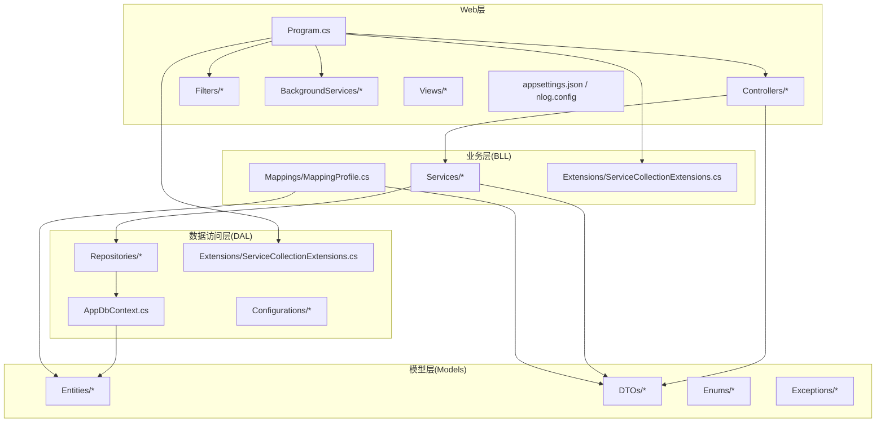
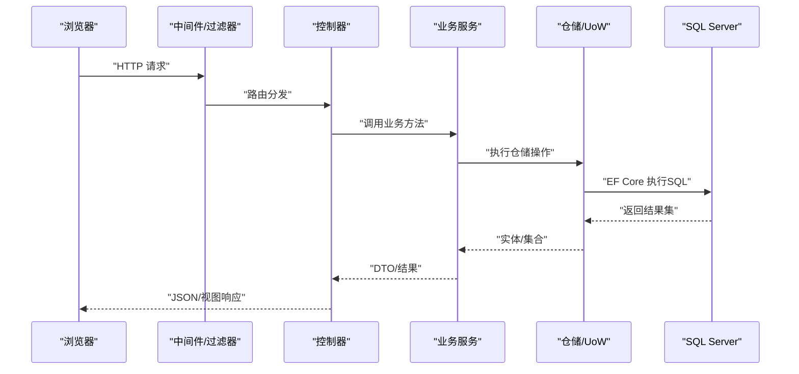

# 技术栈说明

<cite>
**本文引用的文件**   
- [EquipmentIMS.Web.csproj](file://EquipmentIMS.Web/EquipmentIMS.Web.csproj)
- [Program.cs](file://EquipmentIMS.Web/Program.cs)
- [appsettings.json](file://EquipmentIMS.Web/appsettings.json)
- [nlog.config](file://EquipmentIMS.Web/nlog.config)
- [libman.json](file://EquipmentIMS.Web/libman.json)
- [Extensions/ServiceCollectionExtensions.cs](file://EquipmentIMS.BLL/Extensions/ServiceCollectionExtensions.cs)
- [Mappings/MappingProfile.cs](file://EquipmentIMS.BLL/Mappings/MappingProfile.cs)
- [AppDbContext.cs](file://EquipmentIMS.DAL/AppDbContext.cs)
- [Extensions/ServiceCollectionExtensions.cs](file://EquipmentIMS.DAL/Extensions/ServiceCollectionExtensions.cs)
- [Repositories/GenericRepository.cs](file://EquipmentIMS.DAL/Repositories/GenericRepository.cs)
- [Repositories/UnitOfWork.cs](file://EquipmentIMS.DAL/Repositories/UnitOfWork.cs)
- [Interfaces/IRepository.cs](file://EquipmentIMS.DAL/Interfaces/IRepository.cs)
- [Interfaces/IUnitOfWork.cs](file://EquipmentIMS.DAL/Interfaces/IUnitOfWork.cs)
- [Entities/BaseEntity.cs](file://EquipmentIMS.Models/Entities/BaseEntity.cs)
- [Entities/SysUser.cs](file://EquipmentIMS.Models/Entities/SysUser.cs)
- [Entities/BaseProduct.cs](file://EquipmentIMS.Models/Entities/BaseProduct.cs)
- [DTOs/ApiResponse.cs](file://EquipmentIMS.Models/DTOs/ApiResponse.cs)
- [Controllers/HomeController.cs](file://EquipmentIMS.Web/Controllers/HomeController.cs)
- [Filters/GlobalExceptionMiddleware.cs](file://EquipmentIMS.Web/Filters/GlobalExceptionMiddleware.cs)
- [BackgroundServices/ExportBackgroundService.cs](file://EquipmentIMS.Web/BackgroundServices/ExportBackgroundService.cs)
- [BackgroundServices/ReportExportBackgroundService.cs](file://EquipmentIMS.Web/BackgroundServices/ReportExportBackgroundService.cs)
- [DataSeed.cs](file://EquipmentIMS.Web/DataSeed.cs)
</cite>

## 目录
1. [简介](#简介)
2. [项目结构](#项目结构)
3. [核心组件](#核心组件)
4. [架构总览](#架构总览)
5. [详细组件分析](#详细组件分析)
6. [依赖关系分析](#依赖关系分析)
7. [性能与可扩展性](#性能与可扩展性)
8. [故障排查指南](#故障排查指南)
9. [结论](#结论)
10. [附录：环境搭建与版本要求](#附录环境搭建与版本要求)

## 简介
本文件面向THMS（设备库存管理系统）的技术栈说明，覆盖后端、前端、数据库与开发工具链，解释各技术选型的原因与优势、版本兼容性要求，并提供架构图与依赖关系图。文档同时为开发者提供环境搭建指导，为架构师提供技术决策参考，并说明各组件在项目中的具体应用与作用。

## 项目结构
项目采用分层架构与模块化组织：
- Web层（MVC + API）：负责HTTP请求处理、视图渲染、中间件与过滤器、后台任务等
- 业务层（BLL）：领域服务、映射配置、缓存与加密等横切能力
- 数据访问层（DAL）：EF Core上下文、仓储与UoW实现、实体配置
- 模型层（Models）：实体、DTO、枚举、异常定义
- 测试与数据生成：单元测试与演示数据脚本

图表来源
- [Program.cs](file://EquipmentIMS.Web/Program.cs)
- [Extensions/ServiceCollectionExtensions.cs](file://EquipmentIMS.BLL/Extensions/ServiceCollectionExtensions.cs)
- [Extensions/ServiceCollectionExtensions.cs](file://EquipmentIMS.DAL/Extensions/ServiceCollectionExtensions.cs)
- [AppDbContext.cs](file://EquipmentIMS.DAL/AppDbContext.cs)
- [Repositories/GenericRepository.cs](file://EquipmentIMS.DAL/Repositories/GenericRepository.cs)
- [Repositories/UnitOfWork.cs](file://EquipmentIMS.DAL/Repositories/UnitOfWork.cs)
- [Mappings/MappingProfile.cs](file://EquipmentIMS.BLL/Mappings/MappingProfile.cs)
- [Entities/BaseEntity.cs](file://EquipmentIMS.Models/Entities/BaseEntity.cs)
- [DTOs/ApiResponse.cs](file://EquipmentIMS.Models/DTOs/ApiResponse.cs)

章节来源
- [Program.cs](file://EquipmentIMS.Web/Program.cs)
- [EquipmentIMS.Web.csproj](file://EquipmentIMS.Web/EquipmentIMS.Web.csproj)
- [Extensions/ServiceCollectionExtensions.cs](file://EquipmentIMS.BLL/Extensions/ServiceCollectionExtensions.cs)
- [Extensions/ServiceCollectionExtensions.cs](file://EquipmentIMS.DAL/Extensions/ServiceCollectionExtensions.cs)
- [AppDbContext.cs](file://EquipmentIMS.DAL/AppDbContext.cs)

## 核心组件
- 后端框架：ASP.NET Core MVC/Web API
  - 作用：统一HTTP管道、依赖注入、中间件、过滤器、身份认证授权、配置系统
  - 选型原因：跨平台、高性能、生态完善、与EF Core/AutoMapper/NLog等无缝集成
- ORM与数据访问：Entity Framework Core
  - 作用：对象关系映射、迁移、查询构建、事务与连接管理
  - 选型原因：强类型、可测试、支持复杂查询与批量操作、与SQL Server深度优化
- 对象映射：AutoMapper
  - 作用：在实体与DTO之间进行声明式映射，减少样板代码
  - 选型原因：配置集中、性能良好、易于维护
- 日志：NLog
  - 作用：结构化日志、异步写入、多目标输出（文件、控制台、数据库等）
  - 选型原因：灵活、高性能、易扩展
- 前端UI：Bootstrap、jQuery、Select2、ECharts
  - 作用：响应式布局、表单交互、下拉选择增强、图表可视化
  - 选型原因：成熟稳定、社区活跃、学习成本低
- 数据库：SQL Server
  - 作用：持久化存储、事务、索引、备份恢复
  - 选型原因：企业级特性丰富、与.NET生态契合度高
- 其他关键能力
  - 后台任务：IHostedService（导出、报表、库存预警等）
  - 全局异常处理：自定义中间件
  - 数据种子：启动时初始化基础数据
  - 客户端库管理：libman

章节来源
- [Program.cs](file://EquipmentIMS.Web/Program.cs)
- [nlog.config](file://EquipmentIMS.Web/nlog.config)
- [libman.json](file://EquipmentIMS.Web/libman.json)
- [DataSeed.cs](file://EquipmentIMS.Web/DataSeed.cs)
- [Filters/GlobalExceptionMiddleware.cs](file://EquipmentIMS.Web/Filters/GlobalExceptionMiddleware.cs)
- [BackgroundServices/ExportBackgroundService.cs](file://EquipmentIMS.Web/BackgroundServices/ExportBackgroundService.cs)
- [BackgroundServices/ReportExportBackgroundService.cs](file://EquipmentIMS.Web/BackgroundServices/ReportExportBackgroundService.cs)

## 架构总览
下图展示从浏览器到数据库的端到端调用路径，以及关键横切关注点（日志、异常、权限、缓存等）。

图表来源
- [Program.cs](file://EquipmentIMS.Web/Program.cs)
- [Controllers/HomeController.cs](file://EquipmentIMS.Web/Controllers/HomeController.cs)
- [Repositories/GenericRepository.cs](file://EquipmentIMS.DAL/Repositories/GenericRepository.cs)
- [Repositories/UnitOfWork.cs](file://EquipmentIMS.DAL/Repositories/UnitOfWork.cs)
- [AppDbContext.cs](file://EquipmentIMS.DAL/AppDbContext.cs)

## 详细组件分析

### 后端技术栈与选型
- ASP.NET Core
  - 角色：Web服务器、DI容器、中间件管线、配置与日志集成
  - 优势：跨平台、高并发、模块化、生态完善
  - 在本项目中的应用：Program中注册中间件、过滤器、背景服务；控制器接收请求并返回DTO或视图
- Entity Framework Core
  - 角色：ORM、迁移、查询构建、事务
  - 优势：强类型、可测试、支持复杂查询与批量操作
  - 在本项目中的应用：AppDbContext承载所有实体配置；仓储封装CRUD与事务边界
- AutoMapper
  - 角色：实体与DTO映射
  - 优势：声明式配置、集中管理、避免手写转换
  - 在本项目中的应用：MappingProfile集中定义映射规则
- NLog
  - 角色：结构化日志
  - 优势：异步、多目标、高性能
  - 在本项目中的应用：nlog.config定义目标与规则，贯穿控制器与服务层

章节来源
- [Program.cs](file://EquipmentIMS.Web/Program.cs)
- [nlog.config](file://EquipmentIMS.Web/nlog.config)
- [Mappings/MappingProfile.cs](file://EquipmentIMS.BLL/Mappings/MappingProfile.cs)
- [AppDbContext.cs](file://EquipmentIMS.DAL/AppDbContext.cs)

### 前端技术栈与选型
- Bootstrap
  - 作用：栅格布局、组件样式、响应式设计
- jQuery
  - 作用：DOM操作、AJAX、事件处理
- Select2
  - 作用：增强下拉框搜索与多选
- ECharts
  - 作用：交互式图表（库存、销售、采购等报表）
- 选型原因
  - 成熟稳定、学习曲线平缓、与MVC视图集成简单
  - 通过libman管理静态资源版本，便于本地开发与离线部署

章节来源
- [libman.json](file://EquipmentIMS.Web/libman.json)

### 数据库技术与选型
- SQL Server
  - 作用：企业级关系型数据库，支持事务、索引、备份恢复
  - 选型原因：与.NET生态高度契合，性能优异，工具链完善
- EF Core配置
  - 作用：实体映射、连接字符串、迁移策略
  - 在本项目中的应用：AppDbContext集中配置，仓储层使用UoW管理事务

章节来源
- [AppDbContext.cs](file://EquipmentIMS.DAL/AppDbContext.cs)

### 开发工具链
- .NET SDK与Visual Studio/VS Code
  - 作用：编译、调试、发布、NuGet包管理
- libman
  - 作用：管理前端静态库版本
- PowerShell脚本
  - 作用：数据生成与演示数据导入

章节来源
- [libman.json](file://EquipmentIMS.Web/libman.json)

## 依赖关系分析
下图展示主要程序集之间的依赖方向与职责边界。

图表来源
- [EquipmentIMS.Web.csproj](file://EquipmentIMS.Web/EquipmentIMS.Web.csproj)
- [Extensions/ServiceCollectionExtensions.cs](file://EquipmentIMS.BLL/Extensions/ServiceCollectionExtensions.cs)
- [Extensions/ServiceCollectionExtensions.cs](file://EquipmentIMS.DAL/Extensions/ServiceCollectionExtensions.cs)
- [AppDbContext.cs](file://EquipmentIMS.DAL/AppDbContext.cs)
- [Repositories/GenericRepository.cs](file://EquipmentIMS.DAL/Repositories/GenericRepository.cs)
- [Repositories/UnitOfWork.cs](file://EquipmentIMS.DAL/Repositories/UnitOfWork.cs)
- [Entities/BaseEntity.cs](file://EquipmentIMS.Models/Entities/BaseEntity.cs)
- [DTOs/ApiResponse.cs](file://EquipmentIMS.Models/DTOs/ApiResponse.cs)

章节来源
- [EquipmentIMS.Web.csproj](file://EquipmentIMS.Web/EquipmentIMS.Web.csproj)
- [Extensions/ServiceCollectionExtensions.cs](file://EquipmentIMS.BLL/Extensions/ServiceCollectionExtensions.cs)
- [Extensions/ServiceCollectionExtensions.cs](file://EquipmentIMS.DAL/Extensions/ServiceCollectionExtensions.cs)

## 性能与可扩展性
- 异步与并发
  - 控制器与服务层尽量使用异步API，提升吞吐
  - 后台任务（导出、报表、库存预警）使用IHostedService，避免阻塞请求线程
- 缓存
  - 内存缓存用于热点字典与配置项，降低数据库压力
- 日志
  - NLog异步写入，避免IO阻塞主流程
- 数据库
  - 合理使用索引、分页与投影查询，减少数据传输量
  - 批量操作与事务合并，减少往返次数
- 前端
  - 按需加载ECharts，延迟渲染大数据图表
  - 使用Select2远程搜索，减少首屏数据量

[本节为通用建议，不直接分析具体文件]

## 故障排查指南
- 全局异常处理
  - 通过自定义中间件捕获未处理异常，统一返回错误格式，便于前端提示与日志追踪
- 日志定位
  - 检查NLog配置文件的目标与规则，确认日志输出位置与级别
- 数据库连接
  - 核对连接字符串与网络可达性，查看EF Core生成的SQL语句
- 后台任务
  - 检查后台服务是否成功注册与运行，观察相关日志与队列状态

章节来源
- [Filters/GlobalExceptionMiddleware.cs](file://EquipmentIMS.Web/Filters/GlobalExceptionMiddleware.cs)
- [nlog.config](file://EquipmentIMS.Web/nlog.config)
- [BackgroundServices/ExportBackgroundService.cs](file://EquipmentIMS.Web/BackgroundServices/ExportBackgroundService.cs)
- [BackgroundServices/ReportExportBackgroundService.cs](file://EquipmentIMS.Web/BackgroundServices/ReportExportBackgroundService.cs)

## 结论
THMS采用成熟的.NET技术栈与分层架构，结合EF Core、AutoMapper与NLog，构建了高内聚、低耦合、可观测且易扩展的系统。前端以Bootstrap与jQuery为基础，辅以Select2与ECharts，满足丰富的交互与可视化需求。整体方案在企业级应用中具备稳定性与可维护性优势。

[本节为总结性内容，不直接分析具体文件]

## 附录：环境搭建与版本要求

### 环境准备
- 安装.NET SDK（推荐LTS版本）
- 安装SQL Server（建议使用较新版本以获得最佳性能与功能）
- 安装Visual Studio或VS Code及必要扩展
- 安装Node.js（可选，仅用于libman命令）

### 克隆与还原
- 克隆仓库后，在解决方案目录下执行包还原与libman还原
- 确保appsettings.json中的数据库连接字符串正确指向本地或远程SQL Server实例

### 初始化与运行
- 运行数据库迁移（如存在）
- 首次启动时可通过DataSeed初始化基础数据
- 启动Web项目，访问默认端口验证登录与基本功能

### 版本兼容要点
- ASP.NET Core与.NET运行时需匹配SDK版本
- EF Core与SQL Server驱动需保持兼容
- 前端静态库版本由libman锁定，避免升级引入破坏性变更

章节来源
- [appsettings.json](file://EquipmentIMS.Web/appsettings.json)
- [DataSeed.cs](file://EquipmentIMS.Web/DataSeed.cs)
- [libman.json](file://EquipmentIMS.Web/libman.json)