# 仓库管理

<cite>
**本文引用的文件**   
- [WarehouseService.cs](file://EquipmentIMS.BLL/Services/WarehouseService.cs)
- [IWarehouseService.cs](file://EquipmentIMS.BLL/Interfaces/IWarehouseService.cs)
- [BaseWarehouse.cs](file://EquipmentIMS.Models/Entities/BaseWarehouse.cs)
- [BaseWarehouseConfiguration.cs](file://EquipmentIMS.DAL/Configurations/BaseWarehouseConfiguration.cs)
- [StockRepository.cs](file://EquipmentIMS.DAL/Repositories/StockRepository.cs)
- [IStockRepository.cs](file://EquipmentIMS.DAL/Interfaces/IStockRepository.cs)
- [StockService.cs](file://EquipmentIMS.BLL/Services/StockService.cs)
- [IStockService.cs](file://EquipmentIMS.BLL/Interfaces/IStockService.cs)
- [StockCheckController.cs](file://EquipmentIMS.Web/Controllers/StockCheckController.cs)
- [StockTransferController.cs](file://EquipmentIMS.Web/Controllers/StockTransferController.cs)
- [StockCheckDto.cs](file://EquipmentIMS.Models/DTOs/StockCheckDto.cs)
- [StockTransferDto.cs](file://EquipmentIMS.Models/DTOs/StockTransferDto.cs)
- [StockTransactionDto.cs](file://EquipmentIMS.Models/DTOs/StockTransactionDto.cs)
- [StockTransactionQueryDto.cs](file://EquipmentIMS.Models/DTOs/StockTransactionQueryDto.cs)
- [InvStockCheck.cs](file://EquipmentIMS.Models/Entities/InvStockCheck.cs)
- [InvStockCheckDetail.cs](file://EquipmentIMS.Models/Entities/InvStockCheckDetail.cs)
- [InvStockTransfer.cs](file://EquipmentIMS.Models/Entities/InvStockTransfer.cs)
- [InvStockTransferDetail.cs](file://EquipmentIMS.Models/Entities/InvStockTransferDetail.cs)
- [InvStockTransaction.cs](file://EquipmentIMS.Models/Entities/InvStockTransaction.cs)
- [StockAlertBackgroundService.cs](file://EquipmentIMS.Web/BackgroundServices/StockAlertBackgroundService.cs)
- [ReportService.cs](file://EquipmentIMS.BLL/Services/ReportService.cs)
- [IReportService.cs](file://EquipmentIMS.BLL/Interfaces/IReportService.cs)
- [ReportInventoryDtos.cs](file://EquipmentIMS.Models/DTOs/Reports/ReportInventoryDtos.cs)
</cite>

## 目录
1. [简介](#简介)
2. [项目结构](#项目结构)
3. [核心组件](#核心组件)
4. [架构总览](#架构总览)
5. [详细组件分析](#详细组件分析)
6. [依赖关系分析](#依赖关系分析)
7. [性能与容量规划](#性能与容量规划)
8. [故障排查指南](#故障排查指南)
9. [结论](#结论)
10. [附录](#附录)

## 简介
本文件围绕仓库管理模块，系统性阐述仓库信息管理、仓库容量与位置管理、多仓库架构与调拨流程、库位管理与货架规划、存储策略优化、作业流程（入库/出库/盘点）、利用率分析与效率统计、空间优化建议，以及自动化设备集成与WMS对接方案。文档以代码级事实为依据，结合分层架构（Web/BLL/DAL/Models）进行说明，并提供可视化图示帮助理解。

## 项目结构
仓库相关能力分布在以下层次：
- Web层：控制器暴露仓储相关API（仓库、库存、盘点、调拨等），并承载报表导出与后台任务触发。
- BLL层：业务服务封装仓库、库存、盘点、调拨、报表等业务逻辑，协调仓储与库存领域操作。
- DAL层：仓储配置与数据访问，提供实体映射与通用/专用仓储接口实现。
- Models层：实体、DTO、枚举、异常等模型定义，贯穿各层交互契约。

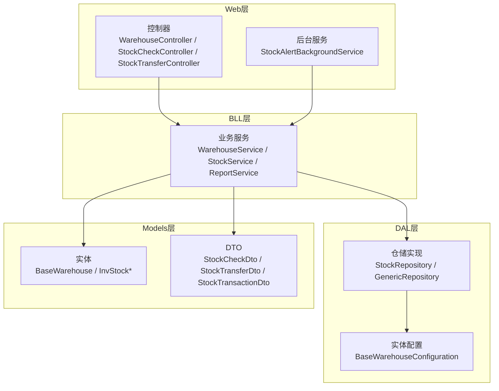

图表来源
- [WarehouseController.cs](file://EquipmentIMS.Web/Controllers/WarehouseController.cs)
- [StockCheckController.cs](file://EquipmentIMS.Web/Controllers/StockCheckController.cs)
- [StockTransferController.cs](file://EquipmentIMS.Web/Controllers/StockTransferController.cs)
- [StockAlertBackgroundService.cs](file://EquipmentIMS.Web/BackgroundServices/StockAlertBackgroundService.cs)
- [WarehouseService.cs](file://EquipmentIMS.BLL/Services/WarehouseService.cs)
- [StockService.cs](file://EquipmentIMS.BLL/Services/StockService.cs)
- [ReportService.cs](file://EquipmentIMS.BLL/Services/ReportService.cs)
- [StockRepository.cs](file://EquipmentIMS.DAL/Repositories/StockRepository.cs)
- [BaseWarehouseConfiguration.cs](file://EquipmentIMS.DAL/Configurations/BaseWarehouseConfiguration.cs)
- [BaseWarehouse.cs](file://EquipmentIMS.Models/Entities/BaseWarehouse.cs)
- [StockCheckDto.cs](file://EquipmentIMS.Models/DTOs/StockCheckDto.cs)
- [StockTransferDto.cs](file://EquipmentIMS.Models/DTOs/StockTransferDto.cs)
- [StockTransactionDto.cs](file://EquipmentIMS.Models/DTOs/StockTransactionDto.cs)

章节来源
- [WarehouseService.cs](file://EquipmentIMS.BLL/Services/WarehouseService.cs)
- [StockRepository.cs](file://EquipmentIMS.DAL/Repositories/StockRepository.cs)
- [BaseWarehouseConfiguration.cs](file://EquipmentIMS.DAL/Configurations/BaseWarehouseConfiguration.cs)
- [StockCheckController.cs](file://EquipmentIMS.Web/Controllers/StockCheckController.cs)
- [StockTransferController.cs](file://EquipmentIMS.Web/Controllers/StockTransferController.cs)
- [StockAlertBackgroundService.cs](file://EquipmentIMS.Web/BackgroundServices/StockAlertBackgroundService.cs)

## 核心组件
- 仓库信息服务：提供仓库的增删改查、状态控制、基础属性维护，支撑多仓库场景下的主数据管理。
- 库存与交易服务：围绕库存数量、批次/序列号、交易流水、安全库存预警等进行事务性处理。
- 盘点服务：支持创建盘点单、明细录入、差异处理与结果过账，确保账实相符。
- 调拨服务：跨仓库调拨的订单创建、审批、出库/入库联动与库存转移。
- 报表与分析服务：提供库存汇总、周转率、库龄、利用率等指标计算与导出。

章节来源
- [IWarehouseService.cs](file://EquipmentIMS.BLL/Interfaces/IWarehouseService.cs)
- [IStockService.cs](file://EquipmentIMS.BLL/Interfaces/IStockService.cs)
- [StockCheckDto.cs](file://EquipmentIMS.Models/DTOs/StockCheckDto.cs)
- [StockTransferDto.cs](file://EquipmentIMS.Models/DTOs/StockTransferDto.cs)
- [StockTransactionDto.cs](file://EquipmentIMS.Models/DTOs/StockTransactionDto.cs)
- [ReportInventoryDtos.cs](file://EquipmentIMS.Models/DTOs/Reports/ReportInventoryDtos.cs)

## 架构总览
仓库管理采用典型三层架构，通过接口解耦，便于扩展与测试。关键交互如下：
- Web控制器接收请求，调用BLL服务完成业务编排。
- BLL服务组合多个仓储与领域对象，保证事务一致性与业务规则。
- DAL层通过EF Core配置与仓储实现持久化。
- Models层统一实体与DTO契约，贯穿全链路。

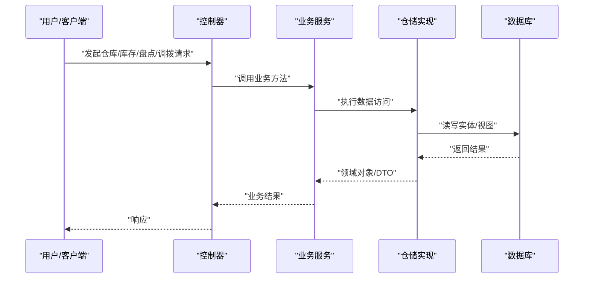

图表来源
- [StockCheckController.cs](file://EquipmentIMS.Web/Controllers/StockCheckController.cs)
- [StockTransferController.cs](file://EquipmentIMS.Web/Controllers/StockTransferController.cs)
- [WarehouseService.cs](file://EquipmentIMS.BLL/Services/WarehouseService.cs)
- [StockRepository.cs](file://EquipmentIMS.DAL/Repositories/StockRepository.cs)

## 详细组件分析

### 仓库信息与容量管理
- 仓库信息：包含仓库编码、名称、地址、负责人、状态等主数据字段，用于区分不同仓库主体。
- 容量管理：在仓库维度记录可用面积/体积/托盘位等容量指标，结合库存占用计算利用率。
- 位置管理：仓库内可进一步划分区域、通道、货架、库位层级，为上架策略与拣货路径优化提供基础。

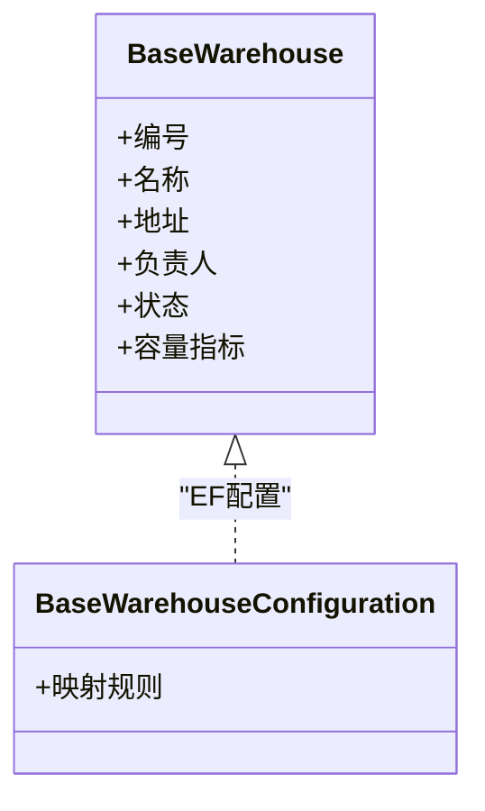

图表来源
- [BaseWarehouse.cs](file://EquipmentIMS.Models/Entities/BaseWarehouse.cs)
- [BaseWarehouseConfiguration.cs](file://EquipmentIMS.DAL/Configurations/BaseWarehouseConfiguration.cs)

章节来源
- [BaseWarehouse.cs](file://EquipmentIMS.Models/Entities/BaseWarehouse.cs)
- [BaseWarehouseConfiguration.cs](file://EquipmentIMS.DAL/Configurations/BaseWarehouseConfiguration.cs)

### 多仓库架构与仓库间调拨
- 多仓库设计：所有库存与交易均绑定仓库标识，支持按仓库隔离查询与统计。
- 调拨流程：创建调拨单（源仓库→目标仓库）→审核→源仓出库→目标仓入库→库存转移完成。
- 一致性保障：调拨涉及两仓库存扣减与增加，需在同一事务中完成，避免中间态不一致。

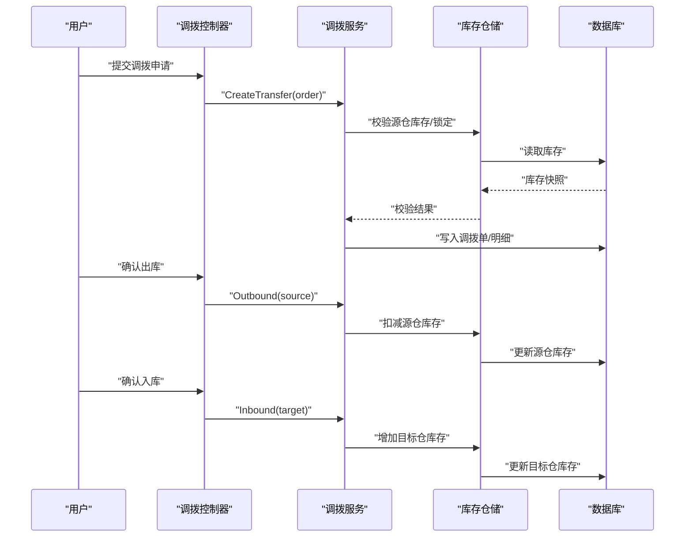

图表来源
- [StockTransferController.cs](file://EquipmentIMS.Web/Controllers/StockTransferController.cs)
- [StockTransferDto.cs](file://EquipmentIMS.Models/DTOs/StockTransferDto.cs)
- [InvStockTransfer.cs](file://EquipmentIMS.Models/Entities/InvStockTransfer.cs)
- [InvStockTransferDetail.cs](file://EquipmentIMS.Models/Entities/InvStockTransferDetail.cs)
- [StockRepository.cs](file://EquipmentIMS.DAL/Repositories/StockRepository.cs)

章节来源
- [StockTransferController.cs](file://EquipmentIMS.Web/Controllers/StockTransferController.cs)
- [StockTransferDto.cs](file://EquipmentIMS.Models/DTOs/StockTransferDto.cs)
- [InvStockTransfer.cs](file://EquipmentIMS.Models/Entities/InvStockTransfer.cs)
- [InvStockTransferDetail.cs](file://EquipmentIMS.Models/Entities/InvStockTransferDetail.cs)
- [StockRepository.cs](file://EquipmentIMS.DAL/Repositories/StockRepository.cs)

### 库位管理与货架规划
- 库位建模：仓库→区域→通道→货架→层→格口，形成多级定位体系。
- 上架策略：可按品类、周转率、体积重量、先进先出等规则推荐库位。
- 拣货路径：基于库位坐标与订单行聚合，生成最优拣货路线，减少行走距离。

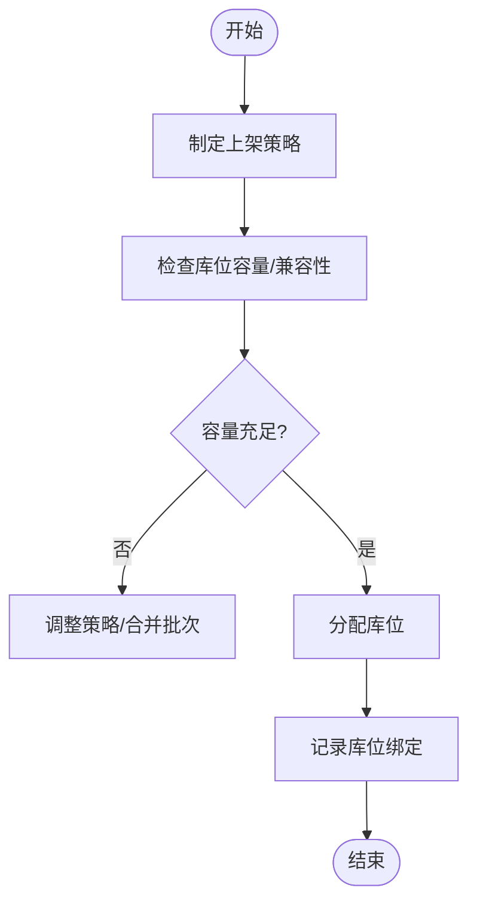

[本节为概念性流程，不直接对应具体源码文件]

### 存储策略优化
- 分类分区：ABC分类、冷热分离、危险品隔离、温湿度要求分区。
- 批次与效期：FIFO/FEFO策略，近效期优先出库。
- 堆码与包装：按SKU尺寸与包装规格设定堆叠高度与托盘化策略。

[本节为概念性内容，不直接对应具体源码文件]

### 作业流程：入库、出库、盘点
- 入库：采购到货/退货入库→质检→上架→库存增加→交易流水记录。
- 出库：销售出库/领料出库→波次/拣货→复核→打包→发货→库存扣减→交易流水记录。
- 盘点：创建盘点计划→冻结或动态盘点→差异录入→差异审批→过账调整→生成盘点报告。

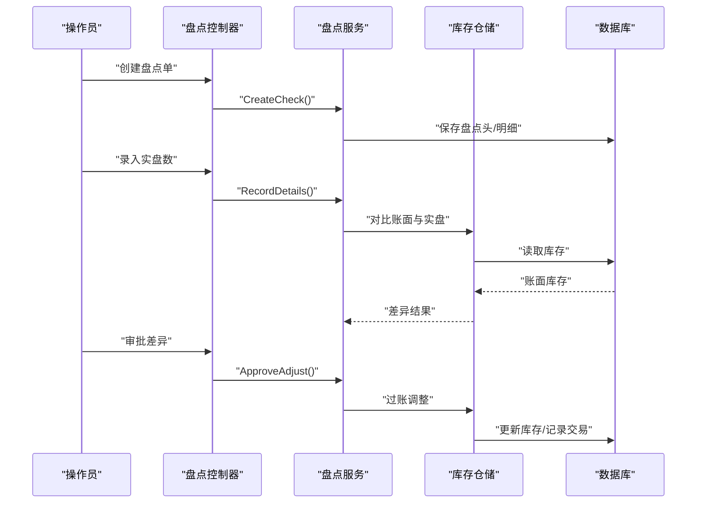

图表来源
- [StockCheckController.cs](file://EquipmentIMS.Web/Controllers/StockCheckController.cs)
- [StockCheckDto.cs](file://EquipmentIMS.Models/DTOs/StockCheckDto.cs)
- [InvStockCheck.cs](file://EquipmentIMS.Models/Entities/InvStockCheck.cs)
- [InvStockCheckDetail.cs](file://EquipmentIMS.Models/Entities/InvStockCheckDetail.cs)
- [StockRepository.cs](file://EquipmentIMS.DAL/Repositories/StockRepository.cs)

章节来源
- [StockCheckController.cs](file://EquipmentIMS.Web/Controllers/StockCheckController.cs)
- [StockCheckDto.cs](file://EquipmentIMS.Models/DTOs/StockCheckDto.cs)
- [InvStockCheck.cs](file://EquipmentIMS.Models/Entities/InvStockCheck.cs)
- [InvStockCheckDetail.cs](file://EquipmentIMS.Models/Entities/InvStockCheckDetail.cs)
- [StockRepository.cs](file://EquipmentIMS.DAL/Repositories/StockRepository.cs)

### 仓库利用率分析与作业效率统计
- 利用率：按仓库/区域/货架/库位维度统计占用率、空置率、周转天数。
- 效率指标：入库时效、出库时效、拣货行数/小时、盘点准确率、差异率。
- 报表输出：库存汇总、库龄分布、滞销/呆滞清单、热点SKU排行。

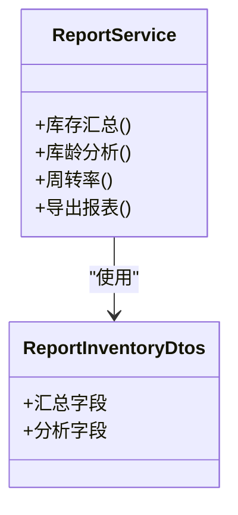

图表来源
- [ReportService.cs](file://EquipmentIMS.BLL/Services/ReportService.cs)
- [ReportInventoryDtos.cs](file://EquipmentIMS.Models/DTOs/Reports/ReportInventoryDtos.cs)

章节来源
- [ReportService.cs](file://EquipmentIMS.BLL/Services/ReportService.cs)
- [ReportInventoryDtos.cs](file://EquipmentIMS.Models/DTOs/Reports/ReportInventoryDtos.cs)

### 库存交易与审计
- 交易流水：每笔出入库、调拨、盘点调整均生成交易记录，支持追溯与对账。
- 查询过滤：支持按仓库、商品、时间范围、交易类型、单据号等多条件筛选。

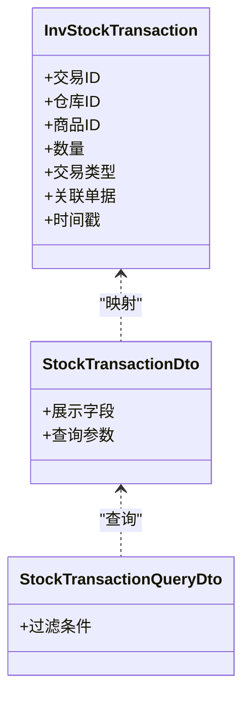

图表来源
- [InvStockTransaction.cs](file://EquipmentIMS.Models/Entities/InvStockTransaction.cs)
- [StockTransactionDto.cs](file://EquipmentIMS.Models/DTOs/StockTransactionDto.cs)
- [StockTransactionQueryDto.cs](file://EquipmentIMS.Models/DTOs/StockTransactionQueryDto.cs)

章节来源
- [InvStockTransaction.cs](file://EquipmentIMS.Models/Entities/InvStockTransaction.cs)
- [StockTransactionDto.cs](file://EquipmentIMS.Models/DTOs/StockTransactionDto.cs)
- [StockTransactionQueryDto.cs](file://EquipmentIMS.Models/DTOs/StockTransactionQueryDto.cs)

### 安全库存与预警
- 安全库存：为SKU设置最低/最高库存阈值，低于下限触发补货提醒。
- 预警机制：后台定时扫描低库存、临期品、超储品，推送通知或生成任务。

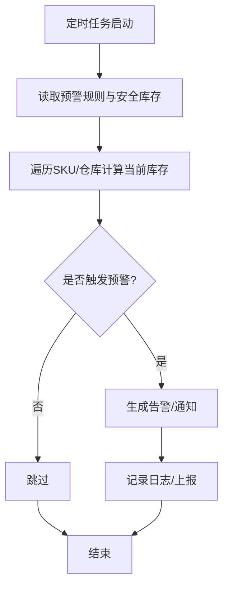

图表来源
- [StockAlertBackgroundService.cs](file://EquipmentIMS.Web/BackgroundServices/StockAlertBackgroundService.cs)

章节来源
- [StockAlertBackgroundService.cs](file://EquipmentIMS.Web/BackgroundServices/StockAlertBackgroundService.cs)

### 自动化设备集成与WMS对接方案
- 设备接入：通过标准协议（如OPC UA、MQTT、HTTP API）与AGV、输送线、电子标签、RFID读写器通信。
- 指令下发：WMS将上架、下架、移库、盘点任务转换为设备指令队列，设备反馈执行状态。
- 数据同步：设备事件回写至交易流水与库位占用表，保持系统实时一致。
- 容错与重试：失败任务进入重试队列，异常报警并人工介入。

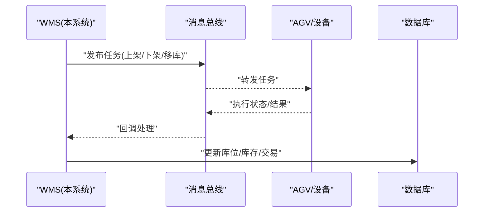

[本节为概念性对接方案，不直接对应具体源码文件]

## 依赖关系分析
- 控制器到服务：Web控制器仅负责请求解析与响应组装，核心逻辑下沉至BLL服务。
- 服务到仓储：BLL服务通过仓储接口访问数据，避免与具体实现耦合。
- 实体与配置：DAL层通过EF Core配置类描述实体映射，保证数据库结构与领域模型一致。
- DTO与实体：跨层传输使用DTO，屏蔽内部实体细节，提升稳定性与演进能力。

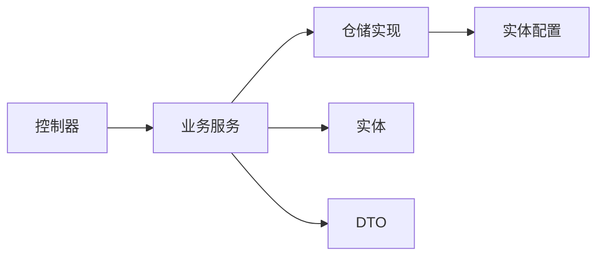

图表来源
- [StockCheckController.cs](file://EquipmentIMS.Web/Controllers/StockCheckController.cs)
- [StockTransferController.cs](file://EquipmentIMS.Web/Controllers/StockTransferController.cs)
- [WarehouseService.cs](file://EquipmentIMS.BLL/Services/WarehouseService.cs)
- [StockRepository.cs](file://EquipmentIMS.DAL/Repositories/StockRepository.cs)
- [BaseWarehouseConfiguration.cs](file://EquipmentIMS.DAL/Configurations/BaseWarehouseConfiguration.cs)
- [StockCheckDto.cs](file://EquipmentIMS.Models/DTOs/StockCheckDto.cs)
- [StockTransferDto.cs](file://EquipmentIMS.Models/DTOs/StockTransferDto.cs)

章节来源
- [StockCheckController.cs](file://EquipmentIMS.Web/Controllers/StockCheckController.cs)
- [StockTransferController.cs](file://EquipmentIMS.Web/Controllers/StockTransferController.cs)
- [WarehouseService.cs](file://EquipmentIMS.BLL/Services/WarehouseService.cs)
- [StockRepository.cs](file://EquipmentIMS.DAL/Repositories/StockRepository.cs)
- [BaseWarehouseConfiguration.cs](file://EquipmentIMS.DAL/Configurations/BaseWarehouseConfiguration.cs)
- [StockCheckDto.cs](file://EquipmentIMS.Models/DTOs/StockCheckDto.cs)
- [StockTransferDto.cs](file://EquipmentIMS.Models/DTOs/StockTransferDto.cs)

## 性能与容量规划
- 索引与查询：为高频查询字段（仓库、商品、时间、交易类型）建立合适索引，避免全表扫描。
- 分页与投影：列表查询采用分页与只读投影，减少网络与内存开销。
- 事务边界：调拨、盘点过账等关键操作限定最小事务范围，降低锁竞争。
- 缓存策略：字典类数据（仓库、区域、货架）可短期缓存，提高读取性能。
- 异步与批处理：报表导出、批量调整、历史归档采用后台任务与分批处理。
- 容量监控：持续采集仓库/库位占用率与吞吐指标，设置阈值告警与扩容预案。

[本节提供通用指导，不直接对应具体源码文件]

## 故障排查指南
- 库存不一致：核对交易流水与库存快照，定位缺失或重复过账的交易；检查事务是否完整提交。
- 调拨失败：查看调拨单状态机流转，确认源仓出库与目标仓入库是否成对完成；核查库存锁定与并发冲突。
- 盘点差异大：复核盘点冻结策略与动态盘点逻辑，确认是否存在未过账的调整单。
- 预警不生效：检查后台任务调度、规则配置与阈值设置；验证告警通知通道连通性。
- 性能问题：定位慢SQL与热点表，评估索引命中率与锁等待；必要时拆分报表任务或引入物化视图。

章节来源
- [StockCheckController.cs](file://EquipmentIMS.Web/Controllers/StockCheckController.cs)
- [StockTransferController.cs](file://EquipmentIMS.Web/Controllers/StockTransferController.cs)
- [StockAlertBackgroundService.cs](file://EquipmentIMS.Web/BackgroundServices/StockAlertBackgroundService.cs)

## 结论
仓库管理模块以清晰的三层架构与明确的职责边界，实现了仓库主数据、库存交易、盘点与调拨的核心能力。通过库位与货架规划、存储策略优化、利用率与效率分析，持续提升空间与作业效率。面向自动化与WMS集成的扩展点已预留，便于后续接入更多智能设备与外部系统。

## 附录
- 术语
  - 仓库：具备独立物理与管理边界的存储单元。
  - 库位：仓库内最小可定位的存放单元。
  - 调拨：同一企业下不同仓库之间的库存转移。
  - 盘点：对实物与账面库存进行核对与调整的过程。
- 最佳实践
  - 以交易流水为核心，确保任何库存变动可追溯。
  - 严格区分“计划”与“执行”，避免误操作影响库存。
  - 定期复盘利用率与效率指标，驱动流程与布局优化。