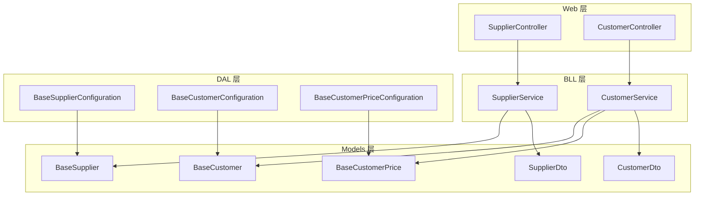
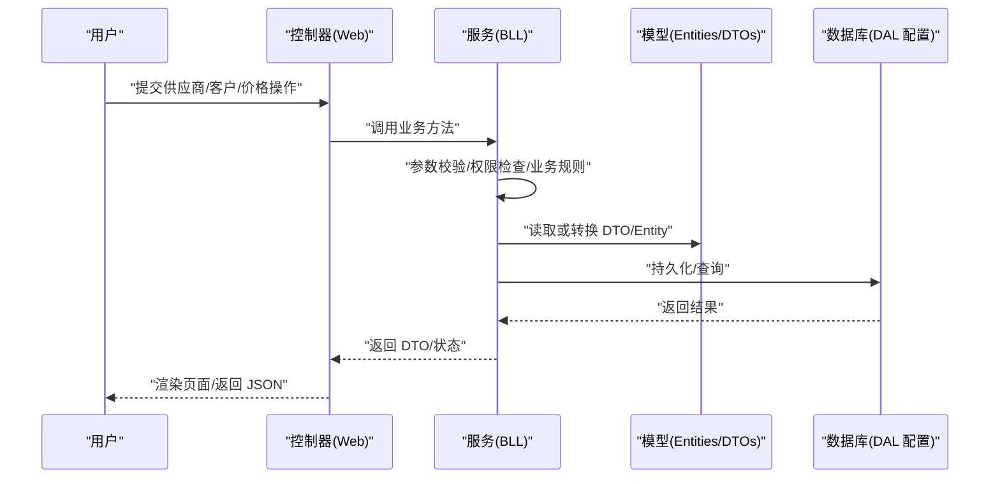
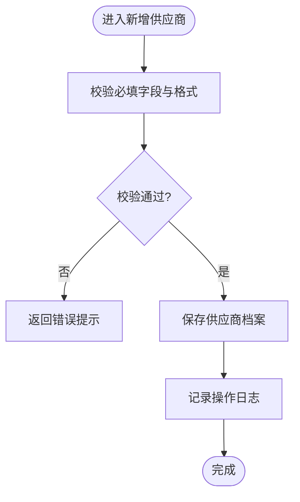
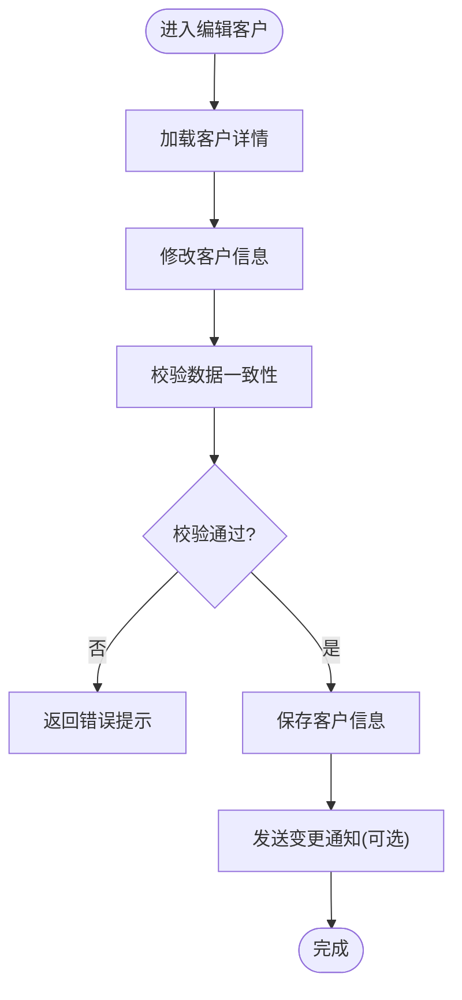
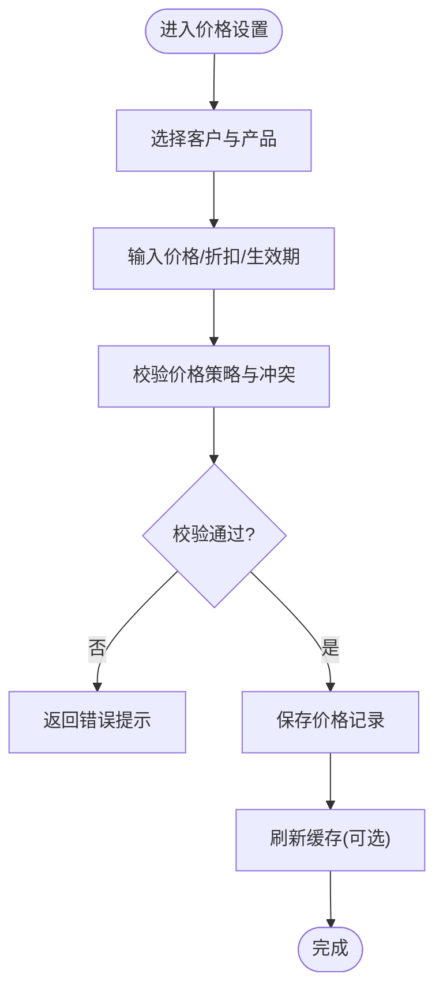
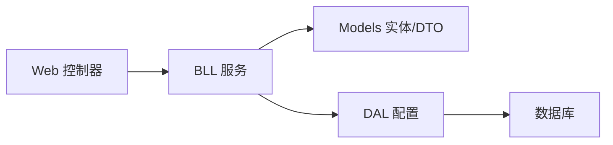

# 供应商与客户管理

<cite>
**本文引用的文件**   
- [SupplierService.cs](file://EquipmentIMS.BLL/Services/SupplierService.cs)
- [CustomerService.cs](file://EquipmentIMS.BLL/Services/CustomerService.cs)
- [BaseSupplier.cs](file://EquipmentIMS.Models/Entities/BaseSupplier.cs)
- [BaseCustomer.cs](file://EquipmentIMS.Models/Entities/BaseCustomer.cs)
- [BaseCustomerPrice.cs](file://EquipmentIMS.Models/Entities/BaseCustomerPrice.cs)
- [SupplierController.cs](file://EquipmentIMS.Web/Controllers/SupplierController.cs)
- [CustomerController.cs](file://EquipmentIMS.Web/Controllers/CustomerController.cs)
- [SupplierDto.cs](file://EquipmentIMS.Models/DTOs/SupplierDto.cs)
- [CustomerDto.cs](file://EquipmentIMS.Models/DTOs/CustomerDto.cs)
- [BaseSupplierConfiguration.cs](file://EquipmentIMS.DAL/Configurations/BaseSupplierConfiguration.cs)
- [BaseCustomerConfiguration.cs](file://EquipmentIMS.DAL/Configurations/BaseCustomerConfiguration.cs)
- [BaseCustomerPriceConfiguration.cs](file://EquipmentIMS.DAL/Configurations/BaseCustomerPriceConfiguration.cs)
</cite>

## 目录
1. [简介](#简介)
2. [项目结构](#项目结构)
3. [核心组件](#核心组件)
4. [架构总览](#架构总览)
5. [详细组件分析](#详细组件分析)
6. [依赖关系分析](#依赖关系分析)
7. [性能考虑](#性能考虑)
8. [故障排查指南](#故障排查指南)
9. [结论](#结论)
10. [附录](#附录)

## 简介
本模块聚焦于“供应商与客户管理”，围绕供应商信息管理、客户信息管理、价格管理等核心能力，提供从基础档案到业务协同的完整支撑。文档覆盖以下主题：
- 供应商信息管理与评估体系（资质管理、合同管理流程）
- 客户分级管理、信用评估与价格策略配置
- 供应商绩效考核、客户满意度调查与合作关系维护
- 供应链风险管理、客户流失预警与商业智能分析
- 供应商门户与客户自助服务系统的集成方案

说明：本文档基于仓库中现有代码结构与接口进行归纳与扩展性建议，未直接实现的功能以“可扩展点”形式给出，便于后续迭代落地。

## 项目结构
供应商与客户管理在分层架构中的位置如下：
- Web 层：控制器暴露 REST 接口，承载供应商与客户的增删改查及价格维护等页面逻辑
- 业务层：服务类封装领域规则、校验与编排调用仓储
- 数据访问层：实体映射配置定义数据库表结构
- 模型层：实体、DTO、枚举与异常类型

图表来源
- [SupplierController.cs](file://EquipmentIMS.Web/Controllers/SupplierController.cs)
- [CustomerController.cs](file://EquipmentIMS.Web/Controllers/CustomerController.cs)
- [SupplierService.cs](file://EquipmentIMS.BLL/Services/SupplierService.cs)
- [CustomerService.cs](file://EquipmentIMS.BLL/Services/CustomerService.cs)
- [BaseSupplier.cs](file://EquipmentIMS.Models/Entities/BaseSupplier.cs)
- [BaseCustomer.cs](file://EquipmentIMS.Models/Entities/BaseCustomer.cs)
- [BaseCustomerPrice.cs](file://EquipmentIMS.Models/Entities/BaseCustomerPrice.cs)
- [SupplierDto.cs](file://EquipmentIMS.Models/DTOs/SupplierDto.cs)
- [CustomerDto.cs](file://EquipmentIMS.Models/DTOs/CustomerDto.cs)
- [BaseSupplierConfiguration.cs](file://EquipmentIMS.DAL/Configurations/BaseSupplierConfiguration.cs)
- [BaseCustomerConfiguration.cs](file://EquipmentIMS.DAL/Configurations/BaseCustomerConfiguration.cs)
- [BaseCustomerPriceConfiguration.cs](file://EquipmentIMS.DAL/Configurations/BaseCustomerPriceConfiguration.cs)

章节来源
- [SupplierController.cs](file://EquipmentIMS.Web/Controllers/SupplierController.cs)
- [CustomerController.cs](file://EquipmentIMS.Web/Controllers/CustomerController.cs)
- [SupplierService.cs](file://EquipmentIMS.BLL/Services/SupplierService.cs)
- [CustomerService.cs](file://EquipmentIMS.BLL/Services/CustomerService.cs)
- [BaseSupplier.cs](file://EquipmentIMS.Models/Entities/BaseSupplier.cs)
- [BaseCustomer.cs](file://EquipmentIMS.Models/Entities/BaseCustomer.cs)
- [BaseCustomerPrice.cs](file://EquipmentIMS.Models/Entities/BaseCustomerPrice.cs)
- [SupplierDto.cs](file://EquipmentIMS.Models/DTOs/SupplierDto.cs)
- [CustomerDto.cs](file://EquipmentIMS.Models/DTOs/CustomerDto.cs)
- [BaseSupplierConfiguration.cs](file://EquipmentIMS.DAL/Configurations/BaseSupplierConfiguration.cs)
- [BaseCustomerConfiguration.cs](file://EquipmentIMS.DAL/Configurations/BaseCustomerConfiguration.cs)
- [BaseCustomerPriceConfiguration.cs](file://EquipmentIMS.DAL/Configurations/BaseCustomerPriceConfiguration.cs)

## 核心组件
- 供应商管理
  - 供应商档案：统一维护供应商基本信息、联系人、地址、税号、银行账户等
  - 供应商评估：支持资质审核、评分维度与等级划分（可扩展）
  - 合同管理：合同生命周期与版本控制（可扩展）
  - 绩效考核：交付质量、交期达成率、价格竞争力等指标（可扩展）
- 客户管理
  - 客户档案：企业/个人基本信息、开票信息、结算方式等
  - 客户分级：按规模、贡献度、风险等维度划分等级（可扩展）
  - 信用评估：授信额度、账期、逾期记录（可扩展）
  - 价格策略：按客户、产品、区域、时间等多维定价（已具备 BaseCustomerPrice）
- 价格管理
  - 客户价目表：针对特定客户的产品价格、折扣、生效期、优先级等
  - 价格审批流：价格变更审批与版本留痕（可扩展）

章节来源
- [BaseSupplier.cs](file://EquipmentIMS.Models/Entities/BaseSupplier.cs)
- [BaseCustomer.cs](file://EquipmentIMS.Models/Entities/BaseCustomer.cs)
- [BaseCustomerPrice.cs](file://EquipmentIMS.Models/Entities/BaseCustomerPrice.cs)
- [SupplierService.cs](file://EquipmentIMS.BLL/Services/SupplierService.cs)
- [CustomerService.cs](file://EquipmentIMS.BLL/Services/CustomerService.cs)
- [SupplierDto.cs](file://EquipmentIMS.Models/DTOs/SupplierDto.cs)
- [CustomerDto.cs](file://EquipmentIMS.Models/DTOs/CustomerDto.cs)

## 架构总览
系统采用典型三层架构：Web 控制器负责请求路由与参数绑定；BLL 服务层封装业务规则与事务边界；DAL 通过 EF Core 配置映射实体到数据库。供应商与客户管理的端到端调用链如下：

图表来源
- [SupplierController.cs](file://EquipmentIMS.Web/Controllers/SupplierController.cs)
- [CustomerController.cs](file://EquipmentIMS.Web/Controllers/CustomerController.cs)
- [SupplierService.cs](file://EquipmentIMS.BLL/Services/SupplierService.cs)
- [CustomerService.cs](file://EquipmentIMS.BLL/Services/CustomerService.cs)
- [BaseSupplier.cs](file://EquipmentIMS.Models/Entities/BaseSupplier.cs)
- [BaseCustomer.cs](file://EquipmentIMS.Models/Entities/BaseCustomer.cs)
- [BaseCustomerPrice.cs](file://EquipmentIMS.Models/Entities/BaseCustomerPrice.cs)
- [BaseSupplierConfiguration.cs](file://EquipmentIMS.DAL/Configurations/BaseSupplierConfiguration.cs)
- [BaseCustomerConfiguration.cs](file://EquipmentIMS.DAL/Configurations/BaseCustomerConfiguration.cs)
- [BaseCustomerPriceConfiguration.cs](file://EquipmentIMS.DAL/Configurations/BaseCustomerPriceConfiguration.cs)

## 详细组件分析

### 供应商管理组件
- 职责范围
  - 供应商档案的创建、编辑、查询、分页与导出
  - 供应商评估与资质管理（可扩展）
  - 合同管理流程（可扩展）
  - 供应商绩效考核（可扩展）
- 关键交互
  - 控制器接收表单/JSON，调用 SupplierService 执行业务逻辑
  - Service 层进行数据校验、权限控制、审计日志记录
  - 通过 DAL 配置将实体持久化至数据库
- 数据模型要点
  - 供应商实体用于存储主数据与元信息
  - DTO 用于前后端数据传输与展示
- 业务流程（示例：新增供应商）

图表来源
- [SupplierController.cs](file://EquipmentIMS.Web/Controllers/SupplierController.cs)
- [SupplierService.cs](file://EquipmentIMS.BLL/Services/SupplierService.cs)
- [BaseSupplier.cs](file://EquipmentIMS.Models/Entities/BaseSupplier.cs)
- [SupplierDto.cs](file://EquipmentIMS.Models/DTOs/SupplierDto.cs)
- [BaseSupplierConfiguration.cs](file://EquipmentIMS.DAL/Configurations/BaseSupplierConfiguration.cs)

章节来源
- [SupplierController.cs](file://EquipmentIMS.Web/Controllers/SupplierController.cs)
- [SupplierService.cs](file://EquipmentIMS.BLL/Services/SupplierService.cs)
- [BaseSupplier.cs](file://EquipmentIMS.Models/Entities/BaseSupplier.cs)
- [SupplierDto.cs](file://EquipmentIMS.Models/DTOs/SupplierDto.cs)
- [BaseSupplierConfiguration.cs](file://EquipmentIMS.DAL/Configurations/BaseSupplierConfiguration.cs)

### 客户管理组件
- 职责范围
  - 客户档案的创建、编辑、查询、分页与导出
  - 客户分级与信用评估（可扩展）
  - 客户满意度调查与合作关系维护（可扩展）
  - 客户流失预警（可扩展）
- 关键交互
  - 控制器处理客户相关请求，委托 CustomerService 执行
  - Service 层整合业务规则与外部服务（如通知、报表）
- 数据模型要点
  - 客户实体承载主数据
  - 客户价目表实体用于多维定价
- 业务流程（示例：更新客户信息）

图表来源
- [CustomerController.cs](file://EquipmentIMS.Web/Controllers/CustomerController.cs)
- [CustomerService.cs](file://EquipmentIMS.BLL/Services/CustomerService.cs)
- [BaseCustomer.cs](file://EquipmentIMS.Models/Entities/BaseCustomer.cs)
- [CustomerDto.cs](file://EquipmentIMS.Models/DTOs/CustomerDto.cs)
- [BaseCustomerConfiguration.cs](file://EquipmentIMS.DAL/Configurations/BaseCustomerConfiguration.cs)

章节来源
- [CustomerController.cs](file://EquipmentIMS.Web/Controllers/CustomerController.cs)
- [CustomerService.cs](file://EquipmentIMS.BLL/Services/CustomerService.cs)
- [BaseCustomer.cs](file://EquipmentIMS.Models/Entities/BaseCustomer.cs)
- [CustomerDto.cs](file://EquipmentIMS.Models/DTOs/CustomerDto.cs)
- [BaseCustomerConfiguration.cs](file://EquipmentIMS.DAL/Configurations/BaseCustomerConfiguration.cs)

### 价格管理组件
- 职责范围
  - 客户价目表的维护：按客户、产品、区域、有效期、优先级等维度设置价格
  - 价格策略配置：折扣、促销、阶梯价、最低限价等（可扩展）
  - 价格审批与版本留痕（可扩展）
- 关键交互
  - 控制器提供价格列表、新增、编辑、删除、导入导出
  - Service 层确保价格冲突检测、生效期校验、权限控制
- 数据模型要点
  - BaseCustomerPrice 作为价格主数据载体
  - 通过 DAL 配置建立索引与约束，保障查询性能与数据一致性
- 业务流程（示例：为客户设置产品价格）

图表来源
- [CustomerController.cs](file://EquipmentIMS.Web/Controllers/CustomerController.cs)
- [CustomerService.cs](file://EquipmentIMS.BLL/Services/CustomerService.cs)
- [BaseCustomerPrice.cs](file://EquipmentIMS.Models/Entities/BaseCustomerPrice.cs)
- [BaseCustomerPriceConfiguration.cs](file://EquipmentIMS.DAL/Configurations/BaseCustomerPriceConfiguration.cs)

章节来源
- [CustomerController.cs](file://EquipmentIMS.Web/Controllers/CustomerController.cs)
- [CustomerService.cs](file://EquipmentIMS.BLL/Services/CustomerService.cs)
- [BaseCustomerPrice.cs](file://EquipmentIMS.Models/Entities/BaseCustomerPrice.cs)
- [BaseCustomerPriceConfiguration.cs](file://EquipmentIMS.DAL/Configurations/BaseCustomerPriceConfiguration.cs)

### 供应商评估与资质管理（可扩展）
- 评估维度
  - 资质合规：营业执照、许可证、质量体系认证等
  - 交付能力：准时交付率、批次合格率、退换货率
  - 价格竞争力：同品类比价、成本趋势
  - 服务响应：沟通效率、问题闭环时效
- 资质管理流程
  - 上传与归档资质文件
  - 自动到期提醒与续审
  - 资质有效性校验与黑名单联动
- 合同管理流程（可扩展）
  - 合同模板与条款库
  - 电子签批与版本控制
  - 履约跟踪与违约预警

章节来源
- [SupplierService.cs](file://EquipmentIMS.BLL/Services/SupplierService.cs)
- [BaseSupplier.cs](file://EquipmentIMS.Models/Entities/BaseSupplier.cs)
- [SupplierDto.cs](file://EquipmentIMS.Models/DTOs/SupplierDto.cs)

### 客户分级与信用评估（可扩展）
- 分级策略
  - 按营收贡献、订单频次、毛利率、战略重要性等维度打分
  - 等级与价格策略、账期、库存配额联动
- 信用评估
  - 授信额度、账期、逾期天数、坏账率
  - 动态调整与风控阈值告警
- 满意度调查
  - 定期问卷、NPS 评分、投诉工单闭环
  - 与客户服务团队绩效挂钩

章节来源
- [CustomerService.cs](file://EquipmentIMS.BLL/Services/CustomerService.cs)
- [BaseCustomer.cs](file://EquipmentIMS.Models/Entities/BaseCustomer.cs)
- [CustomerDto.cs](file://EquipmentIMS.Models/DTOs/CustomerDto.cs)

### 供应商绩效考核（可扩展）
- 指标体系
  - 质量：来料合格率、缺陷率
  - 交付：OTD（准时交付率）、平均交货周期
  - 成本：价格波动、降本贡献
  - 服务：响应速度、问题解决率
- 考核流程
  - 数据采集（采购入库、质检、售后）
  - 评分计算与排名
  - 结果应用（续约、淘汰、配额调整）

章节来源
- [SupplierService.cs](file://EquipmentIMS.BLL/Services/SupplierService.cs)
- [BaseSupplier.cs](file://EquipmentIMS.Models/Entities/BaseSupplier.cs)

### 客户关系维护与流失预警（可扩展）
- 关系维护
  - 拜访计划、会议纪要、合作里程碑
  - 节日问候、专属客服通道
- 流失预警
  - 交易活跃度下降、客诉增多、竞品替代迹象
  - 预警触发与挽回策略（优惠、升级服务）

章节来源
- [CustomerService.cs](file://EquipmentIMS.BLL/Services/CustomerService.cs)
- [BaseCustomer.cs](file://EquipmentIMS.Models/Entities/BaseCustomer.cs)

### 供应链风险管理（可扩展）
- 风险识别
  - 供应中断、价格暴涨、合规风险、地缘政治
- 风险度量
  - 单一来源占比、替代供应商可用性、安全库存
- 应对策略
  - 多源采购、框架协议、应急切换预案

章节来源
- [SupplierService.cs](file://EquipmentIMS.BLL/Services/SupplierService.cs)
- [BaseSupplier.cs](file://EquipmentIMS.Models/Entities/BaseSupplier.cs)

### 商业智能分析（可扩展）
- 分析主题
  - 供应商绩效看板、客户价值分析、价格毛利分析
  - 趋势预测与异常检测
- 数据源
  - 供应商/客户主数据、交易明细、价格策略、质检与售后
- 输出
  - 可视化报表、导出任务、自动化报告推送

章节来源
- [CustomerService.cs](file://EquipmentIMS.BLL/Services/CustomerService.cs)
- [SupplierService.cs](file://EquipmentIMS.BLL/Services/SupplierService.cs)

### 供应商门户与客户自助服务集成（可扩展）
- 供应商门户
  - 在线报价、订单确认、发货通知、对账与发票
  - 资质上传、合同签署、绩效反馈
- 客户自助服务
  - 在线下单、价格查询、订单跟踪、退换货申请
  - 满意度评价、服务工单、知识库
- 集成方案
  - 统一身份认证（SSO）、API 网关、消息队列异步处理
  - 数据同步与审计日志、权限隔离与最小授权

章节来源
- [SupplierController.cs](file://EquipmentIMS.Web/Controllers/SupplierController.cs)
- [CustomerController.cs](file://EquipmentIMS.Web/Controllers/CustomerController.cs)
- [SupplierService.cs](file://EquipmentIMS.BLL/Services/SupplierService.cs)
- [CustomerService.cs](file://EquipmentIMS.BLL/Services/CustomerService.cs)

## 依赖关系分析
- 组件耦合
  - 控制器与服务层松耦合，通过接口与 DTO 通信
  - 服务层依赖实体与 DTO，不直接感知 UI 细节
  - DAL 配置仅关注实体映射，保持高内聚
- 外部依赖
  - 文件系统（资质/合同附件）
  - 邮件/短信/站内信（通知服务）
  - 报表与导出（Excel/CSV）
  - 缓存（价格热点数据）
- 潜在循环依赖
  - 当前分层清晰，未见循环引用；新增模块需遵循单向依赖原则

图表来源
- [SupplierController.cs](file://EquipmentIMS.Web/Controllers/SupplierController.cs)
- [CustomerController.cs](file://EquipmentIMS.Web/Controllers/CustomerController.cs)
- [SupplierService.cs](file://EquipmentIMS.BLL/Services/SupplierService.cs)
- [CustomerService.cs](file://EquipmentIMS.BLL/Services/CustomerService.cs)
- [BaseSupplier.cs](file://EquipmentIMS.Models/Entities/BaseSupplier.cs)
- [BaseCustomer.cs](file://EquipmentIMS.Models/Entities/BaseCustomer.cs)
- [BaseCustomerPrice.cs](file://EquipmentIMS.Models/Entities/BaseCustomerPrice.cs)
- [BaseSupplierConfiguration.cs](file://EquipmentIMS.DAL/Configurations/BaseSupplierConfiguration.cs)
- [BaseCustomerConfiguration.cs](file://EquipmentIMS.DAL/Configurations/BaseCustomerConfiguration.cs)
- [BaseCustomerPriceConfiguration.cs](file://EquipmentIMS.DAL/Configurations/BaseCustomerPriceConfiguration.cs)

章节来源
- [SupplierController.cs](file://EquipmentIMS.Web/Controllers/SupplierController.cs)
- [CustomerController.cs](file://EquipmentIMS.Web/Controllers/CustomerController.cs)
- [SupplierService.cs](file://EquipmentIMS.BLL/Services/SupplierService.cs)
- [CustomerService.cs](file://EquipmentIMS.BLL/Services/CustomerService.cs)
- [BaseSupplier.cs](file://EquipmentIMS.Models/Entities/BaseSupplier.cs)
- [BaseCustomer.cs](file://EquipmentIMS.Models/Entities/BaseCustomer.cs)
- [BaseCustomerPrice.cs](file://EquipmentIMS.Models/Entities/BaseCustomerPrice.cs)
- [BaseSupplierConfiguration.cs](file://EquipmentIMS.DAL/Configurations/BaseSupplierConfiguration.cs)
- [BaseCustomerConfiguration.cs](file://EquipmentIMS.DAL/Configurations/BaseCustomerConfiguration.cs)
- [BaseCustomerPriceConfiguration.cs](file://EquipmentIMS.DAL/Configurations/BaseCustomerPriceConfiguration.cs)

## 性能考虑
- 价格查询优化
  - 为常用查询条件建立复合索引（客户+产品+生效期）
  - 引入缓存层缓存热点价格，降低数据库压力
- 大数据量分页
  - 使用游标或键集分页避免深翻页性能问题
- 并发与一致性
  - 价格变更使用乐观锁或版本号防止覆盖
  - 批量导入采用异步任务与分片写入
- 统计与分析
  - 离线聚合与物化视图，避免实时重算

[本节为通用指导，无需源码引用]

## 故障排查指南
- 常见问题定位
  - 参数校验失败：检查控制器入参与 DTO 映射
  - 权限不足：核对角色与权限配置
  - 价格冲突：检查生效期与优先级规则
  - 附件上传失败：检查文件路径与权限
- 日志与审计
  - 查看操作日志与异常堆栈
  - 追踪关键业务流程的审计记录
- 恢复与回滚
  - 重要数据变更开启事务与快照
  - 提供一键回滚与差异对比

章节来源
- [SupplierController.cs](file://EquipmentIMS.Web/Controllers/SupplierController.cs)
- [CustomerController.cs](file://EquipmentIMS.Web/Controllers/CustomerController.cs)
- [SupplierService.cs](file://EquipmentIMS.BLL/Services/SupplierService.cs)
- [CustomerService.cs](file://EquipmentIMS.BLL/Services/CustomerService.cs)

## 结论
供应商与客户管理模块以清晰的三层架构为基础，已具备供应商与客户的档案管理以及客户价格管理的关键能力。在此基础上，可通过扩展评估、资质、合同、绩效、信用、满意度、风险与 BI 等能力，构建完整的供应链与客户运营体系。建议优先落地价格策略与缓存、供应商评估与合同电子化、客户分级与信用评估，逐步完善门户与自助服务集成，形成可度量、可追溯、可优化的业务闭环。

[本节为总结性内容，无需源码引用]

## 附录
- 术语
  - OTD：准时交付率
  - NPS：净推荐值
  - SSO：单点登录
- 参考入口
  - 供应商管理：控制器与服务层
  - 客户管理：控制器与服务层
  - 价格管理：客户价目表实体与配置

章节来源
- [SupplierController.cs](file://EquipmentIMS.Web/Controllers/SupplierController.cs)
- [CustomerController.cs](file://EquipmentIMS.Web/Controllers/CustomerController.cs)
- [SupplierService.cs](file://EquipmentIMS.BLL/Services/SupplierService.cs)
- [CustomerService.cs](file://EquipmentIMS.BLL/Services/CustomerService.cs)
- [BaseCustomerPrice.cs](file://EquipmentIMS.Models/Entities/BaseCustomerPrice.cs)
- [BaseCustomerPriceConfiguration.cs](file://EquipmentIMS.DAL/Configurations/BaseCustomerPriceConfiguration.cs)