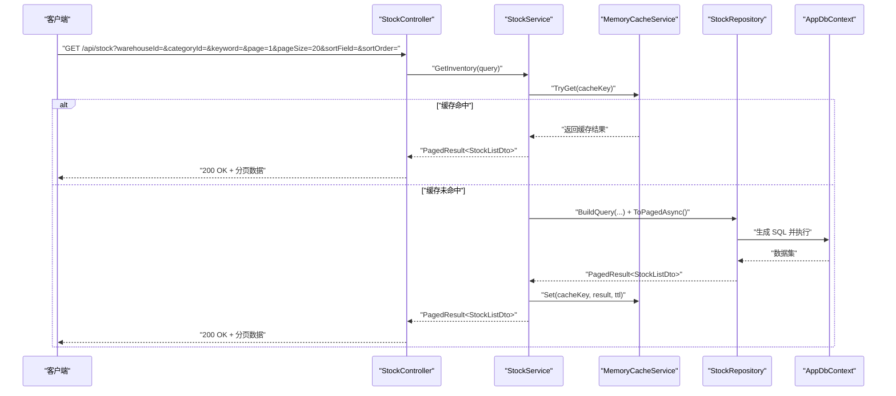
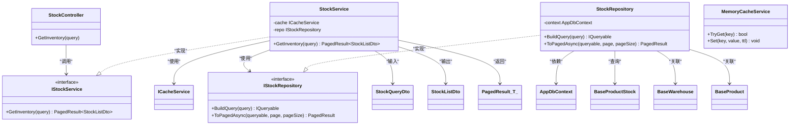

# 库存查询

<cite>
**本文引用的文件**   
- [StockController.cs](file://EquipmentIMS.Web/Controllers/StockController.cs)
- [StockService.cs](file://EquipmentIMS.BLL/Services/StockService.cs)
- [IStockService.cs](file://EquipmentIMS.BLL/Interfaces/IStockService.cs)
- [StockRepository.cs](file://EquipmentIMS.DAL/Repositories/StockRepository.cs)
- [IStockRepository.cs](file://EquipmentIMS.DAL/Interfaces/IStockRepository.cs)
- [StockQueryDto.cs](file://EquipmentIMS.Models/DTOs/StockQueryDto.cs)
- [StockListDto.cs](file://EquipmentIMS.Models/DTOs/StockListDto.cs)
- [PagedResult.cs](file://EquipmentIMS.Models/DTOs/PagedResult.cs)
- [BaseProductStock.cs](file://EquipmentIMS.Models/Entities/BaseProductStock.cs)
- [BaseWarehouse.cs](file://EquipmentIMS.Models/Entities/BaseWarehouse.cs)
- [BaseProduct.cs](file://EquipmentIMS.Models/Entities/BaseProduct.cs)
- [AppDbContext.cs](file://EquipmentIMS.DAL/AppDbContext.cs)
- [MemoryCacheService.cs](file://EquipmentIMS.BLL/Services/MemoryCacheService.cs)
- [ICacheService.cs](file://EquipmentIMS.BLL/Interfaces/ICacheService.cs)
</cite>

## 目录
1. [简介](#简介)
2. [项目结构](#项目结构)
3. [核心组件](#核心组件)
4. [架构总览](#架构总览)
5. [详细组件分析](#详细组件分析)
6. [依赖关系分析](#依赖关系分析)
7. [性能考虑](#性能考虑)
8. [故障排查指南](#故障排查指南)
9. [结论](#结论)
10. [附录：接口与示例](#附录接口与示例)

## 简介
本文件围绕“库存查询”能力，系统性说明多条件组合查询、分页显示、排序与筛选的实现方式；阐述库存实时查询机制、缓存策略与性能优化；覆盖按仓库、产品类别、批次等多维度查询方法；解释库存数量计算逻辑、在途库存处理与可用库存概念；并提供查询接口使用示例、参数说明与返回格式，以及调优建议与最佳实践。

## 项目结构
库存查询功能遵循分层架构：Web 控制器层接收请求并返回统一响应；BLL 服务层封装业务规则（含缓存）；DAL 仓储层负责数据访问与查询构建；Models 提供 DTO、实体与分页模型。

```mermaid
graph TB
subgraph "Web 层"
C["StockController<br/>库存控制器"]
end
subgraph "BLL 层"
S["StockService<br/>库存服务"]
Cache["MemoryCacheService<br/>内存缓存"]
end
subgraph "DAL 层"
R["StockRepository<br/>库存仓储"]
DB["AppDbContext<br/>EF Core 上下文"]
end
subgraph "模型层"
Q["StockQueryDto<br/>查询参数"]
L["StockListDto<br/>列表项"]
P["PagedResult<T><br/>分页结果"]
E1["BaseProductStock<br/>库存实体"]
E2["BaseWarehouse<br/>仓库实体"]
E3["BaseProduct<br/>产品实体"]
end
C --> S
S --> Cache
S --> R
R --> DB
S --> Q
S --> L
S --> P
R --> E1
R --> E2
R --> E3
```

图表来源
- [StockController.cs](file://EquipmentIMS.Web/Controllers/StockController.cs)
- [StockService.cs](file://EquipmentIMS.BLL/Services/StockService.cs)
- [MemoryCacheService.cs](file://EquipmentIMS.BLL/Services/MemoryCacheService.cs)
- [StockRepository.cs](file://EquipmentIMS.DAL/Repositories/StockRepository.cs)
- [AppDbContext.cs](file://EquipmentIMS.DAL/AppDbContext.cs)
- [StockQueryDto.cs](file://EquipmentIMS.Models/DTOs/StockQueryDto.cs)
- [StockListDto.cs](file://EquipmentIMS.Models/DTOs/StockListDto.cs)
- [PagedResult.cs](file://EquipmentIMS.Models/DTOs/PagedResult.cs)
- [BaseProductStock.cs](file://EquipmentIMS.Models/Entities/BaseProductStock.cs)
- [BaseWarehouse.cs](file://EquipmentIMS.Models/Entities/BaseWarehouse.cs)
- [BaseProduct.cs](file://EquipmentIMS.Models/Entities/BaseProduct.cs)

章节来源
- [StockController.cs](file://EquipmentIMS.Web/Controllers/StockController.cs)
- [StockService.cs](file://EquipmentIMS.BLL/Services/StockService.cs)
- [StockRepository.cs](file://EquipmentIMS.DAL/Repositories/StockRepository.cs)
- [StockQueryDto.cs](file://EquipmentIMS.Models/DTOs/StockQueryDto.cs)
- [StockListDto.cs](file://EquipmentIMS.Models/DTOs/StockListDto.cs)
- [PagedResult.cs](file://EquipmentIMS.Models/DTOs/PagedResult.cs)
- [BaseProductStock.cs](file://EquipmentIMS.Models/Entities/BaseProductStock.cs)
- [BaseWarehouse.cs](file://EquipmentIMS.Models/Entities/BaseWarehouse.cs)
- [BaseProduct.cs](file://EquipmentIMS.Models/Entities/BaseProduct.cs)
- [AppDbContext.cs](file://EquipmentIMS.DAL/AppDbContext.cs)
- [MemoryCacheService.cs](file://EquipmentIMS.BLL/Services/MemoryCacheService.cs)

## 核心组件
- 控制器 StockController：暴露库存查询 HTTP 接口，解析查询参数，调用服务层并返回统一响应。
- 服务层 StockService：实现多条件组合查询、分页、排序、筛选与缓存命中/回源逻辑；维护“可用库存”等计算规则。
- 仓储层 StockRepository：基于 EF Core 动态构建查询表达式，支持多维度过滤、排序与分页。
- 缓存服务 MemoryCacheService：提供键值对缓存能力，用于热点库存查询结果的短期缓存。
- 模型层：StockQueryDto（查询入参）、StockListDto（列表项）、PagedResult<T>（分页包装）、实体 BaseProductStock/BaseWarehouse/BaseProduct。

章节来源
- [StockController.cs](file://EquipmentIMS.Web/Controllers/StockController.cs)
- [StockService.cs](file://EquipmentIMS.BLL/Services/StockService.cs)
- [IStockService.cs](file://EquipmentIMS.BLL/Interfaces/IStockService.cs)
- [StockRepository.cs](file://EquipmentIMS.DAL/Repositories/StockRepository.cs)
- [IStockRepository.cs](file://EquipmentIMS.DAL/Interfaces/IStockRepository.cs)
- [StockQueryDto.cs](file://EquipmentIMS.Models/DTOs/StockQueryDto.cs)
- [StockListDto.cs](file://EquipmentIMS.Models/DTOs/StockListDto.cs)
- [PagedResult.cs](file://EquipmentIMS.Models/DTOs/PagedResult.cs)
- [MemoryCacheService.cs](file://EquipmentIMS.BLL/Services/MemoryCacheService.cs)
- [ICacheService.cs](file://EquipmentIMS.BLL/Interfaces/ICacheService.cs)

## 架构总览
库存查询的关键流程如下：客户端发起查询请求 → 控制器校验参数 → 服务层尝试从缓存获取 → 未命中则进入仓储层执行数据库查询 → 组装分页结果并可选写入缓存 → 返回给客户端。

图表来源
- [StockController.cs](file://EquipmentIMS.Web/Controllers/StockController.cs)
- [StockService.cs](file://EquipmentIMS.BLL/Services/StockService.cs)
- [MemoryCacheService.cs](file://EquipmentIMS.BLL/Services/MemoryCacheService.cs)
- [StockRepository.cs](file://EquipmentIMS.DAL/Repositories/StockRepository.cs)
- [AppDbContext.cs](file://EquipmentIMS.DAL/AppDbContext.cs)

## 详细组件分析

### 控制器层：StockController
- 职责：接收库存查询请求，解析查询参数，调用服务层，返回统一响应。
- 关键行为：
  - 参数绑定：仓库 ID、产品类别、关键词、页码、页大小、排序字段、排序方向等。
  - 调用服务：将参数映射为 StockQueryDto 后调用 GetInventory。
  - 返回格式：统一包装为 ApiResponse<PagedResult<StockListDto>>。

章节来源
- [StockController.cs](file://EquipmentIMS.Web/Controllers/StockController.cs)

### 服务层：StockService
- 职责：实现库存查询的业务逻辑，包括多条件组合、分页、排序、筛选、缓存控制与“可用库存”计算。
- 关键行为：
  - 缓存策略：根据查询条件生成稳定 cacheKey，优先读取缓存；未命中时回源数据库并将结果写入缓存。
  - 查询构建：将 StockQueryDto 转换为仓储层可执行的查询条件集合。
  - 可用库存计算：在返回列表中计算“可用库存”，通常由“现有库存 - 占用库存 + 在途入库 - 在途出库”等规则组成（具体以仓储层或领域规则为准）。
  - 分页与排序：通过仓储层提供的分页与排序能力完成。

章节来源
- [StockService.cs](file://EquipmentIMS.BLL/Services/StockService.cs)
- [IStockService.cs](file://EquipmentIMS.BLL/Interfaces/IStockService.cs)
- [MemoryCacheService.cs](file://EquipmentIMS.BLL/Services/MemoryCacheService.cs)
- [ICacheService.cs](file://EquipmentIMS.BLL/Interfaces/ICacheService.cs)

### 仓储层：StockRepository
- 职责：基于 EF Core 构建高效查询，支持多维度过滤、排序与分页。
- 关键行为：
  - 多条件组合：按仓库、产品类别、批次、关键字等条件拼接 Where。
  - 排序：支持按指定字段升/降序排列。
  - 分页：Skip/Take 或等效分页实现。
  - 关联查询：按需 Join 仓库、产品、类别等表，减少 N+1 问题。

章节来源
- [StockRepository.cs](file://EquipmentIMS.DAL/Repositories/StockRepository.cs)
- [IStockRepository.cs](file://EquipmentIMS.DAL/Interfaces/IStockRepository.cs)
- [AppDbContext.cs](file://EquipmentIMS.DAL/AppDbContext.cs)

### 模型层：DTO 与实体
- StockQueryDto：定义查询入参，如仓库ID、类别ID、批次号、关键词、页码、页大小、排序字段、排序方向等。
- StockListDto：定义返回的库存行项，包含基础信息与“可用库存”等计算字段。
- PagedResult<T>：通用分页包装，包含数据集合、总数、页码、页大小等元信息。
- 实体：BaseProductStock（库存主记录）、BaseWarehouse（仓库）、BaseProduct（产品），用于关联与展示。

章节来源
- [StockQueryDto.cs](file://EquipmentIMS.Models/DTOs/StockQueryDto.cs)
- [StockListDto.cs](file://EquipmentIMS.Models/DTOs/StockListDto.cs)
- [PagedResult.cs](file://EquipmentIMS.Models/DTOs/PagedResult.cs)
- [BaseProductStock.cs](file://EquipmentIMS.Models/Entities/BaseProductStock.cs)
- [BaseWarehouse.cs](file://EquipmentIMS.Models/Entities/BaseWarehouse.cs)
- [BaseProduct.cs](file://EquipmentIMS.Models/Entities/BaseProduct.cs)

## 依赖关系分析
- 控制器依赖服务接口 IStockService，便于替换实现与测试。
- 服务依赖缓存接口 ICacheService 与仓储接口 IStockRepository，解耦外部依赖。
- 仓储依赖 EF Core 上下文 AppDbContext，直接操作实体与视图。

图表来源
- [StockController.cs](file://EquipmentIMS.Web/Controllers/StockController.cs)
- [IStockService.cs](file://EquipmentIMS.BLL/Interfaces/IStockService.cs)
- [StockService.cs](file://EquipmentIMS.BLL/Services/StockService.cs)
- [IStockRepository.cs](file://EquipmentIMS.DAL/Interfaces/IStockRepository.cs)
- [StockRepository.cs](file://EquipmentIMS.DAL/Repositories/StockRepository.cs)
- [MemoryCacheService.cs](file://EquipmentIMS.BLL/Services/MemoryCacheService.cs)
- [StockQueryDto.cs](file://EquipmentIMS.Models/DTOs/StockQueryDto.cs)
- [StockListDto.cs](file://EquipmentIMS.Models/DTOs/StockListDto.cs)
- [PagedResult.cs](file://EquipmentIMS.Models/DTOs/PagedResult.cs)
- [BaseProductStock.cs](file://EquipmentIMS.Models/Entities/BaseProductStock.cs)
- [BaseWarehouse.cs](file://EquipmentIMS.Models/Entities/BaseWarehouse.cs)
- [BaseProduct.cs](file://EquipmentIMS.Models/Entities/BaseProduct.cs)

## 性能考虑
- 索引建议
  - 仓库维度：BaseProductStock.WarehouseId、BaseWarehouse.Id
  - 产品维度：BaseProduct.ProductCode、BaseProduct.CategoryId、BaseProduct.Name
  - 批次维度：BaseProductStock.BatchNo
  - 时间维度：BaseProductStock.UpdateTime（如需按时间范围筛选）
- 查询优化
  - 仅选择必要字段投影，避免 SELECT *。
  - 合理使用 Include/Join，避免 N+1 查询。
  - 分页参数 pageSize 限制上限，防止大结果集拖慢网络与渲染。
- 缓存策略
  - 针对热点查询（如固定仓库+类别+无关键字）设置较短 TTL（例如 10-30 秒），平衡实时性与性能。
  - 缓存键需包含所有影响结果的查询参数，确保一致性。
- 连接与并发
  - 合理配置 EF Core 连接池与最大并行度。
  - 避免在查询中执行耗时 CPU 密集运算，尽量下推到数据库。

[本节为通用性能指导，不直接分析具体文件]

## 故障排查指南
- 常见问题
  - 缓存未命中：检查缓存键生成是否稳定，确认参数序列化一致。
  - 分页异常：确认 page/pageSize 边界值与默认值处理。
  - 排序无效：确认 sortField 白名单与映射是否正确。
  - 结果为空：核对筛选条件是否过严，检查数据库是否存在匹配数据。
- 日志与监控
  - 在仓储层记录关键 SQL 与执行时长，定位慢查询。
  - 统计缓存命中率与平均响应时间，评估缓存效果。

章节来源
- [StockRepository.cs](file://EquipmentIMS.DAL/Repositories/StockRepository.cs)
- [StockService.cs](file://EquipmentIMS.BLL/Services/StockService.cs)

## 结论
库存查询通过分层架构与缓存策略实现了高内聚、低耦合与高性能。多条件组合、分页与排序能力完备，可按仓库、产品类别、批次等多维度灵活查询。建议在高频场景启用短时缓存，并结合索引与投影优化提升整体性能。

[本节为总结性内容，不直接分析具体文件]

## 附录：接口与示例

### 接口定义
- 路径：GET /api/stock
- 认证：需要登录态（依据全局权限过滤器）
- 请求参数（StockQueryDto）
  - warehouseId: 整数，可选，仓库 ID
  - categoryId: 整数，可选，产品类别 ID
  - batchNo: 字符串，可选，批次号
  - keyword: 字符串，可选，产品名称/编码模糊匹配
  - page: 整数，默认 1，页码
  - pageSize: 整数，默认 20，每页条数
  - sortField: 字符串，可选，排序字段（如 stockQuantity、availableQuantity、productName）
  - sortOrder: 字符串，可选，asc/desc
- 返回格式（ApiResponse<PagedResult<StockListDto>>）
  - data.items: StockListDto[]
  - data.totalCount: 总数
  - data.pageNumber: 当前页
  - data.pageSize: 每页大小
  - data.hasPreviousPage / hasNextPage: 是否有上一页/下一页

章节来源
- [StockController.cs](file://EquipmentIMS.Web/Controllers/StockController.cs)
- [StockQueryDto.cs](file://EquipmentIMS.Models/DTOs/StockQueryDto.cs)
- [StockListDto.cs](file://EquipmentIMS.Models/DTOs/StockListDto.cs)
- [PagedResult.cs](file://EquipmentIMS.Models/DTOs/PagedResult.cs)

### 使用示例
- 基本查询（按仓库与类别）
  - GET /api/stock?warehouseId=1&categoryId=10&page=1&pageSize=20
- 关键词搜索（按产品名称/编码）
  - GET /api/stock?keyword=螺丝&page=1&pageSize=20
- 按批次查询
  - GET /api/stock?batchNo=B20250101&page=1&pageSize=20
- 排序
  - GET /api/stock?sortField=stockQuantity&sortOrder=desc&page=1&pageSize=20

[本节为接口使用说明，不直接分析具体文件]

### 库存数量计算与可用库存
- 库存数量
  - 现有库存：仓库×产品×批次的当前结存数量。
- 在途库存
  - 在途入库：已下单但未入库的数量。
  - 在途出库：已出库但尚未到达目的地的数量。
- 可用库存
  - 常用公式：可用库存 = 现有库存 + 在途入库 - 在途出库 - 占用库存
  - 若存在锁定/预留，应从可用库存中扣除相应数量。
- 数据来源
  - 现有库存：BaseProductStock 主记录。
  - 在途库存：采购入库单明细、销售出库单明细等交易流水聚合。
  - 占用库存：销售订单预留、生产领料预留等。

章节来源
- [BaseProductStock.cs](file://EquipmentIMS.Models/Entities/BaseProductStock.cs)
- [StockService.cs](file://EquipmentIMS.BLL/Services/StockService.cs)
- [StockRepository.cs](file://EquipmentIMS.DAL/Repositories/StockRepository.cs)

### 缓存策略与实时性
- 缓存键
  - 由所有影响结果的查询参数组成，确保不同条件对应不同缓存条目。
- 失效策略
  - 短 TTL（如 10-30 秒）适用于高频读场景；当发生库存变动（入库/出库/调拨/盘点）时，应主动清除相关缓存键。
- 实时性权衡
  - 若业务要求强实时，可降低缓存命中率或禁用缓存；若允许最终一致，可适度提高 TTL。

章节来源
- [StockService.cs](file://EquipmentIMS.BLL/Services/StockService.cs)
- [MemoryCacheService.cs](file://EquipmentIMS.BLL/Services/MemoryCacheService.cs)
- [ICacheService.cs](file://EquipmentIMS.BLL/Interfaces/ICacheService.cs)

### 查询性能调优建议与最佳实践
- 数据库侧
  - 为常用过滤字段建立复合索引（如 WarehouseId + CategoryId + BatchNo）。
  - 对频繁排序字段建立索引，必要时使用覆盖索引。
- 应用侧
  - 限制 pageSize 最大值，避免前端一次性拉取过多数据。
  - 对复杂查询进行 SQL 分析与执行计划优化。
  - 使用异步 IO 与合理的超时配置。
- 缓存侧
  - 热点数据短时缓存，冷数据不缓存。
  - 缓存键规范化，避免键冲突与泄漏。
- 前端侧
  - 防抖与节流，避免重复触发相同查询。
  - 分页加载与虚拟滚动，降低渲染压力。

[本节为通用优化建议，不直接分析具体文件]