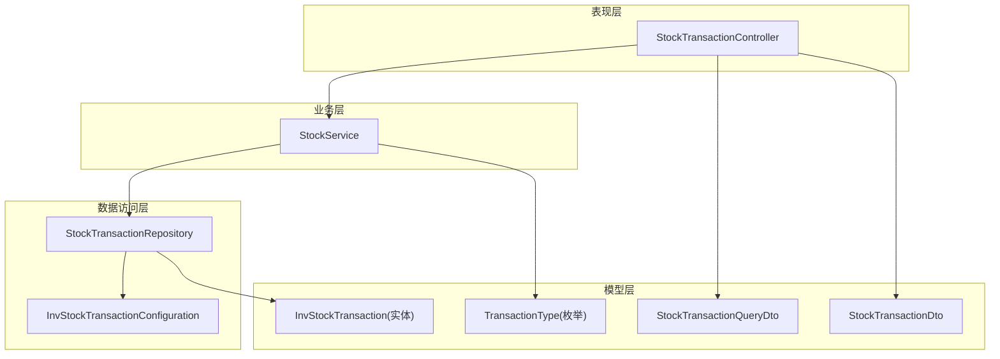
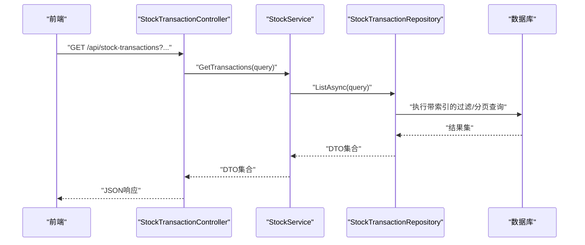
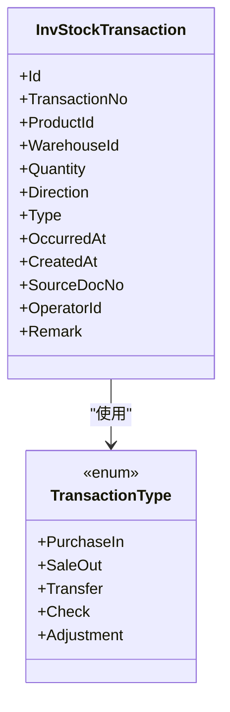
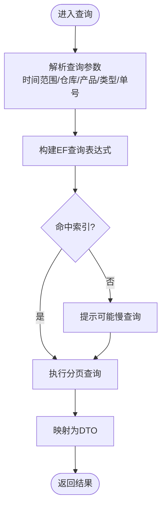
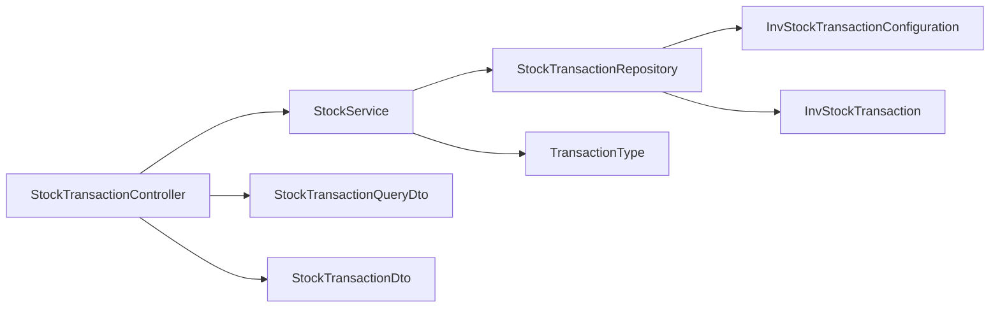

# 库存流水

<cite>
**本文引用的文件**   
- [InvStockTransaction.cs](file://EquipmentIMS.Models/Entities/InvStockTransaction.cs)
- [TransactionType.cs](file://EquipmentIMS.Models/Enums/TransactionType.cs)
- [StockTransactionDto.cs](file://EquipmentIMS.Models/DTOs/StockTransactionDto.cs)
- [StockTransactionQueryDto.cs](file://EquipmentIMS.Models/DTOs/StockTransactionQueryDto.cs)
- [InvStockTransactionConfiguration.cs](file://EquipmentIMS.DAL/Configurations/InvStockTransactionConfiguration.cs)
- [IStockTransactionRepository.cs](file://EquipmentIMS.DAL/Interfaces/IStockTransactionRepository.cs)
- [StockTransactionRepository.cs](file://EquipmentIMS.DAL/Repositories/StockTransactionRepository.cs)
- [IStockService.cs](file://EquipmentIMS.BLL/Interfaces/IStockService.cs)
- [StockService.cs](file://EquipmentIMS.BLL/Services/StockService.cs)
- [StockTransactionController.cs](file://EquipmentIMS.Web/Controllers/StockTransactionController.cs)
</cite>

## 目录
1. [简介](#简介)
2. [项目结构](#项目结构)
3. [核心组件](#核心组件)
4. [架构总览](#架构总览)
5. [详细组件分析](#详细组件分析)
6. [依赖分析](#依赖分析)
7. [性能考虑](#性能考虑)
8. [故障排查指南](#故障排查指南)
9. [结论](#结论)
10. [附录](#附录)

## 简介
本文件围绕“库存流水”能力，系统化说明库存事务记录机制、事务类型定义与流水号生成规则；覆盖入库、出库、调拨、盘点等场景的流水记录方式；阐述流水查询（时间范围筛选、业务关联查询）、数据分析（趋势统计、异常检测）、审计追溯与数据完整性保证；并对流水表结构设计、索引优化与归档策略给出工程化建议。文档面向开发者与运维人员，兼顾可读性与可落地性。

## 项目结构
库存流水相关代码遵循分层架构：
- 模型层（Models）：实体、枚举、DTO
- 数据访问层（DAL）：配置、仓储接口与实现
- 业务逻辑层（BLL）：服务编排与事务边界
- 表现层（Web）：控制器对外暴露查询与导出能力

图表来源
- [StockTransactionController.cs](file://EquipmentIMS.Web/Controllers/StockTransactionController.cs)
- [StockService.cs](file://EquipmentIMS.BLL/Services/StockService.cs)
- [StockTransactionRepository.cs](file://EquipmentIMS.DAL/Repositories/StockTransactionRepository.cs)
- [InvStockTransactionConfiguration.cs](file://EquipmentIMS.DAL/Configurations/InvStockTransactionConfiguration.cs)
- [InvStockTransaction.cs](file://EquipmentIMS.Models/Entities/InvStockTransaction.cs)
- [TransactionType.cs](file://EquipmentIMS.Models/Enums/TransactionType.cs)
- [StockTransactionQueryDto.cs](file://EquipmentIMS.Models/DTOs/StockTransactionQueryDto.cs)
- [StockTransactionDto.cs](file://EquipmentIMS.Models/DTOs/StockTransactionDto.cs)

章节来源
- [StockTransactionController.cs](file://EquipmentIMS.Web/Controllers/StockTransactionController.cs)
- [StockService.cs](file://EquipmentIMS.BLL/Services/StockService.cs)
- [StockTransactionRepository.cs](file://EquipmentIMS.DAL/Repositories/StockTransactionRepository.cs)
- [InvStockTransactionConfiguration.cs](file://EquipmentIMS.DAL/Configurations/InvStockTransactionConfiguration.cs)
- [InvStockTransaction.cs](file://EquipmentIMS.Models/Entities/InvStockTransaction.cs)
- [TransactionType.cs](file://EquipmentIMS.Models/Enums/TransactionType.cs)
- [StockTransactionQueryDto.cs](file://EquipmentIMS.Models/DTOs/StockTransactionQueryDto.cs)
- [StockTransactionDto.cs](file://EquipmentIMS.Models/DTOs/StockTransactionDto.cs)

## 核心组件
- 实体与配置
  - 库存流水实体：承载每次库存变动的最小原子记录，包含产品、仓库、数量变动、方向、时间、来源单据、操作人等维度。
  - 实体配置：定义主键、字段映射、约束与索引策略。
- 事务类型
  - 通过枚举统一描述入库、出库、调拨、盘点、调整等类型，确保全链路一致。
- DTO 与查询
  - 查询 DTO：封装分页、时间范围、仓库、产品、类型、单号等筛选条件。
  - 返回 DTO：对前端展示友好，屏蔽内部敏感字段。
- 仓储与接口
  - 仓储接口：声明按条件分页查询、批量写入、汇总统计等能力。
  - 仓储实现：基于 EF Core 构建动态查询、投影与排序。
- 服务层
  - 服务编排：在业务事务中创建流水记录，协调库存扣减/增加、校验与幂等控制。
- 控制器
  - 对外提供列表查询、详情查看、导出等 REST 接口。

章节来源
- [InvStockTransaction.cs](file://EquipmentIMS.Models/Entities/InvStockTransaction.cs)
- [InvStockTransactionConfiguration.cs](file://EquipmentIMS.DAL/Configurations/InvStockTransactionConfiguration.cs)
- [TransactionType.cs](file://EquipmentIMS.Models/Enums/TransactionType.cs)
- [StockTransactionQueryDto.cs](file://EquipmentIMS.Models/DTOs/StockTransactionQueryDto.cs)
- [StockTransactionDto.cs](file://EquipmentIMS.Models/DTOs/StockTransactionDto.cs)
- [IStockTransactionRepository.cs](file://EquipmentIMS.DAL/Interfaces/IStockTransactionRepository.cs)
- [StockTransactionRepository.cs](file://EquipmentIMS.DAL/Repositories/StockTransactionRepository.cs)
- [IStockService.cs](file://EquipmentIMS.BLL/Interfaces/IStockService.cs)
- [StockService.cs](file://EquipmentIMS.BLL/Services/StockService.cs)
- [StockTransactionController.cs](file://EquipmentIMS.Web/Controllers/StockTransactionController.cs)

## 架构总览
库存流水贯穿采购入库、销售出库、调拨、盘点等业务，形成“事件驱动 + 持久化”的流水体系。

图表来源
- [StockTransactionController.cs](file://EquipmentIMS.Web/Controllers/StockTransactionController.cs)
- [StockService.cs](file://EquipmentIMS.BLL/Services/StockService.cs)
- [StockTransactionRepository.cs](file://EquipmentIMS.DAL/Repositories/StockTransactionRepository.cs)
- [InvStockTransactionConfiguration.cs](file://EquipmentIMS.DAL/Configurations/InvStockTransactionConfiguration.cs)

## 详细组件分析

### 实体与配置（流水表结构）
- 关键字段
  - 主键：自增或全局唯一标识
  - 流水号：业务唯一且可追溯
  - 产品/仓库：定位到具体物料与库位
  - 数量与方向：正负表示增减
  - 类型：枚举值，如入库、出库、调拨、盘点、调整
  - 时间戳：发生时间与记录时间
  - 来源单据：关联采购入库单、销售出库单、调拨单、盘点单等
  - 操作人/备注：审计信息
- 配置要点
  - 主键约束
  - 非空与长度限制
  - 常用过滤字段建立索引（见“索引优化”）
  - 可选：软删除标记、分区键（按时间）

图表来源
- [InvStockTransaction.cs](file://EquipmentIMS.Models/Entities/InvStockTransaction.cs)
- [TransactionType.cs](file://EquipmentIMS.Models/Enums/TransactionType.cs)
- [InvStockTransactionConfiguration.cs](file://EquipmentIMS.DAL/Configurations/InvStockTransactionConfiguration.cs)

章节来源
- [InvStockTransaction.cs](file://EquipmentIMS.Models/Entities/InvStockTransaction.cs)
- [InvStockTransactionConfiguration.cs](file://EquipmentIMS.DAL/Configurations/InvStockTransactionConfiguration.cs)
- [TransactionType.cs](file://EquipmentIMS.Models/Enums/TransactionType.cs)

### 事务类型定义
- 入库：采购入库、退货入库、初始导入等
- 出库：销售出库、领用出库、报废出库等
- 调拨：仓库间转移
- 盘点：盘盈/盘亏
- 调整：系统修正、价格重估不涉数量时也可记录为调整类流水（仅用于审计）

章节来源
- [TransactionType.cs](file://EquipmentIMS.Models/Enums/TransactionType.cs)

### 流水号生成规则
- 唯一性：全局唯一，避免并发冲突
- 可读性：包含日期/批次/来源前缀，便于人工识别
- 稳定性：一旦生成不可复用、不可回滚
- 并发安全：采用序列/雪花/数据库序列等方式保障
- 幂等：支持去重键，防止重复提交产生重复流水

章节来源
- [StockTransactionRepository.cs](file://EquipmentIMS.DAL/Repositories/StockTransactionRepository.cs)
- [StockService.cs](file://EquipmentIMS.BLL/Services/StockService.cs)

### 各类库存变动的流水记录
- 入库
  - 触发点：采购入库确认、退货入库确认、初始导入完成
  - 动作：增加库存，写入类型为“入库”的流水
- 出库
  - 触发点：销售出库确认、领用出库确认、报废出库确认
  - 动作：减少库存，写入类型为“出库”的流水
- 调拨
  - 触发点：调拨单过账
  - 动作：源仓减少、目标仓增加，分别写入两条“调拨”流水
- 盘点
  - 触发点：盘点过账
  - 动作：根据盘盈/盘亏写入对应方向的“盘点”流水

章节来源
- [StockService.cs](file://EquipmentIMS.BLL/Services/StockService.cs)
- [StockTransactionRepository.cs](file://EquipmentIMS.DAL/Repositories/StockTransactionRepository.cs)

### 流水查询功能
- 时间范围筛选：支持起止时间、精确到秒/分钟
- 业务关联查询：按来源单号、产品类型、仓库、供应商/客户等维度
- 分页与排序：默认按时间倒序，支持自定义排序
- 导出：支持 CSV/Excel 导出，便于离线分析

图表来源
- [StockTransactionRepository.cs](file://EquipmentIMS.DAL/Repositories/StockTransactionRepository.cs)
- [StockTransactionQueryDto.cs](file://EquipmentIMS.Models/DTOs/StockTransactionQueryDto.cs)
- [StockTransactionDto.cs](file://EquipmentIMS.Models/DTOs/StockTransactionDto.cs)

章节来源
- [StockTransactionQueryDto.cs](file://EquipmentIMS.Models/DTOs/StockTransactionQueryDto.cs)
- [StockTransactionRepository.cs](file://EquipmentIMS.DAL/Repositories/StockTransactionRepository.cs)

### 流水数据分析、趋势统计与异常检测
- 趋势统计
  - 日/周/月出入库量趋势
  - 分仓库/分产品热度排行
  - 周转率与滞销预警
- 异常检测
  - 负库存风险：出库后库存为负
  - 超阈值波动：某时段出入库量突增/突降
  - 重复流水：相同流水号或相同幂等键重复写入
  - 时间穿越：记录时间早于发生时间
- 报表输出
  - 结合报告模块导出 PDF/Excel，支撑经营决策

章节来源
- [StockTransactionRepository.cs](file://EquipmentIMS.DAL/Repositories/StockTransactionRepository.cs)
- [StockService.cs](file://EquipmentIMS.BLL/Services/StockService.cs)

### 流水审计、操作追溯与数据完整性
- 审计字段：操作人、操作时间、来源单据、备注
- 幂等控制：基于幂等键/流水号去重，避免重复提交
- 事务一致性：库存变更与流水写入在同一事务内，失败回滚
- 不可篡改：历史流水只增不改，必要时以“冲正”流水替代
- 可追溯：从流水反查来源单据，再追溯到上游业务

章节来源
- [StockService.cs](file://EquipmentIMS.BLL/Services/StockService.cs)
- [StockTransactionRepository.cs](file://EquipmentIMS.DAL/Repositories/StockTransactionRepository.cs)

### 控制器与API
- 列表查询：GET /api/stock-transactions
- 详情查看：GET /api/stock-transactions/{id}
- 导出：GET /api/stock-transactions/export?{query}
- 权限控制：结合全局过滤器进行鉴权与日志记录

章节来源
- [StockTransactionController.cs](file://EquipmentIMS.Web/Controllers/StockTransactionController.cs)

## 依赖分析
- 控制器依赖服务，服务依赖仓储，仓储依赖实体与配置
- 枚举与DTO作为跨层契约，保证前后端与领域语义一致

图表来源
- [StockTransactionController.cs](file://EquipmentIMS.Web/Controllers/StockTransactionController.cs)
- [StockService.cs](file://EquipmentIMS.BLL/Services/StockService.cs)
- [StockTransactionRepository.cs](file://EquipmentIMS.DAL/Repositories/StockTransactionRepository.cs)
- [InvStockTransactionConfiguration.cs](file://EquipmentIMS.DAL/Configurations/InvStockTransactionConfiguration.cs)
- [InvStockTransaction.cs](file://EquipmentIMS.Models/Entities/InvStockTransaction.cs)
- [TransactionType.cs](file://EquipmentIMS.Models/Enums/TransactionType.cs)
- [StockTransactionQueryDto.cs](file://EquipmentIMS.Models/DTOs/StockTransactionQueryDto.cs)
- [StockTransactionDto.cs](file://EquipmentIMS.Models/DTOs/StockTransactionDto.cs)

章节来源
- [StockTransactionController.cs](file://EquipmentIMS.Web/Controllers/StockTransactionController.cs)
- [StockService.cs](file://EquipmentIMS.BLL/Services/StockService.cs)
- [StockTransactionRepository.cs](file://EquipmentIMS.DAL/Repositories/StockTransactionRepository.cs)
- [InvStockTransactionConfiguration.cs](file://EquipmentIMS.DAL/Configurations/InvStockTransactionConfiguration.cs)
- [InvStockTransaction.cs](file://EquipmentIMS.Models/Entities/InvStockTransaction.cs)
- [TransactionType.cs](file://EquipmentIMS.Models/Enums/TransactionType.cs)
- [StockTransactionQueryDto.cs](file://EquipmentIMS.Models/DTOs/StockTransactionQueryDto.cs)
- [StockTransactionDto.cs](file://EquipmentIMS.Models/DTOs/StockTransactionDto.cs)

## 性能考虑
- 索引设计
  - 复合索引：(OccurredAt, WarehouseId)、(OccurredAt, ProductId)、(SourceDocNo)
  - 高频过滤字段：Type、Direction、Product/Warehouse 外键
  - 覆盖索引：针对常见查询列组合，减少回表
- 查询优化
  - 严格时间范围，避免全表扫描
  - 分页游标/Keyset 分页替代偏移分页
  - 按需投影，避免 SELECT *
- 写入优化
  - 批量插入流水（同批业务合并）
  - 异步落盘（非关键路径）+ 重试补偿
- 存储与归档
  - 按月/季度分区
  - 冷热分离：历史数据归档至冷存储或只读副本
  - 压缩与清理策略

[本节为通用性能建议，无需特定文件引用]

## 故障排查指南
- 常见问题
  - 查询缓慢：检查是否缺少索引、是否未限定时间范围
  - 重复流水：核查幂等键与并发控制
  - 库存不一致：核对事务边界与回滚路径
  - 导出超时：拆分导出任务，后台异步处理
- 定位手段
  - 开启慢查询日志与SQL跟踪
  - 结合操作日志与流水溯源
  - 监控指标：QPS、P99延迟、错误率、锁等待

章节来源
- [StockTransactionRepository.cs](file://EquipmentIMS.DAL/Repositories/StockTransactionRepository.cs)
- [StockService.cs](file://EquipmentIMS.BLL/Services/StockService.cs)

## 结论
库存流水是库存系统的“事实之基”。通过统一的事务类型、严格的流水号规则、完善的查询与分析能力以及可靠的审计与归档策略，系统可在高并发与大数据量下保持稳定与可观测。建议在上线前完成索引与分页优化，并制定明确的归档与备份策略。

[本节为总结性内容，无需特定文件引用]

## 附录

### 流水表结构与索引建议（参考）
- 主键：Id
- 业务键：TransactionNo（唯一）
- 维度键：ProductId、WarehouseId、Type、Direction
- 时间键：OccurredAt、CreatedAt
- 关联键：SourceDocNo
- 审计键：OperatorId、Remark
- 索引建议
  - 唯一索引：TransactionNo
  - 复合索引：(OccurredAt, WarehouseId), (OccurredAt, ProductId), (SourceDocNo)
  - 普通索引：Type, Direction, ProductId, WarehouseId

章节来源
- [InvStockTransactionConfiguration.cs](file://EquipmentIMS.DAL/Configurations/InvStockTransactionConfiguration.cs)