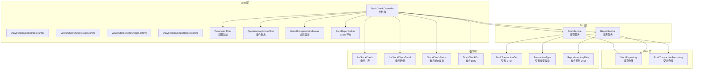
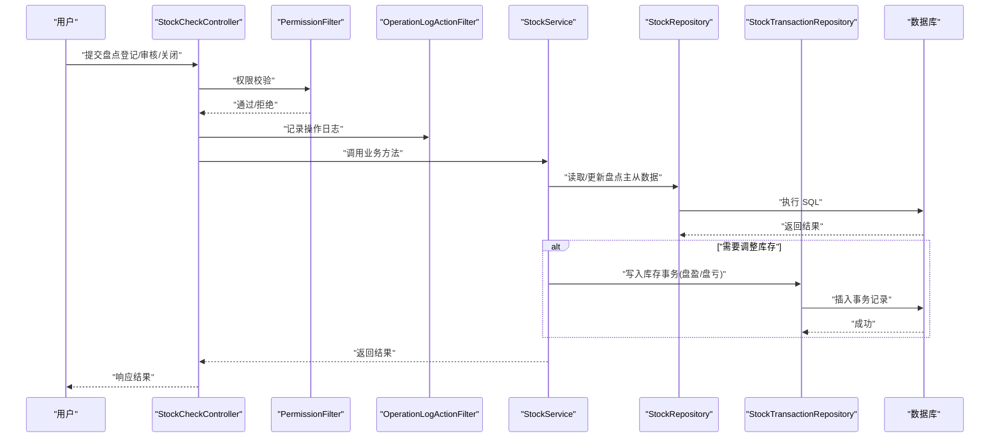
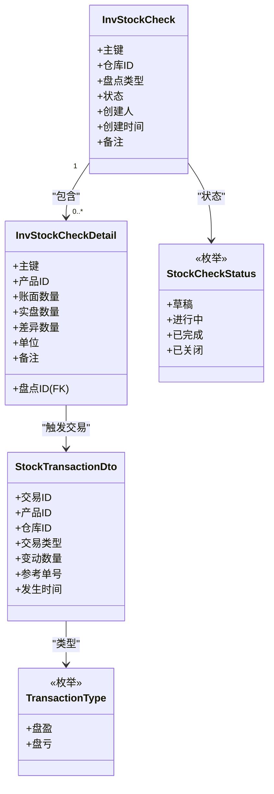
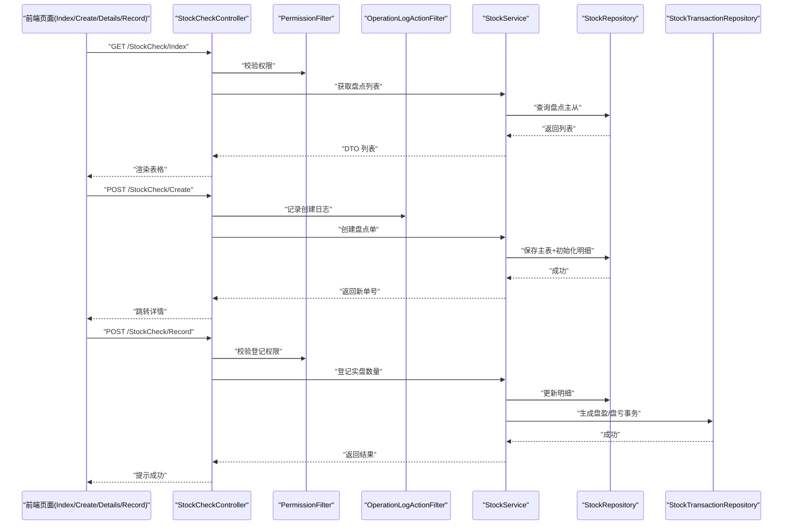
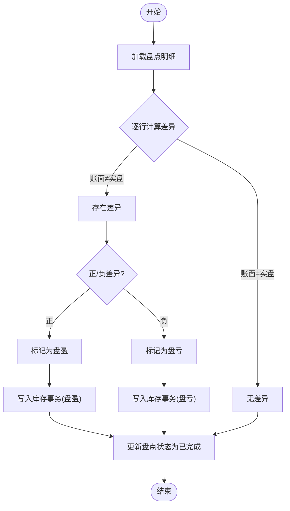
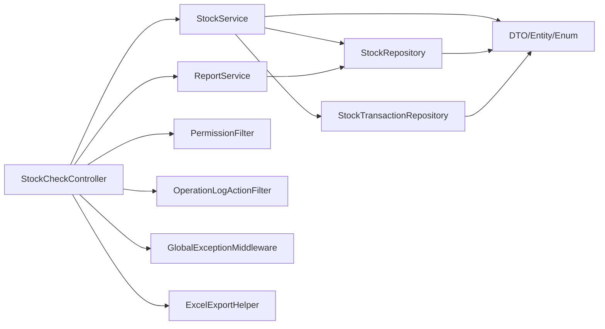
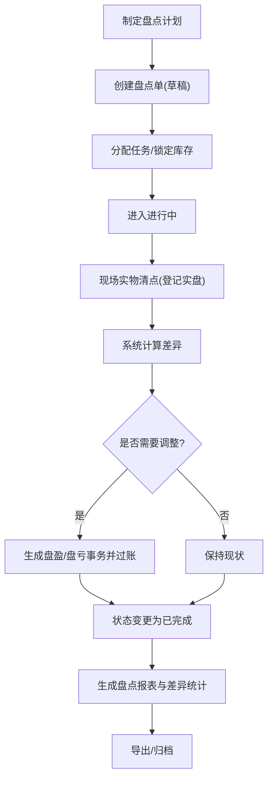

# 库存盘点

<cite>
**本文引用的文件**   
- [StockCheckController.cs](file://EquipmentIMS.Web/Controllers/StockCheckController.cs)
- [StockCheckDto.cs](file://EquipmentIMS.Models/DTOs/StockCheckDto.cs)
- [InvStockCheck.cs](file://EquipmentIMS.Models/Entities/InvStockCheck.cs)
- [InvStockCheckDetail.cs](file://EquipmentIMS.Models/Entities/InvStockCheckDetail.cs)
- [StockCheckStatus.cs](file://EquipmentIMS.Models/Enums/StockCheckStatus.cs)
- [StockRepository.cs](file://EquipmentIMS.DAL/Repositories/StockRepository.cs)
- [IStockRepository.cs](file://EquipmentIMS.DAL/Interfaces/IStockRepository.cs)
- [StockService.cs](file://EquipmentIMS.BLL/Services/StockService.cs)
- [IStockService.cs](file://EquipmentIMS.BLL/Interfaces/IStockService.cs)
- [StockTransactionRepository.cs](file://EquipmentIMS.DAL/Repositories/StockTransactionRepository.cs)
- [IStockTransactionRepository.cs](file://EquipmentIMS.DAL/Interfaces/IStockTransactionRepository.cs)
- [StockTransactionDto.cs](file://EquipmentIMS.Models/DTOs/StockTransactionDto.cs)
- [TransactionType.cs](file://EquipmentIMS.Models/Enums/TransactionType.cs)
- [ReportService.cs](file://EquipmentIMS.BLL/Services/ReportService.cs)
- [IReportService.cs](file://EquipmentIMS.BLL/Interfaces/IReportService.cs)
- [ReportInventoryDtos.cs](file://EquipmentIMS.Models/DTOs/Reports/ReportInventoryDtos.cs)
- [PermissionFilter.cs](file://EquipmentIMS.Web/Filters/PermissionFilter.cs)
- [OperationLogActionFilter.cs](file://EquipmentIMS.Web/Filters/OperationLogActionFilter.cs)
- [SysOperationLog.cs](file://EquipmentIMS.Models/Entities/SysOperationLog.cs)
- [GlobalExceptionMiddleware.cs](file://EquipmentIMS.Web/Filters/GlobalExceptionMiddleware.cs)
- [ExcelExportHelper.cs](file://EquipmentIMS.Web/Helpers/ExcelExportHelper.cs)
- [Index.cshtml](file://EquipmentIMS.Web/Views/StockCheck/Index.cshtml)
- [Create.cshtml](file://EquipmentIMS.Web/Views/StockCheck/Create.cshtml)
- [Details.cshtml](file://EquipmentIMS.Web/Views/StockCheck/Details.cshtml)
- [Record.cshtml](file://EquipmentIMS.Web/Views/StockCheck/Record.cshtml)
</cite>

## 目录
1. [简介](#简介)
2. [项目结构](#项目结构)
3. [核心组件](#核心组件)
4. [架构总览](#架构总览)
5. [详细组件分析](#详细组件分析)
6. [依赖关系分析](#依赖关系分析)
7. [性能考虑](#性能考虑)
8. [故障排查指南](#故障排查指南)
9. [结论](#结论)
10. [附录](#附录)

## 简介
本文件围绕“库存盘点”能力，提供从计划制定、任务分配到流程管理的完整说明。重点覆盖：
- 盘点单创建与状态流转
- 实物清点与差异分析
- 调整处理与库存事务记录
- 权限控制与操作审计
- 报表生成、差异统计与分析
- 数据导入导出、批量操作与异常处理
- 业务流程图与操作指南

## 项目结构
库存盘点功能采用分层架构：Web 层控制器负责请求路由与视图渲染；BLL 层服务编排业务逻辑；DAL 层仓储访问数据库；Models 定义实体、枚举与 DTO；Filters 实现权限校验与审计日志；Helpers 提供 Excel 导出等通用工具。

图表来源
- [StockCheckController.cs](file://EquipmentIMS.Web/Controllers/StockCheckController.cs)
- [StockService.cs](file://EquipmentIMS.BLL/Services/StockService.cs)
- [ReportService.cs](file://EquipmentIMS.BLL/Services/ReportService.cs)
- [StockRepository.cs](file://EquipmentIMS.DAL/Repositories/StockRepository.cs)
- [StockTransactionRepository.cs](file://EquipmentIMS.DAL/Repositories/StockTransactionRepository.cs)
- [StockCheckDto.cs](file://EquipmentIMS.Models/DTOs/StockCheckDto.cs)
- [InvStockCheck.cs](file://EquipmentIMS.Models/Entities/InvStockCheck.cs)
- [InvStockCheckDetail.cs](file://EquipmentIMS.Models/Entities/InvStockCheckDetail.cs)
- [StockCheckStatus.cs](file://EquipmentIMS.Models/Enums/StockCheckStatus.cs)
- [StockTransactionDto.cs](file://EquipmentIMS.Models/DTOs/StockTransactionDto.cs)
- [TransactionType.cs](file://EquipmentIMS.Models/Enums/TransactionType.cs)
- [ReportInventoryDtos.cs](file://EquipmentIMS.Models/DTOs/Reports/ReportInventoryDtos.cs)
- [PermissionFilter.cs](file://EquipmentIMS.Web/Filters/PermissionFilter.cs)
- [OperationLogActionFilter.cs](file://EquipmentIMS.Web/Filters/OperationLogActionFilter.cs)
- [GlobalExceptionMiddleware.cs](file://EquipmentIMS.Web/Filters/GlobalExceptionMiddleware.cs)
- [ExcelExportHelper.cs](file://EquipmentIMS.Web/Helpers/ExcelExportHelper.cs)

章节来源
- [StockCheckController.cs](file://EquipmentIMS.Web/Controllers/StockCheckController.cs)
- [StockService.cs](file://EquipmentIMS.BLL/Services/StockService.cs)
- [ReportService.cs](file://EquipmentIMS.BLL/Services/ReportService.cs)
- [StockRepository.cs](file://EquipmentIMS.DAL/Repositories/StockRepository.cs)
- [StockTransactionRepository.cs](file://EquipmentIMS.DAL/Repositories/StockTransactionRepository.cs)
- [StockCheckDto.cs](file://EquipmentIMS.Models/DTOs/StockCheckDto.cs)
- [InvStockCheck.cs](file://EquipmentIMS.Models/Entities/InvStockCheck.cs)
- [InvStockCheckDetail.cs](file://EquipmentIMS.Models/Entities/InvStockCheckDetail.cs)
- [StockCheckStatus.cs](file://EquipmentIMS.Models/Enums/StockCheckStatus.cs)
- [StockTransactionDto.cs](file://EquipmentIMS.Models/DTOs/StockTransactionDto.cs)
- [TransactionType.cs](file://EquipmentIMS.Models/Enums/TransactionType.cs)
- [ReportInventoryDtos.cs](file://EquipmentIMS.Models/DTOs/Reports/ReportInventoryDtos.cs)
- [PermissionFilter.cs](file://EquipmentIMS.Web/Filters/PermissionFilter.cs)
- [OperationLogActionFilter.cs](file://EquipmentIMS.Web/Filters/OperationLogActionFilter.cs)
- [GlobalExceptionMiddleware.cs](file://EquipmentIMS.Web/Filters/GlobalExceptionMiddleware.cs)
- [ExcelExportHelper.cs](file://EquipmentIMS.Web/Helpers/ExcelExportHelper.cs)

## 核心组件
- 控制器层
  - StockCheckController：提供盘点列表、创建、详情、登记、审核、关闭、导出等接口，并集成权限过滤与操作日志。
- 服务层
  - StockService：封装盘点生命周期管理（创建、分配、登记、差异计算、调整过账）、库存事务写入、查询汇总。
  - ReportService：聚合盘点结果与库存快照，输出盘点报表与差异统计。
- 仓储层
  - StockRepository：读写盘点主表、明细表及库存相关数据。
  - StockTransactionRepository：持久化库存事务记录（如盘盈/盘亏）。
- 模型与枚举
  - InvStockCheck/InvStockCheckDetail：盘点主从实体。
  - StockCheckStatus：盘点状态（如草稿、进行中、已完成、已关闭等）。
  - TransactionType：库存交易类型（如盘盈、盘亏）。
  - DTO：StockCheckDto、StockTransactionDto、ReportInventoryDtos 用于跨层数据传输。
- 横切关注点
  - PermissionFilter：基于角色的权限校验。
  - OperationLogActionFilter：自动记录关键操作的审计日志。
  - GlobalExceptionMiddleware：统一异常捕获与响应。
  - ExcelExportHelper：报表与清单的 Excel 导出。

章节来源
- [StockCheckController.cs](file://EquipmentIMS.Web/Controllers/StockCheckController.cs)
- [StockService.cs](file://EquipmentIMS.BLL/Services/StockService.cs)
- [ReportService.cs](file://EquipmentIMS.BLL/Services/ReportService.cs)
- [StockRepository.cs](file://EquipmentIMS.DAL/Repositories/StockRepository.cs)
- [StockTransactionRepository.cs](file://EquipmentIMS.DAL/Repositories/StockTransactionRepository.cs)
- [StockCheckDto.cs](file://EquipmentIMS.Models/DTOs/StockCheckDto.cs)
- [InvStockCheck.cs](file://EquipmentIMS.Models/Entities/InvStockCheck.cs)
- [InvStockCheckDetail.cs](file://EquipmentIMS.Models/Entities/InvStockCheckDetail.cs)
- [StockCheckStatus.cs](file://EquipmentIMS.Models/Enums/StockCheckStatus.cs)
- [StockTransactionDto.cs](file://EquipmentIMS.Models/DTOs/StockTransactionDto.cs)
- [TransactionType.cs](file://EquipmentIMS.Models/Enums/TransactionType.cs)
- [ReportInventoryDtos.cs](file://EquipmentIMS.Models/DTOs/Reports/ReportInventoryDtos.cs)
- [PermissionFilter.cs](file://EquipmentIMS.Web/Filters/PermissionFilter.cs)
- [OperationLogActionFilter.cs](file://EquipmentIMS.Web/Filters/OperationLogActionFilter.cs)
- [GlobalExceptionMiddleware.cs](file://EquipmentIMS.Web/Filters/GlobalExceptionMiddleware.cs)
- [ExcelExportHelper.cs](file://EquipmentIMS.Web/Helpers/ExcelExportHelper.cs)

## 架构总览
盘点功能遵循典型的 MVC + 领域服务 + 仓储模式。控制器接收请求，调用服务完成业务编排，仓储负责数据存取，模型承载数据契约，过滤器提供权限与审计，中间件保障异常一致性。

图表来源
- [StockCheckController.cs](file://EquipmentIMS.Web/Controllers/StockCheckController.cs)
- [PermissionFilter.cs](file://EquipmentIMS.Web/Filters/PermissionFilter.cs)
- [OperationLogActionFilter.cs](file://EquipmentIMS.Web/Filters/OperationLogActionFilter.cs)
- [StockService.cs](file://EquipmentIMS.BLL/Services/StockService.cs)
- [StockRepository.cs](file://EquipmentIMS.DAL/Repositories/StockRepository.cs)
- [StockTransactionRepository.cs](file://EquipmentIMS.DAL/Repositories/StockTransactionRepository.cs)

## 详细组件分析

### 盘点实体与状态模型
盘点由主表与明细组成，配合状态枚举驱动流程推进。

图表来源
- [InvStockCheck.cs](file://EquipmentIMS.Models/Entities/InvStockCheck.cs)
- [InvStockCheckDetail.cs](file://EquipmentIMS.Models/Entities/InvStockCheckDetail.cs)
- [StockCheckStatus.cs](file://EquipmentIMS.Models/Enums/StockCheckStatus.cs)
- [StockTransactionDto.cs](file://EquipmentIMS.Models/DTOs/StockTransactionDto.cs)
- [TransactionType.cs](file://EquipmentIMS.Models/Enums/TransactionType.cs)

章节来源
- [InvStockCheck.cs](file://EquipmentIMS.Models/Entities/InvStockCheck.cs)
- [InvStockCheckDetail.cs](file://EquipmentIMS.Models/Entities/InvStockCheckDetail.cs)
- [StockCheckStatus.cs](file://EquipmentIMS.Models/Enums/StockCheckStatus.cs)
- [StockTransactionDto.cs](file://EquipmentIMS.Models/DTOs/StockTransactionDto.cs)
- [TransactionType.cs](file://EquipmentIMS.Models/Enums/TransactionType.cs)

### 控制器与视图交互
控制器暴露盘点相关 API，并与前端视图协同完成创建、登记、查看与导出等操作。

图表来源
- [StockCheckController.cs](file://EquipmentIMS.Web/Controllers/StockCheckController.cs)
- [PermissionFilter.cs](file://EquipmentIMS.Web/Filters/PermissionFilter.cs)
- [OperationLogActionFilter.cs](file://EquipmentIMS.Web/Filters/OperationLogActionFilter.cs)
- [StockService.cs](file://EquipmentIMS.BLL/Services/StockService.cs)
- [StockRepository.cs](file://EquipmentIMS.DAL/Repositories/StockRepository.cs)
- [StockTransactionRepository.cs](file://EquipmentIMS.DAL/Repositories/StockTransactionRepository.cs)
- [Index.cshtml](file://EquipmentIMS.Web/Views/StockCheck/Index.cshtml)
- [Create.cshtml](file://EquipmentIMS.Web/Views/StockCheck/Create.cshtml)
- [Details.cshtml](file://EquipmentIMS.Web/Views/StockCheck/Details.cshtml)
- [Record.cshtml](file://EquipmentIMS.Web/Views/StockCheck/Record.cshtml)

章节来源
- [StockCheckController.cs](file://EquipmentIMS.Web/Controllers/StockCheckController.cs)
- [Index.cshtml](file://EquipmentIMS.Web/Views/StockCheck/Index.cshtml)
- [Create.cshtml](file://EquipmentIMS.Web/Views/StockCheck/Create.cshtml)
- [Details.cshtml](file://EquipmentIMS.Web/Views/StockCheck/Details.cshtml)
- [Record.cshtml](file://EquipmentIMS.Web/Views/StockCheck/Record.cshtml)

### 差异分析与调整处理流程
差异分析在登记完成后进行，根据账面与实盘数量计算差异，并生成盘盈/盘亏库存事务以调整库存。

图表来源
- [StockService.cs](file://EquipmentIMS.BLL/Services/StockService.cs)
- [StockRepository.cs](file://EquipmentIMS.DAL/Repositories/StockRepository.cs)
- [StockTransactionRepository.cs](file://EquipmentIMS.DAL/Repositories/StockTransactionRepository.cs)
- [StockCheckStatus.cs](file://EquipmentIMS.Models/Enums/StockCheckStatus.cs)
- [TransactionType.cs](file://EquipmentIMS.Models/Enums/TransactionType.cs)

章节来源
- [StockService.cs](file://EquipmentIMS.BLL/Services/StockService.cs)
- [StockRepository.cs](file://EquipmentIMS.DAL/Repositories/StockRepository.cs)
- [StockTransactionRepository.cs](file://EquipmentIMS.DAL/Repositories/StockTransactionRepository.cs)
- [StockCheckStatus.cs](file://EquipmentIMS.Models/Enums/StockCheckStatus.cs)
- [TransactionType.cs](file://EquipmentIMS.Models/Enums/TransactionType.cs)

### 权限控制与操作审计
- 权限控制
  - 使用权限过滤器对盘点关键动作（创建、登记、审核、关闭）进行角色或权限点校验，未授权直接拒绝。
- 操作审计
  - 操作日志过滤器在关键控制器动作前后记录操作人、动作、目标对象与结果，便于追溯。
- 异常处理
  - 全局异常中间件统一捕获未处理异常，返回标准化错误响应，避免泄露内部细节。

章节来源
- [PermissionFilter.cs](file://EquipmentIMS.Web/Filters/PermissionFilter.cs)
- [OperationLogActionFilter.cs](file://EquipmentIMS.Web/Filters/OperationLogActionFilter.cs)
- [GlobalExceptionMiddleware.cs](file://EquipmentIMS.Web/Filters/GlobalExceptionMiddleware.cs)
- [SysOperationLog.cs](file://EquipmentIMS.Models/Entities/SysOperationLog.cs)

### 盘点报表与差异统计
- 报表服务聚合盘点结果与库存快照，支持按仓库、时间范围、品类等维度筛选。
- 输出差异统计（盘盈/盘亏金额、数量占比、趋势），并提供 Excel 导出能力。

章节来源
- [ReportService.cs](file://EquipmentIMS.BLL/Services/ReportService.cs)
- [ReportInventoryDtos.cs](file://EquipmentIMS.Models/DTOs/Reports/ReportInventoryDtos.cs)
- [ExcelExportHelper.cs](file://EquipmentIMS.Web/Helpers/ExcelExportHelper.cs)

### 数据导入导出与批量操作
- 导出
  - 控制器调用导出助手将盘点清单、差异明细、报表导出为 Excel，供线下核对与归档。
- 导入
  - 可复用系统通用的初始导入机制（例如初始库存导入），结合盘点模板进行批量导入，减少手工录入成本。
- 批量操作
  - 支持批量登记、批量确认差异、批量关闭盘点单，提升效率。

章节来源
- [ExcelExportHelper.cs](file://EquipmentIMS.Web/Helpers/ExcelExportHelper.cs)
- [StockCheckController.cs](file://EquipmentIMS.Web/Controllers/StockCheckController.cs)

## 依赖关系分析
- 控制器依赖服务与过滤器，服务依赖仓储，仓储依赖数据库上下文。
- 模型与枚举贯穿各层，作为数据契约与行为约束。
- 横切关注点（权限、审计、异常）通过过滤器与中间件解耦注入。

图表来源
- [StockCheckController.cs](file://EquipmentIMS.Web/Controllers/StockCheckController.cs)
- [StockService.cs](file://EquipmentIMS.BLL/Services/StockService.cs)
- [ReportService.cs](file://EquipmentIMS.BLL/Services/ReportService.cs)
- [StockRepository.cs](file://EquipmentIMS.DAL/Repositories/StockRepository.cs)
- [StockTransactionRepository.cs](file://EquipmentIMS.DAL/Repositories/StockTransactionRepository.cs)
- [PermissionFilter.cs](file://EquipmentIMS.Web/Filters/PermissionFilter.cs)
- [OperationLogActionFilter.cs](file://EquipmentIMS.Web/Filters/OperationLogActionFilter.cs)
- [GlobalExceptionMiddleware.cs](file://EquipmentIMS.Web/Filters/GlobalExceptionMiddleware.cs)
- [ExcelExportHelper.cs](file://EquipmentIMS.Web/Helpers/ExcelExportHelper.cs)

章节来源
- [StockCheckController.cs](file://EquipmentIMS.Web/Controllers/StockCheckController.cs)
- [StockService.cs](file://EquipmentIMS.BLL/Services/StockService.cs)
- [ReportService.cs](file://EquipmentIMS.BLL/Services/ReportService.cs)
- [StockRepository.cs](file://EquipmentIMS.DAL/Repositories/StockRepository.cs)
- [StockTransactionRepository.cs](file://EquipmentIMS.DAL/Repositories/StockTransactionRepository.cs)
- [PermissionFilter.cs](file://EquipmentIMS.Web/Filters/PermissionFilter.cs)
- [OperationLogActionFilter.cs](file://EquipmentIMS.Web/Filters/OperationLogActionFilter.cs)
- [GlobalExceptionMiddleware.cs](file://EquipmentIMS.Web/Filters/GlobalExceptionMiddleware.cs)
- [ExcelExportHelper.cs](file://EquipmentIMS.Web/Helpers/ExcelExportHelper.cs)

## 性能考虑
- 分页与索引
  - 盘点列表与明细查询应分页展示，并对常用筛选字段建立索引（仓库、时间、状态）。
- 批量写入
  - 登记与差异过账尽量批量写入，减少往返次数与锁竞争。
- 事务边界
  - 盘点状态更新与库存事务写入应在同一事务中，保证一致性。
- 导出优化
  - 大数据量导出采用流式写入，避免一次性加载到内存。

[本节为通用指导，不直接分析具体文件]

## 故障排查指南
- 权限问题
  - 现象：点击登记/审核被拒绝。
  - 排查：检查当前用户角色与权限点配置，确认过滤器是否放行。
- 数据不一致
  - 现象：盘点已完成但库存未调整。
  - 排查：查看库存事务记录是否存在，确认事务是否回滚；核对盘点状态与明细差异。
- 审计缺失
  - 现象：关键操作无日志。
  - 排查：确认操作日志过滤器是否注册，日志写入是否成功。
- 异常信息
  - 现象：页面显示通用错误。
  - 排查：查看全局异常中间件记录的堆栈与错误码，定位具体原因。

章节来源
- [PermissionFilter.cs](file://EquipmentIMS.Web/Filters/PermissionFilter.cs)
- [OperationLogActionFilter.cs](file://EquipmentIMS.Web/Filters/OperationLogActionFilter.cs)
- [GlobalExceptionMiddleware.cs](file://EquipmentIMS.Web/Filters/GlobalExceptionMiddleware.cs)
- [SysOperationLog.cs](file://EquipmentIMS.Models/Entities/SysOperationLog.cs)

## 结论
库存盘点模块通过清晰的职责划分与严格的权限审计，实现了从计划到执行的闭环管理。差异分析与库存事务联动确保账实相符，报表与导出能力支撑管理与决策。建议在生产环境完善索引与批处理策略，进一步提升稳定性与性能。

[本节为总结性内容，不直接分析具体文件]

## 附录

### 业务流程图（端到端）

[此图为概念流程图，无需代码映射]

### 操作指南（要点）
- 创建盘点单
  - 选择仓库、盘点类型、时间范围，系统自动生成单号与初始明细。
- 登记实盘
  - 逐项输入实盘数量，系统实时计算差异并提示异常项。
- 差异处理
  - 确认差异后，系统自动写入盘盈/盘亏事务并调整库存。
- 审核与关闭
  - 具备相应权限的用户进行审核与关闭，冻结后续修改。
- 报表与导出
  - 查看差异统计与趋势，导出 Excel 用于线下核对与归档。

[本节为操作指引，不直接分析具体文件]