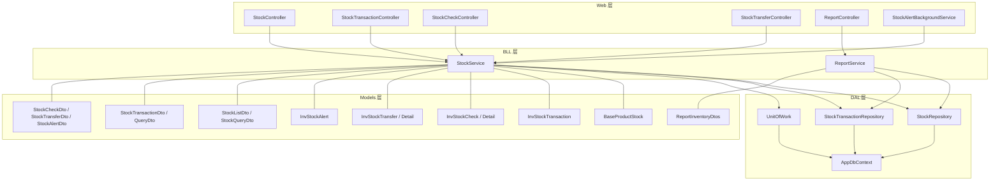
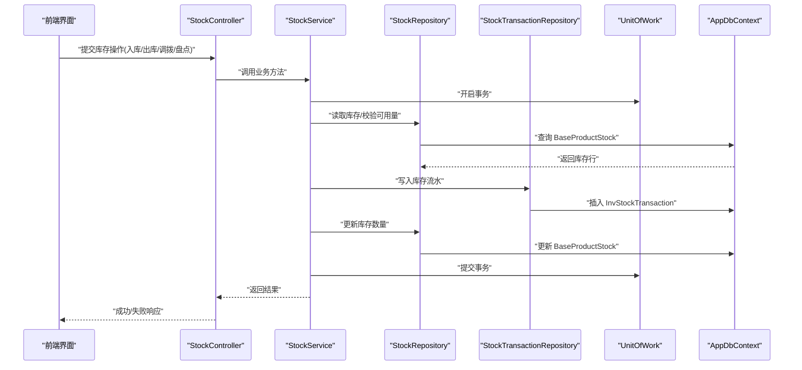
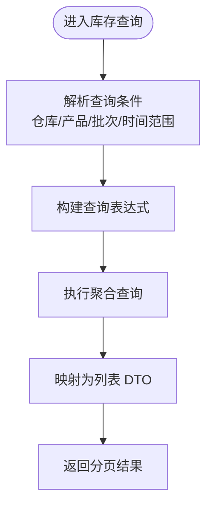
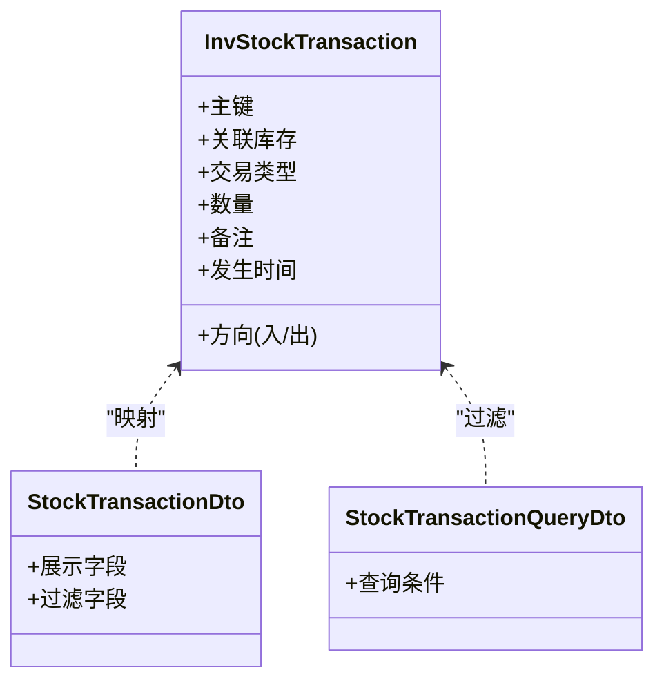
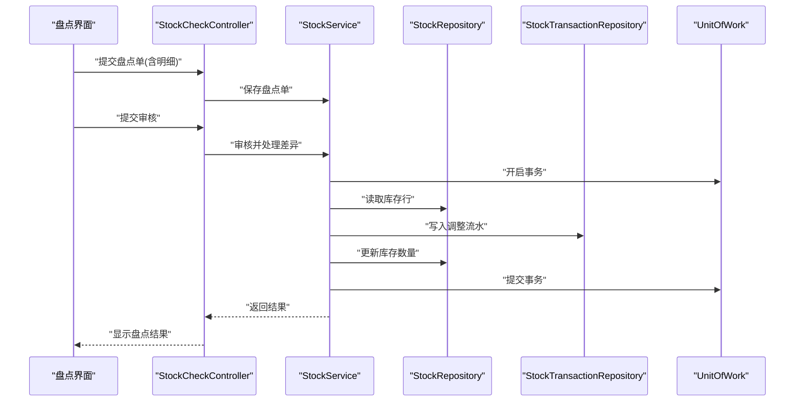
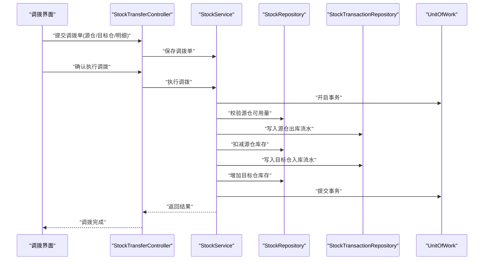
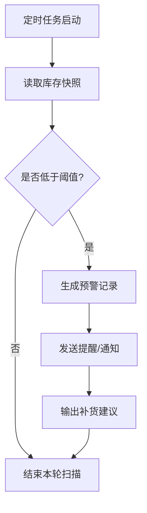
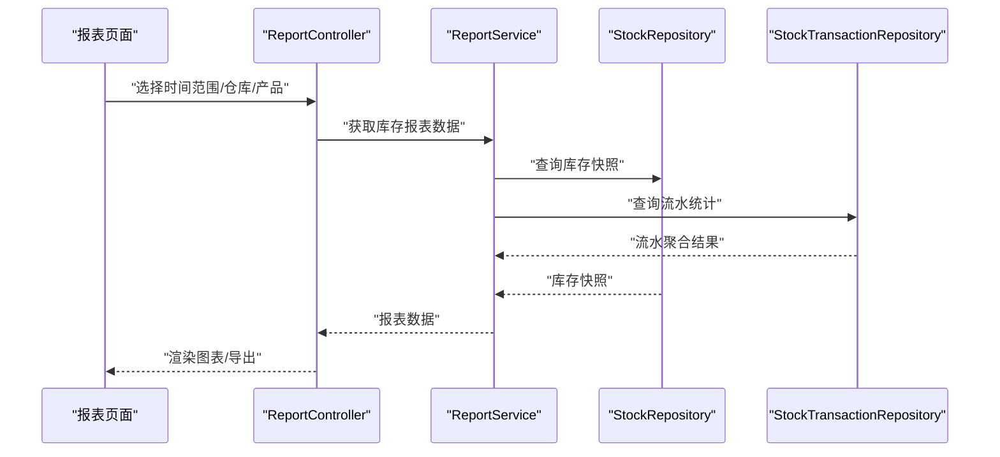

# 库存管理

<cite>
**本文引用的文件**   
- [StockService.cs](file://EquipmentIMS.BLL/Services/StockService.cs)
- [IStockService.cs](file://EquipmentIMS.BLL/Interfaces/IStockService.cs)
- [StockRepository.cs](file://EquipmentIMS.DAL/Repositories/StockRepository.cs)
- [IStockRepository.cs](file://EquipmentIMS.DAL/Interfaces/IStockRepository.cs)
- [StockTransactionRepository.cs](file://EquipmentIMS.DAL/Repositories/StockTransactionRepository.cs)
- [IStockTransactionRepository.cs](file://EquipmentIMS.DAL/Interfaces/IStockTransactionRepository.cs)
- [UnitOfWork.cs](file://EquipmentIMS.DAL/Repositories/UnitOfWork.cs)
- [AppDbContext.cs](file://EquipmentIMS.DAL/AppDbContext.cs)
- [BaseProductStock.cs](file://EquipmentIMS.Models/Entities/BaseProductStock.cs)
- [InvStockTransaction.cs](file://EquipmentIMS.Models/Entities/InvStockTransaction.cs)
- [InvStockCheck.cs](file://EquipmentIMS.Models/Entities/InvStockCheck.cs)
- [InvStockCheckDetail.cs](file://EquipmentIMS.Models/Entities/InvStockCheckDetail.cs)
- [InvStockTransfer.cs](file://EquipmentIMS.Models/Entities/InvStockTransfer.cs)
- [InvStockTransferDetail.cs](file://EquipmentIMS.Models/Entities/InvStockTransferDetail.cs)
- [InvStockAlert.cs](file://EquipmentIMS.Models/Entities/InvStockAlert.cs)
- [StockListDto.cs](file://EquipmentIMS.Models/DTOs/StockListDto.cs)
- [StockQueryDto.cs](file://EquipmentIMS.Models/DTOs/StockQueryDto.cs)
- [StockTransactionDto.cs](file://EquipmentIMS.Models/DTOs/StockTransactionDto.cs)
- [StockTransactionQueryDto.cs](file://EquipmentIMS.Models/DTOs/StockTransactionQueryDto.cs)
- [StockCheckDto.cs](file://EquipmentIMS.Models/DTOs/StockCheckDto.cs)
- [StockTransferDto.cs](file://EquipmentIMS.Models/DTOs/StockTransferDto.cs)
- [StockAlertDto.cs](file://EquipmentIMS.Models/DTOs/StockAlertDto.cs)
- [ReportInventoryDtos.cs](file://EquipmentIMS.Models/DTOs/Reports/ReportInventoryDtos.cs)
- [StockController.cs](file://EquipmentIMS.Web/Controllers/StockController.cs)
- [StockTransactionController.cs](file://EquipmentIMS.Web/Controllers/StockTransactionController.cs)
- [StockCheckController.cs](file://EquipmentIMS.Web/Controllers/StockCheckController.cs)
- [StockTransferController.cs](file://EquipmentIMS.Web/Controllers/StockTransferController.cs)
- [StockAlertBackgroundService.cs](file://EquipmentIMS.Web/BackgroundServices/StockAlertBackgroundService.cs)
- [ReportService.cs](file://EquipmentIMS.BLL/Services/ReportService.cs)
- [ReportController.cs](file://EquipmentIMS.Web/Controllers/ReportController.cs)
</cite>

## 目录
1. [简介](#简介)
2. [项目结构](#项目结构)
3. [核心组件](#核心组件)
4. [架构总览](#架构总览)
5. [详细组件分析](#详细组件分析)
6. [依赖关系分析](#依赖关系分析)
7. [性能考虑](#性能考虑)
8. [故障排查指南](#故障排查指南)
9. [结论](#结论)
10. [附录](#附录)

## 简介
本文件围绕库存管理模块，系统性阐述以下能力：
- 库存查询与多仓库、批次维度管理
- 库存盘点流程、差异处理与调整记录
- 库存调拨（跨仓）机制与事务一致性
- 库存预警规则配置、低库存提醒与自动补货建议
- 库存流水记录与可追溯性
- 库存报表生成、趋势分析与可视化展示
- 事务一致性与并发控制策略

## 项目结构
库存相关代码遵循分层架构：Web 控制器层调用业务服务层，业务服务层通过仓储接口访问数据访问层，实体与 DTO 位于模型层。

图表来源
- [StockController.cs](file://EquipmentIMS.Web/Controllers/StockController.cs)
- [StockTransactionController.cs](file://EquipmentIMS.Web/Controllers/StockTransactionController.cs)
- [StockCheckController.cs](file://EquipmentIMS.Web/Controllers/StockCheckController.cs)
- [StockTransferController.cs](file://EquipmentIMS.Web/Controllers/StockTransferController.cs)
- [ReportController.cs](file://EquipmentIMS.Web/Controllers/ReportController.cs)
- [StockAlertBackgroundService.cs](file://EquipmentIMS.Web/BackgroundServices/StockAlertBackgroundService.cs)
- [StockService.cs](file://EquipmentIMS.BLL/Services/StockService.cs)
- [ReportService.cs](file://EquipmentIMS.BLL/Services/ReportService.cs)
- [StockRepository.cs](file://EquipmentIMS.DAL/Repositories/StockRepository.cs)
- [StockTransactionRepository.cs](file://EquipmentIMS.DAL/Repositories/StockTransactionRepository.cs)
- [UnitOfWork.cs](file://EquipmentIMS.DAL/Repositories/UnitOfWork.cs)
- [AppDbContext.cs](file://EquipmentIMS.DAL/AppDbContext.cs)
- [BaseProductStock.cs](file://EquipmentIMS.Models/Entities/BaseProductStock.cs)
- [InvStockTransaction.cs](file://EquipmentIMS.Models/Entities/InvStockTransaction.cs)
- [InvStockCheck.cs](file://EquipmentIMS.Models/Entities/InvStockCheck.cs)
- [InvStockCheckDetail.cs](file://EquipmentIMS.Models/Entities/InvStockCheckDetail.cs)
- [InvStockTransfer.cs](file://EquipmentIMS.Models/Entities/InvStockTransfer.cs)
- [InvStockTransferDetail.cs](file://EquipmentIMS.Models/Entities/InvStockTransferDetail.cs)
- [InvStockAlert.cs](file://EquipmentIMS.Models/Entities/InvStockAlert.cs)
- [StockListDto.cs](file://EquipmentIMS.Models/DTOs/StockListDto.cs)
- [StockQueryDto.cs](file://EquipmentIMS.Models/DTOs/StockQueryDto.cs)
- [StockTransactionDto.cs](file://EquipmentIMS.Models/DTOs/StockTransactionDto.cs)
- [StockTransactionQueryDto.cs](file://EquipmentIMS.Models/DTOs/StockTransactionQueryDto.cs)
- [StockCheckDto.cs](file://EquipmentIMS.Models/DTOs/StockCheckDto.cs)
- [StockTransferDto.cs](file://EquipmentIMS.Models/DTOs/StockTransferDto.cs)
- [StockAlertDto.cs](file://EquipmentIMS.Models/DTOs/StockAlertDto.cs)
- [ReportInventoryDtos.cs](file://EquipmentIMS.Models/DTOs/Reports/ReportInventoryDtos.cs)

章节来源
- [StockController.cs](file://EquipmentIMS.Web/Controllers/StockController.cs)
- [StockService.cs](file://EquipmentIMS.BLL/Services/StockService.cs)
- [StockRepository.cs](file://EquipmentIMS.DAL/Repositories/StockRepository.cs)
- [StockTransactionRepository.cs](file://EquipmentIMS.DAL/Repositories/StockTransactionRepository.cs)
- [UnitOfWork.cs](file://EquipmentIMS.DAL/Repositories/UnitOfWork.cs)
- [AppDbContext.cs](file://EquipmentIMS.DAL/AppDbContext.cs)
- [BaseProductStock.cs](file://EquipmentIMS.Models/Entities/BaseProductStock.cs)
- [InvStockTransaction.cs](file://EquipmentIMS.Models/Entities/InvStockTransaction.cs)
- [InvStockCheck.cs](file://EquipmentIMS.Models/Entities/InvStockCheck.cs)
- [InvStockCheckDetail.cs](file://EquipmentIMS.Models/Entities/InvStockCheckDetail.cs)
- [InvStockTransfer.cs](file://EquipmentIMS.Models/Entities/InvStockTransfer.cs)
- [InvStockTransferDetail.cs](file://EquipmentIMS.Models/Entities/InvStockTransferDetail.cs)
- [InvStockAlert.cs](file://EquipmentIMS.Models/Entities/InvStockAlert.cs)
- [StockListDto.cs](file://EquipmentIMS.Models/DTOs/StockListDto.cs)
- [StockQueryDto.cs](file://EquipmentIMS.Models/DTOs/StockQueryDto.cs)
- [StockTransactionDto.cs](file://EquipmentIMS.Models/DTOs/StockTransactionDto.cs)
- [StockTransactionQueryDto.cs](file://EquipmentIMS.Models/DTOs/StockTransactionQueryDto.cs)
- [StockCheckDto.cs](file://EquipmentIMS.Models/DTOs/StockCheckDto.cs)
- [StockTransferDto.cs](file://EquipmentIMS.Models/DTOs/StockTransferDto.cs)
- [StockAlertDto.cs](file://EquipmentIMS.Models/DTOs/StockAlertDto.cs)
- [ReportInventoryDtos.cs](file://EquipmentIMS.Models/DTOs/Reports/ReportInventoryDtos.cs)

## 核心组件
- 库存查询与多仓库/批次管理
  - 通过列表与查询 DTO 支持按仓库、产品、批次等条件筛选；返回聚合后的库存快照。
  - 参考路径：[StockListDto.cs](file://EquipmentIMS.Models/DTOs/StockListDto.cs)、[StockQueryDto.cs](file://EquipmentIMS.Models/DTOs/StockQueryDto.cs)
- 库存流水
  - 所有库存变动均落库为流水记录，保证可追溯与审计。
  - 参考路径：[InvStockTransaction.cs](file://EquipmentIMS.Models/Entities/InvStockTransaction.cs)、[StockTransactionDto.cs](file://EquipmentIMS.Models/DTOs/StockTransactionDto.cs)、[StockTransactionQueryDto.cs](file://EquipmentIMS.Models/DTOs/StockTransactionQueryDto.cs)
- 库存盘点
  - 支持创建盘点单、明细录入、审核与差异调整。
  - 参考路径：[InvStockCheck.cs](file://EquipmentIMS.Models/Entities/InvStockCheck.cs)、[InvStockCheckDetail.cs](file://EquipmentIMS.Models/Entities/InvStockCheckDetail.cs)、[StockCheckDto.cs](file://EquipmentIMS.Models/DTOs/StockCheckDto.cs)
- 库存调拨
  - 支持跨仓库调拨，包含主单与明细，状态流转与结果回写库存。
  - 参考路径：[InvStockTransfer.cs](file://EquipmentIMS.Models/Entities/InvStockTransfer.cs)、[InvStockTransferDetail.cs](file://EquipmentIMS.Models/Entities/InvStockTransferDetail.cs)、[StockTransferDto.cs](file://EquipmentIMS.Models/DTOs/StockTransferDto.cs)
- 库存预警
  - 基于阈值触发预警，后台定时任务扫描并生成预警记录。
  - 参考路径：[InvStockAlert.cs](file://EquipmentIMS.Models/Entities/InvStockAlert.cs)、[StockAlertDto.cs](file://EquipmentIMS.Models/DTOs/StockAlertDto.cs)、[StockAlertBackgroundService.cs](file://EquipmentIMS.Web/BackgroundServices/StockAlertBackgroundService.cs)
- 库存报表
  - 提供库存汇总、趋势与导出能力。
  - 参考路径：[ReportInventoryDtos.cs](file://EquipmentIMS.Models/DTOs/Reports/ReportInventoryDtos.cs)、[ReportService.cs](file://EquipmentIMS.BLL/Services/ReportService.cs)、[ReportController.cs](file://EquipmentIMS.Web/Controllers/ReportController.cs)

章节来源
- [StockListDto.cs](file://EquipmentIMS.Models/DTOs/StockListDto.cs)
- [StockQueryDto.cs](file://EquipmentIMS.Models/DTOs/StockQueryDto.cs)
- [InvStockTransaction.cs](file://EquipmentIMS.Models/Entities/InvStockTransaction.cs)
- [StockTransactionDto.cs](file://EquipmentIMS.Models/DTOs/StockTransactionDto.cs)
- [StockTransactionQueryDto.cs](file://EquipmentIMS.Models/DTOs/StockTransactionQueryDto.cs)
- [InvStockCheck.cs](file://EquipmentIMS.Models/Entities/InvStockCheck.cs)
- [InvStockCheckDetail.cs](file://EquipmentIMS.Models/Entities/InvStockCheckDetail.cs)
- [StockCheckDto.cs](file://EquipmentIMS.Models/DTOs/StockCheckDto.cs)
- [InvStockTransfer.cs](file://EquipmentIMS.Models/Entities/InvStockTransfer.cs)
- [InvStockTransferDetail.cs](file://EquipmentIMS.Models/Entities/InvStockTransferDetail.cs)
- [StockTransferDto.cs](file://EquipmentIMS.Models/DTOs/StockTransferDto.cs)
- [InvStockAlert.cs](file://EquipmentIMS.Models/Entities/InvStockAlert.cs)
- [StockAlertDto.cs](file://EquipmentIMS.Models/DTOs/StockAlertDto.cs)
- [StockAlertBackgroundService.cs](file://EquipmentIMS.Web/BackgroundServices/StockAlertBackgroundService.cs)
- [ReportInventoryDtos.cs](file://EquipmentIMS.Models/DTOs/Reports/ReportInventoryDtos.cs)
- [ReportService.cs](file://EquipmentIMS.BLL/Services/ReportService.cs)
- [ReportController.cs](file://EquipmentIMS.Web/Controllers/ReportController.cs)

## 架构总览
库存模块采用“控制器 -> 服务 -> 仓储 -> 上下文”的分层设计，关键交互如下：
- Web 控制器接收请求，参数校验后调用服务方法
- 服务编排业务逻辑，使用 UnitOfWork 确保事务边界
- 仓储实现具体数据访问，读写实体与视图模型
- 背景服务周期性执行库存预警检查

图表来源
- [StockController.cs](file://EquipmentIMS.Web/Controllers/StockController.cs)
- [StockService.cs](file://EquipmentIMS.BLL/Services/StockService.cs)
- [StockRepository.cs](file://EquipmentIMS.DAL/Repositories/StockRepository.cs)
- [StockTransactionRepository.cs](file://EquipmentIMS.DAL/Repositories/StockTransactionRepository.cs)
- [UnitOfWork.cs](file://EquipmentIMS.DAL/Repositories/UnitOfWork.cs)
- [AppDbContext.cs](file://EquipmentIMS.DAL/AppDbContext.cs)

## 详细组件分析

### 库存查询与多仓库/批次管理
- 功能要点
  - 支持按仓库、产品、批次等多维筛选
  - 返回当前可用库存快照，便于前端展示与决策
- 关键数据流
  - 控制器接收查询 DTO -> 服务组装查询条件 -> 仓储聚合查询 -> 返回 DTO 列表
- 典型 DTO
  - 列表与查询 DTO 定义字段与过滤项
  - 参考路径：[StockListDto.cs](file://EquipmentIMS.Models/DTOs/StockListDto.cs)、[StockQueryDto.cs](file://EquipmentIMS.Models/DTOs/StockQueryDto.cs)

图表来源
- [StockController.cs](file://EquipmentIMS.Web/Controllers/StockController.cs)
- [StockService.cs](file://EquipmentIMS.BLL/Services/StockService.cs)
- [StockRepository.cs](file://EquipmentIMS.DAL/Repositories/StockRepository.cs)
- [StockListDto.cs](file://EquipmentIMS.Models/DTOs/StockListDto.cs)
- [StockQueryDto.cs](file://EquipmentIMS.Models/DTOs/StockQueryDto.cs)

章节来源
- [StockController.cs](file://EquipmentIMS.Web/Controllers/StockController.cs)
- [StockService.cs](file://EquipmentIMS.BLL/Services/StockService.cs)
- [StockRepository.cs](file://EquipmentIMS.DAL/Repositories/StockRepository.cs)
- [StockListDto.cs](file://EquipmentIMS.Models/DTOs/StockListDto.cs)
- [StockQueryDto.cs](file://EquipmentIMS.Models/DTOs/StockQueryDto.cs)

### 库存流水记录与可追溯性
- 设计目标
  - 任何库存变更必须产生不可变流水，支撑审计与回溯
- 关键实体与 DTO
  - 流水实体与查询/展示 DTO
  - 参考路径：[InvStockTransaction.cs](file://EquipmentIMS.Models/Entities/InvStockTransaction.cs)、[StockTransactionDto.cs](file://EquipmentIMS.Models/DTOs/StockTransactionDto.cs)、[StockTransactionQueryDto.cs](file://EquipmentIMS.Models/DTOs/StockTransactionQueryDto.cs)
- 事务边界
  - 库存扣减/增加与流水写入在同一个事务中完成，避免不一致

图表来源
- [InvStockTransaction.cs](file://EquipmentIMS.Models/Entities/InvStockTransaction.cs)
- [StockTransactionDto.cs](file://EquipmentIMS.Models/DTOs/StockTransactionDto.cs)
- [StockTransactionQueryDto.cs](file://EquipmentIMS.Models/DTOs/StockTransactionQueryDto.cs)

章节来源
- [InvStockTransaction.cs](file://EquipmentIMS.Models/Entities/InvStockTransaction.cs)
- [StockTransactionDto.cs](file://EquipmentIMS.Models/DTOs/StockTransactionDto.cs)
- [StockTransactionQueryDto.cs](file://EquipmentIMS.Models/DTOs/StockTransactionQueryDto.cs)
- [StockTransactionRepository.cs](file://EquipmentIMS.DAL/Repositories/StockTransactionRepository.cs)

### 库存盘点流程、差异处理与调整记录
- 流程概述
  - 创建盘点单 -> 录入实盘数量 -> 系统计算差异 -> 审核通过后自动调整库存并生成流水
- 关键实体
  - 盘点主单与明细
  - 参考路径：[InvStockCheck.cs](file://EquipmentIMS.Models/Entities/InvStockCheck.cs)、[InvStockCheckDetail.cs](file://EquipmentIMS.Models/Entities/InvStockCheckDetail.cs)
- 展示与输入
  - 盘点 DTO 用于表单与列表展示
  - 参考路径：[StockCheckDto.cs](file://EquipmentIMS.Models/DTOs/StockCheckDto.cs)

图表来源
- [StockCheckController.cs](file://EquipmentIMS.Web/Controllers/StockCheckController.cs)
- [StockService.cs](file://EquipmentIMS.BLL/Services/StockService.cs)
- [StockRepository.cs](file://EquipmentIMS.DAL/Repositories/StockRepository.cs)
- [StockTransactionRepository.cs](file://EquipmentIMS.DAL/Repositories/StockTransactionRepository.cs)
- [UnitOfWork.cs](file://EquipmentIMS.DAL/Repositories/UnitOfWork.cs)
- [InvStockCheck.cs](file://EquipmentIMS.Models/Entities/InvStockCheck.cs)
- [InvStockCheckDetail.cs](file://EquipmentIMS.Models/Entities/InvStockCheckDetail.cs)
- [StockCheckDto.cs](file://EquipmentIMS.Models/DTOs/StockCheckDto.cs)

章节来源
- [StockCheckController.cs](file://EquipmentIMS.Web/Controllers/StockCheckController.cs)
- [StockService.cs](file://EquipmentIMS.BLL/Services/StockService.cs)
- [StockRepository.cs](file://EquipmentIMS.DAL/Repositories/StockRepository.cs)
- [StockTransactionRepository.cs](file://EquipmentIMS.DAL/Repositories/StockTransactionRepository.cs)
- [UnitOfWork.cs](file://EquipmentIMS.DAL/Repositories/UnitOfWork.cs)
- [InvStockCheck.cs](file://EquipmentIMS.Models/Entities/InvStockCheck.cs)
- [InvStockCheckDetail.cs](file://EquipmentIMS.Models/Entities/InvStockCheckDetail.cs)
- [StockCheckDto.cs](file://EquipmentIMS.Models/DTOs/StockCheckDto.cs)

### 库存调拨（跨仓）机制
- 功能要点
  - 支持从源仓库到目标仓库的调拨，包含主单与明细
  - 调拨完成后分别扣减源仓、增加目标仓库存，并生成对应流水
- 关键实体与 DTO
  - 调拨主单与明细、调拨 DTO
  - 参考路径：[InvStockTransfer.cs](file://EquipmentIMS.Models/Entities/InvStockTransfer.cs)、[InvStockTransferDetail.cs](file://EquipmentIMS.Models/Entities/InvStockTransferDetail.cs)、[StockTransferDto.cs](file://EquipmentIMS.Models/DTOs/StockTransferDto.cs)

图表来源
- [StockTransferController.cs](file://EquipmentIMS.Web/Controllers/StockTransferController.cs)
- [StockService.cs](file://EquipmentIMS.BLL/Services/StockService.cs)
- [StockRepository.cs](file://EquipmentIMS.DAL/Repositories/StockRepository.cs)
- [StockTransactionRepository.cs](file://EquipmentIMS.DAL/Repositories/StockTransactionRepository.cs)
- [UnitOfWork.cs](file://EquipmentIMS.DAL/Repositories/UnitOfWork.cs)
- [InvStockTransfer.cs](file://EquipmentIMS.Models/Entities/InvStockTransfer.cs)
- [InvStockTransferDetail.cs](file://EquipmentIMS.Models/Entities/InvStockTransferDetail.cs)
- [StockTransferDto.cs](file://EquipmentIMS.Models/DTOs/StockTransferDto.cs)

章节来源
- [StockTransferController.cs](file://EquipmentIMS.Web/Controllers/StockTransferController.cs)
- [StockService.cs](file://EquipmentIMS.BLL/Services/StockService.cs)
- [StockRepository.cs](file://EquipmentIMS.DAL/Repositories/StockRepository.cs)
- [StockTransactionRepository.cs](file://EquipmentIMS.DAL/Repositories/StockTransactionRepository.cs)
- [UnitOfWork.cs](file://EquipmentIMS.DAL/Repositories/UnitOfWork.cs)
- [InvStockTransfer.cs](file://EquipmentIMS.Models/Entities/InvStockTransfer.cs)
- [InvStockTransferDetail.cs](file://EquipmentIMS.Models/Entities/InvStockTransferDetail.cs)
- [StockTransferDto.cs](file://EquipmentIMS.Models/DTOs/StockTransferDto.cs)

### 库存预警规则配置、低库存提醒与自动补货建议
- 预警规则
  - 基于安全库存/最低库存阈值进行判断，达到或低于阈值即触发预警
- 低库存提醒
  - 后台定时任务扫描库存，生成预警记录并通知用户
- 自动补货建议
  - 根据历史消耗与安全库存计算建议补货量（由服务层输出建议值）
- 关键实体与 DTO
  - 预警实体与 DTO
  - 参考路径：[InvStockAlert.cs](file://EquipmentIMS.Models/Entities/InvStockAlert.cs)、[StockAlertDto.cs](file://EquipmentIMS.Models/DTOs/StockAlertDto.cs)
- 后台任务
  - 参考路径：[StockAlertBackgroundService.cs](file://EquipmentIMS.Web/BackgroundServices/StockAlertBackgroundService.cs)

图表来源
- [StockAlertBackgroundService.cs](file://EquipmentIMS.Web/BackgroundServices/StockAlertBackgroundService.cs)
- [InvStockAlert.cs](file://EquipmentIMS.Models/Entities/InvStockAlert.cs)
- [StockAlertDto.cs](file://EquipmentIMS.Models/DTOs/StockAlertDto.cs)

章节来源
- [StockAlertBackgroundService.cs](file://EquipmentIMS.Web/BackgroundServices/StockAlertBackgroundService.cs)
- [InvStockAlert.cs](file://EquipmentIMS.Models/Entities/InvStockAlert.cs)
- [StockAlertDto.cs](file://EquipmentIMS.Models/DTOs/StockAlertDto.cs)

### 库存报表生成、趋势分析与可视化展示
- 报表能力
  - 库存汇总、出入库趋势、周转率等指标
- 数据模型
  - 报表 DTO 定义汇总字段与时间维度
  - 参考路径：[ReportInventoryDtos.cs](file://EquipmentIMS.Models/DTOs/Reports/ReportInventoryDtos.cs)
- 服务与控制器
  - 报表服务负责数据聚合，控制器暴露查询与导出接口
  - 参考路径：[ReportService.cs](file://EquipmentIMS.BLL/Services/ReportService.cs)、[ReportController.cs](file://EquipmentIMS.Web/Controllers/ReportController.cs)

图表来源
- [ReportController.cs](file://EquipmentIMS.Web/Controllers/ReportController.cs)
- [ReportService.cs](file://EquipmentIMS.BLL/Services/ReportService.cs)
- [StockRepository.cs](file://EquipmentIMS.DAL/Repositories/StockRepository.cs)
- [StockTransactionRepository.cs](file://EquipmentIMS.DAL/Repositories/StockTransactionRepository.cs)
- [ReportInventoryDtos.cs](file://EquipmentIMS.Models/DTOs/Reports/ReportInventoryDtos.cs)

章节来源
- [ReportController.cs](file://EquipmentIMS.Web/Controllers/ReportController.cs)
- [ReportService.cs](file://EquipmentIMS.BLL/Services/ReportService.cs)
- [ReportInventoryDtos.cs](file://EquipmentIMS.Models/DTOs/Reports/ReportInventoryDtos.cs)

## 依赖关系分析
- 组件耦合
  - 控制器仅依赖服务接口，服务依赖仓储接口与 UnitOfWork，降低横向耦合
- 外部依赖
  - 数据库访问通过 EF Core 上下文，仓储统一封装 CRUD 与复杂查询
- 潜在循环依赖
  - 当前分层清晰，未见循环引用

图表来源
- [StockController.cs](file://EquipmentIMS.Web/Controllers/StockController.cs)
- [StockService.cs](file://EquipmentIMS.BLL/Services/StockService.cs)
- [StockRepository.cs](file://EquipmentIMS.DAL/Repositories/StockRepository.cs)
- [StockTransactionRepository.cs](file://EquipmentIMS.DAL/Repositories/StockTransactionRepository.cs)
- [UnitOfWork.cs](file://EquipmentIMS.DAL/Repositories/UnitOfWork.cs)
- [AppDbContext.cs](file://EquipmentIMS.DAL/AppDbContext.cs)

章节来源
- [StockController.cs](file://EquipmentIMS.Web/Controllers/StockController.cs)
- [StockService.cs](file://EquipmentIMS.BLL/Services/StockService.cs)
- [StockRepository.cs](file://EquipmentIMS.DAL/Repositories/StockRepository.cs)
- [StockTransactionRepository.cs](file://EquipmentIMS.DAL/Repositories/StockTransactionRepository.cs)
- [UnitOfWork.cs](file://EquipmentIMS.DAL/Repositories/UnitOfWork.cs)
- [AppDbContext.cs](file://EquipmentIMS.DAL/AppDbContext.cs)

## 性能考虑
- 查询优化
  - 对常用筛选字段建立索引（仓库、产品、批次、时间范围）
  - 报表查询尽量使用服务端聚合，减少数据传输量
- 事务粒度
  - 将库存更新与流水写入置于同一事务，缩短锁持有时间
- 并发控制
  - 在高并发场景下，结合乐观锁或行级锁保障库存一致性
- 缓存策略
  - 热点库存快照可短期缓存，但需保证失效策略与一致性

## 故障排查指南
- 常见问题
  - 库存不足：检查可用量与锁定量，核对最近流水
  - 盘点差异过大：复核实盘录入与审核流程
  - 调拨失败：检查源仓可用量与目标仓容量限制
  - 预警未触发：确认阈值配置与后台任务运行状态
- 定位步骤
  - 查看库存流水定位异常时间点
  - 检查盘点/调拨单据状态与明细
  - 核查后台任务日志与预警记录
- 参考路径
  - 控制器与服务入口：[StockController.cs](file://EquipmentIMS.Web/Controllers/StockController.cs)、[StockService.cs](file://EquipmentIMS.BLL/Services/StockService.cs)
  - 流水与实体：[InvStockTransaction.cs](file://EquipmentIMS.Models/Entities/InvStockTransaction.cs)、[StockTransactionDto.cs](file://EquipmentIMS.Models/DTOs/StockTransactionDto.cs)
  - 盘点与调拨：[InvStockCheck.cs](file://EquipmentIMS.Models/Entities/InvStockCheck.cs)、[InvStockTransfer.cs](file://EquipmentIMS.Models/Entities/InvStockTransfer.cs)
  - 预警与后台任务：[InvStockAlert.cs](file://EquipmentIMS.Models/Entities/InvStockAlert.cs)、[StockAlertBackgroundService.cs](file://EquipmentIMS.Web/BackgroundServices/StockAlertBackgroundService.cs)

章节来源
- [StockController.cs](file://EquipmentIMS.Web/Controllers/StockController.cs)
- [StockService.cs](file://EquipmentIMS.BLL/Services/StockService.cs)
- [InvStockTransaction.cs](file://EquipmentIMS.Models/Entities/InvStockTransaction.cs)
- [StockTransactionDto.cs](file://EquipmentIMS.Models/DTOs/StockTransactionDto.cs)
- [InvStockCheck.cs](file://EquipmentIMS.Models/Entities/InvStockCheck.cs)
- [InvStockTransfer.cs](file://EquipmentIMS.Models/Entities/InvStockTransfer.cs)
- [InvStockAlert.cs](file://EquipmentIMS.Models/Entities/InvStockAlert.cs)
- [StockAlertBackgroundService.cs](file://EquipmentIMS.Web/BackgroundServices/StockAlertBackgroundService.cs)

## 结论
库存管理模块以清晰的层次化设计与严格的事务边界，实现了多仓库、批次的精细化管控，并通过盘点、调拨与预警形成闭环。流水记录保障了可追溯性，报表与可视化提升了运营效率。建议在后续迭代中持续完善并发控制、索引策略与监控告警，进一步提升稳定性与可观测性。

## 附录
- 关键实体与 DTO 清单
  - 库存快照：[BaseProductStock.cs](file://EquipmentIMS.Models/Entities/BaseProductStock.cs)
  - 库存流水：[InvStockTransaction.cs](file://EquipmentIMS.Models/Entities/InvStockTransaction.cs)
  - 盘点：[InvStockCheck.cs](file://EquipmentIMS.Models/Entities/InvStockCheck.cs)、[InvStockCheckDetail.cs](file://EquipmentIMS.Models/Entities/InvStockCheckDetail.cs)
  - 调拨：[InvStockTransfer.cs](file://EquipmentIMS.Models/Entities/InvStockTransfer.cs)、[InvStockTransferDetail.cs](file://EquipmentIMS.Models/Entities/InvStockTransferDetail.cs)
  - 预警：[InvStockAlert.cs](file://EquipmentIMS.Models/Entities/InvStockAlert.cs)
  - 查询与列表 DTO：[StockListDto.cs](file://EquipmentIMS.Models/DTOs/StockListDto.cs)、[StockQueryDto.cs](file://EquipmentIMS.Models/DTOs/StockQueryDto.cs)、[StockTransactionDto.cs](file://EquipmentIMS.Models/DTOs/StockTransactionDto.cs)、[StockTransactionQueryDto.cs](file://EquipmentIMS.Models/DTOs/StockTransactionQueryDto.cs)、[StockCheckDto.cs](file://EquipmentIMS.Models/DTOs/StockCheckDto.cs)、[StockTransferDto.cs](file://EquipmentIMS.Models/DTOs/StockTransferDto.cs)、[StockAlertDto.cs](file://EquipmentIMS.Models/DTOs/StockAlertDto.cs)
  - 报表 DTO：[ReportInventoryDtos.cs](file://EquipmentIMS.Models/DTOs/Reports/ReportInventoryDtos.cs)