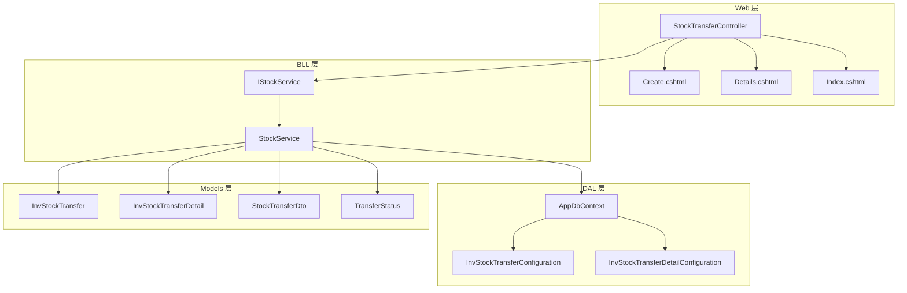
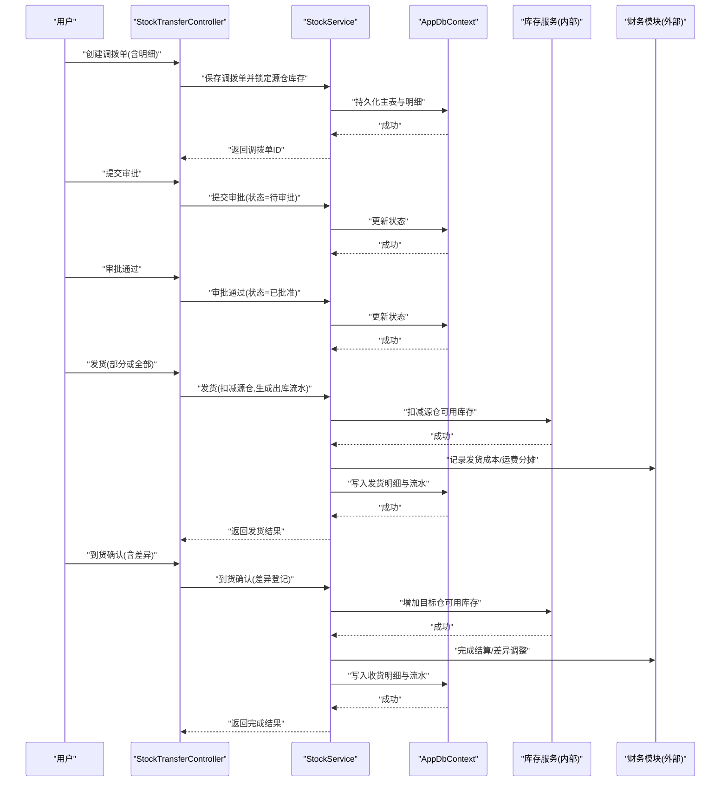
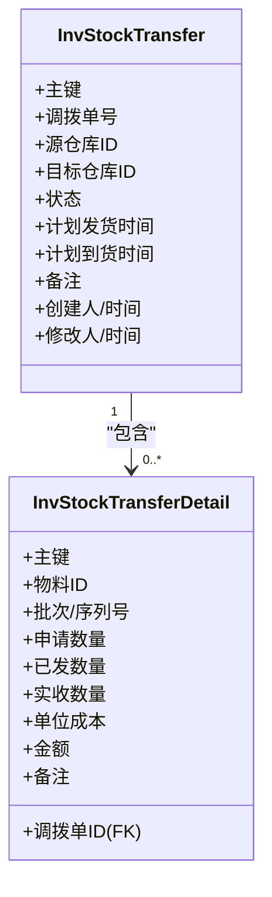
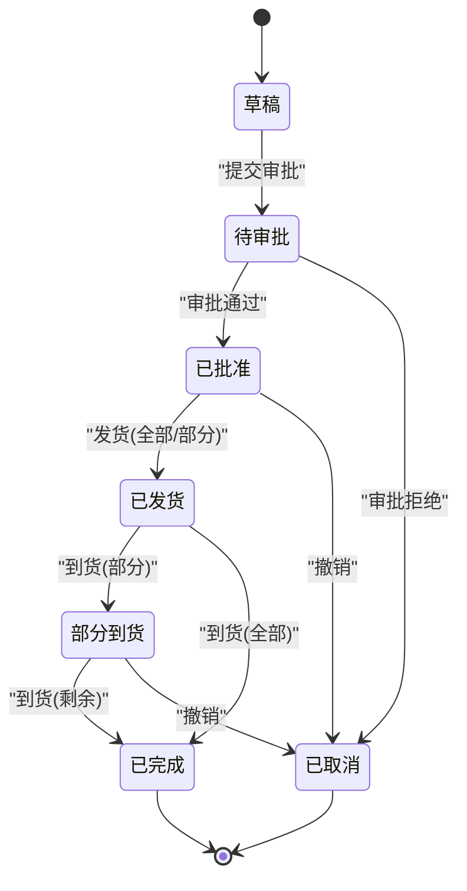
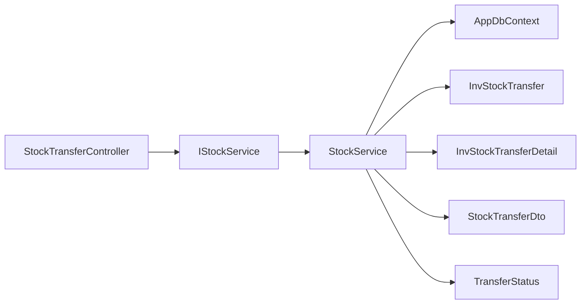
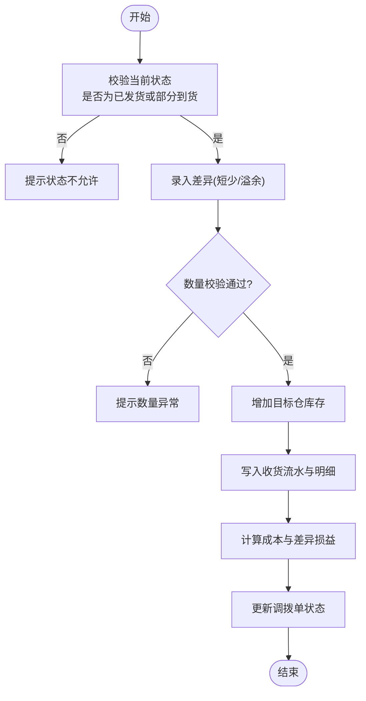

# 库存调拨

<cite>
**本文引用的文件**   
- [StockTransferController.cs](file://EquipmentIMS.Web/Controllers/StockTransferController.cs)
- [Create.cshtml](file://EquipmentIMS.Web/Views/StockTransfer/Create.cshtml)
- [Details.cshtml](file://EquipmentIMS.Web/Views/StockTransfer/Details.cshtml)
- [Index.cshtml](file://EquipmentIMS.Web/Views/StockTransfer/Index.cshtml)
- [StockTransferDto.cs](file://EquipmentIMS.Models/DTOs/StockTransferDto.cs)
- [InvStockTransfer.cs](file://EquipmentIMS.Models/Entities/InvStockTransfer.cs)
- [InvStockTransferDetail.cs](file://EquipmentIMS.Models/Entities/InvStockTransferDetail.cs)
- [TransferStatus.cs](file://EquipmentIMS.Models/Enums/TransferStatus.cs)
- [IStockService.cs](file://EquipmentIMS.BLL/Interfaces/IStockService.cs)
- [StockService.cs](file://EquipmentIMS.BLL/Services/StockService.cs)
- [AppDbContext.cs](file://EquipmentIMS.DAL/AppDbContext.cs)
- [InvStockTransferConfiguration.cs](file://EquipmentIMS.DAL/Configurations/InvStockTransferConfiguration.cs)
- [InvStockTransferDetailConfiguration.cs](file://EquipmentIMS.DAL/Configurations/InvStockTransferDetailConfiguration.cs)
</cite>

## 目录
1. [简介](#简介)
2. [项目结构](#项目结构)
3. [核心组件](#核心组件)
4. [架构总览](#架构总览)
5. [详细组件分析](#详细组件分析)
6. [依赖关系分析](#依赖关系分析)
7. [性能考虑](#性能考虑)
8. [故障排查指南](#故障排查指南)
9. [结论](#结论)
10. [附录](#附录)

## 简介
本文件围绕“库存调拨”能力，系统化梳理跨仓库调拨流程、调拨申请与审批、调拨执行、调拨单创建与明细管理、状态跟踪、成本与运费分摊、财务处理、物流跟踪、到货确认与差异处理、报表分析与效率评估、优化建议以及业务规则与异常处理机制。文档面向产品、实施与研发人员，兼顾可读性与可落地性。

## 项目结构
调拨功能在分层架构中分布于 Web 层（控制器与视图）、BLL 层（服务）、DAL 层（数据访问与配置）与 Models 层（实体、枚举、DTO）。关键入口为 StockTransferController，对应视图位于 Views/StockTransfer；领域模型与配置位于 Entities 与 Configurations；服务接口与实现位于 BLL/Interfaces 与 BLL/Services。

图表来源
- [StockTransferController.cs](file://EquipmentIMS.Web/Controllers/StockTransferController.cs)
- [Create.cshtml](file://EquipmentIMS.Web/Views/StockTransfer/Create.cshtml)
- [Details.cshtml](file://EquipmentIMS.Web/Views/StockTransfer/Details.cshtml)
- [Index.cshtml](file://EquipmentIMS.Web/Views/StockTransfer/Index.cshtml)
- [IStockService.cs](file://EquipmentIMS.BLL/Interfaces/IStockService.cs)
- [StockService.cs](file://EquipmentIMS.BLL/Services/StockService.cs)
- [AppDbContext.cs](file://EquipmentIMS.DAL/AppDbContext.cs)
- [InvStockTransferConfiguration.cs](file://EquipmentIMS.DAL/Configurations/InvStockTransferConfiguration.cs)
- [InvStockTransferDetailConfiguration.cs](file://EquipmentIMS.DAL/Configurations/InvStockTransferDetailConfiguration.cs)
- [StockTransferDto.cs](file://EquipmentIMS.Models/DTOs/StockTransferDto.cs)
- [InvStockTransfer.cs](file://EquipmentIMS.Models/Entities/InvStockTransfer.cs)
- [InvStockTransferDetail.cs](file://EquipmentIMS.Models/Entities/InvStockTransferDetail.cs)
- [TransferStatus.cs](file://EquipmentIMS.Models/Enums/TransferStatus.cs)

章节来源
- [StockTransferController.cs](file://EquipmentIMS.Web/Controllers/StockTransferController.cs)
- [StockService.cs](file://EquipmentIMS.BLL/Services/StockService.cs)
- [AppDbContext.cs](file://EquipmentIMS.DAL/AppDbContext.cs)
- [InvStockTransferConfiguration.cs](file://EquipmentIMS.DAL/Configurations/InvStockTransferConfiguration.cs)
- [InvStockTransferDetailConfiguration.cs](file://EquipmentIMS.DAL/Configurations/InvStockTransferDetailConfiguration.cs)
- [StockTransferDto.cs](file://EquipmentIMS.Models/DTOs/StockTransferDto.cs)
- [InvStockTransfer.cs](file://EquipmentIMS.Models/Entities/InvStockTransfer.cs)
- [InvStockTransferDetail.cs](file://EquipmentIMS.Models/Entities/InvStockTransferDetail.cs)
- [TransferStatus.cs](file://EquipmentIMS.Models/Enums/TransferStatus.cs)

## 核心组件
- 控制器：提供调拨单的创建、列表、详情、提交、审核、发货、收货等 HTTP 端点。
- 服务：封装调拨业务逻辑，包括校验、状态机推进、库存扣减与增加、事务边界、日志与通知。
- 实体与配置：定义调拨主表与明细表结构及 EF Core 映射。
- DTO：承载前端交互数据与查询条件。
- 枚举：统一调拨状态语义。

章节来源
- [StockTransferController.cs](file://EquipmentIMS.Web/Controllers/StockTransferController.cs)
- [IStockService.cs](file://EquipmentIMS.BLL/Interfaces/IStockService.cs)
- [StockService.cs](file://EquipmentIMS.BLL/Services/StockService.cs)
- [StockTransferDto.cs](file://EquipmentIMS.Models/DTOs/StockTransferDto.cs)
- [InvStockTransfer.cs](file://EquipmentIMS.Models/Entities/InvStockTransfer.cs)
- [InvStockTransferDetail.cs](file://EquipmentIMS.Models/Entities/InvStockTransferDetail.cs)
- [TransferStatus.cs](file://EquipmentIMS.Models/Enums/TransferStatus.cs)

## 架构总览
调拨流程遵循“请求-审批-发货-收货-结算”的闭环控制，通过状态机驱动各阶段流转，并在关键节点触发库存变动与财务事件。

图表来源
- [StockTransferController.cs](file://EquipmentIMS.Web/Controllers/StockTransferController.cs)
- [StockService.cs](file://EquipmentIMS.BLL/Services/StockService.cs)
- [AppDbContext.cs](file://EquipmentIMS.DAL/AppDbContext.cs)
- [InvStockTransfer.cs](file://EquipmentIMS.Models/Entities/InvStockTransfer.cs)
- [InvStockTransferDetail.cs](file://EquipmentIMS.Models/Entities/InvStockTransferDetail.cs)
- [TransferStatus.cs](file://EquipmentIMS.Models/Enums/TransferStatus.cs)

## 详细组件分析

### 调拨单实体与配置
- 主表字段包含：调拨单号、源仓库、目标仓库、发起人、计划发/到时间、备注、状态、创建/更新时间等。
- 明细表字段包含：关联主表、物料、批次/序列号（可选）、申请数量、已发数量、实收数量、单位成本、金额、备注等。
- EF Core 配置定义了主从关系、索引与约束，确保数据一致性与查询性能。

图表来源
- [InvStockTransfer.cs](file://EquipmentIMS.Models/Entities/InvStockTransfer.cs)
- [InvStockTransferDetail.cs](file://EquipmentIMS.Models/Entities/InvStockTransferDetail.cs)
- [InvStockTransferConfiguration.cs](file://EquipmentIMS.DAL/Configurations/InvStockTransferConfiguration.cs)
- [InvStockTransferDetailConfiguration.cs](file://EquipmentIMS.DAL/Configurations/InvStockTransferDetailConfiguration.cs)

章节来源
- [InvStockTransfer.cs](file://EquipmentIMS.Models/Entities/InvStockTransfer.cs)
- [InvStockTransferDetail.cs](file://EquipmentIMS.Models/Entities/InvStockTransferDetail.cs)
- [InvStockTransferConfiguration.cs](file://EquipmentIMS.DAL/Configurations/InvStockTransferConfiguration.cs)
- [InvStockTransferDetailConfiguration.cs](file://EquipmentIMS.DAL/Configurations/InvStockTransferDetailConfiguration.cs)

### 调拨状态机
- 典型状态：草稿、待审批、已批准、已发货、部分到货、已完成、已取消。
- 状态转换需满足前置条件（如仅允许已批准状态发货；仅允许已发货或部分到货状态进行到货确认；差异确认后自动完成或进入差异处理分支）。

图表来源
- [TransferStatus.cs](file://EquipmentIMS.Models/Enums/TransferStatus.cs)
- [StockService.cs](file://EquipmentIMS.BLL/Services/StockService.cs)

章节来源
- [TransferStatus.cs](file://EquipmentIMS.Models/Enums/TransferStatus.cs)
- [StockService.cs](file://EquipmentIMS.BLL/Services/StockService.cs)

### 控制器与视图
- 控制器提供：
  - 创建/编辑调拨单（含明细）
  - 列表查询（支持按仓库、状态、时间范围筛选）
  - 详情查看（含明细、流水、附件）
  - 提交审批、审批通过/拒绝
  - 发货（支持分批、超发拦截）
  - 到货确认（支持差异登记、短少/溢余处理）
  - 作废/撤销
- 视图页面：
  - Create.cshtml：表单与明细行动态增删
  - Index.cshtml：分页列表与筛选
  - Details.cshtml：主从信息展示与操作按钮

章节来源
- [StockTransferController.cs](file://EquipmentIMS.Web/Controllers/StockTransferController.cs)
- [Create.cshtml](file://EquipmentIMS.Web/Views/StockTransfer/Create.cshtml)
- [Index.cshtml](file://EquipmentIMS.Web/Views/StockTransfer/Index.cshtml)
- [Details.cshtml](file://EquipmentIMS.Web/Views/StockTransfer/Details.cshtml)

### 服务层与业务流程
- 职责边界：
  - 参数校验（仓库有效性、物料可用性、数量合理性）
  - 状态机推进与权限校验
  - 库存预占与释放（发货前锁库，取消时释放）
  - 库存扣减与增加（发货扣源仓，收货加目标仓）
  - 成本计算与运费分摊（按重量/体积/件数/金额比例）
  - 财务事件生成（入库/出库成本、运费、差异损益）
  - 审计日志与通知
- 事务策略：
  - 创建/审批：单事务
  - 发货/收货：多步原子操作，失败回滚
  - 差异处理：独立事务，保证一致性

章节来源
- [IStockService.cs](file://EquipmentIMS.BLL/Interfaces/IStockService.cs)
- [StockService.cs](file://EquipmentIMS.BLL/Services/StockService.cs)

### DTO 与查询
- 使用 StockTransferDto 承载前端输入输出，避免直接暴露实体。
- 支持分页、排序、多条件组合查询。

章节来源
- [StockTransferDto.cs](file://EquipmentIMS.Models/DTOs/StockTransferDto.cs)

## 依赖关系分析
- 控制器依赖服务接口，便于替换实现与单元测试。
- 服务依赖上下文与实体，通过配置类声明关系与索引。
- 视图仅消费控制器返回的数据模型，不直接访问服务。

图表来源
- [StockTransferController.cs](file://EquipmentIMS.Web/Controllers/StockTransferController.cs)
- [IStockService.cs](file://EquipmentIMS.BLL/Interfaces/IStockService.cs)
- [StockService.cs](file://EquipmentIMS.BLL/Services/StockService.cs)
- [AppDbContext.cs](file://EquipmentIMS.DAL/AppDbContext.cs)
- [InvStockTransfer.cs](file://EquipmentIMS.Models/Entities/InvStockTransfer.cs)
- [InvStockTransferDetail.cs](file://EquipmentIMS.Models/Entities/InvStockTransferDetail.cs)
- [StockTransferDto.cs](file://EquipmentIMS.Models/DTOs/StockTransferDto.cs)
- [TransferStatus.cs](file://EquipmentIMS.Models/Enums/TransferStatus.cs)

章节来源
- [StockTransferController.cs](file://EquipmentIMS.Web/Controllers/StockTransferController.cs)
- [IStockService.cs](file://EquipmentIMS.BLL/Interfaces/IStockService.cs)
- [StockService.cs](file://EquipmentIMS.BLL/Services/StockService.cs)
- [AppDbContext.cs](file://EquipmentIMS.DAL/AppDbContext.cs)

## 性能考虑
- 索引设计：对调拨单号、源/目标仓库、状态、创建时间建立复合索引，提升列表与统计查询性能。
- 批量操作：发货/收货明细采用批量插入/更新，减少往返开销。
- 读写分离：报表与历史查询走只读副本（若存在），降低主库压力。
- 缓存策略：仓库与物料基础信息短期缓存，减少重复读取。
- 分页与投影：列表页按需投影字段，避免全量加载。

[本节为通用性能建议，无需代码引用]

## 故障排查指南
- 常见错误
  - 库存不足：检查源仓可用库存与预占情况，确认是否存在并发占用。
  - 状态非法：核对当前状态是否允许该操作，必要时先回退或撤销。
  - 数量不一致：发货/收货数量不得大于申请数量；差异需在到货确认环节登记。
  - 成本异常：核对计价方法与运费分摊规则，确认是否启用分摊。
- 定位步骤
  - 查看调拨单详情与明细，确认状态与数量。
  - 检查库存流水与交易记录，定位扣减/增加节点。
  - 查看系统日志与审计日志，获取异常堆栈与操作轨迹。
  - 复现路径：以相同参数在测试环境重现，逐步缩小范围。

章节来源
- [StockTransferController.cs](file://EquipmentIMS.Web/Controllers/StockTransferController.cs)
- [StockService.cs](file://EquipmentIMS.BLL/Services/StockService.cs)

## 结论
调拨功能以状态机为核心，贯穿“申请-审批-发货-收货-结算”全流程，结合库存与财务联动，形成完整的跨仓库调拨闭环。通过合理的索引、批量与缓存策略，可在保障一致性的同时获得良好性能。建议在后续迭代中完善差异处理工作流、扩展运费分摊策略与增强报表分析能力。

[本节为总结性内容，无需代码引用]

## 附录

### 业务规则摘要
- 创建与编辑
  - 源仓库与目标仓库不可相同。
  - 明细至少一行，且申请数量大于零。
  - 支持草稿保存与多次编辑。
- 审批
  - 仅草稿可提交审批；审批通过后进入已批准。
  - 审批拒绝则进入已取消。
- 发货
  - 仅已批准可发货；支持分批发货。
  - 发货数量不得超过申请数量；超发需特殊授权。
  - 发货后源仓可用库存扣减，生成出库流水。
- 到货确认
  - 仅已发货或部分到货可到货确认。
  - 支持差异登记（短少/溢余），差异计入损益。
  - 全部到货后状态变为已完成。
- 撤销/作废
  - 未发货前可撤销；已发货需走逆向流程。
- 成本与运费
  - 成本按计价方法计算（如移动加权平均）。
  - 运费可按重量/体积/件数/金额比例分摊至明细。
- 财务处理
  - 发货产生出库成本事件。
  - 收货产生入库成本事件。
  - 差异产生损益调整事件。
  - 运费分摊生成费用事件。

[本节为业务规则说明，无需代码引用]

### 报表与分析指标
- 调拨效率
  - 平均审批时长、平均发货时长、平均到货时长、端到端周期。
- 质量指标
  - 差异率（差异数量/申请数量）、准时到货率、退货/逆向率。
- 成本指标
  - 单位调拨成本、运费占比、差异损益占比。
- 可视化建议
  - 趋势图（周期、差异率）、热力图（仓库间流向）、漏斗图（审批-发货-到货转化）。

[本节为分析建议，无需代码引用]

### 流程图：到货确认与差异处理

[本节为概念流程图，无需代码引用]