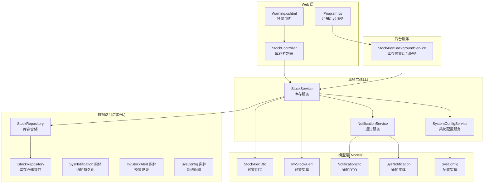
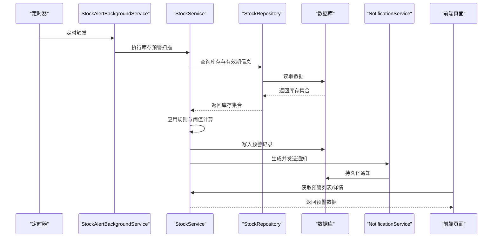
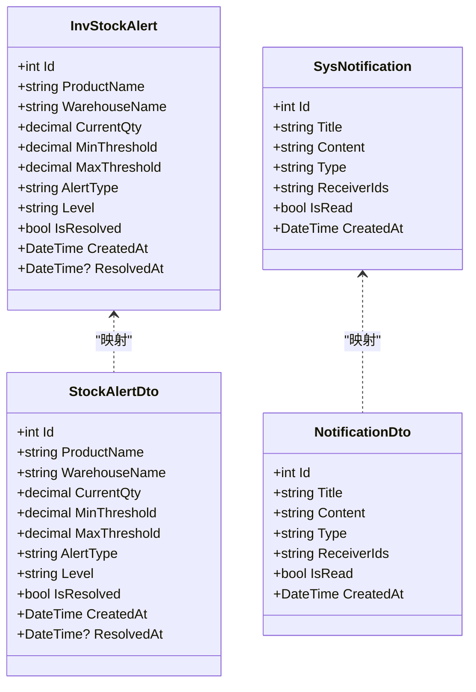
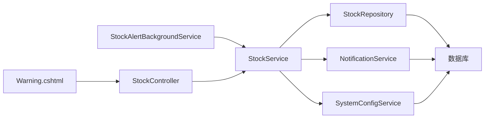

# 库存预警

<cite>
**本文引用的文件**   
- [StockAlertBackgroundService.cs](file://EquipmentIMS.Web/BackgroundServices/StockAlertBackgroundService.cs)
- [StockController.cs](file://EquipmentIMS.Web/Controllers/StockController.cs)
- [Warning.cshtml](file://EquipmentIMS.Web/Views/Stock/Warning.cshtml)
- [StockAlertDto.cs](file://EquipmentIMS.Models/DTOs/StockAlertDto.cs)
- [InvStockAlert.cs](file://EquipmentIMS.Models/Entities/InvStockAlert.cs)
- [InvStockAlertConfiguration.cs](file://EquipmentIMS.DAL/Configurations/InvStockAlertConfiguration.cs)
- [IStockService.cs](file://EquipmentIMS.BLL/Interfaces/IStockService.cs)
- [StockService.cs](file://EquipmentIMS.BLL/Services/StockService.cs)
- [IStockRepository.cs](file://EquipmentIMS.DAL/Interfaces/IStockRepository.cs)
- [StockRepository.cs](file://EquipmentIMS.DAL/Repositories/StockRepository.cs)
- [NotificationService.cs](file://EquipmentIMS.BLL/Services/NotificationService.cs)
- [INotificationService.cs](file://EquipmentIMS.BLL/Interfaces/INotificationService.cs)
- [SysNotification.cs](file://EquipmentIMS.Models/Entities/SysNotification.cs)
- [NotificationDto.cs](file://EquipmentIMS.Models/DTOs/NotificationDto.cs)
- [SystemConfigService.cs](file://EquipmentIMS.BLL/Services/SystemConfigService.cs)
- [ISystemConfigService.cs](file://EquipmentIMS.BLL/Interfaces/ISystemConfigService.cs)
- [SysConfig.cs](file://EquipmentIMS.Models/Entities/SysConfig.cs)
- [Program.cs](file://EquipmentIMS.Web/Program.cs)
</cite>

## 目录
1. [简介](#简介)
2. [项目结构](#项目结构)
3. [核心组件](#核心组件)
4. [架构总览](#架构总览)
5. [详细组件分析](#详细组件分析)
6. [依赖关系分析](#依赖关系分析)
7. [性能考虑](#性能考虑)
8. [故障排查指南](#故障排查指南)
9. [结论](#结论)
10. [附录：配置示例与最佳实践](#附录配置示例与最佳实践)

## 简介
本文件围绕“库存预警”功能，系统化说明规则配置、预警级别与阈值管理、低/高/过期库存预警机制、通知方式与频率、接收人配置、历史记录、处理流程与效果评估，以及后台服务运行机制、定时检查与性能优化策略。文档同时提供可操作的配置示例与最佳实践建议，帮助使用者快速落地并持续优化预警效果。

## 项目结构
库存预警涉及 Web 层（控制器与视图）、后台任务、业务服务、仓储与数据模型等分层模块。整体采用分层架构与依赖注入，通过后台服务周期性扫描库存状态，生成预警记录并通过通知服务触达用户。

图表来源
- [StockAlertBackgroundService.cs](file://EquipmentIMS.Web/BackgroundServices/StockAlertBackgroundService.cs)
- [StockController.cs](file://EquipmentIMS.Web/Controllers/StockController.cs)
- [Warning.cshtml](file://EquipmentIMS.Web/Views/Stock/Warning.cshtml)
- [StockService.cs](file://EquipmentIMS.BLL/Services/StockService.cs)
- [IStockRepository.cs](file://EquipmentIMS.DAL/Interfaces/IStockRepository.cs)
- [StockRepository.cs](file://EquipmentIMS.DAL/Repositories/StockRepository.cs)
- [NotificationService.cs](file://EquipmentIMS.BLL/Services/NotificationService.cs)
- [INotificationService.cs](file://EquipmentIMS.BLL/Interfaces/INotificationService.cs)
- [SystemConfigService.cs](file://EquipmentIMS.BLL/Services/SystemConfigService.cs)
- [ISystemConfigService.cs](file://EquipmentIMS.BLL/Interfaces/ISystemConfigService.cs)
- [InvStockAlert.cs](file://EquipmentIMS.Models/Entities/InvStockAlert.cs)
- [StockAlertDto.cs](file://EquipmentIMS.Models/DTOs/StockAlertDto.cs)
- [SysNotification.cs](file://EquipmentIMS.Models/Entities/SysNotification.cs)
- [NotificationDto.cs](file://EquipmentIMS.Models/DTOs/NotificationDto.cs)
- [SysConfig.cs](file://EquipmentIMS.Models/Entities/SysConfig.cs)
- [Program.cs](file://EquipmentIMS.Web/Program.cs)

章节来源
- [StockAlertBackgroundService.cs](file://EquipmentIMS.Web/BackgroundServices/StockAlertBackgroundService.cs)
- [StockController.cs](file://EquipmentIMS.Web/Controllers/StockController.cs)
- [Warning.cshtml](file://EquipmentIMS.Web/Views/Stock/Warning.cshtml)
- [StockService.cs](file://EquipmentIMS.BLL/Services/StockService.cs)
- [IStockRepository.cs](file://EquipmentIMS.DAL/Interfaces/IStockRepository.cs)
- [StockRepository.cs](file://EquipmentIMS.DAL/Repositories/StockRepository.cs)
- [NotificationService.cs](file://EquipmentIMS.BLL/Services/NotificationService.cs)
- [INotificationService.cs](file://EquipmentIMS.BLL/Interfaces/INotificationService.cs)
- [SystemConfigServiceService.cs](file://EquipmentIMS.BLL/Services/SystemConfigService.cs)
- [ISystemConfigService.cs](file://EquipmentIMS.BLL/Interfaces/ISystemConfigService.cs)
- [InvStockAlert.cs](file://EquipmentIMS.Models/Entities/InvStockAlert.cs)
- [StockAlertDto.cs](file://EquipmentIMS.Models/DTOs/StockAlertDto.cs)
- [SysNotification.cs](file://EquipmentIMS.Models/Entities/SysNotification.cs)
- [NotificationDto.cs](file://EquipmentIMS.Models/DTOs/NotificationDto.cs)
- [SysConfig.cs](file://EquipmentIMS.Models/Entities/SysConfig.cs)
- [Program.cs](file://EquipmentIMS.Web/Program.cs)

## 核心组件
- 后台服务：负责周期性触发库存预警扫描，读取配置、计算阈值、生成预警记录并发送通知。
- 库存服务：封装预警规则判断、阈值计算、历史去重与批量写入逻辑。
- 通知服务：将预警结果转换为通知消息，落库并推送至前端或外部渠道。
- 系统配置服务：提供预警开关、频率、接收人、阈值模板等配置项的读写能力。
- 仓储与实体：提供库存、预警记录、通知、配置的持久化访问。

章节来源
- [StockAlertBackgroundService.cs](file://EquipmentIMS.Web/BackgroundServices/StockAlertBackgroundService.cs)
- [StockService.cs](file://EquipmentIMS.BLL/Services/StockService.cs)
- [NotificationService.cs](file://EquipmentIMS.BLL/Services/NotificationService.cs)
- [SystemConfigService.cs](file://EquipmentIMS.BLL/Services/SystemConfigService.cs)
- [IStockRepository.cs](file://EquipmentIMS.DAL/Interfaces/IStockRepository.cs)
- [StockRepository.cs](file://EquipmentIMS.DAL/Repositories/StockRepository.cs)
- [InvStockAlert.cs](file://EquipmentIMS.Models/Entities/InvStockAlert.cs)
- [SysNotification.cs](file://EquipmentIMS.Models/Entities/SysNotification.cs)
- [SysConfig.cs](file://EquipmentIMS.Models/Entities/SysConfig.cs)

## 架构总览
库存预警的整体运行流程如下：后台服务按配置周期执行；每次执行时从配置中心加载规则与阈值，调用库存服务进行扫描；库存服务根据当前库存、有效期等信息判定是否触发低库存、高库存或过期预警；命中规则后生成预警记录并写入数据库，同时通过通知服务创建通知消息；前端通过控制器与视图展示预警列表与详情，支持人工处理与反馈。

图表来源
- [StockAlertBackgroundService.cs](file://EquipmentIMS.Web/BackgroundServices/StockAlertBackgroundService.cs)
- [StockService.cs](file://EquipmentIMS.BLL/Services/StockService.cs)
- [StockRepository.cs](file://EquipmentIMS.DAL/Repositories/StockRepository.cs)
- [NotificationService.cs](file://EquipmentIMS.BLL/Services/NotificationService.cs)
- [StockController.cs](file://EquipmentIMS.Web/Controllers/StockController.cs)
- [Warning.cshtml](file://EquipmentIMS.Web/Views/Stock/Warning.cshtml)

## 详细组件分析

### 后台服务：库存预警定时扫描
- 职责：在应用启动后注册为后台服务，按固定间隔执行一次库存预警扫描任务。
- 关键行为：
  - 读取系统配置中的预警开关与执行频率。
  - 调用库存服务执行扫描与生成预警。
  - 异常捕获与日志记录，确保任务健壮性。
- 集成点：
  - 通过依赖注入获取库存服务与配置服务。
  - 在 Program 中注册为托管后台服务。

章节来源
- [StockAlertBackgroundService.cs](file://EquipmentIMS.Web/BackgroundServices/StockAlertBackgroundService.cs)
- [Program.cs](file://EquipmentIMS.Web/Program.cs)

### 库存服务：规则与阈值计算
- 职责：实现低库存、高库存、过期库存三类预警的判断逻辑，并进行批量写入与去重。
- 关键行为：
  - 低库存预警：比较当前可用库存与最低安全库存阈值，低于阈值则触发。
  - 高库存预警：比较当前可用库存与最高库存上限阈值，超过上限则触发。
  - 过期库存预警：依据产品有效期或批次到期时间，对已过期或即将过期的库存生成预警。
  - 规则合并：结合仓库维度、品类维度、供应商维度等条件过滤。
  - 历史去重：避免同一周期内重复产生相同预警。
- 输出：
  - 生成预警实体集合，批量写入数据库。
  - 同步生成通知消息，交由通知服务处理。

章节来源
- [StockService.cs](file://EquipmentIMS.BLL/Services/StockService.cs)
- [IStockRepository.cs](file://EquipmentIMS.DAL/Interfaces/IStockRepository.cs)
- [StockRepository.cs](file://EquipmentIMS.DAL/Repositories/StockRepository.cs)
- [InvStockAlert.cs](file://EquipmentIMS.Models/Entities/InvStockAlert.cs)
- [StockAlertDto.cs](file://EquipmentIMS.Models/DTOs/StockAlertDto.cs)

#### 类图：库存预警相关实体与 DTO

图表来源
- [InvStockAlert.cs](file://EquipmentIMS.Models/Entities/InvStockAlert.cs)
- [StockAlertDto.cs](file://EquipmentIMS.Models/DTOs/StockAlertDto.cs)
- [SysNotification.cs](file://EquipmentIMS.Models/Entities/SysNotification.cs)
- [NotificationDto.cs](file://EquipmentIMS.Models/DTOs/NotificationDto.cs)

### 通知服务：消息生成与分发
- 职责：将预警结果转换为通知消息，持久化到数据库，并提供前端展示与外部推送扩展点。
- 关键行为：
  - 根据预警类型与级别生成标题与内容模板。
  - 解析接收人列表（支持多角色或多用户）。
  - 标记未读状态，供前端拉取与标记已读。
- 集成点：
  - 通过 INotificationService 接口被库存服务调用。
  - 与 SysNotification 实体配合完成持久化。

章节来源
- [NotificationService.cs](file://EquipmentIMS.BLL/Services/NotificationService.cs)
- [INotificationService.cs](file://EquipmentIMS.BLL/Interfaces/INotificationService.cs)
- [SysNotification.cs](file://EquipmentIMS.Models/Entities/SysNotification.cs)
- [NotificationDto.cs](file://EquipmentIMS.Models/DTOs/NotificationDto.cs)

### 系统配置服务：规则与阈值管理
- 职责：提供预警相关的系统配置项读写，包括开关、频率、阈值模板、接收人等。
- 关键配置项（概念性说明）：
  - 预警开关：启用/禁用库存预警。
  - 执行频率：后台扫描间隔（分钟）。
  - 低库存阈值：默认最低安全库存值或按品类/仓库覆盖。
  - 高库存阈值：默认最高库存上限值或按品类/仓库覆盖。
  - 过期预警提前天数：用于即将过期预警。
  - 接收人：默认接收人或按规则动态指定。
- 集成点：
  - 通过 ISystemConfigService 接口被库存服务与后台服务调用。
  - 与 SysConfig 实体配合完成持久化。

章节来源
- [SystemConfigService.cs](file://EquipmentIMS.BLL/Services/SystemConfigService.cs)
- [ISystemConfigService.cs](file://EquipmentIMS.BLL/Interfaces/ISystemConfigService.cs)
- [SysConfig.cs](file://EquipmentIMS.Models/Entities/SysConfig.cs)

### 控制器与视图：预警展示与处理
- 控制器：
  - 提供预警列表、详情、处理（如标记已解决）等 API。
  - 支持分页、筛选（仓库、品类、预警类型、级别、是否已解决）。
- 视图：
  - Warning.cshtml 渲染预警列表与操作按钮，支持刷新与跳转详情。
- 交互流程：
  - 前端请求控制器获取预警数据。
  - 控制器调用库存服务返回 DTO 集合。
  - 视图渲染表格与操作区，用户点击处理时提交更新。

章节来源
- [StockController.cs](file://EquipmentIMS.Web/Controllers/StockController.cs)
- [Warning.cshtml](file://EquipmentIMS.Web/Views/Stock/Warning.cshtml)

## 依赖关系分析
- 耦合关系：
  - 后台服务依赖库存服务与配置服务，保持低耦合。
  - 库存服务依赖仓储接口与通知服务，屏蔽底层实现细节。
  - 通知服务与系统配置服务均通过接口解耦，便于替换与测试。
- 外部依赖：
  - 数据库通过仓储层访问，实体与配置由 DAL 配置。
  - 前端通过控制器暴露的 API 消费预警数据。

图表来源
- [StockAlertBackgroundService.cs](file://EquipmentIMS.Web/BackgroundServices/StockAlertBackgroundService.cs)
- [StockService.cs](file://EquipmentIMS.BLL/Services/StockService.cs)
- [StockRepository.cs](file://EquipmentIMS.DAL/Repositories/StockRepository.cs)
- [NotificationService.cs](file://EquipmentIMS.BLL/Services/NotificationService.cs)
- [SystemConfigService.cs](file://EquipmentIMS.BLL/Services/SystemConfigService.cs)
- [StockController.cs](file://EquipmentIMS.Web/Controllers/StockController.cs)
- [Warning.cshtml](file://EquipmentIMS.Web/Views/Stock/Warning.cshtml)

## 性能考虑
- 批量化处理：
  - 批量查询库存与批量写入预警记录，减少数据库往返次数。
- 索引优化：
  - 针对常用筛选字段（仓库、品类、产品、预警类型、是否已解决、创建时间）建立索引，提升查询效率。
- 去重与限流：
  - 同一周期内对相同条件的预警进行去重，避免重复通知与记录膨胀。
- 异步与并发：
  - 后台服务使用独立线程池执行，避免阻塞主请求链路。
- 缓存策略：
  - 对静态配置（如阈值模板、接收人）进行短期缓存，降低频繁读取配置开销。
- 分页与增量：
  - 前端分页加载预警列表；后台可按时间戳增量扫描，减少全量比对。

[本节为通用性能建议，不直接分析具体文件]

## 故障排查指南
- 后台服务未执行：
  - 检查 Program 中后台服务是否正确注册。
  - 确认系统配置中的预警开关与执行频率设置正确。
- 预警未生成：
  - 核对库存阈值配置是否合理（过低或过高导致无法命中）。
  - 查看库存服务日志，确认规则判断与批量写入是否成功。
- 通知未送达：
  - 检查通知服务是否成功持久化通知记录。
  - 确认接收人配置有效且前端能拉取到未读通知。
- 性能问题：
  - 关注数据库慢查询，补充必要索引。
  - 调整后台扫描频率与批处理大小，平衡实时性与资源占用。

章节来源
- [StockAlertBackgroundService.cs](file://EquipmentIMS.Web/BackgroundServices/StockAlertBackgroundService.cs)
- [StockService.cs](file://EquipmentIMS.BLL/Services/StockService.cs)
- [NotificationService.cs](file://EquipmentIMS.BLL/Services/NotificationService.cs)
- [SystemConfigService.cs](file://EquipmentIMS.BLL/Services/SystemConfigService.cs)
- [Program.cs](file://EquipmentIMS.Web/Program.cs)

## 结论
库存预警功能通过后台定时扫描、规则化阈值判断、统一的通知与持久化机制，实现了低库存、高库存与过期库存的全链路预警闭环。借助分层架构与接口解耦，系统在可扩展性与可维护性方面具备良好基础。建议在生产环境完善索引与监控，并结合业务实际持续优化阈值与频率，以提升预警准确率与用户体验。

[本节为总结性内容，不直接分析具体文件]

## 附录：配置示例与最佳实践

### 配置示例（概念性）
- 启用预警与频率：
  - 预警开关：启用
  - 执行频率：每 15 分钟
- 阈值模板：
  - 低库存阈值：默认 50（可按品类/仓库覆盖）
  - 高库存阈值：默认 500（可按品类/仓库覆盖）
  - 过期预警提前天数：7 天
- 接收人：
  - 默认接收人：仓库管理员、采购负责人
  - 高级规则：按品类自动指定品类负责人

[本节为概念性配置示例，不直接分析具体文件]

### 最佳实践
- 分阶段上线：
  - 先以只读模式运行，观察预警命中率与误报率，再逐步开启通知。
- 精细化阈值：
  - 基于历史销量与安全库存策略设定品类级阈值，避免一刀切。
- 定期复盘：
  - 按月评估预警效果（命中率、平均处理时长、积压数量），动态调优。
- 告警降噪：
  - 对高频但影响小的场景进行合并与降级，聚焦关键风险。
- 权限与审计：
  - 限制阈值修改权限，保留变更记录，便于追溯与合规。

[本节为通用实践建议，不直接分析具体文件]